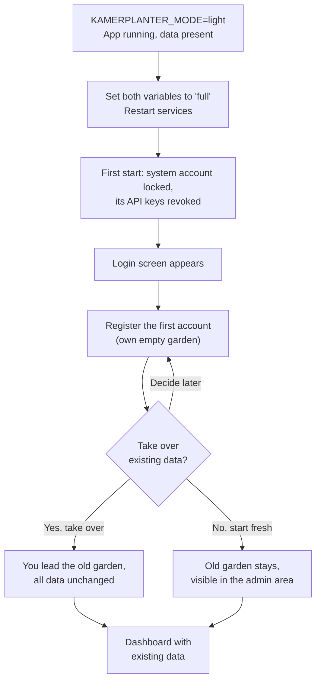

# Light-Modus

Der Light-Modus ist eine Betriebsoption für lokale Kamerplanter-Instanzen, bei der du die App direkt im Browser öffnen kannst — ohne dich einzuloggen oder zu registrieren. Du siehst sofort deine Pflanzen, Aufgaben und den Kalender.

Perfekt für: einen Raspberry Pi im Heimnetzwerk, Docker Compose auf dem Laptop, oder wenn du Kamerplanter einfach ausprobieren möchtest.

---

## Wann solltest du den Light-Modus verwenden?

| Szenario | Light-Modus | Full-Modus |
|----------|:-----------:|:----------:|
| Ich bin allein und brauche kein Login | Empfehlung | Möglich |
| Familie / Haushalt teilt eine Instanz im LAN | Empfehlung | Möglich |
| Ich möchte die App erst ausprobieren | Empfehlung | Möglich |
| Mehrere Personen mit eigenen Konten | Nicht geeignet | Empfehlung |
| Öffentlich erreichbare Instanz (Internet) | **Nicht verwenden** | Empfehlung |
| Gemeinschaftsgarten mit Rollenverwaltung | Nicht geeignet | Empfehlung |

!!! danger "Sicherheitshinweis: Nur für geschlossene Netzwerke"
    Im Light-Modus gibt es keine Authentifizierung. Jeder, der deine Instanz im Netzwerk erreichen kann, hat vollen Lese- und Schreibzugriff. Betreibe den Light-Modus **niemals** auf einer öffentlich erreichbaren Adresse.

    Geeignete Umgebungen: `localhost`, Heimnetzwerk hinter Router-Firewall, Raspberry Pi ohne Port-Forwarding.

---

## Was der Light-Modus verändert

Beim ersten Start im Light-Modus legt das System automatisch einen **System-Benutzer** (Anzeigename: "Gärtner") und einen **System-Garten** (Name: "Mein Garten") an. Alle Pflanzen und Daten gehören diesem Garten.

Die folgende Tabelle zeigt, welche Funktionen je nach Modus sichtbar sind:

| Funktion | Light-Modus | Full-Modus |
|----------|:-----------:|:----------:|
| Login-Screen | Ausgeblendet | Sichtbar |
| Registrierung | Ausgeblendet | Sichtbar |
| Passwort vergessen | Ausgeblendet | Sichtbar |
| Garten-Wechsler (Tenant-Switcher) | Ausgeblendet | Sichtbar |
| Mitgliederverwaltung | Ausgeblendet | Sichtbar |
| Einladungssystem | Ausgeblendet | Sichtbar |
| DSGVO-Einwilligungs-Banner | Ausgeblendet | Sichtbar |
| Datenschutz-Einstellungen | Ausgeblendet | Sichtbar |
| Kontoeinstellungen | Nur Sprache & Erfahrungsstufe | Vollständig |
| Aufgaben-Zuweisung an Personen | Ausgeblendet (nur ein Nutzer) | Sichtbar |
| Onboarding-Wizard | Startet direkt beim ersten Öffnen | Nach Login |
| Pflanzen verwalten | Vollständig | Vollständig |
| Standorte verwalten | Vollständig | Vollständig |
| Pflegeerinnerungen | Vollständig | Vollständig |
| Düngung & Bewässerung | Vollständig | Vollständig |
| Erntemanagement | Vollständig | Vollständig |
| Pflanzenschutz (IPM) | Vollständig | Vollständig |
| Aufgabenplanung | Vollständig | Vollständig |
| Phasensteuerung | Vollständig | Vollständig |
| Stammdaten-Import | Vollständig | Vollständig |

---

## Light-Modus aktivieren

Du aktivierst den Light-Modus über eine einzige Umgebungsvariable in deiner Docker Compose Konfiguration:

```yaml
# docker-compose.yml
services:
  backend:
    environment:
      KAMERPLANTER_MODE: light

  frontend:
    environment:
      VITE_KAMERPLANTER_MODE: light
```

Ein Neustart der Dienste ist nach jeder Änderung erforderlich. Bestehende Daten bleiben dabei erhalten.

!!! note "Standard-Modus"
    Wenn du die Variable nicht setzt, startet Kamerplanter im Full-Modus (`KAMERPLANTER_MODE=full`). Der Full-Modus ist der Standard für Mehrbenutzerbetrieb und SaaS-Installationen.

---

## Modus wechseln

### Upgrade: Light → Full

Du möchtest Kamerplanter mit anderen teilen oder mehrere Konten verwenden? Du kannst jederzeit auf den Full-Modus upgraden.

<!-- diagram-source: src/backend/app/domain/services/mode_switch_service.py — upgrade flow from Light Mode to Full Mode with the take-over dialog -->


1. Setze `KAMERPLANTER_MODE=full` (Backend) und `VITE_KAMERPLANTER_MODE=full` (Frontend) und starte beide Dienste neu.
2. Beim ersten Start im Full-Modus sperrt Kamerplanter das System-Konto des Light-Modus. Es lässt sich danach nicht mehr anmelden, und alles, was im Light-Modus ohne Anmeldung dafür ausgestellt wurde, wird ungültig: API-Schlüssel (`kp_…`) und Kalender-Abo-Links. Deine Pflanzen, Standorte und Pläne bleiben unverändert erhalten.
3. Du siehst den Login-Screen. Registriere dich — dein Konto bekommt wie jedes neue Konto einen eigenen, leeren Garten.
4. Nach der Anmeldung erscheint ein Dialog mit dem, was der alte Garten enthält, zum Beispiel „30 Pflanzen, 3 Standorte“.

**Ja, übernehmen:** Der alte Garten gehört jetzt dir. Du wirst seine Leitung mit allen Verwaltungsrechten, er trägt deinen Namen, und Kamerplanter wechselt direkt in ihn. Die Daten selbst werden dabei nicht verändert oder kopiert, und die Adresse des Gartens bleibt dieselbe. Danach kannst du weitere Mitglieder einladen.

**Nein, neu starten:** Du arbeitest in deinem eigenen leeren Garten weiter. Der alte Garten bleibt mit allen Daten erhalten und ist im Admin-Bereich unter den Mandanten zu finden.

**Später entscheiden:** Der Dialog schließt sich. Er erscheint bei deiner nächsten Anmeldung wieder.

Übernehmen und Ablehnen bestätigst du mit deinem Passwort. Hast du kein Passwort, meldest du dich dafür noch einmal bei deinem Anmeldeanbieter an oder gibst einen Code aus einer E-Mail ein.

Wer den Dialog sieht: der Plattform-Admin, falls es schon einen gibt. Sonst das **erste Konto, das nach dem Umstieg registriert wurde**, dessen E-Mail-Adresse bestätigt ist und das seinen eigenen Garten hat. Konten von vor dem Umstieg, deaktivierte Konten und Service-Konten zählen nicht. Andere Konten sehen den Dialog nicht. Gibt es noch keinen Plattform-Admin, wirst du es mit deiner Entscheidung, egal ob du übernimmst oder ablehnst. <!-- REQ-027 Szenario 5/6, Issue #1855 -->

!!! danger "Registriere dich zuerst, bevor andere die Instanz erreichen"
    Das erste Konto nach dem Umstieg wird Plattform-Admin, also Verwalter der ganzen Installation. Ist die Registrierung offen und erreicht jemand anderes die Instanz vor dir, kann diese Person das sein. Starte deshalb im Full-Modus zuerst nur für dich (zum Beispiel ohne Freigabe nach außen oder mit `REGISTRATION_ALLOWED_DOMAINS` auf deine eigene E-Mail-Domain beschränkt): Registriere dich, bestätige deine E-Mail-Adresse und entscheide über die Übernahme — alle drei Schritte, bevor andere die Instanz erreichen. Es zählt nämlich das früheste Konto mit bestätigter Adresse, nicht das zuerst registrierte: Bestätigt jemand anderes seine Adresse vor dir, ist diese Person das „erste Konto“. Oder lege vorher einen Plattform-Admin an (`python -m app.migrations.add_platform_admin <E-Mail>`): Dann entscheidet nur er. Gab es schon vor dem Umstieg Konten, ist das sogar nötig, denn solche Konten zählen nicht als „erstes Konto“. <!-- REQ-027 §7a SEC-001, Issue #1855 -->

!!! warning "Alle Instanzen gleichzeitig umstellen"
    Stelle Backend, Worker und Frontend in einem Schritt auf `full` um. Laufen Light- und Full-Instanzen gegen dieselbe Datenbank nebeneinander, bedient die Light-Instanz weiter jeden ohne Anmeldung. Im Full-Modus meldet Kamerplanter das System-Konto unabhängig von der Datenbank nie an. <!-- Issue #1855 SEC-006 -->

!!! warning "Externe Zugriffe neu einrichten"
    Home Assistant, ein MCP-Client oder andere Programme, die im Light-Modus einen API-Schlüssel des System-Kontos benutzt haben, bekommen nach dem Upgrade `401`. Lege im Full-Modus einen neuen Schlüssel an, zum Beispiel für ein Service-Konto, und trage ihn dort ein. Ein Kalender-Abo legst du in den Kalender-Einstellungen neu an.

!!! tip "Tipp"
    Wenn du dir unsicher bist, wähle "Ja, übernehmen". Du kannst nachher immer noch Daten löschen — du verlierst aber nichts.

### Downgrade: Full → Light

Du möchtest vom Full-Modus zurück zum Light-Modus wechseln?

!!! warning "Achtung: Nur System-Garten sichtbar"
    Im Light-Modus ist ausschließlich der System-Garten zugänglich. Wenn du im Full-Modus mehrere Gärten oder Nutzerkonten angelegt hast, sind diese im Light-Modus nicht sichtbar. Die Daten gehen **nicht verloren** — sie sind bei einem erneuten Upgrade auf Full wieder vollständig zugänglich.

Ändere beide Umgebungsvariablen auf `light` und starte die Dienste neu. Kamerplanter entsperrt das System-Konto und gibt ihm seinen Garten zurück. Gibt es zu diesem Zeitpunkt andere Konten, schreibt der Start eine Warnung der Stufe `critical` ins Protokoll (`light_mode_start_with_person_accounts`): Im Light-Modus kommt jeder ohne Anmeldung an die Daten des System-Gartens. Du landest direkt auf dem Dashboard ohne Login. Hast du den Garten im Full-Modus übernommen, behält er seinen neuen Namen.

!!! warning "Noch nicht implementiert"
    Künftig wird Kamerplanter einen System-Garten, den ein Admin im Full-Modus gesperrt oder gelöscht hat, beim Downgrade wieder aktivieren oder neu anlegen und ihm alle Stammdaten zuordnen. Bis dahin entsperrst du einen gesperrten Garten vor dem Downgrade selbst im Admin-Bereich. <!-- REQ-027 AK-23, AK-24, Issue #1855 -->

### Roundtrip: Light → Full → Light → Full

Ein vollständiger Hin-und-her-Wechsel ist möglich. Alle Daten bleiben in der Datenbank erhalten. Beim erneuten Upgrade auf Full sperrt Kamerplanter das System-Konto wieder, und der Übernahme-Dialog erscheint erneut — du kannst den Garten noch einmal übernehmen.

---

## Häufige Fragen

??? question "Was passiert, wenn mehrere Personen im LAN gleichzeitig auf die Light-Modus-Instanz zugreifen?"
    Alle Geräte im Netzwerk sehen dieselben Daten und arbeiten als derselbe System-Benutzer. Änderungen einer Person sind sofort für alle anderen sichtbar. Es gibt keine Nutzer-Trennung — das ist beabsichtigt für Familien und Haushalte.

??? question "Kann ich im Light-Modus Backups erstellen?"
    Backups werden unabhängig vom Modus über ArangoDB-Backups oder Docker-Volume-Backups erstellt. Der Modus hat keinen Einfluss auf die Backup-Strategie.

??? question "Mein Netzwerk hat eine öffentliche IP — kann ich den Light-Modus trotzdem nutzen?"
    Nur wenn die Instanz ausschließlich intern erreichbar ist (Firewall blockiert den Port nach außen, kein Port-Forwarding). Wenn die Instanz über das Internet erreichbar ist, verwende immer den Full-Modus mit Authentifizierung.

??? question "Ich habe den Light-Modus aktiviert, aber der Login-Screen erscheint noch. Warum?"
    Stelle sicher, dass du sowohl `KAMERPLANTER_MODE=light` (Backend) als auch `VITE_KAMERPLANTER_MODE=light` (Frontend) gesetzt hast und beide Dienste neu gestartet wurden. Das Frontend-Build liest die Variable beim Start aus — ein Neustart des Frontend-Containers ist erforderlich.

??? question "Darf der KI-Assistent im Light-Modus ein Cloud-Sprachmodell nutzen?"
    Nein. Im Light-Modus gibt es keine Einwilligungen, also darf keine KI-Frage an einen Cloud-Anbieter gehen. Welches Sprachmodell antwortet, legst du am Knowledge Service mit `LLM_PROVIDER` fest — nicht am Backend.

    Kamerplanter prüft diese Kombination **nicht**: Läuft der Knowledge Service mit `LLM_PROVIDER=anthropic`, gehen auch im Light-Modus alle KI-Fragen an Anthropic. Nutze im Light-Modus `LLM_PROVIDER=ollama` oder `LLM_PROVIDER=openai_compatible` mit einer `LLM_API_URL` in deinem eigenen Netz — oder schalte die KI-Funktionen mit `AI_FEATURES_ENABLED=false` ab. Details: [KI-Provider einrichten](ai-providers.md).

??? question "Kann ich im Light-Modus die Sprache und Erfahrungsstufe ändern?"
    Ja. Die **Kontoeinstellungen** sind im Light-Modus eingeschränkt verfügbar: Du kannst Sprache, Zeitzone und Erfahrungsstufe anpassen. Passwort, Sessions und Datenschutz-Einstellungen sind ausgeblendet, weil sie im Light-Modus nicht relevant sind.

---

## Siehe auch

- [Onboarding-Wizard](onboarding.md) — Erste Schritte nach dem Start
- [Standorte & Substrate](locations-substrates.md) — Standorte verwalten
- [Dashboard](dashboard.md) — Überblick über deine Pflanzen
