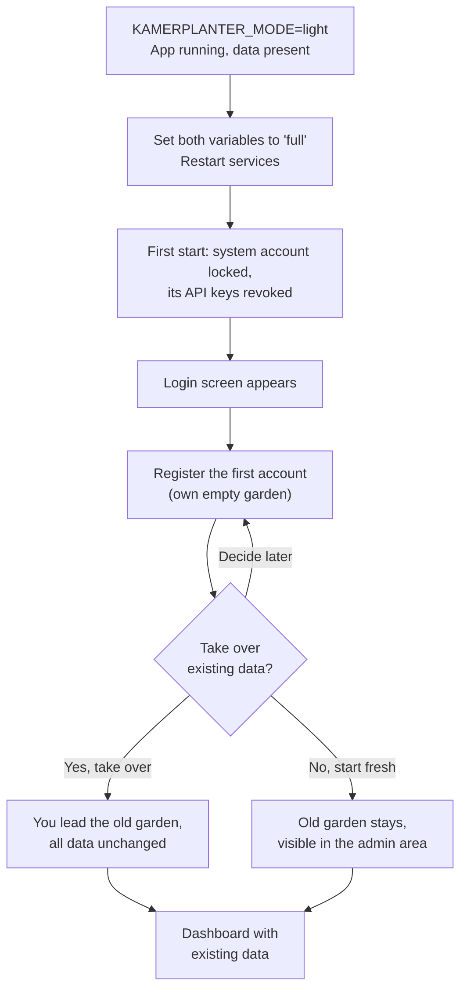

# Light Mode

Light Mode is an operating option for local Kamerplanter instances where you can open the app directly in your browser — without logging in or registering. You immediately see your plants, tasks, and calendar.

Perfect for: a Raspberry Pi on your home network, Docker Compose on your laptop, or just trying Kamerplanter out.

---

## When Should You Use Light Mode?

| Scenario | Light Mode | Full Mode |
|----------|:----------:|:---------:|
| I am the only user and don't need a login | Recommended | Possible |
| Family / household shares one instance on the LAN | Recommended | Possible |
| I want to try the app first | Recommended | Possible |
| Multiple people with separate accounts | Not suitable | Recommended |
| Publicly accessible instance (internet) | **Do not use** | Recommended |
| Community garden with role management | Not suitable | Recommended |

!!! danger "Security Warning: Closed Networks Only"
    Light Mode has no authentication. Anyone who can reach your instance on the network has full read and write access. Never run Light Mode on a publicly accessible address.

    Suitable environments: `localhost`, home network behind router firewall, Raspberry Pi without port forwarding.

---

## What Light Mode Changes

On first startup in Light Mode, the system automatically creates a **System User** (display name: "Gardener") and a **System Garden** (name: "My Garden"). All plants and data belong to this garden.

The table below shows which features are visible in each mode:

| Feature | Light Mode | Full Mode |
|---------|:----------:|:---------:|
| Login screen | Hidden | Visible |
| Registration | Hidden | Visible |
| Forgot password | Hidden | Visible |
| Garden switcher (tenant switcher) | Hidden | Visible |
| Member management | Hidden | Visible |
| Invitation system | Hidden | Visible |
| GDPR consent banner | Hidden | Visible |
| Privacy settings | Hidden | Visible |
| Account settings | Language & experience level only | Full |
| Task assignment to people | Hidden (single user) | Visible |
| Onboarding wizard | Starts directly on first open | After login |
| Manage plants | Full | Full |
| Manage locations | Full | Full |
| Care reminders | Full | Full |
| Fertilization & watering | Full | Full |
| Harvest management | Full | Full |
| Pest management (IPM) | Full | Full |
| Task planning | Full | Full |
| Phase control | Full | Full |
| Master data import | Full | Full |

---

## Enabling Light Mode

You enable Light Mode with a single environment variable in your Docker Compose configuration:

```yaml
# docker-compose.yml
services:
  backend:
    environment:
      KAMERPLANTER_MODE: light

  frontend:
    environment:
      VITE_KAMERPLANTER_MODE: light
```

A restart of the services is required after every change. Existing data is preserved.

!!! note "Default Mode"
    If you do not set the variable, Kamerplanter starts in Full Mode (`KAMERPLANTER_MODE=full`). Full Mode is the default for multi-user operation and SaaS installations.

---

## Switching Modes

### Upgrade: Light → Full

Want to share Kamerplanter with others or use multiple accounts? You can upgrade to Full Mode at any time.

<!-- diagram-source: src/backend/app/domain/services/mode_switch_service.py — upgrade flow from Light Mode to Full Mode with the take-over dialog -->


1. Set `KAMERPLANTER_MODE=full` (backend) and `VITE_KAMERPLANTER_MODE=full` (frontend) and restart both services.
2. On the first start in Full Mode, Kamerplanter locks the Light Mode system account. It can no longer be signed into, and everything issued for it without sign-in in Light Mode stops working: API keys (`kp_…`) and calendar subscription links. Your plants, locations, and plans stay exactly as they are.
3. You see the login screen. Register — like every new account, yours gets its own empty garden.
4. After signing in, a dialog shows what the old garden holds, for example "30 plants, 3 sites".

**Yes, take over:** The old garden is now yours. You become its lead with all management rights, it carries your name, and Kamerplanter switches straight into it. The data themselves are neither changed nor copied, and the garden's address stays the same. You can then invite additional members.

**No, start fresh:** You keep working in your own empty garden. The old garden stays with all its data and can be found in the admin area under tenants.

**Decide later:** The dialog closes. It appears again the next time you sign in.

You confirm taking over and declining with your password. If you have no password, you sign in once more at your sign-in provider or enter a code from an e-mail.

Who sees the dialog: the platform admin, if one exists already. Otherwise the **first account registered after the switch** whose e-mail address is confirmed and that has its own garden. Accounts from before the switch, deactivated accounts and service accounts do not count. Other accounts do not see the dialog. If there is no platform admin yet, your decision makes you one, whether you take over or decline. <!-- REQ-027 Szenario 5/6, Issue #1855 -->

!!! danger "Register first, before anybody else can reach the instance"
    The first account after the switch becomes platform admin, the administrator of the whole installation. If registration is open and somebody else reaches the instance before you, that person can be the one. So start in Full Mode for yourself only first (for example without exposing it, or with `REGISTRATION_ALLOWED_DOMAINS` limited to your own e-mail domain), register and decide the take-over. Or create a platform admin beforehand (`python -m app.migrations.add_platform_admin <email>`): then only that admin decides. If accounts existed before the switch, this is even required, because such accounts do not count as "the first account". <!-- REQ-027 §7a SEC-001, Issue #1855 -->

!!! warning "Switch all instances at once"
    Switch backend, worker, and frontend to `full` in one step. If light and full instances run side by side against the same database, the light instance keeps serving everybody without sign-in. In Full Mode, Kamerplanter never signs the system account in, whatever the database says. <!-- Issue #1855 SEC-006 -->

!!! warning "Set up external access again"
    Home Assistant, an MCP client, or any other program that used an API key of the system account in Light Mode gets `401` after the upgrade. Create a new key in Full Mode, for example for a service account, and enter it there. Create a calendar subscription again in the calendar settings.

!!! tip "Tip"
    If you are unsure, choose "Yes, take over". You can always delete data afterwards — but you won't lose anything.

### Downgrade: Full → Light

Want to switch back from Full Mode to Light Mode?

!!! warning "Attention: Only the System Garden is Visible"
    In Light Mode only the system garden is accessible. If you created multiple gardens or user accounts in Full Mode, they are not visible in Light Mode. The data is **not lost** — it is fully accessible again when you next upgrade to Full.

Change both environment variables to `light` and restart the services. Kamerplanter unlocks the system account and gives it its garden back. If other accounts exist at that point, the start writes a `critical` log line (`light_mode_start_with_person_accounts`): in Light Mode everybody reaches the system garden's data without sign-in. You land directly on the dashboard without login. If you took the garden over in Full Mode, it keeps its new name.

!!! warning "Not yet implemented"
    Kamerplanter will reactivate or recreate a system garden that an admin suspended or deleted in Full Mode on the downgrade, and assign all master data to it. Until then, reactivate a suspended garden yourself in the admin area before the downgrade. <!-- REQ-027 AK-23, AK-24, Issue #1855 -->

### Round Trip: Light → Full → Light → Full

A full back-and-forth switch is possible. All data remains in the database. When you next upgrade to Full, Kamerplanter locks the system account again and the take-over dialog appears again — you can take the garden over once more.

---

## Frequently Asked Questions

??? question "What happens if multiple people in the LAN access the Light Mode instance at the same time?"
    All devices on the network see the same data and act as the same system user. Changes made by one person are immediately visible to everyone else. There is no user separation — this is intentional for families and households.

??? question "Can I create backups in Light Mode?"
    Backups are created independently of the mode via ArangoDB backups or Docker volume backups. The mode has no influence on the backup strategy.

??? question "My network has a public IP address — can I still use Light Mode?"
    Only if the instance is exclusively reachable internally (firewall blocks the port externally, no port forwarding). If the instance is reachable via the internet, always use Full Mode with authentication.

??? question "I enabled Light Mode but the login screen still appears. Why?"
    Make sure you have set both `KAMERPLANTER_MODE=light` (backend) and `VITE_KAMERPLANTER_MODE=light` (frontend) and restarted both services. The frontend build reads the variable at startup — a restart of the frontend container is required.

??? question "May the AI assistant use a cloud language model in Light Mode?"
    No. Light Mode has no consents, so no AI question may reach a cloud provider. Which language model answers is set on the Knowledge Service with `LLM_PROVIDER` — not on the backend.

    Kamerplanter does **not** check this combination: if the Knowledge Service runs with `LLM_PROVIDER=anthropic`, every AI question goes to Anthropic, in Light Mode too. In Light Mode, use `LLM_PROVIDER=ollama` or `LLM_PROVIDER=openai_compatible` with an `LLM_API_URL` inside your own network — or turn the AI features off with `AI_FEATURES_ENABLED=false`. Details: [AI Provider Setup](ai-providers.md).

??? question "Can I change the language and experience level in Light Mode?"
    Yes. **Account Settings** are available in a limited form in Light Mode: you can adjust language, timezone, and experience level. Password, sessions, and privacy settings are hidden because they are not relevant in Light Mode.

---

## See Also

- [Onboarding Wizard](onboarding.md) — First steps after startup
- [Locations & Substrates](locations-substrates.md) — Manage locations
- [Dashboard](dashboard.md) — Overview of your plants
