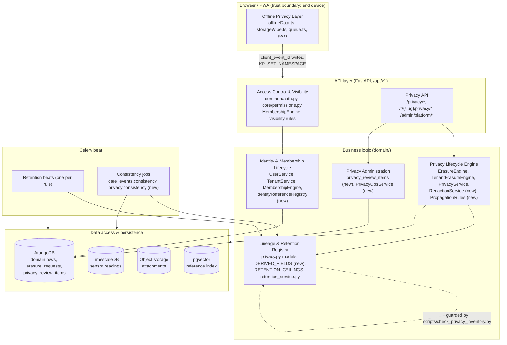
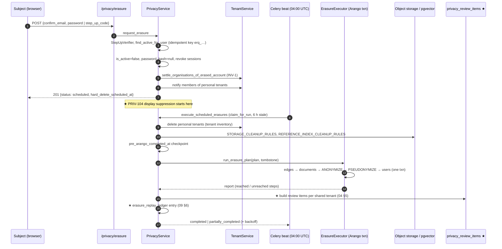
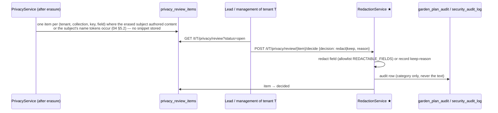

# SPEC-01 — Privacy Architecture

```
Package: spec/privacy (GDPR Privacy Architecture and Implementation Specification)
Status: Draft for implementation — legal review pending (see decision-log.md, LEG-*)
Version: 1.0
Date: 2026-11-09
Measured against: develop 24d1c2988 (after fast-forward; wave 9 of REQ-053 merged)
Language: English (specification); analysis notes may be German
Requirement IDs: PRIV-001 … PRIV-029 (this document)
```

This document is the entry point of the privacy architecture. It fixes the vocabulary, the
components, their responsibilities and the trust boundaries. Every other document of the
package refines one component. The README explains the reading order and the traceability
model (requirement → acceptance criterion → test).

RFC 2119 keywords (MUST, MUST NOT, SHOULD, SHOULD NOT, MAY) are normative. Statements
marked **[verified]** were read in the code or the specs at the commit above; statements
marked **[proposal]** are this package's design; statements marked **[legal]** need review by
qualified legal counsel or the data protection officer (DPO) and are tracked as `LEG-nn` in
the decision log.

---

## 1. Scope and baseline

### 1.1 What exists today (verified summary)

Kamerplanter already has a substantial GDPR implementation. The package builds on it and
does not replace it:

| Area | Where it lives | Status |
|------|----------------|--------|
| Erasure inventory (Art. 17) | `ErasureEngine.DELETE_STEPS`, `ANONYMIZE_COLLECTIONS`, `PSEUDONYMIZE_AUDIT_COLLECTIONS`, `STORAGE_CLEANUP_RULES`, `REFERENCE_INDEX_CLEANUP_RULES`, `EXCLUDED_USER_REFERENCES` in `src/backend/app/domain/engines/erasure_engine.py` | implemented, guarded by `scripts/check_privacy_inventory.py` (R1–R6) and `tests/unit/domain/engines/test_privacy_engines.py` |
| Disclosure inventory (Art. 15/20) | `DataExportEngine.USER_DATA_MANIFEST`, `EXCLUDED_FROM_DISCLOSURE` in `domain/engines/data_export_engine.py` | implemented; reciprocity with the erasure inventory is guarded (REQ-025 §3.1.4) |
| Tenant erasure | `TenantErasureEngine.INVENTORY` in `domain/engines/tenant_erasure_engine.py`; executor `data_access/arango/tenant_erasure_executor.py` | implemented, 90-day grace (`RETENTION_TENANT_ERASURE_GRACE_DAYS`), cancel route, retry with backoff |
| Account erasure flow | `PrivacyService.request_erasure` / `erase_account` / `_finalize_erasure` in `domain/services/privacy_service.py`; API `api/v1/privacy/router.py` | implemented: step-up, immediate soft-close, 90-day hard delete (R-01), claim/retry, `partially_completed` state, no cancel |
| Retention (NFR-011) | one Celery beat task per category in `app/tasks/retention_tasks.py`; ceilings/floors in `app/config/settings.py` (`RETENTION_CEILINGS`) | implemented for R-01…R-07, R-16…R-18 (deleted tenants only), R-25, R-26, R-38; R-14/R-15/R-19…R-21/R-27…R-40 not implemented |
| Consent | `ConsentEngine.PURPOSES` (`domain/engines/consent_engine.py`), `ConsentGuard` (`domain/guards/consent_guard.py`) | implemented, service-layer guard, no middleware |
| Two replacement forms for an erased subject | marker `_anonymized` (`ANONYMIZED_MARKER`) for shared-tenant rows; tombstone `anon_<16hex>` (`compute_tombstone_hash`, `sha256(user_key + ERASURE_TOMBSTONE_SALT)[:16]`) for statutory and audit rows | implemented; the marker constant is copied four times (`erasure_engine.py`, `models/care_event.py`, `attachment_repository.py`, `tenant_export_engine.py:ANONYMIZED_ACCOUNT`), the tombstone regex twice as a literal |
| Care log (REQ-053 §13) | `domain/models/care_event.py`, `domain/services/care_event_service.py`, `care_event_repository.py`; role-dependent `performed_by` filter (`MembershipEngine.can_filter_care_log_by_member`); lead-only redaction `POST /care-events/{key}/redact` | implemented (WP 4.3, 8.1, 8.3, 9.3) |
| Offline (REQ-053 wave 9, UI-NFR-012 v2.4) | `src/frontend/src/sw.ts`, `pwa/cachePolicy.ts`, `features/gardenPlanner/offline/{db,queueDb,queue,sync,retention}.ts`, `pwa/offlineData.ts` | implemented: IndexedDB `kp-plan-cache` / `kp-write-queue`, Cache Storage `kp:{user}:{tenant}` (latent, backend sends `no-store`), kill switch `PWA_CACHING_ENABLED`, replay idempotency `client_event_id` (v0106) |

### 1.2 What this package adds

The gaps the repository analysis found (see `02-personal-data-inventory.md` §6 and the
decision log) fall into six groups; each becomes a component responsibility below:

1. **Identity is not separated from history.** Every domain row stores the raw `users._key`
   in ~30 fields with no declared attribution role; display names are resolved ad hoc by
   AQL `DOCUMENT()` joins; an erased actor renders as the hard-coded German string
   `"anonymisiert"` in one place and as `null` in another. A pseudonym (`anon_…`) can leak
   from a statutory row into the care log (#2770 item 1).
2. **Erasure stops at the key.** Account erasure never clears content free text (diary text,
   care-event `summary`/`material`, bed-template names, location names, audit summaries,
   captions, original file names). Redaction exists only for care events, only for leads,
   and only by hand without a discoverable list of affected rows (#2517).
3. **Membership end has no privacy semantics.** Leaving a tenant deletes the membership row
   and clears task assignments; every attribution of the former member stays visible to the
   tenant indefinitely (until account erasure or the 5-year care-event retention).
4. **Legal bases are applied uniformly.** Statutory retention (CanG, PflSchG §11) is applied
   to every tenant, including hobby gardens that carry no record-keeping duty; the care log
   inherits performer identities from statutory rows (purpose change, Art. 6(4)); employee
   and volunteer contexts are not distinguished (Art. 88 GDPR, §26 BDSG).
5. **No privacy administration.** There is no privacy-operation audit trail, no review queue,
   no monitoring of incomplete erasures beyond log lines, no per-tenant view of what an
   erasure left behind.
6. **Offline data outlives the account.** The write buffer survives a dead session; an account
   erased on another device leaves entries on this device for up to 365 days; logout does not
   await the wipe; several `localStorage` keys holding a `user_key` or an e-mail address are
   never cleared.

### 1.3 Out of scope

- Writing the record of processing activities (Art. 30) or the DPIA itself — this package
  delivers the technical input (`02`, `06`, `11`), not the organisational documents.
- Changing REQ-049's role model (viewer/grower/lead + `management`/`technical`). The package
  adds purpose-specific **visibility rules** on top of it, not new roles.
- Plant Identity / Plant Social (REQ-055) — not implemented; its privacy rows (NFR-011
  R-28…R-37) are referenced but not redesigned.

---

## 2. Vocabulary

| Term | Definition in this package |
|------|----------------------------|
| **Subject** | A natural person whose data is processed: an account holder, a former account holder, a third party named in free text (`performed_by_label`), a person shown on a photo. |
| **Account reference** | A field holding `users._key` (shape `user_key`, `*_user_key`, `*_by_key`, `*_by`, `owner_user_key`). REQ-025 §3.1.3 rule 5 requires every such field to be in the erasure inventory or in `EXCLUDED_USER_REFERENCES`. |
| **Attribution role** | *Why* an account reference exists on a row: `performed_by` (did the activity), `created_by` (wrote the record), `confirmed_by` (confirmed a task/event), `modified_by` (changed the record), `assigned_to`, `owner`, `actor` (audit), `recipient`, `subject_of`. Defined in §4.1. |
| **Identifiable personal data** | A row that names a living person directly (display name, e-mail, raw `user_key` of an existing account) or indirectly through content the controller can link. |
| **Pseudonymised data** | Art. 4(5): the account reference is replaced by a value (`anon_<16hex>`) that cannot be attributed without additional information kept separately (`ERASURE_TOMBSTONE_SALT`, the mapping of key → person). Rows of one person stay **linkable** to each other. Pseudonymised data is personal data. |
| **Anonymised data** | The row no longer permits identification by any means reasonably likely to be used (Recital 26). The marker `_anonymized` is **not** proof of anonymisation: the row is anonymised only if no other stored attribute (free text, photo, co-occurring data) permits identification. |
| **Domain history without personal attribution** | A row whose account references are `null` or the marker and whose free text has been reviewed or redacted — what the tenant keeps for agronomic purposes (crop rotation, bed history). |
| **Tombstone** | The pseudonym `anon_<16hex>`; also the `erasure_requests` row that survives the account. |
| **Marker** | The literal `_anonymized` written into an account-reference field of a retained shared row. |
| **Redaction** | Replacing a free-text value by the literal `[redacted]` (code `REDACTED` in `models/care_event.py`) and recording who, when and why. |
| **Shared tenant** | A tenant with, or that may acquire, more than one member (`tenant_type: organization`, or a personal tenant with invitees). REQ-049 P3 treats `tenant_type` as a display property; this package follows REQ-025 §3.1.3, which does branch on it for erasure. |
| **Statutory record** | A row kept under Art. 6(1)(c) because a law requires it: `harvest_batches` / `quality_assessments` (CanG, 5 years, NFR-011 R-16), `treatment_applications` (PflSchG §11, 3 years, R-17), `inspections` (R-18). Whether the duty applies to a given tenant is a **[legal]** question (LEG-03). |
| **Privacy operation** | A long-running, retryable change driven by a data-subject right or a retention rule: account erasure, tenant erasure, export, redaction batch, retention sweep, migration backfill. |

---

## 3. Architecture overview

### 3.1 Component map

The decomposition follows the task's proposal with one change: *Data Lineage and Retention
Management* is split into a declarative **registry** (lineage + retention metadata, pure
code, guarded) and the existing **retention beats** (Celery). This matches the repository's
own pattern — "the inventory is the code, guarded by a script" (REQ-025 §3.1) — and avoids a
new runtime service. No microservice, no new datastore, no middleware is introduced.



### 3.2 Responsibilities

| Component | Owns | Does not own | Refined in |
|-----------|------|--------------|------------|
| **Identity & Membership Lifecycle (IML)** | account states (`active` → `closed` → `erased`), membership states, the *attribution role* of every account reference (`IdentityReferenceRegistry`), display-name resolution for all API responses (`resolve_display`), the rendering states `member`, `former_member`, `erased`, `third_party`, `system`, `service_account` | deleting or rewriting rows (PLE), deciding who may see a name (ACV) | `03-account-and-membership-lifecycle.md`, `08-api-and-data-model.md` §2 |
| **Privacy Lifecycle Engine (PLE)** | the erasure plan and its execution, anonymisation and pseudonymisation rules, redaction (manual and cascading), propagation to derived rows, idempotency, retry, partial-failure handling, the erasure replay ledger for backup restores | retention periods (REG), UI (PADM) | `03`, `04-anonymization-and-redaction.md`, `09-migrations-and-backfills.md` |
| **Lineage & Retention Registry (REG)** | declarative metadata: which field is derived from which (`DERIVED_FIELDS`), which rows are statutory, the retention ceilings/floors, the redactable-field allowlist, the tombstone-allowed collections; guard scripts that keep the registries complete | execution (PLE, beats) | `02-personal-data-inventory.md`, `06-retention-and-legal-basis.md` |
| **Access Control & Visibility (ACV)** | role gates (existing), *visibility rules* for personal attribution (performer/creator/confirmer), purpose-specific permissions (`privacy.review`, `privacy.redact`, `attribution.filter`), the audit row for every privacy-sensitive read (bulk export with names) | role definitions (REQ-049) | `05-access-and-visibility.md` |
| **Privacy Administration (PADM)** | the review queue (`privacy_review_items`), lead/management UI to see what an erasure left in their tenant and decide (redact / keep with reason), DSAR status, monitoring of incomplete privacy operations, exception documentation | the rules themselves | `04`, `05`, `08`, `12-implementation-roadmap.md` |
| **Offline Privacy Layer (OPL)** | everything stored on the end device: namespaces, cache lifecycle, write-queue lifecycle, session isolation, revocation handling, shared-device mode | server-side dedupe (`client_event_writes.py`, PLE) | `07-offline-privacy.md` |

### 3.3 Why not a separate privacy service or middleware

- REQ-025 §3.7 already decided against a consent middleware; the consent guard is a
  service-layer call. The same reasoning holds for visibility: the information needed
  (role, scope, attribution role of the field, membership state of the referenced person)
  is only available inside the service, not at the HTTP edge.
- All privacy operations already run as Celery tasks with their own state documents
  (`erasure_requests`, `tenant_erasure_records`, `data_export_requests`). A new "engine
  service" would duplicate claim/retry/backoff logic that exists in
  `PrivacyService._finalize_erasure` and `TenantService._run_tenant_erasure`.
- The 5-layer rule (NFR-001) and the ownership predicate (#2107, `*, tenant_key: str`) are
  kept: every new service method that loads by key and writes takes `tenant_key`.

---

## 4. Identity separation

### 4.1 Attribution roles

**PRIV-001** Every account-reference field MUST be registered with exactly one attribution
role. The registry (`IdentityReferenceRegistry`, see `08` §2) is derived from the existing
erasure inventory — the `AnonymizationRule` / `PseudonymizationRule` / `ErasureStep` /
`ErasureExclusion` entries gain an `attribution` attribute — so that there is still one list
(REQ-025 §3.1, "no second copy"). The guard `scripts/check_privacy_inventory.py` gains rule
R7: every account-shaped field has an attribution.

| Role | Meaning | Required for | Examples [verified] |
|------|---------|--------------|---------------------|
| `performed_by` | the person who carried the activity out | domain function (who watered), accountability inside the tenant, statutory record (applicator) | `care_events.performed_by_user_key`, `harvest_batches.harvested_by_key`, `treatment_applications.applied_by_key`, `inspections.inspected_by_key`, `quality_assessments.assessed_by_key` |
| `performed_for` | the member on whose behalf (proxy) | domain function | `care_events.performed_for_user_key` |
| `created_by` | the author of the record | own-row correction (`care_event_service.py` author check), Art. 15 attribution, audit | `care_events.created_by`, `plant_diary_entries.created_by`, `task_comments.created_by`, `garden_objects.created_by`, `bed_templates.created_by`, `attachments.created_by`, `manual_overrides.created_by` |
| `confirmed_by` | who confirmed a task/event | accountability; today **not stored separately** — `CareConfirmation` has no actor field, the derived care event's `performed_by_user_key` stands in | (none; see `03` §4.3) |
| `modified_by` | who last changed / voided / redacted | audit, correction rights | `care_events.voided_by`, `care_events.redacted_by`, `sites.plan.plan_updated_by`, `weather_source_configs.updated_by` |
| `assigned_to` | responsibility | domain function | `tasks.assigned_to_user_key`, `location_assignments` |
| `owner` | ownership of a container | authorisation | `tenants.owner_user_key` |
| `actor` | who performed an administrative/security action | Art. 32 audit | `security_audit_log.actor_user_key`, `garden_plan_audit.user_key`, `mcp_audit_log.service_account_key`, `ai_audit_log.user_key` |
| `recipient` | to whom something is addressed | delivery | `notifications.user_key`, `invitations.accepted_by_user_key` |
| `subject_of` | the person the record is about | the right itself | `erasure_requests.user_key`, `consent_records.user_key`, `memberships.user_key` |

**PRIV-002** The roles MUST NOT be treated as interchangeable. In particular:
- a `created_by` MUST NOT be copied into a `performed_by` (or the reverse) by a backfill,
  consistency job or import; the mapper MUST leave the target `null` when the source has no
  field of the same role;
- a `confirmed_by` MUST be derived from the authenticated caller of the confirmation, never
  from the task's `assigned_to_user_key`;
- a `performed_by` MAY legitimately differ from `created_by` (proxy entry, correction by a
  lead): both are kept, and only `created_by` grants own-row correction rights.

**PRIV-003** [verified gap → requirement] The confirmation paths MUST store the same actor
rule. Today REST and notification store the caller, the task-queue bridge
(`care_reminder_service.record_care_task_completion`, called from
`api/v1/tasks/tenant_router.py` without a user) and MCP (`mcp_server/tools/care.py`) store
`null`. The rule is: `performed_by_user_key = authenticated principal` (a service account is
a principal, rendered as `service_account`); `created_by = authenticated principal`.
(#2770 item 2; legal visibility decision in LEG-05 does not change *what* is stored, only
*who sees it*.)

### 4.2 Required vs optional attribution

**PRIV-004** For each attribution the registry MUST state whether it is `required` (the
function or a legal duty needs it) or `optional` (kept for convenience). Defaults:

| Attribution | Class | Reason |
|-------------|-------|--------|
| `performed_by` on statutory rows | required while the statutory duty applies to the tenant (LEG-03) | PflSchG §11(2) record content (applicator) — **[legal]** whether the *name* must stay legible for the full period (LEG-04) |
| `performed_by` on care events, watering, feeding | optional | domain history needs *that* the bed was watered, not *who*; accountability is a tenant interest (Art. 6(1)(f), balancing in `06` §4) |
| `created_by` | optional, but needed for own-row correction and Art. 15 attribution while the account exists | — |
| `actor` on security audit | required for 730 days | Art. 32, Art. 5(2) |
| `actor` on `garden_plan_audit` | optional | tenant-internal change log; one year |
| `assigned_to`, `owner`, `recipient`, `subject_of` | required while the relationship exists; deleted or replaced when it ends | — |

**PRIV-005** An `optional` attribution MUST be removable without breaking the function: every
reader MUST handle `null`, the marker and a missing user document identically (render state
`erased`, see §4.3).

### 4.3 One display-resolution path

**PRIV-006** All API responses that show a person for an account reference MUST go through
one resolver (`IdentityReferenceRegistry.resolve_display`, `08` §2.3) that returns a
`PersonRef` with `state ∈ {member, former_member, erased, third_party, system, service_account}`
and `display_name` only when the viewer may see it (`05`). Today's AQL joins
(`DOCUMENT(CONCAT(@users, key)).display_name` in `care_event_repository.py` and
`garden_plan_repository.py`) remain allowed as the *lookup*, but the *rendering decision*
MUST be made in one function.

**PRIV-007** The backend MUST NOT emit a localised word for an erased person. The current
literal `PERFORMED_BY_ANONYMISED = "anonymisiert"` (`models/care_event.py`) is kept for one
compatibility cycle in the string field and accompanied by `performed_by_kind` (see `08`
§3.1); the frontend renders by kind through i18n (`enums.personRef.<state>`).

**PRIV-008** A missing user document (account hard-deleted) and the marker MUST render the
same (`erased`). A tombstone (`anon_…`) outside the allowlisted statutory/audit collections
MUST be treated as a defect (reported by the consistency job, `04` §6) and rendered `erased`.

---

## 5. Privacy lifecycle

### 5.1 Subject lifecycle

```mermaid
stateDiagram-v2
    [*] --> Active: registration (personal tenant auto-created)
    Active --> Closed: POST /privacy/erasure or DELETE /users/me<br/>(step-up; is_active=false, password_hash=null, sessions revoked,<br/>organisations settled, members notified)
    Closed --> Erased: retention.execute_scheduled_erasures<br/>(R-01, default 90 d; admin path immediate)
    Erased --> Erased: retry (partially_completed → backoff 1,2,4,7 d, escalation at 5)
    Erased --> [*]: erasure_requests purged (R-06, 3 y, only if user_key is a tombstone)

    note right of Closed
      No cancel route (verified).
      Display name still resolvable for up to 90 d
      → PRIV-104 suppresses it at Closed.
    end note
    note right of Erased
      users row removed; shared rows carry _anonymized;
      statutory/audit rows carry anon_<hash>;
      free text reviewed via privacy_review_items (new).
    end note
```



### 5.2 Membership lifecycle (per tenant)

```mermaid
stateDiagram-v2
    [*] --> Invited: invitation (e-mail or link)
    Invited --> Member: accept (joined_at)
    Member --> Member: role / scope change (security_audit_log)
    Member --> Former: leave / remove / admin remove<br/>(membership row deleted; task assignee cleared;<br/>calendar feeds deleted; INV-1 guard)
    Former --> Member: rejoin (new membership, new joined_at)
    Former --> Suppressed: RETENTION_FORMER_MEMBER_NAME_DAYS elapsed<br/>(display state former_member; key kept) [proposal, LEG-06]
    Member --> Erased: account erasure (membership deleted, rows → marker)
    Former --> Erased: account erasure
    Suppressed --> Erased: account erasure
```

**PRIV-009** The three ends of a relationship are distinct and MUST stay distinct:
*membership end* (the person still exists and may rejoin; attribution is suppressed for
other members after a period, never deleted), *account closure* (no login, name hidden,
data intact for the grace period), *account erasure* (rows deleted, marked or
pseudonymised; free text reviewed). `03` specifies each.

### 5.3 Data lifecycle per retention class

| Class | Rows | At account erasure | At tenant erasure | At retention end | Spec |
|-------|------|--------------------|-------------------|------------------|------|
| `ephemeral` | sessions, tokens, preferences, notifications, restrictions, personal exports | deleted | deleted | deleted | `06` |
| `shared_history` | care events, diary, tasks, comments, garden objects, bed templates, attachments, audit of plan | account refs → marker; free text → review queue | deleted | care events: free text redacted after 5 y (R-25) | `04`, `06` |
| `statutory` | harvest batches, quality assessments, treatment applications, inspections — **only in tenants with a record-keeping duty (LEG-03)** | key → tombstone, display name cleared (today); **[legal]** LEG-04 | kept pseudonymised until the statutory end | deleted | `06` |
| `audit` | security audit, erasure requests, consent records, MCP audit | key → tombstone | security audit kept, others per rule | deleted (730 d / 3 y) | `06` |
| `device` | IndexedDB, Cache Storage, localStorage | wiped on this device; other devices: dead-session quarantine | wiped on next session | TTL 15 min / queue 90–365 d (to be shortened) | `07` |

---

## 6. Data flows

### 6.1 Account erasure (as implemented, with the additions marked ★)



### 6.2 Membership end

```mermaid
sequenceDiagram
    participant L as Lead / management (or the member)
    participant TS as TenantService
    participant MR as MembershipRepository
    participant SA as security_audit_log
    participant REG as IdentityReferenceRegistry ★

    L->>TS: remove_member / leave_tenant (step-up for remove, INV-1)
    TS->>MR: delete(membership) (+ edges, location_assignments)
    TS->>SA: MEMBERSHIP_REMOVED | MEMBERSHIP_LEFT (old_role, old_scopes)
    TS->>TS: _end_membership: clear task assignee, delete calendar feeds
    Note over REG: ★ no write; resolve_display derives<br/>former_member from "key present, no active membership"<br/>and suppresses the name after RETENTION_FORMER_MEMBER_NAME_DAYS
```

### 6.3 Redaction review (new)



### 6.4 Offline write and revocation

See `07` §5 and §7: the device posts `KP_SET_NAMESPACE {userKey, tenantKey}` to the worker,
buffers writes with a `client_event_id`, replays FIFO; the server dedupes on the unique
sparse index `(tenant_key, client_event_id)` (v0106). ★ A dead session (refresh refused with
401/403) quarantines the queue of that `user_key` for `OFFLINE_DEAD_SESSION_GRACE_DAYS`,
then purges it; a server-side stable error code (`account.erased`, `membership.ended`)
triggers an immediate purge.

---

## 7. Trust boundaries

| Boundary | What crosses it | Controls (existing) | Controls added |
|----------|-----------------|---------------------|----------------|
| **End device ↔ API** | JWT access token (memory), refresh cookie (HttpOnly), buffered writes with `client_event_id`, cached plan data | `Cache-Control: no-store` on all `/api/v1` (MT-044), SW allowlist, namespace per user+tenant, `no-store` for `/sw.js` and `manifest.json` | shared-device mode, dead-session quarantine, logout awaits wipe, localStorage hygiene (`07`) |
| **Tenant ↔ tenant** | nothing | URL `/t/{slug}/`, `_membership_for_slug` single resolver, ownership predicate `*, tenant_key: str`, route-walk isolation tests | review queue and redaction are tenant-scoped; the registry's propagation never crosses a tenant |
| **Member ↔ member (inside a tenant)** | performer/creator names, free text, member e-mails | role gates; `performed_by` filter restricted to self for viewer/grower | visibility rules (`05`): names of former members suppressed, performer hidden from non-leads where the tenant setting says so, member e-mails only for `management`, CSV with names audited |
| **Tenant ↔ platform operator** | membership lists, counts, security audit; **no domain data** (REQ-049 P4, AK-09) | `require_platform_admin` | privacy-operation monitoring exposes counts and states, never row content |
| **Controller ↔ processor** [legal] | Who is controller for a community/commercial tenant's member data — the tenant organisation (with the operator as processor, Art. 28) or the operator (Art. 26 joint)? | not addressed anywhere in the specs | **LEG-01**; the package assumes the *tenant organisation is controller for member data and the operator is processor*, and marks every place where that assumption matters |
| **Primary store ↔ backups** | full copies | **no backup exists** (audit DR-01…04) | erasure replay ledger and restore procedure (`09` §6) before any backup is introduced |

---

## 8. Tenant isolation invariants

**PRIV-010** Every new collection introduced by this package (`privacy_review_items`,
`erasure_replay_ledger`, `redaction_log` if separate) MUST carry `tenant_key` (or be
platform-only and listed in `TenantErasureEngine.NOT_TENANT_SCOPED` with a reason) and MUST
be added to `TenantErasureEngine.INVENTORY`; the guard
`tests/unit/guards/test_tenant_erasure_inventory_is_complete.py` enforces this.

**PRIV-011** The review queue MUST be readable only through `/api/v1/t/{slug}/privacy/…` by
members holding `management` or role `lead` of that tenant (ACV); a platform admin sees
counts per tenant, never items (REQ-049 P4).

**PRIV-012** Propagation of a marker or a redaction MUST NOT follow a reference into another
tenant. Cross-tenant lineage exists only for global catalogue data (species/cultivars with
`tenant_has_access`), which carries no account reference.

---

## 9. Principles the package applies (for implementers)

1. **One list, guarded.** Inventories live in code; a script and a unit test keep them
   complete. New metadata (attribution, lineage, redactable fields) is added to the existing
   dataclasses in `domain/models/privacy.py`, not kept in a parallel document.
2. **Never key on free text; always review it.** Automatic deletion is driven only by
   server-set account fields (REQ-025 rule 4). Free text is *flagged* for human review, with
   the decision recorded.
3. **Pseudonym ≠ anonym.** Tombstones are confined to an allowlist; everything else uses the
   marker or `null`. A marker is an *attribute* claim, not a *row* claim.
4. **Separate the three ends.** Membership end, account closure and account erasure have
   distinct observable behaviour.
5. **Visibility is purpose-bound.** Seeing a performer's name requires a role *and* a purpose
   (operational coordination, accountability); aggregation and export of names are separate
   permissions.
6. **Devices are untrusted and shared.** The client stores the minimum, in a namespace, for
   the shortest useful time; revocation reaches the device.
7. **Every operation is idempotent, resumable and observable.** State documents carry
   `status`, `attempt_count`, `next_attempt_at`; metrics count open and stale operations.
8. **Legal questions are visible, not assumed.** `LEG-nn` items carry the default the code
   ships with and the alternative.

---

## 10. Traceability

| PRIV | Acceptance / test (see `10-testing-and-acceptance.md`) |
|------|---------------------------------------------------------|
| PRIV-001 | TA-001 registry completeness (guard R7) |
| PRIV-002 | TA-002 mapper never copies across roles; TA-003 confirmation actor = caller |
| PRIV-003 | TA-003 four entry paths store the principal |
| PRIV-004, 005 | TA-004 every reader renders `null`/marker/missing identically |
| PRIV-006, 007, 008 | TA-005 single resolver; TA-006 no localised literal from the backend; TA-007 tombstone outside allowlist → `erased` + consistency finding |
| PRIV-009 | TA-100…TA-130 (lifecycle) |
| PRIV-010, 011, 012 | TA-010 new collections in tenant inventory; TA-011 review queue route walk; TA-012 no cross-tenant propagation |
