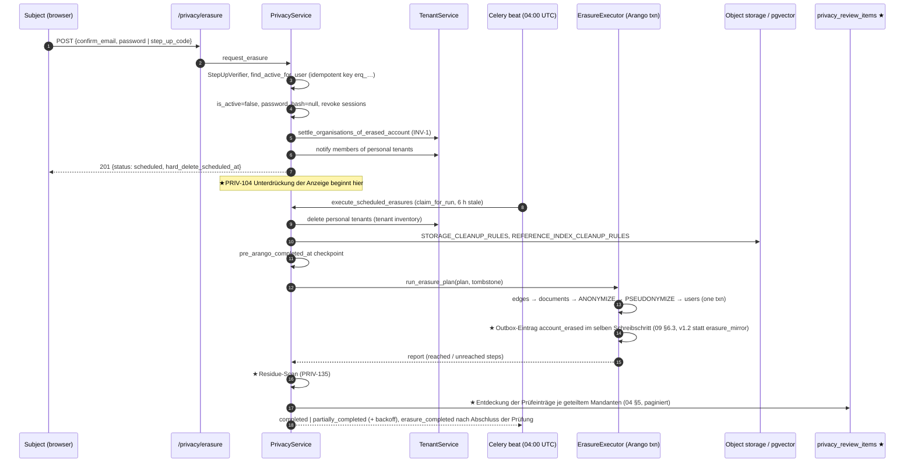
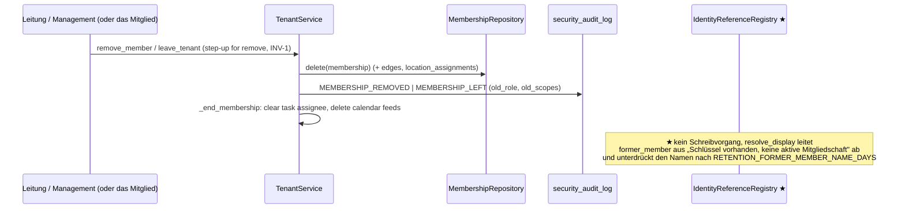
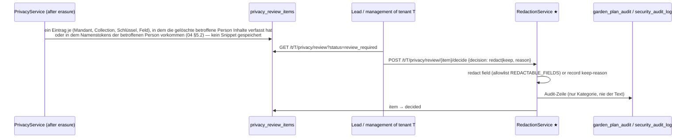

# SPEC-01 — Datenschutzarchitektur

```
Paket: spec/privacy (DSGVO-Datenschutzarchitektur und Implementierungsspezifikation)
Status: Entwurf zur Implementierung — rechtliche Prüfung ausstehend (siehe decision-log.md, LEG-*); Produktionsgates je Maßnahme (06 §10)
Version: 1.2 (Audit 2026-11-22: Zielarchitektur integriert; v1.1: Evidenzklassen, Löschungs-Spiegel statt Raw-Key-Ledger, Zustandsautomat Prüfung, Offline-Opt-in)
Datum: 2026-11-22
Gemessen an: develop 24d1c2988 (nach Fast-Forward; Welle 9 von REQ-053 gemergt); Nachtrag #2839 (develop 343afbb97, 2026-11-09)
Gemessen gegen: develop 007a4ea90 (Audit 2026-11-22)
Änderungen 1.2: §1.1 Ist-Stand korrigiert (Marker/Regex je eine Definition, R-40 umgesetzt, Art. 18/21 inert, Backup
aktivierbar); §1.4 drei Befundmuster; §3.1/§3.2 Komponentenmodell erweitert (Zweck-Guards `ProcessingHoldGuard`/`CloudGate`,
Tenant-Privacy-Profile-Resolver, Data Subject Requests, `PrivacyJournal` statt `erasure_mirror`, Incident Register,
Retention- und Empfängerregister, Restore-Detektor/Replay, Betrieb); §3.4 Entscheidungstabelle; §3.5 zwölf Konzepte
(Recht/Architektur/Umsetzung/Betrieb, A-*-Anforderungen) inkl. KI-Cloud-Gate; §5 Zustandsmodelle nach `03` §0 verlegt;
§7 Vertrauensgrenzen ergänzt; §7a TOM-Ist-Stand; §7b Befunde LEG-32, LEG-42, LEG-45, LEG-57, LEG-59; §8a Invarianten
INV-P1…INV-P10; §11 offene Architekturfragen; PRIV-003 umgesetzt (#2961).
Sprache: Deutsch (Spezifikation); Quellcode und GitHub-Texte bleiben englisch
Anforderungs-IDs: PRIV-001 … PRIV-029 (dieses Dokument)
```

Dieses Dokument ist der Einstiegspunkt der Datenschutzarchitektur. Es legt das Vokabular, die
Komponenten, ihre Zuständigkeiten und die Vertrauensgrenzen fest. Jedes weitere Dokument des
Pakets verfeinert eine Komponente. Die README erläutert die Lesereihenfolge und das
Rückverfolgbarkeitsmodell (Anforderung → Abnahmekriterium → Test).

Die RFC-2119-Schlüsselwörter (MUSS, DARF NICHT, SOLLTE, SOLLTE NICHT, KANN) sind normativ. Aussagen,
die mit **[verifiziert]** markiert sind, wurden im Code oder in den Specs beim oben genannten
Commit gelesen; Aussagen mit **[Vorschlag]** sind der Entwurf dieses Pakets; Aussagen mit
**[rechtlich]** bedürfen der Prüfung durch qualifizierte Rechtsberatung oder den
Datenschutzbeauftragten (DSB) und werden im Entscheidungslog als `LEG-nn` geführt.

---

## 1. Geltungsbereich und Ausgangslage

### 1.1 Was heute existiert (verifizierte Zusammenfassung)

Kamerplanter verfügt bereits über eine umfangreiche DSGVO-Implementierung. Das Paket baut
darauf auf und ersetzt sie nicht:

| Bereich | Wo er liegt | Status |
|---------|-------------|--------|
| Löschinventar (Art. 17) | `ErasureEngine.DELETE_STEPS`, `ANONYMIZE_COLLECTIONS`, `PSEUDONYMIZE_AUDIT_COLLECTIONS`, `STORAGE_CLEANUP_RULES`, `REFERENCE_INDEX_CLEANUP_RULES`, `EXCLUDED_USER_REFERENCES` in `src/backend/app/domain/engines/erasure_engine.py` | implementiert, abgesichert durch `scripts/check_privacy_inventory.py` (R1–R6) und `tests/unit/domain/engines/test_privacy_engines.py` |
| Auskunftsinventar (Art. 15/20) | `DataExportEngine.USER_DATA_MANIFEST`, `EXCLUDED_FROM_DISCLOSURE` in `domain/engines/data_export_engine.py` | implementiert; Wechselseitigkeit mit dem Löschinventar ist abgesichert (REQ-025 §3.1.4) |
| Mandantenlöschung | `TenantErasureEngine.INVENTORY` in `domain/engines/tenant_erasure_engine.py`; Executor `data_access/arango/tenant_erasure_executor.py` | implementiert, 90 Tage Karenzzeit (`RETENTION_TENANT_ERASURE_GRACE_DAYS`), Abbruch-Route, Wiederholung mit Backoff |
| Ablauf der Kontolöschung | `PrivacyService.request_erasure` / `erase_account` / `_finalize_erasure` in `domain/services/privacy_service.py`; API `api/v1/privacy/router.py` | implementiert: Step-up, sofortiges Soft-Close, Hard-Delete nach 90 Tagen (R-01), Claim/Retry, Zustand `partially_completed`, kein Abbruch |
| Aufbewahrung (NFR-011) | ein Celery-Beat-Task pro Kategorie in `app/tasks/retention_tasks.py`; Obergrenzen/Untergrenzen in `app/config/settings.py` (`RETENTION_CEILINGS`) | implementiert für R-01…R-07, R-16…R-18 (nur gelöschte Mandanten), R-25, R-26, R-38, **R-40** (Audit 2026-11-22, LEG-58: `tenant_export_service.py:170–171, 1406–1407`, Konstante `REQUEST_RETENTION`); R-14 nur mit `TIMESCALEDB_ENABLED=true` (Default `false`, `config/settings.py:645`); R-15/R-19…R-21/R-27…R-37/R-39 nicht implementiert; R-46…R-48 ohne Beat; Nebenspeicher ohne Frist (LEG-44, `06`) |
| Einwilligung | `ConsentEngine.PURPOSES` (`domain/engines/consent_engine.py`), `ConsentGuard` (`domain/guards/consent_guard.py`) | implementiert, Guard auf Service-Ebene, keine Middleware |
| Zwei Ersatzformen für eine gelöschte betroffene Person | Marker `_anonymized` (`ANONYMIZED_MARKER`) für Zeilen geteilter Mandanten; Tombstone `anon_<16hex>` (`compute_tombstone_hash`, `sha256(user_key + ERASURE_TOMBSTONE_SALT)[:16]`) für gesetzliche und Audit-Zeilen | implementiert; Marker und Tombstone-Regex haben seit v0109 genau **eine** Definition (`domain/models/privacy.py:17, 25`; Guard `tests/unit/guards/test_privacy_marker_and_tombstone_have_one_definition.py`), Kopien nur noch eingefroren in den Migrationen v0107/v0109/v0114 (NFR-016 M-7) (Audit 2026-11-22: `ALREADY_FIXED`; v1.1 beschrieb noch vier Kopien) |
| Einschränkung/Widerspruch (Art. 18/21) | `processing_restrictions`, `POST /privacy/restrict`, `POST /privacy/object` | **gespeichert, nirgends gelesen** (Audit 2026-11-22, LEG-23; `03` §2.6) |
| Backup | Helm-CronJob `arangodb-backup` (`helm/kamerplanter/values.yaml:567–612`) | vorhanden, Default aus, **ohne Löschpropagation, Precheck und Fristgrenze** (Audit 2026-11-22, LEG-11; `09` §6.1) |
| Pflegeprotokoll (REQ-053 §13) | `domain/models/care_event.py`, `domain/services/care_event_service.py`, `care_event_repository.py`; rollenabhängiger `performed_by`-Filter (`MembershipEngine.can_filter_care_log_by_member`); Schwärzung nur durch lead `POST /care-events/{key}/redact` | implementiert (WP 4.3, 8.1, 8.3, 9.3) |
| Offline (REQ-053 Welle 9, UI-NFR-012 v2.4) | `src/frontend/src/sw.ts`, `pwa/cachePolicy.ts`, `features/gardenPlanner/offline/{db,queueDb,queue,sync,retention}.ts`, `pwa/offlineData.ts` | implementiert: IndexedDB `kp-plan-cache` / `kp-write-queue`, Cache Storage `kp:{user}:{tenant}` (latent, das Backend sendet `no-store`), Kill-Switch `PWA_CACHING_ENABLED`, Replay-Idempotenz `client_event_id` (v0106) |

### 1.2 Was dieses Paket ergänzt

Die Lücken, die die Repository-Analyse ergeben hat (siehe `02-personal-data-inventory.md` §6 und
das Entscheidungslog), fallen in sechs Gruppen; jede wird unten zu einer Zuständigkeit einer
Komponente:

1. **Identität ist nicht von der Historie getrennt.** Jede Domänenzeile speichert den rohen
   `users._key` in ca. 30 Feldern ohne deklarierte Zurechnungsrolle; Anzeigenamen werden ad hoc
   durch AQL-`DOCUMENT()`-Joins aufgelöst; ein gelöschter Akteur erscheint an einer Stelle als
   hartcodierter deutscher String `"anonymisiert"` und an einer anderen als `null`. Ein
   Pseudonym (`anon_…`) konnte bis #2839 aus einer gesetzlichen Zeile in das Pflegeprotokoll
   durchsickern (#2770 Punkt 1; seit #2839 Marker, Bestand durch v0107 korrigiert) — die
   übrigen Kopierstellen sind nicht abgesichert (PRIV-205).
2. **Die Löschung endet am Schlüssel.** Die Kontolöschung leert nie Freitext von Inhalten
   (Tagebuchtext, `summary`/`material` von Pflegeereignissen, Namen von Beetvorlagen,
   Standortnamen, Audit-Zusammenfassungen, Bildunterschriften, ursprüngliche Dateinamen).
   Schwärzung gibt es nur für Pflegeereignisse, nur für Leads und nur von Hand ohne auffindbare
   Liste betroffener Zeilen (#2517).
3. **Das Ende einer Mitgliedschaft hat keine Datenschutzsemantik.** Beim Verlassen eines
   Mandanten werden die Mitgliedschaftszeile gelöscht und Aufgabenzuweisungen geleert; jede
   Zurechnung des ehemaligen Mitglieds bleibt für den Mandanten unbegrenzt sichtbar (bis zur
   Kontolöschung oder zur 5-jährigen Aufbewahrung der Pflegeereignisse).
4. **Rechtsgrundlagen werden einheitlich angewandt.** Die gesetzliche Aufbewahrung (CanG,
   PflSchG §11) gilt für jeden Mandanten, auch für Hobbygärten, die keine Aufzeichnungspflicht
   trifft; das Pflegeprotokoll erbt die Identitäten der Ausführenden aus gesetzlichen Zeilen
   (Zweckänderung, Art. 6(4)); Beschäftigten- und Ehrenamtskontexte werden nicht unterschieden
   (Art. 88 DSGVO, §26 BDSG).
5. **Keine Datenschutzadministration.** Es gibt keinen Audit-Trail für Datenschutzvorgänge,
   keine Prüfwarteschlange, keine Überwachung unvollständiger Löschungen über Logzeilen hinaus,
   keine mandantenbezogene Sicht darauf, was eine Löschung zurückgelassen hat.
6. **Offline-Daten überleben das Konto.** Der Schreibpuffer überlebt eine tote Sitzung; ein auf
   einem anderen Gerät gelöschtes Konto hinterlässt auf diesem Gerät bis zu 365 Tage lang
   Einträge; der Logout wartet nicht auf die Bereinigung; mehrere `localStorage`-Schlüssel mit
   einem `user_key` oder einer E-Mail-Adresse werden nie gelöscht.

### 1.3 Nicht im Geltungsbereich

- Das Verzeichnis von Verarbeitungstätigkeiten (Art. 30) oder die Datenschutz-Folgenabschätzung
  selbst zu schreiben — dieses Paket liefert die technische Zuarbeit (`02`, `06`, `11`), nicht
  die organisatorischen Dokumente.
- Das Rollenmodell von REQ-049 (viewer/grower/lead + `management`/`technical`) zu ändern. Das
  Paket ergänzt zweckbezogene **Sichtbarkeitsregeln** darüber, keine neuen Rollen.
- Plant Identity / Plant Social (REQ-055) — nicht implementiert; die zugehörigen
  Datenschutzzeilen (NFR-011 R-28…R-37) werden referenziert, aber nicht neu entworfen.

### 1.4 Befund des Audits 2026-11-22: drei wiederkehrende Muster

Das Audit 2026-11-22 (gemessen gegen develop `007a4ea90`) bestätigt die Grundsatzentscheidung aus §3.3 — **kein
separater Datenschutzdienst, keine Middleware, kein neuer Datenspeicher**. Die gefundenen Lücken liegen nicht in einer
fehlenden Laufzeitkomponente, sondern in drei Mustern:

1. **Gespeichert, aber nicht gelesen.** `processing_restrictions` (LEG-23), `organization_kind`/`record_keeping`
   (LEG-30), Mandanten-KI-Provider (LEG-31): Ein Wert existiert, kein Verarbeitungspfad fragt ihn ab.
2. **Das Messwerkzeug kennt eine Schreibweise nicht.** R6 übersieht `_by_user` (LEG-29), die Projektion gilt nur für einen
   von zwei Lesecaches (LEG-27), die EXIF-Nachbearbeitung nur für aktuelle Mitgliedsmandanten (LEG-55).
3. **Zustand lebt nur in der Datenbank.** Widerrufe, Löschungen und Einschränkungen gehen bei einem Restore verloren,
   weil kein Teil davon außerhalb der DB festgehalten wird (LEG-11, LEG-24, LEG-25).

Die Zielarchitektur (§3.4, §3.5) antwortet darauf mit (a) **je einem einzigen Leser** pro Privacy-Einstellung,
(b) **Guards, die die Schreibweise des Codes messen** statt einer Namenskonvention, und (c) einem **Journal außerhalb der
Datenbank**. Neue Komponenten entstehen nur, wo kein bestehender Ort die Verantwortung tragen kann: `PrivacyJournal`,
`ProcessingHoldGuard`, `CloudGate`, `privacy_incidents`, `privacy_requests`. Alles andere ist Erweiterung des Bestands.
Maßnahmen-IDs `PRA-<Phase>.<nn>` stehen in [`12-implementation-roadmap.md`](12-implementation-roadmap.md);
Backend-Pfade ohne Präfix liegen unter `src/backend/app/`, Frontend-Pfade ohne Präfix unter `src/frontend/src/`.

---

## 2. Vokabular

| Begriff | Definition in diesem Paket |
|---------|----------------------------|
| **Betroffene Person** | Eine natürliche Person, deren Daten verarbeitet werden: ein Kontoinhaber, ein ehemaliger Kontoinhaber, ein im Freitext genannter Dritter (`performed_by_label`), eine auf einem Foto gezeigte Person. |
| **Kontoreferenz** | Ein Feld mit `users._key` (Form `user_key`, `*_user_key`, `*_by_key`, `*_by`, `owner_user_key`). REQ-025 §3.1.3 Regel 5 verlangt, dass jedes solche Feld im Löschinventar oder in `EXCLUDED_USER_REFERENCES` steht. Die Erkennung in R6 ist eine Namensliste (`user_key\|*_user_key\|*_by_key\|*_account_key\|*_by`, `scripts/check_privacy_inventory.py:214–215`) und übersieht andere Formen, z. B. `control_events.triggered_by_user` (`domain/models/actuator.py:227`; Audit 2026-11-22, LEG-29) → A-REG-2 (§3.5.1). |
| **Zurechnungsrolle** | *Warum* eine Kontoreferenz auf einer Zeile existiert: `performed_by` (hat die Tätigkeit ausgeführt), `created_by` (hat den Datensatz verfasst), `confirmed_by` (hat eine Aufgabe/ein Ereignis bestätigt), `modified_by` (hat den Datensatz geändert), `assigned_to`, `owner`, `actor` (Audit), `recipient`, `subject_of`. Definiert in §4.1. |
| **Identifizierbare personenbezogene Daten** | Eine Zeile, die eine lebende Person direkt (Anzeigename, E-Mail, roher `user_key` eines bestehenden Kontos) oder indirekt über Inhalte benennt, die der Verantwortliche verknüpfen kann. |
| **Pseudonymisierte Daten** | Art. 4(5): Die Kontoreferenz wird durch einen Wert (`anon_<16hex>`) ersetzt, der ohne gesondert aufbewahrte zusätzliche Informationen (`ERASURE_TOMBSTONE_SALT`, die Zuordnung Schlüssel → Person) nicht zugerechnet werden kann. Zeilen einer Person bleiben untereinander **verknüpfbar**. Pseudonymisierte Daten sind personenbezogene Daten. |
| **Anonymisierte Daten** | Die Zeile erlaubt mit keinem Mittel, das vernünftigerweise eingesetzt werden könnte, mehr eine Identifizierung (Erwägungsgrund 26). Der Marker `_anonymized` ist **kein** Nachweis der Anonymisierung: Die Zeile ist nur dann anonymisiert, wenn kein anderes gespeichertes Attribut (Freitext, Foto, gemeinsam auftretende Daten) eine Identifizierung erlaubt. |
| **Domänenhistorie ohne personenbezogene Zurechnung** | Eine Zeile, deren Kontoreferenzen `null` oder der Marker sind und deren Freitext geprüft oder geschwärzt wurde — das, was der Mandant für agronomische Zwecke behält (Fruchtfolge, Beethistorie). |
| **Tombstone** | Das Pseudonym `anon_<16hex>`; ebenso die Zeile in `erasure_requests`, die das Konto überlebt. |
| **Marker** | Das Literal `_anonymized`, das in ein Kontoreferenz-Feld einer beibehaltenen geteilten Zeile geschrieben wird. |
| **Schwärzung** | Das Ersetzen eines Freitextwerts durch das Literal `[redacted]` (Code `REDACTED` in `models/care_event.py`) und die Aufzeichnung von Wer, Wann und Warum. |
| **Geteilter Mandant** | Ein Mandant mit mehr als einem Mitglied oder der mehr als ein Mitglied erhalten kann (`tenant_type: organization` oder ein persönlicher Mandant mit Eingeladenen). REQ-049 P3 behandelt `tenant_type` als Anzeigeeigenschaft; dieses Paket folgt REQ-025 §3.1.3, das bei der Löschung sehr wohl danach unterscheidet. |
| **Gesetzlicher Datensatz** | Eine Zeile, die nach Art. 6(1)(c) aufbewahrt wird, weil ein Gesetz es verlangt: `harvest_batches` / `quality_assessments` (CanG, 5 Jahre, NFR-011 R-16), `treatment_applications` (PflSchG §11, 3 Jahre, R-17), `inspections` (R-18). Ob die Pflicht für einen bestimmten Mandanten gilt, ist eine **[rechtliche]** Frage (LEG-03). |
| **Datenschutzvorgang** | Eine langlaufende, wiederholbare Änderung, die durch ein Betroffenenrecht oder eine Aufbewahrungsregel ausgelöst wird: Kontolöschung, Mandantenlöschung, Export, Schwärzungsstapel, Aufbewahrungslauf, Migrations-Backfill. |

---

## 3. Architekturübersicht

### 3.1 Komponentenkarte

Die Zerlegung folgt dem Vorschlag der Aufgabe mit einer Änderung: *Datenherkunft
(Data Lineage) und Aufbewahrungsverwaltung* wird in eine deklarative **Registry**
(Herkunftsbeziehung + Aufbewahrungsmetadaten, reiner Code, abgesichert) und die bestehenden
**Aufbewahrungs-Beats** (Celery) aufgeteilt. Das entspricht dem eigenen Muster des Repositorys
— „das Inventar ist der Code, abgesichert durch ein Skript" (REQ-025 §3.1) — und vermeidet
einen neuen Laufzeitdienst. Es wird kein Microservice, kein neuer Datenspeicher und keine
Middleware eingeführt.

Seit v1.2 (Audit 2026-11-22) ist die Karte um die Bausteine der Zielarchitektur erweitert (§3.4): Zweck-Guards,
Tenant-Privacy-Profile-Resolver, Data Subject Requests, `PrivacyJournal`, Incident Register, Retention- und
Empfängerregister sowie die Betriebsbausteine für Restore und Alarmierung. Mit „neu“ markierte Bausteine sind
[PROPOSED]; alle anderen existieren (VERIFIED_CODE) und werden erweitert.

```mermaid
flowchart TB
    subgraph Client["Browser / PWA (trust boundary: device)"]
        OPL["Offline Privacy Layer<br/>offlineData.ts, storageWipe.ts, queue.ts, sw.ts<br/>opt-in, projection, quarantine, sweep, shared device"]
    end

    subgraph API["API layer (FastAPI, /api/v1)"]
        AUTH["Access Control and Visibility<br/>common/auth.py, core/permissions.py, MembershipEngine,<br/>attribution_visibility, step-up table, uploader predicate"]
        PRIVAPI["Privacy API<br/>/privacy/*, /t/slug/privacy/*"]
        AAPI["Admin Privacy API<br/>/admin/platform/privacy: requests, holds, incidents, journal status"]
    end

    subgraph Guards["Purpose guards (service level, no middleware)"]
        CG["consent_guard (existing)"]
        HG["ProcessingHoldGuard (new)<br/>Art. 18/21, legal hold"]
        CLG["CloudGate (new)<br/>actual KS provider"]
    end

    subgraph Domain["Business logic (domain/)"]
        IML["Identity and Membership Lifecycle<br/>UserService, TenantService, MembershipEngine,<br/>IdentityReferenceRegistry (new), PersonRef"]
        TPP["Tenant Privacy Profile Resolver (new)<br/>resolve_tenant_privacy_profile"]
        PLE["Privacy Lifecycle Engine<br/>ErasureEngine, TenantErasureEngine, PrivacyService,<br/>RedactionService (new), PropagationRules (new), residue scan"]
        DSR["Data Subject Requests<br/>DataExportEngine, erasure_requests,<br/>privacy_requests (new)"]
        PADM["Privacy Administration<br/>privacy_review_items (new), PrivacyOpsService (new)"]
        JRN["PrivacyJournal (new)<br/>outbox, flush, high-water mark"]
        INC["Incident Register (new)<br/>privacy_incidents"]
    end

    subgraph Registry["Declarative registries (code, CI-guarded)"]
        REG["Privacy Register / Lineage<br/>privacy.py models, field classification,<br/>DERIVED_FIELDS (new)"]
        RET["Retention Policy Register<br/>RetentionRule incl. side stores,<br/>RETENTION_CEILINGS, retention_service.py"]
        RCP["Recipient Register (new)<br/>YAML + doc"]
    end

    subgraph Jobs["Celery beat"]
        BEATS["Retention beats (one per rule)"]
        CONS["Consistency jobs<br/>care_events.consistency, privacy.consistency"]
        FLUSH["privacy.journal_flush (new)"]
    end

    subgraph Data["Data access and persistence"]
        ARANGO[("ArangoDB<br/>domain rows, erasure_requests,<br/>privacy_review_items, journal outbox")]
        TSDB[("TimescaleDB<br/>sensor readings")]
        OBJ[("Object storage<br/>attachments")]
        PGV[("vectordb (pgvector)<br/>reference index")]
        JB[("Journal bucket (new)<br/>Object Lock")]
        BK[("Backup bucket")]
    end

    subgraph Ops["Operations"]
        DET["Restore detector (new)<br/>lifespan, worker init"]
        RPL["privacy_restore_replay CLI (new)"]
        ALR["PrometheusRules (new)"]
        EVD["Evidence store (operations repo)"]
    end

    KS["Knowledge service<br/>reports provider_type (new)"]

    OPL -- "client_event_id writes,<br/>KP_SET_NAMESPACE" --> API
    PRIVAPI --> AUTH
    AAPI --> AUTH
    AUTH --> IML
    IML --> TPP
    PRIVAPI --> PLE
    PRIVAPI --> DSR
    PRIVAPI --> PADM
    AAPI --> HG
    AAPI --> INC
    PLE --> HG
    PLE --> REG
    PLE --> JRN
    IML --> JRN
    DSR --> REG
    DSR --> RET
    DSR --> RCP
    BEATS --> RET
    BEATS --> HG
    BEATS --> Data
    CONS --> REG
    CONS --> Data
    PLE --> Data
    IML --> ARANGO
    PADM --> ARANGO
    TPP --> ARANGO
    INC --> ARANGO
    JRN --> ARANGO
    JRN --> FLUSH
    FLUSH --> JB
    CLG --> CG
    CLG --> KS
    DET --> JB
    DET --> ARANGO
    RPL --> JB
    RPL --> Data
    ALR --> EVD
    REG -. "guarded by<br/>scripts/check_privacy_inventory.py" .-> REG
```



### 3.2 Zuständigkeiten

| Komponente | Status | Verantwortet | Verantwortet nicht | Schnittstelle (eingehend → ausgehend) | Verfeinert in |
|------------|--------|--------------|--------------------|----------------------------------------|---------------|
| **Identity & Membership Lifecycle (IML)** | Bestand, erweitert | Kontozustände (`active` → `closed` → `erased`, Ziel zusätzlich `restricted`/`held`), Mitgliedschaftszustände, die *Zurechnungsrolle* jeder Kontoreferenz (`IdentityReferenceRegistry`), Auflösung des Anzeigenamens für alle API-Antworten (`resolve_display`), die Darstellungszustände `member`, `former_member`, `erased`, `third_party`, `system`, `service_account` | Löschen oder Umschreiben von Zeilen (PLE), Entscheiden, wer einen Namen sehen darf (ACV) | emittiert Journal-Ereignisse `membership_removed`, `role_lowered`, `sessions_revoked`, `password_changed` (PRA-2.03, PRA-1.04) | `03-account-and-membership-lifecycle.md`, `08-api-and-data-model.md` §2 |
| **Privacy Lifecycle Engine (PLE)** | Bestand, erweitert | den Löschplan und seine Ausführung, Anonymisierungs- und Pseudonymisierungsregeln, Schwärzung (manuell und kaskadierend), Propagation auf abgeleitete Zeilen, Idempotenz, Wiederholung, Behandlung von Teilausfällen, Residue-Scan (auch Kontolöschung, PRIV-135), mandantengebundene Pseudonyme, den Zustandsautomaten der Freitextprüfung (`04` §5.1a); der ausführende Service schreibt das Journal-Ereignis `account_erased`/`tenant_erased` (die `ErasureEngine` bleibt rein deklarativ). v1.1 sah hier den Löschungs-Spiegel `erasure_mirror` vor; er geht im `PrivacyJournal` auf (Audit 2026-11-22: LEG-25, `09` §6.3) | Aufbewahrungsfristen (RET), Holds (Zweck-Guards), UI (PADM) | Pläne aus REG; prüft `held_subjects`; emittiert Journal-Ereignisse (PRA-1.07, PRA-2.01, PRA-2.02, PRA-2.13) | `03`, `04-anonymization-and-redaction.md`, `09-migrations-and-backfills.md` |
| **Lineage & Privacy Register (REG)** | Bestand (PRIV-E05), erweitert | deklarative Metadaten: Feldklassifizierung je personenbezogenem Feld (A-REG-1), welches Feld von welchem abgeleitet ist (`DERIVED_FIELDS`), welche Zeilen gesetzlich sind, die Allowlist schwärzbarer Felder, die Collections, in denen Tombstones erlaubt sind; Guard-Skripte, die die Registries vollständig halten | Ausführung (PLE, Beats) | Python-Modul; Guards R1–R8, `check_privacy_registry_doc.py` (PRA-1.01) | `02-personal-data-inventory.md` |
| **Retention Policy Register (RET)** | Bestand, erweitert | deklarative `RetentionRule`-Liste je Speicherstelle inkl. Nebenspeicher (Logs, Valkey, `vectordb`, Snapshots, nicht-aktuelle S3-Versionen, Backups, Endgerät) mit Frist, Grundlage und Durchsetzungsart; Ober-/Untergrenzen (`RETENTION_CEILINGS`) | Ausführung (Beats) | Guard Beat ↔ Regel; Quelle für Art. 13/15 (PRA-3.06, PRA-2.18) | `06-retention-and-legal-basis.md` |
| **Empfängerregister (RCP)** | neu (Doku + YAML) | Dienste, Rollen, Regionen, Übermittlungsgrundlagen | Vertragsinhalt | YAML; Guard über `data_access/external/` und `src/knowledge-service/app/llm/`; Quelle für Art. 13/15 und Verzeichnis (PRA-1.03) | `06` |
| **Access Control & Visibility (ACV)** | Bestand, erweitert | Rollen-Gates (bestehend), *Sichtbarkeitsregeln* für personenbezogene Zurechnung (Ausführende/Ersteller/Bestätigende, `attribution_visibility`), zweckbezogene Berechtigungen (`privacy.review`, `attribution.filter`, `attribution.export`; Schwärzung läuft unter `privacy.review`, `05` §5), Uploader-Prädikat für Fotos, Step-up-Tabelle je Recht (A-DSR-2), die Audit-Zeile für jedes datenschutzrelevante Lesen (Massenexport mit Namen) | Rollendefinitionen (REQ-049), Klassenregeln (TPP) | `require_permission`, `require_tenant_role`; liest `TenantPrivacyProfile` (PRA-2.04, PRA-2.05, PRA-2.12) | `05-access-and-visibility.md` |
| **Zweck-Guards** | `consent_guard` Bestand; `ProcessingHoldGuard`, `CloudGate` neu | Prüfung vor einer zweckgebundenen Verarbeitung: Einwilligung, Einschränkung/Widerspruch/Legal Hold, tatsächlicher Cloud-Provider | Rollen, Sichtbarkeit | `require_consent(ctx, purpose)`, `require_not_held(ctx, purpose)`, `held_subjects(scope)`, `CloudGate.require(ctx)`; Fehler 403/423 (PRA-0.09, PRA-1.06) | §3.5.4, §3.5.12; `03` §2.6 |
| **Tenant Privacy Profile Resolver (TPP)** | neu (reine Funktion) | wirksame Privacy-Defaults je Mandantenklasse | Speicherung der Einstellungen | `resolve_tenant_privacy_profile(settings) -> TenantPrivacyProfile`; einziger Leser von `organization_kind` (INV-P3, PRA-1.02) | §3.5.7; `05`, `06` |
| **Data Subject Requests (DSR)** | Bestand + `privacy_requests` neu | Vorgänge Art. 15–21 mit Zustand, Frist und Verantwortlichem, Admin-Lesemodell, Art.-15-Metainformationen | Wirkung der Einschränkung (Zweck-Guards) | `POST/GET /privacy/*`, `GET /admin/platform/privacy/requests`; liest REG/RET/RCP (PRA-0.06, PRA-2.04, PRA-2.18, PRA-2.20) | §3.5.6; `03` §2.6, §10.2; `08` |
| **Privacy Administration (PADM)** | neu | die Prüfwarteschlange (`privacy_review_items`), die Lead-/Management-UI, um zu sehen, was eine Löschung in ihrem Mandanten hinterlassen hat, und zu entscheiden (schwärzen / mit Begründung behalten), Überwachung unvollständiger Datenschutzvorgänge, Dokumentation von Ausnahmen | die Regeln selbst; Vorgänge der Betroffenenrechte (DSR) | `/t/{slug}/privacy/review`, `GET /admin/platform/privacy/operations` | `04`, `05`, `08`, `12-implementation-roadmap.md` |
| **PrivacyJournal (JRN)** | neu | Outbox im selben Schreibschritt, Flush ins Bucket, Hochwassermarke, Outbox-Metrik | Replay-Ausführung | `journal.append(event)` (nur innerhalb einer Transaktion); Task `privacy.journal_flush` (PRA-1.04) | §3.5.5; `09` §6.3 |
| **Incident Register (INC)** | neu | Fallakte nach Art. 33 Abs. 5, Mandantenbenachrichtigung | Erkennung (Alarmregeln) | `POST/GET /admin/platform/privacy/incidents` (PRA-3.02) | §3.5.11, §7b |
| **Offline Privacy Layer (OPL)** | Bestand, erweitert | alles, was auf dem Endgerät gespeichert wird: Opt-in, Namespaces, Projektion **beider** Lesecaches, physische Fristen, Lebenszyklus des Schreibpuffers, Quarantäne, Logout-Wipe, Sitzungsisolation, Behandlung von Widerrufen, Modus für geteilte Geräte | serverseitige Deduplizierung (`client_event_writes.py`, PLE), serverseitige Rechte | `KP_SET_NAMESPACE`, `KP_CLEAR_DATA`/`KP_CLEAR_DONE`, Fehlercodes `account.closed`/`membership.ended` (PRA-0.07, PRA-0.08, PRA-2.15 … PRA-2.17) | `07-offline-privacy.md` |
| **Restore-Detektor / Replay** | neu | Restore erkennen, Wartungsmodus, Replay über alle Speicher, Residue-Scan, Bericht | Backup-Erstellung | Lifespan-Check in `src/backend/app/main.py` und Worker-Init; CLI `python -m app.migrations.privacy_restore_replay` (PRA-1.05) | §3.5.9; `09` §6.4 |
| **PrometheusRules / Evidenzablage** | neu (Betrieb) | Alarme auf Sicherheits- und Privacy-Signale; datierte Nachweise je Installation | — | Chart (`monitoring.enabled`); Betriebs-Repo (PRA-3.02, PRA-3.09) | §3.5.8, §3.5.11 |

### 3.3 Warum kein separater Datenschutzdienst und keine Middleware

- REQ-025 §3.7 hat sich bereits gegen eine Einwilligungs-Middleware entschieden; der
  Einwilligungs-Guard ist ein Aufruf auf Service-Ebene. Dieselbe Überlegung gilt für die
  Sichtbarkeit: Die benötigten Informationen (Rolle, Scope, Zurechnungsrolle des Feldes,
  Mitgliedschaftszustand der referenzierten Person) sind nur innerhalb des Services verfügbar,
  nicht am HTTP-Rand.
- Alle Datenschutzvorgänge laufen bereits als Celery-Tasks mit eigenen Zustandsdokumenten
  (`erasure_requests`, `tenant_erasure_records`, `data_export_requests`). Ein neuer
  „Engine-Service" würde die Claim-/Retry-/Backoff-Logik duplizieren, die in
  `PrivacyService._finalize_erasure` und `TenantService._run_tenant_erasure` existiert.
- Die 5-Schichten-Regel (NFR-001) und das Eigentumsprädikat (#2107, `*, tenant_key: str`)
  bleiben erhalten: Jede neue Service-Methode, die per Schlüssel lädt und schreibt, nimmt
  `tenant_key` entgegen.
- **Audit 2026-11-22:** Das Audit bestätigt diese Entscheidung (§1.4). Auch die neuen Bausteine sind keine Dienste:
  `ProcessingHoldGuard` und `CloudGate` sitzen wie `consent_guard` auf Service-Ebene, weil Zweck und Subjekt nur der
  Service bzw. Job kennt, nicht der HTTP-Rand; der Restore-Detektor gehört in den Start, der Replay in das
  Migrationsframework; ein Privacy-Lifecycle-Orchestrator würde Claim/Retry/Backoff verdoppeln.

### 3.4 Architekturentscheidungen (Audit 2026-11-22)

| Konzept | Entscheidung | Ort im Bestand | Begründung (Kurzform) | PRA |
|---|---|---|---|---|
| Zentrales Privacy-Register | **Erweiterung** der Registry (REG, PRIV-E05) um eine Feldklassifizierung; keine Laufzeitkomponente | `domain/models/privacy.py`, Registry aus PRIV-E05, `scripts/check_privacy_inventory.py` | „Inventar ist Code“ ist bewährt; die Lücke ist die Guard-Abdeckung, nicht der Speicherort | PRA-1.01 |
| Verarbeitungsverzeichnis (Art. 30) | **Generiertes Artefakt**, keine Komponente | `06` §2 (PA-nn), Empfängerregister aus PRA-1.03, Feldklassifizierung | Art. 30 verlangt ein Dokument, keinen Dienst; Generierung verhindert eine zweite Liste | PRA-1.03, PRA-3.03 |
| Retention-Policy-Register | **Erweiterung**: deklarative `RetentionRule`-Liste neben `RETENTION_CEILINGS`, ausdrücklich auch für Nicht-DB-Speicher | `config/settings.py`, `domain/services/retention_service.py`, `tasks/retention_tasks.py` | Beats existieren je Regel; es fehlen Regeln für Nebenspeicher und ein Guard Beat ↔ Regel | PRA-3.06, PRA-2.18 |
| ErasureEngine: Lösch-Spiegel/Journal | **Neue Komponente** `PrivacyJournal` (Outbox + Flush-Task + Bucket-Objekt); die ErasureEngine emittiert nichts, der ausführende Service schreibt | neues Repository unter `data_access/arango/`, Task unter `tasks/` | Ereignisse stammen aus fünf Services (Erasure, Consent, Auth, Membership, Tenant) und müssen außerhalb der DB überleben | PRA-1.04 |
| ErasureEngine: Legal Hold + Restriction-Guard | **Neue Komponente** `ProcessingHoldGuard` in `domain/guards/`, analog `consent_guard` | `domain/guards/`, Aufrufe in Retention-Tasks und Executors | Querschnittsprüfung auf Service-Ebene; das Muster existiert bereits und ist bewusst keine Middleware | PRA-1.06 |
| Privacy-Lifecycle-Service | **Kein neuer Orchestrator**; Lebenszyklus bleibt in den besitzenden Services, ergänzt um Ereignistypen und Post-Transition-Hooks | `PrivacyService`, `TenantService`, `UserService`, Offline-Schicht | ein Orchestrator würde Claim/Retry/Backoff duplizieren (§3.3); es fehlt die Ereignisspur, nicht die Steuerung | PRA-1.04 |
| Betroffenenanfragen-Workflow | **Erweiterung** der bestehenden Zustandsdokumente plus **kleine neue Collection** `privacy_requests` für Rechte ohne Selbstbedienung | `erasure_requests`, `data_export_requests`, `processing_restrictions`; Admin-Lesemodell | Erasure/Export haben Zustandsautomaten; Art. 16/18/21/19 und Anfragen Dritter haben keinen Ort | PRA-0.06, PRA-1.06, PRA-2.04 |
| Mandanten-Privacy-Konfiguration | **Erweiterung** von `TenantSettings` plus **ein Resolver** `resolve_tenant_privacy_profile` | `domain/models/tenant.py`, neuer reiner Resolver in `domain/engines/` | Werte existieren (v0110); ein einziger Leser verhindert verstreute Klassenregeln | PRA-1.02 |
| Audit- und Evidenzverwaltung | **Erweiterung** von `security_audit_log` (Aktionen, Hold) plus **Betriebsartefakt** Evidenzablage | `common/enums.py`, `security_audit_service`, Betriebs-Repo | Audit-Store existiert mit Frist R-38; Nachweise über Drills und Prüfungen sind Betriebsdokumente | PRA-3.09, PRA-1.06 |
| Backup-Löschpropagation | **Neue Bausteine** im Bestand: Restore-Detektor (Lifespan), Replay-CLI (Migrationsframework), Helm-Durchsetzung | `src/backend/app/main.py`, `migrations/`, `helm/kamerplanter/` | Replay passt in das vorhandene Migrations-CLI; Erkennung muss vor jedem Request greifen | PRA-0.10, PRA-1.05 |
| DSFA-Dokumentation | **Dokument** plus **Kopplung** an die Klassifizierung (auditierte Bestätigung) | `11`, `TenantService` | DSFA ist Pflicht des Verantwortlichen; das Produkt liefert Baustein und Auslöser | PRA-3.04 |
| Incident-Management | **Neue Komponente** `privacy_incidents` (Register) plus Runbook und Alert-Regeln | neuer Router/Service/Repo unter `api/v1/admin/platform/`, `helm/…/templates` | Art. 33 Abs. 5 verlangt Dokumentation jeder Verletzung; es gibt keinen Store dafür | PRA-0.11, PRA-3.02 |
| KI-Cloud-Prüfung (Querschnitt) | **Neue Komponente** `CloudGate` neben `consent_guard` | `domain/guards/` | eine Prüfung vor jedem Knowledge-Service-Aufruf; Quelle der Wahrheit ist der Knowledge-Service, nicht der Mandanten-Datensatz | PRA-0.09 |

### 3.5 Konzepte der Zielarchitektur

Jedes Konzept trennt vier Ebenen, die nicht vermischt werden dürfen:

| Ebene | Bedeutung | Wer entscheidet |
|---|---|---|
| **(1) Recht** | Was die Norm verlangt, mit Kennzeichnung (a) ausdrückliche Pflicht, (b) Auslegung, (c) empfohlene Schutzmaßnahme, (e) offene Rechtsfrage; Belege L-nn in [`13-legal-evidence-register.md`](13-legal-evidence-register.md) | Gesetz; Auslegung durch DSB/Rechtsberatung (PRA-3.01) |
| **(2) Architektur** | Technische Eigenschaft, die das System haben muss, damit (1) erfüllbar ist — unabhängig von der Bauweise; testbar formuliert (IDs `A-…`) | Architektur (dieses Dokument) |
| **(3) Umsetzung** | Konkreter Vorschlag im Bestand (Datei, Mechanismus); austauschbar, solange (2) erfüllt ist | implementierende Lane |
| **(4) Betrieb** | Was ein Betreiber tun muss; im Repo nur als Doku nachweisbar | Betreiber |

Alle Ebenen (2)–(4) sind [PROPOSED]; die „Ausgangslage“ ist der gemessene Stand (VERIFIED_CODE am SHA `007a4ea90`).

#### 3.5.1 Zentrales Privacy-Register (Datenklassifizierung je Feld, inkl. Freitexte)

**Ausgangslage.** Lösch- und Auskunftsinventar sind Code und durch `scripts/check_privacy_inventory.py` (R1–R6)
gegenseitig abgesichert (§1.1). PRIV-E05 plant `AttributionRole`, `RetentionClass`, `review_fields`. Die Feldmenge ist
nur so vollständig wie das Erkennungsmuster: R6 (`check_privacy_inventory.py:214–215`) übersieht
`control_events.triggered_by_user` (LEG-29); `02` lässt weitere Felder und Telemetrie aus (LEG-46).

1. **Recht.** (a) Art. 30 Abs. 1 lit. c, f; Art. 5 Abs. 2; Art. 15 Abs. 1 und Art. 17 Abs. 1 setzen voraus, dass der
   Verantwortliche weiß, wo Daten einer Person liegen. (b) Freitext kann Art.-9-Daten enthalten; eine automatische
   Inhaltsklassifikation verlangt die DSGVO nicht.
2. **Architektur.** **A-REG-1** Jedes persistierte Feld mit Personenbezug hat genau eine Klassifizierungszeile
   (`data_class`, `attribution_role`, `retention_rule`, `erasure_action`, `export_section`, `recipients`, `free_text`,
   `max_length`). **A-REG-2** Die Erkennung personenbezogener Felder misst die Modellfelder (Typ und Name), nicht eine
   Namensliste; ein unbekanntes Feld lässt CI scheitern. **A-REG-3** Lösch-, Auskunfts-, Schwärzungs- und
   Retention-Inventar werden aus dem Register abgeleitet oder gegen es geprüft — es gibt keine zweite Liste.
   **A-REG-4** Jedes Freitextfeld hat eine Längengrenze.
3. **Umsetzung.** Registry aus PRIV-E05 als Python-Modul neben `domain/models/privacy.py` (deklarative Tupel, keine DB);
   R6-Erweiterung, neues `scripts/check_privacy_registry_doc.py` (PRIV-030), `max_length`-Guard; `02` wird zur
   menschenlesbaren Sicht, gegen das Register geprüft — PRA-1.01.
4. **Betrieb.** Keiner.

**Entscheidung:** Erweiterung, keine Laufzeitkomponente. Ein Datenbank-Register wäre zur Laufzeit änderbar und damit
nicht mehr per Guard prüfbar; die Stärke des Musters liegt in der CI-Prüfung.

#### 3.5.2 Verarbeitungsverzeichnis (Art. 30)

**Ausgangslage.** Kein Verzeichnis im Repo (LEG-12); die PA-Matrix in `06` §2 kennt keine Tätigkeiten für KI,
Erkennung, Benachrichtigung, Wetter, MCP (LEG-33); Empfänger und Drittländer fehlen.

1. **Recht.** (a) Art. 30 Abs. 1 (Verantwortlicher) und Abs. 2 (Auftragsverarbeiter) — Pflicht des jeweiligen
   Verantwortlichen bzw. AV, nicht des Softwareherstellers (kein Phone-home, LEG-01). (b) Art. 28 Abs. 3 lit. f.
2. **Architektur.** **A-ROPA-1** Das Verzeichnis ist aus Quellen erzeugbar, die CI prüft (PA-Tabelle,
   Empfängerregister, Feldklassifizierung). **A-ROPA-2** Jeder externe Dienst im Code steht im Empfängerregister (Guard
   über `data_access/external/` und `src/knowledge-service/app/llm/`, INV-P8). **A-ROPA-3** Ausgabe je Betriebsmodell
   (Betreiber-Verzeichnis und Mandantenvorlage).
3. **Umsetzung.** Maschinenlesbares Register (YAML) plus geplantes Dokument „Empfänger und Unterauftragsverarbeiter“;
   PA-13…PA-17 in `06` §2; Generator (PRIV-E17) erzeugt Markdown/CSV — PRA-1.03.
4. **Betrieb.** Betreiber ergänzt Angaben außerhalb des Codes (Verträge, Sitz, Kontakt) und führt das Verzeichnis;
   Mandanten mit eigener Verantwortlichkeit nutzen die Vorlage — PRA-3.03.

**Entscheidung:** Kein Bestandteil der Laufzeit; das Produkt liefert prüfbare Quellen.

#### 3.5.3 Retention-Policy-Register

**Ausgangslage.** Ein Beat je Kategorie (NFR-011 §3.1), Grenzen in `RETENTION_CEILINGS`, Art.-13-Zusammenfassung über
`RetentionService`. Lücken: Nebenspeicher ohne Frist (Logs, Valkey-AOF, `vectordb`, Snapshots, nicht-aktuelle
S3-Versionen, Sentry; LEG-44); Backup-Frist ohne Grenzen (`values.yaml:596`, `0` = unbegrenzt); R-46…R-48 ohne Beat;
Fristen teils Konstanten ohne Setting (`ai_assistant_service.py:57`, `security_audit_service.py:40`); Waisenobjekte
unbefristet (LEG-60); Gerätefristen hart kodiert (LEG-10).

1. **Recht.** (a) Art. 5 Abs. 1 lit. e; Art. 13 Abs. 2 lit. a; Art. 30 Abs. 1 lit. f; gesetzliche Mindestfristen
   (PflSchG § 11, KCanG § 26; L-01, L-05) begrenzen nach unten.
2. **Architektur.** **A-RET-1** Jede Speicherstelle mit Personenbezug — DB, Objektspeicher, Cache, Broker, Log, Backup,
   Endgerät — hat eine Regel mit ID, Frist, Grundlage und **Durchsetzungsart** (`beat:<name>`, `client`, `operator`,
   `ttl`). **A-RET-2** Jeder Retention-Beat verweist auf genau eine Regel, jede `beat`-Regel hat einen Beat (Guard,
   INV-P2). **A-RET-3** Jede Regel mit Durchsetzung `beat` prüft den Processing-Hold (§3.5.4). **A-RET-4** Art.-13-Text
   und Art.-15-Bündel lesen die Fristen aus dem Register. **A-RET-5** Konfigurierbare Fristen haben Unter- und
   Obergrenze; Helm-Werte ebenso (Render-Fail).
3. **Umsetzung.** Deklarative `RetentionRule`-Liste in `domain/services/retention_service.py` (oder unter `config/`),
   aus der `RETENTION_CEILINGS` und die Policy-Zeilen gespeist werden; Zeilen R-49 ff. in `06`; Helm-Precheck
   `1 ≤ backup.retentionDays ≤ 35` — PRA-3.06, PRA-0.10, PRA-2.18.
4. **Betrieb.** Regeln mit Durchsetzung `operator` (Log-Pipeline, Tracker, Snapshots, Bucket-Lifecycle) brauchen einen
   Nachweis in der Evidenzablage (§3.5.8) — PRA-0.03, PRA-3.09.

**Entscheidung:** Erweiterung. Die Beats bleiben einzeln (NFR-011 §3.1, kein Master-Task).

#### 3.5.4 Processing-Hold: Einschränkung, Widerspruch, Legal Hold (`ProcessingHoldGuard`)

**Ausgangslage.** `processing_restrictions` wird geschrieben, nie gelesen; kein Legal Hold; Purges laufen ohne
Prüfung (LEG-23, LEG-35; Sachverhalt und Evidenz in `03` §2.6).

1. **Recht.** (a) Art. 18 Abs. 1/2, Art. 21 Abs. 1 S. 2, Art. 12 Abs. 3, Art. 19. (b) Ein manueller Prüfprozess ist
   zulässig, wenn der Verantwortliche vom Antrag erfährt. (c) Legal Hold als empfohlene Maßnahme zur Wahrung von Art. 17
   Abs. 3 lit. e und für behördliche Prüfungen (KCanG, PflSchG); keine ausdrückliche Norm „Legal Hold“.
2. **Architektur.** **A-RES-1** `scope` ist ein geschlossenes Enum der realen Verarbeitungszwecke. **A-RES-2** Jede
   zweckgebundene Verarbeitung prüft vor Ausführung den Hold-Status (423 für Routen, Überspringen für Jobs).
   **A-RES-3** Eine aktive Einschränkung mit `scope ∈ {all, retention}` wirkt als Legal Hold auf die Daten der Person.
   **A-RES-4** Der Verantwortliche wird bei Anlage benachrichtigt und hat eine Liste mit Fälligkeit (§3.5.6).
   **A-HOLD-1** Ein Hold auf Person, Mandant oder Datensatz verhindert Löschung, Anonymisierung und Purge durch jeden
   automatischen Job und den Erasure-Executor; der Job zählt übersprungene Zeilen. **A-HOLD-2** Anlage und Aufhebung
   nur durch Plattform-Admin, auditiert, mit Ablaufdatum. **A-HOLD-3** Nach Aufhebung holt der nächste Lauf nach.
3. **Umsetzung.** `domain/guards/processing_hold_guard.py` mit `require_not_held(ctx, purpose)` für Service-Methoden
   und `held_subjects(scope)` für Jobs; Collection `legal_holds`; Aufruf in `tasks/retention_tasks.py`,
   `retention_service.py`, `erasure_executor.py`, `tenant_erasure_executor.py` und an den Zweck-Stellen; Guard-Test:
   jeder Retention-Task ruft `held_subjects` (INV-P2) — PRA-0.06, PRA-1.06; Anforderungen PRIV-136, PRIV-137 (`03`).
4. **Betrieb.** Betreiber prüft Anträge binnen eines Monats und setzt den Status; dokumentiert Anlass und Dauer eines
   Holds (Evidenzablage); Hold auf `security_audit_log` bei offenem Vorfall (`RETENTION_LEGAL_HOLD_SECURITY_AUDIT`,
   PRA-3.02).

**Entscheidung:** Eine gemeinsame neue Komponente `ProcessingHoldGuard`, angesiedelt wie `consent_guard`
(Service-Ebene, keine Middleware, §3.3): Die Prüfung braucht Zweck und Subjekt — beides kennt nur der Service bzw. Job.

#### 3.5.5 Privacy-&-Security-Journal (`PrivacyJournal`, ersetzt den Löschungs-Spiegel)

**Ausgangslage.** DEC-26 (proposed) sah einen Spiegel aus Tombstones vor, PRIV-E14 einen Beat-Sync. Batch-Sync ist
wirkungslos (LEG-25), und Löschungen sind nicht die einzigen Zustände, die ein Restore zurücksetzt (LEG-24). Nichts
davon ist gebaut (`grep erasure_mirror` → 0). Sachverhalt in `09` §6.

1. **Recht.** (a) Art. 17 Abs. 1, Art. 7 Abs. 3, Art. 18 Abs. 2, Art. 21 Abs. 3, Art. 32 Abs. 1 lit. b/c. (b) EDSA
   01/2022 Rn. 110 (L-19). (e) Zulässigkeit eines pseudonymen Journals (Tombstones sind personenbezogen, ErwG 26) — LEG-11.
2. **Architektur.** **A-JRN-1** Jede privacy- oder sicherheitsrelevante Zustandsänderung erzeugt im **selben
   Schreibschritt** einen Journal-Eintrag (Outbox); ohne Eintrag kein Commit (INV-P5). **A-JRN-2** Der Eintrag erreicht
   binnen eines SLA (Minuten) einen Speicher außerhalb der Datenbank, der vom Backup unabhängig ist und nicht gelöscht
   werden kann (append-only, Object Lock). **A-JRN-3** Kein Rohschlüssel im Journal; Subjekt als
   `compute_tombstone_hash` oder Datensatz-ID. **A-JRN-4** Monotone Sequenz und Hochwassermarke in der DB.
3. **Umsetzung.** `privacy_journal_outbox` (ArangoDB) + Task `privacy.journal_flush` + Bucket-Prefix
   `privacy/journal/<seq>.jsonl.fernet` mit HMAC-Kette; Metrik `privacy_journal_outbox_age_seconds`. Emittenten:
   `PrivacyService` (Konto-/Mandantenlöschung, Einwilligung, Einschränkung, Widerspruch), `AuthService` (Sitzungen,
   Passwort), API-Key-Service, `TenantService` (Mitgliedschaft, Rolle, Sperre); die `ErasureEngine` bleibt rein
   deklarativ. Ereignisliste: `09` §6.3 (PRIV-709) — PRA-1.04.
4. **Betrieb.** S3-Schlüssel nur mit `PutObject`; Object-Lock-Dauer ≥ Dump-Frist + Puffer; Alarm auf Outbox-Alter.

**Entscheidung:** Eigene Komponente — querschnittlich (fünf Emittenten) und muss außerhalb der DB überleben. DEC-26
wird erweitert, nicht verworfen.

#### 3.5.6 Betroffenenanfragen-Workflow

**Ausgangslage.** Selbstbedienung mit Zustandsdokumenten für Löschung (`erasure_requests`) und Export
(`data_export_requests`); Einschränkung/Widerspruch nur gespeichert (LEG-23); kein Weg für abgebildete Dritte ohne Konto
(LEG-21); Export per ungescoptem API-Key ohne Step-up (LEG-38, `05`); Art.-15-Bündel ohne Metainformationen (LEG-41,
`03` §10.2); Art. 16 über die normalen Bearbeitungsrouten.

1. **Recht.** (a) Art. 12 Abs. 3 (ein Monat, Verlängerung mit Begründung), Abs. 6 (Identitätsprüfung), Art. 15–21,
   Art. 19. (e) Umfang Art. 15 für verlassene Mandanten und Dateien (LEG-06 b, LEG-21).
2. **Architektur.** **A-DSR-1** Jede Anfrage nach Art. 15–21 hat Zustand, Frist und einen Verantwortlichen, der sie
   sieht — auch wenn sie nicht automatisch erfüllt wird. **A-DSR-2** Identitätsprüfung nach einer Tabelle je Recht
   (Step-up für Export, E-Mail-Änderung, Löschung; API-Keys ausgeschlossen). **A-DSR-3** Auskunft und Art.-13-Information
   lesen dieselbe Quelle (§3.5.1–§3.5.3). **A-DSR-4** Anfragen von Personen ohne Konto sind erfassbar und auditiert
   bearbeitbar.
3. **Umsetzung.** Bestehende Zustandsdokumente bleiben. Neue kleine Collection `privacy_requests` (`kind ∈
   {restriction, objection, rectification, third_party, notification_art19}`, `status`, `due_at`, `subject_ref`,
   `handled_by`) für Rechte ohne Selbstbedienung; `processing_restrictions` bleibt der Wirkungsdatensatz,
   `privacy_requests` der Vorgang. Admin-Lesemodell `GET /admin/platform/privacy/requests`; Step-up-Tabelle in REQ-023
   §3.9 — PRA-0.06, PRA-1.06, PRA-2.04, PRA-2.18, PRA-2.20.
4. **Betrieb.** Betreiber bearbeitet die Liste fristgerecht; Prozessseite für Dritte (Betreiber → Leitung).

**Entscheidung:** Erweiterung plus eine kleine neue Collection. Ein allgemeiner DSAR-Automat für **alle** Rechte würde
die funktionierenden Automaten für Löschung/Export ersetzen müssen.

#### 3.5.7 Mandanten-Privacy-Konfiguration (`organization_kind`/`record_keeping` wirksam machen)

**Ausgangslage.** `TenantSettings.record_keeping`/`organization_kind` gespeichert (v0110), aber ohne API und ohne Leser
(`domain/models/tenant.py:35, 38`; LEG-30, Sachverhalt in `05`). Davon hängen ab: `attribution_visibility`
(PRIV-300/301, nicht gebaut), Aufgaben-Leistungsfelder (LEG-28), Zurechnungskopie (LEG-07, `09` §3a), MCP-Freitext
(LEG-51), Pflichtzeilen nach Löschung (LEG-47), Shared-Device-Modus, DSFA-Auslöser (LEG-48), DEC-32-Gate. Weitere
Mandantenmittel: KI-Provider (`ai_allow_cloud_providers`, heute wirkungslos, LEG-31), Benachrichtigungskanäle,
`data_controller` (PRIV-E13, offen).

1. **Recht.** (a) Art. 25 Abs. 1/2, Art. 35 (DSFA beim Verantwortlichen). (b) Je mehr Mittel der Betreiber fest
   bestimmt, desto weniger trägt die Rolle „Betreiber = AV“ (EDSA 07/2020, L-18; LEG-01). (e) Ob die Plattform
   `leads_and_self` für gewerbliche Mandanten erzwingen muss (LEG-05).
2. **Architektur.** **A-TEN-1** Die Klassifizierung ist bei Anlage Pflicht (Organisation) bzw. automatisch
   (persönlich) und nur auditiert änderbar. **A-TEN-2** **Ein** reiner Resolver leitet aus Klassifizierung und
   expliziten Einstellungen das wirksame Privacy-Profil ab; kein anderer Code liest `organization_kind` direkt
   (INV-P3). **A-TEN-3** Jeder Profilwert hat je Klasse einen getesteten Default (TA-630); ein Legacy-Default wird nie
   Default neuer Mandanten (W-03). **A-TEN-4** Eine Mandanteneinstellung, die eine Verarbeitung zu steuern verspricht,
   muss an der Stelle wirken, an der die Verarbeitung stattfindet (Lehre aus LEG-31).
3. **Umsetzung.** `resolve_tenant_privacy_profile(settings) -> TenantPrivacyProfile` in `domain/engines/` mit
   `attribution_visibility`, `attribution_visibility_locked`, `task_performance_fields_enabled`,
   `backfill_copies_performer`, `mcp_member_free_text`, `shared_device_mode`, `statutory_retention_after_erasure`,
   `dpia_confirmation_required`, `data_controller`; Anlage-API mit 422, Audit-Aktionen, Leitungshinweis — PRA-1.02,
   PRA-2.05, PRA-2.06, PRA-2.08, PRA-2.09, PRA-2.10, PRA-2.17, PRA-3.04.
4. **Betrieb.** Betreiber sieht den Zähler nicht klassifizierter Mandanten (PRIV-110) und fordert Bestandsmandanten zur
   Klassifizierung auf.

**Entscheidung:** Erweiterung von `TenantSettings` plus ein reiner Resolver; kein eigener Konfigurationsdienst.

#### 3.5.8 Audit- und Evidenzverwaltung

**Ausgangslage.** `security_audit_log` (R-38, 730 d fest, `security_audit_service.py:40`), `ai_audit_log` (30 d),
`mcp_audit_log` (90 d), `migration_reports`. Es fehlen Aktionen für Zurechnungsexporte und -filter
(`common/enums.py:1990–2025`, LEG-02), Löschvorschau-Lesen (PRIV-316), Einschränkungs-/Hold-Vorgänge, Vorfälle;
Lesezugriffe von Plattform-Admins auf Kontolisten sind nicht auditiert (LEG-45, §7b). `security_audit_log` rollt bei
Restore mit zurück (LEG-24). Nachweise über Betreiberprüfungen und Drills gibt es nicht (Drill 2026-10-04 nur
Dokumentanzahlen, `backup-restore.md:103–104`).

1. **Recht.** (a) Art. 5 Abs. 2, Art. 32 Abs. 1 lit. d, Art. 33 Abs. 5. (b) Audit-Daten sind selbst personenbezogen
   und brauchen eine Frist.
2. **Architektur.** **A-AUD-1** Jede privacy-relevante Admin- oder Leitungshandlung erzeugt genau eine Audit-Zeile ohne
   Inhaltsdaten (Akteur, Mandant, Aktion, Zähler). **A-AUD-2** Der Audit-Purge respektiert einen Hold. **A-AUD-3**
   Sicherheitsrelevante Audit-Ereignisse gehen zusätzlich ins Journal (überleben Restore). **A-AUD-4**
   Betriebsnachweise sind datiert, je Installation abgelegt und referenzieren die Kontrolle (PRA-ID), die sie belegen.
3. **Umsetzung.** Neue Aktionen in `common/enums.py`: `ATTRIBUTION_EXPORTED`, `ATTRIBUTION_FILTER_USED`,
   `ERASURE_PREVIEW_READ`, `RESTRICTION_REQUESTED/APPLIED/REJECTED`, `LEGAL_HOLD_SET/LIFTED`,
   `TENANT_ORGANIZATION_KIND_CHANGED`, `DPIA_CONFIRMED`, `INCIDENT_RECORDED`, `TENANT_EXPORT_REASON`; Hold über
   `ProcessingHoldGuard`; Evidenzablage als Dokumentvorlage, nicht als Collection — PRA-1.06, PRA-2.05, PRA-2.19,
   PRA-3.09.
4. **Betrieb.** Quartals-Drill, jährliche Tabletop-Übung, Ablage der Prüfergebnisse (PRA-0.01…0.04) im Betriebs-Repo.

**Entscheidung:** Erweiterung von `security_audit_log`; Evidenz ist ein Betriebsartefakt — eine eigene
Evidenz-Collection läge in genau der Datenbank, deren Restore sie belegen soll.

#### 3.5.9 Backup-Löschpropagation (Restore-Erkennung + Replay)

**Ausgangslage.** Backup-CronJob vorhanden, Default aus; kein Replay, kein Precheck, keine Fristgrenze; die Doku leitet
zur Aktivierung an; Versionierung ohne Lifecycle empfohlen (LEG-26); Docker-Pfad ohne Frist (LEG-43); Restore-Szenarien
S1–S10. Sachverhalt und Evidenz: `09` §6.1, §6.5.

1. **Recht.** (a) Art. 17 Abs. 1, Art. 5 Abs. 1 lit. e und Art. 32 Abs. 1 lit. c stehen in Spannung. (b) L-19: kurzer
   Zyklus + erneute Anwendung nach Restore vertretbar; kein deutscher Primärbeleg (L-21). (e) Toleranz der Zeit zwischen
   Restore und Replay; Zulässigkeit des Journals (LEG-11).
2. **Architektur.** **A-BAK-1** Ein Backup kann nicht ohne Journal aktiviert werden (Render-Fail). **A-BAK-2**
   Backup-Fristen haben eine harte Obergrenze (≤ 35 d), auch für nicht-aktuelle Objektversionen. **A-BAK-3** Ein
   Restore wird **automatisch** erkannt (Hochwassermarke DB < Journal), und das System nimmt bis zum Replay keine
   Verarbeitung auf (Wartungsmodus, INV-P6). **A-BAK-4** Der Replay umfasst alle Speicher (ArangoDB, TimescaleDB,
   Objektspeicher, `vectordb`) und alle Journal-Ereignistypen und endet mit Residue-Scan und Bericht. **A-BAK-5** Ohne
   Journal gilt eine Rückfall-Basis (Secret-Rotation, Token-/Key-Widerruf), und der Restore gilt als nicht abgeschlossen.
3. **Umsetzung.** Helm-Precheck (PRA-0.10, INV-P10); Restore-Detektor im Lifespan von `src/backend/app/main.py` und in
   der Worker-Initialisierung; CLI `python -m app.migrations.privacy_restore_replay` im vorhandenen Migrationsframework
   mit `migration_reports`; Bucket-Lifecycle-Doku — PRA-0.10, PRA-1.04, PRA-1.05, PRA-3.07. Anforderungen PRIV-707…713
   in `09` §6.
4. **Betrieb.** Lifecycle-Regeln und Object Lock setzen; Restore nur nach Runbook; Drill (PRA-3.09); Docker-Skript mit
   Frist.

**Entscheidung:** Neue Bausteine, aber kein neuer Dienst: der Detektor gehört in den Start, der Replay in das
Migrationsframework (gleiche Phasen `precheck/dry_run/apply/verify`, PRIV-718).

#### 3.5.10 DSFA-Dokumentation

**Ausgangslage.** Vorprüfung `11` methodisch tragfähig, aber ohne Modell „selbst gehostet, gewerblich“, ohne KI/MCP
(LEG-12, LEG-48); Nutzerdoku behauptet eine durchgeführte DSFA (W-10); DEC-32-Gate technisch nicht durchsetzbar (LEG-30).

1. **Recht.** (a) Art. 35 Abs. 1, 3, 4; DSK-Muss-Liste Nr. 8 (L-17); Pflicht des Verantwortlichen. (b) WP248-Kriterien
   1, 3, 7 in gewerblichen Mandanten erfüllt (L-16). (e) Schwelle „umfangreich“ bei Kleinbetrieben; Art.-9-Nähe
   Cannabis (RISK-18).
2. **Architektur.** **A-DPIA-1** Der Auslöser hängt an der Klassifizierung, nicht am Hosting-Modell. **A-DPIA-2** Die
   Bestätigung der Leitung ist auditiert und im Profil (§3.5.7) sichtbar. **A-DPIA-3** Neue Überwachungseignung
   (Personenbezug + Zeit/Dauer/Bewertung) lässt einen Guard scheitern (TA-309, INV-P9) und erzwingt so die
   DSFA-Fortschreibung.
3. **Umsetzung.** `11` fortschreiben; DSFA-Baustein „Beschäftigte“ und Betreiberdoku „Für Betriebe“;
   Bestätigungsdialog bei `commercial` — PRA-0.05, PRA-3.04.
4. **Betrieb.** Mandant bzw. Betreiber führt die DSFA durch und bewahrt sie auf; Betriebsrat wird beteiligt (§ 87 Abs. 1
   Nr. 6 BetrVG, L-10).

**Entscheidung:** Dokument plus Kopplung an §3.5.7; keine Laufzeitkomponente.

#### 3.5.11 Incident-Management (Art. 33/34)

**Ausgangslage.** Kein Verfahren, kein Register, keine `SECURITY.md`, keine Alert-Regeln (LEG-32, Sachverhalt in §7b);
Signale vorhanden (`security_audit_log`, `revoke_family`, Lockouts, MCP-/KI-Audit, `POST /auth/logout-all`
`api/v1/auth/router.py:539–547`).

1. **Recht.** (a) Art. 33 Abs. 1 (72 h), Abs. 2 (AV meldet unverzüglich an den Verantwortlichen), Abs. 5 (Dokumentation
   jeder Verletzung), Art. 34 (Abs. 3 lit. a Ausnahme bei Verschlüsselung, §7b LEG-42), Art. 28 Abs. 3 lit. f. (e) Rolle
   des Plattformbetreibers für Meldungen der Mandanten.
2. **Architektur.** **A-INC-1** Es gibt einen Ort, an dem jede Verletzung mit den Pflichtfeldern nach Art. 33 Abs. 5
   dokumentiert wird, nur für Plattform-Admins, mit Frist. **A-INC-2** Sicherheitsrelevante Signale erzeugen Alarme
   (Regeln im Chart). **A-INC-3** Eindämmungshebel (Secret-Rotation, Massenwiderruf, Mandantensperre) sind dokumentiert
   und per Route/CLI ausführbar. **A-INC-4** Betroffene Mandanten sind aus dem System heraus benachrichtigbar
   (auditiert). **A-INC-5** Beweise lassen sich einfrieren (Audit-Hold, §3.5.4).
3. **Umsetzung.** `privacy_incidents` (Repository, Service, Router unter `api/v1/admin/platform/`), Funktion „Mandanten
   benachrichtigen“, PrometheusRules unter `helm/kamerplanter/templates` (`monitoring.enabled`), geplantes Dokument
   „Incident Response“ im Paket, `SECURITY.md` — PRA-0.11, PRA-3.02.
4. **Betrieb.** Rufbereitschaft/Meldeweg, Tabletop-Übung, Meldung an die Aufsichtsbehörde durch den Verantwortlichen.

**Entscheidung:** Neue Komponente. `security_audit_log` ist dafür ungeeignet (Ereignisprotokoll, keine Fallakte,
730-d-Purge).

#### 3.5.12 KI-Cloud-Prüfung (`CloudGate`)

**Ausgangslage.** Für Tipps, Tagestipp, „Warum?“, Chat und Diagnose ermittelt das Backend `uses_cloud` aus dem
Provider-Datensatz **des Mandanten**; der LLM-Aufruf läuft aber über den Knowledge-Service ohne Provider-Angabe, und der
Knowledge-Service nutzt sein per Umgebung festgelegtes `LLM_PROVIDER`. Mandantensperre `ai_allow_cloud_providers`,
Einwilligung `ai_cloud_processing`, UI-Indikator und `ai_audit_log.uses_cloud_provider` können damit vom tatsächlichen
Verarbeitungsort abweichen; nur `ask_knowledge` prüft korrekt (LEG-31, technisch `CONFIRMED` für die vier Pfade und die
Diagnose, `NOT_REPRODUCIBLE` für `/ask`). Der Sachverhalt mit Evidenz und die rechtliche Einordnung stehen in
[`06-retention-and-legal-basis.md`](06-retention-and-legal-basis.md); hier nur Architektur und Invariante.

1. **Recht.** (a) Art. 6 Abs. 1 lit. a, Art. 7; Art. 44 ff.; Art. 5 Abs. 1 lit. a, Art. 13 Abs. 1 lit. f. (e) ob die
   Einwilligung als Art. 49 Abs. 1 lit. a gedacht ist.
2. **Architektur.** **A-AI-1** Quelle der Wahrheit für „Cloud oder lokal“ ist der Dienst, der tatsächlich verarbeitet
   (Knowledge-Service), nicht ein Mandanten-Datensatz; unbekannt = fail-closed „Cloud“. **A-AI-2** Jede Methode, die den
   Knowledge-Service aufruft, ruft vorher **eine** zentrale Prüfung, die Mandantensperre (`403 ai.disabled_for_tenant`)
   und Einwilligung (`403 consent_required`) durchsetzt (INV-P4). **A-AI-3** Indikator und KI-Audit übernehmen den Wert
   des Knowledge-Service. **A-AI-4** = A-TEN-4: eine Mandanteneinstellung, die den Provider zu steuern verspricht, wirkt
   am Knowledge-Service oder wird als „nur Anzeige“ gekennzeichnet bzw. entfernt.
3. **Umsetzung.** Knowledge-Service meldet `provider_type`/`uses_cloud` bei `/health` und in jeder `/ask`-Antwort
   (`src/knowledge-service/app/main.py`, `schemas.py`); `CloudGate.require(ctx)` in `domain/guards/` vor jedem
   `self._ks.ask` in `domain/services/ai_assistant_service.py`, `domain/services/diagnose_service.py` und
   `glossary_service.py`; ruft intern `consent_guard`; Guard unter `src/backend/tests/unit/guards/` — PRA-0.09
   (Dringlichkeit über Prüfaufgabe PRA-0.01).
4. **Betrieb.** Betreiber prüft `LLM_PROVIDER` der Produktion (PRA-0.01); bei Cloud-LLM ohne Gate bedingte Eskalation
   auf P0.

**Entscheidung:** Neue Komponente `CloudGate` neben `consent_guard`. Offen bleibt, ob mandanteneigene Provider an den
Knowledge-Service durchgereicht oder entfernt werden (§11).

#### 3.5.13 Privacy-Lebenszyklus (kein eigener Lifecycle-Service)

**Ausgangslage.** Lebenszyklusübergänge sind auf `PrivacyService` (Kontolöschung `request_erasure` :904 ff.,
`erase_account` :3000–3164, `_run_storage_cleanup` :3302–3369), `TenantService` (Mitgliedschaftsende :3716–3806,
Mandantenlöschung) und die Offline-Schicht verteilt. `PrivacyService` reicht mindestens bis Zeile 3 573
(`_user_tenant_keys` :3564) und vereint Löschung, Export, Einwilligung, Einschränkung und Policy.

1. **Recht.** Keine eigene Anforderung; die Pflichten liegen in Art. 17, 18, 21 und den Fristen (§3.5.3).
2. **Architektur.** **A-LC-1** Jeder Übergang eines Lebenszyklus (`03` §0) hat einen benannten Ereignistyp, der ins
   Journal geht (A-JRN-1). **A-LC-2** Folgearbeiten eines Übergangs (Freitext-Entdeckung, Storage-Phase,
   Benachrichtigung) laufen über eine deklarierte Hook-Liste nach Commit (`privacy.post_commit_followups`, PRIV-223), nicht
   über verstreute Aufrufe. **A-LC-3** Die Mandantenmenge einer Folgearbeit wird aus den Daten bestimmt (z. B.
   `attachments.created_by`), nicht aus aktuellen Mitgliedschaften (Lehre aus LEG-55, PRIV-138 in `03` §10.3).
3. **Umsetzung.** Kein neuer Orchestrator. Ereignistypen als Enum in `common/enums.py`; Hook-Liste aus PRIV-E07.
   Empfohlen (Wartbarkeit, keine Privacy-Pflicht): Restriktions-/Widerspruchs- und Policy-Logik aus `PrivacyService` in
   eigene Services auslagern, sobald PRA-1.06 und PRA-2.18 sie ohnehin anfassen (§11).
4. **Betrieb.** Keiner.

**Entscheidung:** Kein eigener Privacy-Lifecycle-Service. Die Claim-/Retry-/Backoff-Logik existiert in
`PrivacyService._finalize_erasure` und `TenantService._run_tenant_erasure`; ein Orchestrator darüber würde sie
verdoppeln (§3.3). Was fehlt, ist die Ereignisspur (Journal) und die Hook-Disziplin.

---

## 4. Identitätstrennung

### 4.1 Zurechnungsrollen

**PRIV-001** Jedes Kontoreferenz-Feld MUSS mit genau einer Zurechnungsrolle registriert sein.
Die Registry (`IdentityReferenceRegistry`, siehe `08` §2) wird aus dem bestehenden
Löschinventar abgeleitet — die Einträge `AnonymizationRule` / `PseudonymizationRule` /
`ErasureStep` / `ErasureExclusion` erhalten ein Attribut `attribution` —, sodass es weiterhin
genau eine Liste gibt (REQ-025 §3.1, „keine zweite Kopie"). Das Guard-Skript
`scripts/check_privacy_inventory.py` erhält die Regel R7: Jedes kontoförmige Feld hat eine
Zurechnung.

| Rolle | Bedeutung | Erforderlich für | Beispiele [verifiziert] |
|-------|-----------|------------------|-------------------------|
| `performed_by` | die Person, die die Tätigkeit ausgeführt hat | Domänenfunktion (wer gegossen hat), Rechenschaft innerhalb des Mandanten, gesetzlicher Datensatz (Anwender) | `care_events.performed_by_user_key`, `harvest_batches.harvested_by_key`, `treatment_applications.applied_by_key`, `inspections.inspected_by_key`, `quality_assessments.assessed_by_key` |
| `performed_for` | das Mitglied, in dessen Auftrag gehandelt wurde (Stellvertretung) | Domänenfunktion | `care_events.performed_for_user_key` |
| `created_by` | der Verfasser des Datensatzes | Korrektur der eigenen Zeile (Autorenprüfung in `care_event_service.py`), Zurechnung nach Art. 15, Audit | `care_events.created_by`, `plant_diary_entries.created_by`, `task_comments.created_by`, `garden_objects.created_by`, `bed_templates.created_by`, `attachments.created_by`, `manual_overrides.created_by` |
| `confirmed_by` | wer eine Aufgabe/ein Ereignis bestätigt hat | Rechenschaft; heute **nicht separat gespeichert** — `CareConfirmation` hat kein Akteursfeld, stattdessen steht `performed_by_user_key` des abgeleiteten Pflegeereignisses | (keine; siehe `03` §4.3) |
| `modified_by` | wer zuletzt geändert / storniert / geschwärzt hat | Audit, Korrekturrechte | `care_events.voided_by`, `care_events.redacted_by`, `sites.plan.plan_updated_by`, `weather_source_configs.updated_by` |
| `assigned_to` | Verantwortlichkeit | Domänenfunktion | `tasks.assigned_to_user_key`, `location_assignments` |
| `owner` | Eigentum an einem Container | Autorisierung | `tenants.owner_user_key` |
| `actor` | wer eine administrative/sicherheitsrelevante Aktion ausgeführt hat | Art.-32-Audit | `security_audit_log.actor_user_key`, `garden_plan_audit.user_key`, `mcp_audit_log.service_account_key`, `ai_audit_log.user_key` |
| `recipient` | an wen etwas adressiert ist | Zustellung | `notifications.user_key`, `invitations.accepted_by_user_key` |
| `subject_of` | die Person, auf die sich der Datensatz bezieht | das Recht selbst | `erasure_requests.user_key`, `consent_records.user_key`, `memberships.user_key` |

**PRIV-002** Die Rollen DÜRFEN NICHT als austauschbar behandelt werden. Insbesondere gilt:
- Ein `created_by` DARF NICHT durch einen Backfill, einen Konsistenzjob oder einen Import in
  ein `performed_by` kopiert werden (oder umgekehrt); der Mapper MUSS das Ziel auf `null`
  lassen, wenn die Quelle kein Feld derselben Rolle hat;
- ein `confirmed_by` MUSS vom authentifizierten Aufrufer der Bestätigung abgeleitet werden,
  niemals aus `assigned_to_user_key` der Aufgabe;
- ein `performed_by` DARF legitim von `created_by` abweichen (Stellvertretereintrag, Korrektur
  durch einen Lead): Beide werden behalten, und nur `created_by` gewährt das Recht zur
  Korrektur der eigenen Zeile.

**PRIV-003** [VERIFIED_CODE: umgesetzt seit #2961, 2026-11-14; v1.1: verifizierte Lücke → Anforderung] Die Bestätigungspfade MÜSSEN dieselbe
Akteursregel speichern. Heute speichern REST und Benachrichtigung den Aufrufer, die
Task-Queue-Brücke (`care_reminder_service.record_care_task_completion`, aufgerufen aus
`api/v1/tasks/tenant_router.py` ohne Benutzer) und MCP (`mcp_server/tools/care.py`) speichern
`null`. Die Regel lautet: `performed_by_user_key = authentifizierter Principal` (ein
Service-Account ist ein Principal und wird als `service_account` dargestellt);
`created_by = authentifizierter Principal`. (#2770 Punkt 2, in #2839 bewusst nicht geändert und an #2517
übergeben; die rechtliche
Sichtbarkeitsentscheidung in LEG-05 ändert nicht, *was* gespeichert wird, nur, *wer es sieht*.)
**Status (Audit 2026-11-22, `ALREADY_FIXED`, LEG-61):** Queue-Brücke und MCP stempeln den Principal
(`mcp_server/tools/care.py:76–85`: `user_key=ctx.principal.account_key`; `domain/services/care_reminder_service.py:986–990,
1295–1312`; Commit `8cff212c0`). Die v1.1-Beschreibung „Task-Queue-Brücke und MCP speichern `null`“ ist überholt;
Details `03` §4.2. Offen bleibt nur die Darstellung als `service_account` (E05/E08).

### 4.2 Erforderliche und optionale Zurechnung

**PRIV-004** Für jede Zurechnung MUSS die Registry angeben, ob sie `required` (die Funktion
oder eine gesetzliche Pflicht braucht sie) oder `optional` (aus Bequemlichkeit behalten) ist.
Standardwerte:

| Zurechnung | Klasse | Begründung |
|------------|--------|------------|
| `performed_by` auf gesetzlichen Zeilen | erforderlich, solange die gesetzliche Pflicht für den Mandanten gilt (LEG-03) | Aufzeichnungsinhalt nach PflSchG §11(2) (Anwender) — **[rechtlich]**, ob der *Name* für den gesamten Zeitraum lesbar bleiben muss (LEG-04) |
| `performed_by` auf Pflegeereignissen, Gießen, Düngen | optional | Die Domänenhistorie braucht, *dass* das Beet gegossen wurde, nicht, *wer* es getan hat; Rechenschaft ist ein Interesse des Mandanten (Art. 6(1)(f), Abwägung in `06` §4) |
| `created_by` | optional, aber erforderlich für die Korrektur der eigenen Zeile und die Zurechnung nach Art. 15, solange das Konto existiert | — |
| `actor` im Sicherheits-Audit | erforderlich für 730 Tage | Art. 32, Art. 5(2) |
| `actor` in `garden_plan_audit` | optional | mandanteninternes Änderungsprotokoll; ein Jahr |
| `assigned_to`, `owner`, `recipient`, `subject_of` | erforderlich, solange die Beziehung besteht; gelöscht oder ersetzt, wenn sie endet | — |

**PRIV-005** Eine `optional`-Zurechnung MUSS entfernbar sein, ohne die Funktion zu brechen:
Jeder Leser MUSS `null`, den Marker und ein fehlendes Benutzerdokument identisch behandeln
(Darstellungszustand `erased`, siehe §4.3).

### 4.3 Ein einziger Pfad zur Anzeigeauflösung

**PRIV-006** Alle API-Antworten, die für eine Kontoreferenz eine Person zeigen, MÜSSEN über
einen einzigen Resolver laufen (`IdentityReferenceRegistry.resolve_display`, `08` §2.3), der
ein `PersonRef` mit `state ∈ {member, former_member, erased, third_party, system, service_account}`
und `display_name` nur dann zurückgibt, wenn die betrachtende Person ihn sehen darf (`05`).
Die heutigen AQL-Joins (`DOCUMENT(CONCAT(@users, key)).display_name` in
`care_event_repository.py` und `garden_plan_repository.py`) bleiben als *Nachschlagen*
erlaubt, die *Darstellungsentscheidung* MUSS jedoch in einer einzigen Funktion getroffen werden.

**PRIV-007** Das Backend DARF NICHT ein lokalisiertes Wort für eine gelöschte Person
ausgeben. Das aktuelle Literal `PERFORMED_BY_ANONYMISED = "anonymisiert"`
(`models/care_event.py`) bleibt für einen Kompatibilitätszyklus im String-Feld erhalten und
wird von `performed_by_kind` begleitet (siehe `08` §3.1); das Frontend stellt nach Art über
i18n dar (`enums.personRef.<state>`).

**PRIV-008** Ein fehlendes Benutzerdokument (Konto hart gelöscht) und der Marker MÜSSEN
gleich dargestellt werden (`erased`). Ein Tombstone (`anon_…`) außerhalb der per Allowlist
zugelassenen gesetzlichen/Audit-Collections MUSS als Defekt behandelt werden (vom
Konsistenzjob gemeldet, `04` §6) und als `erased` dargestellt werden.

---

## 5. Datenschutz-Lebenszyklus

### 5.1 Lebenszyklus der betroffenen Person

Seit v1.2 stehen die Zustandsmodelle für Konto, Mitgliedschaft, Mandant und Gerät — einschließlich der Zielzustände
`restricted`/`held`, der Journal-Ereignisse und der im Audit 2026-11-22 gemessenen Lücken je Übergang — vollständig in
[`03-account-and-membership-lifecycle.md`](03-account-and-membership-lifecycle.md) §0; der Backup-Lebenszyklus in
[`09-migrations-and-backfills.md`](09-migrations-and-backfills.md) §6.1a. Die Diagramme aus v1.1 (Konto: Active →
Closed → Erased → purged; Mitgliedschaft: Invited → Member → Former → Suppressed → Erased) sind dort unverändert
enthalten und um Hold und Journal ergänzt.

### 5.2 Mitgliedschafts-Lebenszyklus (pro Mandant)

Siehe `03` §0.2.

**PRIV-009** Die drei Enden einer Beziehung sind verschieden und MÜSSEN verschieden bleiben:
*Ende der Mitgliedschaft* (die Person existiert weiter und kann wieder beitreten; die
Zurechnung wird nach einer Frist für andere Mitglieder unterdrückt, nie gelöscht),
*Kontoschließung* (kein Login, Name verborgen, Daten für die Karenzzeit intakt),
*Kontolöschung* (Zeilen gelöscht, markiert oder pseudonymisiert; Freitext geprüft). `03`
spezifiziert jedes einzelne.

### 5.3 Datenlebenszyklus je Aufbewahrungsklasse

| Klasse | Zeilen | Bei Kontolöschung | Bei Mandantenlöschung | Bei Ende der Aufbewahrung | Spec |
|--------|--------|-------------------|-----------------------|---------------------------|------|
| `ephemeral` | Sitzungen, Tokens, Einstellungen, Benachrichtigungen, Einschränkungen, persönliche Exporte | gelöscht | gelöscht | gelöscht | `06` |
| `shared_history` | Pflegeereignisse, Tagebuch, Aufgaben, Kommentare, Gartenobjekte, Beetvorlagen, Anhänge, Audit des Plans | Kontoreferenzen → Marker; Freitext → Prüfwarteschlange | gelöscht | Pflegeereignisse: Freitext nach 5 J. geschwärzt (R-25) | `04`, `06` |
| `statutory` | Erntechargen, Qualitätsbewertungen, Behandlungsanwendungen, Inspektionen — **nur in Mandanten mit Aufzeichnungspflicht (LEG-03)** | Schlüssel → Tombstone, Anzeigename geleert (heute); **[rechtlich]** LEG-04 | pseudonymisiert behalten bis zum Ende der gesetzlichen Frist | gelöscht | `06` |
| `audit` | Sicherheits-Audit, Löschanträge, Einwilligungsdatensätze, MCP-Audit | Schlüssel → Tombstone | Sicherheits-Audit behalten, andere nach Regel | gelöscht (730 d / 3 J.) | `06` |
| `device` | IndexedDB, Cache Storage, localStorage | auf diesem Gerät bereinigt; andere Geräte: Quarantäne toter Sitzungen | bei der nächsten Sitzung bereinigt | TTL 15 min / Queue 90–365 d (zu verkürzen) | `07` |

Querschnittlich gilt [PROPOSED]: Ein aktiver Legal Hold oder eine Einschränkung mit `scope ∈ {all, retention}` setzt
jede Spalte „Bei …“ außer Kraft, bis er aufgehoben ist (`03` §2.6, §3.5.4). Den gemessenen Ist-Stand je Kategorie und
Ereignis zeigt die Lösch-Matrix in `03` §2.5.

---

## 6. Datenflüsse

### 6.1 Kontolöschung (wie implementiert, mit den mit ★ markierten Ergänzungen)



### 6.2 Ende der Mitgliedschaft



### 6.3 Schwärzungsprüfung (neu)



### 6.4 Offline-Schreiben und Widerruf

Siehe `07` §5 und §7: Das Gerät sendet `KP_SET_NAMESPACE {userKey, tenantKey}` an den Worker,
puffert Schreibvorgänge mit einer `client_event_id` und spielt sie FIFO ab; der Server
dedupliziert über den eindeutigen Sparse-Index `(tenant_key, client_event_id)` (v0106). ★ Eine
tote Sitzung (Refresh mit 401/403 abgelehnt) stellt die Queue dieses `user_key` für
`OFFLINE_DEAD_SESSION_GRACE_DAYS` unter Quarantäne und bereinigt sie dann; ein serverseitiger
stabiler Fehlercode (`account.closed`, `membership.ended`) löst eine sofortige Bereinigung aus. Cache und
Puffer entstehen nur nach ausdrücklichem Einschalten des Offline-Modus (`07` §2.1, DEC-29).

---

## 7. Vertrauensgrenzen

| Grenze | Was sie überquert | Kontrollen (bestehend) | Ergänzte Kontrollen |
|--------|-------------------|------------------------|---------------------|
| **Endgerät ↔ API** | JWT-Access-Token (Speicher), Refresh-Cookie (HttpOnly), gepufferte Schreibvorgänge mit `client_event_id`, gecachte Plandaten | `Cache-Control: no-store` auf allen `/api/v1` (MT-044; Ausnahme `private, no-cache` für die drei Lesepfade der SW-Allowlist, umgesetzt mit REQ-053 v1.47; abgerufen mit Request-Cache-Modus `no-store`, Logout sendet `Clear-Site-Data: "cache"`), SW-Allowlist, Namespace pro Benutzer+Mandant, `no-store` für `/sw.js` und `manifest.json` | Modus für geteilte Geräte, Quarantäne toter Sitzungen, Logout wartet auf Bereinigung, localStorage-Hygiene (`07`) |
| **Mandant ↔ Mandant** | nichts | URL `/t/{slug}/`, `_membership_for_slug` als einziger Resolver, Eigentumsprädikat `*, tenant_key: str`, Isolationstests über alle Routen | Prüfwarteschlange und Schwärzung sind mandantenbezogen; die Propagation der Registry überschreitet nie einen Mandanten |
| **Mitglied ↔ Mitglied (innerhalb eines Mandanten)** | Namen von Ausführenden/Erstellern, Freitext, E-Mail-Adressen von Mitgliedern | Rollen-Gates; `performed_by`-Filter für viewer/grower auf die eigene Person beschränkt | Sichtbarkeitsregeln (`05`): Namen ehemaliger Mitglieder unterdrückt, Ausführende vor Nicht-Leads verborgen, wo die Mandanteneinstellung es vorsieht, Mitglieds-E-Mails nur für `management`, CSV mit Namen auditiert |
| **Mandant ↔ Plattformbetreiber** | Mitgliedschaftslisten, Zähler, Sicherheits-Audit; **keine Domänendaten** (REQ-049 P4, AK-09) — Audit 2026-11-22: der Plattform-Export nach REQ-056 §8 widerspricht dem (LEG-53, W-30, `05`/`14`); Plattform-Admins lesen E-Mail und Mitgliedschaften aller Konten ohne zweiten Faktor und ohne Leseaudit (LEG-45, §7b) | `require_platform_admin` | Die Überwachung von Datenschutzvorgängen legt Zähler und Zustände offen, nie Zeileninhalte; zweiter Faktor und Leseaudit (PRA-2.19); Export nur mit `reason` (PRA-2.11) |
| **Verantwortlicher ↔ Auftragsverarbeiter** [rechtlich] | Wer ist Verantwortlicher für die Mitgliedsdaten eines Community-/Gewerbe-Mandanten — die Mandantenorganisation (mit dem Betreiber als Auftragsverarbeiter, Art. 28) oder der Betreiber (gemeinsam, Art. 26)? | in den Specs nirgends behandelt | **LEG-01**; das Paket unterstellt, dass die *Mandantenorganisation Verantwortlicher für Mitgliedsdaten und der Betreiber Auftragsverarbeiter ist*, und kennzeichnet jede Stelle, an der diese Annahme eine Rolle spielt |
| **Primärspeicher ↔ Backups** | vollständige Kopien | Helm-CronJob vorhanden, **Default aus**, aber ohne Löschpropagation, Precheck und Fristgrenze aktivierbar; Doku empfiehlt Versionierung ohne Lifecycle (Audit 2026-11-22: LEG-11, LEG-26; korrigiert „es existiert kein Backup“) | Privacy-&-Security-Journal außerhalb der DB (write-through, Object Lock), Restore-Detektor mit Startsperre und Replay über alle Speicher (`09` §6, DEC-26 erweitert, §3.5.5, §3.5.9), bevor ein Backup in Produktion aktiviert wird; Dumps und nicht-aktuelle Versionen ≤ 35 d |
| **Backend ↔ Knowledge-Service / LLM-Anbieter** | Prompts mit Stammwerten, Notizen, Chat-Freitext; keine Konto-IDs | `consent_guard` (`ai_tenant_data_access`), Prompt-Injection-Schutz im KS (`knowledge-service/app/prompt_engine.py:148–190`), KS protokolliert keine Fragen | `CloudGate` am tatsächlichen Provider (§3.5.12, LEG-31); Empfängerregister (§3.5.2) |
| **Pod ↔ Pod (im Cluster)** | Datenbank- und Broker-Verkehr (ArangoDB, Valkey, TimescaleDB) | NetworkPolicy default-deny (nur Prod-Release) | Valkey-Authentifizierung, CNI-Voraussetzung dokumentiert, optional mTLS (LEG-59, §7b) |

### 7a. Technische und organisatorische Maßnahmen (Art. 32) — Ist-Stand (Audit 2026-11-22)

Gemessen am SHA `007a4ea90` (VERIFIED_CODE, statisch; Laufzeitwirkung und Produktionswerte nicht geprüft). Status-Token
des Audits. Fehlende oder teilweise Kontrollen verweisen auf den Befund (§7b bzw. Fachdokument) und die Maßnahme.

| Kontrolle | Dokumentiert | Implementiert | Status |
|---|---|---|---|
| Passwort-Hashing bcrypt (Cost 12) | REQ-023 §1 | `domain/engines/password_engine.py:21–25` | `CONFIRMED` |
| Access-Token 15 min (HS256), Refresh 30 d, Rotation + Replay-Erkennung (Familie widerrufen) | REQ-023 §3.2a | `config/settings.py:380–382`; `domain/services/auth_service.py:838–915` | `CONFIRMED` |
| Refresh-Cookie HttpOnly/Secure/SameSite, pfadgebunden; CSRF | REQ-023 | `api/v1/auth/router.py:250–267`; `api/v1/auth/csrf.py` | `CONFIRMED` (30 d nur mit „Angemeldet bleiben“, LEG-37, `07`) |
| Login-Throttling/Lockout, Auth-Rate-Limit | REQ-023 | `auth_service.py:684–692`; `settings.py:809` | `CONFIRMED` |
| Step-up für sensible Aktionen, nicht per API-Key | REQ-023, #1791 | `common/auth.py:82–92`; `admin/platform/router.py:300` | `CONFIRMED` (Art.-15-Export per API-Key ohne Step-up: LEG-38, `05`) |
| Zweiter Faktor (MFA) | REQ-023 (zukünftig) | — | **Lücke** (LEG-45, §7b) |
| Service-Accounts/API-Keys: Digest (SHA-256), IP-Allowlist, Rate-Limit, Ablauf, Mandanten-Scope | REQ-023 §3.7 | `domain/models/auth.py:290–301, 356–369`; `api_key_controls.py:93–110`; `common/auth.py:62–79, 108–137` | `CONFIRMED` |
| RBAC (Rolle + Admin-Scopes), fail-closed | REQ-024/049 | `common/auth.py:671–832` | `CONFIRMED` (Vollständigkeit je Route nicht Gegenstand) |
| Eigentumsprädikat im Service (MT-010) | CLAUDE.md #9 | Guard `tests/unit/guards/test_keyed_service_writes_take_the_tenant.py` (`_REMAINING = frozenset()`, `:279`) | `CONFIRMED` |
| Mandantentrennung URL + Mandanten-Gate in Beats | REQ-024 | `common/auth.py:252–560`; Guards `test_beats_read_per_tenant.py`, `test_beats_skip_inactive_tenants.py` | `CONFIRMED` (statisch) |
| Light-Modus ohne Authentifizierung | REQ-027, Warnbox `docker-dauerbetrieb.md` | `common/auth.py:623–641`; Ports per Default an `127.0.0.1` | `CONFIRMED` (bewusst; Betreiberverantwortung) |
| TLS nach außen | Helm-Doku | Ingress-TLS Betreibersache (`values.yaml:2578–2582`); HSTS `nginx-security-headers.inc:8` | `PARTIALLY_CONFIRMED` (Einbindung im Pod-Pfad nicht aufgelöst) |
| TLS intern, Valkey-Authentifizierung | — | ArangoDB `http`, Valkey ohne Passwort, TimescaleDB ohne TLS | **Lücke** (LEG-59, §7b) |
| Netzsegmentierung default-deny | INF-S3 | `values.yaml:2601–2620` | `CONFIRMED` (nur Prod-Release; Dev-Overlays ohne) |
| Verschlüsselung Feld-Secrets (Fernet) | INF-S5 | `domain/engines/encryption_engine.py:55–90`; Start-Gate `main.py:94–95` | `CONFIRMED` (Ausnahme: mit `DEBUG=true` Klartext-Passthrough, `encryption_engine.py:61–77`) |
| Start verweigert Default-Secrets | — | `main.py:77–110`, Aufruf `:180–191` nur ohne `debug` | `PARTIALLY_CONFIRMED` (mit `DEBUG=true` Start mit Default-JWT-Secret) |
| Verschlüsselung ruhender Daten (DB/Volumes) | — | nicht im Repo | **Lücke** (LEG-42, §7b) |
| Verschlüsselung Backups | `values.yaml:584–587` | SSE `AES256`/`aws:kms` (`:1443–1444`), keine Client-Verschlüsselung | `PARTIALLY_CONFIRMED` |
| Secrets-Management | `values.yaml:530–565` | `externalSecrets.app` (Default aus); Start-Gate `main.py:77–191` | `CONFIRMED` |
| Least-Privilege und Pod-Härtung Backup (App-Konto, non-root, RO-FS, drop ALL) | `values.yaml:578–583, 1334–1352` | ebd., `:1376–1387` | `CONFIRMED` |
| Log-Pseudonymisierung/Redaktion L-1…L-9 | NFR-011 §3.4 | `common/log_privacy.py`, `config/logging.py:33–80, 484`, `src/frontend/nginx.conf:18–48`, Guards | `CONFIRMED` (statisch) |
| Log-Aufbewahrung 30 d | NFR-011 v1.13 | Betreiber, keine Doku | `DOCUMENTATION_GAP` (LEG-44, `06`) |
| IP-Anonymisierung 7 d (Sitzungen, Einwilligung) | NFR-011 R-03/R-04a | `tasks/auth_tasks.py:134–156`; `retention.anonymize_consent_ips` | `CONFIRMED` |
| Sicherheits-Audit (Mutationen), 730 d | NFR-011 R-38 | `security_audit_service.py:40` | `CONFIRMED` (nur Mutationen) |
| Auditierte Lesezugriffe (PRIV-316) | `05` | fehlt (`admin/platform/router.py:544–560`) | `CONFIRMED` (offen) |
| Plattform-Admin-Zugriff | REQ-024 §1a | `require_platform_admin` `common/auth.py:644–668`; liest alle Konten | `PARTIALLY_CONFIRMED` (LEG-45) |
| Datei-/Upload-Sicherheit (Größe, EXIF-Strip, Presign-TTL 900 s, Virenscan optional) | NFR-013 | `settings.py:195–231` (`storage_strip_exif=True`, `virus_scan_enabled=False`) | `CONFIRMED` (Virenscan aus; Strip fail-open: LEG-57, §7b) |
| API-Rate-Limits je Klasse | Settings | `settings.py:787–1089` | `CONFIRMED` |
| Incident-/Breach-Verfahren | — | — | **Lücke** (LEG-32, §7b) |
| Backup/Wiederherstellbarkeit (Art. 32 Abs. 1 lit. c) | NFR-002 §8, `backup-restore.md` | CronJob vorhanden, Default aus; Drill 2026-10-04 | `PARTIALLY_CONFIRMED` (`09` §6.1) |
| Löschpropagation in Backups | DEC-26, PRIV-707…713 | fehlt | **Lücke** (LEG-11, `09` §6) |
| Restore-Integrität von Sicherheits- und Rechtezustand | — | fehlt | **Lücke** (LEG-24, `09` §6.5) |

### 7b. Befunde zu Architektur und TOM (Audit 2026-11-22)

**LEG-32 — Kein Verfahren für Datenschutzverletzungen (Art. 33/34), kein Register, keine Meldeadresse, keine Alerts
(P1; bedingt P0, sobald BM-001 freigegeben werden soll).** NFR-007 §5 behandelt nur Verfügbarkeit (SEV-1…SEV-4,
Post-Mortem); es fehlen Kategorien für Vertraulichkeit/Integrität, die 72-h-Uhr, die Risikobewertung nach Art. 33/34,
die Dokumentation nach Art. 33 Abs. 5, die Benachrichtigung der Mandanten (Verantwortliche in BM-001), die Meldekette zu
Unterauftragsverarbeitern und die Beweissicherung. Evidenz: Grep `Art.? ?33|Art.? ?34|Datenpanne|Datenschutzverletzung|
data breach|Sicherheitsvorfall|incident.response` über `spec/`, `docs/`, `.github/` → nur `spec/betriebsmodelle/README.md:114`,
`BM-001:101, 137`, NFR-007 (Verfügbarkeit), `NFR-011:657, 684`; `helm/` ohne `PrometheusRule` und `- alert:`
(`NFR-007:95` „Offen“); kein `SECURITY.md` in Root und `.github/`; `spec/privacy/` erwähnte Art. 33/34 bis v1.1 nicht.
Vorhandene Signale (Security-Audit, Lockout, Refresh-Replay-Erkennung `revoke_family`, MCP-/KI-Audit) münden in keinen
Alarm; ohne Erkennung beginnt die 72-h-Frist faktisch erst mit einer externen Meldung, und die IP-Anonymisierung nach
7 d verkürzt das Forensikfenster. Recht: (a) Art. 33 Abs. 1, 2, 5; Art. 34; Art. 28 Abs. 3 lit. f; Art. 32 Abs. 1 lit. d;
(b) für BM-002/BM-003 trifft die Pflicht Verein bzw. Privatperson (Haushaltsausnahme nur BM-003). Die EDSA-Leitlinien
9/2022 sind noch nicht im Evidenzregister (`13`). Soll: §3.5.11 (A-INC-1…5); Abnahme: Incident-Dokument mit
TA-Einträgen in `10`, `POST /admin/platform/privacy/incidents` nur Plattform-Admin (403 sonst) mit Pflichtfeldern (Art,
Kategorien, Zahl der Betroffenen, Folgen, Maßnahmen, Meldezeitpunkt), Helm-Test `monitoring.enabled=true` rendert
mindestens eine `PrometheusRule` mit Sicherheits-Alert (`refresh_token_replay`, Lockout-Häufung, gehäufte
`not_found`/`permission.denied` je API-Key in MCP, Spitzen bei Mandantenexporten, Step-up-Sperren, Fehlerspitzen in
`erasure`), `RETENTION_LEGAL_HOLD_SECURITY_AUDIT=true` unterbindet `purge_expired_security_audit`, `SECURITY.md` im Root —
PRA-0.02, PRA-0.11, PRA-3.02, PRA-3.09.

**LEG-42 — Verschlüsselung ruhender Daten weder erzwungen noch als Betreiberanforderung dokumentiert (P2).** Nachweisbar
sind nur Feld-Secrets via Fernet (`domain/engines/encryption_engine.py`) und SSE für S3
(`data_access/storage/s3_adapter.py:106, 297`). Nicht nachweisbar oder verlangt ist die Verschlüsselung der ArangoDB-,
Valkey- (AOF mit Broker- und OAuth-State-Daten), TimescaleDB- und `backend-attachments`-Volumes (local-fs, Fotos)
(`helm/kamerplanter/values.yaml:604–605, 3253–3261`); ArangoDB Community kennt keine Encryption-at-rest; `grep -rni "at
rest\|ruhend\|LUKS" docs/de/deployment spec/stack.md spec/nfr/NFR-002*` → 0. Diebstahl eines Node-Datenträgers oder
PV-Snapshots legt alle Daten offen. Recht: (c) Art. 32 Abs. 1 lit. a (Beispielmaßnahme, dokumentationsbedürftige
Abwägung, Art. 5 Abs. 2); Art. 34 Abs. 3 lit. a (Ausnahme von der Benachrichtigung nur bei Verschlüsselung). Soll
[PROPOSED]: Betreiberanforderung in `docs/de/deployment/helm.md`/`kubernetes.md` (StorageClass mit
Volume-Verschlüsselung, z. B. Talos-Disk-Encryption/LUKS/CSI); optional Chart-Value
`security.requireEncryptedStorageClass` mit Render-Fail; Backup optional client-seitig verschlüsselt (rclone `crypt`) —
PRA-3.07.

**LEG-45 — Privilegierte Konten ohne zweiten Faktor (P2).** Kein MFA/TOTP/WebAuthn (`grep -rli "totp\|mfa\|webauthn"
src/backend/app/domain` → kein Auth-Treffer); REQ-023 führt 2FA als „zukünftige Erweiterung“
(`spec/req/REQ-023…md:2757`). Plattform-Admins lesen E-Mail, Anzeigename, letzte Anmeldung und Mitgliedschaften **aller**
Konten und dürfen Konten löschen (`api/v1/admin/platform/router.py:257–297`; `AdminUserResponse`
`api/v1/admin/platform/schemas.py:121–130`); Step-up schützt Mutationen, nicht diese Leseroute; der Lesezugriff wird
nicht auditiert (PRIV-316). Ein kompromittiertes Admin-Passwort öffnet die Kontodaten der gesamten Installation. Recht:
(c) Art. 32 Abs. 1 (Stand der Technik für privilegierte Zugänge). Soll [PROPOSED]: TOTP/WebAuthn mindestens für
Plattform-Admin und `technical`-Scope verpflichtend (Feature-Flag: ohne zweiten Faktor 403 auf `/admin/platform/*`); bis
dahin Betreiberempfehlung „Plattform-Admin nur über föderiertes Konto mit IdP-MFA“; Alarm auf Admin-Login von neuer
IP-/UA-Kombination; Leseaudit (A-AUD-1) — PRA-2.19.

**LEG-57 — EXIF-Strip beim Upload ist fail-open und global abschaltbar (P3).** `ExifStripper.strip` ruft
`strip_exif(..., strict=False)`; bei Dekodierfehler (OSError/ValueError) werden die Originalbytes gespeichert (nur
Warn-Log `exif_strip_skipped`) (`domain/engines/storage/exif_stripper.py:100–136, 155–163`). Die Magic-Byte-Prüfung
schützt nicht gegen eine gültige JPEG-Präambel mit EXIF/GPS-Segment und defektem Bildteil. Der Mandanten-Import nutzt
dagegen `strict=True` (`domain/services/attachment_service.py:143–162, 164ff., 355–356`). `STORAGE_STRIP_EXIF=false`
schaltet das Strippen ganz ab (`config/settings.py:1340`; dann gelten HEIC/GIF-Whitelists ohne Strip). Die Zusage
„Fotos sind EXIF-frei“ gilt damit nicht ausnahmslos. Recht: (c) Art. 25 Abs. 1/2, Art. 5 Abs. 1 lit. c (keine
ausdrückliche Pflicht). Soll [PROPOSED]: Upload-Pfad auf `strict=True` (415/422 bei nicht dekodierbarem Bild, kein
Objekt geschrieben); Startwarnung/Health-Hinweis bei `storage_strip_exif=False`; Abnahme: JPEG mit gültigem
APP1/GPS-Segment und abgeschnittenem Scan-Teil → Upload abgelehnt — PRA-2.13. Folgen für die Löschung: `03` §10.

**LEG-59 — Interne Datenbankverbindungen unverschlüsselt, Valkey ohne Authentifizierung (P3).** Die gebündelte ArangoDB
erzwingt `ARANGODB_SCHEME=http`, Valkey läuft unter `redis://kamerplanter-valkey:6379/0` ohne Passwort/TLS, TimescaleDB
ohne TLS-Parameter (`helm/kamerplanter/values.yaml:786, 793, 2610–2614`). Schutz allein durch NetworkPolicy
(default-deny nur im Prod-Release); bei einem CNI ohne NetworkPolicy-Unterstützung sind die Policies wirkungslos, ohne
Render-Hinweis. Recht: (c) Art. 32 Abs. 1 lit. a/b. Soll [PROPOSED]: Valkey `requirepass` aus `kamerplanter-secrets`;
Doku-Hinweis „CNI muss NetworkPolicies durchsetzen“; optional mTLS/Service-Mesh — PRA-3.08.

---

## 8. Invarianten der Mandantenisolation

**PRIV-010** Jede von diesem Paket eingeführte neue Collection (`privacy_review_items`,
`privacy_journal_outbox` (v1.1: `erasure_mirror`), `legal_holds`, `privacy_requests`, `privacy_incidents`,
`migration_reports`, `redaction_log`, falls separat) MUSS `tenant_key` tragen (oder
plattformweit sein und mit Begründung in `TenantErasureEngine.NOT_TENANT_SCOPED` geführt
werden) und MUSS zu `TenantErasureEngine.INVENTORY` hinzugefügt werden; der Guard
`tests/unit/guards/test_tenant_erasure_inventory_is_complete.py` erzwingt dies.

**PRIV-011** Die Prüfwarteschlange MUSS ausschließlich über `/api/v1/t/{slug}/privacy/…`
lesbar sein, und zwar für Mitglieder mit `management` oder der Rolle `lead` dieses Mandanten
(ACV); ein Plattformadministrator sieht Zähler je Mandant, nie Einträge (REQ-049 P4).

**PRIV-012** Die Propagation eines Markers oder einer Schwärzung DARF NICHT einer Referenz in
einen anderen Mandanten folgen. Mandantenübergreifende Herkunftsbeziehungen gibt es nur für
globale Katalogdaten (Arten/Cultivare mit `tenant_has_access`), die keine Kontoreferenz tragen.

## 8a. Architektur-Invarianten (Audit 2026-11-22, testbar)

[PROPOSED] Jede Invariante ist maschinell prüfbar; die TA-Vergabe erfolgt in `10`.

| ID | Invariante | Durchsetzung | PRA |
|---|---|---|---|
| INV-P1 | Kein personenbezogenes Feld ohne Klassifizierungszeile. | Guard R6 (erweitert, A-REG-2) + `check_privacy_registry_doc.py` | PRA-1.01 |
| INV-P2 | Kein Retention-Beat ohne Regel, keine `beat`-Regel ohne Beat; jeder Beat ruft `held_subjects`. | Guard (statisch) | PRA-1.06, PRA-3.06 |
| INV-P3 | `organization_kind` wird nur im Resolver gelesen. | Guard (Grep-basiert, mit Ausnahmeliste Modell/Migration/Export) | PRA-1.02 |
| INV-P4 | Jede Methode, die den Knowledge-Service aufruft, ruft vorher `CloudGate.require`. | Guard | PRA-0.09 |
| INV-P5 | Jede Zustandsänderung aus der Ereignisliste (`09` §6.3) committet nur mit Outbox-Eintrag. | Integrationstest je Ereignistyp | PRA-1.04 |
| INV-P6 | Der Backend-Start verweigert die Verarbeitung, wenn die DB-Hochwassermarke unter der Journal-Sequenz liegt. | Integrationstest S3–S7 (`09` §6.5) | PRA-1.05 |
| INV-P7 | Jede Allowlist-Route des SW-Caches hat eine Projektion. | Vitest-Guard | PRA-0.07 |
| INV-P8 | Jeder externe Adapter steht im Empfängerregister. | Guard | PRA-1.03 |
| INV-P9 | Kein Antwortschema liefert Dauer-/Bewertungsfelder zusammen mit Personenbezug ohne Rollenfilter. | Guard TA-309 | PRA-2.06 |
| INV-P10 | `helm template` mit `backup.enabled` ohne Journal oder mit Frist außerhalb [1, 35] schlägt fehl. | helm-unittest | PRA-0.10 |

---

## 9. Prinzipien, die das Paket anwendet (für Implementierende)

1. **Eine Liste, abgesichert.** Inventare leben im Code; ein Skript und ein Unit-Test halten
   sie vollständig. Neue Metadaten (Zurechnung, Herkunftsbeziehung, schwärzbare Felder) werden
   den bestehenden Dataclasses in `domain/models/privacy.py` hinzugefügt, nicht in einem
   parallelen Dokument geführt.
2. **Nie auf Freitext schlüsseln; ihn immer prüfen.** Automatische Löschung wird nur durch
   serverseitig gesetzte Kontofelder gesteuert (REQ-025 Regel 4). Freitext wird zur
   menschlichen Prüfung *markiert*, die Entscheidung wird aufgezeichnet.
3. **Pseudonym ≠ Anonym.** Tombstones sind auf eine Allowlist beschränkt; alles andere nutzt
   den Marker oder `null`. Ein Marker ist eine Aussage über ein *Attribut*, nicht über eine
   *Zeile*.
4. **Die drei Enden trennen.** Ende der Mitgliedschaft, Kontoschließung und Kontolöschung
   haben jeweils eigenes beobachtbares Verhalten.
5. **Sichtbarkeit ist zweckgebunden.** Den Namen einer ausführenden Person zu sehen erfordert
   eine Rolle *und* einen Zweck (operative Koordination, Rechenschaft); Aggregation und Export
   von Namen sind eigene Berechtigungen.
6. **Geräte sind nicht vertrauenswürdig und werden geteilt.** Der Client speichert das
   Minimum, in einem Namespace, für die kürzest nützliche Zeit; der Widerruf erreicht das Gerät.
7. **Jeder Vorgang ist idempotent, fortsetzbar und beobachtbar.** Zustandsdokumente tragen
   `status`, `attempt_count`, `next_attempt_at`; Metriken zählen offene und veraltete Vorgänge.
8. **Rechtliche Fragen sind sichtbar, nicht unterstellt.** `LEG-nn`-Einträge enthalten den
   Standardwert, mit dem der Code ausgeliefert wird, die Alternative **und das Produktionsgate**
   (README §Produktionsgates): Maßnahmen, die Verarbeitung **einschränken**, sind ohne Rechtsfreigabe
   umsetzbar; Maßnahmen, die Verarbeitung **ausweiten** oder **Daten mit möglicher Aufbewahrungspflicht
   vernichten**, stehen hinter einem Feature-Flag (`08` §8a), bis die registrierte Entscheidung vorliegt.
9. **Evidenz vor Behauptung.** Jede Aussage trägt ihre Klasse (`VERIFIED_CODE`, `VERIFIED_SPEC`,
   `VERIFIED_LEGAL` mit L-nn, `INFERRED`, `PROPOSED`, `OPEN_DECISION`, `LEGAL_REVIEW_REQUIRED`); in den
   Dokumenten v1.0 entsprechen `[verifiziert]` = VERIFIED_CODE/VERIFIED_SPEC (je nach Bezug), `[Vorschlag]` =
   PROPOSED, `[rechtlich]` = LEGAL_REVIEW_REQUIRED, `[?]` = INFERRED/unverifiziert.

---

## 10. Rückverfolgbarkeit

| PRIV | Abnahme / Test (siehe `10-testing-and-acceptance.md`) |
|------|--------------------------------------------------------|
| PRIV-001 | TA-001 Vollständigkeit der Registry (Guard R7) |
| PRIV-002 | TA-002 Mapper kopiert nie über Rollen hinweg; TA-003 Bestätigungsakteur = Aufrufer |
| PRIV-003 | TA-003 vier Eintrittspfade speichern den Principal |
| PRIV-004, 005 | TA-004 jeder Leser stellt `null`/Marker/fehlend identisch dar |
| PRIV-006, 007, 008 | TA-005 einziger Resolver; TA-006 kein lokalisiertes Literal aus dem Backend; TA-007 Tombstone außerhalb der Allowlist → `erased` + Konsistenzbefund |
| PRIV-009 | TA-100…TA-130 (Lebenszyklus) |
| PRIV-010, 011, 012 | TA-010 neue Collections im Mandanteninventar; TA-011 Route-Walk der Prüfwarteschlange; TA-012 keine mandantenübergreifende Propagation |
| A-* (§3.5), INV-P1…INV-P10 (§8a) | Testbeschreibungen in §3.5/§8a; TA-Vergabe in `10` (PRA-3.10) |

---

## 11. Offene Architekturfragen (Audit 2026-11-22)

[OPEN_DECISION] Produkt- und Betriebsentscheidungen, keine Rechtsfragen (diese stehen in `16`).

| Frage | Optionen | Abhängig von | PRA |
|---|---|---|---|
| Mandanteneigene KI-Provider: an den Knowledge-Service durchreichen oder entfernen? | Provider je Anfrage im KS / nur Anzeige / entfernen | Produktentscheidung; KS-Schnittstelle | PRA-0.09 |
| `control_events` bei manuellen Befehlen: Schlüssel mit Marker oder nur `source = manual`? | Kontoreferenz mit Lebenszyklus / keine Personenangabe | Produktentscheidung, Bedarf an Nachvollziehbarkeit | PRA-2.07 |
| Journal-Speicher für Installationen ohne S3 (Light, Docker) | lokales append-only Verzeichnis auf separatem Volume / kein Backup ohne S3 | Betriebsmodelle BM-002/BM-003 | PRA-1.04, PRA-3.07 |
| Snapshot-Frist im Gartenplan kürzer als R-26? | 30 d / 365 d mit Schwärzungspropagation | Produktentscheidung | PRA-2.02 |
| Auslagerung von Restriktions- und Policy-Logik aus `PrivacyService` (reicht mindestens bis Zeile 3 573 und vereint Löschung, Export, Einwilligung, Einschränkung und Policy) | eigene Services / Bestand | Wartbarkeit (keine Privacy-Pflicht) | PRA-1.06, PRA-2.18 |
| Wird `privacy_requests` auch für Löschung/Export als Vorgangssicht genutzt? | nur manuelle Rechte / einheitliche Sicht über alle | Umfang des Admin-Lesemodells | PRA-0.06, PRA-2.04 |
