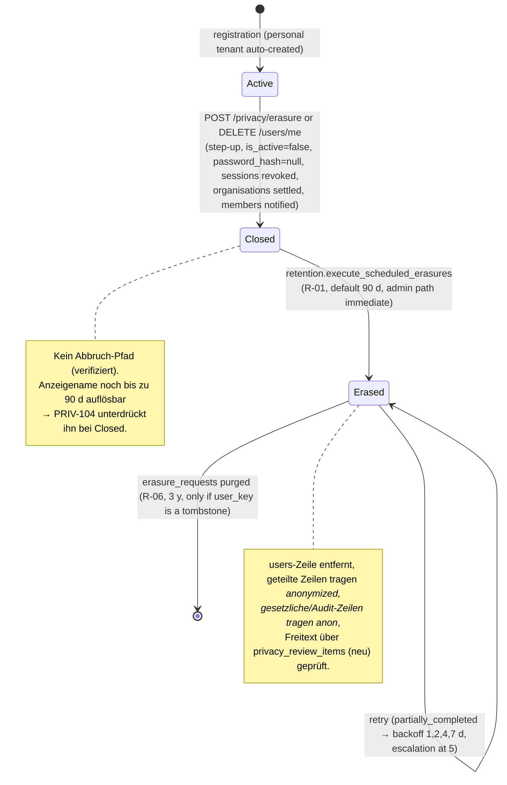
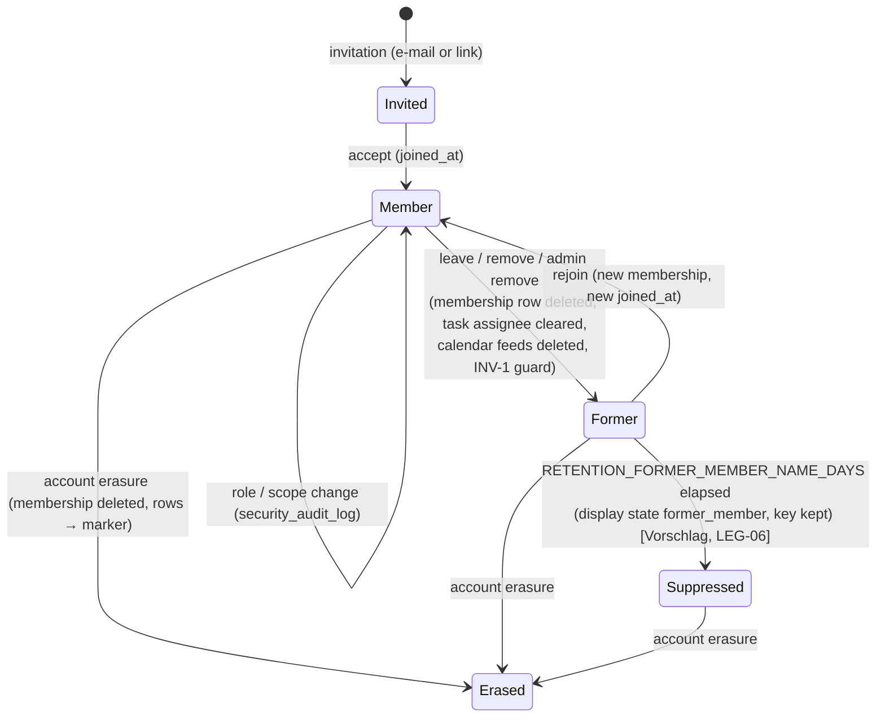
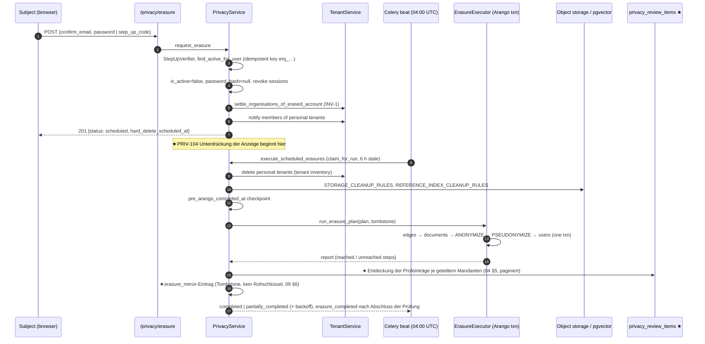
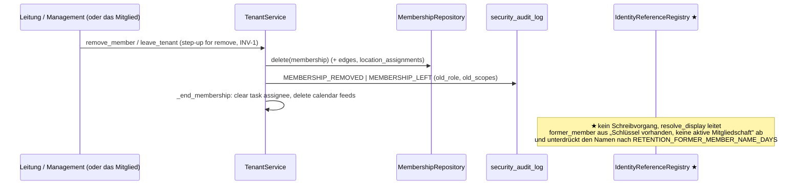
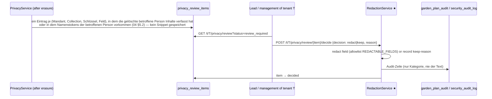

# SPEC-01 — Datenschutzarchitektur

```
Paket: spec/privacy (DSGVO-Datenschutzarchitektur und Implementierungsspezifikation)
Status: Entwurf zur Implementierung — rechtliche Prüfung ausstehend (siehe decision-log.md, LEG-*); Produktionsgates je Maßnahme (06 §10)
Version: 1.1 (Härtung: Evidenzklassen, Löschungs-Spiegel statt Raw-Key-Ledger, Zustandsautomat Prüfung, Offline-Opt-in)
Datum: 2026-11-09
Gemessen an: develop 24d1c2988 (nach Fast-Forward; Welle 9 von REQ-053 gemergt); Nachtrag #2839 (develop 343afbb97, 2026-11-09)
Sprache: Deutsch (Spezifikation); Quellcode und GitHub-Texte bleiben englisch
Anforderungs-IDs: PRIV-001 … PRIV-029 (dieses Dokument)
```

Dieses Dokument ist der Einstiegspunkt der Datenschutzarchitektur. Es legt das Vokabular, die
Komponenten, ihre Zuständigkeiten und die Vertrauensgrenzen fest. Jedes weitere Dokument des
Pakets verfeinert eine Komponente. Die README erläutert die Lesereihenfolge und das
Rückverfolgbarkeitsmodell (Anforderung → Abnahmekriterium → Test).

Die RFC-2119-Schlüsselwörter (MUSS, DARF NICHT, SOLLTE, SOLLTE NICHT, KANN) sind normativ. Aussagen,
die mit **[verifiziert]** markiert sind, wurden im Code oder in den Specs beim oben genannten
Commit gelesen; Aussagen mit **[Vorschlag]** sind der Entwurf dieses Pakets; Aussagen mit
**[rechtlich]** bedürfen der Prüfung durch qualifizierte Rechtsberatung oder den
Datenschutzbeauftragten (DSB) und werden im Entscheidungslog als `LEG-nn` geführt.

---

## 1. Geltungsbereich und Ausgangslage

### 1.1 Was heute existiert (verifizierte Zusammenfassung)

Kamerplanter verfügt bereits über eine umfangreiche DSGVO-Implementierung. Das Paket baut
darauf auf und ersetzt sie nicht:

| Bereich | Wo er liegt | Status |
|---------|-------------|--------|
| Löschinventar (Art. 17) | `ErasureEngine.DELETE_STEPS`, `ANONYMIZE_COLLECTIONS`, `PSEUDONYMIZE_AUDIT_COLLECTIONS`, `STORAGE_CLEANUP_RULES`, `REFERENCE_INDEX_CLEANUP_RULES`, `EXCLUDED_USER_REFERENCES` in `src/backend/app/domain/engines/erasure_engine.py` | implementiert, abgesichert durch `scripts/check_privacy_inventory.py` (R1–R6) und `tests/unit/domain/engines/test_privacy_engines.py` |
| Auskunftsinventar (Art. 15/20) | `DataExportEngine.USER_DATA_MANIFEST`, `EXCLUDED_FROM_DISCLOSURE` in `domain/engines/data_export_engine.py` | implementiert; Wechselseitigkeit mit dem Löschinventar ist abgesichert (REQ-025 §3.1.4) |
| Mandantenlöschung | `TenantErasureEngine.INVENTORY` in `domain/engines/tenant_erasure_engine.py`; Executor `data_access/arango/tenant_erasure_executor.py` | implementiert, 90 Tage Karenzzeit (`RETENTION_TENANT_ERASURE_GRACE_DAYS`), Abbruch-Route, Wiederholung mit Backoff |
| Ablauf der Kontolöschung | `PrivacyService.request_erasure` / `erase_account` / `_finalize_erasure` in `domain/services/privacy_service.py`; API `api/v1/privacy/router.py` | implementiert: Step-up, sofortiges Soft-Close, Hard-Delete nach 90 Tagen (R-01), Claim/Retry, Zustand `partially_completed`, kein Abbruch |
| Aufbewahrung (NFR-011) | ein Celery-Beat-Task pro Kategorie in `app/tasks/retention_tasks.py`; Obergrenzen/Untergrenzen in `app/config/settings.py` (`RETENTION_CEILINGS`) | implementiert für R-01…R-07, R-16…R-18 (nur gelöschte Mandanten), R-25, R-26, R-38; R-14/R-15/R-19…R-21/R-27…R-40 nicht implementiert |
| Einwilligung | `ConsentEngine.PURPOSES` (`domain/engines/consent_engine.py`), `ConsentGuard` (`domain/guards/consent_guard.py`) | implementiert, Guard auf Service-Ebene, keine Middleware |
| Zwei Ersatzformen für eine gelöschte betroffene Person | Marker `_anonymized` (`ANONYMIZED_MARKER`) für Zeilen geteilter Mandanten; Tombstone `anon_<16hex>` (`compute_tombstone_hash`, `sha256(user_key + ERASURE_TOMBSTONE_SALT)[:16]`) für gesetzliche und Audit-Zeilen | implementiert; die Marker-Konstante ist viermal kopiert (`erasure_engine.py`, `models/care_event.py`, `attachment_repository.py`, `tenant_export_engine.py:ANONYMIZED_ACCOUNT`), der Tombstone-Regex dreimal als Literal; je eine weitere eingefrorene Kopie in `v0107_care_event_tombstone_performer.py` (bleibt, NFR-016 M-7; `04` §1) |
| Pflegeprotokoll (REQ-053 §13) | `domain/models/care_event.py`, `domain/services/care_event_service.py`, `care_event_repository.py`; rollenabhängiger `performed_by`-Filter (`MembershipEngine.can_filter_care_log_by_member`); Schwärzung nur durch lead `POST /care-events/{key}/redact` | implementiert (WP 4.3, 8.1, 8.3, 9.3) |
| Offline (REQ-053 Welle 9, UI-NFR-012 v2.4) | `src/frontend/src/sw.ts`, `pwa/cachePolicy.ts`, `features/gardenPlanner/offline/{db,queueDb,queue,sync,retention}.ts`, `pwa/offlineData.ts` | implementiert: IndexedDB `kp-plan-cache` / `kp-write-queue`, Cache Storage `kp:{user}:{tenant}` (latent, das Backend sendet `no-store`), Kill-Switch `PWA_CACHING_ENABLED`, Replay-Idempotenz `client_event_id` (v0106) |

### 1.2 Was dieses Paket ergänzt

Die Lücken, die die Repository-Analyse ergeben hat (siehe `02-personal-data-inventory.md` §6 und
das Entscheidungslog), fallen in sechs Gruppen; jede wird unten zu einer Zuständigkeit einer
Komponente:

1. **Identität ist nicht von der Historie getrennt.** Jede Domänenzeile speichert den rohen
   `users._key` in ca. 30 Feldern ohne deklarierte Zurechnungsrolle; Anzeigenamen werden ad hoc
   durch AQL-`DOCUMENT()`-Joins aufgelöst; ein gelöschter Akteur erscheint an einer Stelle als
   hartcodierter deutscher String `"anonymisiert"` und an einer anderen als `null`. Ein
   Pseudonym (`anon_…`) konnte bis #2839 aus einer gesetzlichen Zeile in das Pflegeprotokoll
   durchsickern (#2770 Punkt 1; seit #2839 Marker, Bestand durch v0107 korrigiert) — die
   übrigen Kopierstellen sind nicht abgesichert (PRIV-205).
2. **Die Löschung endet am Schlüssel.** Die Kontolöschung leert nie Freitext von Inhalten
   (Tagebuchtext, `summary`/`material` von Pflegeereignissen, Namen von Beetvorlagen,
   Standortnamen, Audit-Zusammenfassungen, Bildunterschriften, ursprüngliche Dateinamen).
   Schwärzung gibt es nur für Pflegeereignisse, nur für Leads und nur von Hand ohne auffindbare
   Liste betroffener Zeilen (#2517).
3. **Das Ende einer Mitgliedschaft hat keine Datenschutzsemantik.** Beim Verlassen eines
   Mandanten werden die Mitgliedschaftszeile gelöscht und Aufgabenzuweisungen geleert; jede
   Zurechnung des ehemaligen Mitglieds bleibt für den Mandanten unbegrenzt sichtbar (bis zur
   Kontolöschung oder zur 5-jährigen Aufbewahrung der Pflegeereignisse).
4. **Rechtsgrundlagen werden einheitlich angewandt.** Die gesetzliche Aufbewahrung (CanG,
   PflSchG §11) gilt für jeden Mandanten, auch für Hobbygärten, die keine Aufzeichnungspflicht
   trifft; das Pflegeprotokoll erbt die Identitäten der Ausführenden aus gesetzlichen Zeilen
   (Zweckänderung, Art. 6(4)); Beschäftigten- und Ehrenamtskontexte werden nicht unterschieden
   (Art. 88 DSGVO, §26 BDSG).
5. **Keine Datenschutzadministration.** Es gibt keinen Audit-Trail für Datenschutzvorgänge,
   keine Prüfwarteschlange, keine Überwachung unvollständiger Löschungen über Logzeilen hinaus,
   keine mandantenbezogene Sicht darauf, was eine Löschung zurückgelassen hat.
6. **Offline-Daten überleben das Konto.** Der Schreibpuffer überlebt eine tote Sitzung; ein auf
   einem anderen Gerät gelöschtes Konto hinterlässt auf diesem Gerät bis zu 365 Tage lang
   Einträge; der Logout wartet nicht auf die Bereinigung; mehrere `localStorage`-Schlüssel mit
   einem `user_key` oder einer E-Mail-Adresse werden nie gelöscht.

### 1.3 Nicht im Geltungsbereich

- Das Verzeichnis von Verarbeitungstätigkeiten (Art. 30) oder die Datenschutz-Folgenabschätzung
  selbst zu schreiben — dieses Paket liefert die technische Zuarbeit (`02`, `06`, `11`), nicht
  die organisatorischen Dokumente.
- Das Rollenmodell von REQ-049 (viewer/grower/lead + `management`/`technical`) zu ändern. Das
  Paket ergänzt zweckbezogene **Sichtbarkeitsregeln** darüber, keine neuen Rollen.
- Plant Identity / Plant Social (REQ-055) — nicht implementiert; die zugehörigen
  Datenschutzzeilen (NFR-011 R-28…R-37) werden referenziert, aber nicht neu entworfen.

---

## 2. Vokabular

| Begriff | Definition in diesem Paket |
|---------|----------------------------|
| **Betroffene Person** | Eine natürliche Person, deren Daten verarbeitet werden: ein Kontoinhaber, ein ehemaliger Kontoinhaber, ein im Freitext genannter Dritter (`performed_by_label`), eine auf einem Foto gezeigte Person. |
| **Kontoreferenz** | Ein Feld mit `users._key` (Form `user_key`, `*_user_key`, `*_by_key`, `*_by`, `owner_user_key`). REQ-025 §3.1.3 Regel 5 verlangt, dass jedes solche Feld im Löschinventar oder in `EXCLUDED_USER_REFERENCES` steht. |
| **Zurechnungsrolle** | *Warum* eine Kontoreferenz auf einer Zeile existiert: `performed_by` (hat die Tätigkeit ausgeführt), `created_by` (hat den Datensatz verfasst), `confirmed_by` (hat eine Aufgabe/ein Ereignis bestätigt), `modified_by` (hat den Datensatz geändert), `assigned_to`, `owner`, `actor` (Audit), `recipient`, `subject_of`. Definiert in §4.1. |
| **Identifizierbare personenbezogene Daten** | Eine Zeile, die eine lebende Person direkt (Anzeigename, E-Mail, roher `user_key` eines bestehenden Kontos) oder indirekt über Inhalte benennt, die der Verantwortliche verknüpfen kann. |
| **Pseudonymisierte Daten** | Art. 4(5): Die Kontoreferenz wird durch einen Wert (`anon_<16hex>`) ersetzt, der ohne gesondert aufbewahrte zusätzliche Informationen (`ERASURE_TOMBSTONE_SALT`, die Zuordnung Schlüssel → Person) nicht zugerechnet werden kann. Zeilen einer Person bleiben untereinander **verknüpfbar**. Pseudonymisierte Daten sind personenbezogene Daten. |
| **Anonymisierte Daten** | Die Zeile erlaubt mit keinem Mittel, das vernünftigerweise eingesetzt werden könnte, mehr eine Identifizierung (Erwägungsgrund 26). Der Marker `_anonymized` ist **kein** Nachweis der Anonymisierung: Die Zeile ist nur dann anonymisiert, wenn kein anderes gespeichertes Attribut (Freitext, Foto, gemeinsam auftretende Daten) eine Identifizierung erlaubt. |
| **Domänenhistorie ohne personenbezogene Zurechnung** | Eine Zeile, deren Kontoreferenzen `null` oder der Marker sind und deren Freitext geprüft oder geschwärzt wurde — das, was der Mandant für agronomische Zwecke behält (Fruchtfolge, Beethistorie). |
| **Tombstone** | Das Pseudonym `anon_<16hex>`; ebenso die Zeile in `erasure_requests`, die das Konto überlebt. |
| **Marker** | Das Literal `_anonymized`, das in ein Kontoreferenz-Feld einer beibehaltenen geteilten Zeile geschrieben wird. |
| **Schwärzung** | Das Ersetzen eines Freitextwerts durch das Literal `[redacted]` (Code `REDACTED` in `models/care_event.py`) und die Aufzeichnung von Wer, Wann und Warum. |
| **Geteilter Mandant** | Ein Mandant mit mehr als einem Mitglied oder der mehr als ein Mitglied erhalten kann (`tenant_type: organization` oder ein persönlicher Mandant mit Eingeladenen). REQ-049 P3 behandelt `tenant_type` als Anzeigeeigenschaft; dieses Paket folgt REQ-025 §3.1.3, das bei der Löschung sehr wohl danach unterscheidet. |
| **Gesetzlicher Datensatz** | Eine Zeile, die nach Art. 6(1)(c) aufbewahrt wird, weil ein Gesetz es verlangt: `harvest_batches` / `quality_assessments` (CanG, 5 Jahre, NFR-011 R-16), `treatment_applications` (PflSchG §11, 3 Jahre, R-17), `inspections` (R-18). Ob die Pflicht für einen bestimmten Mandanten gilt, ist eine **[rechtliche]** Frage (LEG-03). |
| **Datenschutzvorgang** | Eine langlaufende, wiederholbare Änderung, die durch ein Betroffenenrecht oder eine Aufbewahrungsregel ausgelöst wird: Kontolöschung, Mandantenlöschung, Export, Schwärzungsstapel, Aufbewahrungslauf, Migrations-Backfill. |

---

## 3. Architekturübersicht

### 3.1 Komponentenkarte

Die Zerlegung folgt dem Vorschlag der Aufgabe mit einer Änderung: *Datenherkunft
(Data Lineage) und Aufbewahrungsverwaltung* wird in eine deklarative **Registry**
(Herkunftsbeziehung + Aufbewahrungsmetadaten, reiner Code, abgesichert) und die bestehenden
**Aufbewahrungs-Beats** (Celery) aufgeteilt. Das entspricht dem eigenen Muster des Repositorys
— „das Inventar ist der Code, abgesichert durch ein Skript" (REQ-025 §3.1) — und vermeidet
einen neuen Laufzeitdienst. Es wird kein Microservice, kein neuer Datenspeicher und keine
Middleware eingeführt.


### 3.2 Zuständigkeiten

| Komponente | Verantwortet | Verantwortet nicht | Verfeinert in |
|------------|--------------|--------------------|---------------|
| **Identity & Membership Lifecycle (IML)** | Kontozustände (`active` → `closed` → `erased`), Mitgliedschaftszustände, die *Zurechnungsrolle* jeder Kontoreferenz (`IdentityReferenceRegistry`), Auflösung des Anzeigenamens für alle API-Antworten (`resolve_display`), die Darstellungszustände `member`, `former_member`, `erased`, `third_party`, `system`, `service_account` | Löschen oder Umschreiben von Zeilen (PLE), Entscheiden, wer einen Namen sehen darf (ACV) | `03-account-and-membership-lifecycle.md`, `08-api-and-data-model.md` §2 |
| **Privacy Lifecycle Engine (PLE)** | den Löschplan und seine Ausführung, Anonymisierungs- und Pseudonymisierungsregeln, Schwärzung (manuell und kaskadierend), Propagation auf abgeleitete Zeilen, Idempotenz, Wiederholung, Behandlung von Teilausfällen, den Löschungs-Spiegel (`erasure_mirror`, Tombstone-Liste ohne Rohschlüssel, DEC-26) für Backup-Wiederherstellungen, den Zustandsautomaten der Freitextprüfung (`04` §5.1a) | Aufbewahrungsfristen (REG), UI (PADM) | `03`, `04-anonymization-and-redaction.md`, `09-migrations-and-backfills.md` |
| **Lineage & Retention Registry (REG)** | deklarative Metadaten: welches Feld von welchem abgeleitet ist (`DERIVED_FIELDS`), welche Zeilen gesetzlich sind, die Aufbewahrungsober-/-untergrenzen, die Allowlist schwärzbarer Felder, die Collections, in denen Tombstones erlaubt sind; Guard-Skripte, die die Registries vollständig halten | Ausführung (PLE, Beats) | `02-personal-data-inventory.md`, `06-retention-and-legal-basis.md` |
| **Access Control & Visibility (ACV)** | Rollen-Gates (bestehend), *Sichtbarkeitsregeln* für personenbezogene Zurechnung (Ausführende/Ersteller/Bestätigende), zweckbezogene Berechtigungen (`privacy.review`, `attribution.filter`, `attribution.export`; Schwärzung läuft unter `privacy.review`, `05` §5), die Audit-Zeile für jedes datenschutzrelevante Lesen (Massenexport mit Namen) | Rollendefinitionen (REQ-049) | `05-access-and-visibility.md` |
| **Privacy Administration (PADM)** | die Prüfwarteschlange (`privacy_review_items`), die Lead-/Management-UI, um zu sehen, was eine Löschung in ihrem Mandanten hinterlassen hat, und zu entscheiden (schwärzen / mit Begründung behalten), Auskunftsstatus (DSAR), Überwachung unvollständiger Datenschutzvorgänge, Dokumentation von Ausnahmen | die Regeln selbst | `04`, `05`, `08`, `12-implementation-roadmap.md` |
| **Offline Privacy Layer (OPL)** | alles, was auf dem Endgerät gespeichert wird: Namespaces, Cache-Lebenszyklus, Lebenszyklus des Schreibpuffers, Sitzungsisolation, Behandlung von Widerrufen, Modus für geteilte Geräte | serverseitige Deduplizierung (`client_event_writes.py`, PLE) | `07-offline-privacy.md` |

### 3.3 Warum kein separater Datenschutzdienst und keine Middleware

- REQ-025 §3.7 hat sich bereits gegen eine Einwilligungs-Middleware entschieden; der
  Einwilligungs-Guard ist ein Aufruf auf Service-Ebene. Dieselbe Überlegung gilt für die
  Sichtbarkeit: Die benötigten Informationen (Rolle, Scope, Zurechnungsrolle des Feldes,
  Mitgliedschaftszustand der referenzierten Person) sind nur innerhalb des Services verfügbar,
  nicht am HTTP-Rand.
- Alle Datenschutzvorgänge laufen bereits als Celery-Tasks mit eigenen Zustandsdokumenten
  (`erasure_requests`, `tenant_erasure_records`, `data_export_requests`). Ein neuer
  „Engine-Service" würde die Claim-/Retry-/Backoff-Logik duplizieren, die in
  `PrivacyService._finalize_erasure` und `TenantService._run_tenant_erasure` existiert.
- Die 5-Schichten-Regel (NFR-001) und das Eigentumsprädikat (#2107, `*, tenant_key: str`)
  bleiben erhalten: Jede neue Service-Methode, die per Schlüssel lädt und schreibt, nimmt
  `tenant_key` entgegen.

---

## 4. Identitätstrennung

### 4.1 Zurechnungsrollen

**PRIV-001** Jedes Kontoreferenz-Feld MUSS mit genau einer Zurechnungsrolle registriert sein.
Die Registry (`IdentityReferenceRegistry`, siehe `08` §2) wird aus dem bestehenden
Löschinventar abgeleitet — die Einträge `AnonymizationRule` / `PseudonymizationRule` /
`ErasureStep` / `ErasureExclusion` erhalten ein Attribut `attribution` —, sodass es weiterhin
genau eine Liste gibt (REQ-025 §3.1, „keine zweite Kopie"). Das Guard-Skript
`scripts/check_privacy_inventory.py` erhält die Regel R7: Jedes kontoförmige Feld hat eine
Zurechnung.

| Rolle | Bedeutung | Erforderlich für | Beispiele [verifiziert] |
|-------|-----------|------------------|-------------------------|
| `performed_by` | die Person, die die Tätigkeit ausgeführt hat | Domänenfunktion (wer gegossen hat), Rechenschaft innerhalb des Mandanten, gesetzlicher Datensatz (Anwender) | `care_events.performed_by_user_key`, `harvest_batches.harvested_by_key`, `treatment_applications.applied_by_key`, `inspections.inspected_by_key`, `quality_assessments.assessed_by_key` |
| `performed_for` | das Mitglied, in dessen Auftrag gehandelt wurde (Stellvertretung) | Domänenfunktion | `care_events.performed_for_user_key` |
| `created_by` | der Verfasser des Datensatzes | Korrektur der eigenen Zeile (Autorenprüfung in `care_event_service.py`), Zurechnung nach Art. 15, Audit | `care_events.created_by`, `plant_diary_entries.created_by`, `task_comments.created_by`, `garden_objects.created_by`, `bed_templates.created_by`, `attachments.created_by`, `manual_overrides.created_by` |
| `confirmed_by` | wer eine Aufgabe/ein Ereignis bestätigt hat | Rechenschaft; heute **nicht separat gespeichert** — `CareConfirmation` hat kein Akteursfeld, stattdessen steht `performed_by_user_key` des abgeleiteten Pflegeereignisses | (keine; siehe `03` §4.3) |
| `modified_by` | wer zuletzt geändert / storniert / geschwärzt hat | Audit, Korrekturrechte | `care_events.voided_by`, `care_events.redacted_by`, `sites.plan.plan_updated_by`, `weather_source_configs.updated_by` |
| `assigned_to` | Verantwortlichkeit | Domänenfunktion | `tasks.assigned_to_user_key`, `location_assignments` |
| `owner` | Eigentum an einem Container | Autorisierung | `tenants.owner_user_key` |
| `actor` | wer eine administrative/sicherheitsrelevante Aktion ausgeführt hat | Art.-32-Audit | `security_audit_log.actor_user_key`, `garden_plan_audit.user_key`, `mcp_audit_log.service_account_key`, `ai_audit_log.user_key` |
| `recipient` | an wen etwas adressiert ist | Zustellung | `notifications.user_key`, `invitations.accepted_by_user_key` |
| `subject_of` | die Person, auf die sich der Datensatz bezieht | das Recht selbst | `erasure_requests.user_key`, `consent_records.user_key`, `memberships.user_key` |

**PRIV-002** Die Rollen DÜRFEN NICHT als austauschbar behandelt werden. Insbesondere gilt:
- Ein `created_by` DARF NICHT durch einen Backfill, einen Konsistenzjob oder einen Import in
  ein `performed_by` kopiert werden (oder umgekehrt); der Mapper MUSS das Ziel auf `null`
  lassen, wenn die Quelle kein Feld derselben Rolle hat;
- ein `confirmed_by` MUSS vom authentifizierten Aufrufer der Bestätigung abgeleitet werden,
  niemals aus `assigned_to_user_key` der Aufgabe;
- ein `performed_by` DARF legitim von `created_by` abweichen (Stellvertretereintrag, Korrektur
  durch einen Lead): Beide werden behalten, und nur `created_by` gewährt das Recht zur
  Korrektur der eigenen Zeile.

**PRIV-003** [verifizierte Lücke → Anforderung] Die Bestätigungspfade MÜSSEN dieselbe
Akteursregel speichern. Heute speichern REST und Benachrichtigung den Aufrufer, die
Task-Queue-Brücke (`care_reminder_service.record_care_task_completion`, aufgerufen aus
`api/v1/tasks/tenant_router.py` ohne Benutzer) und MCP (`mcp_server/tools/care.py`) speichern
`null`. Die Regel lautet: `performed_by_user_key = authentifizierter Principal` (ein
Service-Account ist ein Principal und wird als `service_account` dargestellt);
`created_by = authentifizierter Principal`. (#2770 Punkt 2, in #2839 bewusst nicht geändert und an #2517
übergeben; die rechtliche
Sichtbarkeitsentscheidung in LEG-05 ändert nicht, *was* gespeichert wird, nur, *wer es sieht*.)

### 4.2 Erforderliche und optionale Zurechnung

**PRIV-004** Für jede Zurechnung MUSS die Registry angeben, ob sie `required` (die Funktion
oder eine gesetzliche Pflicht braucht sie) oder `optional` (aus Bequemlichkeit behalten) ist.
Standardwerte:

| Zurechnung | Klasse | Begründung |
|------------|--------|------------|
| `performed_by` auf gesetzlichen Zeilen | erforderlich, solange die gesetzliche Pflicht für den Mandanten gilt (LEG-03) | Aufzeichnungsinhalt nach PflSchG §11(2) (Anwender) — **[rechtlich]**, ob der *Name* für den gesamten Zeitraum lesbar bleiben muss (LEG-04) |
| `performed_by` auf Pflegeereignissen, Gießen, Düngen | optional | Die Domänenhistorie braucht, *dass* das Beet gegossen wurde, nicht, *wer* es getan hat; Rechenschaft ist ein Interesse des Mandanten (Art. 6(1)(f), Abwägung in `06` §4) |
| `created_by` | optional, aber erforderlich für die Korrektur der eigenen Zeile und die Zurechnung nach Art. 15, solange das Konto existiert | — |
| `actor` im Sicherheits-Audit | erforderlich für 730 Tage | Art. 32, Art. 5(2) |
| `actor` in `garden_plan_audit` | optional | mandanteninternes Änderungsprotokoll; ein Jahr |
| `assigned_to`, `owner`, `recipient`, `subject_of` | erforderlich, solange die Beziehung besteht; gelöscht oder ersetzt, wenn sie endet | — |

**PRIV-005** Eine `optional`-Zurechnung MUSS entfernbar sein, ohne die Funktion zu brechen:
Jeder Leser MUSS `null`, den Marker und ein fehlendes Benutzerdokument identisch behandeln
(Darstellungszustand `erased`, siehe §4.3).

### 4.3 Ein einziger Pfad zur Anzeigeauflösung

**PRIV-006** Alle API-Antworten, die für eine Kontoreferenz eine Person zeigen, MÜSSEN über
einen einzigen Resolver laufen (`IdentityReferenceRegistry.resolve_display`, `08` §2.3), der
ein `PersonRef` mit `state ∈ {member, former_member, erased, third_party, system, service_account}`
und `display_name` nur dann zurückgibt, wenn die betrachtende Person ihn sehen darf (`05`).
Die heutigen AQL-Joins (`DOCUMENT(CONCAT(@users, key)).display_name` in
`care_event_repository.py` und `garden_plan_repository.py`) bleiben als *Nachschlagen*
erlaubt, die *Darstellungsentscheidung* MUSS jedoch in einer einzigen Funktion getroffen werden.

**PRIV-007** Das Backend DARF NICHT ein lokalisiertes Wort für eine gelöschte Person
ausgeben. Das aktuelle Literal `PERFORMED_BY_ANONYMISED = "anonymisiert"`
(`models/care_event.py`) bleibt für einen Kompatibilitätszyklus im String-Feld erhalten und
wird von `performed_by_kind` begleitet (siehe `08` §3.1); das Frontend stellt nach Art über
i18n dar (`enums.personRef.<state>`).

**PRIV-008** Ein fehlendes Benutzerdokument (Konto hart gelöscht) und der Marker MÜSSEN
gleich dargestellt werden (`erased`). Ein Tombstone (`anon_…`) außerhalb der per Allowlist
zugelassenen gesetzlichen/Audit-Collections MUSS als Defekt behandelt werden (vom
Konsistenzjob gemeldet, `04` §6) und als `erased` dargestellt werden.

---

## 5. Datenschutz-Lebenszyklus

### 5.1 Lebenszyklus der betroffenen Person



### 5.2 Mitgliedschafts-Lebenszyklus (pro Mandant)



**PRIV-009** Die drei Enden einer Beziehung sind verschieden und MÜSSEN verschieden bleiben:
*Ende der Mitgliedschaft* (die Person existiert weiter und kann wieder beitreten; die
Zurechnung wird nach einer Frist für andere Mitglieder unterdrückt, nie gelöscht),
*Kontoschließung* (kein Login, Name verborgen, Daten für die Karenzzeit intakt),
*Kontolöschung* (Zeilen gelöscht, markiert oder pseudonymisiert; Freitext geprüft). `03`
spezifiziert jedes einzelne.

### 5.3 Datenlebenszyklus je Aufbewahrungsklasse

| Klasse | Zeilen | Bei Kontolöschung | Bei Mandantenlöschung | Bei Ende der Aufbewahrung | Spec |
|--------|--------|-------------------|-----------------------|---------------------------|------|
| `ephemeral` | Sitzungen, Tokens, Einstellungen, Benachrichtigungen, Einschränkungen, persönliche Exporte | gelöscht | gelöscht | gelöscht | `06` |
| `shared_history` | Pflegeereignisse, Tagebuch, Aufgaben, Kommentare, Gartenobjekte, Beetvorlagen, Anhänge, Audit des Plans | Kontoreferenzen → Marker; Freitext → Prüfwarteschlange | gelöscht | Pflegeereignisse: Freitext nach 5 J. geschwärzt (R-25) | `04`, `06` |
| `statutory` | Erntechargen, Qualitätsbewertungen, Behandlungsanwendungen, Inspektionen — **nur in Mandanten mit Aufzeichnungspflicht (LEG-03)** | Schlüssel → Tombstone, Anzeigename geleert (heute); **[rechtlich]** LEG-04 | pseudonymisiert behalten bis zum Ende der gesetzlichen Frist | gelöscht | `06` |
| `audit` | Sicherheits-Audit, Löschanträge, Einwilligungsdatensätze, MCP-Audit | Schlüssel → Tombstone | Sicherheits-Audit behalten, andere nach Regel | gelöscht (730 d / 3 J.) | `06` |
| `device` | IndexedDB, Cache Storage, localStorage | auf diesem Gerät bereinigt; andere Geräte: Quarantäne toter Sitzungen | bei der nächsten Sitzung bereinigt | TTL 15 min / Queue 90–365 d (zu verkürzen) | `07` |

---

## 6. Datenflüsse

### 6.1 Kontolöschung (wie implementiert, mit den mit ★ markierten Ergänzungen)



### 6.2 Ende der Mitgliedschaft



### 6.3 Schwärzungsprüfung (neu)



### 6.4 Offline-Schreiben und Widerruf

Siehe `07` §5 und §7: Das Gerät sendet `KP_SET_NAMESPACE {userKey, tenantKey}` an den Worker,
puffert Schreibvorgänge mit einer `client_event_id` und spielt sie FIFO ab; der Server
dedupliziert über den eindeutigen Sparse-Index `(tenant_key, client_event_id)` (v0106). ★ Eine
tote Sitzung (Refresh mit 401/403 abgelehnt) stellt die Queue dieses `user_key` für
`OFFLINE_DEAD_SESSION_GRACE_DAYS` unter Quarantäne und bereinigt sie dann; ein serverseitiger
stabiler Fehlercode (`account.closed`, `membership.ended`) löst eine sofortige Bereinigung aus. Cache und
Puffer entstehen nur nach ausdrücklichem Einschalten des Offline-Modus (`07` §2.1, DEC-29).

---

## 7. Vertrauensgrenzen

| Grenze | Was sie überquert | Kontrollen (bestehend) | Ergänzte Kontrollen |
|--------|-------------------|------------------------|---------------------|
| **Endgerät ↔ API** | JWT-Access-Token (Speicher), Refresh-Cookie (HttpOnly), gepufferte Schreibvorgänge mit `client_event_id`, gecachte Plandaten | `Cache-Control: no-store` auf allen `/api/v1` (MT-044; Ausnahme `private, no-cache` für die drei Lesepfade der SW-Allowlist, umgesetzt mit REQ-053 v1.47; abgerufen mit Request-Cache-Modus `no-store`, Logout sendet `Clear-Site-Data: "cache"`), SW-Allowlist, Namespace pro Benutzer+Mandant, `no-store` für `/sw.js` und `manifest.json` | Modus für geteilte Geräte, Quarantäne toter Sitzungen, Logout wartet auf Bereinigung, localStorage-Hygiene (`07`) |
| **Mandant ↔ Mandant** | nichts | URL `/t/{slug}/`, `_membership_for_slug` als einziger Resolver, Eigentumsprädikat `*, tenant_key: str`, Isolationstests über alle Routen | Prüfwarteschlange und Schwärzung sind mandantenbezogen; die Propagation der Registry überschreitet nie einen Mandanten |
| **Mitglied ↔ Mitglied (innerhalb eines Mandanten)** | Namen von Ausführenden/Erstellern, Freitext, E-Mail-Adressen von Mitgliedern | Rollen-Gates; `performed_by`-Filter für viewer/grower auf die eigene Person beschränkt | Sichtbarkeitsregeln (`05`): Namen ehemaliger Mitglieder unterdrückt, Ausführende vor Nicht-Leads verborgen, wo die Mandanteneinstellung es vorsieht, Mitglieds-E-Mails nur für `management`, CSV mit Namen auditiert |
| **Mandant ↔ Plattformbetreiber** | Mitgliedschaftslisten, Zähler, Sicherheits-Audit; **keine Domänendaten** (REQ-049 P4, AK-09) | `require_platform_admin` | Die Überwachung von Datenschutzvorgängen legt Zähler und Zustände offen, nie Zeileninhalte |
| **Verantwortlicher ↔ Auftragsverarbeiter** [rechtlich] | Wer ist Verantwortlicher für die Mitgliedsdaten eines Community-/Gewerbe-Mandanten — die Mandantenorganisation (mit dem Betreiber als Auftragsverarbeiter, Art. 28) oder der Betreiber (gemeinsam, Art. 26)? | in den Specs nirgends behandelt | **LEG-01**; das Paket unterstellt, dass die *Mandantenorganisation Verantwortlicher für Mitgliedsdaten und der Betreiber Auftragsverarbeiter ist*, und kennzeichnet jede Stelle, an der diese Annahme eine Rolle spielt |
| **Primärspeicher ↔ Backups** | vollständige Kopien | **es existiert kein Backup** (Audit DR-01…04) | Löschungs-Spiegel (Tombstone-Liste, verschlüsselt, HMAC-Kette) und Restore-Replay über Tombstone-Abgleich (`09` §6, DEC-26), bevor irgendein Backup eingeführt wird; Dumps ≤ 35 d |

---

## 8. Invarianten der Mandantenisolation

**PRIV-010** Jede von diesem Paket eingeführte neue Collection (`privacy_review_items`,
`erasure_mirror`, `migration_reports`, `redaction_log`, falls separat) MUSS `tenant_key` tragen (oder
plattformweit sein und mit Begründung in `TenantErasureEngine.NOT_TENANT_SCOPED` geführt
werden) und MUSS zu `TenantErasureEngine.INVENTORY` hinzugefügt werden; der Guard
`tests/unit/guards/test_tenant_erasure_inventory_is_complete.py` erzwingt dies.

**PRIV-011** Die Prüfwarteschlange MUSS ausschließlich über `/api/v1/t/{slug}/privacy/…`
lesbar sein, und zwar für Mitglieder mit `management` oder der Rolle `lead` dieses Mandanten
(ACV); ein Plattformadministrator sieht Zähler je Mandant, nie Einträge (REQ-049 P4).

**PRIV-012** Die Propagation eines Markers oder einer Schwärzung DARF NICHT einer Referenz in
einen anderen Mandanten folgen. Mandantenübergreifende Herkunftsbeziehungen gibt es nur für
globale Katalogdaten (Arten/Cultivare mit `tenant_has_access`), die keine Kontoreferenz tragen.

---

## 9. Prinzipien, die das Paket anwendet (für Implementierende)

1. **Eine Liste, abgesichert.** Inventare leben im Code; ein Skript und ein Unit-Test halten
   sie vollständig. Neue Metadaten (Zurechnung, Herkunftsbeziehung, schwärzbare Felder) werden
   den bestehenden Dataclasses in `domain/models/privacy.py` hinzugefügt, nicht in einem
   parallelen Dokument geführt.
2. **Nie auf Freitext schlüsseln; ihn immer prüfen.** Automatische Löschung wird nur durch
   serverseitig gesetzte Kontofelder gesteuert (REQ-025 Regel 4). Freitext wird zur
   menschlichen Prüfung *markiert*, die Entscheidung wird aufgezeichnet.
3. **Pseudonym ≠ Anonym.** Tombstones sind auf eine Allowlist beschränkt; alles andere nutzt
   den Marker oder `null`. Ein Marker ist eine Aussage über ein *Attribut*, nicht über eine
   *Zeile*.
4. **Die drei Enden trennen.** Ende der Mitgliedschaft, Kontoschließung und Kontolöschung
   haben jeweils eigenes beobachtbares Verhalten.
5. **Sichtbarkeit ist zweckgebunden.** Den Namen einer ausführenden Person zu sehen erfordert
   eine Rolle *und* einen Zweck (operative Koordination, Rechenschaft); Aggregation und Export
   von Namen sind eigene Berechtigungen.
6. **Geräte sind nicht vertrauenswürdig und werden geteilt.** Der Client speichert das
   Minimum, in einem Namespace, für die kürzest nützliche Zeit; der Widerruf erreicht das Gerät.
7. **Jeder Vorgang ist idempotent, fortsetzbar und beobachtbar.** Zustandsdokumente tragen
   `status`, `attempt_count`, `next_attempt_at`; Metriken zählen offene und veraltete Vorgänge.
8. **Rechtliche Fragen sind sichtbar, nicht unterstellt.** `LEG-nn`-Einträge enthalten den
   Standardwert, mit dem der Code ausgeliefert wird, die Alternative **und das Produktionsgate**
   (README §Produktionsgates): Maßnahmen, die Verarbeitung **einschränken**, sind ohne Rechtsfreigabe
   umsetzbar; Maßnahmen, die Verarbeitung **ausweiten** oder **Daten mit möglicher Aufbewahrungspflicht
   vernichten**, stehen hinter einem Feature-Flag (`08` §8a), bis die registrierte Entscheidung vorliegt.
9. **Evidenz vor Behauptung.** Jede Aussage trägt ihre Klasse (`VERIFIED_CODE`, `VERIFIED_SPEC`,
   `VERIFIED_LEGAL` mit L-nn, `INFERRED`, `PROPOSED`, `OPEN_DECISION`, `LEGAL_REVIEW_REQUIRED`); in den
   Dokumenten v1.0 entsprechen `[verifiziert]` = VERIFIED_CODE/VERIFIED_SPEC (je nach Bezug), `[Vorschlag]` =
   PROPOSED, `[rechtlich]` = LEGAL_REVIEW_REQUIRED, `[?]` = INFERRED/unverifiziert.

---

## 10. Rückverfolgbarkeit

| PRIV | Abnahme / Test (siehe `10-testing-and-acceptance.md`) |
|------|--------------------------------------------------------|
| PRIV-001 | TA-001 Vollständigkeit der Registry (Guard R7) |
| PRIV-002 | TA-002 Mapper kopiert nie über Rollen hinweg; TA-003 Bestätigungsakteur = Aufrufer |
| PRIV-003 | TA-003 vier Eintrittspfade speichern den Principal |
| PRIV-004, 005 | TA-004 jeder Leser stellt `null`/Marker/fehlend identisch dar |
| PRIV-006, 007, 008 | TA-005 einziger Resolver; TA-006 kein lokalisiertes Literal aus dem Backend; TA-007 Tombstone außerhalb der Allowlist → `erased` + Konsistenzbefund |
| PRIV-009 | TA-100…TA-130 (Lebenszyklus) |
| PRIV-010, 011, 012 | TA-010 neue Collections im Mandanteninventar; TA-011 Route-Walk der Prüfwarteschlange; TA-012 keine mandantenübergreifende Propagation |
