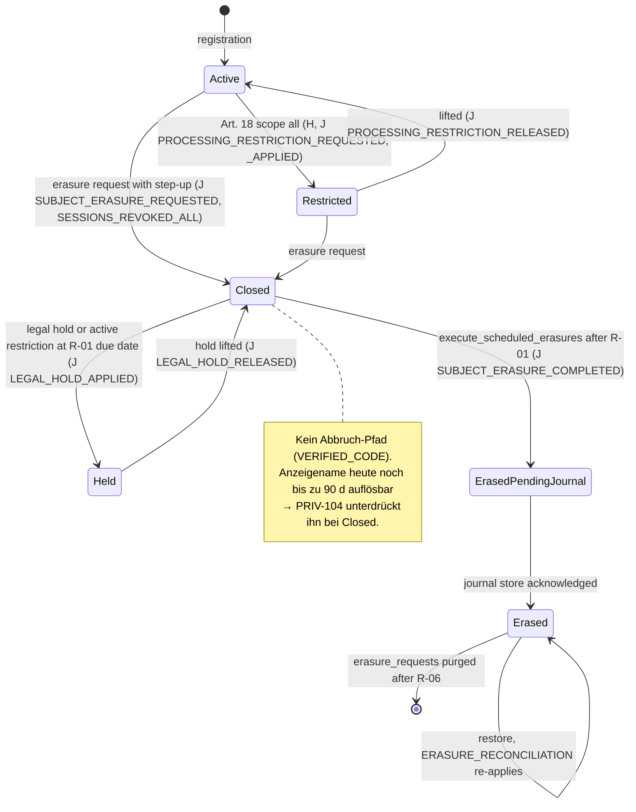
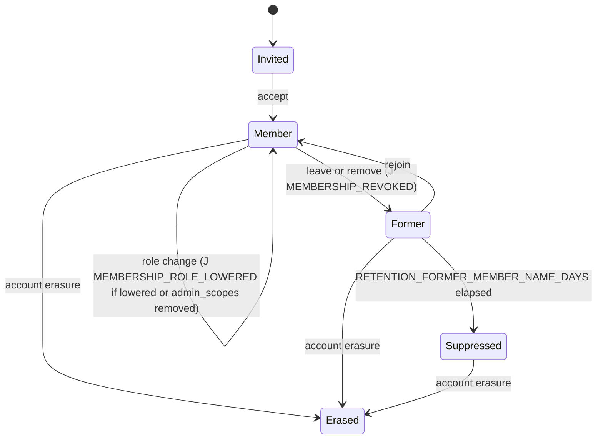
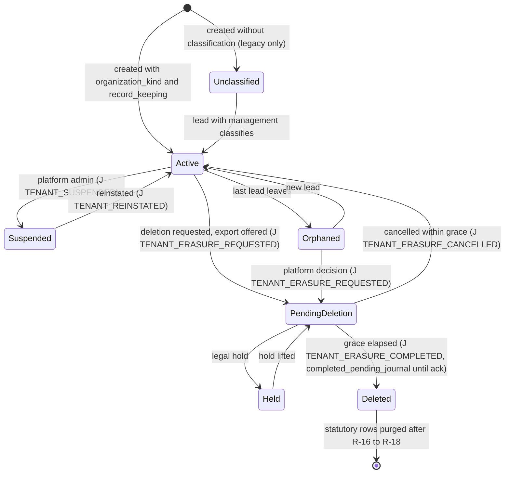
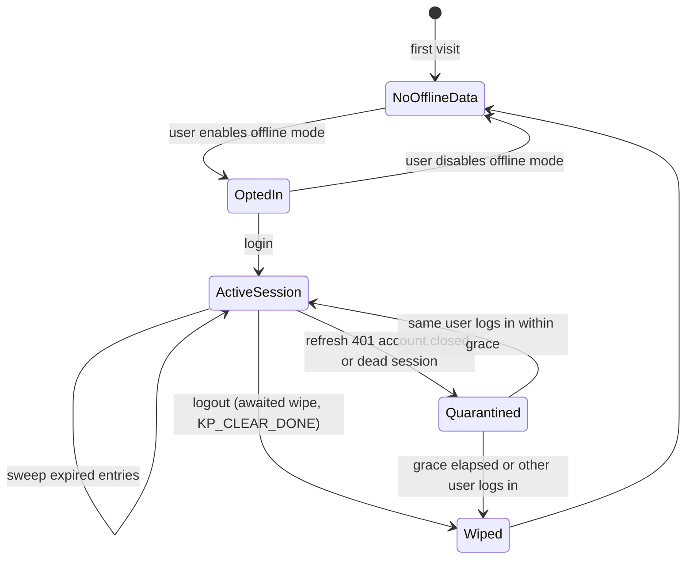

# SPEC-03 — Lebenszyklus von Konto und Mitgliedschaft

```
Paket: spec/privacy · Version 1.2 · 2026-11-22 · gemessen gegen develop 24d1c2988; Nachtrag #2839 (develop 343afbb97)
Gemessen gegen: develop 007a4ea90 (Audit 2026-11-22)
Anforderungs-IDs: PRIV-100 … PRIV-139
Abhängig von: 01 (Vokabular, Komponenten), 04 (Bedeutung von Marker/Tombstone), 06 (Fristen), 09 (Backup/Journal)
Änderungen 1.2: Kopf von 1.0 direkt auf Paketversion 1.2 (LEG-61); §0 Lebenszyklusmodell Konto/Mitgliedschaft/Mandant/
Gerät mit Hold- und Journal-Übergängen; §1.1 Zielzustände `restricted`/`held`; §2.2–§2.4 Ist-Stand korrigiert (PRIV-101/104
nicht gebaut, `erasure_mirror` → Journal, kein Residue-Scan der Kontolöschung); §2.5 Lösch-Matrix 34 Kategorien × 4
Ereignisse mit Code-Belegen; §2.6 Art. 18/21 gespeichert, nicht durchgesetzt (LEG-23), kein Legal Hold (LEG-35); §4.2
PRIV-003/119 umgesetzt (#2961); §10 Fotos, Dateien und Auskunft im Lebenszyklus (LEG-20, LEG-21, LEG-22, LEG-40, LEG-41,
LEG-55).
Nachtrag 2026-11-23 (gemessen gegen develop ce7e858d0): §0 Journal-Ereignisse auf die Taxonomie in
`17-privacy-recovery.md` §3.3 (UPPER_SNAKE_CASE) umgestellt, Mandant um `TENANT_ERASURE_REQUESTED`/`_CANCELLED`
ergänzt; Zwischenzustand `completed_pending_journal` (PRIV-811); neuer §0.5 Restore-Übergänge; §2.4 PRIV-108
angeglichen; §2.5 Zeile G2 und Abschnitt „nach Restore“ (Abbildung auf `17` §6.3); PRIV-126 Begründung Outbox.
```

Dieses Dokument spezifiziert den vollständigen Lebenszyklus der Beziehung einer betroffenen Person zur
Plattform und zu jedem Mandanten: Kontolöschung, Beendigung der Mitgliedschaft, Mandantenlöschung,
Wiedereintritt, Löschanfragen während des Offline-Betriebs, Löschung von Nutzern mit gesetzlich
aufzubewahrenden Datensätzen und Wiederaufnahme der Verarbeitung nach Teilausfall. Für jeden betroffenen
Datensatz wird das erwartete Verhalten angegeben. Verifizierte Fakten sind mit **[verifiziert]**
markiert, neues Verhalten mit **[Vorschlag]**.

---

## 0. Lebenszyklusmodell (Zielbild, Audit 2026-11-22)

Seit v1.2 stehen hier die vollständigen Zustandsmodelle; `01` §5 verweist auf diesen Abschnitt, der Backup-Lebenszyklus
steht in [`09-migrations-and-backfills.md`](09-migrations-and-backfills.md) §6.1a. Je Lebenszyklus sind die Übergänge
markiert, die ein **Journal-Ereignis (J)** erzeugen (Taxonomie [`17-privacy-recovery.md`](17-privacy-recovery.md)
§3.3, präzisiert PRIV-709 aus `09` §6.3), und die Stellen, an denen der **Processing-Hold (H)** greift (§2.6). Wie
ein Restore jeden Lebenszyklus berührt, steht in §0.5. Die Architektur dazu (Komponenten `PrivacyJournal`, `ProcessingHoldGuard`,
Resolver `resolve_tenant_privacy_profile`) steht in [`01-privacy-architecture.md`](01-privacy-architecture.md) §3.5.
Alle Zustände und Übergänge mit „Lücke heute“ sind [PROPOSED]; die Spalte „Lücke heute“ ist der gemessene Stand
(VERIFIED_CODE am SHA `007a4ea90`).

### 0.1 Konto



| Übergang | Wirkung (Soll) | Lücke heute | PRA |
|---|---|---|---|
| Active → Restricted | Lesemodus (423 auf verarbeitende Routen), Jobs überspringen die Person | Einschränkung ohne Wirkung (LEG-23, §2.6) | PRA-0.06, PRA-1.06 |
| Closed → Held | Hard-Delete aufgeschoben, `held_reason` | kein Hold (LEG-35, §2.6) | PRA-1.06 |
| Closed → Erased | Pläne, Storage-Phase über alle Mandanten mit Uploads, Freitext-Entdeckung, Residue-Scan, Journal | Storage-Phase nur aktuelle Mitgliedschaften (LEG-55, §10.3); `control_events` fehlt im Plan (LEG-29, `02`); kein Residue-Scan (PRIV-234); kein Journal (LEG-11, `09` §6) | PRA-1.04, PRA-1.07, PRA-2.01, PRA-2.07, PRA-2.13 |
| Closed → ErasedPendingJournal → Erased | Vollzugs-Commit setzt `completed_pending_journal`; erst nach Bestätigung durch den Journal-Store `completed` (Nutzerbestätigung, Admin-Liste und Metriken zählen erst `completed`; `17` §4.3, PRIV-811) | kein Journal, Status `completed` direkt nach dem Vollzug | PRA-1.04 |
| Passwort/Sitzungen/Keys/Einwilligung/E-Mail (innerhalb Active) | Journal-Ereignis je Änderung (`PASSWORD_CHANGED`, `SESSION_REVOKED`/`SESSIONS_REVOKED_ALL`, `API_KEY_REVOKED`, `CONSENT_WITHDRAWN`, `ACCOUNT_EMAIL_CHANGED`); Widerruf fail-closed (PRIV-812) | Restore setzt zurück (LEG-24, `09` §6.5 S6/S7); API-Key-Widerruf fail-open (LEG-66) | PRA-1.04, PRA-2.21 |

### 0.2 Mitgliedschaft (je Mandant)



| Übergang | Wirkung (Soll) | Lücke heute | PRA |
|---|---|---|---|
| Member → Former | Zuständigkeiten geleert, Austrittshinweis (PRIV-115), Offline-Puffer des Mandanten auf Geräten als `membership.ended` | kein Hinweis; kein Fehlercode (PRIV-521, `07`) | PRA-2.03, PRA-2.15 |
| Former → Suppressed | Anzeige `former_member`, Filter 422, CSV ohne Namen (PRIV-112/114) | unbefristet sichtbar (LEG-06 a) | PRA-2.03 |
| Former (Art. 15) | Export enthält server-gestempelte Zeilen verlassener Mandanten | nicht enthalten (LEG-06 b, PRIV-111) | PRA-2.04 |
| Former / gesenkte Rolle nach Restore | Mitgliedschaft bleibt entfernt bzw. Rolle gesenkt (ACCESS_RECONCILIATION, `17` §5.2); Erhöhungen und Hinzufügungen werden nicht journalisiert | Entzug und Audit-Zeile rollen gemeinsam zurück (`17` §1.3) | PRA-1.05 |

### 0.3 Mandant



| Zustand/Übergang | Wirkung (Soll) | Lücke heute | PRA |
|---|---|---|---|
| Anlage | Klassifizierung Pflicht; Profil aus dem Resolver; DSFA-Bestätigung bei `commercial` | Klassifizierung nicht setzbar (LEG-30, `05`); kein DSFA-Auslöser (LEG-48, `11`) | PRA-1.02, PRA-3.04 |
| Active → PendingDeletion | Pflichtexport angeboten und bestätigt | kein Angebot (LEG-47, `06`) | PRA-2.09 |
| PendingDeletion → Deleted | Pflichtzeilen nur bei Pflichtklasse behalten, Herausgabeprozess | für jede Klasse behalten (LEG-47) | PRA-2.09 |
| Plattform-Export (jeder Zustand) | nur mit `reason`; `orphaned` → Benachrichtigung aller aktiven Mitglieder | kein `reason`, Hinweis geht ins Leere (LEG-13, LEG-53; `06`, `05`, `14` W-30) | PRA-2.11 |
| Antrag/Abbruch/Vollzug im Journal | `pending_deletion` mit ursprünglichem Datum überlebt einen Restore; Abbruch in der Gnadenfrist entscheidet die Reihenfolge; Vollzug gilt erst nach Journal-Bestätigung als abgeschlossen (`17` §3.3, PRIV-811) | `pending_deletion` nach dem Backup geht verloren; im Gnadenfall setzt nur `resume_tenant_erasures` fort | PRA-1.04, PRA-1.05 |
| Mandanten-Import (Teil-Restore) | Kontokennungen im Archiv werden gegen abgeschlossene Löschungen geprüft (`17` §6.4, PRIV-844) | kein Abgleich (LEG-65) | PRA-1.07 |

### 0.4 Gerät



Die Übergangstabelle mit Sachverhalt und Evidenz (LEG-09, LEG-10, LEG-27, LEG-36, LEG-37, LEG-56; PRA-0.07, PRA-0.08,
PRA-2.15 … PRA-2.17) steht in [`07-offline-privacy.md`](07-offline-privacy.md); hier gilt nur die Kopplung an den
Kontolebenszyklus (§7). Nach einem Server-Restore wechselt die Restore-Epoche; das Gerät verwirft seine Lesecaches und
legt Puffer-Einträge zur Bestätigung vor (`07` §9, PRIV-846).

### 0.5 Restore-Übergänge (Nachtrag 2026-11-23) [PROPOSED]

Ein Restore setzt die Datenbank auf den Stand des Backups (T0) zurück; jeder Lebenszyklus oben fällt dabei ohne
Gegenmaßnahme auf seinen T0-Zustand zurück (VERIFIED_CODE, `17` §1.3). Der Restore-Lebenszyklus (`17` §5.1) hält das
System geschlossen, bis die Reconciliation die nach T0 journalisierten Entscheidungen erneut angewendet hat. „Erneut
anwenden“ heißt löschen, sperren, widerrufen — nie eine Ausweitung wiederherstellen (`17` §3.6).

| Lebenszyklus | Zustand nach T0, Restore ohne Journal (Ist) | Reconciliation (Soll) | Phase in `17` §5.2 | Ausnahme |
|---|---|---|---|---|
| Konto Active → Closed | Konto wieder `active` mit Passwort | Konto schließen, Tokens widerrufen, `erasure_requests` mit ursprünglicher Fälligkeit angleichen | ERASURE_RECONCILIATION | — |
| Konto Closed → Erased | Person mit Rohschlüssel und allen Zeilen zurück | `jsub_`/Tombstone je wiederhergestellter `users`-Zeile, Kontolöschung über den bestehenden Plan erneut, Nachweis in `erasure_requests` neu | ERASURE_RECONCILIATION | Löschungen im Status `completed_pending_journal` zum Zeitpunkt des Datenverlusts sind nur im Journal, wenn das Relay sie bestätigt hatte („unbestätigtes Fenster“ im Evidence-Report, `17` §4.3) |
| Konto Active ↔ Restricted, Held | Sperre/Hold fehlt | Sperre bzw. Hold vor allen löschenden Folgephasen setzen; Aufhebungen nach T0 werden angewendet | PROCESSING_HOLD_RECONCILIATION | Wirkung erst mit PRA-1.06 |
| Einwilligung | Widerruf verschwindet | `revoked_at` setzen | PROCESSING_HOLD_RECONCILIATION | `CONSENT_GRANTED` nach T0 wird nicht wiederhergestellt; erneute Abfrage (Vorschlag DEC-39, Q-DSB-25) |
| Sitzungen, Passwort, API-Keys, E-Mail | Widerrufe rückgängig, altes Passwort gültig | jeweilige Aktion erneut; danach **global** alle Refresh-Token widerrufen und Generationen aller Konten erhöhen | ACCESS_RECONCILIATION | Rückfall ohne Journal: zusätzlich `JWT_SECRET_KEY` rotieren (`17` §5.5) |
| Mitgliedschaft entzogen, Rolle gesenkt | Mitglied bzw. höhere Rechte zurück | entfernen bzw. senken, wenn aktueller Wert höher | ACCESS_RECONCILIATION | — |
| Mandant Suspended | Sperre weg | sperren | ACCESS_RECONCILIATION | `TENANT_REINSTATED` nach T0 wird angewendet |
| Mandant PendingDeletion → Deleted | Mandant `active`, Nebenspeicher bereits leer (inkonsistent) | Status bzw. Mandantenlöschung über alle Speicher erneut, `tenant_erasure_records` neu | ERASURE_RECONCILIATION, DERIVED_STORE_RECONCILIATION | `TENANT_ERASURE_CANCELLED` nach T0 hebt den Antrag auf |
| Gerät | Puffer werden gegen den alten Stand gespielt | Restore-Epoche, Cache verwerfen, Puffer zur Bestätigung, Neuanmeldung durch Token-Entwertung | Freigabe (§5.7, PWA zuletzt) | — |

Der Restore-Vorgang selbst hat ein eigenes Zustandsmodell (`RESTORE_REQUESTED` … `RESTORE_RELEASED`, `RESTORE_BLOCKED`,
`FALLBACK_REVIEW`); es ist in `17` §5.1 beschrieben und wird hier nicht wiederholt. Je Datenbereich: `17` §6.3.

---

## 1. Zustände

### 1.1 Konto

| Zustand | Definition [verifiziert, sofern nicht anders markiert] | Beobachtbar |
|---------|---------------------------------------------------------|-------------|
| `active` | `users.is_active = true`, keine `erasure_requests`-Zeile in `scheduled`/`in_progress` | Login funktioniert |
| `closed` | `request_erasure` wurde ausgeführt: `is_active=false`, `password_hash=None`, alle Refresh-Tokens widerrufen, Einladungen des persönlichen Mandanten widerrufen, Organisationen abgewickelt (INV-1), Mitglieder persönlicher Mandanten benachrichtigt; `erasure_requests.status = scheduled`, `hard_delete_scheduled_at = now + R-01` | kein Login; **[Vorschlag]** Anzeigename für andere Mitglieder nicht mehr auflösbar (PRIV-104) |
| `erasing` | `claim_for_run` erfolgreich (`status = in_progress`, 6 h Stale-Fenster) | — |
| `partially_completed` | ein Versuch ist fehlgeschlagen oder hat Schritte unerreicht gelassen; `attempt_count`, `next_attempt_at` (Backoff `min(2^(n-1), 7)` Tage), Eskalationslog bei Versuch 5 | Admin sieht es unter `GET /admin/platform/erasures/{key}` |
| `erased` | `users`-Zeile entfernt; `erasure_requests.user_key` ist der Tombstone; `status = completed` | nichts wird aufgelöst; Zeilen tragen Marker/Tombstone |
| `purged` | `erasure_requests`-Zeile durch R-06 gelöscht (3 Jahre, nur wenn `user_key` ein Tombstone ist) | — |
| `restricted` **[PROPOSED, existiert nicht]** | aktive Einschränkung mit `scope = all` (§2.6) | heute nicht beobachtbar: `processing_restrictions` wird gespeichert, aber nie gelesen (LEG-23) |
| `held` **[PROPOSED, existiert nicht]** | `closed`, Hard-Delete aufgeschoben wegen Legal Hold oder aktiver Einschränkung mit `scope ∈ {all, retention}`; `held_reason` | heute nicht beobachtbar (LEG-35) |

Es gibt **keinen Abbruch** einer Kontolöschungsanfrage **[verifiziert]** (Docstring in `privacy_service.py`:
„there is no cancel route, the password hash is dropped with the request"). Dieses Paket behält diese
Entscheidung bei; ihre Folge für Offline-Geräte siehe §7.3.

### 1.2 Mitgliedschaft (pro Mandant)

| Zustand | Definition | Datensatz |
|---------|------------|-----------|
| `invited` | `invitations`-Zeile (an E-Mail gebunden oder Link) | Einladung |
| `member` | `memberships`-Zeile, `is_active = true`, `role`, `admin_scopes`, `joined_at` | Mitgliedschaft |
| `former` | **keine Zeile** — `leave_tenant` / `remove_member` / `admin_remove_membership` löschen die Mitgliedschaft samt Kanten und `location_assignments` hart **[verifiziert]** (`membership_repository.py:130-142`); nur `security_audit_log` (`MEMBERSHIP_LEFT` / `MEMBERSHIP_REMOVED`, mit `old_role`, `old_scopes`, 730 Tage) hält fest, dass die Person Mitglied war | abgeleitet: „Konto-Key in Mandantenzeilen vorhanden, keine aktive Mitgliedschaft" |
| `deactivated` | `is_active = false` — wird nur bei Mandantenlöschung/-import verwendet (`deactivate_all_for_tenant`) | Mitgliedschaft |

**[verifiziert]** Das Modell kennt weder `status`, `left_at` noch eine Mitgliedschaftshistorie
(`domain/models/membership.py`). **[Vorschlag, DEC-05]** Dieses Paket fügt **keine** hinzu:
der Zustand „ehemaliges Mitglied" wird zur Lesezeit abgeleitet (§3), und das Security-Audit bleibt der
Nachweis, wer wann Mitglied war. Begründung: eine Collection `former_members` wäre ein neuer
Speicher personenbezogener Daten mit eigener Aufbewahrung; der abgeleitete Zustand braucht keine.

### 1.3 Mandant

**[verifiziert]** `TenantStatus ∈ {active, suspended, pending_deletion, orphaned, deleted, importing}`
(`common/enums.py`); nur `active` löst einen Slug auf (`_membership_for_slug`, dasselbe 403 für
unbekannt / inaktiv / keine Mitgliedschaft). Löschung: `delete_tenant` (lead **und** `management`,
Step-up) → `pending_deletion` für `RETENTION_TENANT_ERASURE_GRACE_DAYS` (Standard 90, Obergrenze
90, 0 erlaubt) → `resume_tenant_erasures` (04:30 UTC) führt das Mandanteninventar aus → `deleted`.
`cancel_tenant_erasure` existiert. `TenantType ∈ {personal, organization}` ausschließlich — im Code gibt es
keinen Typ `community` oder `commercial`.

---

## 2. Kontolöschung

### 2.1 Anfrage (wie implementiert, unverändert)

**PRIV-100** Der Anfragepfad MUSS wie implementiert bleiben [verifiziert]: Step-up
(`StepUpVerifier`: wiederholte E-Mail, aktuelles Passwort oder per E-Mail gesendeter Code; API-Keys und Service-Accounts
abgelehnt; Sperre 429 `STEP_UP_LOCKED`), idempotenter Datensatzschlüssel
`compute_request_key` (`erq_` + HMAC), `find_active_for_user` verweigert eine zweite Anfrage,
sofortige Schließung, Abwicklung von Organisationen, Mitgliederbenachrichtigung. `DELETE /users/me` eröffnet dieselbe
Anfrage (REQ-023 §3.9).

### 2.2 Verhalten während der Karenzzeit (neu)

**PRIV-101** [Vorschlag] Solange das Konto `closed` ist, MÜSSEN die Daten der Person als
*eingeschränkt* behandelt werden (Art. 18 analog): keine Benachrichtigung wird an sie gesendet, keine Erinnerung nennt sie,
keine Aufgabe wird ihr zugewiesen. [verifizierte Lücke] Heute ändern sich nur `is_active` und `password_hash`;
`DOCUMENT(users/…)`-Joins lösen den Anzeigenamen noch bis zu 90 Tage lang auf. (Audit 2026-11-22, `CONFIRMED`: der
Namens-Join liest `is_active` nicht, `care_event_repository.py:657–662`; PRIV-101 und PRIV-104 sind nicht gebaut —
90 Tage Sichtbarkeit nach dem Löschantrag.)

**PRIV-102** [Vorschlag] Die betroffene Person MUSS den Status der Anfrage einsehen können
(`GET /privacy/erasure/{key}` existiert) **ohne sich anzumelden**? — Nein: das Konto ist geschlossen, daher ist
die Statusseite nur über das E-Mail-Link-Muster des E-Mail-Änderungs-Flows erreichbar.
Dieses Paket fügt **keinen** unauthentifizierten Status-Endpunkt hinzu (Risiko der Informationspreisgabe); die
Bestätigungs-E-Mail nennt bereits das geplante Datum. *Entscheidung als DEC-19 festgehalten.*

**PRIV-103** Das Datum der endgültigen Löschung DARF durch nichts verschoben werden außer durch die Wartezeit der
Mitgliederbenachrichtigung (`RETENTION_ERASURE_MEMBER_NOTICE_DAYS`, 7), die bereits in REQ-025 §3.1.3 spezifiziert ist.

**PRIV-104** [Vorschlag] Ab dem Moment der Schließung MUSS `IdentityReferenceRegistry.resolve_display`
für den Key der betroffenen Person den Zustand `erased` an jeden Betrachter zurückgeben, außer an Plattform-Admins
(die den Namen für die Löschvorschau und den Support benötigen). Umsetzung: der Resolver liest
`users.is_active` zusammen mit dem Anzeigenamen (ein zusätzliches Feld im bestehenden Join); ein
geschlossenes Konto wird wie ein fehlendes dargestellt. Abnahme: TA-101.

### 2.3 Endgültige Löschung (wie implementiert) und ihr Ergebnis je Datensatzklasse

**PRIV-105** Die Plan-Reihenfolge MUSS bleiben: Objektspeicher (Phase 0) → pgvector (0.5) → Kanten →
Dokumente → `ANONYMIZE_COLLECTIONS` → `PSEUDONYMIZE_AUDIT_COLLECTIONS` (2.5) → `users`;
persönliche Mandanten werden **vor** dem Plan über das Mandanteninventar gelöscht; der ArangoDB-Teil
ist eine Transaktion (`erasure_executor.py`). [verifiziert]

Erwarteter Zustand jeder Datensatzklasse nach einer abgeschlossenen Löschung (die Tabelle ist der normative
Vertrag; `02` listet jedes Feld):

| Datensatzklasse | Heute [verifiziert] | Erforderlich [dieses Paket] | Spec |
|-----------------|---------------------|-----------------------------|------|
| Sitzungen, Tokens, API-Keys, Präferenzen, Onboarding, Einschränkungen, Exporte, E-Mail-Änderung, Auth-Provider | gelöscht | unverändert | — |
| Benachrichtigungen, Benachrichtigungspräferenzen, Kalender-Feeds, KI-Konversationen, Identifikations-/Diagnoseanfragen, Schädlingserkennungen, eigene Schädlingsbeiträge | gelöscht | unverändert | — |
| Mitgliedschaften, Standortzuweisungen, angenommene Einladungen | gelöscht | unverändert | — |
| persönliche(r) Mandant(en) im Besitz der betroffenen Person | gelöscht mit allem darin (auch Zeilen anderer Mitglieder, die zum Anfragezeitpunkt benachrichtigt wurden; Ausnahme `retained_late_joiner`) | unverändert | REQ-025 Q-E1/Q-E5 |
| Zeilen in geteilten Mandanten, die die betroffene Person verfasst/ausgeführt hat (Pflegeereignisse, Tagebuch, Aufgabenkommentare, Gartenobjekte, Beetvorlagen, Anhänge, manuelle Überschreibungen, Importjobs, Wetterkonfigurationen, verworfene Tipps, versendete Einladungen) | Konto-Referenzen → `_anonymized`; **sämtlicher Freitext bleibt erhalten**; Fotos bleiben erhalten; `original_filename` geleert, **`caption` bleibt** (LEG-20); EXIF erneut entfernt **nur in aktuellen Mitgliedsmandanten** (Audit 2026-11-22: LEG-55, §10.3) | Konto-Referenzen → Marker **und** ein `privacy_review_items`-Eintrag je Zeile mit prüfbarem Freitext (`04` §5); `attachments.original_filename` geleert (PRIV-211) | `04` |
| `tasks.assigned_to_user_key` | Marker | Marker (unverändert; eine Aufgabe, die niemandem zugewiesen ist) | — |
| `sites.plan.plan_updated_by` | Marker | Marker | — |
| gesetzlich aufzubewahrende Zeilen (`harvest_batches`, `quality_assessments`, `treatment_applications`, `inspections`) | Key → Tombstone, typisierter Anzeigename geleert; `notes` bleiben — auch in Mandanten ohne Aufzeichnungspflicht 3–5 J. (Audit 2026-11-22, `CONFIRMED`) | unverändert **vorbehaltlich LEG-03/LEG-04**: hat der Mandant keine Aufbewahrungspflicht, MÜSSEN diese Zeilen stattdessen als `shared_history` behandelt werden (Marker, Prüfung) | `06` §3 |
| `garden_plan_audit.user_key` | Tombstone | **Marker** (DEC-16): das Plan-Audit ist mandantenintern, nicht gesetzlich; Verknüpfbarkeit wird nicht benötigt; Freitext in `summary`/`snapshot` → Prüfeinträge | `04` §4.3 |
| `security_audit_log.actor/target`, `erasure_requests.user_key`, `consent_records.user_key`, `mcp_audit_log.service_account_key` | Tombstone | unverändert | `06` |
| `ai_audit_log.user_key` | Marker; bei **Mandanten**löschung bleibt der rohe `user_key` bis 30 d (`tenant_erasure_engine.py:253–260`, zweckgebunden) | unverändert | — |
| `control_events.triggered_by_user` | roher Kontoschlüssel, **nicht im Löschplan**, nicht im Export, ohne Frist; Guard R6 übersieht die Form `_by_user` (Audit 2026-11-22: LEG-29) | in den Lebenszyklus aufnehmen (Marker oder `source = manual`, offene Architekturfrage `01` §11) | `02`, PRA-2.07 |
| `tenants.owner_user_key` einer fortbestehenden Organisation | Marker (REQ-056 §9.1 Übergabe geplant, nicht implementiert); bei einem verbleibenden persönlichen Mandanten (`retained_late_joiner`) wird der Mandant umbenannt, Site-/Location-Namen aber nicht (Audit 2026-11-22, `erasure_engine.py:458–485`, gering) | unverändert, bis REQ-056 umgesetzt ist | — |
| `care_events`-Zeilen, deren `performed_by_user_key` den **Tombstone** der betroffenen Person enthält (kopiert durch v0104/Konsistenzjob **vor #2839**) | seit #2839: Bestand durch v0107 auf den Marker gesetzt, Neuschreiben durch `account_of` verhindert (VERIFIED_CODE); die Löschregel selbst trifft weiterhin nur den echten Key | erfasst: `04` §3.3 verbietet hier Tombstones; Migration `09` §3 korrigiert Altkopien | #2770 |
| Gerätespeicher auf den Geräten der betroffenen Person | dieses Gerät geleert (`AccountSettingsPage` → `clearOfflineData({discardWriteQueueOf})`); andere Geräte behalten die Schreibwarteschlange 90/365 Tage | Quarantäne toter Sitzungen `07` §7 | `07` |

**PRIV-106** [Vorschlag] Der Löschbericht (`erasure_requests`-Collection, Listen und Zähler)
MUSS zusätzlich `review_items_created` pro Mandant und `tombstone_copies_corrected` erfassen,
damit der Betreiber sehen kann, dass die neuen Phasen gelaufen sind. Kein Zeileninhalt, keine Mandantennamen.

### 2.4 Teilausfall und Wiederaufnahme

**PRIV-107** Die Claim-/Retry-Mechanik MUSS bleiben [verifiziert]: `claim_for_run` mit 6 h Stale-
Fenster, Checkpoint `pre_arango_completed_at` (Speicherphasen werden nicht wiederholt), transaktionaler
ArangoDB-Plan (alles oder nichts), `partially_completed` mit Backoff, Konfigurationsfehler halten
an, ohne einen Versuch zu verbrauchen, ein tombstonierter `user_key` bedeutet „committed".

**PRIV-108** [PROPOSED; neu gefasst v1.2] Die Entdeckung der Prüfeinträge MUSS **nach** dem Commit der
ArangoDB-Transaktion laufen und auf ihren eigenen Keys idempotent sein (`privacy_review_items._key = hash(erasure_key,
collection, row_key)`). Ein Fehler in dieser Phase DARF die Löschung NICHT zurückrollen (die Zurechnung ist entfernt);
der Auftrag trägt `post_commit_pending = true`, der Beat `privacy.post_commit_followups` setzt die Entdeckung am Cursor
fort (`04` §5.1a). Der Auftrag erreicht `erasure_completed` erst, wenn Entdeckung und alle Prüfeinträge abgeschlossen
sind. Das Journal-Ereignis `SUBJECT_ERASURE_COMPLETED` (bis v1.2 `account_erased`) ist dagegen **keine** Folgephase
mehr: es entsteht als Outbox-Eintrag **im selben Commit** wie der Vollzug (PRIV-709, präzisiert durch `17` PRIV-802).
Der Vollzugs-Commit setzt `completed_pending_journal`; der Auftrag gilt erst als abgeschlossen, wenn zusätzlich das
Relay die Bestätigung des Journal-Stores zurückgeschrieben hat (`17` §4.3, PRIV-811). (Audit 2026-11-22: LEG-25 — ein nachgelagerter
Spiegel-Eintrag `erasure_mirror` hätte genau die Löschungen verloren, die ein Restore zurückdreht; `erasure_mirror`
ist zudem nicht gebaut, `grep` → 0.)

**PRIV-135** [VERIFIED_CODE, Lücke; Audit 2026-11-22] Die Kontolöschung meldet `completed` **ohne Residue-Prüfung**:
`grep residue` in `data_access/arango/erasure_executor.py` → 0, nur `tenant_erasure_executor.py` prüft Reste. Soll:
Residue-Scan (kein Rohschlüssel, kein Tombstone außerhalb der Allowlist) als letzte Phase der Kontolöschung (PRIV-234,
`04` §8; PRA-1.07).

**PRIV-109** [Vorschlag] Eskalationsschwellen MÜSSEN für Konto- und Mandantenlöschung identisch sein.
Heute eskaliert die Kontolöschung bei Versuch 5 (`ERASURE_ESCALATE_AFTER_ATTEMPTS`), die Mandantenlöschung
bei 3 (`TenantErasureEngine.ESCALATE_AFTER_ATTEMPTS`). Empfehlung: 3 für beide,
eine Einstellung `PRIVACY_OPERATION_ESCALATE_AFTER_ATTEMPTS`. Abnahme: TA-105.

**PRIV-110** [Vorschlag] Eine Löschung, die länger als
`PRIVACY_OPERATION_STALE_ALERT_DAYS` (Standard 14) in `partially_completed` verbleibt, MUSS als Metrik
(`privacy_operations_open{kind,status}`) und in `GET /admin/platform/privacy/operations`
(`08` §5) sichtbar sein. Heute ist das einzige Signal das Logfeld `open_failing`.

### 2.5 Lösch-Matrix je Lebenszyklusereignis × Datenkategorie (Ist, Audit 2026-11-22)

Gemessener Stand am SHA `007a4ea90` (VERIFIED_CODE, Strang A des Audits). Die Tabelle in §2.3 ist der normative
Vertrag (Soll); diese Matrix ist der Ist-Stand über **alle vier** Ereignisse und Grundlage der Abnahme. Backend-Pfade
ohne Präfix liegen unter `src/backend/app/` (Engines unter `domain/engines/`, Services unter `domain/services/`).

Legende: **L** löschen · **P** pseudonymisieren (`anon_`, instanzweit) · **M** Zurechnung entfernen (Marker
`_anonymized`, attributbezogen — Zeile **nicht** anonym) · **B** behalten unverändert · **G** Feld geleert · **—** nicht
betroffen. „Antrag“ = `request_erasure` (Konto `closed`, 90 d Karenz R-01); „Vollzug“ = `erase_account`;
„Mitgliedschaftsende“ = `leave_tenant`/`remove_member`/`admin_remove_membership`; „Mandantenlöschung“ = Vollzug nach
`pending_deletion` (Gnadenfrist `RETENTION_TENANT_ERASURE_GRACE_DAYS` = 90, `config/settings.py:122`; während der Frist
B, kein Zugriff, nur `active` löst auf).

| # | Datenkategorie | Konto: Antrag | Konto: Vollzug | Mitgliedschaftsende | Mandantenlöschung | Code-Beleg |
|---|---|---|---|---|---|---|
| 1 | `users` (E-Mail, Anzeigename) | B (`is_active=false`, `password_hash=None`); Name bleibt **auflösbar** | L | — | — | `privacy_service.py:983`; `erasure_engine.py:853` |
| 2 | Sitzungen, Refresh-Tokens, API-Keys, Prefs, Onboarding, Auth-Provider, E-Mail-Änderungen | Tokens widerrufen | L | — | API-Keys mit `tenant_scope` L | `erasure_engine.py:586–694`; `tenant_erasure_engine.py:243` |
| 3 | Mitgliedschaften, `location_assignments` (inkl. `notes`) | B | L | L | L | `erasure_engine.py:620–671`; `membership_repository.py:130–142`; `tenant_erasure_engine.py:99–101` |
| 4 | Benachrichtigungen, -Prefs, Kalender-Feeds | B | L | Feeds des Mandanten L; Benachrichtigungen B | L | `erasure_engine.py:750–772`; `tenant_service.py:3798–3806`; `tenant_erasure_engine.py:228–229` |
| 5 | KI-Konversationen, Identifikations-/Diagnoseanfragen, Schädlingserkennungen | B | L | B | L | `erasure_engine.py:695–809`; `tenant_erasure_engine.py:210–213, 230` |
| 6 | Schädlings-Referenzbilder (eigene) | B | L (Bytes + Dokument), Embeddings L (pgvector) | B | L | `erasure_engine.py:517–547, 733–739, 826–835` |
| 7 | Persönlicher Mandant (Eigentum) inkl. Zeilen anderer Mitglieder | Einladungen widerrufen, Mitglieder benachrichtigt | L über Mandanteninventar (Ausnahme `retained_late_joiner`: Owner M, `name/slug` umbenannt) | — | — | `privacy_service.py:3138–3145`; `erasure_engine.py:458–485` |
| 8 | Organisation (letzte `management`) | geregelt beim Antrag | Übergabe an Lead oder `orphaned` → Mandantenlöschung | INV-1 verhindert Austritt | — | `privacy_service.py:960, 996, 3146–3151` |
| 9 | `care_events` Kontofelder (5) | B (Name sichtbar) | M | B (Name sichtbar, filterbar) | L | `erasure_engine.py:162–236`; `tenant_erasure_engine.py:117` |
| 10 | `care_events` Freitexte (`summary`, `reason`, `observed_outcome`, `product_label`, `performed_by_label`, `void_reason`, `redaction_reason`) | B | **B** (nur manuelle Lead-Schwärzung; R-25 nach 5 J. `[redacted]`) | B | L | `care_event_repository.py:573–595, 1020–1084` |
| 11 | `care_events.material`, `measurements[].source/extraction_method` | B | **B, unerreichbar** (weder Schwärzung noch R-25) | B | L | `domain/models/care_event.py:83, 166, 254–256` |
| 12 | `care_events.photo_refs` / Anhänge | B | Bytes B, `created_by` M, `original_filename` G, `caption` B, EXIF erneut gestrippt **nur in aktuellen Mitgliedsmandanten** (LEG-55) | B | L (Prefix-Purge) | `erasure_engine.py:358–378, 502–516`; `privacy_service.py:3302–3369` |
| 13 | Tagebuch (`created_by`, `analysis_*`) / Text, Titel, Tags, KI-Analyse | B | Kontofelder M; Freitext **B** | B | L | `erasure_engine.py:291–317`; `tenant_erasure_engine.py:182` |
| 14 | Aufgaben: Zuweisung / Kommentare | B | `assigned_to_user_key` M; Kommentar-`created_by` M, Text B | Zuweisung im Mandanten geleert; Kommentare B | L | `erasure_engine.py:123–137, 321–333`; `tenant_service.py:3824ff.` |
| 15 | Gartenobjekte, Beetvorlagen (`created_by`) / `label`, `notes`, `name` | B | M / Text **B** | B | L (globale Vorlagen `tenant_key=null` bleiben) | `erasure_engine.py:247–268`; `tenant_erasure_engine.py:112, 119` |
| 16 | Locations (Namen/Notizen, inkl. aus Vorlage kopierte Namen) | B | B (kein Kontofeld) | B | L | `garden_plan_service.py:771`; `tenant_erasure_engine.py:108` |
| 17 | `sites.plan.plan_updated_by` | B | M | B | L | `erasure_engine.py:138–149` |
| 18 | `rooting_protocols.author_user_key` | B | M | B | L | `erasure_engine.py:150–161` |
| 19 | `garden_plan_audit.user_key` / `summary` / `snapshot` | B | M / B / **B** (per Restore zurückspielbar, LEG-34) | B | L | `erasure_engine.py:269–283`; `tenant_erasure_engine.py:122`; R-26 Purge 365 d |
| 20 | Gesetzliche Zeilen `harvest_batches`, `quality_assessments`, `treatment_applications`, `inspections`: `*_by_key` / Namensfeld / `notes` | B | **P** / G / B | B | **P** (auch für lebende Konten) / G / B; Purge nach R-16 (5 J.) bzw. R-17/R-18 (3 J.) | `erasure_engine.py:84–122, 237–246`; `tenant_erasure_engine.py:189–209, 353–366` |
| 21 | `yield_metrics` | — | — | — | B bis R-16 | `tenant_erasure_engine.py:196–201` |
| 22 | Gieß-/Tank-/Wartungsprotokolle `performed_by` (Freitextname), `notes`; `performed_by_user_key` (immer `null`) | B | **B** (ausgeschlossen) | B | L | `erasure_engine.py:948–1014` |
| 23 | Gesendete / angenommene Einladungen | B (persönl. Mandant: widerrufen) | `invited_by_user_key` M / L | — | L | `erasure_engine.py:334–345, 813–825` |
| 24 | Importjobs, Wetterkonfiguration, manuelle Overrides, verworfene Tipps | B | Kontofeld M, Inhalt (z. B. `manual_overrides.reason`) B | B | L | `erasure_engine.py:412–457` |
| 25 | Mandanten-Export-/Importanträge | B | `requested_by_user_key` M | B | Export-Anträge L; Archive per Prefix L; sonst R-05/R-40 | `erasure_engine.py:391–411`; `tenant_export_service.py:1384–1416` |
| 26 | Mandanten-Archiv (Objektspeicher; `members.jsonl` mit Schlüssel + Name und `anon_`) | B | **B bis R-05-Ablauf** | B | L | `domain/models/tenant_export.py:110–118`; `tenant_export_service.py:1388–1400` |
| 27 | `ai_audit_log.user_key` | B | M | B | **B roh** bis 30 d | `erasure_engine.py:379–390`; `tenant_erasure_engine.py:253–260` |
| 28 | `mcp_audit_log.service_account_key` | B | P | B | B | `erasure_engine.py:872–883`; `tenant_erasure_engine.py:261–268` |
| 29 | `security_audit_log` actor/target | B (Löschantrag selbst protokolliert) | P | neue Zeile `MEMBERSHIP_LEFT/REMOVED` (730 d) | B | `erasure_engine.py:884–904`; `tenant_service.py:3762–3795` |
| 30 | `consent_records` | B | erst widerrufen, dann P, `user_agent` G | — | — | `privacy_service.py:3152–3158`; `erasure_engine.py:905–931` |
| 31 | `erasure_requests` (Nachweis) | angelegt | `user_key` P; `personal_tenant_keys` B; R-06 3 J. | — | — | `domain/models/privacy.py:200–279`; `erasure_engine.py:861–871` |
| 32 | `tenant_erasure_records` | — | — | — | B (R-06a) | `tenant_erasure_engine.py:280–287` |
| 33 | Art.-15-Exportdateien | B | L | — | — | `privacy_service.py:3207ff.` |
| 34 | Logs | — | nur `sub_`-HMAC-Referenzen (eigenes Salt) | `sub_`/`ten_` | `ten_` | `erasure_engine.py:1258–1310`; AST-Scan aller `logger.*`-Kwargs: keine Roh-Konto-/E-Mail-Werte |
| G1 | Gerätespeicher (andere Geräte) — Grenze | B | B bis 90/365 d | B | B | `07` |
| G2 | Backups — Grenze | nicht prüfbar | kein Restore-Abgleich (Journal fehlt); Dumps bis `retentionDays` (Default 30 d), bei `0`/negativ oder abgeschaltetem Backup unbefristet (LEG-11, LEG-68) | — | — | `09` §6.1; Soll `17` §6.3 |

Nicht in der Matrix, weil nicht im Löschplan: `control_events.triggered_by_user` (LEG-29, §2.3, `02`).

**Nach Restore (Nachtrag 2026-11-23).** Für jede Zeile der Matrix gilt heute: ein Restore setzt sie auf den Zustand
des Backups zurück; jede Behandlung nach T0 (L, P, M, G, Schwärzung) ist rückgängig, ausgenommen fristbasierte Löschungen
(nächster Beat-Lauf) und Anträge vor T0 (`execute_scheduled_erasures`, `resume_tenant_erasures`) (VERIFIED_CODE, `09`
§6.1). Soll je Zeilengruppe (Datenbereiche aus `17` §6.3, alle `spezifiziert`):

| Matrix-Zeilen | Datenbereich in `17` §6.3 | Auslösendes Journal-Ereignis | Behandlung nach Restore |
|---|---|---|---|
| 1, 2, 5, 6 | Benutzerkonten; Suchindizes (`vectordb`) | `SUBJECT_ERASURE_*`; `jsub_`/Tombstone je `users`-Zeile, auch gegen im Dump abgeschlossene Löschungen | Kontolöschung über den bestehenden Plan erneut, `vectordb`-Beiträge löschen |
| 2 (Sitzungen, Keys, Auth-Provider, E-Mail), 3, 4, 23 | Berechtigungen | `API_KEY_REVOKED`, `SESSION*`, `PASSWORD_CHANGED`, `ACCOUNT_EMAIL_CHANGED`, `MEMBERSHIP_*`, `ACCESS_GRANT_REVOKED` (`auth_provider_link`, `push_subscription`, `calendar_feed_token`, `invitation`) | entziehen, widerrufen, senken; global Token-Entwertung |
| 7, 8, Spalte „Mandantenlöschung“ | Mandantendaten | `TENANT_ERASURE_*` | Mandantenlöschung über alle Speicher erneut |
| 9–11, 13–19, 22, 24 | Pflanzentagebücher, Pflegeprotokoll, Freitextfelder | über Konto-/Mandantenereignis; `REDACTION_APPLIED` | Marker erneut; Schwärzung (`[redacted]`) erneut inkl. Plan-Snapshots (LEG-34) |
| 12, 26 | Bilder, Anhänge, Objektversionen; Exporte | `ATTACHMENT_DELETED`; Konto-/Mandantenlöschung | alle Versionen und Renditions löschen; Waisen in Quarantäne (R-65) |
| 20, 21 | gesetzlich Aufzubewahrendes | Konto-/Mandantenereignis | bleibt pseudonymisiert und aus Produktfunktionen ausgeschlossen (PRIV-843) |
| 25, 33 | Exporte | Fristen R-05/R-40 | Retention-Nachlauf; Anträge ohne Archiv `expired` |
| 27–29, 31, 32 | Audit-Daten, Nachweis | E-Ereignisse | `erasure_requests`/`tenant_erasure_records` neu; je Zugangsentzug `RESTORE_REAPPLIED_<ACTION>`; verlorene Audit-Zeilen nicht rekonstruiert |
| 30 | Einwilligungen | `CONSENT_WITHDRAWN` | widerrufen; Erteilungen nach T0 nicht wiederhergestellt |
| 34 | — (Logs liegen nicht in der DB) | — | nicht vom Restore betroffen |
| G1 | Offline-Daten | Restore-Epoche | `07` §9, PRIV-846 |
| G2 | Backups | — | Fristen und Lifecycle `17` §7.2, §8 |

**Begriffsabgrenzung (Ist).** *Löschen* = Dokument entfernt. *Anonymisieren* (zeilenbezogen) findet im Code **nur**
durch R-25 nach 5 Jahren statt (Konto- und Freitextfelder gemeinsam) und — eingeschränkt — für `yield_metrics`. Alles,
was der Code bei Kontolöschung „anonymisiert“ nennt, ist **Zurechnungsentfernung (M)**. *Pseudonymisieren (P)* nur in
der Allowlist. *Einschränkung* (Art. 18) hat keine technische Wirkung (§2.6). *Aufbewahrung wegen Rechtspflicht* nur
R-16…R-18 (collection-weit, nicht feldgenau — LEG-03, W-15).

**Rekonstruierbarkeit gelöschter Identitäten über Sekundärdaten (Ist).** (1) Freitexte (`summary`, Tagebuch,
Kommentare, Notizen, Vorlagennamen, Snapshots): ja, direkt, solange nicht geschwärzt (LEG-08, LEG-34; `04`).
(2) `created_by`/`performed_by`: nach Vollzug nein (Marker), aber der Marker ist mandantenweit ein Sammelwert; mit
Zeitpunkt, Beet und Gruppenwissen ist Herausgreifen möglich (ErwG 26) — daher nur „Zurechnung entfernt“.
(3) Plan-Audit: `user_key` Marker, `summary`/`snapshot` Freitext. (4) Exportarchive/CSV: CSV beim Empfänger außerhalb
der Reichweite; Mandantenarchiv bis R-05 mit Name + Schlüssel; `anon_` darin mandantenübergreifend vergleichbar
(LEG-15). (5) Pseudonyme: mit Salt durch Durchrechnen des Schlüsselraums zum Originalschlüssel umkehrbar; der Name nur
mit zusätzlicher Quelle (Backup, Archiv) — der Salt-Schutz ist die einzige Schranke (`09` §7). (6) Logs: keine
Rohschlüssel; `sub_`-Referenzen mit Log-Salt korrelierbar; Grenze ist die Log-Aufbewahrung außerhalb des Repos (`06`,
LEG-44).

### 2.6 Einschränkung, Widerspruch und Legal Hold (Art. 18, Art. 21, Art. 17 Abs. 3 lit. e)

**Ist-Stand (Audit 2026-11-22, LEG-23 P1, technisch `NEW_FINDING`/VERIFIED_CODE).** `POST /privacy/restrict` und
`POST /privacy/object` legen `processing_restrictions`-Dokumente an (`api/v1/privacy/router.py:336–381`;
`domain/services/privacy_service.py:1810–1888`, einziger Nutzer des Repositorys). **Kein Verarbeitungspfad liest sie:**
die in REQ-025 §3.7 spezifizierte Dependency `check_processing_restriction` (423, AK-11) existiert nicht;
`ProcessingRestrictionRepository.list_active_by_user` hat keinen Aufrufer
(`domain/interfaces/processing_restriction_repository.py:38`); `scope` ist Freitext ohne Zuordnung zu einem Zweck
(`api/v1/privacy/schemas.py:265–290`). Es gibt keine `GET`-Route zum Auflisten (die UI zeigt nur in derselben Sitzung
angelegte Einträge, `src/frontend/src/pages/auth/PrivacySettingsPage.tsx:117, 232–252`) und keinen Betreiberpfad, der
Anträge anzeigt. Kein Lösch-, Anonymisierungs- oder Purge-Job berücksichtigt eine Einschränkung: R-25, R-26, R-16…R-18,
R-06, R-38 laufen unabhängig davon (`tasks/retention_tasks.py:298–348`). REQ-025 AK-12 (Widerspruch → Restriction
`objection_pending`, `privacy_service.py:1863–1888`) ist erfüllt, aber ohne Wirkung. Die Nutzerdoku sichert das
Gegenteil zu: „Während einer Einschränkung werden die betroffenen Daten nicht mehr aktiv verarbeitet.“
(`docs/de/user-guide/privacy.md:153`). Verifikation: `grep -rn "check_processing_restriction\|list_active_by_user"
src/backend/app`.

**Ist-Stand Legal Hold (Audit 2026-11-22, LEG-35 P2).** Weder Code noch Paket kennen einen Legal Hold (`grep -i
"legal.hold\|legal_hold"` in `src/backend/app` und `spec/privacy` → 0 vor v1.2). Automatische Jobs können damit
irreversibel Beweismittel vernichten, die wegen Rechtsstreit, behördlicher Anordnung oder KCanG-/PflSchG-Prüfung zu
erhalten wären.

**PRIV-136** [PROPOSED; PRA-0.06 sofort, PRA-1.06] Eine Einschränkung oder ein Widerspruch MUSS (a) **sofort** den
Verantwortlichen erreichen (Benachrichtigung an `controller_email` bei Anlage; Admin-Liste
`GET /admin/platform/privacy/restrictions` mit Status `requested/applied/rejected`; `GET /privacy/restrict` für die
Person) und der UI-/Doku-Text MUSS bis zur technischen Wirkung „Antrag wird an den Betreiber weitergeleitet und geprüft“
lauten (PRA-0.05); (b) danach **technisch wirken**: `scope` wird ein geschlossenes Enum der realen Zwecke
(`attribution_display`, `sensor_analytics`, `ai_processing`, `notifications`, `retention`, `all`; Zweckliste vom
Product Owner, LEGAL_REVIEW_REQUIRED für die Zuordnung), jede zweckgebundene Verarbeitung prüft vor Ausführung über
`ProcessingHoldGuard.require_not_held(ctx, purpose)` (423 für Routen, Überspringen für Jobs), `all` versetzt das Konto in
den Zustand `restricted` (Lesemodus, 423 auf verarbeitende Routen außer `/privacy/*`) (A-RES-1…A-RES-4, `01` §3.5).
Der Satz in `privacy.md:153` steht nur, wenn die Abnahmetests grün sind.

**PRIV-137** [PROPOSED; PRA-1.06] Ein **Legal Hold** auf Person, Mandant oder Datensatz (Collection `legal_holds {scope:
user|tenant|record, ref, reason_code, created_by, expires_at}`) MUSS Löschung, Anonymisierung und Purge durch jeden
automatischen Job und durch Erasure- und Tenant-Erasure-Executor verhindern; der Job zählt übersprungene Zeilen
(`held=n`). Anlage und Aufhebung nur durch Plattform-Admin, jeweils in `security_audit_log` (`LEGAL_HOLD_SET/LIFTED`),
mit Ablaufdatum; nach Aufhebung holt der nächste Lauf nach (A-HOLD-1…3). Eine aktive Einschränkung mit
`scope ∈ {all, retention}` wirkt als Hold auf die Daten der Person (A-RES-3). Kontolöschung einer gehaltenen Person:
Schließung ja, Hard-Delete nein (Zustand `held`, `held_reason`, §1.1, §0.1); Mandantenlöschung: `PendingDeletion → Held`
(§0.3). Spezialfall `RETENTION_LEGAL_HOLD_SECURITY_AUDIT` für `security_audit_log` bei offenem Vorfall (PRA-3.02,
`01` §7a). Rechtsfreigabe nötig für Hold-Berechtigung und -Dauer (PRA-1.06).

**Abnahme (Testbeschreibung; TA-Vergabe in `10`):** aktive Einschränkung `sensor_analytics` → betroffene Route 423
(AK-11); Widerspruch erzeugt Betreiberbenachrichtigung (Mock-Mailer) und erscheint in der Admin-Liste; `GET
/privacy/restrict` liefert Einträge nach Reload; aktive Einschränkung → Kontolöschung bleibt `scheduled` mit
`held_reason`, `anonymize_expired_care_events` lässt ihre Zeilen unverändert und meldet `held=n`; Hold auf Mandant →
`anonymize_expired_care_events` und `purge_expired_garden_plan_audit` lassen seine Zeilen unverändert; Aufhebung →
nächster Lauf verarbeitet nach; Guard-Test: jeder Retention-Task ruft `held_subjects` (INV-P2).

---

## 3. Beendigung der Mitgliedschaft

### 3.1 Was heute geschieht [verifiziert]

`leave_tenant`, `remove_member`, `admin_remove_membership`, Entfernen von Service-Accounts:
INV-1-Schutz (das letzte `management` kann nicht austreten), Step-up für das Entfernen, Mitgliedschaftszeile gelöscht
samt Kanten und `location_assignments`, `security_audit_log`-Zeile, `_end_membership` leert
`tasks.assigned_to_user_key` in diesem Mandanten und löscht die Kalender-Feeds des Mitglieds dort.
**Sonst ändert sich nichts**: jede `performed_by`/`created_by`/`actor`-Referenz des ehemaligen
Mitglieds bleibt, sein Anzeigename wird weiterhin für alle Mitglieder aufgelöst, der Pflegelog-Filter nach
dieser Person funktioniert weiterhin für Leads, ihre Zeilen bleiben mit ihrem Namen in CSV-Exporten. (Audit 2026-11-22, `CONFIRMED`: `membership_repository.py:130–142`;
`tenant_service.py:3762–3795`; Matrix §2.5 Spalte „Mitgliedschaftsende“.)

### 3.2 Erforderliches Verhalten

**PRIV-111** Die Beendigung der Mitgliedschaft DARF KEINE Domänenzeile löschen, markieren oder pseudonymisieren.
Begründung: die Zeilen sind die Historie des Mandanten (Art. 6(1)(f) des Mandanten und seiner Mitglieder);
die Person existiert weiterhin und kann Art. 15 über sie ausüben (das Art.-15-Manifest liest
mandantenbezogene Quellen nur in aktuellen Mandanten — REQ-025 §3.1.2 Regel 4 —, sodass die
Zeilen eines früheren Mandanten aus dem eigenen Export der Person herausfallen; **[rechtlich] LEG-06(b)**, ob das akzeptabel ist).

**PRIV-112** [Vorschlag, DEC-05] Nach `RETENTION_FORMER_MEMBER_NAME_DAYS` (Standard **90**,
Untergrenze 0, Obergrenze 365; **[rechtlich] LEG-06(a)**) ab Ende der Mitgliedschaft DARF der Anzeigename
des ehemaligen Mitglieds für andere Mitglieder dieses Mandanten NICHT aufgelöst werden: `resolve_display` gibt
den Zustand `former_member` mit `display_name = null` zurück. Bevor die Frist abläuft, wird der Name
angezeigt, damit Übergaben („wer hat Beet 3 zuletzt gegossen?") weiter funktionieren. Der Zeitpunkt des
Mitgliedschaftsendes wird aus `security_audit_log` (`MEMBERSHIP_LEFT`/`REMOVED`, `created_at`) gelesen; existiert
keine Audit-Zeile (Austritte vor #2111), wird der Key sofort als unterdrückt behandelt. (Audit 2026-11-22: nicht gebaut,
LEG-06 a technisch `CONFIRMED`; Umsetzung PRA-2.03, Lebenszyklus §0.2.)

**PRIV-113** [Vorschlag] Leads und `management` KÖNNEN den Namen eines ehemaligen Mitglieds weiterhin für
denselben Zeitraum **plus** die für Rechenschaftsfragen nötige Zeit auflösen? — Nein: die Unterdrückung
gilt für jede Rolle im Mandanten; der Plattform-Admin sieht das Konto (falls vorhanden) in
`/admin/platform/users`. Begründung: das Rechenschaftsinteresse des Mandanten ist zeitlich begrenzt; der
Name steht weiterhin im Security-Audit (730 Tage) für echte Streitfälle, nur vom
Plattform-Admin lesbar.

**PRIV-114** [Vorschlag] Der Pflegelog-Filter `performed_by` und der CSV-Export MÜSSEN ein unterdrücktes
ehemaliges Mitglied wie ein gelöschtes behandeln: der Filterwert wird mit 422 abgelehnt
(`care_event.filter_target_unavailable`), die CSV zeigt die Darstellung `former_member`.

**PRIV-115** [Vorschlag] Dem austretenden Mitglied MUSS im Austrittsdialog und in der
Entfernungsmitteilung mitgeteilt werden, dass seine Beiträge in der Historie des Mandanten verbleiben, dass sein Name
Mitgliedern noch N weitere Tage angezeigt wird und wie es die Löschung beantragt (Link zur Art.-17-Selbstbedienung)
— die Informationspflicht nach Art. 13(2)(a)/(b).

**PRIV-116** [Vorschlag, KANN] Ein aus einem Mandanten austretendes Mitglied KANN die *Entfernung der Zurechnung* in
diesem Mandanten beantragen (Art. 21 Widerspruch, Art. 17(1)(c)): seine Konto-Referenzen in diesem Mandanten werden
sofort auf den Marker gesetzt, und für die Leads des Mandanten werden Prüfeinträge angelegt. Dies ist eine
mandantenbezogene Teilmenge des Löschplans (`ANONYMIZE_COLLECTIONS`, gefiltert nach `tenant_key`),
kein neuer Regelsatz. Gesetzlich aufzubewahrende Zeilen sind ausgenommen, wo LEG-03 greift. Priorität P2.

### 3.3 Wiedereintritt

**PRIV-117** [verifiziert] Beim Wiedereintritt wird eine neue `memberships`-Zeile mit neuem `joined_at` angelegt; die
alten Zeilen der Person bleiben unberührt und werden wieder aufgelöst, weil der Key derselbe ist.

**PRIV-118** [Vorschlag] Beim Wiedereintritt endet die Unterdrückung (PRIV-112) für diesen Mandanten automatisch
(der abgeleitete Zustand wird wieder `member`). Hat die Person PRIV-116 genutzt, bleiben die Marker —
ein Marker ist von Entwurf an unumkehrbar (die Zuordnung ist weg). Der Wiedereintrittsdialog MUSS darauf hinweisen.

---

## 4. Zurechnung beim Schreiben (wer wird gespeichert)

### 4.1 Regel

**PRIV-119** Jeder Schreibpfad MUSS Konto-Referenzen aus dem **authentifizierten
Principal** der Anfrage setzen, niemals aus dem Body (REQ-053 GP-NFR-054 [verifiziert für Pflege-
ereignisse]). Der Principal eines MCP-Tool-Aufrufs ist der Service-Account (`ctx.principal`); bei einem
Abschluss über die Aufgabenwarteschlange der Nutzer des Tokens (`CompletionActor.user_key`); bei einer Benachrichtigungs-
aktion der handelnde Nutzer; bei einem Celery-Job **niemand** (`null`). **Status (Audit 2026-11-22, LEG-61):** für alle
vier Bestätigungspfade umgesetzt seit #2961 (2026-11-14); damit ist auch PRIV-003 (`01` §4.1) erfüllt; TA-120 ist der
Abnahmetest.

### 4.2 Verifizierte Abweichungen und erforderliche Korrekturen

| Pfad | Heute | Erforderlich | Issue |
|------|-------|--------------|-------|
| REST `POST /plants/{key}/confirm`, Benachrichtigungsaktion | Aufrufer gespeichert | unverändert | — |
| Abschluss über Aufgabenwarteschlange → `record_care_task_completion` | **umgesetzt #2961 (2026-11-14)**, VERIFIED_CODE (Audit 2026-11-22, `ALREADY_FIXED`): der Aufrufer wird gestempelt (`domain/services/care_reminder_service.py:986–990, 1295–1312`; Commit `8cff212c0`) — v1.0: `null` | Aufrufer | #2770 Punkt 2 → #2517 → **#2961** |
| MCP `ConfirmCareTask` | **umgesetzt #2961**, VERIFIED_CODE: `user_key=ctx.principal.account_key` (`mcp_server/tools/care.py:76–85`) — v1.0: `null` | Service-Account-Key (`account_type: service`), dargestellt als `service_account` (Darstellung offen, E05/E08) | #2770 Punkt 2 → #2517 → **#2961** |
| Live-Erinnerungs-/Bestätigungszeilen via `map_document` | **behoben #2839** (VERIFIED_CODE): `created_by = user_key` in `care_reminder_service.py`; Backfill übergibt `None` | `created_by = performed_by_user_key` auf **Live**-Pfaden; Backfill und Konsistenzjob behalten `null` (Systemherkunft) | #2770 Punkt 3 |
| Backfill/Konsistenz `account_of` | **behoben #2839** (VERIFIED_CODE): Tombstone → `_anonymized` über `ErasureEngine.is_tombstone`; Bestand durch v0107 korrigiert; `anon2_` (E03) noch nicht erkannt | kopiert nur einen Wert, der ein aktueller `users._key` ist, *oder* schreibt `_anonymized` für einen Tombstone/Marker; niemals ein Label | #2770 Punkt 1, `04` §3.3 |

### 4.3 `confirmed_by`

**PRIV-120** `CareConfirmation` hat kein Akteur-Feld [verifiziert]. Dieses Paket fügt
keines hinzu: das Pflegeereignis der Bestätigung trägt `performed_by_user_key` (den Principal) und ist die
einzige Zurechnung; eine zweite Kopie auf der Bestätigung würde eine Abstammung erzeugen, die synchron gehalten werden müsste. Die
Registry hält fest: `care_confirmations: attribution = none, derived_event =
care_events(source_ref)`.

---

## 5. Löschung von Nutzern mit gesetzlich aufzubewahrenden Datensätzen

**PRIV-121** [VERIFIED_CODE] Gesetzlich aufzubewahrende Zeilen überleben Konto und Mandant: Key → Tombstone,
typisierter Anzeigename (`harvester`, `applied_by`, `inspector`, `assessed_by`) geleert;
`purge_expired_legal_retention_rows` löscht sie erst, wenn der Mandant nicht mehr existiert und
die Frist (R-16 5 J. ab `harvest_date`, R-17/R-18 3 J. ab `applied_at`/`inspected_at`) abgelaufen ist; der
Art.-15-Export findet sie für eine noch aktive Person über den Tombstone. **Abweichung vom Gesetz:** PflSchG § 11
Abs. 3 (L-01, VERIFIED_LEGAL) lässt die Frist am 1. Januar des Folgejahres beginnen → PRIV-412 (`06` §3.2).

**PRIV-122** [PROPOSED, DEC-11 aktualisiert; **LEGAL_REVIEW_REQUIRED LEG-03**] Ein Organisationsmandant MUSS bei
der Anlage klassifiziert werden (PRIV-409: `organization_kind` und `record_keeping ∈ {none, pflschg_professional,
kcang_association, both}`); ohne Angabe gilt `undeclared` (konservative Aufbewahrung, Hinweis an die Leitung,
Zählung beim Betreiber). Bestandsmandanten: `legacy` (v0110) = heutiges Verhalten. Persönliche Mandanten: `none`
(KCanG § 9/§ 10 kennen keine Dokumentationspflicht, L-07). Die Klasse wirkt **feldgenau** (`06` §3.2): nur die einer
Vorschrift zugeordneten Felder werden unter Art. 6 Abs. 1 lit. c aufbewahrt; z. B. ist die erntende Person nach
KCanG § 26 keine Pflichtangabe (L-05) → `harvested_by_key` erhält bei Löschung den Marker (PRIV-411, hinter Flag).
Begründung: PflSchG § 11 trifft berufliche Anwender (L-01, L-02), KCanG § 26 Anbauvereinigungen (L-05).

**PRIV-123** [**rechtlich LEG-04**] Ob der *Name* des Anwenders in einem
PflSchG-§11-Nachweis für den gesamten Zeitraum lesbar bleiben muss (heute wird er bei der Löschung geleert und nur das
Pseudonym bleibt), ist ungeklärt. Falls die Rechtsberatung Ja sagt, lautet der alternative Entwurf: den
Anzeigenamen in einem versiegelten Feld `applied_by_sealed` halten, das nur für `management`+`lead`
mit Step-up lesbar ist und zum gesetzlichen Ende geleert wird. Keine Codeänderung bis zur Entscheidung.

**PRIV-124** `pest_control`-/`ipm`-Pflegeereignisse MÜSSEN dem Pflegelog folgen, nicht dem gesetzlichen
Nachweis: bei Mandantenlöschung werden sie gelöscht [verifizierter Kommentar in
`tenant_erasure_engine.py`], bei Kontolöschung tragen sie den Marker, bei R-25 warten sie auf
den PflSchG-Stichtag (`care_event_pflschg_cutoff = max(R-25, R-17)`) [verifiziert]. Die
`treatment_applications`-Zeile ist der einzige §11-Nachweis (REQ-053 §13.2, E-16). **[rechtlich] LEG-07**
bestätigt diese Lesart. (Audit 2026-11-22, `CONFIRMED`: `tenant_erasure_engine.py:111–117, 208`; die Zurechnungskopie
aus Pflichtzeilen ins Pflegeprotokoll läuft fortlaufend über den täglichen Konsistenzjob, `09` §3a.)

---

## 6. Mandantenlöschung

**PRIV-125** [verifiziert, unverändert] `pending_deletion` für die Karenzzeit, Mitglieder benachrichtigt
mit einem Art.-20-Exportfenster, abbrechbar, danach: das Mandanteninventar löscht jede mandantenbezogene
Collection (Pflegeereignisse inkl. `pest_control`, Tagebuch, Aufgaben, Anhänge, Mitgliedschaften
zuerst deaktiviert, dann gelöscht, `client_event_tombstones`), gesetzlich aufzubewahrende Zeilen pseudonymisiert,
`security_audit_log` bleibt, TimescaleDB-Messwerte gelöscht, `tenant_erasure_records` bleiben bis zur
am längsten aufzubewahrenden gesetzlichen Zeile oder 5 Jahre (R-06a).

**PRIV-126** [Vorschlag] Die neuen Collections `privacy_review_items` und (falls separat)
`redaction_log` MÜSSEN in `TenantErasureEngine.INVENTORY` als `_delete` stehen. Die Journal-Outbox
`privacy_journal_outbox` (v1.1: Löschungs-Spiegel `erasure_mirror`, `09` §6.3; RC-02 in `17` §2.3), `legal_holds`,
`privacy_requests`, `privacy_incidents` und `migration_reports` sind plattformweit (`NOT_TENANT_SCOPED` mit Begründung,
DEC-26, `01` §8 PRIV-010). Für die Outbox gilt zusätzlich: eine Mandantenlöschung entfernt ihre eigenen Löschereignisse
nicht vor der Bestätigung durch den Journal-Store.

**PRIV-127** [Vorschlag] Verwaiste Mandanten (`orphaned`, REQ-024 AK-65) MÜSSEN in die
Überwachung der Datenschutzvorgänge (PRIV-110) einbezogen werden, weil ihr Karenzzeit-Timer läuft, ohne dass ein Mitglied
handeln könnte.

**PRIV-128** [verifizierte Lücke, **rechtlich LEG-13**] Das Mandanten-Exportarchiv (REQ-056 §8,
`members.jsonl` mit `user_key`, `display_name`, Rolle, Scopes; Standort-GPS) verlässt die
Installation. Dieses Paket hält die Frage fest; hier wird keine Änderung vorgeschlagen.

---

## 7. Löschung und Offline-Betrieb

**PRIV-129** [verifiziert] Auf dem Gerät, auf dem die Löschung beantragt wird, leert
`AccountSettingsPage` den Lese-Cache und die Schreibwarteschlange der betroffenen Person vor der Weiterleitung.

**PRIV-130** [Vorschlag] Auf jedem anderen Gerät der betroffenen Person schlägt der nächste Refresh fehl (Tokens
widerrufen). Der Client MUSS einen abgelehnten Refresh (401/403) als **tote Sitzung** behandeln und
die Schreibwarteschlange des gespeicherten Nutzers in Quarantäne setzen (`07` §7): Einträge werden `quarantined`, nie
wiedergegeben und nach `OFFLINE_DEAD_SESSION_GRACE_DAYS` (Standard 14) gelöscht, sofern sich nicht
derselbe `user_key` auf diesem Gerät erneut anmeldet. Ein geschlossenes Konto kann sich nicht anmelden, daher
endet die Quarantäne in einer Löschung.

**PRIV-131** [Vorschlag] Der Server MUSS einen Replay von einem gelöschten oder geschlossenen Konto mit
`401` und einem stabilen `error_code` beantworten, auf den der Client reagieren kann. Da das Nutzerdokument nach der
endgültigen Löschung weg ist, kann der Server „gelöscht" nicht von „unbekannt" unterscheiden — daher wird das Signal
während der **closed**-Phase ausgegeben: Refresh und jeder `/t/{slug}/…`-Schreibzugriff von einem geschlossenen
Konto beantworten `401 account.closed`. Der Client leert die Warteschlange bei diesem Code sofort.
Nach der endgültigen Löschung greift das generische 401 auf die Quarantäne aus PRIV-130 zurück.

**PRIV-132** Ein gepufferter Schreibvorgang DARF nach Schließung des Kontos NICHT akzeptiert werden: der Schreib-
pfad verlangt bereits eine aktive Mitgliedschaft und `users.is_active` [verifiziert über
`_membership_for_slug`]; TA-131 sichert das für die `client_event_id`-Pfade ab
(`POST /care-events`, `/tasks/{key}/complete`, Foto-Uploads).

**PRIV-133** [verifiziert] `client_event_tombstones` (IDs gelöschter gepufferter Schreibvorgänge, zufällige
UUIDs, TTL 395 Tage) enthalten keine personenbezogenen Daten; sie werden mit dem Mandanten gelöscht.

---

## 8. Service-Accounts

**PRIV-134** [verifiziert] Service-Accounts (`account_type: service`) können keine Löschung beantragen
(Step-up lehnt API-Keys/Service-Accounts ab). Ihre Entfernung ist eine Entfernung der Mitgliedschaft plus Widerruf
des Keys. **[Vorschlag]** Mit dem Key eines Service-Accounts gestempelte Zeilen werden als
`service_account` mit dem Label des Accounts dargestellt (keine Person); bei Entfernung des Service-Accounts
wird das Label wie bei einem ehemaligen Mitglied unterdrückt (PRIV-112).

---

## 9. Abnahmekriterien (Zusammenfassung; Details in `10`)

| ID | Kriterium |
|----|-----------|
| TA-100 | Nach `request_erasure` zeigt jede API-Antwort, die den Namen der betroffenen Person zeigen würde, den Zustand `erased`; die Löschvorschau für einen Plattform-Admin zeigt ihn weiterhin. |
| TA-101 | PRIV-104: der Anzeige-Join liest `is_active`; ein geschlossenes Konto wird wie ein fehlendes dargestellt. |
| TA-102 | Eine abgeschlossene Löschung hinterlässt keine Zeile in einer geteilten Collection, deren kontoförmiges Feld dem echten Key **oder** dem Tombstone entspricht (außer den auf der Allowlist stehenden gesetzlichen/Audit-Collections). |
| TA-103 | Jede prüfbare Freitext-Zeile der betroffenen Person in einem geteilten Mandanten hat genau einen `privacy_review_items`-Eintrag; ein zweiter Löschlauf legt keinen an. |
| TA-104 | Eine `partially_completed`-Löschung wird von `GET /admin/platform/privacy/operations` aufgelistet und von `privacy_operations_open` gezählt. |
| TA-105 | Konto- und Mandantenlöschung eskalieren bei derselben Versuchszahl. |
| TA-110 | Der Austritt aus einem Mandanten ändert keine Domänenzeile; Aufgabenzuständiger und Kalender-Feeds werden geleert (unverändertes Verhalten abgesichert). |
| TA-111 | N Tage nach dem Austritt gibt `resolve_display` für jede Mitgliedsrolle `former_member` ohne Namen zurück; ein Plattform-Admin sieht das Konto weiterhin. |
| TA-112 | Der Wiedereintritt stellt die Darstellung `member` wieder her; durch PRIV-116 gesetzte Marker bleiben. |
| TA-113 | Filtern des Pflegelogs nach einem unterdrückten ehemaligen Mitglied → 422; die CSV zeigt die Darstellung für ehemalige Mitglieder. |
| TA-120 | Alle vier Bestätigungspfade speichern den Principal als `performed_by_user_key` und `created_by`. |
| TA-121 | `account_of` gibt niemals einen Tombstone oder ein Label zurück; eine Tombstone-Quelle ergibt `_anonymized`. |
| TA-122 | Ein Mandant mit `record_keeping = none` behandelt die vier gesetzlichen Collections bei Löschung als geteilte Historie. |
| TA-130 | Ein abgelehnter Refresh setzt die Warteschlange in Quarantäne; `401 account.closed` leert sie sofort. |
| TA-131 | Ein nach Kontoschließung wiedergegebener gepufferter Schreibvorgang wird auf jedem `client_event_id`-Pfad abgelehnt. |

Neue Anforderungen v1.2 ohne TA-ID (Testbeschreibungen in §2.6 und §10; TA-Vergabe in `10`): PRIV-135 (Residue-Scan
der Kontolöschung), PRIV-136 (Art. 18/21 wirksam), PRIV-137 (Legal Hold), PRIV-138 (Speicherphase über alle
Upload-Mandanten).

---

## 10. Fotos, Dateien und Auskunft im Lebenszyklus (LEG-20, LEG-21, LEG-22, LEG-40, LEG-41, LEG-55)

Seit v1.2 stehen die Rechte an Fotos und Dateien über den Lebenszyklus hier an einem Ort. Abgrenzung: die
Löschberechtigung eigener Fotos während der Mitgliedschaft (LEG-39) steht in
[`05-access-and-visibility.md`](05-access-and-visibility.md); die Härtung des Upload-Strips (LEG-57) als TOM in
[`01-privacy-architecture.md`](01-privacy-architecture.md) §7a; die Feldinventur der Anhänge in `02`. Rechtsfragen zu
LEG-20/21/22/40 sind LEGAL_REVIEW_REQUIRED (Rechtsstatus im decision-log; Fragen an den DSB in `16`).

### 10.1 Beetfotos und Plan-Unterlagen einer gelöschten Person (LEG-20)

**Ist (Audit 2026-11-22, technisch `CONFIRMED`).** Die Kategorien `location` und `garden_plan_underlay` liegen im Scope
`user_diary_attachments` (`data_access/storage/local_fs_adapter.py:577–600`); die Regel in `STORAGE_CLEANUP_RULES`
lautet `anonymize_metadata_and_strip_exif` (Bytes behalten) mit der Begründung NFR-011 R-16/R-17/R-18
(`domain/engines/erasure_engine.py:491–530`). Der Scope `user_personal` (löschen) ist leer (`local_fs_adapter.py:582`);
der Regeltext nennt nicht existierende Kategorien `profile`, `user_notes` (`common/enums.py:1562–1588`) und eine nicht
existierende Einstellung `STORAGE_KEEP_EXIF_<category>` (`erasure_engine.py:508–512`; nur `storage_strip_exif`,
`config/settings.py:1340`). `anonymize_user_metadata` setzt `created_by = _anonymized` und leert `original_filename`,
**`caption` (≤ 500, `domain/models/attachment.py:84`) bleibt** (`data_access/arango/attachment_repository.py:404–430`).
Ein fremdes Beetfoto löscht nur `lead` (`domain/services/location_photo_service.py:128–135, 237–266`).

**Bewertung.** Die zitierte Ausnahme (CanG/PflSchG) trägt für Beetfotos und Unterlagen nicht; die „Anonymisierung“
eines Fotos, das Person oder Haus zeigt, ist i. d. R. keine Anonymisierung im Sinne von ErwG 26 (Auslegung,
LEGAL_REVIEW_REQUIRED).

**Anforderung [PROPOSED; PRA-2.12].** Sofort (ohne Rechtsfreigabe): Regelbegründung korrigieren (keine R-16…R-18 für
`location`/`garden_plan_underlay`), `caption` in `anonymize_user_metadata` mitleeren, Regeltext ohne
`STORAGE_KEEP_EXIF` und ohne nicht existierende Kategorien; `/privacy/erasure-preview` nennt Beetfotos ausdrücklich.
Nach DSB-Antwort: Variante B (Kategorien nach `user_personal`, löschen) oder C (Wahlrecht im Löschdialog, Flag am
Erasure-Request) über `_erasure_scope_categories`; Dedup-Schutz vorhanden (#1770). Abnahme: Erasure-Plan für eine Person
mit `location`-Foto → je nach Entscheidung `hard_delete` bzw. Marker + `caption == ""`; Regel-`description` ohne
R-16…R-18 für diese Kategorien.

### 10.2 Auskunft über Fotos und Dateien; abgebildete Dritte (LEG-21) und Pflichtangaben der Auskunft (LEG-41)

**Ist (Audit 2026-11-22, LEG-21 technisch `PARTIALLY_CONFIRMED`).** Die Kontoquelle `attachments` im Art.-15-Export
liefert per `created_by` nur `tenant_key, category, original_filename, mime_type, byte_size, caption, taken_on` — **kein
`_key`, kein `created_at`, kein Bezugsobjekt** (`domain/engines/data_export_engine.py:501–506`); nur im persönlichen
Mandanten zusätzlich `_key`, `created_at` (`:802–818`). Tagebuch-`photo_refs` nur für mandantengebundene Quellen =
aktuelle Mitgliedschaften (`domain/models/privacy.py:413–417`; vgl. PRIV-111, LEG-06 b). Das Bündel ist reines JSON
(`api/v1/privacy/router.py:145–181`); Bilddateien gibt es nur über mandantengebundene Routen mit Mitgliedschaft
(`api/v1/attachments/tenant_router.py:235–318`). Das Mandantenarchiv (REQ-056) enthält Originale
(`tenant_export_engine.py:31, 77`), nur für `lead ∧ management` + Step-up (`api/v1/tenant_exports/router.py:66–90`). Für
Anfragen abgebildeter Dritter ohne Konto gibt es weder Prozess noch Werkzeug. Folge: In geteilten Mandanten kann die
Person nicht erkennen, **welches** Foto gemeint ist; für verlassene Mandanten erhält sie Metadaten ohne
Abrufmöglichkeit.

**Ist (Audit 2026-11-22, LEG-41 P2, VERIFIED_CODE).** `build_bundle` liefert Verantwortlichenkontakt, einen festen
`legal_basis`-Satz und die Datensätze (`data_export_engine.py:1328–1388`). Es fehlen je Kategorie Zweck, Empfänger(-
kategorien) einschließlich externer Dienste (Pl@ntNet, LLM-Provider, Sentry, Mastodon, Home Assistant), Speicherdauer,
Herkunft (z. B. von anderen Mitgliedern erfasste Zuordnungen), Drittlandbezug und ein Hinweis zu Art. 22 (Art. 15 Abs. 1
lit. a–h, Abs. 2). Der Policy-Endpunkt (`privacy_service.py:1981–2196`) enthält Retention-Teile, wird vom Bündel aber
nicht referenziert.

**Anforderung [PROPOSED; PRA-2.04, PRA-2.18].** Kurzfristig: Kontoquelle um `_key`, `created_at` und Bezugsobjekt
erweitern (ohne `storage_key`), Bündelhinweis auf den Dateiabruf. Nach DSB-Antwort: Option „mit Dateien“ als ZIP (eigene
Uploads inkl. verlassener Mandanten, EXIF-frei; `AttachmentService.open_stream`, signierte local-fs-Links
`api/v1/attachments/token_router.py:37–80`). Prozessdoku „Anfrage einer abgebildeten Person“ plus Admin-Route zur
Fotolöschung mit Audit (Vorgang in `privacy_requests`, `kind = third_party`, `01` §3.5). Abschnitt
`processing_information` im Bündel aus **derselben Quelle** wie `get_privacy_policy` (je Sektion `purpose`,
`legal_basis`, `retention`, `recipients`) und fester Satz zu Art. 22 („keine automatisierte Entscheidung mit
Rechtswirkung; KI-Ergebnisse sind Vorschläge“) — A-DSR-3, keine zweite Liste. Abnahme: Bündelsektion „Uploaded files“
enthält `_key` und `created_at`; Person verlässt Mandanten, fordert Export „mit Dateien“ an → ZIP enthält ihre dortigen
Fotos (EXIF-frei), keine fremden; jede Bündelsektion trägt `purpose`/`retention`; Guard: jede Manifest-Collection ist
einer Policy-Zeile zugeordnet.

### 10.3 EXIF-Nachstrip bei Kontolöschung erreicht verlassene Mandanten nicht (LEG-55)

**Ist (Audit 2026-11-22, P3, VERIFIED_CODE).** Die Speicherphase der Kontolöschung (`_run_storage_cleanup`,
`domain/services/privacy_service.py:3302–3369`) iteriert `_erasure_tenant_keys` (`:3532–3551`) = aktuelle
Mitgliedschaften + Mandanten mit Schädlingsbeiträgen. Fotos, die die Person in einem **verlassenen** Mandanten
hochgeladen hat (die Mitgliedschaft wird beim Austritt gelöscht, §1.2), werden nicht EXIF-nachgestrippt. Die
collection-weite ArangoDB-Regel (`domain/engines/erasure_engine.py:358–378`, `data_access/arango/erasure_executor.py:51,
387–421`) setzt danach `created_by` auf den Marker und leert den Dateinamen — **kein späterer Lauf findet sie mehr**.
Relevant für Altbestand vor dem Upload-Strip, HEIC-Altbestand und Installationen mit `STORAGE_STRIP_EXIF=false`; die
Inventarzusage „bei Löschung erneut entfernt [v]“ in `02` ist damit zu weit.

**PRIV-138** [PROPOSED; PRA-2.13] Die Mandantenmenge jeder Folgearbeit einer Kontolöschung MUSS aus den Daten bestimmt
werden, nicht aus aktuellen Mitgliedschaften (A-LC-3, `01` §3.5): für den EXIF-Strip aus `attachments` per
`created_by == user_key` über alle Mandanten, analog zur unbegrenzten ArangoDB-Regel; Reihenfolge Strip vor Marker
bleibt. Abnahme: Person lädt ein JPEG mit EXIF (Strip aus) in Mandant B hoch, verlässt B, löscht ihr Konto → Objekt in B
ohne EXIF, `created_by = _anonymized`; `test_erasure_exif_strip_reach.py` um den Fall „verlassener Mandant“ erweitert.

### 10.4 Fremde Fotos an externe Erkennungsdienste (LEG-40)

**Ist (Audit 2026-11-22, P2, VERIFIED_CODE).** `POST …/photos/{attachment_id}/assess` lässt jedes Mitglied ab `grower`
ein beliebiges Galeriefoto des Mandanten — auch eines anderen oder gelöschten Mitglieds — an den gewählten Adapter
senden (`api/v1/plant_instances/photo_router.py:277–311`). Die Einwilligungsprüfung (`plant_identification`,
Drittlandtransfer) erfolgt für `ctx.user_key`, nicht für Uploader oder Abgebildete
(`domain/services/plant_photo_service.py:282–286, 314–343`; `_resolve_plant_attachment` `:94–118` prüft nur Mandant und
Kategorie; ebenso `identification_service.py:99–118, 240–260`). EXIF ist nur entfernt, wenn `STORAGE_STRIP_EXIF` beim
Upload an war; vor dem Versand gibt es keinen Re-Strip.

**Bewertung.** Wessen Einwilligung (Art. 6 Abs. 1 lit. a, Art. 49 Abs. 1 lit. a bei Drittland) die Übermittlung eines
fremden Fotos trägt, ist offen (LEGAL_REVIEW_REQUIRED); für reine Pflanzenfotos ohne Personenbezug unkritisch. Der
Einwilligungs-Guard ist personen-, nicht datenbezogen.

**Anforderung [PROPOSED; PRA-2.12].** Vor jedem externen Versand fail-closed `strip_exif` (strict) auf die Bytes
(ohne Rechtsfreigabe); externe Bewertung nur für eigene Uploads **oder** mit Einwilligung des Uploaders (nach
DSB-Antwort). Abnahme: Assess eines Fotos mit `created_by != user_key` auf externem Adapter → 403 (oder
Uploader-Einwilligung geprüft); Adapter erhält nachweislich EXIF-freie Bytes auch bei `storage_strip_exif=False`.

### 10.5 Fotos im maschinenlesbaren Datenschutzhinweis (LEG-22)

**Ist (Audit 2026-11-22, `DOCUMENTATION_GAP`).** `get_privacy_policy` (`GET /privacy/policy`,
`privacy_service.py:1981–2196`) kennt in `retention_summary` die Kategorien `account_data, harvest_records,
treatment_records, inspection_records, unverified_accounts, ip_addresses, consent_records, export_files,
erasure_records, email_change_requests, refresh_tokens` — **keine** Kategorie für Fotos/Anhänge, obwohl `02` Fotos als
MED-Klasse führt. `docs/de/user-guide/privacy.md:78` sagt „Angaben zu Fotos und Dateien (ohne die Dateien selbst)“.

**Anforderung [PROPOSED; PRA-2.18].** Zeile `photos_and_attachments` (Unterkategorien `location`,
`garden_plan_underlay`, `plant`, `diary`/`ipm`/`harvest`/`task`, `pest_reference`, `id_recognition`) mit
Rechtsgrundlage, Speicherdauer und Löschverhalten (aus §2.5 Zeile 12 und §10.1) in `RetentionCategoryInfo`; Guard „jede
`AttachmentCategory` ist einer Policy-Zeile zugeordnet“; abgebildete Dritte als eigene Betroffenenkategorie im
Verarbeitungsverzeichnis (`06`). Die Gliederung entscheidet der DSB.
