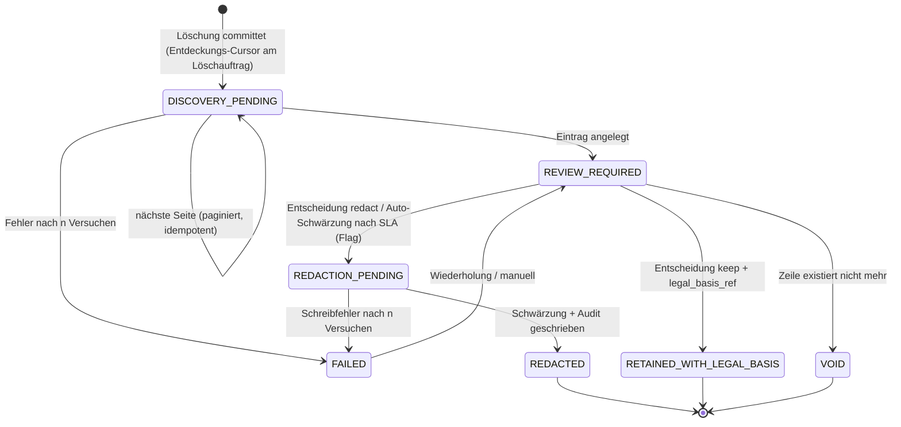

# SPEC-04 — Anonymisierung und Schwärzung

```
Paket: spec/privacy · Version 1.2 · 2026-11-22 · gemessen gegen develop 24d1c2988; Nachtrag #2839 (develop 343afbb97)
Gemessen gegen: develop 007a4ea90 (Audit 2026-11-22)
Anforderungs-IDs: PRIV-200 … PRIV-249
Hängt ab von: 01 §2 (Vokabular), 02 (Feldinventar), 03 (wann welche Regel greift), 13 (L-14, L-15), 15 (DA-05, DA-06)
Änderung v1.1: Identifikationsklassen (§1a), mandantengebundene Pseudonyme für neue Zeilen (PRIV-238),
Prüfwarteschlange als Zustandsautomat ohne ausschließende Obergrenze (§5), `keep` nur mit Rechtsgrundlage.
Änderungen 1.2: Begriffsabgrenzung Ist und Rekonstruierbarkeit (§1b); Pseudonym-Ist-Stand LEG-15 mit Korrelationswegen
und Rückrechenbarkeit (§2.1a); Import-Regel für `anon_` (LEG-54, PRIV-241); Freitextinventar > 50 Felder mit Abdeckung
(§3.4) und Art.-9/10-Empfehlung (§3.5, PRIV-242); Plan-Snapshots mit Restore (LEG-34, PRIV-240); Ist-Vermerke an
PRIV-201/204/205/206/207/211/213/216/218/234 und §5/§7 (erledigt bzw. offen); Dokumentationslücken (§11).
```

---

## 1. Die drei Ersetzungsformen und was sie belegen

| Form | Geschrieben wo [verifiziert] | Verknüpfbar? | Ist die Zeile danach anonym? |
|------|------------------------------|--------------|------------------------------|
| `null` / Zeile gelöscht | `DELETE_STEPS`; `_end_membership` leert `assigned_to_user_key` | nein | das Attribut ist weg; die Zeile kann über ihren Inhalt weiterhin identifizieren |
| Marker `_anonymized` (`ANONYMIZED_MARKER`) | `ANONYMIZE_COLLECTIONS`-Regeln mit `anonymized_value=ANONYMIZED_MARKER`; R-25-Aufbewahrungs-Patch; Attachment-Storage-Scope; Mandanten-Import für nicht zugeordnete Konten (`ANONYMIZED_ACCOUNT`) | nein — alle gelöschten Personen eines Mandanten teilen sich dasselbe Literal | **nicht von sich aus**: die Zeile ist nur anonym, wenn kein Freitext, kein Foto und kein gemeinsam auftretendes Attribut die Person identifiziert (Erwägungsgrund 26) |
| Tombstone `anon_<16hex>` (`compute_tombstone_hash`) | `tombstone_hash`-Regeln (gesetzliche Zeilen), `PSEUDONYMIZE_AUDIT_COLLECTIONS`, Pseudonymisierung bei der Mandantenlöschung | ja — deterministisch pro `(user_key, ERASURE_TOMBSTONE_SALT)`, instanzweit | **nein**: pseudonymisierte personenbezogene Daten (Art. 4 Nr. 5); das Salt ist die „zusätzliche Information“ |

**PRIV-200** Das Paket MUSS die Begriffe wie oben in Code-Kommentaren, API-Dokumentation
und nutzersichtbaren Texten verwenden: „anonymisiert“ nur dort, wo die gesamte Zeile geprüft wurde oder
keinen identifizierenden Inhalt enthält; andernfalls „Zurechnung entfernt“ (Marker) oder „pseudonymisiert“
(Tombstone). Der i18n-Schlüssel für die Personendarstellung ist `enums.personRef.erased`,
mit dem deutschen Anzeigetext „entferntes Mitglied“ statt „anonymisiert“ **[Vorschlag]** — das aktuelle
Wort verspricht mehr, als die Daten einlösen.

### 1a. Identifikationsklassen (DA-06; Evidenz L-14, L-15)

| Klasse | Definition | Beispiele | Folge |
|--------|------------|-----------|-------|
| **direkt identifizierend** | Wert, der ohne Zusatzwissen eine Person benennt oder ein bestehendes Konto adressiert | `display_name`, `email`, roher `users._key` eines bestehenden Kontos | volle Löschpflicht |
| **pseudonym** | Zurechnung nur mit gesondert gehaltener Zusatzinformation (Salt, Schlüssel); Zeilen bleiben verknüpfbar (WP216: „pseudonymisation is not a method of anonymisation“; EDSA 01/2025: bleibt personenbezogen, auch wenn die Zusatzinformation beim Verantwortlichen gelöscht ist) | `anon_<hash>`, `anon2_<hash>`, `sub_…`-Logpseudonyme, Client-Event-Digest | personenbezogen; nur in der Allowlist; Zweck- und Zugriffsbeschränkung |
| **effektiv anonym (attributbezogen)** | das Attribut trägt keine Zuordnung mehr; die **Zeile** kann über Inhalt identifizieren | `_anonymized`, `null` | Zeile gilt als anonym erst nach Freitext-Prüfung (§5) |
| **effektiv anonym (zeilenbezogen)** | kein Attribut erlaubt Herausgreifen, Verknüpfen oder Inferenz mit vernünftigem Aufwand (Erwägungsgrund 26, Bezug) | Mengen-/Datumsaufzeichnung ohne Zurechnung und ohne Freitext | außerhalb der DSGVO |

**PRIV-237** [PROPOSED] Jede Aussage „anonymisiert“ in Code, API oder UI MUSS einer **zeilenbezogenen** Klasse
entsprechen; attributbezogene Ersetzungen heißen „Zurechnung entfernt“. Zugesagt werden kann: *Zurechnung
entfernt; Verknüpfbarkeit auf einen Mandanten und eine Aufbewahrungsklasse begrenzt (nach DEC-25)*; nicht
zugesagt wird „anonym“ für Zeilen mit Freitext.

### 1b. Begriffsabgrenzung im Ist-Stand und Rekonstruierbarkeit (Audit 2026-11-22, Strang A)

[VERIFIED_CODE, develop 007a4ea90] Was der Code heute tatsächlich tut, getrennt nach den Begriffen aus §1/§1a:

| Begriff | Wo es im Code tatsächlich geschieht |
|---------|-------------------------------------|
| **Löschen** | Dokument oder Kante entfernt (`DELETE_STEPS`, Mandantenlöschung) |
| **Zurechnung entfernen** (Marker, attributbezogen) | alles, was der Code bei der Kontolöschung „anonymisiert“ nennt; die Zeile ist danach **nicht** anonym |
| **Pseudonymisieren** (`anon_`, instanzweit) | nur in der Tombstone-Allowlist (PRIV-204) |
| **Anonymisieren (zeilenbezogen)** | **nur** durch R-25 nach 5 Jahren (Konto- und Freitextfelder von `care_events` gemeinsam) und eingeschränkt für `yield_metrics` |
| **Einschränken** (Art. 18) | ohne technische Wirkung (LEG-23 → `03`) |
| **Aufbewahren wegen Rechtspflicht** | nur R-16…R-18, Collection-weit statt feldgenau (LEG-03, W-15 → `06`) |

Der UI-Begriff `PERFORMED_BY_ANONYMISED` (`domain/models/care_event.py:427`, Anzeige „anonymisiert“) verspricht mehr,
als der Datenzustand hält (PRIV-200, PRIV-236; Produktentscheidung Q-PO-04).

**Rekonstruierbarkeit gelöschter Identitäten über Sekundärdaten:**
1. Freitexte (`summary`, Tagebuch, Kommentare, Notizen, Vorlagennamen, Snapshots): direkt, solange nicht geschwärzt
   (LEG-08, LEG-34).
2. `created_by`/`performed_by`-Felder: nach dem Vollzug nicht mehr (Marker); der Marker ist aber ein mandantenweiter
   Sammelwert, und mit Zeitpunkt, Beet und Gruppenwissen bleibt Herausgreifen möglich (Erwägungsgrund 26) — deshalb nur
   „Zurechnung entfernt“.
3. Plan-Audit: `user_key` Marker; `summary`/`snapshot` Freitext (wie 1).
4. Exportarchive/CSV: die CSV liegt beim Empfänger außerhalb der Reichweite; das Mandantenarchiv hält bis R-05
   Schlüssel und Namen (`members.jsonl`); `anon_` darin ist mandantenübergreifend vergleichbar (§2.1a).
5. Pseudonyme: mit dem Salt durch Durchrechnen des Schlüsselraums umkehrbar (§2.1a).
6. Logs: keine Rohschlüssel (AST-Scan aller `logger.*`-Kwargs); `sub_`-Referenzen sind mit dem Log-Salt korrelierbar;
   die Log-Frist liegt außerhalb des Repos (`02` §3.11).

**PRIV-201** Der Marker und die Tombstone-Regex MÜSSEN jeweils genau eine Definition haben.
**[erfüllt — Audit 2026-11-22: `ALREADY_FIXED`]** Im Anwendungscode gibt es je eine Definition in
`domain/models/privacy.py:17` (Marker) und `:25` (Regex, beide Generationen); eingefrorene Kopien liegen nur noch in
den Migrationen v0107, v0109 und v0114 (NFR-016 M-7, vom Guard ausgenommen); Guard
`tests/unit/guards/test_privacy_marker_and_tombstone_have_one_definition.py`. Altstand v1.1 (develop 343afbb97):
`_anonymized` viermal im Anwendungscode (`erasure_engine.py`, `models/care_event.py`, `attachment_repository.py`,
`tenant_export_engine.py:ANONYMIZED_ACCOUNT`), die Regex dreimal. Abnahme: TA-200.

---

## 2. Tombstone-Regeln

### 2.1 Ableitung (beibehalten)

**PRIV-202** Die Ableitung `anon_ + sha256(user_key + salt)[:16]` DARF NICHT für bestehende Daten
geändert werden: über Jahre geschriebene gesetzliche und Audit-Zeilen müssen untereinander verknüpfbar bleiben,
und der Tombstone-Lookup nach Art. 15 (REQ-025 §3.1.2 Regel 6) hängt davon ab. [verifiziert] Es handelt sich um
reines SHA-256 mit angehängtem Salt, nicht um HMAC, gekürzt auf 64 Bit; die Schwester-Ableitungen
(`compute_request_key`, `log_subject`) verwenden HMAC mit einem Zweck-Label. Festgehalten als
DEC-04; eine künftige Schlüsselrotation braucht eine Re-Keying-Migration (`09` §7) und liegt außerhalb des Umfangs.

### 2.1a Ist-Stand der Pseudonyme (Audit 2026-11-22, LEG-15)

Verifikationsstatus: technisch `PARTIALLY_CONFIRMED` — Teil „Marker im Plan-Audit“ `ALREADY_FIXED` (DEC-16, v0109),
Teil „instanzweites deterministisches Pseudonym, `anon2_` nicht gebaut“ bestätigt; Verhältnismäßigkeit
`LEGAL_REVIEW_REQUIRED` (Q-DSB-03). Priorität P2 (Pseudonyme bleiben intern; vermeidbare Exposition). Maßnahme PRA-1.07.

[VERIFIED_CODE, develop 007a4ea90]
1. `compute_tombstone_hash` = `"anon_" + sha256(user_key + salt)[:16]` (`erasure_engine.py:1235–1256`): instanzweit,
   kein HMAC, keine Mandantenbindung. Geschrieben in `harvest_batches.harvested_by_key`,
   `quality_assessments.assessed_by_key`, `treatment_applications.applied_by_key`, `inspections.inspected_by_key`
   (`:84–122`, `:237–246`) sowie in `erasure_requests.user_key`, `mcp_audit_log.service_account_key`,
   `security_audit_log.actor_user_key/target_user_key`, `consent_records.user_key` (`:860–932`); die Allowlist wird
   abgeleitet (`:1129–1143`).
2. Die Mandantenlöschung schreibt **denselben** instanzweiten Tombstone auch für **lebende** Konten in die gesetzlichen
   Zeilen (`tenant_erasure_engine.py:189–209`, Regeln aus `ErasureEngine`, `:451–467`); die Art.-15-Suche findet sie darüber
   (`personal_data_repository.py:109–131`) — aber nur für nicht mehr existierende Mandanten.
3. `anon2_` (PRIV-238) wird **nur erkannt, nie geschrieben** (`domain/models/privacy.py:19–25`); einziger Pfad ist der
   Mandantenimport, der `anon2_` in den Marker umwandelt (`tenant_import_engine.py:401–404`).
4. Der Mandantenimport übernimmt `anon_` **unverändert** (`tenant_import_engine.py:405–406`) → PRIV-241 (LEG-54).
5. Mandantenarchive enthalten die Collections „as stored“, also `anon_`-Werte (`tenant_export_engine.py:186–215`);
   API-Antworten zeigen `*_by_key` nicht (`api/v1/harvest/schemas.py:73–88`, `api/v1/ipm/schemas.py:299–363`).
6. `users._key` vergibt ArangoDB mit dem Standardgenerator (numerisch, niedrige Entropie).

**Korrelation über Mandanten heute möglich:** (i) für den Betreiber bzw. jede/n DB-Lesende/n trivial (gleicher
`anon_`-Wert in Zeilen verschiedener Mandanten, in `erasure_requests` neben `personal_tenant_keys`
(`privacy.py:247–252`) und in `security_audit_log`); (ii) für Leads zweier Mandanten über heruntergeladene Archive —
ohne Salt erkennen sie „dieselbe gelöschte Person“, nicht wer; (iii) über den Import (LEG-54).

**Rückrechenbarkeit:** Wer das Salt hat, kann wegen der numerischen Schlüssel den gesamten Schlüsselraum durchrechnen
und jeden Tombstone seinem Originalschlüssel zuordnen; zusammen mit `members.jsonl` eines Archivs (`user_key` +
`display_name`, `tenant_export.py:110–118`) oder einem Backup wird daraus ein Name. Das gilt für jede Pseudonymisierung,
macht aber die **Geheimhaltung des Salts zur einzigen Schranke** (keine Rotation, RISK-20; Verwahrung Q-OP-04). Das Salt
dient zusätzlich als Schlüssel für `compute_request_key` (HMAC, domänengetrennt, `erasure_engine.py:1214–1233`) und
laut Spec für Client-Event-Digests (E18, PRIV-203) — die Mehrfachverwendung vergrößert die Angriffsfläche.

Rechtlich: Tombstones sind pseudonymisierte, weiterhin personenbezogene Daten (Art. 4 Nr. 5; L-14, L-15) [VERIFIED_LEGAL];
für Pflichtaufzeichnungen trägt Verknüpfbarkeit **innerhalb** eines Mandanten den Zweck, mandantenübergreifend trägt
sie außer der Art.-15-Suche keinen genannten Zweck, und die funktioniert auch mit `(tenant_key, user_key)`-Bindung
[INFERRED, Auslegung]. Fehlende Kontrollen: `anon2_`-Ableitung (PRIV-238), `carry_account_reference` an allen
Kopierstellen (PRIV-205), Importregel (PRIV-241), dokumentierte Salt-Schutzmaßnahmen ohne Mehrfachverwendung,
Begriffskorrektur in Code-Kommentaren (§11).

**PRIV-203** Neue, von diesem Paket eingeführte Ableitungen MÜSSEN HMAC mit Domänentrennung verwenden, nicht
`sha256(x + salt)`. Die Wiederverwendung von `erasure_tombstone_salt` als Digest-Schlüssel für Client-Events
(REQ-053 §32.6 Pkt. 16, SEC-003) wird als eigenes Paket E18 (abgeleiteter Schlüssel mit Übergangsregel) geführt.

**PRIV-238** [PROPOSED, DEC-25] **Neue** Pseudonymisierungen in **mandantenbezogenen** Zeilen (die gesetzlichen
Collections `harvest_batches`, `quality_assessments`, `treatment_applications`, `inspections` und jede weitere
Allowlist-Zeile mit `tenant_key`) MÜSSEN mandantengebunden abgeleitet werden: `anon2_ + HMAC-SHA256(ERASURE_TOMBSTONE_SALT,
"tombstone:" || tenant_key || ":" || user_key)[:16]`. **Plattformweite** Audit-Zeilen ohne `tenant_key`
(`erasure_requests.user_key`, `security_audit_log`, `consent_records`, `mcp_audit_log`) behalten den instanzweiten
Tombstone `anon_` — pro Löschung existiert damit genau **ein** instanzweiter Tombstone (= `erasure_requests.user_key`),
auf den sich Art.-15-Suche, Spiegel und Restore-Abgleich stützen (`09` §6), und null bis n mandantengebundene.
Begründung: Der heutige instanzweite Tombstone verknüpft eine gelöschte Person
über alle Mandanten und Exportarchive hinweg (RISK-19); innerhalb eines Mandanten bleibt die Verknüpfbarkeit (Prüfzweck)
erhalten. `is_tombstone` und die Allowlist-Regex kennen beide Generationen (`^anon_[0-9a-f]{16}$|^anon2_[0-9a-f]{16}$`);
die Art.-15-Suche (REQ-025 §3.1.2 Regel 6) prüft je `(tenant_key, user_key)`. Bestandstombstones werden **nicht**
umgeschrieben (`09` §7). Schlüsselrotation ist für Bestandstombstones nicht möglich (RISK-20) — die Zusicherung lautet
daher „Zugriffsbeschränkung des Salts“, nicht „Rotierbarkeit“. **Ist (Audit 2026-11-22):** nicht gebaut — `anon2_` wird
nur erkannt (§2.1a Pkt. 3); Maßnahme PRA-1.07. Zusätzliche Abnahme: Guard — nach Inbetriebnahme von E03 erzeugt kein
Codepfad außer der neuen Ableitung ein `anon_` für neue mandantenbezogene Zeilen.

**PRIV-241** [PROPOSED, LEG-54] Der Mandantenimport MUSS Kontoreferenzen über
`carry_account_reference(value, target_kind)` (PRIV-205) leiten und dabei `anon_` wie folgt behandeln: In einer
Allowlist-Zelle (gesetzliche Zeile) bleibt `anon_` **nur**, wenn Ziel- und Quellinstallation übereinstimmen
(`installation_id` vergleichen) und der Wert als Nachweis nötig ist; sonst wird er zum Marker. In jeder anderen Zelle
wird `anon_` zum Marker. Eine Umrechnung in `anon2_` des Zielmandanten ist mangels Rohschlüssel nicht möglich. Begründung
[VERIFIED_CODE]: `TenantImportEngine._rewrite_value` wandelt `anon2_` bewusst in den Marker („carried into another tenant
it would link rows across tenants“), lässt aber gerade das mandantenübergreifende `anon_` unverändert
(`tenant_import_engine.py:399–406`); nach dem Import existiert dasselbe Pseudonym in Quell- und Zielmandant oder in einer
anderen Installation, und die Art.-15-Suche per Tombstone greift für einen existierenden Zielmandanten nicht
(`personal_data_repository.py:122–131`). Priorität P3 (mit E03 P2). Rechtlich (b) Art. 25 Abs. 1, Art. 5 Abs. 1 lit. c,
Art. 15 Abs. 1 [INFERRED]. Ob Mandanten zwischen Installationen wandern: Q-OP-05. Abnahme: TA-240 (`10`).

### 2.2 Wo ein Tombstone existieren darf

**PRIV-204** Tombstones MÜSSEN ausschließlich in der **Tombstone-Allowlist** existieren, die aus dem
Inventar abgeleitet wird (keine zweite Liste): jede Collection/jedes Feld, das eine `tombstone_hash`-Regel in
`ANONYMIZE_COLLECTIONS` oder einen Eintrag in `PSEUDONYMIZE_AUDIT_COLLECTIONS` hat. [verifiziert heute]:
`harvest_batches.harvested_by_key`, `quality_assessments.assessed_by_key`,
`treatment_applications.applied_by_key`, `inspections.inspected_by_key`, `erasure_requests.user_key`,
`mcp_audit_log.service_account_key`, `security_audit_log.actor_user_key/target_user_key`,
`consent_records.user_key`. `garden_plan_audit.user_key` gehört seit DEC-16 **nicht mehr** dazu (Audit 2026-11-22:
Marker-Regel `erasure_engine.py:269–283`, Altbestand durch v0109 korrigiert).

**PRIV-205** Jeder Prozess, der einen kontoförmigen Wert von einer Zeile in eine andere kopiert
(Backfill-Mapper, Konsistenz-Job, Mandanten-Import, Task-Completion-Engine, die
`harvested_by_key=event.performed_by_user_key` schreibt, Supersede, das die Ausführenden des Vorgängers behält)
MUSS den Wert durch eine Funktion `carry_account_reference(value) -> str | None` leiten:
ein aktuell geformter Schlüssel wird unverändert zurückgegeben; ein Tombstone oder der Marker wird zu `_anonymized`,
wenn das Ziel ein Marker-Feld ist, und zu `null`, wenn das Ziel ein Tombstone-Feld ist (ein
Pseudonym darf nie aus einer Kopie neu erzeugt werden). [VERIFIED_CODE, behoben #2839] `account_of` in
`care_event_backfill_mapper.py` bildet einen Tombstone über `ErasureEngine.is_tombstone` auf `_anonymized` ab
(#2770 Punkt 1); `carry_account_reference` verallgemeinert das auf alle Kopierstellen (`task_completion_engine`,
Plan-Audit, Mandantenimport PRIV-241) und auf die zweite Generation `anon2_` (PRIV-238). **Ist (Audit 2026-11-22,
`CONFIRMED` Lücke):** nur `account_of` (`care_event_backfill_mapper.py:183–191`); `task_completion_engine` kopiert
Rohschlüssel; die Lücke betrifft nur Tombstone-/Marker-Werte als Quelle.

**PRIV-206** Eine Konsistenzprüfung (`privacy.consistency`, neuer Beat, `08` §6) MUSS jeden
tombstone-förmigen Wert außerhalb der Allowlist und jeden Marker in einem Tombstone-Feld melden, pro
Collection, als Anzahlen; der Befund ist ein Defekt und wird nie stillschweigend korrigiert, außer durch die
Einmal-Migration aus `09` §3. **Ist (Audit 2026-11-22):** teilweise umgesetzt — ein täglicher Beat zählt Tombstones
außerhalb der Allowlist (`tasks/privacy_consistency.py:18`, `tasks/__init__.py:607`); ob er auch Marker in
Tombstone-Feldern meldet, ist nicht verifiziert.

**PRIV-207** Die `erased`-Darstellung MUSS einen tombstone-förmigen Wert wie den Marker behandeln
(`display_performer` prüft heute nur `ANONYMIZED_MARKER` [verifiziert]; ein Tombstone wird nur deshalb als
„anonymisiert“ dargestellt, weil das Nutzerdokument fehlt). Der `performed_by`-Filter MUSS einen tombstone-förmigen Wert
ebenso zurückweisen wie den Marker (422) [verifizierte Lücke: nur der exakte
Marker wird zurückgewiesen; Audit 2026-11-22 bestätigt `care_event_service.py:164–170`, geringe Wirkung, weil
`care_events` seit v0107/v0109 keine Tombstones mehr tragen].

### 2.3 Verknüpfbarkeit als Rechtsfrage

**PRIV-208 [rechtlich LEG-15]** Ob ein deterministisches Pseudonym pro Person über alle gesetzlichen
Zeilen für bis zu fünf Jahre verhältnismäßig ist (gegenüber zufälligen Tokens pro Zeile, die den Inhalt des Eintrags
dennoch erfüllen), ist Sache der Rechtsberatung. Das aktuelle Design argumentiert: Das Pseudonym lässt
eine Prüfperson nachvollziehen, dass dieselbe (ungenannte) anwendende Person mehrere Parzellen behandelt hat — eine Eigenschaft, die der Eintrag
braucht; und es lässt den eigenen Art.-15-Export der Person die Zeilen finden. Das Paket behält
es für gesetzliche und Security-Audit-Zeilen bei und entfernt es aus `garden_plan_audit` (DEC-16, umgesetzt),
wo keines der beiden Argumente greift. Revalidierung Audit 2026-11-22: §2.1a; offene Fragen an die DSB in `16`
(Q-DSB-03).

---

## 3. Anonymisierungsregeln (Kontolöschung)

### 3.1 Regelsatz

**PRIV-209** Der Regelsatz MUSS das einzige `ErasureEngine`-Inventar bleiben; dieses Paket ergänzt
Attribute, keine zweite Engine. Erforderliche Ergänzungen (Dataclass-Änderungen siehe `08` §2):

| Regelattribut | Bedeutung |
|---------------|-----------|
| `attribution` | Rolle aus `01` §4.1 |
| `retention_class` | `ephemeral`, `shared_history`, `statutory`, `audit` |
| `review_fields` | Freitextfelder der Zeile, die in die Prüfwarteschlange gehen, wenn die Regel greift (z. B. `care_events: summary, reason, observed_outcome, product_label, material, performed_by_label`) |
| `clear_fields` (existiert) | Freitextfelder, die bei der Löschung **geleert** werden (eingetippte Anzeigenamen, `user_agent`) |

### 3.2 Was wird geleert, was geprüft, was behalten

**PRIV-210** Das Leeren (`clear_fields`) MUSS auf Felder beschränkt bleiben, deren *einziger* Zweck es ist,
die Kontoinhaberin bzw. den Kontoinhaber zu benennen: `harvester`, `assessed_by`, `inspector`, `applied_by`,
`consent_records.user_agent` [verifiziert]. Inhaltlicher Freitext wird nie automatisch geleert
(REQ-025 §3.1.3 Regel 4 „never key on free text“; REQ-053 E-16).

**PRIV-211** [umgesetzt für `original_filename` — Audit 2026-11-22: `ALREADY_FIXED`, `erasure_engine.py:372`,
Altbestand v0109; analog offen: `import_jobs.filename`, §3.4] Zwei Felder MÜSSEN zu `clear_fields` hinzugefügt werden, weil sie
konstruktionsbedingt identitätstragend und kein Inhalt sind:
- `attachments.original_filename` → `""` (ein Kamera-/Telefon-Dateiname enthält häufig den Namen
  der Eigentümerin bzw. des Eigentümers; der gespeicherte Objektschlüssel nie);
- `care_events.performed_by_label` **nur wenn** `performed_by_user_key` die betroffene Person ist? —
  Nein: das Label benennt eine *dritte Person*, nicht die betroffene Person; es bleibt und geht in die Prüfung.

**PRIV-212** [Vorschlag] Inhaltlicher Freitext der Zeilen der betroffenen Person in einem geteilten Mandanten MUSS
**behalten und zugleich** zur Prüfung aufgelistet werden (§5). Die Liste der prüfbaren Felder ist das
`review_fields` der Registry; `02` §3 gibt das vollständige Inventar. Mindestmenge (verifizierte Felder):

| Collection | Prüfbare Felder |
|------------|-----------------|
| `care_events` | `summary`, `reason`, `observed_outcome`, `product_label`, `material`, `performed_by_label`, `void_reason`, `redaction_reason` |
| `plant_diary_entries` | `title`, `text`, `tags`, `analysis.summary` |
| `task_comments` | `comment_text` |
| `tasks` (der betroffenen Person zugewiesen oder von ihr erstellt — `tasks` hat kein `created_by` [verifiziert]; nur Zeilen mit Zuweisung) | `name`, `instruction`, `completion_notes` |
| `garden_objects` | `label`, `notes` |
| `bed_templates` | `name` |
| `locations`, die aus einer Vorlage der betroffenen Person erstellt wurden (`template_key`-Datenlinie) | `name` (kopiert), `description`, `notes` |
| `garden_plan_audit`-Zeilen mit der betroffenen Person als Akteurin | `summary`; `snapshot` (Import-Snapshot) |
| `attachments` | `caption` |
| `manual_overrides` | `reason` |
| `harvest_batches`, `quality_assessments`, `inspections`, `treatment_applications` (wenn `record_keeping = none`, sonst als gesetzlich behalten) | `notes` |

**PRIV-213** `care_events.material` MUSS in die Schwärzungs-Feldmenge `FREE_TEXT_FIELDS`
(Code `models/care_event.py`) und in die Spec-Listen (REQ-053 GP-FR-109, NFR-011 R-25) aufgenommen werden — ein
**Spec-Änderungsvorschlag**, keine stille Änderung: Das Feld ist Freitext (≤ 200), wird im
CSV exportiert und bleibt heute von Schwärzung und R-25 unberührt [verifiziert]. Ebenso
MÜSSEN `measurements[].source` und `measurements[].extraction_method` (freie Strings) mit der Menge
geschwärzt werden. **Ist (Audit 2026-11-22, `CONFIRMED` Lücke):** `care_event.py:83` (Feldmenge), `:166` (`material`,
gespeichert ohne Grenze, API ≤ 200 `:304`), `:254–256` (Messwert-Strings); R-25-Patch `care_event_repository.py:573–595`
erreicht beide nicht; `material` steht in CSV (`care_event_csv_engine.py:37`) und API (`api/v1/care_events/schemas.py:110`).
Folgewirkung: `material` wird fachlich ausgewertet (`task_completion_engine.py:125`, Nährstoffhinweis) — die
Hinweis-Engine MUSS `[redacted]` tolerieren; Produktentscheidung Q-PO-01. Maßnahme PRA-2.01.

### 3.3 Backfill-Zeilen und abgeleitete Zeilen

**PRIV-214** Der Backfill-Mapper und der Konsistenz-Job MÜSSEN `created_by = null`
(Systemursprung) setzen und `performed_by_user_key` nur über `carry_account_reference` aus einem
Feld der **gleichen Zurechnungsrolle** (`applied_by_key`, `harvested_by_key` sind
`performed_by`; `watering_events.performed_by` ist Freitext → niemals). [verifiziert] Der Mapper
weist Labels bereits zurück und setzt `created_by = None`; Tombstones weist er nicht zurück.

**PRIV-215** Zeilen mit Systemursprung (`trigger ∈ {backfill}` und `created_by = null`) MÜSSEN
Korrekturrechte an die **Ausführenden** vergeben: `care_event_service` lässt `created_by == user`
oder eine Lead-Rolle korrigieren [verifiziert]; ergänze `or (created_by is None and performed_by_user_key == user)`.
Das ersetzt den Vorschlag in #2770 Punkt 3 für Backfill-Zeilen (bei denen es keine Autorin bzw. keinen Autor gibt);
Live-Erinnerungszeilen erhalten `created_by = principal` (`03` §4.2).

### 3.4 Freitextfeld-Inventar und Abdeckung (Audit 2026-11-22, Strang A; LEG-08)

Quelle: AST-Scan `domain/models/**` (Klassen mit Ankerfeld), um Kopien ergänzt [VERIFIED_CODE, develop 007a4ea90];
Pfade unter `src/backend/app/domain/models/`. Dieses Inventar ist die eine ausführliche Stelle für Freitextfelder;
`02` §3 führt die Felder mit Zweck und Rechtsgrundlage und verweist hierher. Abdeckung: **S** = in der
Schwärzungsmenge (`FREE_TEXT_FIELDS`, `care_event.py:83`), **R25** = von R-25 erfasst, **G** = bei Kontolöschung
geleert (`clear_fields`), **B** = behalten bis zur gesetzlichen Frist, **Mt** = mit dem Mandanten gelöscht,
**L** = mit dem Konto bzw. der Mitgliedschaft gelöscht. Risiko: hoch (Namensfeld/Freitext über Personen), mittel
(allgemeine Notiz), niedrig (technisch/kategorial). „In `02`“: ✓ eigene Zeile, ○ Sammelzeile, ✗ nicht erfasst.

| Entität.Feld (Datei:Zeile, Länge) | Zweck | Risiko | Abdeckung | In `02` | Anmerkung |
|---|---|---|---|---|---|
| `care_events.summary` (`care_event.py:150`, 500) | Pflegeeintrag | hoch | S, R25, Mt | ✓ | Pflichtfeld; häufig Namen („Maren hat…“) |
| `care_events.reason` (`:157`, 1000) | Begründung | mittel | S, R25, Mt | ✓ | — |
| `care_events.observed_outcome` (`:168`; API 2000) | Beobachtung | mittel | S, R25, Mt | ✓ | gespeichert ohne Längengrenze |
| `care_events.product_label` (`:159`, 200) | Produktname | niedrig–mittel | S, R25, Mt | ✓ | Kopie in `feeding_events.product_label` mitgeschwärzt |
| `care_events.performed_by_label` (`:154` 200 / API `:298` 80) | Dritte Person | **hoch** (Name Dritter) | S, R25, Mt | ✓ | Längen inkonsistent 80/200 |
| `care_events.material` (`:166` ohne Grenze / API `:304` 200) | Material | mittel | **nur Mt** | ✓ | in CSV; fachlich ausgewertet (PRIV-213) |
| `care_events.measurements[].source/extraction_method` (`:254–256`, 40/60) | Messmethode | niedrig | **nur Mt** | ✓ | PRIV-213 |
| `care_events.void_reason` (`:178`) | Stornogrund | mittel | Schwärzung + R25 (außer `undo`), Mt | ✓ | — |
| `care_events.redaction_reason` (`:181`; API 500) | Schwärzungsgrund | mittel | R25, Mt; **nicht** durch Folge-Schwärzung | ✓ | allen Mitgliedern in der API sichtbar (`api/v1/care_events/schemas.py:121`) |
| `feeding_events.notes`, `.material` (`feeding_event.py:34, 45`) | Düngung | mittel/niedrig | Mt | ○ | `material` aus fester Liste (`task_completion_engine.py:125`) |
| `feeding_events.product_label` (`:44`, 200) | Kopie | niedrig–mittel | Schwärzung (Kopie), R25 (Kopie), Mt | ✓ | — |
| `plant_diary_entries.title/text/tags` (`plant_diary_entry.py:90–99`, 200/5000) + `analysis.summary` | Tagebuch | **hoch** (Art. 9 möglich) | Mt | ✓ | Teilstringsuche für alle Mitglieder; KI-Analyse |
| `task_comments.comment_text` (`task.py:225`, 2000) | Kommentar | hoch | Mt | ✓ | — |
| `tasks.name/instruction/completion_notes/tags` (`task.py:135–190`) | Arbeitsplan | mittel | Mt | ✓ | — |
| `garden_objects.label/notes` (`garden_object.py:308, 317`, 200/4000) | Planobjekt | mittel–hoch | Mt | ✓ | auch in Snapshots (PRIV-240) |
| `bed_templates.name` (`bed_template.py:128`, 200) | Vorlage | mittel | Mt (globale Vorlagen bleiben) | ✓ | → `Location.name`, Plan-Audit, Snapshot |
| `locations.name/description/notes` (`site.py:635, 655, 677`, –/1000/4000) | Beet | mittel–hoch | Mt | ✓ | Kopien in `garden_plan_audit.summary`/`snapshot` |
| `sites.name` (`site.py:789`) | Garten | mittel (Adresse/Name) | Mt | ✓ | persönlicher Mandant: Mandantenname umbenannt, Site-Name nicht |
| `garden_plan_audit.summary` (`garden_plan.py:629`, 200) / `.snapshot` (`:633`) | Änderungsnachweis | mittel / **hoch** | R-26 365 d, Mt | ✓ | Restore (PRIV-240) |
| `irrigation_zones.name` (`irrigation_zone.py:63`) | Zone | niedrig | Mt | ✓ | — |
| `attachments.caption` (`attachment.py:84`) / `.original_filename` (`:74`) | Foto | mittel / hoch | Mt / **G** | ✓ | Fotos selbst: Personenabbild möglich (LEG-20…22) |
| `harvest_batches.harvester` (`harvest.py:59`, 200) | Name | hoch | **G** (auch bei Mandantenlöschung) | ✓ | Altzeilen vor #1669 ungeschlüsselt (PRIV-233) |
| `harvest_batches.notes`, `quality_assessments.notes` (`harvest.py:67, 105`) | Protokoll | mittel | **B bis R-16**, auch nach Mandantenlöschung | ✓ | LEG-03/04 |
| `quality_assessments.assessed_by` (`:90`) | Name | hoch | G | ✓ | — |
| `treatment_applications.applied_by` / `.notes` (`ipm.py:243, 248`) | Name / Protokoll | hoch / mittel | G / B bis R-17 | ✓ | — |
| `inspections.inspector` / `.notes` / `symptoms_observed` (`ipm.py:208–227`) | Name / Befund | hoch / mittel | G / B bis R-18 | ✓ | MCP schreibt `mcp:<key>` in `inspector` (PRIV-310) |
| `harvest_observations.notes` (`harvest.py:38`) | Beobachtung | mittel | Mt | ○ | — |
| `watering_events/watering_logs/tank_fill_events/maintenance_logs.performed_by` (`watering_event.py:53`, `watering_log.py:120`, `tank.py:140`, `tank.py:69`) | eingetippter Name | **hoch** | **nur Mt**, keine Frist | ✓ | ausdrücklich von der Löschung ausgenommen (`erasure_engine.py:948–970`) |
| dieselben `.performed_by_label` (80) / `.notes` | Dritte / Notiz | hoch / mittel | Mt | ✓ | — |
| `nutrient_plans.author` (`nutrient_plan.py:198`, **ohne Grenze**) / `author_label` (80) / `description` | Urheber | hoch / mittel | Mt | ✓ | — |
| `rooting_protocols.instructions` (`propagation.py:111`) | Anleitung | niedrig | Mt | ○ | — |
| `phenotype_notes.note` (`propagation.py:130`, 2000) | Phänotyp | mittel | Mt | ○ | — |
| `propagation_batches/events.name/notes/failure_reasons` (`propagation.py:63–86`) | Vermehrung | niedrig–mittel | Mt | ○ | — |
| `planting_runs.name/notes/rotation_override_reason`, `planting_run_entries.notes` (`planting_run.py:101–149`) | Anbaulauf | mittel | Mt | ○/✓ | — |
| `succession_plans.name/notes` (`succession_plan.py:72, 86`) | Folgesaat | niedrig | Mt | ○ | — |
| `overwintering_profiles.notes` (`overwintering_profile.py:56`) | Überwinterung | niedrig | Mt | ○ | — |
| `care_profiles.notes`, `care_confirmations.notes` (`care_reminder.py:62, 81`) | Pflegeprofil | mittel | Mt | ○ | Bestätigung ohne Akteur |
| `post_harvest_batches.notes/storage_location`, `drying_progress/storage_observations.notes`, `burping_events.aroma_notes`, `mold_alerts.trigger_reason/affected_location` (`post_harvest.py:52–144`) | Nachernte (Cannabis) | mittel (Art.-9/10-Kontext) | Mt | ✗ (nur `post_harvest.*notes` ○) | — |
| `actuators/control_rules/control_schedules/control_events/phase_control_profiles.notes/name`, `control_events.error_message` (`actuator.py:120–289`) | Steuerung | niedrig | Mt | ○ | — |
| `manual_overrides.reason` (`actuator.py:244`, 500) | Override-Grund | mittel | Mt; `created_by` Marker | ✓ | — |
| `aquaponic_systems/fish_stocks/water_tests/fish_feeding_events/supplementation_events.notes` (`aquaponik.py:105–202`) | Aquaponik | niedrig | Mt | ○ | — |
| `equipment.notes`, `inventree_*` (`inventree.py:62–110`) | Inventar | niedrig | Mt | ✗ | — |
| `tanks.notes`, `maintenance_schedules.instructions` (`tank.py:38, 95`) | Tank | niedrig | Mt | ✗ | — |
| `fertilizers.notes/product_name` (Mandantenzeilen, `fertilizer.py:22, 53`) | Katalog | niedrig | Mt | ✗ | — |
| `workflow_templates.name/description/tags`, `.created_by` (Freitext aus dem Body) (`task.py:26–38`) | Vorlage | niedrig / hoch | Mt | ✓ | `created_by` ausgeschlossen (`erasure_engine.py:971–978`) |
| `location_assignments.notes` (`location_assignment.py:12`) | Zuständigkeit | mittel | L mit Mitgliedschaft | ✗ → ○ (`02` §3.1, 1.2) | — |
| `processing_restrictions.notes` (`privacy.py:142`) | Art.-18-Antrag | hoch (Art. 9 möglich) | L mit Konto | ✓ | — |
| `api_keys.label`, `refresh_tokens.device_name` (`auth.py:289, 105`) | Konto | niedrig–mittel | L mit Konto | ○ | — |
| `ai_conversations.title` (+ Nachrichten) (`ai_assistant.py:125`) | KI-Chat | hoch (Art. 9 möglich) | L mit Konto, Mt | ✓ | — |
| `pest_detections.llm_explanation`, `pest_image_contributions.caption` (`pest_detection.py:57`, `pest_image.py:34`) | Erkennung | niedrig | L mit Konto | ✓ | — |
| `calendar_feeds.name` (`calendar.py:53`) | Feed | niedrig | L | ✗ → ✓ (`02` §3.1, 1.2) | — |
| `import_jobs.filename/error_message` (`import_job.py:35–40`) | Import | mittel (Dateiname) | Mt; `uploaded_by` Marker | ✗ | Dateiname kann wie `original_filename` identitätstragend sein — wird **nicht** geleert (analog PRIV-211) |
| `tenant_erasure_records.error_message`, `erasure_requests.error_message/retained_reason` | Nachweis | niedrig (gefiltert über `redact_subject`) | R-06/R-06a | ✓ | `privacy_service.py:3513–3531` |
| `tenants.name` (persönlich) | Mandant | hoch (aus Anzeigename) | umbenannt bei `retained_late_joiner` | ✓ | `erasure_engine.py:475–480` |

**Ergebnis:** mehr als 50 Freitextfelder mit Personenbezugspotenzial; **eine** Collection (`care_events`) hat eine
Schwärzung, **eine** (`care_events`) eine inhaltliche Frist (R-25); Namensfelder auf gesetzlichen Zeilen werden geleert;
für alle übrigen gilt „behalten bis zur Mandantenlöschung“. Verifikationsstatus LEG-08: technisch `CONFIRMED`, die
Lücke ist größer als in `16` §3 beschrieben (Snapshots mit Restore, Messwert-Strings); Rechtsstatus
`LEGAL_REVIEW_REQUIRED` (Q-DSB-04). Priorität P1 (jede Kontolöschung in geteilten Mandanten; Vollständigkeit nicht
nachweisbar). Nicht gesetzliche Freitexte haben keine Frist (R-46-Vorschlag, Q-PO-03 → `06`).

### 3.5 Art.-9/Art.-10-Daten in Freitext (Audit 2026-11-22, Strang A)

Freitext in einer Anbau-App kann Gesundheitsdaten enthalten (Eigenmedikation, „für meine Schmerztherapie“, Allergien,
körperliche Einschränkungen bei der Arbeitsverteilung) sowie Hinweise auf Straftaten (Überschreitung der KCanG-Mengen,
Art. 10). Am stärksten betroffen: Tagebuch (5000 Zeichen, KI-Analyse, mandantenweite Suche), Aufgabenkommentare,
KI-Chats, Art.-18-Notizen, Nachernte-Notizen. Bewertung: (a) Art. 9 Abs. 1 greift für tatsächlich eingegebene
Gesundheitsdaten unabhängig vom Zweck der App; Abs. 2 lit. a läge nur bei ausdrücklicher Einwilligung vor, die die App für
Freitext nicht einholt [VERIFIED_LEGAL Normtext]. (b) Die App verarbeitet diese Daten nicht zielgerichtet; ob daraus
Pflichten nach Art. 32 bzw. Art. 35 Abs. 3 lit. b folgen, hängt vom Umfang ab — `LEGAL_REVIEW_REQUIRED` (Q-LAW-11;
DSFA-Vorprüfung `11`).

**PRIV-242** [PROPOSED] Das System DARF Freitext **nicht** automatisch auf Art.-9-/Art.-10-Begriffe scannen oder
moderieren (das würde selbst Art.-9-Daten systematisch verarbeiten, hätte eine hohe Fehlerquote und widerspräche
Art. 25 / Datenminimierung). Stattdessen MUSS es:
1. an Freitextfeldern mit hohem Risiko (Tagebuch, Kommentare, Notizen, Labels Dritter) einen Hinweistext zeigen
   („keine Gesundheits- oder Kontaktdaten, keine Namen Dritter“; vgl. TA-243);
2. für jedes persistierte Freitextfeld eine Längengrenze im Modell führen (fehlend heute bei `care_events.material`,
   `care_events.observed_outcome` (gespeichert), `nutrient_plans.author`); Guard „jedes `str`-Feld eines persistierten
   Modells hat `max_length`“ (PRA-1.01);
3. die generische Schwärzung und Prüfwarteschlange (§5, §6) auf alle Felder aus §3.4 mit Risiko ≥ mittel erstrecken;
4. für nicht gesetzliche Freitexte eine Frist vorsehen (R-46-Vorschlag, `06`);
5. eine Sichtbarkeitsoption für Tagebucheinträge prüfen (heute lesen alle Mitglieder; `05` §3);
6. die Weitergabe an KI nur mit Einwilligung zulassen (Consent-Guard; KI-Gate LEG-31 → `06`).
Abnahme: TA-032, TA-243 (`10`).

---

## 4. Verhalten des Audit-Trails

### 4.1 Garden-Plan-Audit

**PRIV-216** [DEC-16, Spec-Änderungsvorschlag] `garden_plan_audit.user_key` MUSS von
`PSEUDONYMIZE_AUDIT_COLLECTIONS` (Tombstone) nach `ANONYMIZE_COLLECTIONS` (Marker) wandern. NFR-011
R-26 nennt heute beides [verifizierter Widerspruch]; GP-NFR-055 argumentiert mit Verknüpfbarkeit „so that rows
stay linkable — WP 1.8“. Die Zeilen werden nach 365 Tagen (R-26) und mit dem Mandanten gelöscht; der
Art.-15-Export braucht keine Verknüpfbarkeit (die eigenen Zeilen der Person werden über den echten Schlüssel gefunden,
solange das Konto existiert). **[rechtlich LEG-15]** **Ist (Audit 2026-11-22): umgesetzt** — Marker-Regel in
`ANONYMIZE_COLLECTIONS` (`erasure_engine.py:269–283`), Altbestand durch v0109. Offene Dokumentationsreste: NFR-011 R-26
nennt weiter den Tombstone, der Docstring von `PlanAuditRecord` („pseudonymised on account erasure“,
`garden_plan.py:615–616`) ist veraltet (§11).

**PRIV-217** `garden_plan_audit.summary` enthält eine Kopie von `Location.name` /
`GardenObject.label` / `Site.name` / Zonenname [verifiziert], und `snapshot` enthält den vollständigen Plan-Export
einschließlich `notes`/`description`. Beide sind Prüffelder (PRIV-212) und MÜSSEN
schwärzbar sein (`[redacted]` in `summary`; `snapshot` → die Felder `notes`/`description`/`label`
innerhalb des JSON über dieselbe Allowlist schwärzen). Das Audit einer Schwärzung selbst schreibt
nur die Kategorie (Kommentar in `care_event_repository.py`: „The category, never the text“)
[verifiziert] — dieses Muster MUSS für jeden Audit-Schreiber gelten.

**PRIV-240** [PROPOSED, LEG-34] Plan-Snapshots MÜSSEN Schwärzung, Prüfung und Löschung folgen und DÜRFEN eine
durchgeführte Schwärzung nicht per Restore rückgängig machen:
1. Schwärzung und Prüfwarteschlange erstrecken sich auf die Snapshot-Blätter (Allowlist `locations[].name/notes/description`,
   `objects[].label/notes`, `zones[].name`).
2. Wird eine Live-Zeile geschwärzt oder ihr Text geändert, werden die Blätter mit gleichem `key` in **allen** Snapshots
   derselben Site mitgeschwärzt.
3. Restore übernimmt keinen Snapshot-Wert für ein Feld, dessen Live-Zeile ein Schwärzungsmerkmal (`redactions` bzw.
   `redacted_at`) trägt.
4. Eine kürzere Snapshot-Frist (z. B. 30 d statt R-26 365 d) ist eine Produktentscheidung (Q-PO-02).
Sachverhalt [VERIFIED_CODE]: Jeder `replace`-Import schreibt den vollständigen Planexport (Location-`name`, `description`,
`notes`, Gartenobjekt-`label`/`notes`, Zonen- und Site-Namen) als `snapshot` in `garden_plan_audit`
(`garden_plan_import_service.py:1146–1149`; bis 20 je Site; R-26 365 d); weder Kontolöschung (nur `user_key` → Marker)
noch Schwärzung noch Bearbeitung der Live-Zeile erreichen diese Kopien; `restore_snapshot` (`:420–441`, Route
`api/v1/garden_plan/tenant_router.py:867–890`) materialisiert sie wieder — ein von der Leitung entfernter Name oder eine
Notiz mit Kontaktdaten kehrt zurück. Rechtlich (a) Art. 17 Abs. 1 (Löschung muss wirksam sein; vgl. PRIV-220),
Art. 16, (b) Art. 5 Abs. 1 lit. d/e. Priorität P2. Maßnahme PRA-2.02. Abnahme: TA-244 (`10`).

**PRIV-218** [verifizierte Lücke; Audit 2026-11-22 `PARTIALLY_CONFIRMED` — `changed_by_name` bestätigt
(`garden_plan.py:637–647`), das UI-Verhalten nicht erneut geprüft] `garden_plan_audit`-Zeilen sind für jedes Mitglied mit einem
aktiven Anzeigenamen lesbar (`changed_by_name`), und die UI verwirft `null`-Akteure stillschweigend
(`SnapshotPanel.tsx`). Nach diesem Paket: `changed_by` wird zu einer `PersonRef` (`08` §3),
dargestellt über den einen Resolver, `former_member`/`erased` werden als solche angezeigt.

### 4.2 Security-Audit

**PRIV-219** [unverändert] `security_audit_log` behält den Tombstone für 730 Tage; er enthält keinen
Freitext [verifiziert]. Neue Aktionen für Datenschutzvorgänge (`08` §4): `ERASURE_REQUESTED`,
`ERASURE_COMPLETED`, `EXPORT_REQUESTED`, `CONSENT_CHANGED`, `REDACTION_APPLIED`,
`REVIEW_DECIDED`, `ATTRIBUTION_REMOVED` (PRIV-116). `target_user_key` einer Löschzeile wird
**von Anfang an als Tombstone** geschrieben (der Schlüssel verschwindet gleich; der Anfrage-Datensatz
macht das bereits so).

### 4.3 Schwärzungs-Audit

**PRIV-220** Jede Schwärzung und jede Prüfentscheidung MUSS erzeugen: eine Zeile in
`garden_plan_audit`, wenn das Ziel eine Garden-Plan-Collection ist (bestehendes Muster), **oder** sonst eine
`security_audit_log`-Zeile (`REDACTION_APPLIED`, mandantenbezogen); dazu die Felder `decision`, `decided_by`,
`decided_at`, `reason_code`, `reason_text` des `privacy_review_items`-Eintrags
(≤ 500, selbst Freitext — Mitgliedern nicht angezeigt, für Leads des Mandanten sichtbar
und mit dem Eintrag gelöscht). Der *vorherige Wert* DARF NICHT irgendwo gespeichert werden (kein „Undo“
einer Schwärzung — sie ist eine Löschung im Sinne von Art. 17).

---

## 5. Freitext-Prüfwarteschlange als Zustandsautomat (Datenschutzverwaltung; DA-05)

**Ist-Stand (Audit 2026-11-22) [VERIFIED_CODE]:** Nichts aus §5 und §6 ist gebaut (`grep privacy_review_items\|PRIVACY_REVIEW`
= 0; Flag `PRIVACY_REVIEW_AUTO_REDACT_ON_SLA` existiert nicht). Die Kontolöschung ersetzt in geteilten Mandanten nur
Kontoverweise (`erasure_engine.py:162–236` `care_events`, `:247–268` `garden_objects`/`bed_templates`, `:291–333`
Tagebuch/Aufgabenkommentare), alle Freitexte bleiben (Regelbegründung `:172–174`). Der einzige Schwärzungspfad ist
`POST /care-events/{key}/redact` (`api/v1/care_events/tenant_router.py:231–255`, nur `lead`) mit `FREE_TEXT_FIELDS` +
`void_reason` (`care_event.py:83`, `care_event_repository.py:1046–1050`); die Kopie `feeding_events.product_label` wird seit
#2854 mitgeschwärzt (`:1052–1059`). Datenlinie `bed_templates.name` (`bed_template.py:128`) → `Location.name`
(`garden_plan_service.py:771`) → `garden_plan_audit.summary` (`garden_plan_import_service.py:1131–1139`) bestätigt. Ohne
Liste ist reaktive Schwärzung faktisch unwirksam. Empfehlung des Audits: Zustandsautomat **ohne** Auto-Schwärzung jetzt
bauen (schutzverstärkend), PRIV-213 sofort, Snapshots einbeziehen (PRIV-240), Auto-Schwärzung hinter dem Flag bis zur
Rechtsantwort (PRA-2.01; Q-DSB-04).

### 5.1 Warum eine Warteschlange und keine Regel

Automatisches Löschen anhand von Freitext ist verboten (REQ-025 Regel 4) und falsch (der Text ist
meist die agronomische Aufzeichnung des Mandanten: „gegossen 10 L“, „Blattläuse auf Beet 3“). Reaktives
manuelles Schwärzen ohne Liste genügt nicht (#2517). Der Mittelweg: Das System
**findet vollständig** alle Kandidaten, ein Mensch **entscheidet** innerhalb einer Frist, nach Fristablauf
tritt ein **definierter** Zustand ein, und jede Entscheidung ist **protokolliert** (Art. 5 Abs. 2). Eine
Prüffrist ist **keine** Erlaubnis zur Weiterverarbeitung; ein technisches Verarbeitungslimit DARF NIE Zeilen
stillschweigend ausschließen.

### 5.1a Zustände



| Zustand | Bedeutung | Austritt |
|---------|-----------|----------|
| `DISCOVERY_PENDING` | **Zustand des Löschauftrags, nicht des Eintrags** (im Diagramm der Vollständigkeit halber): Entdeckung der Kandidaten einer Löschung läuft (seitenweise, Cursor `review_discovery_cursor` am `erasure_requests`-Dokument; Einträge entstehen direkt in `REVIEW_REQUIRED`; Namens-Token nur bis Abschluss der Entdeckung im Speicher, danach verworfen) | alle Seiten verarbeitet → `review_discovery_completed_at` gesetzt |
| `REVIEW_REQUIRED` | Eintrag offen; `due_at = created_at + PRIVACY_REVIEW_SLA_DAYS` | Entscheidung, SLA-Ablauf, Zeile weg |
| `REDACTION_PENDING` | Schwärzung angeordnet, noch nicht geschrieben (Transaktion, Lineage-Batch) | geschrieben / Fehler |
| `REDACTED` | Felder geschwärzt, Audit-Zeile vorhanden | — |
| `RETAINED_WITH_LEGAL_BASIS` | bewusst behalten; `reason_code` **und** `legal_basis_ref` (PA-nn aus `06` §2 oder LEG-nn) Pflicht | — |
| `VOID` | Zeile existiert nicht mehr (gelöscht, Mandant weg) | — |
| `FAILED` | wiederholter Fehler; Eskalation (Metrik, Betreiber-Endpunkt) | Wiederholung |

**Löschauftrag-Zustand `ERASURE_COMPLETED`** (neuer Wert neben `completed`/`partially_completed`, `08` §3.9) wird
erst gesetzt, wenn `review_discovery_completed_at` vorhanden ist und kein Eintrag der Löschung in
`REVIEW_REQUIRED`, `REDACTION_PENDING` oder `FAILED` steht. Bis dahin bleibt der Auftrag `completed` mit
`followups_open > 0` (sichtbar in PRIV-110).

### 5.1b SLA-Ablauf

**PRIV-239** [PROPOSED] Nach `PRIVACY_REVIEW_SLA_DAYS` (Default 30; Art. 12 Abs. 3 als Orientierung für die
Antwortfrist, L-19) ohne Entscheidung: (a) Einträge mit `match_kinds ⊇ {authored, performed, modified}`
(Schlüsselbezug, kein Schlüsseln auf Freitext) wechseln automatisch nach `REDACTION_PENDING`, **wenn** das Flag
`PRIVACY_REVIEW_AUTO_REDACT_ON_SLA` gesetzt ist (Default **aus** bis LEG-08); ist es aus, bleiben sie
`REVIEW_REQUIRED`, werden als überfällig gezählt und an den Betreiber eskaliert (`privacy.review.overdue`); (b)
reine `name_token`-Treffer eskalieren nur (Menschenentscheidung bleibt). Die Fristüberschreitung wird im Eintrag
(`overdue_since`) und im Löschauftrag (`followups_overdue`) festgehalten.

### 5.2 Anlage von Einträgen (Entdeckung)

**PRIV-221** Wenn eine Kontolöschung committet (und wenn die Zurechnungsentfernung nach PRIV-116 läuft),
MUSS die Engine einen `privacy_review_items`-Eintrag pro `(tenant_key, collection,
row_key)` anlegen für jede Zeile, die (a) den Schlüssel der betroffenen Person in irgendeiner Zurechnungsrolle trug und
mindestens ein nicht leeres Prüffeld hat, **oder** (b) — nur wenn die betroffene Person einen `display_name` von
≥ 3 Zeichen hatte — in einem Prüffeld einen **Namens-Token** der betroffenen Person enthält. Namens-Token:
der Anzeigename, an Leerraum getrennt, Tokens mit ≥ 3 Buchstaben, Substring-Vergleich ohne Beachtung der Groß-/Kleinschreibung,
berechnet **bevor** die Nutzerzeile gelöscht wird und danach verworfen; der lokale Teil der E-Mail-Adresse wird
**nicht** verwendet (zu viele Fehltreffer, und er ist selbst personenbezogen und entsprechend
zu behandeln). Der Eintrag speichert `match_kinds ⊆ {authored, performed, modified, name_token, lineage}`
(`authored` = `created_by`, `performed` = Durchführenden-Feld, `modified` = `updated_by`/`redacted_by`-artige Felder,
`name_token` = Freitexttreffer, `lineage` = über eine Vorlage abgeleitete Zeile, PRIV-230) und die Feld­namen —
**niemals den Text, niemals den Token, niemals den Schlüssel der betroffenen Person** (der `erasure_key` des Eintrags verweist auf den Anfrage-Datensatz,
dessen `user_key` der Tombstone ist).

**PRIV-222** Einträge MÜSSEN auf **ausschließlich geteilte Mandanten** begrenzt sein: Ein persönlicher Mandant der betroffenen Person
wird gelöscht; ein persönlicher Mandant einer anderen Person, in dem die betroffene Person beigetragen hat, *gilt*
für diesen Zweck als geteilt. Gesetzliche Zeilen erzeugen nur für `notes` einen Eintrag und nur dort, wo der Mandant
`record_keeping = none` hat oder die Zeile ihre gesetzliche Frist überschritten hat.

**PRIV-223 (neu gefasst, löst W-06)** Die Entdeckung MUSS **vollständig** sein: Sie liest alle Prüf-
Collections des Mandanten seitenweise (`PRIVACY_REVIEW_DISCOVERY_PAGE_SIZE`, Default 500; `test_beat_task_reads_are_paged`)
und hält den Fortschritt als Cursor am Löschauftrag (`review_discovery_cursor`), sodass ein Abbruch idempotent
fortgesetzt wird (`privacy.post_commit_followups`). Es gibt **keine** Obergrenze, die Zeilen ausschließt. Ein
Schutz vor Laufzeitexplosion ist ausschließlich eine **Eskalationsschwelle** `PRIVACY_REVIEW_ITEMS_ESCALATE_AT`
(Default 5 000): darüber wird der Betreiber benachrichtigt und die Entdeckung läuft **weiter**; die UI zeigt den
Fortschritt („Entdeckung läuft: n von m Collections“). Die maximale Entdeckungsdauer ist `PRIVACY_REVIEW_DISCOVERY_MAX_DAYS`
(Default 2); danach `FAILED` mit Eskalation, nicht Abbruch. Namens-Token werden nur für die Dauer der Entdeckung im
Arbeitsspeicher des Jobs gehalten (verschlüsselter Zwischenzustand am Löschauftrag, `review_name_tokens_enc`, Fernet;
gelöscht mit `review_discovery_completed_at`).

### 5.3 Prüfung und Entscheidung

**PRIV-224** Leads und `management` des Mandanten MÜSSEN die Warteschlange sehen
(`GET /t/{slug}/privacy/review?status=review_required|…`, Zustandsnamen aus §5.1a, `08` §4.1), wobei jeder Eintrag über den normalen
(rollengeprüften) Lesepfad auf die aktuelle Zeile aufgelöst wird, sodass sie den Live-Text in der eigenen
Detailansicht der App ansehen.

**PRIV-225** Entscheidungen: `redact` (im Eintrag aufgelistete Felder oder eine Teilmenge) → `REDACTION_PENDING`
→ generische Schwärzung (§6); `keep` → `RETAINED_WITH_LEGAL_BASIS` **nur** mit `reason_code ∈ {no_personal_reference,
agronomic_record, third_party_consent, statutory, other}` **und** `legal_basis_ref` (PA-nn aus `06` §2 oder LEG-nn;
`statutory` erfordert einen Verweis auf eine Zeile der feldgenauen Zuordnung `06` §3.2) und optionalem
`reason_text`; `defer` ist **kein** Zustand (bleibt `REVIEW_REQUIRED`, verlängert das SLA nicht). Ein entschiedener
Eintrag DARF NICHT durch eine spätere Löschung einer *anderen* betroffenen Person wieder geöffnet werden — es entsteht
ein neuer Eintrag (Schlüssel enthält `erasure_key`). `reason_text` ist selbst Freitext: nur für Leads sichtbar, mit dem
Eintrag gelöscht (R-43), nie im Audit.

**PRIV-226** Offene Einträge älter als `PRIVACY_REVIEW_SLA_DAYS` MÜSSEN als überfällig erscheinen (Mandantenseite,
Metriken `privacy_review_items_overdue`, Betreiber-Eskalation) und PRIV-239 auslösen; die Plattformadministration
sieht Zählwerte (REQ-049 P4). **[LEGAL_REVIEW_REQUIRED LEG-08]**: Darf die Entscheidung den Leads überlassen werden
(DA-01)? Ist 30 Tage mit „unverzüglich“ vereinbar? Ist die Auto-Schwärzung eigener Zeilen nach SLA angemessen?

**PRIV-227** Einträge und ihre Entscheidungen werden mit dem Mandanten und nach
`PRIVACY_REVIEW_ITEM_RETENTION_YEARS` (Standard 3, abgestimmt auf R-06 als Nachweis der
Nachverfolgung der Löschung) gelöscht — NFR-011 braucht eine Zeile `R-43` (Spec-Änderungsvorschlag, `06`).

---

## 6. Generische Schwärzung

**PRIV-228** Ein Schwärzungs-Endpunkt pro Mandant MUSS mit der Zeit die Route nur für Care-Events ersetzen:
`POST /t/{slug}/privacy/redactions` mit Body `{collection, key, fields[], reason_code,
reason_text?, review_item_key?}`; das bestehende `POST /care-events/{key}/redact` bleibt bestehen und
delegiert. Zulässige `(collection, field)`-Paare sind das `REDACTABLE_FIELDS` der Registry
(= die Vereinigung der `review_fields`); alles andere ist 422 `redaction.field_not_redactable`.

**PRIV-229** Schwärzungssemantik je Feldtyp: String → `[redacted]` (Code `REDACTED`);
Liste von Strings (`tags`) → `[]`; verschachteltes JSON (`snapshot`) → die per Allowlist freigegebenen Blattfelder schwärzen;
`photo_refs` → Attachments werden wie heute gelöscht (`care_event_repository.redact`, vorher die
anderen Halter fragen gemäß `test_stored_object_deletes_ask_for_other_holders`). `redacted_at`,
`redacted_by`, `redaction_reason` der Zeile werden gesetzt, wo das Modell sie hat
(`care_events`); andere Modelle erhalten eine Metadatenliste `redactions: list[{field, at}]`, **nur wenn**
die UI den Chip anzeigen muss; andernfalls genügt die Audit-Zeile (Entscheidung je Collection in
`08` §3).

**PRIV-230** Die Schwärzung MUSS der Datenlinie folgen (`02` §5, `DERIVED_FIELDS`): Das Schwärzen von
`bed_templates.name` bietet die daraus erstellten Locations (`template_key`) und deren
`garden_plan_audit.summary`-Kopien als **Stapelvorschlag** in der UI an; sie werden nicht
automatisch geschwärzt (ein inzwischen vom Mandanten überschriebener Beetname gehört ihm). Das Schwärzen einer
Care-Event-Kette schwärzt die gesamte Supersede-Kette [verifiziert, GP-FR-109].

**PRIV-231** Wer schwärzen darf: Rolle `lead` oder Scope `management` (ACV, `05` §3). Heute:
`require_permission(CARE_EVENT, DELETE)` = nur Lead [verifiziert]. Die Aufnahme von `management` folgt
REQ-049 §2.4 („members, roles …“) — **Spec-Änderungsvorschlag**, weil der Scope heute keine
Datenrechte hat.

**PRIV-232** Die Schwärzung DARF NICHTS in einem anderen Mandanten berühren und MUSS idempotent sein
(das Schwärzen eines bereits geschwärzten Felds ist ein No-op mit 200).

---

## 7. Migration von Alt-Tombstones und -Markern (Verfahren siehe `09` §3)

**PRIV-233** Zu korrigierende Altzeilen, alle **[verifiziert]**:

| Befund | Korrektur |
|--------|-----------|
| `care_events.performed_by_user_key =~ ^anon_[0-9a-f]{16}$` (vor #2839 von v0104 / Konsistenz-Job kopiert; Bestand durch v0107 korrigiert — der Befund bleibt als Regressionswächter) | → `_anonymized`; Anzahl pro Mandant |
| `garden_plan_audit.user_key`-Tombstones (nach DEC-16) | → `_anonymized` — **erledigt durch v0109** (Audit 2026-11-22) |
| vor #1669/#1663 geschriebene Zeilen mit `*_by_key = null` und eingetipptem Anzeigenamen (`harvester`, `applied_by`, `inspector`, `assessed_by`) | **nicht** automatisch korrigierbar (REQ-025: ein Name ist kein Schlüssel); den Leads des Mandanten **einmalig** als Prüfeinträge aufgelistet, mit `source_kind = legacy_unkeyed_name` und `match_kinds = [name_token]`, paginiert nach PRIV-223 |
| `attachments.original_filename` von Zeilen mit `created_by = _anonymized` | → `""` — **erledigt durch v0109** (Audit 2026-11-22) |
| `tenant_export_engine.ANONYMIZED_ACCOUNT` / drei Regex-Kopien | Code-Konsolidierung, keine Datenänderung — **erledigt** (PRIV-201) |
| importierte `anon_`-Werte außerhalb der Allowlist oder aus fremder Installation (LEG-54) | → `_anonymized` nach PRIV-241; der Konsistenz-Beat meldet nach dem Import 0 Tombstones außerhalb der Allowlist |

---

## 8. Verifikation erfolgreicher Anonymisierung

**PRIV-234** Nach jeder Löschung MUSS der Executor die **Restbestandsprüfung (Residue-Scan)** ausführen, die die Mandantenlöschung
bereits hat (die Residue-Prüfung in `tenant_erasure_executor` meldet `undeclared:<collection>`
[verifiziert]), nun auch für die Kontolöschung: für jede Collection mit einem kontoförmigen Feld Zeilen zählen,
bei denen das Feld dem echten Schlüssel **oder** dem Tombstone der betroffenen Person entspricht (außerhalb der
Allowlist). Ein Wert ungleich null markiert die Löschung als `partially_completed` mit
`residue = {collection: count}`. **Ist (Audit 2026-11-22, `CONFIRMED` Lücke):** `grep residue` in
`erasure_executor.py` = 0; nur `tenant_erasure_executor.py` prüft; die Kontolöschung meldet `completed` ohne
Residue-Prüfung (PRA-1.07). Ein Residue-Scan hätte `control_events.triggered_by_user` gefunden (LEG-29, `02` §3.9).

**PRIV-235** Die Reach-Tests (`tests/integration/test_account_erasure_reach.py`) MÜSSEN die
Negativfälle aus `10` §4 erhalten: Tombstone in einer nicht auf der Allowlist stehenden Collection, Marker in einem Tombstone-
Feld, Namens-Token in der Prüfwarteschlange, Darstellung eines geschlossenen Kontos.

**PRIV-236** „Anonymisiert“ DARF in keinem Bericht und keinem UI-Text für eine Zeile allein aufgrund eines Markers behauptet werden;
Berichte sagen „Zurechnung entfernt; N Freitext-Zeilen in Prüfung / entschieden“.

---

## 9. Vorher-/Nachher-Beispiele

### 9.1 Care-Event eines gelöschten Mitglieds (geteilter Mandant)

Vorher (Mitglied „Maren K.“ am 2026-12-01 gelöscht; ihr Schlüssel `u_7f3a`):

```json
{"_key":"ce_1","tenant_key":"t_garden","category":"watering",
 "summary":"Maren hat Beet 3 gegossen, 10 L","material":null,
 "performed_by_user_key":"u_7f3a","created_by":"u_7f3a","performed_by_label":null}
```

Nach dem Löschungs-Commit (heutiges Verhalten, beibehalten):

```json
{"_key":"ce_1","summary":"Maren hat Beet 3 gegossen, 10 L",
 "performed_by_user_key":"_anonymized","created_by":"_anonymized"}
```

Neu: ein Prüfeintrag (kein Text, kein Name):

```json
{"_key":"rvw_9c…","tenant_key":"t_garden","erasure_key":"erq_…","collection":"care_events",
 "row_key":"ce_1","fields":["summary"],"match_kinds":["performed","name_token"],
 "status":"REVIEW_REQUIRED","due_at":"2026-12-31T04:12:00Z","created_at":"2026-12-01T04:12:00Z"}
```

Der Lead entscheidet `redact` → Zeile: `"summary":"[redacted]"`, `redacted_at/by/reason` gesetzt,
`garden_plan_audit`-Zeile `{op:"redact", entity:"care_event", summary:"watering"}`; Eintrag
`status:"REDACTED", decision:"redact", decided_by:"u_lead"` (über `REDACTION_PENDING`, §5.1a).

API-Darstellung der Zeile für eine Grower-Rolle, vorher und nachher: `performed_by: null`,
`performed_by_kind: "erased"` (heute: `performed_by: "anonymisiert"`).

### 9.2 Behandlungsmaßnahme (gesetzlicher Mandant)

Vorher: `{"applied_by":"Maren K.","applied_by_key":"u_7f3a","notes":"Neem auf Tomaten, Maren hat die Dosis halbiert"}`
Nachher (heute unverändert): `{"applied_by":"","applied_by_key":"anon_3b9f…","notes":"… Maren hat …"}`
Neu: Prüfeintrag für `notes` **nur wenn** `record_keeping = none` oder die Zeile R-17 überschritten hat;
andernfalls bleibt die Zeile, wie sie ist (gesetzlicher Inhalt) — LEG-04 kann das ändern.

### 9.3 Alt-Tombstone, kopiert

Vorher (von v0104 am 2026-11-07 geschrieben): `care_events.performed_by_user_key = "anon_3b9f…"`
Nach der Migration `09` §3: `"_anonymized"`; Bericht `{tenant: t_garden, corrected: 12}`.

### 9.4 Name einer Beetvorlage

Vorher: `bed_templates {name:"Omas Hochbeet", created_by:"u_7f3a"}`;
`locations {name:"Omas Hochbeet", template_key:"bt_1"}`;
`garden_plan_audit {op:"delete", summary:"Omas Hochbeet"}`.
Nach der Löschung: Vorlage `created_by:"_anonymized"`, Name bleibt; Prüfeinträge für die
Vorlage (`name`), die Location (`name`, Datenlinie `template_key`) und die Audit-Zeile
(`summary`). Der Lead schwärzt die Vorlage und übernimmt den Stapelvorschlag → alle drei
`[redacted]`; oder behält mit `reason_code: no_personal_reference` („Oma“ ist nicht das Mitglied).

---

## 10. Abnahme (Zusammenfassung)

| ID | Kriterium |
|----|-----------|
| TA-200 | Eine Definition des Markers und der Tombstone-Regex; eine eingeschleuste zweite Kopie lässt den Guard fehlschlagen. |
| TA-201 | `carry_account_reference` bildet Tombstone/Marker → Marker für Marker-Felder, → `null` für Tombstone-Felder, Label → `null` ab. |
| TA-202 | Der Konsistenz-Beat meldet einen eingeschleusten Tombstone in `care_events` und einen eingeschleusten Marker in `treatment_applications.applied_by_key`. |
| TA-203 | Filter mit einem tombstone-förmigen `performed_by` → 422. |
| TA-204 | `material` und Messwert-Strings werden mit der Menge geschwärzt, durch Schwärzung und durch R-25. |
| TA-205 | Prüfeinträge werden für selbst verfasste Zeilen und Namens-Token-Zeilen angelegt, speichern keinen Text/Token/Schlüssel, sind pro Löschung idempotent und begrenzt. |
| TA-206 | Die generische Schwärzung weist ein nicht auf der Allowlist stehendes Feld zurück, ist idempotent, schreibt die Audit-Zeile nur mit Kategorie und speichert nie den alten Wert. |
| TA-207 | `garden_plan_audit.user_key` erhält den Marker; ein eingeschleuster Tombstone dort wird gemeldet. |
| TA-208 | Der Residue-Scan markiert eine Löschung als `partially_completed`, wenn eine eingeschleuste Zeile den echten Schlüssel oder den Tombstone außerhalb der Allowlist behält. |
| TA-209 | `original_filename` wird bei der Löschung geleert. |
| TA-237 | Kein Bericht/UI-Text nennt eine Zeile mit nicht leerem Prüffeld „anonymisiert“; Guard auf die i18n-Schlüssel und Berichts-Builder. |
| TA-238 | Neue Pseudonymisierung erzeugt `anon2_`-Format mandantengebunden; dieselbe Person in zwei Mandanten erhält zwei verschiedene Werte; `is_tombstone` erkennt beide Formate; die Art.-15-Suche findet Zeilen beider Formate. |
| TA-239 | Zustandsautomat: Entdeckung paginiert und fortsetzbar (Abbruch nach Seite k, Wiederaufnahme liefert identische Menge); kein Eintrag wird durch die Eskalationsschwelle ausgelassen; `keep` ohne `legal_basis_ref` → 422; SLA-Ablauf mit Flag an → `REDACTION_PENDING` nur für Schlüsselbezug, mit Flag aus → überfällig + Eskalation; `ERASURE_COMPLETED` erst bei leerer offener Menge; Namens-Token nach Entdeckung nirgends gespeichert. |
| TA-240 | (Audit 2026-11-22, LEG-54, PRIV-241) Import-Regel für Pseudonyme: `anon_` aus fremder Installation → Marker; aus gleicher Installation nur in Allowlist-Zellen unverändert; danach 0 Tombstones außerhalb der Allowlist (Details `10` §2.5). |
| TA-241 | (LEG-08) Entdeckung über drei Mandanten mit Abbruch und Wiederaufnahme liefert dieselbe Menge (`10`). |
| TA-242 | (LEG-08) Jede Collection in `review_fields` hat einen Schwärzungspfad über `REDACTABLE_FIELDS` (`10`). |
| TA-243 | (PRIV-242) Eingabehinweise an Freitextfeldern; keine automatische Inhaltsklassifikation (`10`); dazu TA-032 (`max_length` für jedes persistierte `str`-Feld). |
| TA-244 | (LEG-34, PRIV-240) Plan-Snapshots: Schwärzung erreicht alle Snapshots der Site, Restore bringt keinen Originaltext zurück, Prüfeintrag referenziert die Snapshot-Zeile (`10`). |

---

## 11. Dokumentationslücken (Audit 2026-11-22, `DOCUMENTATION_GAP`)

Stellen, an denen Code-Kommentare oder Spezifikationen mehr bzw. anderes behaupten als der Code tut. Korrektur im
jeweiligen Dokument (NFR-011, Code-Kommentare) über PRA-3.10; hier festgehalten, weil sie die Begriffe aus §1/§1b
betreffen.

| Stelle | Aussage | Gemessener Stand [VERIFIED_CODE, develop 007a4ea90] | Korrektur |
|--------|---------|------------------------------------------------------|-----------|
| `erasure_engine.py:857–859` (ähnlich `:868–869`) | Tombstone „must no longer be stored as a personal identifier“ | Tombstone ist ein Pseudonym und bleibt personenbezogen (Art. 4 Nr. 5; L-14, L-15) | Kommentar auf „pseudonymisiert“ korrigieren (PRIV-200, PRIV-237) |
| NFR-011 R-26 (`NFR-011:137`) | `garden_plan_audit` „bei Kontolöschung pseudonymisiert (Tombstone-Hash)“ | Marker in `ANONYMIZE_COLLECTIONS` (`erasure_engine.py:269–283`, DEC-16) | Umsetzungsnotiz nachziehen |
| NFR-011 R-01 | „E-Mail-Hash für Duplikatprüfung behalten“ | kein Feld hält nach dem Hard-Delete einen E-Mail-Hash (`erasure_engine.py:853`); der Code ist datensparsamer als die NFR | NFR anpassen |
| `garden_plan.py:615–616` (`PlanAuditRecord`) | „pseudonymised on account erasure“ | Marker (DEC-16) | Docstring korrigieren |
| `04` §1 PRIV-201 (Version 1.1) | Marker viermal, Regex dreimal im Anwendungscode | je eine Definition (`domain/models/privacy.py:17, 25`) | in 1.2 korrigiert |
| UI-Text `PERFORMED_BY_ANONYMISED` (`care_event.py:427`) | „anonymisiert“ | Zurechnung entfernt, Zeile mit Freitext nicht anonym (§1b) | PRIV-200, Q-PO-04 |
