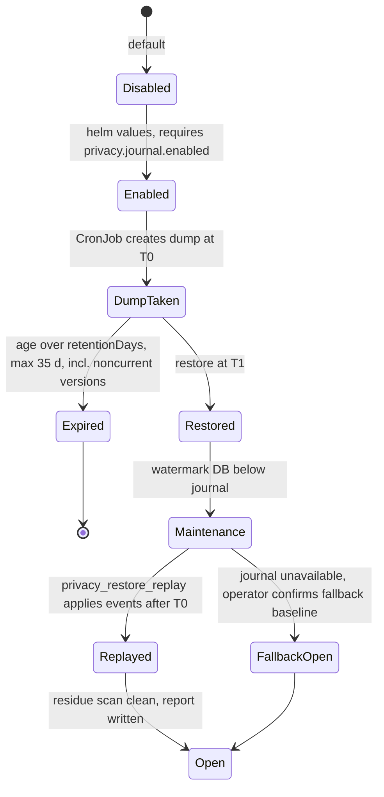

# SPEC-09 — Migrations- und Backfill-Strategie

```
Paket: spec/privacy · Version 1.2 · 2026-11-22 · gemessen gegen develop 24d1c2988; Nachtrag #2839 (develop 343afbb97);
Nachtrag #2976 (2026-11-16, develop 9809d3952): §5a Migration v0114 `rooting_protocols.author` → `author_user_key`
Gemessen gegen: develop 007a4ea90 (Audit 2026-11-22)
Anforderungs-IDs: PRIV-700 … PRIV-739
Hängt ab von: NFR-016 / ADR-009 (Migrationsframework), 04 §7 (Altbefunde), 08 (Modell), 06 §3 (Pflichtfelder)
Änderung v1.1: E04/E15-Konflikt aufgelöst (§3), Vor-/Nachprüfungen je Migration (§2a), Backup-Konzept auf
Tombstone-Spiegel umgestellt (§6, DEC-26), Flags für datenvernichtende Schritte, Behandlung inaktiver Mandanten.
Änderungen 1.2: §3a Zurechnungskopie durch v0104 und täglichen Konsistenzjob (LEG-07); §6 neu gefasst nach Audit
2026-11-22 — Ist-Stand Backup (LEG-11), Backup-Lebenszyklus, Spiegel → write-through Privacy-&-Security-Journal
(LEG-24, LEG-25; PRIV-709/710 korrigiert), Restore-Detektor mit Startsperre und Replay über alle Speicher,
Restore-Szenarien S1–S10, Bucket-Versionierung (LEG-26), Docker-Backup (LEG-43), Waisenobjekte (LEG-60),
Invarianten INV-P5/P6/P10; §1 neueste Version v0114; §11/§12 angeglichen.
```

---

## 1. Framework-Fakten [VERIFIED_CODE]

- Versionen `app/migrations/versions/vNNNN_<slug>.py`, lückenlos, ein `migration`-Objekt; `up(db, *, dry_run=False)
  -> MigrationReport` idempotent (M-3), `dry_run` wird beachtet (M-5); Standard-`down` wirft
  `IrreversibleMigrationError` (M-6); angewendete Quellen sind durch `test_applied_migration_sources_are_frozen`
  eingefroren.
- `MigrationReport {version, name, scanned, changed, dry_run, duration_ms, precondition_unmet, incomplete, details}`;
  CLI gibt Zähler aus und markiert eine ausstehend gelassene Migration; `details` über die structlog-Zeile der
  Migration. **Seit v0109 (2026-11-15, VERIFIED_CODE):** eine Migration mit `kind` (`privacy_correction` |
  `data_backfill`, `framework/base.py`) wird nach dem Redaktionsfilter in `migration_reports` persistiert (Dry-Run und
  echter Lauf, `framework/report_store.py`, §2); `incomplete = true` (Status `partial`/`verify_failed`) behandelt der
  Runner wie `precondition_unmet` (nicht aufgezeichnet, Schleife stoppt, nächster Start wiederholt).
- Kein Mandanten-Scoping auf Framework-Ebene; Unique-Indizes beginnen mit `tenant_key`. Start-Migration mit Sperre
  `schema_migrations/__lock__` (TTL 300 s); Fehler ist startfatal (M-4). `precondition_unmet` hält die Migration
  ausstehend und stoppt die Schleife.
- Konsistenz-Job `care_events.consistency` existiert (05:10 UTC, `ActiveTenants`-Gate, Fenster 7 d). Seit v0109
  existiert der Datenschutz-Konsistenz-Beat `privacy.consistency` in **Minimalform** (05:20 UTC, nur lesend, zählt
  Tombstones außerhalb der Allowlist je Zelle, Gauge `privacy_undeclared_tombstones{cell}`, kein Endpunkt; DEC-28).
- Neueste Datenschutz-Version: `v0114_rooting_protocol_author_key` (2026-11-16, VERIFIED_CODE; §5a); davor
  `v0111_keyed_performers` (2026-11-15, VERIFIED_CODE; §5, erster `data_backfill`), davor `v0110_tenant_record_keeping_default` (§4) und `v0109_privacy_tombstone_copies`
  (2026-11-15, VERIFIED_CODE; §3). Davor
  `v0108_location_tent_fields` (REQ-053, keine Datenschutzmigration) und
  `v0107_care_event_tombstone_performer` (#2839, gemergt 2026-11-09, VERIFIED_CODE): ersetzt
  Tombstones in `care_events.performed_by_user_key` durch `_anonymized` (eingefrorene Regex `^anon_[0-9a-f]{16}$`,
  nur dieses Feld, nur diese Generation), Dry-Run zählt, irreversibel, kein persistierter Bericht. Seit #2839 bildet
  `care_event_backfill_mapper.account_of` einen Tombstone auf den Marker ab, und der Mapper überspringt Beete
  inaktiver Mandanten (`SkipReason.INACTIVE_TENANT`); v0104 selbst ist unverändert (NFR-016 M-7).

**PRIV-700** Jede Migration dieses Pakets MUSS idempotent sein (zweiter Lauf `changed == 0`), im AQL
mandantengebunden (`FILTER doc.tenant_key == @tenant_key` je Mandant, Mandantenliste einmal gelesen), beobachtbar
(structlog-Zeile mit `details` **und** persistierter Bericht, §2), explizit zu Teilausfällen (§2a) und sicher für
inaktive Mandanten (§9).

---

## 2. Persistierte Dry-Run-Berichte

**PRIV-701** Collection `migration_reports` (Plattform, `NOT_TENANT_SCOPED`, Begründung „operator proof of a
migration run; no personal data“) speichert jeden `MigrationReport` einer Datenschutz-Migration (`dry_run` und
echt) nach einem **Redaktionsfilter**: nur Zähler, Collection-/Feldnamen, Mandanten-**Schlüssel**, Stichproben-
**Zeilenschlüssel** (≤ 25 je Bucket) — nie Nutzerschlüssel, Namen, Text, Tombstones. Unit-Test prüft den
erlaubten Schlüsselsatz (TA-701a).

**PRIV-702** CLI `upgrade --dry-run --report-out <path>` schreibt die Berichte als JSON für `.audits/prod-release`.

### 2a. Pflichtphasen jeder Datenschutz-Migration

**PRIV-718** Jede Migration MUSS die folgenden Phasen im Bericht ausweisen (`details.phases`):

| Phase | Inhalt | Abbruchregel |
|-------|--------|--------------|
| `precheck` | Vorbedingungen: Inventaränderung im selben Build vorhanden (Import-Check der Regel), Indizes vorhanden, Salt gesetzt, betroffene Collections existieren, Anzahl Kandidaten je Mandant gezählt | fehlt eine Vorbedingung → `precondition_unmet` (Migration bleibt ausstehend, kein Teilschreiben) |
| `dry_run` | identische Logik ohne Schreiben; Bericht persistiert | — |
| `apply` | je Mandant eine Transaktion; Fortschritt je Mandant im Bericht (`tenants_done`, `tenants_failed`) | Fehler in Mandant X: Transaktion X zurück, Mandant in `tenants_failed`, **Weiterlauf** mit den übrigen; am Ende `changed` = Summe, `status = partial`, Migration gilt als **nicht angewendet** (kein Tracking-Dokument), damit der nächste Start sie erneut versucht — idempotent |
| `verify` | Nachprüfung durch Zählabfragen (z. B. Rest-Tombstones in korrigierten Feldern = 0 je Mandant) | Rest > 0 → `status = verify_failed`, Migration nicht als angewendet markiert; Betreiberhinweis |
| `monitor` | Übergabe der Zählabfrage an den Datenschutz-Konsistenz-Beat (§3, `privacy.consistency`), sobald er registriert ist; bis dahin die Nachprüfung durch einen Unit-Test + den Betreiberbericht | — |

Rollback-Grenzen stehen je Migration in §11.

---

## 3. M-P1 — Kopierte Tombstones korrigieren; Plan-Audit-Akteur auf Marker (E04)

**Stand (2026-11-15, VERIFIED_CODE): umgesetzt.** `v0107_care_event_tombstone_performer` (#2839) hatte Schritt 1
für `performed_by_user_key` (Generation `anon_`) ausgeführt; `v0109_privacy_tombstone_copies` erledigt den Rest:
`created_by`, beide Generationen, Schritte 2–4, alle Phasen und den persistierten Bericht. Die Nummer war von v0107
auf v0108 (W-26) und danach auf v0109 verschoben worden (W-27). Umsetzungsdetails:

- Marker und Tombstone-Regex beider Generationen haben genau eine Definition (`domain/models/privacy.py`:
  `ANONYMIZED_MARKER`, `TOMBSTONE_REGEX`, `is_tombstone`; PRIV-201, Guard
  `test_privacy_marker_and_tombstone_have_one_definition`). Die `anon2_`-Ableitung (PRIV-238) ist nicht Teil davon.
- Inventar: `garden_plan_audit.user_key` ist eine Marker-Regel in `ANONYMIZE_COLLECTIONS` (DEC-16);
  `attachments` leert `original_filename` sowohl in der Regel als auch in der Speicherphase
  (`anonymize_user_metadata`), weil die Speicherphase die Zeile vorher markiert und die Regel sie sonst nie erreicht.
- Die Allowlist wird aus dem Inventar abgeleitet (`ErasureEngine.tombstone_allowlist()`), die beobachteten Zellen
  ebenso (`tombstone_watch_fields()` = kontoförmige Inventarfelder ohne Allowlist). Die Migration friert die Zellen
  von Schritt 3 als Literal ein (NFR-016 M-7); Migration und Beat teilen nur die Zählabfrage
  (`data_access/arango/tombstone_census.py`), nicht die Politik.
- Schritt 3 zählt je Zelle für die gesamte Installation, nicht je Mandant: mehrere beobachtete Collections sind
  konto- oder plattformbezogen und tragen kein `tenant_key`; der Schritt schreibt nichts. Schritte 1, 2 und 4 filtern
  `doc.tenant_key == @tenant_key` in der Transaktion des Mandanten.

**Migration `v0109_privacy_tombstone_copies`** (`kind = privacy_correction`; umkehrbar: nein).

| Schritt | AQL (je Mandant, alle Status außer `deleted`) | Berichts-Bucket |
|---------|-----------------------------------------------|-----------------|
| 1 | `care_events`: `performed_by_user_key` **und** `created_by` mit `=~ TOMBSTONE_REGEX` (beide Generationen) → `_anonymized` — Rest nach v0107 (#2839), das nur `performed_by_user_key` der Generation `anon_` erfasst | `care_events.tombstone_to_marker{tenant_key: count}` |
| 2 | `garden_plan_audit.user_key =~ TOMBSTONE_REGEX` → `_anonymized` (DEC-16) | `garden_plan_audit.tombstone_to_marker` |
| 3 | jede andere **nicht** auf der Allowlist stehende Collection/Feld-Kombination mit kontoförmigem Feld: **nur zählen** | `undeclared_tombstones{collection.field: count}` |
| 4 | `attachments.created_by == _anonymized AND original_filename != ""` → `""` | `attachments.filename_cleared` |
| verify | Schritte 1, 2, 4 erneut zählen → muss 0 sein; Schritt 3 wird als Befund gemeldet, nicht korrigiert | `verify.residual` |

**PRIV-703 (neu gefasst, löst W-02)** Vorbedingungen von v0109 sind **ausschließlich**: (a) die Inventaränderung
`garden_plan_audit` Tombstone → Marker und `attachments.clear_fields += original_filename` im selben Build (Precheck
importiert die Regel und prüft `replacement_strategy`/`clear_fields`); (b) `TOMBSTONE_REGEX`/Allowlist aus
`domain/models/privacy.py` (E03). Die **Nachprüfung** erfolgt innerhalb der Migration (`verify`) und durch
`tests/unit/migrations/versions/test_v0109_*.py`; der Beat `privacy.consistency` ist **keine** Vorbedingung. Der
Beat wird in **E04 in seiner Minimalform** (nur lesende Zählabfragen des Bucket 3 + Metrik, kein Endpunkt) eingeführt,
damit Bucket 3 ab dem Folgetag überwacht ist; Metriken-Endpunkt und Operations-Listing bleiben E15. (DEC-28)

**PRIV-704** Trockenlauf gegen einen Produktions-Snapshot vor P-8; Bericht im Release-Dokument.

**Erwartung Produktion:** klein (Backfill lief 2026-11-07, P-6-Bericht).

---

## 3a. Zurechnungskopie aus Pflichtaufzeichnungen ins Pflegeprotokoll: v0104 **und** täglicher Konsistenzjob (LEG-07)

**Befund (Audit 2026-11-22, LEG-07, technisch `CONFIRMED`, VERIFIED_CODE am SHA `007a4ea90`).** Die Kopie der
ausführenden Person aus gesetzlichen Zeilen (`applied_by_key`, `harvested_by_key` u. a.) nach
`care_events.performed_by_user_key` ist **keine einmalige Migration**, sondern eine **fortlaufende** Kopie über zwei Pfade,
die denselben Mapper nutzen:

| Pfad | Auslöser | Beleg |
|------|----------|-------|
| 1. Backfill `v0104_care_events_backfill` | einmalig beim Start (eingefroren, NFR-016 M-7) | `migrations/versions/v0104_care_events_backfill.py:19–21` (Freitexte und `notes` werden nicht kopiert) |
| 2. Konsistenzjob `care_events.consistency` | **täglich** 05:10 UTC, Fenster 7 d | `domain/services/care_event_consistency_service.py:129`; Fenster `config/settings.py:1287` |
| gemeinsamer Mapper | — | `ACCOUNT_FIELDS` `domain/engines/care_event_backfill_mapper.py:71–77`; `account_of` `:183–191` (Tombstone → Marker seit #2839); `map_document` `:271–306`; Kategorie `pest_control` `:83` |

Der in PRIV-E01 vorgesehene Schalter `PRIVACY_BACKFILL_COPIES_PERFORMER` existiert nicht (Grep in `src/backend/app/`
und `helm/` → 0 Treffer); eine klassenabhängige Regel (z. B. `organization_kind = commercial` → keine Kopie) gibt es
ebenfalls nicht. Folge: Eine Rechtsentscheidung gegen die Kopie würde, wenn sie nur die Migration erfasst, lediglich
Altdaten betreffen — neue Pflichtzeilen würden täglich weiter kopiert.

**Anforderung [PROPOSED] → PRA-2.08.** Der Schalter MUSS in `account_of` gelesen werden, damit er beide Pfade (Rerun
von v0104, Konsistenzjob) und jede künftige Kopie erfasst; Default = Bestand; `commercial` → keine Kopie über
`resolve_tenant_privacy_profile` (`01` §3.5, PRA-1.02). Abnahme: Unit-Test — Schalter aus → Mapper **und**
`CareEventConsistencyService` liefern `performed_by_user_key is None` für Behandlungen/Ernten; `commercial` → keine Kopie
unabhängig vom Schalter. Die Zweckvereinbarkeit (Art. 6 Abs. 4) ist eine Rechtsfrage (LEGAL_REVIEW_REQUIRED) und steht
in [`06-retention-and-legal-basis.md`](06-retention-and-legal-basis.md); hier steht nur der technische Sachverhalt.

---

## 4. M-P2 — Aufzeichnungsprofil und Klassifizierung (E09)

**Stand (2026-11-15, VERIFIED_CODE): Migration und Modellfelder umgesetzt** (Betreiberfreigabe 2026-11-15, DEC-30
`accepted`); der Anlagepfad (PRIV-409, 422 `tenant.classification_required`), das `undeclared`-Verhalten und der
Reklassifizierungs-Job sind offen (E09). Umsetzungsdetails:

- `TenantSettings.record_keeping: RecordKeeping | None` und `organization_kind: OrganizationKind | None`
  (`domain/models/tenant.py`, Enums in `common/enums.py`, Werte wie `08` §3.2), **ohne** Default. Kein Request-
  oder Response-Schema trägt die Felder bisher (Lesen in `GET /tenants/{slug}` ist Teil von E09, `08` §5).
- **Persönliche Mandanten erhalten kein `organization_kind`.** PRIV-409 klassifiziert nur Organisationsmandanten
  (`organization_kind ∈ {association, commercial, community, other}`); `unknown_legacy` würde eine Organisation
  behaupten, die es nicht gibt. Ein Mandant ohne `tenant_type` gilt wie im Modell als persönlich.
- Jedes Feld wird für sich geprüft: Ein Organisationsmandant mit erklärtem `record_keeping`, aber ohne Art erhält
  nur `organization_kind = unknown_legacy`; ein vorhandener Wert wird nie überschrieben. Ein `settings`, das weder
  fehlt noch ein Objekt ist, bleibt unberührt (das Modell kann einen solchen Mandanten ohnehin nicht lesen).
- Phasen wie v0109 (§2a); `precheck` prüft zusätzlich, dass das Modell dieses Builds die geschriebenen Werte liest
  und für beide Felder keinen Default hat. `apply` ist je Mandant ein einzelnes Dokument-`UPDATE` (in ArangoDB
  atomar). Buckets `tenants.record_keeping_legacy`, `tenants.record_keeping_none`,
  `tenants.organization_kind_unknown_legacy`.
- `down` entfernt `record_keeping = legacy` und `organization_kind = unknown_legacy` (Werte, die nur v0110 setzt)
  und lässt `record_keeping = none` stehen: Der Wert stammt nicht eindeutig von v0110 (der Anlagepfad setzt ihn
  für neue persönliche Mandanten ebenso, die Herkunft ist nicht gespeichert) und ist für jeden persönlichen
  Mandanten richtig (L-07); ihn zu entfernen machte einen korrekt klassifizierten Mandanten `undeclared`.

**Migration `v0110_tenant_record_keeping_default`** (`kind = privacy_correction`; umkehrbar: entfernt `legacy`):
setzt bei jedem bestehenden Mandanten ohne Wert `settings.record_keeping = "legacy"` und `settings.organization_kind =
"unknown_legacy"`; persönliche Mandanten erhalten `record_keeping = "none"` (L-07) und kein `organization_kind`. Neue Mandanten erhalten
**keinen** Default (`undeclared`, PRIV-409) — der Anlagepfad verlangt die Angabe.

**Job `privacy.reclassify_statutory_rows`** (läuft bei Wechsel auf `none` oder bei PRIV-411-Anwendung; mandanten-
gebunden; idempotent; **nur wenn `PRIVACY_RECORD_KEEPING_RECLASSIFY = true`**, sonst `reclassification_pending`):

| Zeilen | Aktion |
|--------|--------|
| `harvest_batches`, `quality_assessments`, `treatment_applications`, `inspections` mit Tombstone in `*_by_key` | → `_anonymized`; Prüfeintrag `notes` (`source_kind = record_keeping_change`) |
| dieselben mit lebendem Schlüssel | nichts (Konto existiert); künftige Löschregeln behandeln sie nach Klasse |

Bericht: Zähler je Collection; Audit `TENANT_RECORD_KEEPING_CHANGED`. Rollback: keiner.

---

## 5. M-P3 — Freitext-Ausführendenfelder → Schlüsselfelder (E13)

**Stand (2026-11-15, VERIFIED_CODE): Migration und Modellfelder umgesetzt**; Request-Schemas („Ich war es /
jemand anderes“), serverseitiges Stempeln, Marker-Regeln der Löschung, Beats und `data_controller` sind offen
(Rest von E13). Discovery-Ergebnis gegen den Code (Abweichungen von der Tabelle v1.1, Code maßgeblich):

- **`propagation`-Chargen haben kein `author`.** Das einzige `author` der Vermehrung trägt
  `rooting_protocols` (Bewurzelungsprotokolle), und es ist **kein Freitext**: beide Schreibwege
  (`propagation/tenant_router.py`, Anlegen und Ändern) setzen `author = ctx.user_key`, also den rohen
  Kontoschlüssel der zuletzt ändernden Person; `RootingProtocolResponse.author` gibt ihn aus, und das
  Löschinventar erreicht ihn nicht (R6 sieht den Feldnamen `author` nicht). Eine Label-Kopie würde einen
  Kontoschlüssel in ein Feld für Dritte schreiben; `rooting_protocols` ist deshalb **nicht** Teil von v0111.
  Der Befund ist eine eigene Datenschutzkorrektur: #2976, §5a (v0114).
- **`maintenance_logs` und `tank_fill_events` tragen kein `tenant_key`** (Modell ohne Feld; nur Altbestand aus
  v0004 hat eines). Das Mandantenprädikat sitzt am Anker, dem Tank (`tank.tenant_key == @tenant_key`, dann
  `doc.tank_key == tank._key`; #706).
- **`inspections.inspected_by_key` existiert seit #1669** (serverseitig gestempelt; v0056 schrieb `null` auf
  ältere Zeilen) und ist bereits im Löschinventar (`tombstone_hash`, `clear_fields = [inspector]`). Der MCP-Weg
  schreibt heute beides: `inspector = "mcp:<key>"` **und** `inspected_by_key = <key>`. Schritt 4 füllt daher nur
  Zeilen mit `inspected_by_key = null`; die Prüfung „aktuelles Service-Konto“ verlangt zusätzlich eine
  Mitgliedschaft (`is_active != false`) im Mandanten der Inspektion — ein Service-Konto eines fremden Mandanten
  wird nie zugeordnet.
- **Längen:** `nutrient_plans.author` unbegrenzt, `workflow_templates.created_by` ≤ 200, `performed_by`
  unbegrenzt; Labels werden auf 80 Zeichen gekürzt (`PERSON_LABEL_MAX_LENGTH`, `domain/models/privacy.py`),
  das alte Feld bleibt vollständig.
- **Globale Katalogzeilen** (`tenant_key = ""`: System-Nährstoffpläne, System-Workflowvorlagen) gehören keinem
  Mandanten und bleiben unberührt.

**Migration `v0111_keyed_performers`** (`kind = data_backfill`; nur aktive Mandanten, §9; additiv; umkehrbar §11):

| Collection | Schritt | Berichts-Bucket |
|------------|---------|-----------------|
| `watering_events`, `watering_logs` (Prädikat am Dokument), `maintenance_logs`, `tank_fill_events` (Prädikat am Tank) | `performed_by_user_key = null`, falls das Attribut fehlt; `performed_by_label = performed_by[:80]`, falls das Label `null` und `performed_by` ein nicht-leerer Text ist; `performed_by` ein Release deprecated | `<collection>.performer_keyed` |
| `nutrient_plans` | `author_user_key = null`, `author_label = author[:80]` (dieselbe Regel) | `nutrient_plans.author_keyed` |
| `inspections` mit `inspector` beginnend mit `mcp:` | `inspected_by_key = <key>` **nur wenn** das Feld `null` ist und `<key>` ein bestehendes Konto mit `account_type = service` und Mitgliedschaft im Mandanten ist; sonst bleibt es `null`; danach `inspector = ""` | `inspections.mcp_inspector_cleared`, Teilmenge `inspections.service_account_keyed` |
| `workflow_templates` | `created_by_user_key = null`; `created_by` bleibt das Label (kein eigenes Label-Feld) | `workflow_templates.creator_keyed` |

Phasen wie §2a: `precheck` prüft zusätzlich, dass die Modelle dieses Builds die neuen Felder mit Default `None`
(Label: Grenze 80) tragen und dass jedes neue Schlüsselfeld im Löschinventar
(`ErasureEngine.EXCLUDED_USER_REFERENCES` — die Felder sind bis E13 immer `null`; E13 ersetzt die Ausnahme durch
eine Marker-Regel, sobald es stempelt) und im Mandantenexport (`TenantExportEngine.COLLECTION_REFERENCES`, Art
`account`) deklariert ist. `apply` ist je Mandant eine Stream-Transaktion über alle Schritte; `verify` zählt alle
Schritte erneut. Kein Request-Schema trägt ein `*_user_key` (PRIV-705, Unit-Test), die Response-Schemas sind
unverändert.

**PRIV-705** Kein Konto aus einem getippten Namen ableiten (REQ-025 Regel 4; #1662/#1663); Ausnahme nur das
deterministische Präfix `mcp:` [VERIFIED_CODE]. **PRIV-706** Labels, die einem aktuellen Mitgliedsnamen entsprechen,
KÖNNEN als Prüfeinträge `legacy_unkeyed_name` gelistet werden; die Migration ändert sie nie.

### 5a. `rooting_protocols.author` → `author_user_key` (#2976)

**Stand (2026-11-16, VERIFIED_CODE): umgesetzt** (Betreiberentscheidung D3 vom 2026-11-16 in #2976).

- **Befund [VERIFIED_CODE, develop 9809d3952].** Beide Schreibwege (`propagation/tenant_router.py`, Anlegen und
  Ändern) stempelten `author = ctx.user_key`; `RootingProtocolResponse.author` gab den rohen Kontoschlüssel an jedes
  Mitglied aus; das Löschinventar erreichte ihn nicht, weil R6 (`scripts/check_privacy_inventory.py`) einen
  Kontoverweis an der Form seines Namens erkennt und `author` keine dieser Formen hat.
- **Modell.** `RootingProtocol.author_user_key: str | None = None` ersetzt `author` (R6-Form `*_user_key`, wie
  `performed_by_user_key`); nur der Server stempelt es (PRIV-705: `RootingProtocolCreate` trägt das Feld nicht).
- **Antwort.** `RootingProtocolResponse.author` bleibt als Feldname, trägt aber den Anzeigenamen des Kontos oder
  `anonymisiert` (Konto gelöscht oder Marker) — nie den Schlüssel; dieselbe Regel wie `performed_by` der
  Pflegeeinträge (GP-API-034, `display_performer`). Globale Vorlagen haben keinen Autor (`null`).
- **Löschung.** `AnonymizationRule(rooting_protocols, author_user_key, Marker)`; das Protokoll bleibt als
  Arbeitsvorlage des Mandanten erhalten. Der Mandantenexport leitet den Kontoverweis aus der Regel ab
  (`TenantExportEngine.account_fields`); Art. 15 legt die Protokolle als Quelle „Rooting protocols you saved“ offen
  (R2), ohne den Schlüssel selbst.
- **Klassen-Guard.** `tests/unit/guards/test_caller_account_stamps_use_a_reference_shaped_name.py`: jedes
  Domänenmodell, dem der Kontoschlüssel des Aufrufers (`*.user_key`) übergeben wird, speichert ihn unter einem
  Namen in R6-Form; abweichende, entschiedene Fälle stehen mit Begründung in der Liste des Guards.

**Migration `v0114_rooting_protocol_author_key`** (`kind = privacy_correction`; jeder Mandantenstatus außer
`deleted`, §9; umkehrbar: nein, §11):

| Fall (Zeile des Mandanten mit Attribut `author`) | `author_user_key` | Berichts-Bucket |
|-----------------------------------------------|-------------------|-----------------|
| `author_user_key` schon gesetzt | bleibt | `rooting_protocols.author_dropped` |
| `author` nennt ein bestehendes Konto (`users/<author>` existiert) | `author` | `rooting_protocols.author_keyed` |
| `author` nicht-leerer Text, Konto gelöscht/fehlt (oder schon der Marker) | `_anonymized` | `rooting_protocols.author_to_marker` |
| sonst (`null`, leer, kein Text) | `null` | `rooting_protocols.author_dropped` |

In jedem Fall wird `author` entfernt (`UNSET`). Globale Vorlagen (`tenant_key = ""`) gehören keinem Mandanten;
kein Pfad schreibt dort einen Autor, sie bleiben unberührt. Phasen wie §2a: `precheck` prüft zusätzlich, dass das
Modell dieses Builds `author_user_key` (Default `None`) und kein `author` mehr trägt, die Löschregel den Marker
schreibt und der Mandantenexport das Feld als Kontoverweis kennt; `apply` je Mandant eine Stream-Transaktion;
`verify` zählt Zeilen mit `author` erneut (muss 0 sein); `monitor` entfällt (das Feld existiert nicht mehr, R6 und
der Klassen-Guard verhindern seine Rückkehr). Der Schlüssel stammt nie aus einem getippten Namen (`author` trug
keinen, PRIV-705 berührt das nicht). Tests: `tests/unit/migrations/versions/test_v0114_*.py`,
`tests/integration/test_v0114_*.py`.

**Erwartung Produktion:** klein (Bewurzelungsprotokolle werden selten angelegt); der Dry-Run-Bericht beziffert es.

---

## 6. Backups und Wiederherstellung (DEC-26 ersetzt das Raw-Key-Ledger aus v1.0; v1.2: Journal statt Spiegel)

Seit v1.2 (Audit 2026-11-22) gilt: Der Löschungs-Spiegel aus v1.1 wird zu einem **Privacy-&-Security-Journal**
verallgemeinert, das **im selben Schreibschritt** wie die fachliche Änderung entsteht (write-through), und ein Restore
wird **automatisch** erkannt. Gründe: Ein Spiegel, der nur vor dem Dump synchronisiert wird, ist wirkungslos (LEG-25), und
ein Restore setzt nicht nur Löschungen, sondern auch Widerrufe und Sicherheitsänderungen zurück (LEG-24). DEC-26 wird
damit **erweitert, nicht verworfen**; die Kernidee (§6.2, Abgleich über Tombstones ohne Rohschlüssel) bleibt.
Architektur und Komponentenzuschnitt: [`01-privacy-architecture.md`](01-privacy-architecture.md) §3.5 (Konzepte
„Journal“ und „Backup-Löschpropagation“) und §8a (Invarianten).

### 6.1 Fakten [VERIFIED_CODE / VERIFIED_SPEC, Audit 2026-11-22 am SHA `007a4ea90`]

- **Helm-Backup existiert und ist funktionsfähig, aber aus.** CronJob `arangodb-backup` (`arangodump` inkl.
  Systemcollections → rclone → S3) in `helm/kamerplanter/values.yaml:567–612` (`backup.enabled: false`,
  `retentionDays: 30` Z. 596, SSE `AES256`/`aws:kms` Z. 1443–1444); Controller `:1324–1460` (Dump `:1366–1373`,
  Upload und Retention `:1409–1430`). TimescaleDB, Anhänge und `vectordb` deckt das Chart nicht ab.
  (Audit 2026-11-22: korrigiert die Aussage „es existiert kein Backup“ in v1.1 — es existiert ein aktivierbares Backup
  ohne Löschpropagation.)
- **Keine Fristgrenze.** `retentionDays` ist unvalidiert (kein `values.schema.json`); das Skript löscht nur bei `> 0`
  (`values.yaml:1418`) ⇒ `retentionDays: 0` = **unbegrenzt**; bei einem Upload-Fehler bricht `set -eu` vor der Retention
  ab.
- **Kein Precheck gegen fehlenden Schutz.** Der einzige Backup-Precheck prüft nur `backup.s3.bucket`
  (`values.yaml:382–387`, #2122); `grep mirror\|erasure` in `helm/kamerplanter/templates/` → 0. TA-718 ist offen.
- **Kein Spiegel, kein Replay.** `grep erasure_mirror\|privacy.mirror\|mirror.enabled` in `src/`, `helm/`, `docs/` → 0;
  `privacy_restore_replay` existiert nicht (kein Modul unter `src/backend/app/migrations/`).
- **Betriebsdoku leitet zur Aktivierung an, ohne Replay und ohne Warnung.** `docs/de/deployment/backup-restore.md:21`,
  `:25–80`, `:44`, `:64–65`; Restore `:101–160` endet mit „Anwendung starten“; empfiehlt Versionierung am Backup- und
  am Anhangs-Bucket (`:14`, `:29`; `values.yaml:587–591`) ohne Lifecycle (LEG-26). Der Drill vom 2026-10-04 prüfte nur
  Dokumentanzahlen (`backup-restore.md:103–104`).
- **Restore braucht** denselben `FERNET_KEY` und `ERASURE_TOMBSTONE_SALT` (`backup-restore.md:16, 21`; NFR-011 §4
  verlangt den Salt im DR-Backup) — konsistent mit `compute_tombstone_hash` (`domain/engines/erasure_engine.py:1236`).
- `erasure_requests` behält nach Abschluss den **Tombstone** der Person (`user_key` pseudonymisiert) für R-06 (3 J.);
  `tenant_erasure_records` behält den Mandantenschlüssel (`ter_<tenant_key>`).
- **Einzige zufällige Selbstheilung:** `execute_scheduled_erasures` (`domain/services/privacy_service.py:2568–2602`) wählt
  nach einem Restore Anträge in `scheduled`/`partially_completed`/stale `in_progress` erneut — das deckt nur Szenario S2
  (§6.5).
- **Light/Docker:** `docs/de/deployment/docker-dauerbetrieb.md:205–233` empfiehlt tägliche `arangodump`-Kopien nach
  `./backup-YYYYMMDD` (unverschlüsselt, ohne Frist), übergibt `--server.password "$ARANGO_ROOT_PASSWORD"` als Argument
  (in der Prozessliste sichtbar) und beschreibt den Restore ohne Hinweis auf Löschungen (`:218–230`) (LEG-43).
- **Produktionszustand nicht prüfbar** (ArgoCD außerhalb des Repos) → Prüfaufgabe PRA-0.03.
- Rechtlich: EDSA 01/2022 Rn. 110 (L-19) trägt verzögertes Durchschlagen in Backups bei kurzem Zyklus und erneuter
  Anwendung nach Restore; keine deutsche Aufsichtsaussage gefunden (L-21) → LEG-11 ohne Primärbeleg
  (LEGAL_REVIEW_REQUIRED). Die Zulässigkeit eines pseudonymen Journals (Tombstones sind personenbezogen, ErwG 26) ist Teil
  von LEG-11.

### 6.1a Backup-Lebenszyklus (Zielbild) [PROPOSED]



| Übergang | Wirkung (Soll) | Lücke heute (Audit 2026-11-22) | PRA |
|---|---|---|---|
| Disabled → Enabled | Render-Fail ohne Journal; Frist 1–35 d | aktivierbar ohne Schutz, `0` = unbegrenzt (LEG-11) | PRA-0.10 |
| DumpTaken → Expired | Löschung inkl. nicht-aktueller Objektversionen | Versionierung ohne Lifecycle empfohlen (LEG-26); Docker ohne Frist (LEG-43) | PRA-0.03, PRA-0.10, PRA-3.07 |
| Restored → Maintenance | automatische Erkennung, 503 | keine Erkennung | PRA-1.05 |
| Maintenance → Replayed | alle Speicher, alle Ereignistypen | kein Replay; v1.1 plante nur Löschungen (LEG-24, LEG-25) | PRA-1.04, PRA-1.05 |
| FallbackOpen | Secret-Rotation, Token-/Key-Widerruf, Warnung „Löschungen seit T0 unbekannt“ | — | PRA-1.05 |

### 6.2 Kernidee: Erkennung wiederhergestellter gelöschter Konten **ohne** Rohschlüssel-Speicher

Nach einem Restore existiert die `users`-Zeile einer bereits gelöschten Person wieder — **mit ihrem rohen Schlüssel**.
Weil `compute_tombstone_hash(user_key, salt)` deterministisch ist (VERIFIED_CODE), lässt sich für **jede
wiederhergestellte `users`-Zeile** der Tombstone berechnen und gegen die Liste abgeschlossener Löschanträge
abgleichen. Der Abgleich braucht nur die **Tombstones** der abgeschlossenen Löschungen — keine Rohschlüssel. Das
Raw-Key-Ledger aus v1.0 entfällt (W-09; weniger personenbezogene Daten, DEC-26). Das Journal (§6.3) übernimmt dieses
Prinzip für alle Ereignistypen: Subjekt ist immer ein Tombstone oder eine Datensatz-ID, nie ein Rohschlüssel.

### 6.3 Privacy-&-Security-Journal (ersetzt den Löschungs-Spiegel `erasure_mirror`)

**PRIV-709 (neu gefasst v1.2; Audit 2026-11-22: LEG-24, LEG-25)** Jede privacy- oder sicherheitsrelevante
Zustandsänderung MUSS **im selben Schreibschritt** (ArangoDB-Transaktion) einen Eintrag in die Outbox
`privacy_journal_outbox` schreiben; ohne Eintrag kein Commit (A-JRN-1, INV-P5). Ereignistypen:

| Ereignis | Emittent | Subjekt im Eintrag |
|---|---|---|
| `account_erased` | `PrivacyService` (Abschluss der Kontolöschung, auch sofortige Admin-Löschung) | instanzweiter Tombstone (= `erasure_requests.user_key`), `tenant_tombstones[]` (mandantengebundene `anon2_`-Werte, PRIV-238), `erasure_key`, `plan_fingerprint` |
| `tenant_erased` | `TenantService` | `tenant_key` bzw. `ter_<tenant_key>` |
| `consent_revoked` | `PrivacyService` (Einwilligung) | Tombstone-HMAC, `purpose` |
| `restriction_set` / `restriction_lifted`, `objection_recorded` | `PrivacyService` (Art. 18/21, `03` §2.6) | Tombstone-HMAC, `scope` |
| `api_key_revoked` | API-Key-Service | Datensatz-ID des Keys |
| `sessions_revoked`, `password_changed` | `AuthService` | Tombstone-HMAC bzw. Token-Familien-ID |
| `membership_removed`, `role_lowered`, `tenant_suspended` | `TenantService` | Tombstone-HMAC, `tenant_key`, neue Rolle |

Kein Rohschlüssel, kein Name, kein Inhalt (A-JRN-3); monotone Sequenz und Hochwassermarke
`instance_state.journal_high_watermark` in der DB (A-JRN-4). Die `ErasureEngine` bleibt rein deklarativ und emittiert
nichts; der Service, der den Plan ausführt, schreibt den Eintrag.

**PRIV-710 (neu gefasst v1.2; Audit 2026-11-22: LEG-25)** Der Celery-Task `privacy.journal_flush` MUSS Outbox-Einträge
**binnen eines SLA (Minuten)** an ein Bucket-Objekt `privacy/journal/<seq>.jsonl.fernet` anhängen (verschlüsselt mit
`FERNET_KEY`, HMAC-Kette über die Einträge), das vom Backup unabhängig ist und nicht gelöscht werden kann: eigener
S3-Schlüssel nur mit `PutObject` (ohne `Delete`), Prefix mit **Object Lock** (Governance, Dauer ≥ Dump-Frist + Puffer)
(A-JRN-2). Metrik `privacy_journal_outbox_age_seconds` mit Alarm bei > 1 h. Ein Beat dient nur noch als
Nachzügler-Sweep und Prüfung „Outbox leer“. Die v1.1-Fassung („Spiegel-Sync **vor** der Dump-Erstellung“) ist
**aufgehoben**: Ein nur beim Dump synchronisierter Spiegel enthält genau die Löschungen, die ohnehin im Dump
(`erasure_requests`) stehen, und keine der Löschungen zwischen letztem Dump und Restore — also genau die, die der
Restore verliert. Damit sind PRIV-709 und PRIV-710 widerspruchsfrei; PRIV-E14 in `12` ist entsprechend anzugleichen
(dort „Beats (`sync`, `purge`)“).

**Aufbewahrung des Journals:** wie R-06 (3 J.) bzw. R-06a; danach Bereinigung durch `privacy.purge_erasure_mirror`
(künftig `privacy.purge_journal`: Objekte gefiltert neu schreiben, HMAC-Kette neu, nach Ablauf des Object Lock).
Rechtsgrundlage Art. 17-Durchsetzung (R-45); Zulässigkeit offen (LEG-11, LEGAL_REVIEW_REQUIRED). Zugriff: nur Flush-Task
(schreibend) und Restore-Prozess (lesend).

**Verlust des Journals:** Rückfall auf die im Dump enthaltenen `erasure_requests`/`tenant_erasure_records` (decken alle
Löschungen **vor** dem Dump) plus die Rückfall-Basis aus PRIV-711 Schritt 6; der Restore gilt als **nicht abgeschlossen**
(A-BAK-5), Restrisiko-Zeile RISK-10.

**Offene Architekturfrage:** Journal-Speicher für Installationen ohne S3 (Light, Docker; BM-002/BM-003) — lokales
append-only Verzeichnis auf separatem Volume oder kein Backup ohne S3 (`01` §11, PRA-1.04, PRA-3.07).

### 6.4 Restore-Erkennung und Wiederherstellungsverfahren

**PRIV-711 (neu gefasst v1.2; Audit 2026-11-22: LEG-24)** Das Backend (Lifespan in `src/backend/app/main.py`) und der
Worker (Initialisierung vor jedem Beat) MÜSSEN beim Start die DB-Hochwassermarke mit der höchsten Sequenz im
Journal-Bucket vergleichen. Liegt die DB-Marke darunter, MUSS das System im **Wartungsmodus** bleiben (503 außer Health
und Admin-Replay) und keinen Beat ausführen, bis der Replay abgeschlossen ist (A-BAK-3, INV-P6). Damit ist der Replay
nicht vergessbar. Der Replay läuft als
`python -m app.migrations.privacy_restore_replay` im vorhandenen Migrationsframework (Phasen
`precheck/dry_run/apply/verify` wie PRIV-718, Bericht in `migration_reports` als `restore_replay`):

1. Vereinigung der Ereignisse aus dem Journal-Bucket (entschlüsselt, HMAC-Kette geprüft) mit den wiederhergestellten
   `erasure_requests` (`status = completed`, `user_key =~ TOMBSTONE_REGEX`) und `tenant_erasure_records`.
2. Für **jede** wiederhergestellte `users`-Zeile: instanzweiter `compute_tombstone_hash(_key, salt)` → Treffer ⇒
   `erase_account_now`-Äquivalent erneut ausführen (idempotent; der instanzweite Tombstone existiert je Löschung genau
   einmal, PRIV-238). Mandantengebundene `anon2_`-Werte werden aus den wiederhergestellten Mitgliedschaften neu
   abgeleitet und gegen `tenant_tombstones` geprüft — sie sind nie der Schlüssel des Abgleichs.
3. Für jedes `tenant_erased` (Journal ∪ Dump), dessen Mandantenzeile existiert ⇒ Mandantenlöschung erneut ausführen.
4. **Alle übrigen Ereignistypen** jünger als die DB-Marke idempotent anwenden: Einwilligung widerrufen,
   Einschränkung/Widerspruch wiederherstellen, API-Keys und Token-Familien widerrufen, `password_changed` ⇒
   Passwort-Reset erzwingen, Mitgliedschaft entfernen bzw. Rolle herabsetzen, Mandant sperren.
5. **Alle Speicher** (A-BAK-4): ArangoDB, TimescaleDB (`delete by tenant_key/sensor_key`), Objektspeicher (Präfix
   `t/<tenant>/`, Exportbündel), `vectordb` (`delete_user_contributions`/`delete_tenant_contributions`); Prüfeinträge
   (idempotente Schlüssel) neu erzeugen.
6. **Rückfall-Basis ohne Journal:** `JWT_SECRET_KEY` rotieren, alle `refresh_tokens` widerrufen, alle API-Keys aus der
   Zeit vor dem Restore auf „Bestätigung durch Eigentümer erforderlich“, Betreiberwarnung „Löschungen seit T0 unbekannt“;
   der Restore gilt als nicht abgeschlossen, bis der Betreiber ausdrücklich bestätigt (A-BAK-5).
7. Residue-Scan (`04` §8) über alle Collections; Rest > 0 ⇒ Restore gilt als **nicht abgeschlossen**, Backend bleibt im
   Wartungsmodus; danach Marke angleichen.

**PRIV-712** Restore-Drill (Doku, nightly TA-710; Quartals-Drill PRA-3.09) mit präpariertem Konto je Szenario S3, S5,
S6, S7 (§6.5): nach Replay fehlt der Rohschlüssel in jeder Collection; keine Zeile außerhalb der Allowlist trägt den
Tombstone; ein widerrufener API-Key liefert 401, der Consent-Guard 403 `ConsentRequiredError`, ein Login mit altem
Passwort schlägt fehl, vor dem Restore ausgestellte Refresh-Tokens liefern 401.

**PRIV-713 (präzisiert v1.2; Audit 2026-11-22: LEG-26)** Bucket-Versionierung (Backup- **und** Anhangs-Bucket) ist nur
mit Lifecycle-Regel `NoncurrentVersionExpiration ≤ 35 d` und `ExpiredObjectDeleteMarker` zulässig; TimescaleDB- und
local-fs-Snapshots folgen derselben Frist (≤ 35 d). Ohne diese Regel erzeugen `rclone purge` (`values.yaml:1426`), das
Löschen von Exportarchiven (R-05) und das Löschen von Fotos bei Konto-/Mandantenlöschung nur Delete-Marker; die Inhalte
bleiben als nicht-aktuelle Versionen **unbefristet** beim S3-Anbieter — die im Chart sichtbare 30-Tage-Frist ist dann
nicht die tatsächliche. Heute nennt keine Doku die Regel (`grep -rni "lifecycle\|noncurrent" docs/de/deployment
helm/kamerplanter/values.yaml` → 0). Umsetzung als Betreiberdoku mit Beispiel-JSON (AWS/MinIO), optional Object Lock
(Governance) = `retentionDays` und ein best-effort-Startcheck (`GetBucketLifecycleConfiguration`) mit Warnung — PRA-0.10.
Abnahme: Drill „Objekt löschen → nach Frist + 1 d keine Version mehr (`aws s3api list-object-versions`)“.

**PRIV-707 (angepasst v1.2)** Backups DÜRFEN in Produktion NICHT aktiviert werden, bevor Journal (6.3) und Verfahren
(6.4) existieren. Helm: `backup.enabled` erfordert `privacy.journal.enabled` (v1.1: `privacy.mirror.enabled`) **und**
`1 ≤ backup.retentionDays ≤ 35`, sonst Render-Fail (A-BAK-1, A-BAK-2, INV-P10). **Interim bis PRA-1.04 (PRA-0.10):**
Render-Fail bei `backup.enabled` ohne Journal, außer mit ausdrücklichem Override `backup.acknowledgeNoErasureReplay=true`;
Warnblock in `backup-restore.md` (DE/EN) mit manuellem Runbook „nach Restore Löschaufträge mit `completed_at > dump_ts`
erneut ausführen, JWT-Secret rotieren, Refresh-Tokens widerrufen“. **PRIV-708 [LEG-11]** Dump-Aufbewahrung ≤
`BACKUP_RETENTION_DAYS` (Standard 30, Obergrenze 35); die Datenschutzinformation nennt Frist und Replay (heute
`CONFIRMED` als Lücke: keine Backup-Frist in der Nutzerdoku, `RetentionService` ohne Backup-Zeile; Umsetzung über
PRA-2.18).

### 6.5 Restore-Szenarien S1–S10 (Ist, Audit 2026-11-22)

Ausgangslage: Restore nach `backup-restore.md:101–160` (Dump mit Stand T0, Restore zum Zeitpunkt T1 > T0), danach
starten Backend und Beat ohne weitere Schritte.

| # | Ereignis zwischen T0 und T1 | Zustand nach Restore | Selbstheilung heute? | Ergebnis | Abhilfe |
|---|---|---|---|---|---|
| S1 | Konto vor T0 gelöscht (Antrag `completed`) | Konto fehlt im Dump | — | korrekt | — |
| S2 | Antrag vor T0 (`scheduled`), Hard-Delete zwischen T0 und T1 | Konto soft-deleted zurück, Antrag `scheduled` | **ja**: nächster 04:00-Lauf wählt den Antrag erneut (`privacy_service.py:2601–2602`); Objekte (Phase 0) bereits gelöscht → Referenzen tot | korrekt nach ≤ 24 h, Restexposition | Startsperre verkürzt auf 0 |
| S3 | Antrag **nach** T0 gestellt und vollzogen | Konto **aktiv** zurück, kein Antrag | **nein** | **gelöschte Person stillschweigend wiederhergestellt** (Art. 17, Art. 6) | Journal `account_erased` + Replay |
| S4 | Sofortige Admin-Löschung nach T0 | wie S3 | nein | wie S3 | wie S3 |
| S5 | Mandantenlöschung nach T0 | Mandant `active` zurück; TimescaleDB/Objekte/Vektoren des Mandanten bereits gelöscht (inkonsistent) | nein | Wiederverarbeitung + Inkonsistenz | Journal `tenant_erased` + Replay über alle Speicher |
| S6 | Einwilligungswiderruf / Art.-18-Einschränkung / Widerspruch nach T0 | Einwilligung wieder `granted`, Einschränkung fehlt | nein | Verarbeitung ohne Rechtsgrundlage (LEG-24) | Journal `consent_revoked`, `restriction_set`, `objection_recorded` |
| S7 | API-Key-Widerruf, Sitzungsende, Passwortwechsel nach T0 | alter Zustand gültig | nein (Refresh-Tokens älter als 30 d entfernt der TTL) | Sicherheitslücke — reaktiviert genau die im Vorfall widerrufenen Zugänge (LEG-24) | Journal `api_key_revoked`, `sessions_revoked`, `password_changed`; Rückfall-Basis |
| S8 | Restore nur ArangoDB, TimescaleDB/Objekte nicht | DB älter als Nebenspeicher | Waisen-Sweeps; Reconcile nur Bericht (LEG-60) | Objekte nach T0 verwaist, Katalogzeilen ohne Objekt | §6.6 Waisenobjekte |
| S9 | Restore eines S3-Anhangs-/Snapshot-Stands (Versionierung) | gelöschte Fotos/Exporte zurück | nein | wie S3, für Objekte | PRIV-713; Replay Objektspeicher |
| S10 | Light/Docker-Restore | wie S3–S7 | nein | geringere Relevanz (Haushalt, ggf. Art. 2 Abs. 2 lit. c), S7 bleibt sicherheitsrelevant | §6.6 Docker-Backup; Rückfall-Basis |

Evidenz zu LEG-24: `data_access/arango/api_key_repository.py:70–77` (Widerruf nur `revoked: True` im Dokument),
`domain/services/auth_service.py:891`, `data_access/arango/consent_repository.py:220–230`,
`processing_restriction_repository.py`; `security_audit_log` liegt in derselben ArangoDB und rollt mit zurück — deshalb
gehen sicherheitsrelevante Audit-Ereignisse zusätzlich ins Journal (A-AUD-3, `01` §3.5).

**Technisch erzwingbarer Ansatz (Zusammenfassung):** (1) Journal statt Löschspiegel mit Outbox im selben Schreibschritt
(PRIV-709); (2) write-through ins Bucket mit Object Lock und Alters-Alarm (PRIV-710); (3) Hochwassermarke und
Startsperre (PRIV-711); (4) Replay über alle Speicher und Ereignistypen mit Residue-Scan (PRIV-711); (5) Rückfall-Basis
ohne Journal (PRIV-711 Schritt 6); (6) Chart-Durchsetzung (PRIV-707, INV-P10); (7) Transparenz (PRIV-708);
(8) Drill je Szenario S3, S5, S6, S7 (PRIV-712). Umsetzung: PRA-0.10, PRA-1.04, PRA-1.05, PRA-3.09.

### 6.6 Nebenpfade: Docker-Backup und Waisenobjekte

**Docker-/Light-Backup (LEG-43, P2, VERIFIED_CODE `docs/de/deployment/docker-dauerbetrieb.md:205–233`).** Anforderung
[PROPOSED, PRA-3.07]: Skript `scripts/backup-docker.sh` mit Passwort-Übergabe wie im Helm-Job (nicht als Argument),
Frist ≤ 35 d (`find … -mtime +30 -delete`), optional Verschlüsselung (`age`/`gpg`); Restore-Hinweis auf den Replay
(PRIV-711), sobald vorhanden. Abnahme: Doku zeigt das Passwort nicht als Argument; Frist ≤ 35 d im Beispiel; Hinweis auf
Löschpropagation.

**Waisenobjekte (LEG-60, P3, VERIFIED_CODE).** `storage_reconcile_delete_enabled` ist per Default `False`
(`config/settings.py:1386`); der Abgleich `reconcile_orphaned_storage_objects` (Beat 04:10, `tasks/storage_tasks.py:531`)
meldet nur. Objekte ohne Katalogeintrag — nach fehlgeschlagenen Löschpfaden oder nach einem DB-Restore auf älteren Stand
(S8) — bleiben ohne Frist. Die Voreinstellung schützt bewusst vor Fehllöschung, gibt der Betreiberentscheidung aber
keine Frist. Anforderung [PROPOSED, PRA-3.06]: Betreiberdoku „Freigabe nach erstem Trockenlauf-Bericht“; Metrik
`orphan_objects_total` und Warnung, wenn > 0 länger als 30 d; Aufbewahrungszeile in `06`.

---

## 7. Salt-Rotation und Re-Keying (Verfahren spezifiziert, nicht geplant)

**PRIV-714** `ERASURE_TOMBSTONE_SALT` DARF NICHT rotiert werden ohne Re-Keying-Migration. Verfahren (für den Fall):
(1) neuer Salt als `ERASURE_TOMBSTONE_SALT_NEXT`; (2) Migration `vNNNN_rekey_tombstones`: für jede Allowlist-Zelle
mit Tombstone **ohne** Kenntnis des Rohschlüssels ist eine Neuberechnung **unmöglich** — daher kann Re-Keying nur
Tombstones betreffen, deren Rohschlüssel noch existiert (aktive Konten in gelöschten Mandanten); für alle anderen
bleibt der alte Tombstone gültig und die Allowlist-Regex kennt beide Generationen (`anon_`, `anon2_`, DEC-25); (3) der
Journal (§6.3) wird um die neue Generation ergänzt. Folge: Eine Kompromittierung des Salts ist nicht durch Rotation
heilbar; Schutz liegt in Zugriffsbeschränkung des Secrets (Betriebsdoku, RISK-20).

---

## 8. Bestehende Offline-Datensätze auf Geräten (DEC-29)

**PRIV-715** Client-Migration (Dexie `version(3)` auf `kp-write-queue`, Versionssprung des Plan-Caches): beim ersten
Start der neuen Version (a) `kp-plan-cache` vollständig löschen; (b) vorhandene Puffer-Einträge in einen Übergangs-
dialog „jetzt senden / verwerfen“ geben; ohne Entscheidung werden sie nach 7 Tagen gelöscht (Hinweis mit Anzahl);
(c) Offline-Modus steht auf **aus**, bis der Nutzer ihn einschaltet (`07` §2.1); (d) `expiresAt` neuer Einträge nach
den neuen Fristen; (e) PRIV-512-Schlüssel beim nächsten Logout löschen. Release-Notiz informiert.

---

## 9. Inaktive Mandanten

**PRIV-716** Datenschutzkorrekturen (`kind = privacy_correction`) verarbeiten Mandanten in **jedem** Status außer
`deleted` (Art. 17 gilt unabhängig vom Mandantenzustand); Daten-Backfills (`kind = data_backfill`) verwenden
`ActiveTenants` [VERIFIED_CODE: seit #2839 überspringt der gemeinsame Mapper Beete inaktiver Mandanten
(`SkipReason.INACTIVE_TENANT`, Scan liefert `site_tenant_active`); v0104 selbst bleibt unverändert, NFR-016 M-7]. Guard `test_migration_tenant_gate_kind`
(TA-704).

---

## 10. Teilweise abgeschlossene Löschvorgänge

**PRIV-717** Job `privacy.resume_partial_erasures --older-than 30d` listet jede `partially_completed`-Löschung mit
unerreichten Schritten und Resten und plant sie mit zurückgesetztem `attempt_count` erneut ein; Eskalation an den
Betriebsendpunkt (E15).

---

## 11. Rollback-Einschränkungen

| Migration / Job | Rollback | Teilausfall |
|-----------------|----------|-------------|
| v0109 | keiner (Information absichtlich zerstört); Dry-Run-Bericht ist der Nachweis | je Mandant transaktional; Wiederholung beim nächsten Start |
| v0110 | entfernt explizites `legacy`/`unknown_legacy`; `none` persönlicher Mandanten bleibt (§4) | je Mandant ein Dokument-`UPDATE`; Wiederholung beim nächsten Start; idempotent |
| v0111 | entfernt je Zeile ein Schlüsselfeld, das `null` ist, und ein Label, das noch die Kopie seiner Quelle ist; ein später gestempelter Schlüssel oder ein geändertes Label bleibt. Schritt 4 (`inspector = ""`, zugeordneter Service-Schlüssel) wird nicht zurückgenommen: der Text war ein Pseudo-Schlüssel, kein Name | je Mandant transaktional (PRIV-718, statt „je Collection“ in v1.1); Wiederholung beim nächsten Start; idempotent |
| v0114 | keiner: den Schlüssel nach `author` zurückzuschreiben stellte den Befund wieder her; ein älterer Build liest ein Protokoll ohne `author` als eines ohne Autor | je Mandant transaktional; Wiederholung beim nächsten Start; idempotent |
| Reklassifizierung | keiner | je Mandant; Zustand `reclassification_pending` bis Erfolg |
| Restore-Replay | keiner (wendet Löschungen und alle übrigen Journal-Ereignisse erneut an, §6.4) | Residue > 0 oder Journal fehlt ohne Betreiberbestätigung ⇒ Wartungsmodus bleibt |

---

## 12. Verifikation

| ID | Kriterium |
|----|-----------|
| TA-700 | Zweiter Lauf `changed == 0`; AQL bindet `tenant_key`; Bericht nur mit erlaubten Schlüsseln; Phasen `precheck/dry_run/apply/verify` im Bericht. |
| TA-701 | v0109: Dry-Run schreibt nichts; echter Lauf wandelt präparierte Tombstones um, zählt einen nicht deklarierten Tombstone ohne Änderung, leert `original_filename`; `verify.residual = 0`; ein Fehler in Mandant X lässt die übrigen fertig werden und die Migration nicht als angewendet gelten. |
| TA-701a | Berichtsfilter weist Nutzerschlüssel/Namen in `details` ab. |
| TA-702 | v0111 setzt nie einen `*_user_key` aus einem Namen; `mcp:<key>` nur für existierendes Service-Konto. |
| TA-703 | Reklassifizierung wirkt nur mit gesetztem Flag; ohne Flag `reclassification_pending` + Metrik. |
| TA-704 | Guard: `kind` deklariert; Backfill nutzt `ActiveTenants`, Korrektur nicht. |
| TA-709 | Journal-Eintrag (ohne Rohschlüssel) im selben Schreibschritt; ohne Outbox-Eintrag kein Commit (je Ereignistyp, INV-P5); Bucket-Objekt binnen SLA ohne Dump-Lauf vorhanden, verschlüsselt, HMAC-Kette gültig; Metrik `privacy_journal_outbox_age_seconds` exportiert; Bereinigung filtert. (v1.2, PRA-1.04) |
| TA-710 | Restore-Drill: Dump vor Löschung → Löschung (bzw. Einwilligungswiderruf, API-Key-Widerruf, Passwortwechsel; S3–S7) → Restore → Backend startet im Wartungsmodus (503, INV-P6) → Replay erkennt das Konto über den Tombstone-Abgleich → Rohschlüssel in keiner Collection; Residue 0; API-Key 401, Consent-Guard 403, alter Passwort-Login scheitert; Journalverlust → kein „abgeschlossen“ ohne Betreiberbestätigung. (v1.2, PRA-1.05) |
| TA-711 | Restore-Doku enthält Replay; `mkdocs build --strict`. |
| TA-716 | Korrektur verarbeitet `suspended`; Backfill überspringt. |
| TA-719 | v0114: nach dem Lauf trägt keine Mandantenzeile `rooting_protocols.author`; ein lebendes Konto wird zum Schlüssel, ein gelöschtes zum Marker; ein schon gesetztes `author_user_key` bleibt. |
| TA-717 | Resume-Job listet und plant erneut. |
| TA-718 | Helm: `backup.enabled=true` ohne `privacy.journal.enabled` (v1.1: `privacy.mirror.enabled`) und ohne Override schlägt im Template-Precheck fehl; `backup.retentionDays=0` bzw. `=36` ebenso (INV-P10, PRA-0.10). |
