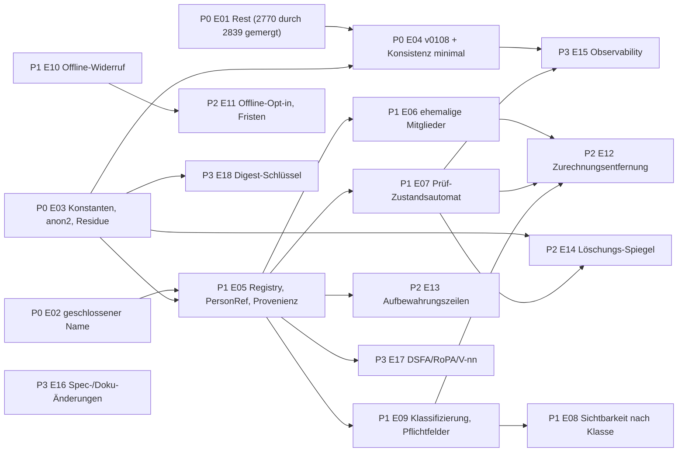

# SPEC-12 — Umsetzungs-Roadmap und Umsetzungsreife

```
Paket: spec/privacy · Version 1.1 · 2026-11-09 · gemessen gegen develop 24d1c2988; Nachtrag #2839 (develop 343afbb97)
Nur Issue-Vorschläge — nichts davon wurde auf GitHub angelegt. Titel sind englisch (GitHub-Regel),
alles andere deutsch. Jede Einheit nennt Abhängigkeiten, Akzeptanz (TA), Rechtsfragen (LEG) mit dem
Default, mit dem sie ausgeliefert wird, und ihr Produktionsgate.
Änderung v1.1: E04/E15-Konflikt aufgelöst (DEC-28), E14 auf Spiegel umgestellt (DEC-26), E18 neu,
Flags/Gates je Epic, Readiness-Tabelle (§4), Verifikationsaufträge V-nn in E17.
```

---

## 0. Einordnung

- **PRIV-E01 = GitHub #2770, geschlossen durch PR #2839 (2026-11-09, develop 343afbb97)**: Punkte 1 (Tombstone →
  Marker im Mapper + Migration `v0107_care_event_tombstone_performer`), 3 (`created_by` auf Live-Bestätigungen),
  4 (`INACTIVE_TENANT`-Skip) und 5 (v0104-Quellliste: mit Begründung geschlossen) sind umgesetzt; Punkt 2 (Principal
  auf Queue-/MCP-Pfaden) wurde bewusst nicht geändert und an **#2517** übergeben. E01 unten beschreibt den **Rest**.
  #2517 bleibt das Rechts-Issue; dieses Paket liefert dafür `11`, `13`, `15` und die LEG-Registry (decision-log §B).
- Drei Gates (README §Produktionsgates): `engineering_allowed` (Code, Tests, Flag aus) · `deployment_allowed`
  (ausgerollt, Flag aus) · `processing_allowed` (Flag an). Einschränkende/schutzverstärkende Maßnahmen brauchen
  keine Rechtsfreigabe; ausweitende oder datenvernichtende stehen hinter Flags (`08` §8a).
- Lanes `feat/priv-<slug>` von `origin/develop`, eigener Worktree, serieller Merge-Zug.

Prioritäten: **P0** kritische Defekte · **P1** Kern-Lebenszyklus und Zugriff · **P2** Aufbewahrung, Administration,
Offline · **P3** Governance, Monitoring, Compliance.

---

## 1. Epics

### P0

#### PRIV-E01 (Rest) · fix(care-events): one actor rule for confirmations; tombstone shape in filters; backfill-attribution switch (#2770 → #2839 gemergt; Rest aus #2517)
- **Erledigt durch #2839 (VERIFIED_CODE)**: `account_of` → Marker für Tombstones (`ErasureEngine.is_tombstone`),
  Bestand per v0107 korrigiert, `created_by = user_key` auf Live-Bestätigungen (`care_reminder_service.py`),
  `created_by = None` im Backfill (`map_document(created_by=…)`), `SkipReason.INACTIVE_TENANT`.
- **Offen**: Task-Queue (`record_care_task_completion`) und MCP (`ConfirmCareTask`) speichern weiterhin `null`
  (PRIV-003/119; #2770 Punkt 2, in #2839 „Changes“ Nr. 2 an #2517 übergeben — Betreiberentscheidung, ob vor LEG-05 umgesetzt); Tombstone-Form
  im `performed_by`-Filter → 422 und im Rendering (PRIV-207); **Schalter `PRIVACY_BACKFILL_COPIES_PERFORMER`**
  (Default = Bestand, DA-02); `carry_account_reference` für die übrigen Kopierstellen (`task_completion_engine`,
  `garden_plan_audit`) folgt in E03/E05.
- **Abhängigkeiten**: keine. **Akzeptanz**: TA-002 (Rollen-Fall ergänzen), TA-120, TA-123, TA-203, TA-801. **Gate**: ja.
- **LEG**: LEG-07 (Schalter macht die Entscheidung ohne Release wirksam); LEG-05 ändert nur Sichtbarkeit.

#### PRIV-E02 · fix(privacy): suppress a closed account's display name during the erasure grace
- PRIV-104; TA-100, TA-101; Gate ja (einschränkend).

#### PRIV-E03 · refactor(privacy): one definition of marker, tombstone regex (two generations) and `[redacted]`; residue scan; tenant-bound pseudonyms for new rows
- **Scope**: Konstanten in `domain/models/privacy.py` (PRIV-201), Allowlist-Regex beider Generationen, `is_tombstone`,
  **`anon2_`-Ableitung für neue Pseudonymisierungen (PRIV-238, DEC-25)**, Art.-15-Suche je `(tenant_key, user_key)`,
  Residue-Scan für Kontolöschung (PRIV-234).
- **Akzeptanz**: TA-200, TA-102/208, TA-238. **Gate**: ja (schutzverstärkend). **LEG**: LEG-15 (Verknüpfbarkeit; Default B).

#### PRIV-E04 · chore(migrations): v0108 tombstone copies → marker, plan-audit actor → marker, anonymised attachments' file names; minimal consistency beat
- **Scope**: `09` §3 (Rest nach v0107/#2839: `created_by`, `anon2_`, Plan-Audit, Dateinamen) mit Phasen
  `precheck/dry_run/apply/verify` (PRIV-718); Inventaränderungen (`garden_plan_audit` Marker
  DEC-16; `attachments.clear_fields += original_filename`); `migration_reports` + `--report-out` (PRIV-701/702);
  **`privacy.consistency` Minimalform** (nur Zähler Bucket 3 + Metrik; DEC-28).
- **Abhängigkeiten**: E01, E03. **Akzeptanz**: TA-700, TA-701, TA-701a, TA-207, TA-209, TA-202. **Gate**: ja;
  DEC-16 braucht Betreiberfreigabe (Produktentscheidung, keine Rechtsfrage).

### P1

#### PRIV-E05 · feat(identity): attribution registry, single person resolver (`PersonRef`), runtime provenance
- `AttributionRole`, `RetentionClass`, `review_fields` (PRIV-001, `08` §2.1); Guard R7; `IdentityReferenceService`;
  `*_kind`-Felder; i18n `enums.personRef.*`; **`DERIVED_FIELDS` + Guard R8 + `derived_from`/`source_ref` (PRIV-609/610)**.
- Abhängigkeiten: E02, E03. Akzeptanz: TA-001, TA-004…TA-007, TA-030, TA-606. Gate: ja.

#### PRIV-E06 · feat(tenants): former-member name suppression and leave/removal transparency
- PRIV-112…118, PRIV-134. Abhängigkeiten: E05. Akzeptanz: TA-110…TA-114. Gate: ja (einschränkend). LEG-06 Default 90 d.

#### PRIV-E07 · feat(privacy): free-text review queue as a state machine, complete paginated discovery, generic redaction
- **Scope**: `privacy_review_items` mit Zuständen (`04` §5.1a), Entdeckungs-Cursor am Löschauftrag und
  `privacy.post_commit_followups` (PRIV-223 neu), `legal_basis_ref` Pflicht bei `keep` (PRIV-225), SLA-Verhalten
  (PRIV-239) mit Flag `PRIVACY_REVIEW_AUTO_REDACT_ON_SLA` (Default aus), `erasure_completed` am Löschauftrag,
  generische Schwärzung (PRIV-228…232), Lineage-Vorschläge, `management` darf schwärzen (PRIV-231, Spec-Änderung),
  `material` in der Schwärzungsmenge (PRIV-213), Frontend `PrivacyReviewPage`, Audit-Aktionen, R-43-Beat, Metriken.
- **Abhängigkeiten**: E05, E03. **Akzeptanz**: TA-103, TA-205, TA-206, TA-210, TA-211, TA-226, TA-239, TA-305, TA-307,
  TA-809, TA-810. **Gate**: ja für Warteschlange/Entdeckung/Schwärzung durch Leads; **nein (bis LEG-08)** für die
  Auto-Schwärzung (Flag).

#### PRIV-E08 · feat(tenants): `attribution_visibility` with class defaults, purpose permissions, member e-mail restriction, audited name exports
- PRIV-300…310, PRIV-414; Defaults nach `organization_kind` (DA-04); `MemberInfoResponse.email` nur `management`
  (Breaking Change dokumentiert); MCP `PersonRef`; `_RBAC`-Kommentare korrigieren.
- Abhängigkeiten: E05, E09 (Klassifizierung liefert `organization_kind`). Akzeptanz: TA-300…TA-309. Gate: ja (einschränkend).
  LEG-02, LEG-05, LEG-14.

#### PRIV-E09 · feat(tenants): mandatory tenant classification; field-level statutory retention; PflSchG period anchoring
- **Scope**: `organization_kind` + `record_keeping` als Pflichtangabe bei Anlage (PRIV-409, 422 `tenant.classification_required`),
  `undeclared`-Verhalten und Betreiberzähler, v0109 (Bestand `legacy`/`unknown_legacy`), **feldgenaue Zuordnung** in
  Löschung/Mandanteninventar (PRIV-410), **Fristbeginn 1. Januar des Folgejahres** für PflSchG-Felder (PRIV-412),
  Hilfsdokumentations-Text (PRIV-413), Reklassifizierungs-Job und PRIV-411 **hinter Flag `PRIVACY_RECORD_KEEPING_RECLASSIFY`**.
- **Abhängigkeiten**: E05. **Akzeptanz**: TA-122, TA-409, TA-410, TA-412, TA-413, TA-703, TA-404, TA-630. **Gate**:
  Klassifizierung, Fristbeginn, Hilfsdokumentation: ja; Reklassifizierung/PRIV-411: **nein (bis LEG-03, LEG-17)**.

#### PRIV-E10 · feat(offline): dead-session quarantine, stable revocation codes, awaited logout wipe, storage-key hygiene
- PRIV-510…523, PRIV-131. Akzeptanz: TA-131, TA-502, TA-512, TA-514, TA-516, TA-519…TA-521, TA-523, TA-528, TA-803.
  Gate: ja. LEG-10 Default 14 d.

### P2

#### PRIV-E11 · feat(offline): explicit offline-mode opt-in with transition, configurable device retention, shared-device mode, byte ceilings, device page
- **Scope**: **Opt-in-Schalter und Übergang (PRIV-531…533, DEC-29)**, Fristen-Settings (PRIV-511), Byte-Grenzen
  (PRIV-505/509), Shared-Device-Modus (PRIV-524…526) + Szenarienmatrix `07` §8a, Geräteseite (PRIV-530), REQ-025-§10-
  Tabelle (Spec-Änderung), Client-Migration (`09` §8).
- Abhängigkeiten: E10. Akzeptanz: TA-500, TA-505, TA-509, TA-511, TA-524, TA-530, TA-531, TA-532. Gate: ja. LEG-09/10.

#### PRIV-E12 · feat(privacy): attribution removal on leaving a tenant (Art. 21 / 17(1)(c))
- PRIV-116/118. Abhängigkeiten: E06, E07, E09. Akzeptanz: TA-112, TA-805. Gate: ja (schutzverstärkend). LEG-06.

#### PRIV-E13 · feat(retention): rows R-46/R-47/R-48; keyed performer fields; configurable `data_controller`
- v0110 (`09` §5), Request-Schemas, UI „Ich war es / jemand anderes“, `nutrient_plans.author_*`, `workflow_templates`,
  Beats mit Grenzen, NFR-011-Zeilen (Spec-Änderung), Art.-15-Quellen, **`data_controller` je Mandant konfigurierbar** (DA-01).
- Abhängigkeiten: E05. Akzeptanz: TA-702, TA-400…TA-403, TA-603. Gate: ja. **Discovery**: V-11 (THC-Feld), Modellfelder
  `nutrient_plans`/`propagation` (Feldnamen VERIFIED_CODE, Längen teilweise unbegrenzt).

#### PRIV-E14 · feat(backup): erasure mirror (tombstones only), bucket object with HMAC chain, restore replay by tombstone match, dump retention — before enabling backups
- `erasure_mirror` + Beats (`sync`, `purge`), Spiegel-Objekt (Fernet, HMAC-Kette), CLI `privacy_restore_replay` (Abgleich
  `compute_tombstone_hash` wiederhergestellter `users`, beide Formate), Residue-Scan im Restore, Helm-Precheck
  `backup.enabled ⇒ privacy.mirror.enabled` (TA-718), Doku `backup-restore.md`, Nightly-Drill.
- Abhängigkeiten: E03, E07. Akzeptanz: TA-709, TA-710, TA-711, TA-718, TA-804. Gate: `deployment_allowed` für Backups
  **nein**, bis E14 gemergt; LEG-11 Prüfdatum.

### P3

#### PRIV-E15 · feat(observability): privacy operations endpoint, full consistency beat, stale alerts, unified escalation, resume job
- `GET /admin/platform/privacy/operations|consistency`, Vollform `privacy.consistency` (inkl. `undeclared`, Registry-
  Abdeckung PRIV-609), Metriken, `PRIVACY_OPERATION_ESCALATE_AFTER_ATTEMPTS`, Stale-Alert, verwaiste Mandanten,
  `privacy.resume_partial_erasures`, R-06-Docstring (W-11).
- Abhängigkeiten: E04, E07. Akzeptanz: TA-104, TA-105, TA-202, TA-305, TA-717. Gate: ja.

#### PRIV-E16 · docs(privacy): spec change set and operator documents
- Änderungen aus `06` §9 (NFR-011, REQ-025, REQ-053, REQ-024/049, REQ-022, REQ-023, Docs); **AVV-Muster, Datenschutz-
  information je Betriebsmodell, Mustertext Betriebsrat (PRIV-406), Art.-13/14-Vorlagen (PRIV-408)**; Widerspruchs-
  register-Einträge W-01, W-10, W-13, W-15, W-17, W-22…W-25.
- Abhängigkeiten: Betreiberfreigabe der DEC; Texte Art. 13/14: **BLOCKED_LEGAL (LEG-12)**. Akzeptanz: `mkdocs build --strict`,
  Spec-Readiness-Review, Changelog-Zeilen zitieren `spec/privacy`.

#### PRIV-E17 · docs(privacy): DPIA hand-over, RoPA input, legal verification tasks
- `11`, `13`, `15` an den DSB; Verifikationsaufträge **V-01…V-11** (`13` §4) abarbeiten (Browserzugang zu EUR-Lex/Curia
  nötig); RoPA-Export aus `06` §2 (PA-Tabelle) generieren; Entscheidungen in decision-log §B eintragen (Status, Prüfdatum).
- Gate: BLOCKED_LEGAL (Ergebnis liegt beim DSB).

#### PRIV-E18 · refactor(security): domain-separated key for client-event digests (SEC-003) with transition rule
- Abgeleiteter Schlüssel statt `erasure_tombstone_salt`; Übergang: Digests beider Schlüssel werden für `CLIENT_EVENT_TOMBSTONE_DAYS`
  akzeptiert. Abhängigkeiten: E03. Akzeptanz: `test_client_event_idempotency.py` erweitert. Gate: ja.

---

## 2. Abhängigkeitsgraph



Lane-Reihenfolge: E01 → E03 → E02 → E04 → E05 → E10 → E09 → E07 → E08 → E06 → E11 → E13 → E15 → E12 → E14 → E18 →
E16/E17 (Doku parallel).

---

## 3. Defaults je Mandantenklasse (Zusammenfassung; DA-03/DA-04; `08` §3.2)

| Klasse | `record_keeping` | `attribution_visibility` | Offline-Modus (Gerät) | Shared-Device | Admin-Zugriff Betreiber |
|--------|------------------|--------------------------|-----------------------|---------------|-------------------------|
| neuer persönlicher Mandant | `none` (L-07) | `all_members` | aus (Opt-in) | aus | Verzeichnisdaten, keine Fachdaten |
| neuer Verein / Gemeinschaftsgarten (`association`/`community`) | Pflichtangabe (`none` oder `kcang_association`) | `all_members` | aus | aus (Kiosk ⇒ an) | dito |
| neuer gewerblicher Mandant (`commercial`) | Pflichtangabe (`pflschg_professional` oder `none`) | `leads_and_self` | aus | aus | dito |
| Bestandsmandant | `legacy` (v0109) | `all_members` | aus (Übergang) | aus | dito |
| migrierter Legacy-Mandant nach Klassifizierung | gewählter Wert; Reklassifizierung nur mit Flag | nach Klasse, nur auf Antrag der Leitung geändert | — | — | — |

Jeder Default hat einen Test (TA-630); ein Legacy-Default wird **nie** zum Default neuer Mandanten (W-03).

---

## 4. Umsetzungsreife (Readiness)

Status: **READY** (vollständig spezifiziert, keine blockierende Entscheidung) · **READY_WITH_GUARDS** (umsetzbar hinter
Flag/Konfiguration) · **BLOCKED_LEGAL** (produktive Verarbeitung erst nach Rechtsfreigabe) · **BLOCKED_TECHNICAL** ·
**NEEDS_DISCOVERY**.

| Anforderung / Epic | Status | Blocker | Evidenz | Nächster Schritt |
|--------------------|--------|---------|---------|------------------|
| E01 erledigt (PRIV-205 für `account_of`, PRIV-214, PRIV-215) | DONE (#2839, develop 343afbb97) | — | VERIFIED_CODE: `care_event_backfill_mapper.account_of`, `v0107_care_event_tombstone_performer.py`, `care_reminder_service.py` | TA-002/TA-121 gegen den gemergten Code pinnen |
| E01 Rest (PRIV-003/119 Principal Queue/MCP, PRIV-207 Filter, Schalter `PRIVACY_BACKFILL_COPIES_PERFORMER`) | READY | PRIV-003 in #2517 geparkt — Betreiber entscheidet, ob vor LEG-05 | DA-02; `03` §4 | kleine Lane oder mit E04 |
| E02 (PRIV-104) | READY | — | VERIFIED_CODE (Join ohne `is_active`) | Lane |
| E03 (PRIV-201, 234, 238) | READY | DEC-25 Betreiberfreigabe (Format) | L-14, L-15; VERIFIED_CODE | Lane |
| E04 (PRIV-701…704, 718; DEC-16) | READY | DEC-16 Betreiberfreigabe | VERIFIED_CODE (Framework), `09` §2a | Dry-Run auf Prod-Snapshot |
| E05 (PRIV-001…008, 609, 610) | READY | — | VERIFIED_CODE (Inventarmodelle) | Lane |
| E06 (PRIV-111…118) | READY | — (LEG-06 Default 90 d, einschränkend) | VERIFIED_CODE (Austritt), DA-02 | Lane |
| E07 Warteschlange/Entdeckung/Schwärzung | READY | — | DA-05 | Lane |
| E07 Auto-Schwärzung nach SLA (PRIV-239) | BLOCKED_LEGAL | LEG-08 | DA-05 | Flag bleibt aus |
| E08 (PRIV-300…310, 414) | READY | — (Breaking Change dokumentiert) | L-09, L-10 (Hinweistext) | Lane nach E09 |
| E09 Klassifizierung, Fristbeginn, Hilfsdokumentation (PRIV-409, 410, 412, 413) | READY | — | L-01, L-02, L-05, L-07 | Lane |
| E09 Reklassifizierung / PRIV-411 (Marker für Erntende) | BLOCKED_LEGAL | LEG-03, LEG-17 | L-05 (keine Pflichtangabe), aber Bestandsänderung | Flag aus; DSB-Entscheidung |
| E10 (PRIV-510…523) | READY | — | VERIFIED_CODE (`07` §1, §7) | Lane |
| E11 (PRIV-505…533) | READY | — (LEG-09/10 als Prüfdatum) | L-11 | Lane |
| E12 (PRIV-116, 118) | READY | — | DA-02 | nach E06/E07/E09 |
| E13 (R-46…R-48, v0110) | NEEDS_DISCOVERY (THC-Feld V-11; Modelle `nutrient_plans`/`propagation` Feldlängen) → sonst READY | V-11 | VERIFIED_CODE teilweise | Discovery-Task vor Lane |
| E14 (PRIV-707…713) | READY_WITH_GUARDS | `deployment_allowed` Backups erst nach E14; LEG-11 Prüfdatum | L-19 (Backups), kein deutscher Primärbeleg (L-21) | Lane; Betreiber entscheidet Dump-Frist |
| E15 | READY | — | — | nach E04/E07 |
| E16 Spec-Änderungen | READY | Betreiberfreigabe je DEC | `14` | Doku-Lane |
| E16 Art.-13/14-Texte, AVV | BLOCKED_LEGAL | LEG-01, LEG-12 | DA-01 | Rechtsberatung |
| E17 | BLOCKED_LEGAL | DSB | `11`, `13` | Übergabe |
| E18 | READY | — | SEC-003 (REQ-053 §32.6 Pkt. 16) | P3 |
| Kommerzieller SaaS-Betrieb mit gewerblichen Mandanten | BLOCKED_LEGAL (`deployment_allowed`) | LEG-01, LEG-05, LEG-12 | DA-01, DA-04, DA-08 | AVV, Information, DSFA-Entscheidung (DEC-32) |
| Bestand: Backfill-Zurechnung, Statutory für alle, Offline ohne Opt-in | `processing_allowed = provisorisch` | LEG-07, LEG-03, LEG-09 | `06` §10 | Prüfdatum 2027-01-31 (Vorschlag), Schalter/Flags in E01/E09/E11 |

---

## 5. Issue-Template

```
**Spec:** spec/privacy/<doc> §<n>, PRIV-<ids>. Priorität <P0..P3>. Abhängig von: <E..>.
## Problem
## Scope (in / out)
## Akzeptanz (TA-ids)
## Tests
## Rechtsfragen (LEG-ids; Default, mit dem dieses Issue ausgeliefert wird; Flag/Gate)
## Leitplanken: BACKEND.md/FRONTEND.md; `*, tenant_key: str`; Route-Walk + Route-Consumer-Pin + begrenzte Listen für neue Routen;
Enums additiv mit DE/EN-i18n; Bundle-Budget; kein Prod-Deploy; Branch feat/priv-<slug> von origin/develop im eigenen Worktree.
```
