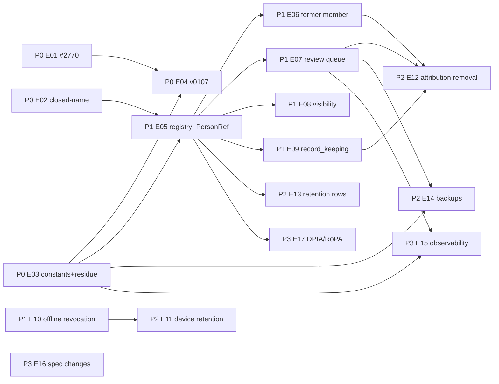

# SPEC-12 — Implementation Roadmap

```
Package: spec/privacy · Version 1.0 · 2026-11-09 · measured against develop 24d1c2988
Issue proposals only — nothing below has been created on GitHub. Titles are in English,
ready to paste; each unit is independently implementable and names its dependencies.
```

---

## 0. How this fits the running REQ-053 work

- The REQ-053 partition of 2026-11-09 schedules **#2770** (backfill tombstone copies,
  reminder `created_by`, v0104 tenant gate, `SOURCE_COLLECTIONS` freeze) as the next lane
  after the wave-10 plan (#2758). **PRIV-E01 below is #2770** with its acceptance sharpened
  by `04` §2–3; it should stay in that queue and reference this package rather than being
  duplicated.
- **#2517** stays the legal issue; this package gives it the LEG list and the DPIA
  pre-screening (`11`) as the input the DPO needs. It does not block P0/P1 engineering: every
  item ships with the documented default and names the LEG that may change it.
- Wave 10 of REQ-053 (indoor floor plan) has no privacy items; the epics below form their
  own lanes (`feat/priv-<slug>` from `origin/develop`, own worktree, serial merge train).

Priority levels: **P0** critical privacy/data-integrity defects (fix in the next lane) ·
**P1** core lifecycle and access control · **P2** retention, administration, offline
safeguards · **P3** governance, monitoring, continuous compliance.

---

## P0 — Critical defects

### PRIV-E01 · fix(care-events): never copy a tombstone into the care log; one actor rule for confirmations; v0104 gates and source list (= #2770)

- **Problem**: `account_of` copies `anon_<hash>` pseudonyms from erased accounts'
  statutory rows into `care_events.performed_by_user_key` (v0104 and the daily consistency
  job); the care-event erasure rule never reaches them; the task-queue and MCP confirmation
  paths store `null` while REST/notification store the caller; reminder rows have no
  `created_by`; v0104 writes into non-active tenants and iterates a mutable source list.
- **Scope**: `carry_account_reference` in `domain/models/privacy.py` (PRIV-205) used by
  `care_event_backfill_mapper.account_of` and `task_completion_engine`; principal passed
  on the task-queue and MCP confirmation paths (PRIV-003/119); `created_by = principal` on
  live reminder events, `null` on backfill (PRIV-214); correction right for system rows
  (PRIV-215); `display_performer`/filter treat tombstone-shaped values like the marker
  (PRIV-207); v0104: `ActiveTenants` gate for the backfill kind, frozen source tuple,
  `_DOWN_SCAN` distinguishes migration-origin rows; one-off correction of already copied
  tombstones → **PRIV-E04** (migration) if v0104 ran anywhere (P-6 says it ran on
  2026-11-07 in prod? — check the P-6 report; the local analysis found the backfill merged).
- **Dependencies**: none (constants may be introduced here and consolidated in E03).
- **Acceptance**: TA-002, TA-003/120, TA-121, TA-123, TA-203, TA-801; dry-run report lists
  `tombstone_sources_marked`.
- **Tests**: `test_care_event_backfill_mapper.py` (tombstone case), the four-path confirmation
  test asserting the performer (today only trigger/category), v0104 tenant-gate unit test.
- **Spec refs**: `01` §4, `03` §4, `04` §2.2/§3.3.
- **Open legal**: LEG-07 (does not block the technical fix).

### PRIV-E02 · fix(privacy): suppress a closed account's display name during the erasure grace

- **Problem**: after `request_erasure` the subject's name resolves for up to 90 days
  (`is_active` ignored by the display joins).
- **Scope**: display joins read `is_active`; closed → state `erased` (PRIV-104); platform
  erasure preview unaffected.
- **Dependencies**: none (can precede the resolver; E05 moves it into the resolver).
- **Acceptance**: TA-100, TA-101.
- **Spec refs**: `03` §2.2.

### PRIV-E03 · refactor(privacy): one definition of marker, tombstone regex and `[redacted]`; residue scan for account erasure

- **Problem**: four marker copies, three regex literals; tenant erasure has a residue check,
  account erasure none.
- **Scope**: constants in `domain/models/privacy.py` (PRIV-201); guard replacing the
  three-copies pin; residue scan in `erasure_executor` marking `partially_completed` with
  `residue` (PRIV-234).
- **Dependencies**: none.
- **Acceptance**: TA-200, TA-102/208.
- **Spec refs**: `04` §1, §8.

### PRIV-E04 · chore(migrations): v0107 — convert copied tombstones to the marker, plan-audit actor to the marker, clear anonymised attachments' file names

- **Problem**: legacy copies (E01) exist in production data; `garden_plan_audit.user_key`
  tombstone has no basis (DEC-16); `original_filename` survives erasure.
- **Scope**: `09` §3 (v0107), inventory change for `garden_plan_audit` and `attachments`
  (`clear_fields`), persisted dry-run report (`09` §2 minimum: `--report-out`).
- **Dependencies**: E01 (constants), E03.
- **Acceptance**: TA-700, TA-701, TA-207, TA-209.
- **Spec refs**: `04` §4.1/§7, `09` §2–3.
- **Open legal**: LEG-15 (marker vs tombstone for the plan audit) — default marker.

---

## P1 — Core privacy lifecycle and access control

### PRIV-E05 · feat(identity): attribution registry and the single person resolver (`PersonRef`)

- **Problem**: no declared attribution role per field; display resolved ad hoc; backend
  emits the German literal "anonymisiert"; plan audit returns `null` actors.
- **Scope**: `AttributionRole`, `RetentionClass`, `review_fields` on the inventory models
  (`08` §2.1); guard R7; `IdentityReferenceService.resolve_display` (`08` §2.3); `*_kind`
  fields on care-event and plan-audit responses; frontend i18n `enums.personRef.*`;
  deprecation of the literal.
- **Dependencies**: E02, E03.
- **Acceptance**: TA-001, TA-004…TA-007, TA-030 (doc check script); PRIV-218 (plan-audit actor as `PersonRef`) is covered by TA-005.
- **Spec refs**: `01` §4, `08` §2–3.

### PRIV-E06 · feat(tenants): former-member name suppression and leave/removal transparency

- **Problem**: a member who left stays named forever; no information at leaving.
- **Scope**: `RETENTION_FORMER_MEMBER_NAME_DAYS` (default 90), derived state from the
  security audit's departure row (PRIV-112/114), filter/CSV behaviour, leave dialog and
  removal notice texts DE/EN (PRIV-115), rejoin semantics (PRIV-118), service accounts
  (PRIV-134).
- **Dependencies**: E05.
- **Acceptance**: TA-110…TA-114.
- **Spec refs**: `03` §3.
- **Open legal**: LEG-06 (period, Art. 15 scope).

### PRIV-E07 · feat(privacy): free-text review queue and generic redaction for tenant leads

- **Problem**: erasure leaves content free text naming the person; no list of affected rows;
  redaction only for care events, lead-only, no UI action.
- **Scope**: `privacy_review_items` collection + indexes + tenant inventory (`08` §3.7);
  item creation as post-commit phase of account erasure with name-token flagging, bounds,
  idempotency (PRIV-221…223, PRIV-108); `REDACTABLE_FIELDS`; generic redaction service and
  routes (`08` §4.1); lineage suggestions for templates/audit (PRIV-230); `management` may
  redact (PRIV-231, spec change proposal); `material` and measurement strings join the
  redaction set (PRIV-213, spec change proposal); frontend `PrivacyReviewPage` (lazy
  chunk), summary, i18n; privacy actions in `security_audit_log` (`08` §3.8 subset:
  `REDACTION_APPLIED`, `REVIEW_DECIDED`); R-43 beat; metrics `privacy_review_items_*`.
- **Dependencies**: E05 (registry `review_fields`), E03.
- **Acceptance**: TA-103, TA-205, TA-206, TA-210, TA-211, TA-226 (overdue metric), TA-305,
  TA-307, TA-809.
- **Spec refs**: `04` §5–6, `08` §3.7/§4.1/§5–6.
- **Open legal**: LEG-08 (model and SLA) — default ships.

### PRIV-E08 · feat(tenants): `attribution_visibility` setting, purpose permissions, member e-mail restriction, audited name exports

- **Problem**: every member sees every performer and every member's e-mail; CSV with
  names for everyone; no audit of name exports; descriptive permission matrix diverges from
  gates.
- **Scope**: `TenantSettings.attribution_visibility` (default `all_members`), resolver
  integration (PRIV-300…303); permissions `attribution.filter|export`, `privacy.review`
  (PRIV-304); `MemberInfoResponse.email` only for `management` (PRIV-305, **breaking**,
  frontend adjusted); CSV `R` rendering for non-leads + `ATTRIBUTION_EXPORTED` audit
  (PRIV-307/308); bed-list CSV assignment column follows the setting (PRIV-309); MCP tools
  return `PersonRef` (PRIV-310, REQ-033 version bump); `inspector = "mcp:<key>"` →
  `inspected_by_key`; tenant settings UI with the §26 BDSG/BetrVG explanation; no
  per-person aggregation guard (PRIV-403); `_RBAC` table comments corrected to match the
  gates (follow-up noted in `05` §1).
- **Dependencies**: E05.
- **Acceptance**: TA-300…TA-309.
- **Spec refs**: `05`, `06` §5.
- **Open legal**: LEG-02, LEG-05 (default for organisation tenants), LEG-14.

### PRIV-E09 · feat(tenants): `record_keeping` profile — statutory retention only where a duty exists

- **Problem**: PflSchG/KCanG retention and tombstones apply to every tenant.
- **Scope**: `TenantSettings.record_keeping` (default `legacy`), v0108, erasure/tenant
  inventory branching on the class (PRIV-122, PRIV-401), reclassification job (PRIV-402,
  `09` §4), creation flow asks organisation tenants, audit action, docs
  (`compliance-anbauvereinigung.md` cross-link).
- **Dependencies**: E05.
- **Acceptance**: TA-122, TA-403/703, TA-404.
- **Spec refs**: `03` §5, `06` §3, `09` §4.
- **Open legal**: LEG-03, LEG-04, LEG-17 — default `legacy` keeps today's behaviour until
  decided; the switch exists so that the decision can be applied without a release.

### PRIV-E10 · feat(offline): dead-session quarantine, stable revocation codes, awaited logout wipe, storage-key hygiene

- **Problem**: account deleted elsewhere leaves the queue for up to 365 d; logout wipe not
  awaited; `kp-sw-state` race; `localStorage` keeps `user_key`/e-mail; one generic 403.
- **Scope**: `quarantined` state and Dexie v3 (PRIV-510/519, `09` §8); `401 account.closed`
  on refresh/writes for closed accounts, `403 membership.ended` for valid tokens with a
  recorded departure (PRIV-520/131); client reactions (PRIV-521); awaited wipe + `replace`
  (PRIV-514); `KP_CLEAR_DONE` handshake (PRIV-516); PRIV-512 key list; sweep on
  `visibilitychange` (PRIV-513); kill-switch poll (PRIV-523); guard extensions.
- **Dependencies**: none on E05 (client + auth paths).
- **Acceptance**: TA-131, TA-502, TA-512, TA-514, TA-516, TA-519…TA-521, TA-523, TA-528,
  TA-803; E2E TC-053-091/092.
- **Spec refs**: `03` §7, `07` §7.
- **Open legal**: LEG-10 (grace period) — default 14 d.

---

## P2 — Retention, administration and offline safeguards

### PRIV-E11 · feat(offline): configurable device retention, shared-device mode, byte ceilings, device page

- **Scope**: runtime-config settings and defaults 90/30 (PRIV-511), 60-day prompt,
  `PLAN_CACHE_MAX_BYTES`, `QUEUE_PHOTO_MAX_BYTES` (PRIV-505/509), shared-device mode
  installation- and tenant-wide with idle logout, session-bound queue, 5-min TTL, login
  banner, kiosk implication (PRIV-524…526), offline opt-in toggle (LEG-09 recommendation),
  device page (PRIV-530), docs DE/EN, REQ-025 §10 table fix incl. TDDDG rename (spec change).
- **Dependencies**: E10.
- **Acceptance**: TA-500, TA-505, TA-509, TA-511, TA-524, TA-530; E2E TC-053-093.
- **Spec refs**: `07` §2, §4–6, §8, §10.
- **Open legal**: LEG-09, LEG-10.

### PRIV-E12 · feat(privacy): attribution removal on leaving a tenant (Art. 21 / 17(1)(c))

- **Scope**: `POST /t/{slug}/privacy/attribution-removal` (step-up), tenant-scoped marker
  run reusing `ANONYMIZE_COLLECTIONS` filtered by `tenant_key`, review items, audit action
  `ATTRIBUTION_REMOVED`, statutory exemption per `record_keeping`, rejoin text (PRIV-116/118).
- **Dependencies**: E06, E07, E09.
- **Acceptance**: TA-112, TA-805.
- **Spec refs**: `03` §3.2.
- **Open legal**: LEG-06.

### PRIV-E13 · feat(retention): new rows R-46 (watering/feeding/tank logs), R-47 (closed tasks/comments), R-48 (notifications); keyed performer fields

- **Scope**: migration v0109 keyed performers (`09` §5), request schemas with
  `performed_by_label`, UI dialogs "I did it / someone else", nutrient-plan `author_*`,
  `workflow_templates.created_by_user_key`; retention beats with ceilings; NFR-011 rows
  (spec change proposal); Art. 15 manifest sources for the new keyed fields (R2).
- **Dependencies**: E05.
- **Acceptance**: TA-702, TA-400…TA-403, TA-603.
- **Spec refs**: `06` §2.3, `08` §3.4, `09` §5.
- **Open legal**: periods per NFR-011 v1.29 ("Vorschlag, DSB-Prüfung offen").

### PRIV-E14 · feat(backup): erasure replay ledger, bucket mirror, restore replay command, dump retention — before enabling backups

- **Scope**: `erasure_replay_ledger` + R-45 beat, mirror object, `privacy_restore_replay`
  CLI, docs `backup-restore.md` extension, helm `backup.retentionDays` ceiling 35, restore
  drill test (nightly), `migration_reports` collection and `--report-out` (`09` §2) if not
  done in E04.
- **Dependencies**: E03 (plan fingerprint), E07 (review-item replay).
- **Acceptance**: TA-709…TA-711, TA-804.
- **Spec refs**: `09` §6, `08` §3.7.
- **Open legal**: LEG-11.

---

## P3 — Governance, monitoring, continuous compliance

### PRIV-E15 · feat(observability): privacy-operations endpoint, metrics, consistency beat, stale alerts, unified escalation, resume job

- **Scope**: `GET /admin/platform/privacy/operations|consistency`, `privacy.consistency`
  beat (PRIV-206), metrics (`08` §5), `PRIVACY_OPERATION_ESCALATE_AFTER_ATTEMPTS` shared
  (PRIV-109), stale alert (PRIV-110), orphaned tenants in monitoring (PRIV-127),
  `privacy.resume_partial_erasures` job (PRIV-717), R-06 docstring fix, Grafana panel
  (docs).
- **Dependencies**: E03, E07.
- **Acceptance**: TA-104, TA-105, TA-202, TA-305, TA-717.
- **Spec refs**: `03` §2.4, `04` §2.2, `08` §4.2/§5–6.

### PRIV-E16 · docs(privacy): spec change set — REQ-025 / NFR-011 / REQ-053 / REQ-024 / REQ-049 / REQ-022 / REQ-023 / user docs

- **Scope**: the proposals of `06` §9 as versioned edits with changelog rows: attribution
  roles and review phase in REQ-025 §3.1.3; §10 table (keys, TDDDG); NFR-011 R-43…R-48,
  R-26 marker, R-25 wording and `material`; REQ-053 GP-FR-109 vs E-16 contradiction, GP-NFR-055
  plan-audit marker; REQ-024/REQ-049 settings and e-mail rule, `management` may redact;
  REQ-022 confirmations have no actor; REQ-023 §5b.1 backup read-access line; docs
  `privacy.md` DPIA sentence; "Für Betriebe und Vereine" section with the works-council
  template (PRIV-406); version/footer drift (REQ-025 footer 1.5, NFR-011 footer 1.7,
  REQ-051 footer 1.0).
- **Dependencies**: operator approval of DEC items; none technical.
- **Acceptance**: `mkdocs build --strict`; spec readiness review; every changelog row cites
  `spec/privacy`.
- **Open legal**: the wording of Art. 13/14 texts (LEG-12).

### PRIV-E17 · docs(privacy): DPIA hand-over package and RoPA input

- **Scope**: hand `11` with the LEG list to the DPO; produce the RoPA input table from `02`
  (export script generating a CSV of processing activities from the registry — optional
  automation, P3); record decisions back into `decision-log.md`.
- **Dependencies**: E05 (registry as the source).
- **Acceptance**: decision log rows LEG-01…17 have a status other than `open`.

---

## Dependency graph



Suggested lane order on the serial merge train: E01 → E03 → E02 → E04 → E05 → E10 → E07 →
E08 → E06 → E09 → E11 → E13 → E15 → E12 → E14 → E16/E17 (docs can run in parallel as
they touch `spec/` and `docs/` only).

---

## Issue template (for each epic when created)

```
**Spec:** spec/privacy/<doc> §<n>, PRIV-<ids>. Priority <P0..P3>. Depends on: <E..>.
## Problem
## Scope (in / out)
## Acceptance (TA-ids)
## Tests
## Open legal decisions (LEG-ids; the default this issue ships with)
## Guardrails: BACKEND.md/FRONTEND.md; `*, tenant_key: str`; route walk + route-consumer pin + bounded lists for new routes;
enums additive with DE/EN i18n; bundle budget; no prod deploy; branch feat/priv-<slug> from origin/develop in its own worktree.
```
