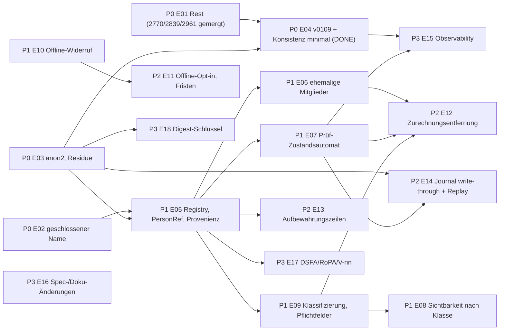
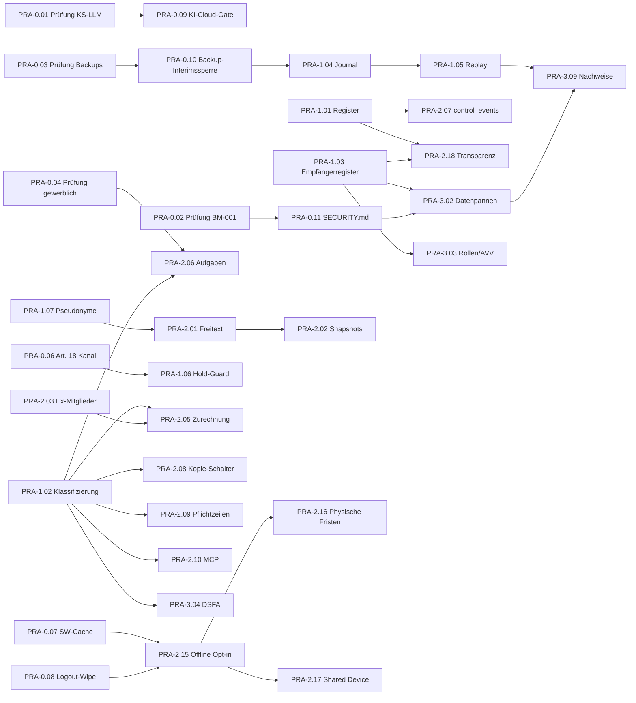

# SPEC-12 — Umsetzungs-Roadmap und Umsetzungsreife

```
Paket: spec/privacy · Version 1.2 · 2026-11-22 · Gemessen gegen: develop 007a4ea90 (Audit 2026-11-22)
Vorher: v1.1 (2026-11-09, develop 24d1c2988); Nachtrag #2839 (develop 343afbb97);
Nachtrag #2976 (2026-11-16): Folge-Issue `rooting_protocols.author` erledigt (E13-Zeile)
Nur Issue-Vorschläge — nichts davon wurde auf GitHub angelegt. Titel sind englisch (GitHub-Regel),
alles andere deutsch. Jede Einheit nennt Abhängigkeiten, Akzeptanz (TA), Rechtsfragen (LEG) mit dem
Default, mit dem sie ausgeliefert wird, und ihr Produktionsgate.
Änderung v1.1: E04/E15-Konflikt aufgelöst (DEC-28), E14 auf Spiegel umgestellt (DEC-26), E18 neu,
Flags/Gates je Epic, Readiness-Tabelle (§4), Verifikationsaufträge V-nn in E17.
Änderungen 1.2: 48 Audit-Maßnahmen PRA-0.01…PRA-3.10 aufgenommen (§6) und mit den Epics in beide Richtungen
verknüpft; PRIV-003/119 (#2961), PRIV-201 und PRIV-211 (v0109) als erledigt belegt; E14 auf Journal write-through mit
Outbox umgestellt (auch Widerrufe, LEG-24/LEG-25); Readiness §4 auf den Audit-Stand und je Betriebsmodell (§4a);
Klassen-Defaults des Audits (§3); offene Punkte für Product Owner, Betreiber und gewerbliche Kunden (§7); LEG→PRA (§6.6).
```

---

## 0. Einordnung

- **PRIV-E01 = GitHub #2770, geschlossen durch PR #2839 (2026-11-09, develop 343afbb97)**: Punkte 1 (Tombstone →
  Marker im Mapper + Migration `v0107_care_event_tombstone_performer`), 3 (`created_by` auf Live-Bestätigungen),
  4 (`INACTIVE_TENANT`-Skip) und 5 (v0104-Quellliste: mit Begründung geschlossen) sind umgesetzt; Punkt 2 (Principal
  auf Queue-/MCP-Pfaden) wurde in #2839 nicht geändert, an **#2517** übergeben und danach durch **#2961** (Commit
  `8cff212c0`, 2026-11-14) umgesetzt (Audit 2026-11-22: `ALREADY_FIXED`). E01 unten beschreibt den **Rest**.
  #2517 bleibt das Rechts-Issue; dieses Paket liefert dafür `11`, `13`, `15`, `16` und die LEG-Registry (decision-log §B).
- **Audit 2026-11-22** (gemessen gegen develop 007a4ea90): Das Audit hat jede Aussage des Pakets am Code geprüft und
  48 Maßnahmen **PRA-0.01…PRA-3.10** abgeleitet (§6). Eine PRA-Aufgabe **ersetzt kein Epic**: Sie setzt einen Teil
  eines Epics um, präzisiert oder ändert es (z. B. E14, PRA-1.04) oder kommt neu hinzu. Jedes Epic in §1 nennt seine
  PRA-Aufgaben („Audit-Bezug“), jede PRA-Aufgabe in §6 ihr Epic („Bezug zu Epic/PRIV“). PRIV- und TA-IDs bleiben;
  neue Abnahmefälle stehen in [`10`](10-testing-and-acceptance.md) (TA-031 ff., TA-132 ff., …, TA-9xx). Die Befunde
  LEG-23…LEG-61 sind im [decision-log](decision-log.md) registriert; ihr Sachverhalt steht im jeweiligen Fachdokument.
- Drei Gates (README §Produktionsgates): `engineering_allowed` (Code, Tests, Flag aus) · `deployment_allowed`
  (ausgerollt, Flag aus) · `processing_allowed` (Flag an). Einschränkende/schutzverstärkende Maßnahmen brauchen
  keine Rechtsfreigabe; ausweitende oder datenvernichtende stehen hinter Flags (`08` §8a).
- Lanes `feat/priv-<slug>` von `origin/develop`, eigener Worktree, serieller Merge-Zug.

Prioritäten der Epics: **P0** kritische Defekte · **P1** Kern-Lebenszyklus und Zugriff · **P2** Aufbewahrung,
Administration, Offline · **P3** Governance, Monitoring, Compliance. Die PRA-Aufgaben tragen eine eigene Priorität
nach der Schwere des Befunds (§6.0); bei Widerspruch zwischen Epic- und PRA-Priorität gilt für die Lane-Reihenfolge
die höhere.

---

## 1. Epics

### P0

#### PRIV-E01 (Rest) · fix(care-events): one actor rule for confirmations; tombstone shape in filters; backfill-attribution switch (#2770 → #2839 gemergt; Queue/MCP #2961 gemergt)
- **Erledigt durch #2839 (VERIFIED_CODE)**: `account_of` → Marker für Tombstones (`ErasureEngine.is_tombstone`),
  Bestand per v0107 korrigiert, `created_by = user_key` auf Live-Bestätigungen (`care_reminder_service.py`),
  `created_by = None` im Backfill (`map_document(created_by=…)`), `SkipReason.INACTIVE_TENANT`.
- **Erledigt durch #2961 (VERIFIED_CODE, Audit 2026-11-22: `ALREADY_FIXED`)**: PRIV-003/PRIV-119 — Task-Queue
  (`record_care_task_completion`) und MCP (`ConfirmCareTask`) stempeln den Aufrufer: `mcp_server/tools/care.py:76-85`
  übergibt `user_key=ctx.principal.account_key`; `care_reminder_service.py:986-990, 1295-1312`; Commit `8cff212c0`;
  abgesichert durch `tests/unit/guards/test_care_confirmation_names_its_performer.py` (alle vier Bestätigungswege,
  TA-120). Die v1.1-Aussage „speichern weiterhin `null`“ war ab 2026-11-14 überholt (LEG-61).
- **Offen**: Tombstone-Form im `performed_by`-Filter → 422 und im Rendering (PRIV-207; Audit: geringe Wirkung, weil
  `care_events` seit v0107/v0109 keine Tombstones tragen, `care_event_service.py:164-170`); **Schalter
  `PRIVACY_BACKFILL_COPIES_PERFORMER`** (Default = Bestand, DA-02; Audit: 0 Treffer in `app/`, `helm/`, und der
  tägliche Konsistenzjob kopiert fortlaufend — umgesetzt durch PRA-2.08); `carry_account_reference` für die übrigen
  Kopierstellen (`task_completion_engine`, `garden_plan_audit`) folgt in PRA-1.07 (E03-Rest).
- **Abhängigkeiten**: keine. **Akzeptanz**: TA-002 (Rollen-Fall ergänzen), TA-120 (erledigt), TA-123, TA-203, TA-801,
  TA-418. **Gate**: ja.
- **LEG**: LEG-07 (Schalter macht die Entscheidung ohne Release wirksam); LEG-05 ändert nur Sichtbarkeit.
- **Audit-Bezug**: PRA-2.08 (Schalter + `commercial`-Regel), PRA-1.07 (Kopierstellen).

#### PRIV-E02 · fix(privacy): suppress a closed account's display name during the erasure grace
- PRIV-104; TA-100, TA-101; Gate ja (einschränkend).
- **Audit-Bezug**: keine eigene PRA-Aufgabe. Audit 2026-11-22 bestätigt den Ist-Stand (`CONFIRMED`): Namens-Join ohne
  `is_active` (`care_event_repository.py:657-662`), d. h. bis 90 Tage Sichtbarkeit nach dem Löschantrag; E02 bleibt
  unverändert gültig.

#### PRIV-E03 · refactor(privacy): one definition of marker, tombstone regex (two generations) and `[redacted]`; residue scan; tenant-bound pseudonyms for new rows
- **Scope**: Konstanten in `domain/models/privacy.py` (PRIV-201), Allowlist-Regex beider Generationen, `is_tombstone`,
  **`anon2_`-Ableitung für neue Pseudonymisierungen (PRIV-238, DEC-25)**, Art.-15-Suche je `(tenant_key, user_key)`,
  Residue-Scan für Kontolöschung (PRIV-234).
- **Erledigt (VERIFIED_CODE, Audit 2026-11-22: `ALREADY_FIXED`)**: PRIV-201 — eine Definition von Marker und
  Tombstone-Regex (`domain/models/privacy.py:17, 25`; nur eingefrorene Kopien in den Migrationen v0107/v0109/v0114),
  Guard `tests/unit/guards/test_privacy_marker_and_tombstone_have_one_definition.py` (TA-200); mit E04 vorgezogen.
- **Offen (Audit bestätigt)**: `anon2_` existiert nur in Regex und Import, kein Erzeuger (`privacy.py:22-25`,
  `tenant_import_engine.py:401`); Residue-Scan nur bei Mandantenlöschung (`grep residue` in `erasure_executor.py` = 0);
  `carry_account_reference` nur in `account_of`. Neu aus dem Audit: Import-Regel für `anon_` (LEG-54).
- **Akzeptanz**: TA-200 (erledigt), TA-102/208, TA-238, TA-240. **Gate**: ja (schutzverstärkend). **LEG**: LEG-15
  (Verknüpfbarkeit; Default B), LEG-54.
- **Audit-Bezug**: PRA-1.07 setzt den Rest um.

#### PRIV-E04 · chore(migrations): v0109 tombstone copies → marker, plan-audit actor → marker, anonymised attachments' file names; minimal consistency beat
- **Scope**: `09` §3 (Rest nach v0107/#2839: `created_by`, `anon2_`, Plan-Audit, Dateinamen) mit Phasen
  `precheck/dry_run/apply/verify` (PRIV-718); Inventaränderungen (`garden_plan_audit` Marker
  DEC-16; `attachments.clear_fields += original_filename`); `migration_reports` + `--report-out` (PRIV-701/702);
  **`privacy.consistency` Minimalform** (nur Zähler Bucket 3 + Metrik; DEC-28).
- **Abhängigkeiten**: E01, E03. **Akzeptanz**: TA-700, TA-701, TA-701a, TA-207, TA-209, TA-202. **Gate**: ja;
  DEC-16 braucht Betreiberfreigabe (Produktentscheidung, keine Rechtsfrage).
- **Stand (2026-11-15)**: umgesetzt (Betreiberfreigabe 2026-11-15, DEC-16/DEC-28 `accepted`). Aus E03 vorgezogen:
  die eine Definition von Marker und Tombstone-Regex beider Generationen (PRIV-201, TA-200); die `anon2_`-Ableitung
  (PRIV-238) und der Residue-Scan bleiben E03. Offen: PRIV-704 (Trockenlauf gegen einen Produktions-Snapshot,
  `python -m app.migrations upgrade --dry-run --report-out <pfad>`, Bericht ins Release-Dokument).
- **Audit 2026-11-22 (VERIFIED_CODE)**: Plan-Audit-Marker `ALREADY_FIXED` (`erasure_engine.py:269-283`, v0109);
  PRIV-211 `original_filename` geleert `ALREADY_FIXED` (`erasure_engine.py:372`; im selben Schreibvorgang
  `attachment_repository.py:404-430`); `privacy.consistency` Minimalform `ALREADY_FIXED` (Commit `63f537786`, #2975).
  Dokumentationsreste: `PlanAuditRecord`-Docstring „pseudonymised on account erasure“ (`garden_plan.py:615-616`) und
  NFR-011 R-26-Notiz (PRA-3.10). `caption` bleibt bei der Löschung erhalten (LEG-20 → PRA-2.12).
- **Audit-Bezug**: keine offene PRA-Aufgabe außer den Textresten in PRA-3.10.

### P1

#### PRIV-E05 · feat(identity): attribution registry, single person resolver (`PersonRef`), runtime provenance
- `AttributionRole`, `RetentionClass`, `review_fields` (PRIV-001, `08` §2.1); Guard R7; `IdentityReferenceService`;
  `*_kind`-Felder; i18n `enums.personRef.*`; **`DERIVED_FIELDS` + Guard R8 + `derived_from`/`source_ref` (PRIV-609/610)**.
- Abhängigkeiten: E02, E03. Akzeptanz: TA-001, TA-004…TA-007, TA-030, TA-031, TA-032, TA-606. Gate: ja.
- **Audit-Bezug**: PRA-1.01 erweitert die Registry um eine **Feldklassifizierung** (`data_class`, `retention_rule`,
  `erasure_action`, `export_section`, `recipients`, `free_text`/`max_length`) und schließt die Lücke im Inventar-Guard
  R6, der `_by_user` nicht erkennt (`scripts/check_privacy_inventory.py:214-215`; deshalb blieb
  `control_events.triggered_by_user` unentdeckt, LEG-29/LEG-46). Audit: `PersonRef` 0 Treffer (offen, Planstand korrekt).

#### PRIV-E06 · feat(tenants): former-member name suppression and leave/removal transparency
- PRIV-112…118, PRIV-134. Abhängigkeiten: E05. Akzeptanz: TA-110…TA-114. Gate: ja (einschränkend). LEG-06 Default 90 d.
- **Audit-Bezug**: PRA-2.03 (Umsetzung); der Export-Teil von LEG-06 (verlassene Mandanten) liegt in PRA-2.04.

#### PRIV-E07 · feat(privacy): free-text review queue as a state machine, complete paginated discovery, generic redaction
- **Scope**: `privacy_review_items` mit Zuständen (`04` §5.1a), Entdeckungs-Cursor am Löschauftrag und
  `privacy.post_commit_followups` (PRIV-223 neu), `legal_basis_ref` Pflicht bei `keep` (PRIV-225), SLA-Verhalten
  (PRIV-239) mit Flag `PRIVACY_REVIEW_AUTO_REDACT_ON_SLA` (Default aus), `erasure_completed` am Löschauftrag,
  generische Schwärzung (PRIV-228…232), Lineage-Vorschläge, `management` darf schwärzen (PRIV-231, Spec-Änderung),
  `material` in der Schwärzungsmenge (PRIV-213), Frontend `PrivacyReviewPage`, Audit-Aktionen, R-43-Beat, Metriken.
- **Abhängigkeiten**: E05, E03. **Akzeptanz**: TA-103, TA-205, TA-206, TA-210, TA-211, TA-226, TA-239, TA-241…TA-244,
  TA-305, TA-307, TA-809, TA-810. **Gate**: ja für Warteschlange/Entdeckung/Schwärzung durch Leads; **nein (bis
  LEG-08)** für die Auto-Schwärzung (Flag).
- **Audit-Bezug**: PRA-2.01 (Umsetzung, ergänzt um Eingabehinweise an Freitextfeldern und `max_length`); PRA-2.02
  ergänzt, was E07 nicht abdeckte: Plan-Snapshots in `garden_plan_audit` (LEG-34).

#### PRIV-E08 · feat(tenants): `attribution_visibility` with class defaults, purpose permissions, member e-mail restriction, audited name exports
- PRIV-300…310, PRIV-414; Defaults nach `organization_kind` (DA-04); `MemberInfoResponse.email` nur `management`
  (Breaking Change dokumentiert); MCP `PersonRef`; `_RBAC`-Kommentare korrigieren.
- Abhängigkeiten: E05, E09 (Klassifizierung liefert `organization_kind`). Akzeptanz: TA-300…TA-311, TA-425. Gate: ja
  (einschränkend). LEG-02, LEG-05, LEG-14.
- **Audit-Bezug**: PRA-2.05 (Umsetzung; Default aus `resolve_tenant_privacy_profile`, in `commercial` erzwungen bis
  LEG-05; Zurechnungsfrist R-25a entkoppelt); PRA-2.10 (MCP, PRIV-310); PRA-2.06/2.07 übertragen das Prinzip auf
  Aufgaben und `control_events`.

#### PRIV-E09 · feat(tenants): mandatory tenant classification; field-level statutory retention; PflSchG period anchoring
- **Scope**: `organization_kind` + `record_keeping` als Pflichtangabe bei Anlage (PRIV-409, 422 `tenant.classification_required`),
  `undeclared`-Verhalten und Betreiberzähler, v0110 (Bestand `legacy`/`unknown_legacy`), **feldgenaue Zuordnung** in
  Löschung/Mandanteninventar (PRIV-410), **Fristbeginn 1. Januar des Folgejahres** für PflSchG-Felder (PRIV-412),
  Hilfsdokumentations-Text (PRIV-413), Reklassifizierungs-Job und PRIV-411 **hinter Flag `PRIVACY_RECORD_KEEPING_RECLASSIFY`**.
- **Abhängigkeiten**: E05. **Akzeptanz**: TA-122, TA-409, TA-410, TA-412, TA-413, TA-703, TA-404, TA-630, TA-034. **Gate**:
  Klassifizierung, Fristbeginn, Hilfsdokumentation: ja; Reklassifizierung/PRIV-411: **nein (bis LEG-03, LEG-17)**.
- **Teilstand (2026-11-15)**: v0110 und die Modellfelder `TenantSettings.record_keeping` / `organization_kind`
  (ohne Default) umgesetzt (Betreiberfreigabe 2026-11-15, DEC-30 `accepted`; `09` §4). Offen: Pflichtangabe bei
  Anlage (PRIV-409, 422), `undeclared`-Verhalten und Betreiberzähler, Felder in `GET`/`PATCH /tenants/{slug}`,
  PRIV-410/412/413, Reklassifizierung/PRIV-411 (Flag).
- **Audit 2026-11-22 (VERIFIED_CODE, LEG-30)**: Die Felder sind gespeichert, aber **weder setzbar noch gelesen** —
  Treffer nur in `domain/models/tenant.py:35, 38`, `tenant_export_service.py:145` und
  `v0110_tenant_record_keeping_default.py`. Damit sind alle klassenabhängigen Defaults (PRIV-404, DA-04), PRIV-410/411
  und das DEC-32-Gate wirkungslos; der v0110-Docstring behauptet einen Anlagepfad, der nicht existiert.
- **Audit-Bezug**: PRA-1.02 (Rest; einziger Leser `resolve_tenant_privacy_profile`); PRA-2.09 (Pflichtzeilen nach
  Mandantenlöschung nutzt das Reklassifizierungs-Flag).

#### PRIV-E10 · feat(offline): dead-session quarantine, stable revocation codes, awaited logout wipe, storage-key hygiene
- PRIV-510…523, PRIV-131. Akzeptanz: TA-131, TA-502, TA-512, TA-514, TA-516, TA-519…TA-521, TA-523, TA-528, TA-535,
  TA-536, TA-803. Gate: ja. LEG-10 Default 14 d.
- **Audit-Bezug**: Audit 2026-11-22 (Strang B): keine der Kontrollen PRIV-511…526 ist umgesetzt; Platzhalterfristen
  365/90 d aktiv (`features/gardenPlanner/offline/retention.ts:13, 15`). PRA-0.08 zieht PRIV-512/514/516 als
  Grundsicherung vor; PRA-2.15 setzt den Rest um.

### P2

#### PRIV-E11 · feat(offline): explicit offline-mode opt-in with transition, configurable device retention, shared-device mode, byte ceilings, device page
- **Scope**: **Opt-in-Schalter und Übergang (PRIV-531…533, DEC-29)**, Fristen-Settings (PRIV-511), Byte-Grenzen
  (PRIV-505/509), Shared-Device-Modus (PRIV-524…526) + Szenarienmatrix `07` §8a, Geräteseite (PRIV-530), REQ-025-§10-
  Tabelle (Spec-Änderung), Client-Migration (`09` §8).
- Abhängigkeiten: E10. Akzeptanz: TA-500, TA-505, TA-509, TA-511, TA-524, TA-530, TA-531, TA-532, TA-533, TA-534,
  TA-537…TA-539. Gate: ja. LEG-09/10.
- **Audit-Bezug**: PRA-0.07 (SW-Cache-Projektion; der SW-Cache speichert heute Rohantworten mit Namen und Notizen,
  LEG-27), PRA-2.15 (Opt-in, Fristen), PRA-2.16 (physische Fristen für SW-Cache und `notices`, LEG-36/LEG-56),
  PRA-2.17 (Shared-Device-Modus; „Angemeldet bleiben“ ist entgegen PRIV-524 implementiert, LEG-37).

#### PRIV-E12 · feat(privacy): attribution removal on leaving a tenant (Art. 21 / 17(1)(c))
- PRIV-116/118. Abhängigkeiten: E06, E07, E09. Akzeptanz: TA-112, TA-805. Gate: ja (schutzverstärkend). LEG-06.
- **Audit-Bezug**: Anschluss aus PRA-2.03; Art.-21-Durchsetzung allgemein über PRA-1.06.

#### PRIV-E13 · feat(retention): rows R-46/R-47/R-48; keyed performer fields; configurable `data_controller`
- v0111 (`09` §5), Request-Schemas, UI „Ich war es / jemand anderes“, `nutrient_plans.author_*`, `workflow_templates`,
  Beats mit Grenzen, NFR-011-Zeilen (Spec-Änderung), Art.-15-Quellen, **`data_controller` je Mandant konfigurierbar** (DA-01).
- Abhängigkeiten: E05. Akzeptanz: TA-702, TA-400…TA-403, TA-603. Gate: ja. **Discovery**: V-11 (THC-Feld), Modellfelder
  `nutrient_plans`/`propagation` (Feldnamen VERIFIED_CODE, Längen teilweise unbegrenzt).
- **Teilstand (2026-11-15)**: Discovery erledigt — V-11: kein THC-Feld, keine Weitergabe-Entität (`13` §4, `06`
  §3.2); `propagation`: nur `rooting_protocols.author`, und das ist ein roher Kontoschlüssel, kein Freitext
  (eigene Korrektur, nicht v0111; erledigt in #2976 mit v0114, `09` §5a). v0111 (`kind = data_backfill`, aktive Mandanten) und die
  Modellfelder `performed_by_user_key`/`performed_by_label` (4 Collections), `author_user_key`/`author_label`
  (`nutrient_plans`), `created_by_user_key` (`workflow_templates`) umgesetzt; Inventar: Ausnahmen „immer `null`“
  (R6) + Kontoreferenzen im Mandantenexport (`08` §3.4 Stand). Offen: serverseitiges Stempeln + Marker-Regeln +
  `USER_DATA_MANIFEST` (zusammen), Request-Schemas (altes Feld als Label, ein Release), UI „Ich war es / jemand
  anderes“, Druckvorlage über `PersonRef`, MCP schreibt weiter `inspector = "mcp:<key>"` (E08/PRIV-310),
  R-46…R-48 mit Beats, Art.-15-Quellen, `data_controller`.
- **Audit 2026-11-22 (VERIFIED_CODE)**: v0111-Felder an Gieß-/Tank-/Wartungsprotokollen werden von keinem Schreiber
  gestempelt (`watering_event.py:58`, `watering_log.py:125`, `tank.py:74, 145`) — bestätigt den Teilstand. R-46…R-48
  sind weiter unbefristet.
- **Audit-Bezug**: PRA-3.06 verweist für R-46…R-48 hierher (keine Dublette) und ergänzt R-49 ff.; PRA-2.06 liefert den
  R-47-Beat für Aufgaben-Leistungsfelder; PRA-2.04 erweitert die Art.-15-Quellen; PRA-3.03 setzt `data_controller` je
  Mandant als Voraussetzung des Rollenmodells um.

#### PRIV-E14 · feat(backup): privacy & security journal (write-through outbox, tombstones only), bucket object with HMAC chain, restore detection and replay, dump retention — before enabling backups
- **Geändert mit v1.2 (Audit 2026-11-22: LEG-24, LEG-25; ersetzt die Mechanik der Fassung v1.1)**: v1.1 sah einen
  `erasure_mirror` mit Beats `sync`/`purge` vor, der das Spiegel-Objekt vor dem Dump aktualisiert. Ein solcher Spiegel
  enthielte genau die Löschungen, die ohnehin im Dump stehen, und keine derjenigen, die ein Restore verliert (LEG-25;
  Widerspruch PRIV-709 „bei jedem Abschluss“ ↔ PRIV-710/E14 „Sync vor dem Dump“). Außerdem setzt ein Restore nicht nur
  Löschungen zurück, sondern auch API-Key-Widerrufe (`api_key_repository.py:70-77`), Sitzungsende
  (`auth_service.py:891`), Passwortwechsel, Einwilligungswiderrufe (`consent_repository.py:220-230`),
  Art.-18/21-Einträge, Mitgliedschaftsentzüge und Mandantensperren (LEG-24); `security_audit_log` rollt mit zurück.
- **Neue Mechanik (PRA-1.04)**: Collection `privacy_journal_outbox`, geschrieben **im selben Schreibschritt** wie die
  fachliche Änderung (write-through) für `account_erased`, `tenant_erased`, `consent_revoked`,
  `restriction_set`/`restriction_lifted`, `objection_recorded`, `api_key_revoked`, `sessions_revoked`,
  `password_changed`, `membership_removed`, `role_lowered`, `tenant_suspended`; Subjekt nur als
  `compute_tombstone_hash` bzw. Datensatz-ID; Celery-Task `privacy.journal_flush` überträgt binnen Minuten nach
  `privacy/journal/<seq>.jsonl.fernet` (HMAC-Kette, eigener S3-Schlüssel nur `PutObject`, Object Lock Governance);
  Metrik `privacy_journal_outbox_age_seconds` (Alarm > 1 h); `instance_state.journal_high_watermark`; Helm-Value
  `privacy.journal.enabled` ersetzt `privacy.mirror.enabled`.
- **Restore (PRA-1.05)**: Restore-Detektor im Lifespan und vor jedem Beat (Hochwassermarke < Journal-Sequenz ⇒
  Wartungsmodus 503), CLI `python -m app.migrations.privacy_restore_replay` (ArangoDB, TimescaleDB, Objektspeicher,
  `vectordb`; Sicherheitsereignisse widerrufen Keys/Token-Familien, `password_changed` ⇒ Reset), Residue-Scan, Bericht
  `migration_reports/restore_replay`; Rückfall ohne Journal (JWT-Secret rotieren, Refresh-Tokens löschen, API-Keys
  „Bestätigung erforderlich“). Helm-Precheck `backup.enabled ⇒ privacy.journal.enabled` (TA-718), Doku
  `backup-restore.md`, Nightly-Drill (PRA-3.09). Bis dahin: Interimssperre PRA-0.10.
- **Ist (Audit 2026-11-22, VERIFIED_CODE)**: nichts davon gebaut (`erasure_mirror` 0 Treffer in `src`/`helm`/`docs`);
  Backup-CronJob voll funktionsfähig, Default aus (`helm/kamerplanter/values.yaml:567-612`, `retentionDays: 30`);
  einziger Precheck prüft `backup.s3.bucket` (`values.yaml:382-387`); `retentionDays: 0` = unbegrenzt; die Doku
  empfiehlt Bucket-Versionierung ohne Lifecycle (`docs/de/deployment/backup-restore.md:29`, LEG-26).
- Abhängigkeiten: E03, E07, DEC-26 (zu erweitern um Nicht-Lösch-Ereignisse, Q-PO-11), PRA-0.10. Akzeptanz: TA-709,
  TA-710, TA-711, TA-718, TA-720…TA-724, TA-804, TA-811. Gate: `deployment_allowed` für Backups **nein**, bis
  PRA-1.04/1.05 gemergt sind; LEG-11 Prüfdatum; Journal-Zulässigkeit und Toleranzfenster sind Rechtsfragen (`16`).
- **Audit-Bezug**: PRA-0.03 (Betriebsprüfung), PRA-0.10 (Interim), PRA-1.04 (Journal), PRA-1.05 (Replay), PRA-3.09 (Drill).

### P3

#### PRIV-E15 · feat(observability): privacy operations endpoint, full consistency beat, stale alerts, unified escalation, resume job
- `GET /admin/platform/privacy/operations|consistency`, Vollform `privacy.consistency` (inkl. `undeclared`, Registry-
  Abdeckung PRIV-609), Metriken, `PRIVACY_OPERATION_ESCALATE_AFTER_ATTEMPTS`, Stale-Alert, verwaiste Mandanten,
  `privacy.resume_partial_erasures`, R-06-Docstring (W-11).
- Abhängigkeiten: E04, E07. Akzeptanz: TA-104, TA-105, TA-202, TA-305, TA-717. Gate: ja.
- **Audit-Bezug**: keine PRA-Aufgabe ersetzt E15 (Audit: `/admin/platform/privacy/operations` 0 Treffer, Planstand
  korrekt). Angrenzend: PRA-2.20 (`privacy_requests` mit Fälligkeit, Metrik `privacy_requests_overdue_total`) und
  PRA-3.02 (Sicherheits-Alerts, `PrometheusRule`) — gemeinsame Admin-Sicht ist offene Produktfrage Q-PO-22.

#### PRIV-E16 · docs(privacy): spec change set and operator documents
- Änderungen aus `06` §9 (NFR-011, REQ-025, REQ-053, REQ-024/049, REQ-022, REQ-023, Docs); **AVV-Muster, Datenschutz-
  information je Betriebsmodell, Mustertext Betriebsrat (PRIV-406), Art.-13/14-Vorlagen (PRIV-408)**; Widerspruchs-
  register-Einträge W-01, W-10, W-13, W-15, W-17, W-22…W-25.
- Abhängigkeiten: Betreiberfreigabe der DEC; Texte Art. 13/14: **BLOCKED_LEGAL (LEG-12)**. Akzeptanz: `mkdocs build --strict`,
  Spec-Readiness-Review, Changelog-Zeilen zitieren `spec/privacy`; TA-905, TA-911, TA-917.
- **Audit-Bezug**: PRA-0.05 (Falschaussagen sofort korrigieren: Art. 18, DSFA-Satz W-10, Offline-Texte, „Angemeldet
  bleiben“), PRA-2.18 (technische Quelle der Art.-13/15-Angaben), PRA-3.03 (AVV, Art.-26-Vorlage), PRA-3.04
  (PRIV-406), PRA-3.10 (Paketpflege, W-10 erweitert um NFR-001 §6.7, ADR-Doppelung).

#### PRIV-E17 · docs(privacy): DPIA hand-over, RoPA input, legal verification tasks
- `11`, `13`, `15` an den DSB; Verifikationsaufträge **V-01…V-11** (`13` §4) abarbeiten (Browserzugang zu EUR-Lex/Curia
  nötig); RoPA-Export aus `06` §2 (PA-Tabelle) generieren; Entscheidungen in decision-log §B eintragen (Status, Prüfdatum).
- Gate: BLOCKED_LEGAL (Ergebnis liegt beim DSB).
- **Audit-Bezug**: PRA-3.01 (DSB-Paket: neue Fragen Q-DSB-*/Q-LAW-* in `16`, V-12/V-13 aus PRA-1.03), PRA-3.04 (DSFA
  fortschreiben: RISK-21…RISK-24, „selbst gehostet, gewerblich“), PRA-3.05 (LIA-4), PRA-1.03 (PA-13…PA-17).

#### PRIV-E18 · refactor(security): domain-separated key for client-event digests (SEC-003) with transition rule
- Abgeleiteter Schlüssel statt `erasure_tombstone_salt`; Übergang: Digests beider Schlüssel werden für `CLIENT_EVENT_TOMBSTONE_DAYS`
  akzeptiert. Abhängigkeiten: E03. Akzeptanz: `test_client_event_idempotency.py` erweitert. Gate: ja.
- **Audit-Bezug**: PRA-1.07 Teil (5) löst die Salt-Mehrfachverwendung über E18 auf (`erasure_engine.py:1214-1256`,
  Client-Event-Digests); Verwahrung des Salts ist Betreiberfrage Q-OP-04.

---

## 2. Abhängigkeitsgraph



Lane-Reihenfolge der Epics: E01 → E03 → E02 → E04 → E05 → E10 → E09 → E07 → E08 → E06 → E11 → E13 → E15 → E12 → E14 →
E18 → E16/E17 (Doku parallel). **Ergänzt mit v1.2:** Die PRA-Aufgaben der Phase 0 laufen vor allen Epic-Lanes
(Prüfaufgaben PRA-0.01…0.04 sofort, Code-Fixes PRA-0.06…0.10 als kleine Lanes); PRA-1.02 (E09-Rest) und PRA-1.01
(E05-Erweiterung) rücken wegen der Abhängigkeiten von PRA-2.05…2.10 nach vorn; E14 wird zu PRA-1.04/1.05 und damit
Phase 1. Die PRA-Kanten stehen in §6.1.

---

## 3. Defaults je Mandantenklasse (Zusammenfassung; DA-03/DA-04; `08` §3.2)

| Klasse | `record_keeping` | `attribution_visibility` | Offline-Modus (Gerät) | Shared-Device | Admin-Zugriff Betreiber |
|--------|------------------|--------------------------|-----------------------|---------------|-------------------------|
| neuer persönlicher Mandant | `none` (L-07) | `all_members` | aus (Opt-in) | aus | Verzeichnisdaten, keine Fachdaten |
| neuer Verein / Gemeinschaftsgarten (`association`/`community`) | Pflichtangabe (`none` oder `kcang_association`) | `all_members` | aus | aus (Kiosk ⇒ an) | dito |
| neuer gewerblicher Mandant (`commercial`) | Pflichtangabe (`pflschg_professional` oder `none`) | `leads_and_self` | aus | aus | dito |
| Bestandsmandant | `legacy` (v0110; persönliche `none`, kein `organization_kind`) | `all_members` | aus (Übergang) | aus | dito |
| migrierter Legacy-Mandant nach Klassifizierung | gewählter Wert; Reklassifizierung nur mit Flag | nach Klasse, nur auf Antrag der Leitung geändert | — | — | — |

Jeder Default hat einen Test (TA-630); ein Legacy-Default wird **nie** zum Default neuer Mandanten (W-03).

**Ergänzung v1.2 (Audit 2026-11-22, PROPOSED):** Alle klassenabhängigen Defaults liefert **ein einziger Leser**
`resolve_tenant_privacy_profile(settings)` (PRA-1.02; Guard TA-034: `organization_kind` wird nur dort gelesen). Heute
liest kein Codepfad die Klassifizierung (LEG-30), die Tabelle oben ist also noch nicht wirksam. Das Audit ergänzt
folgende Defaults, die der Resolver ebenfalls liefert:

| Setting (PRA) | persönlich | Verein / Gemeinschaft | `commercial` | Status |
|---|---|---|---|---|
| `attribution_visibility` (PRA-2.05) | `all_members` | `all_members` | `leads_and_self` **erzwungen** bis LEG-05 entschieden ist (Umschalten ohne Flag abgewiesen) | PROPOSED; „erzwungen vs. Default“ ist Rechtsfrage (`16`) |
| `tasks.performance_fields_enabled` (PRA-2.06) | an | an | aus (Dauer/Bewertungen beim Abschließen verworfen) | PROPOSED; Zweck offen (Q-PO-13) |
| Kopie der Pflichtangabe ins Pflegeprotokoll (PRA-2.08) | nach `PRIVACY_BACKFILL_COPIES_PERFORMER` | dito | keine Kopie | PROPOSED |
| `mcp_member_free_text` (PRA-2.10) | `all` | offen (Q-PO-17) | `own_only` | PROPOSED |
| `settings.shared_device_mode` (PRA-2.17) | aus | aus (Kiosk ⇒ an) | aus; mandantenweite Erzwingung offen (Q-CUS-04) | PROPOSED |
| DSFA-/Betriebsrat-Bestätigung der Leitung (PRA-3.04) | — | — | Pflicht, bis dahin Lead-Hinweis | PROPOSED |

---

## 4. Umsetzungsreife (Readiness)

Status: **READY** (vollständig spezifiziert, keine blockierende Entscheidung) · **READY_WITH_GUARDS** (umsetzbar hinter
Flag/Konfiguration) · **BLOCKED_LEGAL** (produktive Verarbeitung erst nach Rechtsfreigabe) · **BLOCKED_TECHNICAL** ·
**NEEDS_DISCOVERY** · **DONE**. Stand: Audit 2026-11-22, develop 007a4ea90; die Evidenz der PRA-Zeilen steht in §6.

| Anforderung / Epic | Status | Blocker | Evidenz | Nächster Schritt |
|--------------------|--------|---------|---------|------------------|
| E01 erledigt (PRIV-205 für `account_of`, PRIV-214, PRIV-215) | DONE (#2839, develop 343afbb97) | — | VERIFIED_CODE: `care_event_backfill_mapper.account_of`, `v0107_care_event_tombstone_performer.py`, `care_reminder_service.py` | TA-002/TA-121 gegen den gemergten Code pinnen |
| E01 PRIV-003/119 (Principal auf Queue/MCP) | DONE (#2961, Commit `8cff212c0`) | — | VERIFIED_CODE: `mcp_server/tools/care.py:76-85`, `care_reminder_service.py:986-990, 1295-1312`; Guard `test_care_confirmation_names_its_performer.py` (Audit: `ALREADY_FIXED`) | — |
| E01 Rest (PRIV-207 Filter, Schalter `PRIVACY_BACKFILL_COPIES_PERFORMER`) | READY | — | DA-02; `03` §4; Audit: Schalter 0 Treffer, Konsistenzjob kopiert fortlaufend (`care_event_consistency_service.py:129`) | PRA-2.08 (mit E04-Lane oder klein) |
| E02 (PRIV-104) | READY | — | VERIFIED_CODE (Join ohne `is_active`, `care_event_repository.py:657-662`; Audit bestätigt) | Lane |
| E03 PRIV-201 (eine Definition Marker/Regex) | DONE (v0109-Lane, 2026-11-15) | — | VERIFIED_CODE: `privacy.py:17, 25`; Guard `test_privacy_marker_and_tombstone_have_one_definition.py` (Audit: `ALREADY_FIXED`) | — |
| E03 Rest (PRIV-205 übrige Kopierstellen, 234, 238; Import-Regel) | READY | DEC-25 Betreiberfreigabe (Format) | L-14, L-15; VERIFIED_CODE (`anon2_` ohne Erzeuger, kein Residue-Scan bei Kontolöschung) | PRA-1.07 |
| E04 (PRIV-701…704, 718; DEC-16; PRIV-211) | DONE (2026-11-15) | — (DEC-16 freigegeben 2026-11-15) | VERIFIED_CODE, `09` §2a/§3; Audit: Plan-Audit-Marker, PRIV-211 und Konsistenz-Minimalform (#2975) `ALREADY_FIXED` | Dry-Run auf Prod-Snapshot (PRIV-704) offen |
| E05 (PRIV-001…008, 609, 610) + Feldklassifizierung | READY | — | VERIFIED_CODE (Inventarmodelle); Audit: R6-Lücke `_by_user` (`check_privacy_inventory.py:214-215`), Inventar unvollständig (LEG-46) | PRA-1.01 zuerst (Guard rot erwartet), dann Registry |
| E06 (PRIV-111…118) | READY | — (LEG-06 Default 90 d, einschränkend) | VERIFIED_CODE (Austritt `tenant_service.py:3716-3806`), DA-02 | PRA-2.03 |
| E07 Warteschlange/Entdeckung/Schwärzung | READY | — | DA-05; Audit: Schwärzung nur `care_events`, `material`/Messwert-Strings unerreichbar | PRA-2.01, dann PRA-2.02 (Snapshots) |
| E07 Auto-Schwärzung nach SLA (PRIV-239) | BLOCKED_LEGAL | LEG-08 | DA-05 | Flag bleibt aus |
| E08 (PRIV-300…310, 414) | READY | — (Breaking Change dokumentiert) | L-09, L-10 (Hinweistext); Audit: `attribution_visibility` 0 Treffer, CSV an jedes Mitglied | PRA-2.05 nach PRA-1.02 |
| E08 `commercial` erzwungen + Zurechnungsfrist R-25a (Wert) | READY_WITH_GUARDS | LEG-02, LEG-05 (Wert, „erzwungen vs. Default“) | Audit: 5 J. namentlich (`config/settings.py:125`) außerhalb LIA-1 | Setting mit Default = Bestand |
| E09 Klassifizierung, Fristbeginn, Hilfsdokumentation (PRIV-409, 410, 412, 413) | IN_PROGRESS (v0110 + Modellfelder DONE 2026-11-15) | — (DEC-30 freigegeben 2026-11-15) | L-01, L-02, L-05, L-07; VERIFIED_CODE `09` §4; **Audit: Felder weder setzbar noch gelesen (LEG-30), v0110-Docstring falsch** | PRA-1.02: Anlagepfad PRIV-409, Resolver, `undeclared`, dann PRIV-410/412/413 |
| E09 Reklassifizierung / PRIV-411 (Marker für Erntende) | BLOCKED_LEGAL | LEG-03, LEG-17 | L-05 (keine Pflichtangabe), aber Bestandsänderung | Flag aus; DSB-Entscheidung |
| E10 (PRIV-510…523) | READY | — | VERIFIED_CODE (`07` §1, §7); Audit: keine Kontrolle umgesetzt | PRA-0.08 sofort, Rest PRA-2.15 |
| E11 Mechanik (PRIV-505…533) | READY | — | L-11; Audit: Opt-in nicht gebaut, SW-Cache unprojiziert (LEG-27), ohne physische Frist (LEG-36) | PRA-0.07 sofort; PRA-2.15…2.17 |
| E11 Defaults 90/30/14 d und Opt-in als „ausdrücklich gewünscht“ | READY_WITH_GUARDS | LEG-09, LEG-10 (Prüfdatum) | Audit: Fristen hart kodiert 365/90 d | Settings mit Obergrenzen (PRA-2.15) |
| E12 (PRIV-116, 118) | READY | — | DA-02 | nach E06/E07/E09 |
| E13 (R-46…R-48, v0111) | IN_PROGRESS (Discovery + v0111 + Modellfelder DONE 2026-11-15) | — (V-11 erledigt) | VERIFIED_CODE `09` §5; Audit: v0111-Felder ohne Schreiber | Lane: Stempeln + Marker-Regeln, Request-Schemas/UI, R-46…R-48, `data_controller`; Folge-Issue `rooting_protocols.author` erledigt (#2976, v0114, `09` §5a) |
| E14 Journal write-through + Replay (PRIV-707…713, geändert v1.2) | READY_WITH_GUARDS | `deployment_allowed` Backups erst nach PRA-1.04/1.05; DEC-26-Erweiterung (Q-PO-11); Journal-Speicher ohne S3 (Q-PO-21); Journal-Zulässigkeit und Toleranzfenster (`16`); LEG-11 Prüfdatum | L-19 (Backups), kein deutscher Primärbeleg (L-21); Audit: nichts gebaut, Design v1.1 wirkungslos (LEG-25) | PRA-0.10 (Interim) → PRA-1.04 → PRA-1.05; Betreiber entscheidet Dump-Frist |
| E15 | READY | — | Audit: Endpunkte 0 Treffer (Planstand korrekt) | nach E04/E07 |
| E16 Spec-Änderungen | READY | Betreiberfreigabe je DEC | `14` | PRA-0.05 sofort; Doku-Lane |
| E16 Art.-13/14-Texte, AVV | BLOCKED_LEGAL | LEG-01, LEG-12, LEG-22, LEG-41, LEG-50 | DA-01 | Technik PRA-2.18 vorab; Texte nach Rechtsberatung (PRA-3.01, PRA-3.03) |
| E17 | BLOCKED_LEGAL | DSB | `11`, `13`, `16` | PRA-3.01 (Nachtrag zu `16`), PRA-3.04 |
| E18 | READY | — | SEC-003 (REQ-053 §32.6 Pkt. 16) | P3; mit PRA-1.07 |
| Neu: Art.-18/21-Durchsetzung, Legal Hold (PRA-0.06, PRA-1.06, PRA-2.20) | READY (Kanal, Fristüberwachung); READY_WITH_GUARDS (Zweckliste, Hold-Berechtigung) | Zweckliste Q-PO-07/Q-DSB-14 | Audit: `check_processing_restriction` existiert nicht, Einschränkungen nirgends gelesen (LEG-23) | PRA-0.06 sofort |
| Neu: KI-Cloud-Gate am tatsächlichen Provider (PRA-0.09) | READY | — (P0, wenn PRA-0.01 Cloud-LLM findet) | Audit: Gate am Mandanten-Provider, KS nutzt eigenes `LLM_PROVIDER` (LEG-31) | PRA-0.01 → PRA-0.09 |
| Neu: Aufgaben-Leistungsfelder, `control_events` (PRA-2.06, PRA-2.07) | READY | — (einschränkend; Fristen später durch DSB) | Audit: LEG-28, LEG-29 | nach PRA-1.02/PRA-1.01; vorziehen, wenn PRA-0.04 positiv |
| Neu: Empfängerregister, Datenpannen, Rollenmodell (PRA-1.03, PRA-3.02, PRA-3.03) | BLOCKED_LEGAL (Rollen, Übermittlungsgrundlagen, Meldevorlagen) | LEG-01, LEG-32, LEG-33 | Audit: kein Register, kein Verfahren, keine `SECURITY.md` | Erfassung und `SECURITY.md` (PRA-0.11) vorab |
| Kommerzieller SaaS-Betrieb mit gewerblichen Mandanten | BLOCKED_LEGAL (`deployment_allowed`) | LEG-01, LEG-05, LEG-12, LEG-32, LEG-33; LEG-11/LEG-24 bei aktivem Backup | DA-01, DA-04, DA-08; Audit §4a | AVV, Information, DSFA-Entscheidung (DEC-32), PRA-3.02 als Release-Blocker (PRA-0.02) |
| Bestand: Backfill-Zurechnung, Statutory für alle, Offline ohne Opt-in | `processing_allowed = provisorisch` | LEG-07, LEG-03, LEG-09 | `06` §10; Audit: SW-Cache hält zusätzlich Namen/Notizen (LEG-27) | Prüfdatum 2027-01-31 (Vorschlag), Schalter/Flags in E01/E09/E11; PRA-0.05 korrigiert die Texte sofort |

### 4a. Readiness je Betriebsmodell (Audit 2026-11-22)

Gesamturteil des Audits: Das Paket ist methodisch stark, beschreibt aber an vielen Stellen einen Soll- als
Ist-Zustand; mehrere zentrale Schutzmechanismen existieren nur als Datenmodell oder Text (Einschränkung/Widerspruch
gespeichert, nie durchgesetzt; Klassifizierung nie gelesen; Lösch-Spiegel fehlt; Offline-Opt-in nicht gebaut). Die
Schutzmaßnahmen auf Sicherheitsebene tragen (Authentifizierung, Mandantentrennung, Ownership-Prädikate, Log-Redaktion,
IP-Anonymisierung, Retention-Beats).

| Betriebsmodell | Einschätzung | Voraussetzung für die Freigabe | Tragende LEG |
|---|---|---|---|
| Privater Self-Host (eine Person / ein Haushalt) | betreibbar | Phase 0 empfohlen: PRA-0.05 (Falschaussagen), PRA-0.07 (SW-Cache), PRA-0.09 (KI-Gate) | LEG-23, LEG-27, LEG-31 |
| Gemeinschaftsgarten / Verein, selbst gehostet (BM-002) | betreibbar nach Phase 0 | zusätzlich die P1-Aufgaben zu Zurechnung (PRA-2.05), Freitexten (PRA-2.01) und Art. 18/21 (PRA-0.06, PRA-1.06); Grundsicherung geteilte Geräte (PRA-0.08) | LEG-02, LEG-08, LEG-10, LEG-23 |
| Gewerblich, selbst gehostet (Beschäftigte) | **nicht freigabefähig** | LEG-05, LEG-28, LEG-29, LEG-30 geschlossen: PRA-1.02, PRA-2.05, PRA-2.06, PRA-2.07, PRA-3.04; vorher Prüfung PRA-0.04 | LEG-05, LEG-28, LEG-29, LEG-30, LEG-48 |
| Kamerplanter-SaaS (BM-001) | **nicht freigabefähig** — deckt sich mit `deployment_allowed = nein` (DEC-32) | Rollenmodell/AVV (PRA-3.03), Empfängerregister (PRA-1.03), Datenpannen-Verfahren (PRA-0.11, PRA-3.02), Löschpropagation bei Restore (PRA-1.04, PRA-1.05), Art. 18/21 (PRA-1.06); BM-001-Freigabe ist Q-PO-23 | LEG-01, LEG-11, LEG-23, LEG-24, LEG-32, LEG-33 |

Die drei wichtigsten Maßnahmen vor einem kommerziellen SaaS-Betrieb: (1) Verantwortlichkeit und Meldewege —
PRA-3.03, PRA-1.03, PRA-0.11/PRA-3.02 (LEG-01, LEG-32, LEG-33); (2) Löschung und Widerruf dauerhaft durchsetzen —
PRA-1.04, PRA-1.05, PRA-1.06 (LEG-11, LEG-23…LEG-26, LEG-35); (3) Beschäftigtenumgebungen technisch absichern —
PRA-1.02, PRA-2.05…2.07, PRA-3.04 (LEG-05, LEG-12, LEG-28…LEG-30, LEG-48).

---

## 5. Issue-Template

```
**Spec:** spec/privacy/<doc> §<n>, PRIV-<ids>, PRA-<ids>. Priorität <P0..P3>. Abhängig von: <E../PRA-..>.
## Problem
## Scope (in / out)
## Akzeptanz (TA-ids)
## Tests
## Rechtsfragen (LEG-ids; Default, mit dem dieses Issue ausgeliefert wird; Flag/Gate)
## Leitplanken: BACKEND.md/FRONTEND.md; `*, tenant_key: str`; Route-Walk + Route-Consumer-Pin + begrenzte Listen für neue Routen;
Enums additiv mit DE/EN-i18n; Bundle-Budget; kein Prod-Deploy; Branch feat/priv-<slug> von origin/develop im eigenen Worktree.
```

---

## 6. Audit-Maßnahmen PRA-0.01…PRA-3.10 (Audit 2026-11-22)

### 6.0 Konventionen

- **Grundlage.** Die Remediation-Vorschläge der sechs Prüfstränge des Audits (A Löschung/Freitext, B Offline,
  C Betroffenenrechte/Bilder, D TOM/Aufbewahrung/Backup, E Inventar/Rechtsgrundlage/Beschäftigte/DSFA,
  F Governance/Vorfälle/KI), zusammengeführt zu 48 Aufgaben; die Herkunft steht unter „Problem“ („Strang X“).
- **Phasen.** Phase 0 Sofortige Risikominderung (Tage; Prüfaufgaben, Falschaussagen, kleine schutzverstärkende Fixes) ·
  Phase 1 Grundlegende Privacy-Architektur (Register, Klassifizierung, Journal, Guards) · Phase 2 Kernumsetzung
  (Betroffenenrechte, Sichtbarkeit, Offline, Bilder, KI/MCP) · Phase 3 Governance und Betriebsreife.
- **Priorität.** P0 nur bei potentiell rechtswidriger Verarbeitung, gravierender Exposition oder fehlender
  Grundsicherung vor Release. Die vier **Prüfaufgaben** PRA-0.01…0.04 sind P0, weil ihr Ergebnis entscheidet, ob eine
  P0-Lage vorliegt (bedingte Eskalationen LEG-31, LEG-32, LEG-11/LEG-24/LEG-26, LEG-05/LEG-28), und ihr Aufwand gering ist.
- **Art.** **Doku** (Spec, Nutzer-/Betreiberdoku, Rechtstexte) · **Code** (Backend, Frontend, Helm, Migrationen,
  Guards) · **Betrieb** (Prüfung oder Maßnahme in einer Installation, im Repo nicht nachweisbar).
- **Pfade.** Relativ zum Repo-Root; Backend-Pfade ohne Präfix (`domain/…`, `api/…`, `config/…`, `data_access/…`,
  `mcp_server/…`, `migrations/…`, `tasks/…`, `common/…`, `observability/…`) liegen unter `src/backend/app/`,
  Frontend-Pfade ohne Präfix (`pwa/…`, `features/…`, `pages/…`, `sw.ts`) unter `src/frontend/src/`. Zeilennummern am
  SHA 007a4ea90 (VERIFIED_CODE zum Audit-Zeitpunkt).
- **Rechtsfreigabe.** „nein“: einschränkend oder schutzverstärkend, nach §0 ohne Rechtsfreigabe auslieferbar. „ja“:
  ausweitend, datenvernichtend oder Text gegenüber Betroffenen — der freigabepflichtige Teil ist genannt; die Fragen
  stehen in [`16`](16-dpo-briefing-2517.md).
- **Zusatzfelder v1.2.** „Bezug zu Epic/PRIV“ (Gegenrichtung zum „Audit-Bezug“ in §1) und „Abnahmefälle (`10`)“
  (TA-IDs aus [`10`](10-testing-and-acceptance.md)); „Stand v1.2“, wo dieser Nachtrag einen Teil bereits erledigt.

### 6.1 Übersicht


| Task-ID | Titel | Art | Prio | LEG | Epic |
|---|---|---|---|---|---|
| PRA-0.01 | Prüfung: Knowledge-Service-LLM in Produktion | Betrieb | P0 | LEG-31 | — |
| PRA-0.02 | Prüfung: BM-001-Freigabeplan und Datenpannen-Grundsicherung | Betrieb | P0 | LEG-32 | (DEC-32) |
| PRA-0.03 | Prüfung: Backups und Bucket-Versionierung in Produktion | Betrieb | P0 | LEG-11, LEG-24, LEG-26 | E14 (Gate) |
| PRA-0.04 | Prüfung: gewerbliche Mandanten mit Beschäftigten produktiv | Betrieb | P0 | LEG-05, LEG-28 | — |
| PRA-0.05 | Falschaussagen gegenüber Betroffenen korrigieren | Doku | P1 | LEG-23, LEG-12, LEG-27, LEG-37 | E16 |
| PRA-0.06 | Art.-18/21-Anträge erreichen den Betreiber | Code | P1 | LEG-23 | — |
| PRA-0.07 | Service-Worker-Cache projizieren | Code | P1 | LEG-27 | E11 |
| PRA-0.08 | Offline-Grundsicherung beim Logout | Code | P1 | LEG-10 | E10 (Teil) |
| PRA-0.09 | KI-Cloud-Gate am tatsächlichen Provider | Code | P1 | LEG-31 | — |
| PRA-0.10 | Backup-Interimssperre und Bucket-Lifecycle-Doku | Code, Doku | P1 | LEG-11, LEG-26 | E14 (Interim) |
| PRA-0.11 | `SECURITY.md` und Notfall-Kurzrunbook | Doku, Betrieb | P1 | LEG-32 | — |
| PRA-1.01 | Privacy-Register: Feldklassifizierung, Guards, Inventar | Code, Doku | P1 | LEG-46, LEG-29 | E05 |
| PRA-1.02 | Mandantenklassifizierung setzbar und wirksam | Code | P1 | LEG-30 | E09 (Rest) |
| PRA-1.03 | Empfänger- und Unterauftragsverarbeiter-Register | Doku, Code | P1 | LEG-33, LEG-16 | E16/E17 |
| PRA-1.04 | Privacy-&-Security-Journal mit Outbox (write-through) | Code, Doku | P1 | LEG-25, LEG-11, LEG-24 | E14 (ersetzt Mechanik) |
| PRA-1.05 | Restore-Erkennung, Startsperre, Replay | Code, Betrieb | P1 | LEG-11, LEG-24, LEG-26 | E14 |
| PRA-1.06 | Processing-Hold-Guard: Art. 18/21 und Legal Hold | Code | P1 | LEG-23, LEG-35 | — |
| PRA-1.07 | Mandantengebundene Pseudonyme, Import-Regel, Residue-Scan | Code | P2 | LEG-15, LEG-54 | E03 (Rest), E18 |
| PRA-2.01 | Freitext-Prüfwarteschlange und generische Schwärzung | Code | P1 | LEG-08 | E07 |
| PRA-2.02 | Plan-Snapshots in Schwärzung und Restore | Code | P2 | LEG-34 | — |
| PRA-2.03 | Ehemalige Mitglieder unterdrücken | Code | P2 | LEG-06 | E06, E12 |
| PRA-2.04 | Art.-15-Export: Vollständigkeit und Absicherung | Code | P2 | LEG-06, LEG-21, LEG-38 | E13 (Teil) |
| PRA-2.05 | Zurechnung im Pflegeprotokoll: Sichtbarkeit, Audit, Frist | Code | P1 | LEG-02, LEG-05 | E08 |
| PRA-2.06 | Aufgaben-Leistungsdaten minimieren | Code | P1 | LEG-28, LEG-05 | E13 (R-47) |
| PRA-2.07 | `control_events.triggered_by_user` in den Lebenszyklus | Code | P1 | LEG-29 | — |
| PRA-2.08 | Schalter für die Zurechnungskopie (Backfill + Konsistenzjob) | Code | P2 | LEG-07 | E01 (Rest) |
| PRA-2.09 | Pflichtzeilen nach Mandantenlöschung | Code, Betrieb | P2 | LEG-47 | E09 (Flag) |
| PRA-2.10 | MCP-Agentenzugriff: fremde Freitexte und Prompt-Injection | Code, Doku | P2 | LEG-51, LEG-52 | E08 (PRIV-310) |
| PRA-2.11 | Plattform-Admin-Export binden | Code, Doku | P2 | LEG-53, LEG-13 | — |
| PRA-2.12 | Foto-Rechte: Selbstlöschung, externe Bewertung, Beetfotos | Code | P2 | LEG-20, LEG-39, LEG-40 | — |
| PRA-2.13 | EXIF-Härtung | Code | P3 | LEG-55, LEG-57 | — |
| PRA-2.14 | Koordinaten vor Wetterdiensten vergröbern | Code | P2 | LEG-49 | — |
| PRA-2.15 | Offline: Opt-in, Fristen, Quarantäne, Widerrufscodes, Geräteseite | Code | P1 | LEG-09, LEG-10 | E10, E11 |
| PRA-2.16 | Offline: physische Fristen für SW-Cache und Hinweise | Code | P2 | LEG-36, LEG-56 | E11 |
| PRA-2.17 | Shared-Device-Modus | Code | P2 | LEG-37, LEG-10 | E11 |
| PRA-2.18 | Transparenz aus einer Quelle: Art. 13 und Art. 15 | Code, Doku | P2 | LEG-22, LEG-41, LEG-50 | E16 |
| PRA-2.19 | Privilegierte Zugänge: zweiter Faktor, Leseaudit | Code, Betrieb | P2 | LEG-45 | — |
| PRA-2.20 | Betroffenenanfragen: Fristüberwachung und Empfängermitteilung (Art. 12 Abs. 3, Art. 19) | Code | P2 | LEG-23, LEG-33 | — |
| PRA-3.01 | Rechtsentscheidungen einholen (DSB-Paket) | Doku | P1 | alle mit LEGAL_REVIEW_REQUIRED | E17 |
| PRA-3.02 | Datenpannen-Management (Art. 33/34) | Doku, Code, Betrieb | P1 | LEG-32 | — |
| PRA-3.03 | Rollenmodell, AVV-Muster, Art.-26-Vorlage | Doku | P1 | LEG-01, LEG-13 | E16, E13 |
| PRA-3.04 | DSFA fortschreiben und an die Klassifizierung koppeln | Doku, Code | P1 | LEG-12, LEG-48 | E16, E17 |
| PRA-3.05 | LIA-4 Fehlertracking | Doku | P3 | LEG-16 | E17 |
| PRA-3.06 | Aufbewahrungsmatrix für Nebenspeicher, Waisenobjekte | Doku, Code | P2 | LEG-44, LEG-60 | E13 |
| PRA-3.07 | Verschlüsselung ruhender Daten, Docker-Backup | Doku, Betrieb | P2 | LEG-42, LEG-43 | — |
| PRA-3.08 | Valkey-Authentifizierung, NetworkPolicy-Voraussetzung | Code, Betrieb | P3 | LEG-59 | — |
| PRA-3.09 | Nachweisführung: Drills, Tabletop, Evidenzablage | Betrieb, Doku | P2 | LEG-11, LEG-24, LEG-32 | E14 (Drill) |
| PRA-3.10 | Spec-Paket nachführen | Doku | P3 | LEG-58, LEG-61 | E16 |

Abhängigkeitsgraph (nur PRA-Kanten; Epic-Kanten stehen in `12` §2):



---

### 6.2 Phase 0 — Sofortige Risikominderung

#### PRA-0.01 · Betrieb · Prüfung: Knowledge-Service-LLM in Produktion

| Feld | Inhalt |
|---|---|
| Task-ID | PRA-0.01 |
| LEG-IDs | LEG-31 (bedingte Eskalation P1 → P0) |
| Problem | Tipps, Tagestipp, „Warum?“, Chat und Diagnose prüfen Cloud-Sperre und Einwilligung `ai_cloud_processing` am Provider-Datensatz des Mandanten (`domain/services/ai_assistant_service.py:125-165`; ohne Datensatz `("", "ollama", False)` → keine Einwilligungsprüfung), der Knowledge-Service ruft aber sein eigenes `LLM_PROVIDER` (`src/knowledge-service/app/config.py:61-64`, `app/llm/anthropic.py:10`). Läuft eine Produktionsinstanz mit `LLM_PROVIDER ≠ ollama`, gehen Prompts ohne Einwilligung und ohne Drittlandgrundlage an einen Cloud-Anbieter (Strang F). `/ask` (`ask_knowledge`, ab Z. 524, `_platform_provider()` Z. 572) ist korrekt (NOT_REPRODUCIBLE). Die Prod-Konfiguration ist im Repo nicht prüfbar. |
| Empfohlene Lösung | Betreiber liest in jeder Installation den gesetzten `LLM_PROVIDER` des Knowledge-Service (Helm-Values/ArgoCD, Pod-Env) und dokumentiert das Ergebnis mit Datum. Ist er `anthropic` oder `openai_compatible`: sofort den KS auf `ollama` umstellen oder die betroffenen KI-Funktionen (Tipps, Tagestipp, „Warum?“, Chat, Diagnose) abschalten, bis PRA-0.09 gemergt ist. Die Mandanten-Sperre `ai_allow_cloud_providers=false` genügt **nicht**, weil sie nur den Datensatz ersetzt und den KS nicht erreicht (s. Problem). Ergebnis in die Nachweisablage (PRA-3.09). |
| Betroffene Komponenten | `src/knowledge-service/app/config.py`, Helm-Values des Knowledge-Service, Betriebs-Repo (außerhalb) |
| Abhängigkeiten | — ; Ergebnis steuert die Priorität von PRA-0.09 |
| Bezug zu Epic/PRIV | neu (kein Epic); Ergebnis wird Nachweis in PRA-3.09; steuert die Priorität von PRA-0.09 |
| Abnahmefälle (`10`) | TA-901 |
| Priorität | **P0** — entscheidet, ob eine potentiell rechtswidrige Übermittlung (Art. 6 Abs. 1 lit. a, Art. 44 ff. DSGVO) läuft; Aufwand gering. |
| Abnahmekriterien | Für jede bekannte Installation liegt ein datierter Eintrag „`LLM_PROVIDER` = …“ vor; bei Cloud-Wert ist die Umstellung oder Abschaltung mit Zeitpunkt belegt. |
| Nötige Verifikation | Lesen der laufenden Konfiguration (`kubectl get deploy … -o yaml` oder Values-Repo); kein Repo-Nachweis möglich. |
| Rechtsfreigabe nötig | nein |

#### PRA-0.02 · Betrieb · Prüfung: BM-001-Freigabeplan und Datenpannen-Grundsicherung

| Feld | Inhalt |
|---|---|
| Task-ID | PRA-0.02 |
| LEG-IDs | LEG-32 (bedingte Eskalation P1 → P0 vor BM-001-Release) |
| Problem | Es gibt kein Verfahren für Datenschutzverletzungen nach Art. 33/34, kein Pannenregister, keine `SECURITY.md`, keine Alert-Regeln (`helm/`: 0 Treffer für `PrometheusRule`/`- alert:`; Grep `Art. 33|Datenpanne|Datenschutzverletzung|breach` über `spec/privacy`, `docs/de` ohne Treffer; Stränge D und F). DEC-32 sperrt BM-001 organisatorisch; wird BM-001 freigegeben, fehlt die Grundsicherung. |
| Empfohlene Lösung | Product Owner und Betreiber bestätigen schriftlich, ob und wann ein BM-001-Release (SaaS mit Fremdmandanten) geplant ist. Ergebnis wird in `decision-log.md` (Abschnitt Betreiberentscheidungen) als Datum vermerkt; PRA-3.02 wird Release-Blocker für BM-001 (Eintrag in der DEC-32-Checkliste). Bis dahin genügt PRA-0.11 als Mindestmaßnahme. |
| Betroffene Komponenten | `spec/privacy/decision-log.md` (DEC-32), `spec/betriebsmodelle/BM-001…` (Freigabeliste) |
| Abhängigkeiten | DEC-32; PRA-3.02 |
| Bezug zu Epic/PRIV | präzisiert die DEC-32-Checkliste; Vorbedingung für den BM-001-Teil von E16/E17 |
| Abnahmefälle (`10`) | TA-902 |
| Priorität | **P0** — Klärung, ob eine Release-Entscheidung ohne Grundsicherung bevorsteht; Aufwand gering. |
| Abnahmekriterien | Datierte Aussage „BM-001 nicht vor PRA-3.02“ oder Termin; DEC-32-Checkliste nennt PRA-3.02. |
| Nötige Verifikation | Review der Entscheidung; Grep der Checkliste. |
| Rechtsfreigabe nötig | nein |

#### PRA-0.03 · Betrieb · Prüfung: Backups und Bucket-Versionierung in Produktion

| Feld | Inhalt |
|---|---|
| Task-ID | PRA-0.03 |
| LEG-IDs | LEG-11, LEG-24, LEG-26 (bedingte Eskalation P1 → P0 bei aktivem Backup bzw. versioniertem Bucket ohne Lifecycle) |
| Problem | Der Backup-CronJob ist voll funktionsfähig, aber per Default aus (`helm/kamerplanter/values.yaml:567-612`, `retentionDays: 30` Z. 596); Löschungs-Spiegel und Replay fehlen (Grep `erasure_mirror` in `src helm docs` → 0). Ein Restore stellt gelöschte Konten (Szenario S3/S4) und widerrufene Zugänge, Einwilligungen, Art.-18-Einschränkungen (S6/S7) still wieder her (LEG-24). `docs/de/deployment/backup-restore.md:29` empfiehlt Bucket-Versionierung ohne Lifecycle-Regel; gelöschte Fotos, Exporte und Dumps bleiben dann als nicht-aktuelle Versionen unbefristet (LEG-26). Ob eine Produktion `backup.enabled=true` oder versionierte Buckets nutzt, ist im Repo nicht prüfbar. |
| Empfohlene Lösung | Betreiber prüft je Installation: (1) `backup.enabled`, (2) Versionierungsstatus und Lifecycle-Regeln von Backup- und Anhangs-Bucket (`aws s3api get-bucket-versioning` / `get-bucket-lifecycle-configuration` bzw. MinIO-Äquivalent), (3) ob seit Aktivierung ein Restore stattfand. Bei aktivem Backup: bis PRA-1.05 kein Restore ohne manuelles Runbook (PRA-0.10) und Liste der seit Dump abgeschlossenen Löschungen (`erasure_requests` mit `completed_at > dump_ts`) vorhalten. Bei Versionierung ohne Lifecycle: Regel `NoncurrentVersionExpiration ≤ 35 d` + `ExpiredObjectDeleteMarker` sofort setzen. Hat ein Restore stattgefunden: Löschaufträge seit Dump-Zeitpunkt erneut ausführen und JWT-Secret rotieren (Rückfall-Basis aus Strang D §c Pkt. 5). |
| Betroffene Komponenten | Betriebs-Repo (ArgoCD-Values), S3/MinIO-Konfiguration, `docs/de/deployment/backup-restore.md` |
| Abhängigkeiten | PRA-0.10 (Runbook), PRA-1.05 (endgültig) |
| Bezug zu Epic/PRIV | neu; Betriebsprüfung zum Gate „`deployment_allowed` Backups nein bis E14“ (§4) |
| Abnahmefälle (`10`) | TA-903 |
| Priorität | **P0** — bei positivem Befund rechtsgrundlose Wiederverarbeitung gelöschter Personen (Art. 17, Art. 6) bzw. unbefristete Aufbewahrung gelöschter Daten (Art. 5 Abs. 1 lit. e). |
| Abnahmekriterien | Datierter Eintrag je Installation zu (1)–(3); bei Versionierung liegt die gesetzte Lifecycle-Regel als JSON vor; `list-object-versions` zeigt nach Frist + 1 d keine Version eines gelöschten Testobjekts. |
| Nötige Verifikation | Betreiberprüfung außerhalb des Repos; Drill aus Strang D (Abnahmekriterium zu LEG-26). |
| Rechtsfreigabe nötig | nein |

#### PRA-0.04 · Betrieb · Prüfung: gewerbliche Mandanten mit Beschäftigten produktiv

| Feld | Inhalt |
|---|---|
| Task-ID | PRA-0.04 |
| LEG-IDs | LEG-05, LEG-28 (P0, falls gewerbliche Mandanten mit Beschäftigten produktiv sind) |
| Problem | Aufgaben liefern `assigned_to_user_key`, `started_at`, `actual_duration_minutes`, `quality_rating`, `difficulty_rating` an jedes Mitglied (`domain/models/task.py:181-205`, `api/v1/tasks/schemas.py:304-357`, `api/v1/tasks/tenant_router.py:380-426, 529-613`), objektiv zur Leistungs-/Verhaltenskontrolle geeignet (§ 87 Abs. 1 Nr. 6 BetrVG, L-10; Strang E). Das System kann gewerbliche Mandanten nicht erkennen (LEG-30); DEC-32 sperrt nur SaaS, nicht den selbst gehosteten Betrieb. |
| Empfohlene Lösung | Betreiber und Product Owner stellen fest, ob eine Installation (SaaS oder selbst gehostet) Mandanten mit Beschäftigten trägt. Falls ja: PRA-2.06 Teil (1)–(3) (Felder nur für selbst + Lead, `assigned_to` ohne Kontoschlüssel) vor allen anderen Phase-2-Aufgaben ausliefern und die betroffenen Mandantenleitungen auf § 87 BetrVG und die DSFA-Pflicht hinweisen (Textbaustein aus PRA-3.04). |
| Betroffene Komponenten | Betriebsdaten der Installationen; PRA-2.06 |
| Abhängigkeiten | PRA-2.06, PRA-3.04 |
| Bezug zu Epic/PRIV | neu; entscheidet, ob PRA-2.06 vor E08/E09-Resten läuft |
| Abnahmefälle (`10`) | TA-904 |
| Priorität | **P0** — entscheidet, ob eine Überwachungseignung ohne Schutzmaßnahme produktiv wirkt. |
| Abnahmekriterien | Datierte Aussage je Installation; bei „ja“ ist PRA-2.06 als nächste Lane eingeplant und der Hinweis an die Leitungen versendet (Nachweis in PRA-3.09). |
| Nötige Verifikation | Betreiberauskunft; keine Repo-Prüfung möglich (Klassifizierung nicht gelesen, LEG-30). |
| Rechtsfreigabe nötig | nein |

#### PRA-0.05 · Doku · Falschaussagen gegenüber Betroffenen korrigieren

| Feld | Inhalt |
|---|---|
| Task-ID | PRA-0.05 |
| LEG-IDs | LEG-23, LEG-12, LEG-27, LEG-37 |
| Problem | Vier Aussagen gegenüber Betroffenen bzw. in der Spec sind falsch: (1) „Während einer Einschränkung werden die betroffenen Daten nicht mehr aktiv verarbeitet“ (`docs/de/user-guide/privacy.md:153`; UI `src/frontend/src/i18n/locales/de/pages.json:731-733`) — Einschränkungen werden nirgends gelesen (LEG-23). (2) „Für solche Daten wurde eine DSFA durchgeführt“ (`docs/de/user-guide/privacy.md:488-490`, W-10) — es gibt keine (LEG-12). (3) Nutzerdoku, REQ-025 §10 (Z. 1721), `02:114` und PRIV-506 sagen, Mitgliedernamen und Beet-Notizen würden nicht auf dem Gerät gespeichert — der SW-Cache speichert sie (LEG-27). (4) `07:264` (PRIV-524) und `07:282` nehmen an, „Angemeldet bleiben“ sei nicht implementiert; es ist implementiert (`pages/auth/LoginPage.tsx:39, 85, 198-205`, `api/v1/auth/router.py:251-269`) (LEG-37). |
| Empfohlene Lösung | (1) UI- und Doku-Text: „Dein Antrag wird an den Betreiber weitergeleitet und geprüft; du erhältst eine Rückmeldung“ bis PRA-1.06 gemergt ist. (2) DSFA-Satz streichen (DE/EN); stattdessen Verweis auf `11`-Vorprüfung ohne Ergebnisbehauptung. (3) Nutzerdoku „Daten auf deinem Gerät“, REQ-025 §10, `07` §1 und `02:114` auf den Ist-Stand bringen (Hinweis: wird mit PRA-0.07 wieder korrekt; dann Text erneut angleichen). (4) `07` §1 Cookie-Zeile („Session-Cookie; 30 d nur mit ‚Angemeldet bleiben‘“), §8 PRIV-524, §8a getrennt nach Checkbox; Login-Tooltip „nicht auf geteilten Geräten“. Spec-Änderungen in `spec/privacy` nur im Rahmen eines regulären Nachtrags (nicht in diesem Audit). |
| Betroffene Komponenten | `docs/de/user-guide/privacy.md`, `docs/en/user-guide/privacy.md`, `src/frontend/src/i18n/locales/{de,en}/pages.json`, `spec/req/REQ-025_Datenschutz-Betroffenenrechte.md` §10, `spec/privacy/02`, `spec/privacy/07` |
| Abhängigkeiten | PRA-0.07 (Text zu SW-Cache), PRA-1.06 (Text zu Art. 18) |
| Bezug zu Epic/PRIV | setzt einen Teil von E16 um (W-10; Offline-Texte W-24); ändert PRIV-506/PRIV-524-Annahmen in `07` über den Nachtrag v1.2 |
| Abnahmefälle (`10`) | TA-905 |
| Stand v1.2 | Spec-Teile (`02`, `07`) mit v1.2 nachgeführt; Nutzerdoku, i18n und REQ-025 §10 offen. |
| Priorität | **P1** — aktive Falschinformation (Art. 5 Abs. 1 lit. a, Art. 12 Abs. 1 DSGVO); Abhilfe in Stunden. |
| Abnahmekriterien | Grep über `docs/` findet keine DSFA-Behauptung und nicht den Satz zu „nicht mehr aktiv verarbeitet“; i18n DE/EN gleichlautend geändert; `mkdocs build --strict` grün; `07` §8a unterscheidet „mit/ohne Angemeldet bleiben“. |
| Nötige Verifikation | Docs-Build, Spec-Review, i18n-Vollständigkeitsprüfung. |
| Rechtsfreigabe nötig | nein — Korrektur auf den Ist-Stand ist schutzverstärkend; die endgültigen Art.-13-Texte laufen über PRA-2.18/PRA-3.01. |

#### PRA-0.06 · Code · Art.-18/21-Anträge erreichen den Betreiber

| Feld | Inhalt |
|---|---|
| Task-ID | PRA-0.06 |
| LEG-IDs | LEG-23 |
| Problem | `POST /privacy/restrict` und `POST /privacy/object` legen `processing_restrictions` an (`api/v1/privacy/router.py:336-381`, `domain/services/privacy_service.py:1812-1888`), aber niemand erfährt davon: keine Betreiber-Benachrichtigung, keine Admin-Liste, keine `GET`-Route (UI zeigt nur Einträge derselben Sitzung, `pages/auth/PrivacySettingsPage.tsx:117, 232-252`). Art. 12 Abs. 3 (Unterrichtung binnen eines Monats) und Art. 18/21 (Prüfung durch den Verantwortlichen) sind so nicht erfüllbar (Strang C). |
| Empfohlene Lösung | (1) Bei Anlage E-Mail an `privacy_data_controller_email` über den vorhandenen Mailer (Inhalt: Antragsart, `scope`, Zeitpunkt, pseudonymer Kontoverweis; kein Freitext). (2) `GET /privacy/restrict` für die Person. (3) `GET /admin/platform/privacy/restrictions` (Plattform-Admin) mit Status `requested`/`applied`/`rejected` und Fälligkeitsdatum (Anlage + 1 Monat). (4) Statusänderung durch den Admin mit `security_audit_log`-Zeile und Mitteilung an die Person. Durchsetzung folgt in PRA-1.06. |
| Betroffene Komponenten | `api/v1/privacy/router.py`, `domain/services/privacy_service.py`, `domain/interfaces/processing_restriction_repository.py`, `api/v1/admin/platform/router.py`, `pages/auth/PrivacySettingsPage.tsx`, Mail-Templates |
| Abhängigkeiten | — ; Folgeaufgabe PRA-1.06 |
| Bezug zu Epic/PRIV | neu (REQ-025 §3.7; kein Epic); Vorstufe von PRA-1.06 |
| Abnahmefälle (`10`) | TA-132, TA-011 (erweitert) |
| Priorität | **P1** — Recht wird scheinbar wirksam ausgeübt, der Verantwortliche erfährt nichts (Art. 12 Abs. 3, Art. 18, Art. 21). |
| Abnahmekriterien | Integrationstest: Antrag anlegen → Mail-Double empfängt genau eine Nachricht an die Controller-Adresse; `GET /privacy/restrict` liefert den Eintrag nach Reload; Admin-Liste zeigt ihn mit Fälligkeit; Statuswechsel erzeugt Audit-Zeile; Route-Test 403 für Nicht-Admins. |
| Nötige Verifikation | Integration- und Route-Tests; Route-Walk-Pin für die neuen Routen. |
| Rechtsfreigabe nötig | nein |

#### PRA-0.07 · Code · Service-Worker-Cache projizieren

| Feld | Inhalt |
|---|---|
| Task-ID | PRA-0.07 |
| LEG-IDs | LEG-27 |
| Problem | Der Service Worker legt die vollständigen Antworten der drei Offline-Lesepfade in `kp:{user}:{tenant}` ab (`sw.ts:193-207, 232-243`; Plugin `pwa/apiCache.ts:617-626` kopiert den Body unverändert; Allowlist `pwa/cachePolicy.ts:87-91`), darunter `plan.plan_updated_by_name` und Beet-Freitext `notes`/`description` (bis 4 000 Zeichen) und `cover_photo_ref`. Die Minimierung (`storedProjection`, `planCache.ts:338-356`) gilt nur für IndexedDB (Grep `storedProjection` in `sw.ts`, `pwa/*.ts` → 0; Strang B). |
| Empfohlene Lösung | Projektion als gemeinsames Modul `pwa/offlineProjection.ts` (aus `planCache.ts` verschoben), angewandt im SW-Plugin `cacheWillUpdate` je Allowlist-Pfad vor `cache.put`; die Antwort an die Seite bleibt vollständig. Guard: Allowlist und Projektionstabelle haben dieselben Schlüssel. Alternative (Strang B Variante A): serverseitige Offline-Projektion; Variante C: SW-API-Cache abschalten. Empfehlung: clientseitige Projektion (kleinster Eingriff, eine Minimierungsquelle für beide Caches). |
| Betroffene Komponenten | `sw.ts`, `pwa/apiCache.ts`, `pwa/cachePolicy.ts`, `features/gardenPlanner/offline/planCache.ts` (Pfad gemäß Strang B), neues `pwa/offlineProjection.ts` |
| Abhängigkeiten | — ; PRA-0.05 Punkt 3 gleicht danach die Texte an |
| Bezug zu Epic/PRIV | neu; schließt die SW-Cache-Lücke von PRIV-506 (E11) |
| Abnahmefälle (`10`) | TA-533, TA-534 |
| Priorität | **P1** — dokumentierte Schutzzusage gebrochen, Daten Dritter (andere Mitglieder) auf Geräten; einfache Abhilfe. |
| Abnahmekriterien | Vitest: `createApiCachePlugin().cacheWillUpdate` mit `plan.plan_updated_by_name="Sabine"` und `locations[0].notes="x"` → gespeicherter Body enthält beide als `null`, ebenso `description`, `cover_photo_ref`; Guard Allowlist ↔ Projektion grün und rot bei neuem Allowlist-Pfad ohne Projektion; E2E: nach Planansicht enthält `caches.open('kp:…')` keinen Mitgliedernamen. |
| Nötige Verifikation | Vitest, E2E-Lauf in CI. |
| Rechtsfreigabe nötig | nein |

#### PRA-0.08 · Code · Offline-Grundsicherung beim Logout

| Feld | Inhalt |
|---|---|
| Task-ID | PRA-0.08 |
| LEG-IDs | LEG-10 |
| Problem | Die Grundsicherung für geteilte Geräte fehlt: Logout wartet die Geräte-Löschung nicht ab (PRIV-514), `kp-sw-state` kann nach dem Löschen durch `persistState()` wieder entstehen (PRIV-516), localStorage-/sessionStorage-Schlüssel mit `userKey`/E-Mail/Slug bleiben (PRIV-512: `kp_local_data_owner`, `kp-garden-field-mode`, `kp.gardenPlanner.planting.lastUsed.*`, `kp.emailChange.address`, `kp.stepUp.*`). Strang B: keine der Kontrollen PRIV-511…526 umgesetzt; Platzhalterfristen 365/90 d aktiv (`features/gardenPlanner/offline/retention.ts:13,15`). |
| Empfohlene Lösung | Teil von PRIV-E10 vorziehen: (1) `handleLogout` wartet `clearOfflineData({discardWriteQueueOf})` ab, dann `window.location.replace('/login')` (R-B2). (2) `endSession` bei `KP_CLEAR_DATA` löscht den SW-Zustand, Antwort `KP_CLEAR_DONE` per `MessageChannel`, Fenster wartet mit 2-s-Timeout (R-B3). (3) Zentrale Liste `pwa/sessionKeys.ts`; Logout, Kontolöschung und toter Refresh entfernen alle Einträge; Guard: jeder neue Storage-Schlüssel mit Personenbezug steht in der Liste (R-B4). |
| Betroffene Komponenten | `MainLayout.tsx`, `pwa/sessionListener.ts`, `pwa/offlineData.ts`, `sw.ts`, `pages/…/AccountSettingsPage.tsx`, neues `pwa/sessionKeys.ts`, Guard-Test |
| Abhängigkeiten | PRIV-E10 (Teil); PRA-2.15 setzt fort |
| Bezug zu Epic/PRIV | zieht PRIV-512/514/516 aus E10 vor (E10 behält den Rest, PRA-2.15) |
| Abnahmefälle (`10`) | TA-512, TA-514, TA-516 (präzisiert), TA-535 |
| Priorität | **P1** — Grundsicherung vor Release für eine vorhersehbare Nutzung (geteilte Geräte in Vereinen; Art. 25, Art. 32; Strang B §5.3 (b)). |
| Abnahmekriterien | TA-514 (Logout mit Gate-Promise: Navigation erst nach Wipe), TA-516 (kein `kp-sw-state` nach `KP_CLEAR_DONE`), TA-512 (nach Logout keine der gelisteten Schlüssel); Guard rot bei neuem ungelisteten Schlüssel. |
| Nötige Verifikation | Vitest mit SW-Doubles; E2E Logout. |
| Rechtsfreigabe nötig | nein |

#### PRA-0.09 · Code · KI-Cloud-Gate am tatsächlichen Provider

| Feld | Inhalt |
|---|---|
| Task-ID | PRA-0.09 |
| LEG-IDs | LEG-31 |
| Problem | Siehe PRA-0.01. Betroffen sind `refresh_tips` (Z. 245), `refresh_daily_tip` (Z. 350), `explain` (Z. 463), `stream_chat` (Z. 768) in `domain/services/ai_assistant_service.py` sowie `domain/services/diagnose_service.py:295-313`; der Adapter sendet keinen Provider (`data_access/external/knowledge_service_adapter.py:188-213`). Indikator „Cloud-Verarbeitung“ und `ai_audit_log.uses_cloud_provider` können „lokal“ melden, obwohl die Cloud verarbeitet hat. |
| Empfohlene Lösung | (1) Der Knowledge-Service meldet `provider_type`/`uses_cloud` bei `/health` und in jeder `/ask`-Antwort. (2) Zentrale `CloudGate.require(ctx)` im Backend vor jedem `self._ks.ask`: `uses_cloud` aus dem KS-Wert, fail-closed „Cloud“ bei unbekanntem Status; Mandantensperre → `403 ai.disabled_for_tenant`, fehlende Einwilligung → `403 consent_required`. (3) Mandanteneigene Provider-Datensätze an den KS durchreichen oder in UI/API als „nur Anzeige“ kennzeichnen (Produktentscheidung). (4) Indikator und Audit aus dem KS-Wert. Guard: jede Methode mit `self._ks.ask` ruft vorher `CloudGate.require`. |
| Betroffene Komponenten | `src/knowledge-service/app/main.py`, `src/knowledge-service/app/schemas.py`, `data_access/external/knowledge_service_adapter.py`, `domain/services/ai_assistant_service.py`, `domain/services/diagnose_service.py`, `glossary_service.py`, Frontend-Indikator, Guard unter `src/backend/tests/unit/guards/` |
| Abhängigkeiten | PRA-0.01 (Dringlichkeit); `consent_guard` (`domain/guards/consent_guard.py`) |
| Bezug zu Epic/PRIV | neu (KI-Pfade lagen außerhalb der Epics) |
| Abnahmefälle (`10`) | TA-414, TA-415 |
| Priorität | **P1**; **P0**, wenn PRA-0.01 eine Produktionsinstanz mit Cloud-LLM findet. |
| Abnahmekriterien | Integrationstest mit KS-Double `provider_type=anthropic`, Mandant ohne Provider-Datensatz, Person ohne `ai_cloud_processing` → `refresh_tips`, `refresh_daily_tip`, `explain`, `stream_chat`, `diagnose` antworten 403 `consent_required`, kein `/ask` am Double; mit `ai_allow_cloud_providers=false` → 403 `ai.disabled_for_tenant`; Health-Fehler → Einstufung Cloud; `ai_audit_log.uses_cloud_provider` = Double-Wert; Guard grün. |
| Nötige Verifikation | Integrationstest; Prüfung der Prod-Konfiguration (PRA-0.01). |
| Rechtsfreigabe nötig | nein — schutzverstärkend; Teil (3) ist Produktentscheidung. |

#### PRA-0.10 · Code, Doku · Backup-Interimssperre und Bucket-Lifecycle-Doku

| Feld | Inhalt |
|---|---|
| Task-ID | PRA-0.10 |
| LEG-IDs | LEG-11, LEG-26 (enthält den in LEG-11 aufgegangenen Rohbefund „Backup ohne Vorbedingung aktivierbar“) |
| Problem | Chart und Doku erlauben bzw. empfehlen die Aktivierung ohne Schutz: einziger Backup-Precheck prüft nur `backup.s3.bucket` (`helm/kamerplanter/values.yaml:382-387`); `retentionDays` ist unvalidiert, `0` heißt unbegrenzt (`values.yaml:1418`); `docs/de/deployment/backup-restore.md:25-80` leitet zur Aktivierung an, der Restore `:101-160` endet mit „Anwendung starten“; `:29` empfiehlt Versionierung ohne Lifecycle (Grep `lifecycle|noncurrent` in `docs/de/deployment`, `values.yaml` → 0). |
| Empfohlene Lösung | (1) Helm-Precheck: `fail`, wenn `backup.enabled` und nicht `privacy.journal.enabled` (bis PRA-1.04 existiert, nur mit ausdrücklichem Override `backup.acknowledgeNoErasureReplay=true`); `fail`, wenn `retentionDays ∉ [1, 35]`. (2) Warnblock in `backup-restore.md` (DE/EN) „nicht in Produktion aktivieren, bevor Replay verfügbar ist“ und manuelles Runbook „nach Restore Löschaufträge mit `completed_at > dump_ts` erneut ausführen, JWT-Secret rotieren, Refresh-Tokens widerrufen“. (3) Abschnitt Bucket-Lifecycle: Versionierung nur mit `NoncurrentVersionExpiration ≤ 35 d` und `ExpiredObjectDeleteMarker` für Backup- und Anhangs-Bucket, Beispiel-JSON AWS/MinIO; optional Object Lock (Governance) = `retentionDays`. |
| Betroffene Komponenten | `helm/kamerplanter/values.yaml`, `helm/kamerplanter/templates/*` (Precheck), Helm-Unit-Tests, `docs/de/deployment/backup-restore.md`, `docs/en/deployment/backup-restore.md`, `docs/de/deployment/helm.md` |
| Abhängigkeiten | PRA-0.03; endgültig PRA-1.04/1.05 (dann entfällt der Override) |
| Bezug zu Epic/PRIV | Interimsschritt zu E14; präzisiert PRIV-707/713 und TA-718 (Precheck auf `privacy.journal.enabled`) |
| Abnahmefälle (`10`) | TA-718 (präzisiert), TA-720, TA-711 (erweitert) |
| Priorität | **P1** — Default sicher, aber aktivierbar und empfohlen ohne Schutz; P0 über PRA-0.03, falls aktiv. |
| Abnahmekriterien | `helm template --set backup.enabled=true --set backup.s3.bucket=x` → Render-Fehler; mit Override → rendert; `--set backup.retentionDays=0` und `=36` → Render-Fehler; Doku enthält Warnblock und Lifecycle-Beispiel; `mkdocs build --strict` grün. |
| Nötige Verifikation | helm-unittest, Docs-Build. |
| Rechtsfreigabe nötig | nein |

#### PRA-0.11 · Doku, Betrieb · `SECURITY.md` und Notfall-Kurzrunbook

| Feld | Inhalt |
|---|---|
| Task-ID | PRA-0.11 |
| LEG-IDs | LEG-32 |
| Problem | Root und `.github/` haben keine `SECURITY.md`; es gibt keinen Meldeweg für Sicherheitslücken und keine Beschreibung der vorhandenen Notfallhebel (`POST /auth/logout-all`, `api/v1/auth/router.py:539-547`; API-Key-Widerruf; Konto-/Mandantensperre REQ-023 §5a.5). |
| Empfohlene Lösung | `SECURITY.md` im Root (Meldeadresse, unterstützte Versionen, Reaktionszeiten); Kurzrunbook `docs/de/deployment/incident-response.md` (DE/EN) mit den heute verfügbaren Eindämmungsschritten (JWT-Secret und Fernet-Key rotieren mit Folgen, alle Sitzungen und API-Keys widerrufen, Mandant sperren) und dem Hinweis auf die 72-h-Frist des Verantwortlichen (Art. 33 Abs. 1). Vollständiges Verfahren in PRA-3.02. |
| Betroffene Komponenten | `SECURITY.md`, `docs/de/deployment/incident-response.md`, `docs/en/deployment/incident-response.md`, `mkdocs.yml` (Nav) |
| Abhängigkeiten | PRA-0.02 |
| Bezug zu Epic/PRIV | neu; Vorstufe von PRA-3.02 |
| Abnahmefälle (`10`) | TA-906 |
| Priorität | **P1** — Mindestmaßnahme; vollständige Grundsicherung erst mit PRA-3.02. |
| Abnahmekriterien | `SECURITY.md` vorhanden; Runbook in der Nav; `mkdocs build --strict` grün; jeder genannte Hebel verweist auf eine existierende Route oder Einstellung. |
| Nötige Verifikation | Docs-Build, Review. |
| Rechtsfreigabe nötig | nein |

---

### 6.3 Phase 1 — Grundlegende Privacy-Architektur

#### PRA-1.01 · Code, Doku · Privacy-Register: Feldklassifizierung, Guards, Inventar

| Feld | Inhalt |
|---|---|
| Task-ID | PRA-1.01 |
| LEG-IDs | LEG-46, LEG-29 (Guard-Teil) |
| Problem | Das Inventar `02` lässt personenbezogene Felder und Flüsse aus: `control_events.triggered_by_user`, Aufgaben-Leistungsfelder, `calendar_feeds.user_key`, `identification_requests`/`pest_detections`/`plant_diagnosis_requests.user_key`, `ai_tip_cache.dismissed_by`, `weather_source_configs.updated_by`, `tenants.owner_user_key`, Betriebstelemetrie, externe Empfänger (Strang E, `domain/models/calendar.py:59`, `identification.py:41`, `pest_detection.py:38`, `plant_diagnosis_request.py:26`, `ai_assistant.py:192`, `weather.py:168`, `tenant.py:47`). Der Inventar-Guard R6 erkennt `_by_user` nicht (`scripts/check_privacy_inventory.py:214-215`: `user_key|*_user_key|*_by_key|*_account_key|*_by`) — Messwerkzeug-Lücke. Freitextfelder ohne `max_length` und ohne Art.-9-Hinweis (R-A13). |
| Empfohlene Lösung | PRIV-E05 (Registry) um eine **Feldklassifizierung** erweitern: je persistiertem Feld mit Personenbezug `data_class` (identifier, contact, location, free_text, media, behaviour), `attribution_role`, `retention_rule` (R-nn), `erasure_action`, `export_section`, `recipients` (Verweis auf PRA-1.03). Freitexte tragen `free_text=True` und `max_length`. (1) R6-Regex um `[a-z0-9_]+_user$`, `[a-z0-9_]+_by_user$`, `operator_*`, `*_subject` erweitern und Bestand neu messen (rot erwartet, dann Zeilen ergänzen). (2) PRIV-030-Guard `scripts/check_privacy_registry_doc.py`: jede Collection mit personenbezogen geformtem Feld hat eine Klassifizierungszeile oder einen dokumentierten Ausschluss. (3) `02` §3.9 Aktorik, §3.10 Erkennung/Diagnose, §3.11 Telemetrie und Empfänger, Aufgabenfelder ergänzen. (4) Guard „jedes `str`-Feld eines persistierten Modells hat `max_length`“. |
| Betroffene Komponenten | `domain/models/privacy.py`, Registry aus PRIV-E05, `scripts/check_privacy_inventory.py`, neues `scripts/check_privacy_registry_doc.py`, `spec/privacy/02-personal-data-inventory.md`, Modelle unter `domain/models/` |
| Abhängigkeiten | PRIV-E05; liefert Eingaben für PRA-2.07, PRA-2.18, PRA-3.06 |
| Bezug zu Epic/PRIV | erweitert E05 (Registry PRIV-001, PRIV-030) um die Feldklassifizierung und den R6-Fix |
| Abnahmefälle (`10`) | TA-030 (präzisiert), TA-031, TA-032 |
| Priorität | **P1** — die Guard-Lücke hat LEG-29 verursacht und kann weitere Felder verbergen; das Inventar ist Testeingabe (PRIV-030). |
| Abnahmekriterien | R6 schlägt am geprüften SHA mit `control_events.triggered_by_user` fehl und ist nach PRA-2.07 grün; neuer Guard meldet nach Fix 0 nicht klassifizierte Felder; jede `02`-Zeile nennt Zweck, PA-nn, Empfänger, Frist, Löschverhalten; `max_length`-Guard grün. |
| Nötige Verifikation | Guard-Läufe in CI; Spec-Review von `02`. |
| Rechtsfreigabe nötig | nein |

#### PRA-1.02 · Code · Mandantenklassifizierung setzbar und wirksam

| Feld | Inhalt |
|---|---|
| Task-ID | PRA-1.02 |
| LEG-IDs | LEG-30 |
| Problem | `TenantSettings.record_keeping`/`organization_kind` sind gespeichert (v0110), aber weder setzbar noch gelesen: Felder nur in `domain/models/tenant.py:35,38`, `tenant_export_service.py:145`, `migrations/versions/v0110_tenant_record_keeping_default.py` (Grep `RecordKeeping|OrganizationKind` außerhalb Modell/Enum/Migration: 0). Damit sind alle klassenabhängigen Defaults (PRIV-404, DA-04), die feldgenaue Pflichtaufbewahrung (PRIV-410/411) und das DEC-32-Gate wirkungslos; der v0110-Docstring behauptet einen Anlagepfad, der nicht existiert (Strang E). |
| Empfohlene Lösung | Rest von PRIV-E09: (1) `POST /tenants` (organization) verlangt `organization_kind` + `record_keeping` (422 `tenant.classification_required`); persönliche Mandanten → `none` automatisch. (2) Änderung nur `lead ∧ management`, auditiert (`TENANT_RECORD_KEEPING_CHANGED`, neu `TENANT_ORGANIZATION_KIND_CHANGED`). (3) Leitungshinweis bei `undeclared`/`unknown_legacy`; Betreiberzähler (PRIV-110). (4) Ein einziger Leser `resolve_tenant_privacy_profile(settings)` liefert die klassenabhängigen Defaults (siehe Zielarchitektur ([`01`](01-privacy-architecture.md))); erster Verbraucher: Default `attribution_visibility` (PRA-2.05). (5) Docstring v0110 korrigieren. |
| Betroffene Komponenten | `api/v1/tenants/*`, `domain/services/tenant_service.py`, `domain/models/tenant.py`, `common/enums.py`, Frontend Mandantenanlage/-einstellungen, `migrations/versions/v0110_…` (Docstring) |
| Abhängigkeiten | PRIV-E09 (Rest), DEC-30 (accepted) |
| Bezug zu Epic/PRIV | setzt den Rest von E09 um (PRIV-409, PRIV-110); Resolver `resolve_tenant_privacy_profile` neu |
| Abnahmefälle (`10`) | TA-409, TA-630 (präzisiert), TA-034 |
| Priorität | **P1** — Voraussetzung jeder Beschäftigtenschutzmaßnahme und des DEC-32-Gates (Art. 25 Abs. 1/2). |
| Abnahmekriterien | TA-409; API-Test: `POST /tenants` (organization) ohne Klassifizierung → 422; persönliche Anlage → `record_keeping = none`; Änderung erzeugt genau eine Audit-Zeile; Lead sieht Hinweis bis Klassifizierung; Unit-Test: `resolve_tenant_privacy_profile` liefert je Klasse die Defaults aus §3 (TA-630). |
| Nötige Verifikation | API- und UI-Tests; Route-Walk-Pin. |
| Rechtsfreigabe nötig | nein — Erhebung der Klassifizierung ist Konfiguration; Reklassifizierung/PRIV-411 bleibt hinter Flag (LEG-03, LEG-17). |

#### PRA-1.03 · Doku, Code · Empfänger- und Unterauftragsverarbeiter-Register

| Feld | Inhalt |
|---|---|
| Task-ID | PRA-1.03 |
| LEG-IDs | LEG-33, LEG-16 (Register-Teil) |
| Problem | Die im Code verdrahteten externen Dienste (Resend `resend_email_adapter.py:27`, SMTP, LLM über den Knowledge-Service, Pl@ntNet, Kindwise, OpenWeatherMap, Open-Meteo, Bright Sky, NASA POWER, Web Push, Apprise, Sentry/GlitchTip, S3-Backup, OAuth-Provider) sind weder vollständig in REQ-025 §9 (`:1683-1694`) noch in der PA-Matrix `06` §2 (`:62-76`) erfasst; keine Drittlandprüfung (Art. 44 ff.); `13` hat keine Quelle zu Kapitel V und zu den Melde-Leitlinien (Strang F, Teil b). |
| Empfohlene Lösung | (1) Register `spec/privacy/18-recipients-and-subprocessors.md` plus maschinenlesbare Quelle (YAML, z. B. `src/backend/app/config/privacy_recipients.yaml`): Dienst, Aktivierung (Setting), Konfigurationsebene (REQ-049 P5), Datenkategorien, Betroffene, Rolle (AV/eigener Verantwortlicher), Sitz/Region, Übermittlungsgrundlage, Einwilligung, Code-Pfad. (2) Guard: jede Datei unter `data_access/external/` und `src/knowledge-service/app/llm/` mit `https://`-Konstante steht im Register. (3) PA-13 (KI-Assistent), PA-14 (Erkennung/Diagnose), PA-15 (Benachrichtigung/E-Mail), PA-16 (Wetter/Klima), PA-17 (MCP/Agenten) in `06` §2. (4) Verifikationsaufträge V-12 (Kapitel V DSGVO, EU-US-Angemessenheitsbeschluss) und V-13 (EDSA-Leitlinien 9/2022) in `13`. Sentry-Zeile mit Region (Teil von LEG-16). |
| Betroffene Komponenten | `spec/privacy/06`, `spec/privacy/13`, neues `spec/privacy/18-…`, YAML-Quelle, Guard-Test, `spec/req/REQ-025…` §9 |
| Abhängigkeiten | Liefert Eingaben für PRA-2.18, PRA-3.02, PRA-3.03, PRA-3.05 |
| Bezug zu Epic/PRIV | neu; liefert E16/E17 die PA-13…PA-17 und V-12/V-13 |
| Abnahmefälle (`10`) | TA-033, TA-907 |
| Priorität | **P1** für BM-001 (Teil der DEC-32-Checkliste), sonst P2 — fehlende Grundsicherung für den kommerziellen Betrieb (Art. 28 Abs. 2/4, Art. 30, Art. 44 ff.). |
| Abnahmekriterien | Register und YAML vorhanden; Guard grün und rot bei einem Test-Adapter ohne Eintrag; `06` §2 enthält PA-13…PA-17 mit Rechtsgrundlage und Evidenzklasse; `13` enthält V-12, V-13. |
| Nötige Verifikation | Guard in CI; Abgleich mit Verträgen des Betreibers (außerhalb Repo). |
| Rechtsfreigabe nötig | ja — Rollen und Übermittlungsgrundlagen je Dienst; die Erfassung selbst nicht. |

#### PRA-1.04 · Code, Doku · Privacy-&-Security-Journal mit Outbox (write-through)

| Feld | Inhalt |
|---|---|
| Task-ID | PRA-1.04 |
| LEG-IDs | LEG-25, LEG-11, LEG-24 |
| Problem | PRIV-709 (`09:276-285`) verlangt den Spiegel „bei jedem Abschluss“, PRIV-710 (`09:287-291`) und PRIV-E14 (Fassung v1.1, Beats `sync`, `purge`) verlegen die Bucket-Aktualisierung in einen Sync vor dem Dump — der Spiegel enthielte dann genau die Löschungen, die ohnehin im Dump stehen, und keine derjenigen, die ein Restore verliert (LEG-25). DEC-26 deckt nur Löschungen ab; ein Restore setzt auch API-Key-Widerrufe (`api_key_repository.py:70-77`), Sitzungsende (`auth_service.py:891`), Passwortwechsel, Einwilligungswiderrufe (`consent_repository.py:220-230`), Art.-18/21-Einträge, Mitgliedschaftsentzüge und Mandantensperren zurück (LEG-24). `security_audit_log` liegt in derselben DB und rollt mit zurück. Nichts davon ist gebaut (LEG-11). |
| Empfohlene Lösung | PRIV-E14 ändern und umsetzen: (1) Spec-Revision PRIV-709/710/E14 auf write-through mit Outbox (über regulären Spec-Nachtrag). (2) Collection `privacy_journal_outbox` in ArangoDB, im selben Schreibschritt wie die fachliche Änderung; Ereignistypen `account_erased`, `tenant_erased`, `consent_revoked`, `restriction_set`/`restriction_lifted`, `objection_recorded`, `api_key_revoked`, `sessions_revoked`, `password_changed`, `membership_removed`, `role_lowered`, `tenant_suspended`; Subjekt nur als `compute_tombstone_hash` (`domain/engines/erasure_engine.py:1236`) bzw. Datensatz-ID, monotone Sequenz. (3) Celery-Task `privacy.journal_flush` überträgt binnen Minuten nach `privacy/journal/<seq>.jsonl.fernet` mit HMAC-Kette; eigener S3-Schlüssel nur `PutObject`, Prefix mit Object Lock (Governance, ≥ Dump-Frist + Puffer). (4) Metrik `privacy_journal_outbox_age_seconds`, Alarm bei > 1 h. (5) `instance_state.journal_high_watermark` in der DB. (6) Helm: Secret, Prefix, Value `privacy.journal.enabled`; PRA-0.10-Override entfällt. |
| Betroffene Komponenten | `domain/services/privacy_service.py`, `domain/services/auth_service.py`, Consent-/Restriction-/API-Key-/Membership-Services, neues Repository `data_access/arango/privacy_journal_repository.py`, `tasks/` (Flush), `observability/` (Metrik), `helm/kamerplanter/values.yaml` + Templates, `spec/privacy/09`, `spec/privacy/12` |
| Abhängigkeiten | DEC-26 (proposed → accepted, erweitert um Nicht-Lösch-Ereignisse), PRIV-E03 (Tombstone-Formate), PRA-0.10 |
| Bezug zu Epic/PRIV | **ersetzt die Mechanik von E14** (Spiegel + Beat-Sync → Journal write-through mit Outbox; PRIV-709/710); erweitert DEC-26 um Nicht-Lösch-Ereignisse |
| Abnahmefälle (`10`) | TA-709, TA-718 (angepasst), TA-721, TA-722 |
| Stand v1.2 | E14 in §1 mit v1.2 auf write-through mit Outbox umgestellt; PRIV-709/710 werden in `09` nachgeführt (Nachtrag v1.2). Code offen. |
| Priorität | **P1** — Designfehler vor Implementierung von E14; ohne Korrektur würde die Backup-Freigabe auf einer unwirksamen Kontrolle beruhen. |
| Abnahmekriterien | Integrationstest mit MinIO: Löschung abschließen ohne Dump-Lauf → Bucket-Journal enthält den Eintrag innerhalb des konfigurierten SLA; je Ereignistyp ein Test, dass die fachliche Änderung ohne Outbox-Eintrag nicht committet; Metrik exportiert; Journal enthält keinen Rohschlüssel (Regex-Scan); TA-709, TA-718 (angepasst auf `privacy.journal.enabled`). |
| Nötige Verifikation | Integrationstest gegen MinIO mit Object Lock; Spec-Review der Revision. |
| Rechtsfreigabe nötig | ja — Zulässigkeit eines pseudonymen Journals (Tombstones sind personenbezogen, ErwG 26) und seine Aufbewahrung (R-45, 3 J); Mechanik ist schutzverstärkend. |

#### PRA-1.05 · Code, Betrieb · Restore-Erkennung, Startsperre, Replay

| Feld | Inhalt |
|---|---|
| Task-ID | PRA-1.05 |
| LEG-IDs | LEG-11, LEG-24, LEG-26 (Objekt-Restore aus Versionen) |
| Problem | Kein Replay (`privacy_restore_replay` existiert nicht; `src/backend/app/migrations/` ohne Modul), keine Restore-Erkennung; die einzige Selbstheilung ist zufällig (`execute_scheduled_erasures` wählt `scheduled`/`partially_completed` erneut, `privacy_service.py:2568-2602`, nur Szenario S2). Szenarien S3–S9 (Strang D §c) bleiben unkorrigiert. |
| Empfohlene Lösung | (1) Restore-Detektor im Backend-Lifespan und in der Worker-Initialisierung vor jedem Beat: DB-Marke `journal_high_watermark` < höchste Sequenz im Bucket ⇒ Wartungsmodus (503 außer Health und Admin-Replay). (2) CLI `python -m app.migrations.privacy_restore_replay`: wendet alle Ereignisse > Marke idempotent an — ArangoDB, TimescaleDB (`delete by tenant_key/sensor_key`), Objektspeicher (Präfix `t/<tenant>/`, Exportbündel), `vectordb` (`delete_user_contributions`/`delete_tenant_contributions`); Sicherheitsereignisse: Keys und Token-Familien widerrufen, `password_changed` ⇒ Reset erzwingen; danach Residue-Scan (kein Rohschlüssel, kein Tombstone außerhalb der Allowlist), Bericht `migration_reports/restore_replay`. (3) Rückfall ohne Journal: JWT-Secret rotieren, alle Refresh-Tokens löschen, alle API-Keys auf „Bestätigung erforderlich“, Restore gilt als nicht abgeschlossen. (4) Spiegelverlust: Replay verweigert „abgeschlossen“ ohne ausdrückliche Betreiberbestätigung. (5) Betreiberdoku: Restore-Kapitel um Replay-Schritt; Light/Docker-Pfad verweist darauf (PRA-3.07). |
| Betroffene Komponenten | `src/backend/app/main.py` (Lifespan), Worker-Init unter `tasks/`, `migrations/` (neues CLI-Modul), Repositories für ArangoDB/TimescaleDB/Objektspeicher/`vectordb`, `docs/de/deployment/backup-restore.md`, `docs/de/deployment/docker-dauerbetrieb.md` |
| Abhängigkeiten | PRA-1.04; PRIV-E03 (Residue-Scan, siehe PRA-1.07); PRIV-E14 |
| Bezug zu Epic/PRIV | setzt das Replay von E14 um (PRIV-711/712) und erweitert es auf Sicherheitsereignisse |
| Abnahmefälle (`10`) | TA-710, TA-711, TA-804 (präzisiert), TA-723, TA-724, TA-811 |
| Priorität | **P1** — ohne Replay verarbeitet ein Restore gelöschte Personen rechtsgrundlos neu (Art. 17, Art. 6) und reaktiviert kompromittierte Zugänge (Art. 32 Abs. 1 lit. b). |
| Abnahmekriterien | Integrationstests S3–S7: Dump → Konto löschen / Einwilligung widerrufen / API-Key widerrufen / Passwort ändern → Restore → Backend 503 → Replay → kein Rohschlüssel, Consent-Guard 403 `ConsentRequiredError`, API-Key 401, alter Passwort-Login schlägt fehl, Refresh-Tokens vor Restore 401; Spiegelverlust-Test; TA-710, TA-711, TA-804. |
| Nötige Verifikation | Integrationstests; Drill (PRA-3.09). |
| Rechtsfreigabe nötig | ja — Toleranzfenster zwischen Restore und Replay (Wartungsmodus als hinreichende Maßnahme?) und LEG-11 (≤ 35 d mit Replay, L-19, kein deutscher Primärbeleg L-21). |

#### PRA-1.06 · Code · Processing-Hold-Guard: Art. 18/21 und Legal Hold

| Feld | Inhalt |
|---|---|
| Task-ID | PRA-1.06 |
| LEG-IDs | LEG-23, LEG-35 |
| Problem | Die in REQ-025 §3.7 spezifizierte Dependency `check_processing_restriction` (423) existiert nicht; `ProcessingRestrictionRepository.list_active_by_user` hat keinen Aufrufer (`domain/interfaces/processing_restriction_repository.py:38`); `scope` ist Freitext (`api/v1/privacy/schemas.py:265-290`). Kein Retention-Job, kein Erasure-Executor, kein Purge liest Einschränkungen (`tasks/retention_tasks.py:298-348`). Einen Legal Hold gibt es weder im Code noch in `spec/privacy` (Grep `legal.hold|legal_hold` → 0; Stränge A, C). |
| Empfohlene Lösung | Ein Guard `domain/guards/processing_hold_guard.py` analog `consent_guard` (Service-Ebene, keine Middleware): (1) `scope` wird Enum der realen Zwecke (`attribution_display`, `sensor_analytics`, `ai_processing`, `notifications`, `retention`, `all`) mit Übergang für Bestandseinträge; Prüfung an den Zweck-Stellen, `all` → Konto im Lesemodus (423 auf verarbeitende Routen außer `/privacy/*`). (2) Collection `legal_holds {scope: user|tenant|record, ref, reason_code, created_by, expires_at}`, Anlage/Aufhebung nur Plattform-Admin, jeweils `security_audit_log`. (3) Jeder Retention-, Purge-, Anonymisierungs-Job und der Erasure-Executor filtert gehaltene Zeilen/Personen aus und meldet `held=n`; aktive Einschränkung mit `scope ∈ {all, retention}` wirkt als Hold. (4) Kontolöschung einer gehaltenen Person: Schließung ja, Hard-Delete nein (Status `held`, `held_reason`). (5) Integration mit dem Journal (Ereignisse `restriction_set`/`lifted`, PRA-1.04). (6) Setting `RETENTION_LEGAL_HOLD_SECURITY_AUDIT` als Spezialfall für `security_audit_log` (Brücke zu PRA-3.02). |
| Betroffene Komponenten | neues `domain/guards/processing_hold_guard.py`, `domain/services/privacy_service.py`, `tasks/retention_tasks.py`, `domain/services/retention_service.py`, `data_access/arango/erasure_executor.py`, `data_access/arango/tenant_erasure_executor.py`, Admin-API, Migration für `scope`-Enum |
| Abhängigkeiten | PRA-0.06; Zweckliste vom Product Owner; PRA-1.04 (Ereignisse) |
| Bezug zu Epic/PRIV | neu (REQ-025 §3.7/AK-11; Legal Hold neu); kein Epic |
| Abnahmefälle (`10`) | TA-133, TA-134, TA-135, TA-136 |
| Priorität | **P1** — ausdrückliche Pflicht (Art. 18 Abs. 1/2, Art. 21 Abs. 1) ohne technische Wirkung; automatische Löschjobs können zu erhaltende Beweismittel vernichten (Art. 17 Abs. 3 lit. e). |
| Abnahmekriterien | AK-11 (REQ-025): aktive Einschränkung `sensor_analytics` → betroffene Route 423; Hold auf Mandant → `anonymize_expired_care_events` und `purge_expired_garden_plan_audit` lassen Zeilen unverändert und melden `held=n`; aktive Einschränkung → Kontolöschung bleibt `scheduled` mit `held_reason`; Aufhebung → nächster Lauf verarbeitet; Guard-Test: jeder Retention-Task ruft den Hold-Filter (statische Prüfung). |
| Nötige Verifikation | Integrationstest je Job; Guard-Test. |
| Rechtsfreigabe nötig | ja — für die Zweckliste (Zuordnung Art. 18/21 zu Verarbeitungen) und für Hold-Berechtigung und -Dauer; die Durchsetzung bestehender Anträge selbst nicht. |

#### PRA-1.07 · Code · Mandantengebundene Pseudonyme, Import-Regel, Residue-Scan

| Feld | Inhalt |
|---|---|
| Task-ID | PRA-1.07 |
| LEG-IDs | LEG-15 (nur der nicht erledigte Teil; Plan-Audit-Marker ist ALREADY_FIXED durch DEC-16/v0109), LEG-54 |
| Problem | `anon2_` existiert nur in Regex und Import (`domain/models/privacy.py:25`, `domain/engines/tenant_import_engine.py:401`); neue Pseudonymisierungen sind weiterhin instanzweit deterministisch (`anon_`). Der Mandanten-Import übernimmt `anon_` unverändert (`tenant_import_engine.py:399-406`), nach Import ist dasselbe Pseudonym in zwei Mandanten verknüpfbar und für den Art.-15-Export der Person unsichtbar (`data_access/arango/personal_data_repository.py:122-131`). `carry_account_reference` fehlt an Kopierstellen außer `account_of` (`care_event_backfill_mapper.py:183-191`); kein Residue-Scan nach Kontolöschung (PRIV-234). |
| Empfohlene Lösung | PRIV-E03-Rest: (1) DEC-25: `anon2_ = HMAC(salt, "tombstone:"+tenant+":"+user)[:16]` für neue mandantenbezogene Zeilen bei Konto- und Mandantenlöschung; Art.-15-Suche je `(tenant_key, user_key)`. (2) `carry_account_reference(value, target_kind)` an allen Kopierstellen (`task_completion_engine.py:125, 256`, Plan-Audit, Import). (3) Import: `anon_` nur behalten bei gleicher Installation (Archiv-`installation_id`) **und** Allowlist-Zelle, sonst Marker. (4) Residue-Scan nach Commit der Kontolöschung: je kontoförmigem Feld Zählung echter Schlüssel/Tombstones außerhalb der Allowlist; > 0 → `partially_completed` + `residue`. (5) Salt-Mehrfachverwendung per PRIV-E18 auflösen. |
| Betroffene Komponenten | `domain/engines/erasure_engine.py`, `data_access/arango/tenant_erasure_executor.py`, `data_access/arango/personal_data_repository.py`, `domain/engines/task_completion_engine.py`, `domain/engines/tenant_import_engine.py`, `data_access/arango/erasure_executor.py`, `domain/services/privacy_service.py` (`_finalize_erasure`) |
| Abhängigkeiten | PRIV-E03, DEC-25 (Betreiberfreigabe Format), PRIV-E18 |
| Bezug zu Epic/PRIV | setzt den Rest von E03 um (PRIV-205, PRIV-234, PRIV-238); Import-Regel neu; Salt-Trennung über E18 |
| Abnahmefälle (`10`) | TA-121, TA-102/TA-208 (präzisiert), TA-238, TA-240 |
| Priorität | **P2** — Pseudonyme bleiben intern; Verknüpfbarkeit über Mandanten ist vermeidbare Exposition, keine offenkundig rechtswidrige Verarbeitung. |
| Abnahmekriterien | TA-201, TA-208, TA-238; Unit-Test Import: `anon_…` aus fremder Installation → `_anonymized`, aus gleicher Installation nur in Allowlist-Zelle unverändert; Konsistenz-Beat meldet nach Import 0 Tombstones außerhalb der Allowlist; eingeschleuste Rohschlüssel-Zeile → `partially_completed` mit `residue`. |
| Nötige Verifikation | Unit- und Integrationstests mit zwei Mandanten. |
| Rechtsfreigabe nötig | nein — schutzverstärkend; LEG-15 bestätigt nur die Verhältnismäßigkeit des Bestands. |

---

### 6.4 Phase 2 — Kernumsetzung

#### PRA-2.01 · Code · Freitext-Prüfwarteschlange und generische Schwärzung

| Feld | Inhalt |
|---|---|
| Task-ID | PRA-2.01 |
| LEG-IDs | LEG-08 |
| Problem | Freitexte gelöschter Mitglieder werden weder entdeckt noch geprüft; Schwärzung existiert nur für `care_events` (`POST /care-events/{key}/redact`, `care_event_repository.py:1020-1084`); `material` und Messwert-Strings sind mit keinem Werkzeug erreichbar (`domain/models/care_event.py:83`, `care_event_repository.py:573-595, 1046`; Strang A). Art.-9-nahe Inhalte in Freitext ohne Hinweis und ohne Längengrenze (`material`, `observed_outcome`, `nutrient_plans.author`). |
| Empfohlene Lösung | PRIV-E07 bauen (ohne Auto-Schwärzung): (1) `privacy_review_items` als Zustandsautomat, paginierte Entdeckung mit Cursor am Löschauftrag, `privacy.post_commit_followups`, Lead-UI `PrivacyReviewPage`, Eskalation; `legal_basis_ref` Pflicht bei `keep`. (2) Generischer Endpunkt `POST /t/{slug}/privacy/redactions` mit `REDACTABLE_FIELDS` aus der Registry (PRA-1.01), Datenlinien-Stapelvorschlag; `management` darf schwärzen (PRIV-231). (3) `FREE_TEXT_FIELDS` um `material` und Messwert-Strings, `retention_patch` gleichziehen, Nährstoffhinweis toleriert `[redacted]` (PRIV-213). (4) Eingabeseite: Hinweistexte an Freitextfeldern („keine Gesundheits- oder Kontaktdaten“), `max_length` (Guard aus PRA-1.01), optionale Tagebuch-Sichtbarkeit; **keine** automatische Inhaltsklassifikation. (5) Auto-Schwärzung hinter `PRIVACY_REVIEW_AUTO_REDACT_ON_SLA=false`. |
| Betroffene Komponenten | `domain/engines/erasure_engine.py` (`review_fields`), neuer Post-Commit-Job unter `tasks/`, `api/v1/privacy/review`, Repositories je Collection, `domain/engines/nutrient_hint_engine.py`, Frontend `PrivacyReviewPage` und Formulare, `spec/req/REQ-053…` GP-FR-109, `spec/nfr/NFR-011…` R-25 |
| Abhängigkeiten | PRIV-E07, PRIV-E05, PRA-1.01, PRA-1.07; DEC-27 |
| Bezug zu Epic/PRIV | setzt E07 um (ohne Auto-Schwärzung; PRIV-213, 223, 225, 228…232) |
| Abnahmefälle (`10`) | TA-204…TA-206, TA-239, TA-241, TA-242, TA-243 |
| Priorität | **P1** — betrifft jede Kontolöschung in geteilten Mandanten; Vollständigkeit der Löschung (Art. 17, Art. 5 Abs. 2) nicht nachweisbar. |
| Abnahmekriterien | TA-204, TA-205, TA-206, TA-239; Integrationstest mit drei Mandanten inkl. Abbruch und Wiederaufnahme der Entdeckung; Guard: jede Collection in `review_fields` hat einen Schwärzungspfad; `material` nach Schwärzung `[redacted]`, Nährstoffhinweis ohne Fehler; DE/EN-Hinweistexte vorhanden. |
| Nötige Verifikation | Integrationstest, Guard, UI-Test, UI-Review. |
| Rechtsfreigabe nötig | ja — nur für die Auto-Schwärzung nach SLA (LEG-08) und die DSFA-Bewertung der Art.-9-Hinweise; Warteschlange und manuelle Schwärzung nein. |

#### PRA-2.02 · Code · Plan-Snapshots in Schwärzung und Restore

| Feld | Inhalt |
|---|---|
| Task-ID | PRA-2.02 |
| LEG-IDs | LEG-34 |
| Problem | Jeder `replace`-Import schreibt den vollständigen Planexport (Location-`name`/`description`/`notes`, Objekt-`label`/`notes`, Zonen-/Site-Namen) als `snapshot` in `garden_plan_audit` (bis 20 je Site, R-26 365 d; `domain/services/garden_plan_import_service.py:1146-1149`). Weder Kontolöschung noch Schwärzung erreichen diese Kopien; der Restore (`:420-441`, `api/v1/garden_plan/tenant_router.py:867-890`) materialisiert geschwärzte oder gelöschte Texte wieder (Strang A). |
| Empfohlene Lösung | (1) Snapshot-Blätter (`locations[].name/notes/description`, `objects[].label/notes`, `zones[].name`) in Schwärzungsmenge und Prüfwarteschlange. (2) Live-Schwärzung propagiert über `key` in alle Snapshots derselben Site. (3) Restore übernimmt keinen Snapshot-Wert, wenn die Ziel-Live-Zeile ein `redactions`-Merkmal trägt. (4) Produktentscheidung: Snapshot-Frist kürzer als R-26 (z. B. 30 d). |
| Betroffene Komponenten | `domain/services/garden_plan_import_service.py`, `data_access/arango/garden_plan_repository.py`, Restore-Route `api/v1/garden_plan/tenant_router.py`, `domain/models/garden_plan.py:629-634` |
| Abhängigkeiten | PRA-2.01 |
| Bezug zu Epic/PRIV | neu (Snapshots fehlten in E07) |
| Abnahmefälle (`10`) | TA-244 |
| Priorität | **P2** — konkreter Weg, eine durchgeführte Löschung oder Schwärzung rückgängig zu machen (Art. 16, Art. 17 Abs. 1). |
| Abnahmekriterien | Integrationstest: Location-Notiz schwärzen → alle Snapshots der Site enthalten für diesen `key` `[redacted]`; Restore eines älteren Snapshots → Live-Notiz bleibt `[redacted]`; Kontolöschung einer Person mit Beetvorlage → Prüfeintrag referenziert auch die Snapshot-Zeile. |
| Nötige Verifikation | Integrationstest Restore. |
| Rechtsfreigabe nötig | nein |

#### PRA-2.03 · Code · Ehemalige Mitglieder unterdrücken

| Feld | Inhalt |
|---|---|
| Task-ID | PRA-2.03 |
| LEG-IDs | LEG-06 (Teil a) |
| Problem | Ehemalige Mitglieder bleiben unbefristet mit Namen sichtbar und filterbar (Pflegeprotokoll, Plan-Audit, Site-Plan, CSV); kein Austrittshinweis, kein Wahlrecht nach PRIV-116 (Strang A; Mitgliedschaftsende `domain/services/tenant_service.py:3716-3806`). |
| Empfohlene Lösung | PRIV-E06: Resolver-Zustand `former_member` nach `RETENTION_FORMER_MEMBER_NAME_DAYS` (Default 90); Filter auf unterdrückte Ex-Mitglieder → 422; CSV-Darstellung „ehemaliges Mitglied“; Austrittshinweis im Dialog (Art. 13); Anschluss an PRIV-E12 (Zurechnungsentfernung auf Antrag). |
| Betroffene Komponenten | Namens-Joins in `care_event_repository.py:652-664`, Plan-Audit, Site-Plan; `domain/services/care_event_service.py` (`check_performed_by_filter`), CSV-Engine, Frontend-Dialoge |
| Abhängigkeiten | PRIV-E06, PRIV-E05 (`PersonRef`), DEC-05 |
| Bezug zu Epic/PRIV | setzt E06 um (PRIV-112…118); Anschluss E12 |
| Abnahmefälle (`10`) | TA-110…TA-114 (TA-111, TA-113 präzisiert) |
| Priorität | **P2** — fehlende Speicherbegrenzung (Art. 5 Abs. 1 lit. e) ohne Hinweis auf rechtswidrige Kernverarbeitung. |
| Abnahmekriterien | TA-110…TA-114; Integrationstest mit Zeitreise: nach 90 d liefert jede Namensausgabe `former_member`, Filter 422, CSV ohne Namen. |
| Nötige Verifikation | Integrationstest mit fixierter Uhr. |
| Rechtsfreigabe nötig | ja — nur für den endgültigen Fristwert (LEG-06); Default 90 d ist einschränkend und vorab auslieferbar. |

#### PRA-2.04 · Code · Art.-15-Export: Vollständigkeit und Absicherung

| Feld | Inhalt |
|---|---|
| Task-ID | PRA-2.04 |
| LEG-IDs | LEG-06 (Teil b), LEG-21, LEG-38 |
| Problem | (1) Der Art.-15-Export liest verlassene Mandanten nicht (LEG-06 b). (2) Die Kontoquelle `attachments` liefert Metadaten ohne `_key`/Bezugsobjekt und ohne Dateien; „Verweise“ stimmt nur für den persönlichen Mandanten; kein Antragsweg für abgebildete Dritte (LEG-21). (3) `POST /privacy/export`, `GET /privacy/export/{key}` und `/download` hängen nur an `require_account_principal`, das nur mandanten-gescopte Keys abweist (`api/v1/privacy/router.py:124-181`, `common/auth.py:62-79`); ein ungescopter `kp_`-Key lädt das komplette Bündel ohne Step-up, während E-Mail-Änderung und Löschung Step-up verlangen (`router.py:184-221, 271-295`) (LEG-38). |
| Empfohlene Lösung | (1) Manifest-Quelle „server-gestempelte Kontofelder in Mandanten ohne aktive Mitgliedschaft“ im `USER_DATA_MANIFEST`; alternativ `disclosure_gap` mit Begründung (nach Rechtsantwort). (2) Kontoquelle `attachments` um `_key`, `created_at`, Elternobjekt (ohne `storage_key`) plus Bündelhinweis zur Dateibeschaffung; nach Entscheidung ZIP-Variante (`files/<key>.<ext>` eigener Uploads, auch verlassene Mandanten). (3) Export-Routen weisen API-Key-Anfragen ab (403, wie Erasure) **und** verlangen Step-up `data_export`; Info-Mail an die Kontoadresse bei Anlage und Download. (4) Prozessseite „Anfrage einer abgebildeten Person“ (Betreiber → Leitung) plus Admin-Route Foto-Suche/-Löschung mit Audit. (5) `GET /privacy/export`-Liste für Reload (R-C12). |
| Betroffene Komponenten | `domain/engines/data_export_engine.py`, `data_access/arango/personal_data_repository.py`, `tasks/retention_tasks.py` (`process_data_export`), `api/v1/privacy/router.py`, `StepUpVerifier`, Mail-Templates, Admin-API, `docs/de/user-guide/privacy.md` |
| Abhängigkeiten | PRA-1.07 (Suche je `(tenant,user)`), PRA-2.12 (Admin-Foto-Löschung teilt Werkzeug), REQ-023 §3.9 (Step-up-Aktionsliste) |
| Bezug zu Epic/PRIV | neu; erweitert die Art.-15-Quellen von E13; Step-up nach REQ-023 §3.9 |
| Abnahmefälle (`10`) | TA-633, TA-634, TA-635, TA-636 |
| Priorität | **P2** — Recht formal bedienbar, Lücken für verlassene Mandanten und Dritte; Härtungslücke mit hohem Schadenspotenzial bei Key-Diebstahl (Art. 12 Abs. 6, Art. 32). |
| Abnahmekriterien | Integrationstest: Person verlässt Mandant B → Export enthält ihre server-gestempelten Zeilen aus B (oder `disclosure_gap`); Bündelsektion `attachments` enthält `_key`; Route-Test mit `Authorization: Bearer kp_…` (ungescopt) → 403; Sitzung ohne Step-up → 401 `STEP_UP_*`; Mail-Double empfängt „Export angefordert“; Admin-Foto-Löschung erzeugt Audit-Zeile; ZIP-Test nach Entscheidung. |
| Nötige Verifikation | Unit, Integration, Route-Tests. |
| Rechtsfreigabe nötig | ja — für Umfang „verlassene Mandanten“ (LEG-06 b), ZIP-Umfang und Dritten-Prozess (LEG-21); API-Key-Sperre/Step-up nein. |

#### PRA-2.05 · Code · Zurechnung im Pflegeprotokoll: Sichtbarkeit, Audit, Frist

| Feld | Inhalt |
|---|---|
| Task-ID | PRA-2.05 |
| LEG-IDs | LEG-02, LEG-05 |
| Problem | Jedes Mitglied (auch `viewer`) erhält per CSV bis zu 50 000 Zeilen mit Namen über bis zu 5 J. (`api/v1/care_events/tenant_router.py:45-129`, `care_event_csv_engine.py:22-40`, `care_event_service.py:405-447`); der Personenfilter (nur Lead/`management`, `care_event_service.py:151-178`) ist eine Abkürzungssperre, keine Zugriffsbeschränkung. `attribution_visibility` existiert nicht (Grep in `app/`: 0); kein Audit von Filter/Export (keine `ATTRIBUTION_*`-Aktion in `common/enums.py:1990-2025`); namentliche Zurechnung 5 J. (`config/settings.py:125`) liegt außerhalb der eigenen LIA-1 (Strang E). |
| Empfohlene Lösung | PRIV-E08 plus Fristentkopplung: (1) PRIV-307: CSV für `viewer`/`grower` nur eigene Zeilen mit Namen, sonst „Mitglied“. (2) PRIV-308/405: Audit `ATTRIBUTION_EXPORTED`, `ATTRIBUTION_FILTER_USED` (Akteur, Mandant, Zeilenzahl, kein Inhalt). (3) PRIV-112 über PRA-2.03. (4) `attribution_visibility` (PRIV-300/301) mit Default aus `resolve_tenant_privacy_profile` (PRA-1.02); `commercial` → `leads_and_self` **erzwungen** bis LEG-05 anders entscheidet; PRIV-414-Hinweistext; Mustertext Betriebsrat (PRIV-406) in PRA-3.04. (5) Setting Zurechnungsfrist „R-25a“ getrennt von der Inhaltsfrist (Default = Bestand bis Entscheidung; danach Marker bei unverändertem Inhalt). (6) Beetlisten-CSV (PRIV-309) und Benachrichtigungen ziehen gleich. |
| Betroffene Komponenten | `domain/services/care_event_service.py`, `domain/engines/care_event_csv_engine.py`, `bed_history_service.py`, `api/v1/locations/tenant_router.py:818-860`, `common/enums.py`, Security-Audit, Retention-Beat, Frontend Einstellungen, `config/settings.py` |
| Abhängigkeiten | PRIV-E08, PRA-1.02, PRA-2.03, PRIV-E05 |
| Bezug zu Epic/PRIV | setzt E08 um (PRIV-300, 301, 307, 308, 309, 405, 414) und PRIV-112 über PRA-2.03; Zurechnungsfrist R-25a neu |
| Abnahmefälle (`10`) | TA-300…TA-309 (TA-303 präzisiert), TA-310, TA-311, TA-425 |
| Priorität | **P1** — Ist-Zustand widerspricht der eigenen LIA-1 (5 J. Name lesbar, Export an alle; Art. 5 Abs. 1 lit. c/e, Art. 6 Abs. 1 lit. f). |
| Abnahmekriterien | TA-300…TA-309; CSV-Test je Rolle (viewer/grower: Fremdnamen „Mitglied“); genau eine Audit-Zeile je Export und je Filterabfrage; `commercial`-Mandant: Sichtbarkeitsmatrix `05` §3 für `leads_and_self` grün und Umschalten ohne Flag abgewiesen; Zeilen jenseits der Zurechnungsfrist liefern `performed_by = anonymisiert` bei unverändertem Inhalt. |
| Nötige Verifikation | API-Tests je Rolle und Klasse. |
| Rechtsfreigabe nötig | ja — für die Verkürzung der Zurechnungsfrist (Wert) und „erzwungen vs. Default“ in `commercial` (LEG-05); PRIV-307/308/405/112 nein. |

#### PRA-2.06 · Code · Aufgaben-Leistungsdaten minimieren

| Feld | Inhalt |
|---|---|
| Task-ID | PRA-2.06 |
| LEG-IDs | LEG-28, LEG-05 |
| Problem | Siehe PRA-0.04. Zusätzlich: `started_at` (`task_service.py:1469-1475`), Persistenz der Ratings (`:1720-1745`), `TaskResponse` (`api/v1/tasks/schemas.py:332, 338-339, 342, 350-351`), Frontend zeigt den Kontoschlüssel (`pages/aufgaben/TaskDetailPage.tsx:910-912`); keine Frist (R-47 nur Vorschlag); widerspricht PRIV-407 und dem Grundsatz „nie Kontoschlüssel“ (DEC-03/DEC-18). |
| Empfohlene Lösung | (1) `assigned_to_user_key` in Antworten durch `assigned_to` (`PersonRef`/Anzeigename) ersetzen. (2) `actual_duration_minutes`, `difficulty_rating`, `quality_rating`, `started_at` nur für die zuständige/abschließende Person und Leads. (3) Setting `tasks.performance_fields_enabled` aus `resolve_tenant_privacy_profile`: an für persönliche Mandanten, **aus** für `commercial` (Felder werden beim Abschließen verworfen, dokumentiert). (4) R-47-Beat leert die Felder abgeschlossener Aufgaben nach 90 d. (5) Guard TA-309: kein Antwortschema mit Dauer-/Bewertungsfeld und Personenfeld ohne Rollenfilter; ergänzt die fehlende TA zu PRIV-407. |
| Betroffene Komponenten | `api/v1/tasks/schemas.py`, `api/v1/tasks/tenant_router.py`, `domain/services/task_service.py`, `domain/models/task.py`, Retention-Beat unter `tasks/`, `pages/aufgaben/TaskDetailPage.tsx`, Guard unter `src/backend/tests/unit/guards/` |
| Abhängigkeiten | PRA-1.02, PRIV-E05 (`PersonRef`), PRIV-E13 (R-47); vorgezogen, falls PRA-0.04 positiv |
| Bezug zu Epic/PRIV | neu; dehnt PRIV-407 auf `tasks` aus; R-47 aus E13 |
| Abnahmefälle (`10`) | TA-309 (präzisiert), TA-312, TA-313, TA-416 |
| Priorität | **P1** — Überwachungseignung ohne Schutzmaßnahme im Bestand (Art. 5 Abs. 1 lit. c; § 87 Abs. 1 Nr. 6 BetrVG, Auslegung). |
| Abnahmekriterien | API-Test als `viewer`: `GET /tasks/{key}` einer fremden Aufgabe ohne Kontoschlüssel, Dauer, Ratings, `started_at`; als Lead sichtbar; `commercial` ohne Setting: Felder beim Abschließen verworfen; Beat-Test mit fixer Uhr leert nach 90 d; Guard rot auf Bestand, grün nach Fix. |
| Nötige Verifikation | Unit, API-Tests, Guard. |
| Rechtsfreigabe nötig | nein — einschränkend; die Frist 90 d kann der DSB später bestätigen (PRA-3.01). |

#### PRA-2.07 · Code · `control_events.triggered_by_user` in den Lebenszyklus

| Feld | Inhalt |
|---|---|
| Task-ID | PRA-2.07 |
| LEG-IDs | LEG-29 |
| Problem | Manuelle Aktorbefehle, Overrides und Not-Aus speichern den rohen Kontoschlüssel in `control_events.triggered_by_user` (`domain/models/actuator.py:227`; `domain/services/actuator_service.py:158-170, 181, 274, 394, 718-741`); Ausgabe an jedes Mitglied (`api/v1/actuators/schemas.py:111-125`); keine Löschregel bei Kontolöschung (`erasure_engine.py` kennt `control_events` nicht; nur Mandantenlöschung `tenant_erasure_engine.py:143`), nicht im Art.-15-Export, keine Frist. Anwesenheits-/Verhaltenssignal (NFR-001 §6.7). |
| Empfohlene Lösung | (1) Migration auf `triggered_by_user_key` (oder bei manuellen Befehlen nur `source = manual`, Produktentscheidung). (2) Erasure-Regel (Marker) und Art.-15-Quelle. (3) Retention 90 d als neue R-nn in NFR-011/`06`. (4) API liefert `PersonRef`, sichtbar nach `attribution_visibility`. (5) `02` §3.6 ergänzen (über PRA-1.01). |
| Betroffene Komponenten | `domain/models/actuator.py`, `domain/services/actuator_service.py`, `api/v1/actuators/*`, `domain/engines/erasure_engine.py`, `domain/engines/data_export_engine.py`, neue Migration unter `migrations/versions/`, `spec/nfr/NFR-011…` |
| Abhängigkeiten | PRA-1.01 (Guard), PRA-2.05 (`attribution_visibility`), PRIV-E05 |
| Bezug zu Epic/PRIV | neu (Feld fehlte im Inventar `02`) |
| Abnahmefälle (`10`) | TA-031, TA-314, TA-417 |
| Priorität | **P1** — konkrete Nichterfüllung von Art. 15/17 für ein vorhandenes Feld, in jeder Installation mit Aktorik. |
| Abnahmekriterien | R6 grün nach Fix; Integrationstest: Kontolöschung → keine `control_events`-Zeile mit dem Schlüssel; Bündel enthält eigene manuelle Schaltvorgänge; Retention-Beat anonymisiert Zeilen älter als Frist; API-Antwort ohne Kontoschlüssel. |
| Nötige Verifikation | Guard, Integrationstest, Migrations-Dry-Run (PRIV-718). |
| Rechtsfreigabe nötig | nein — schutzverstärkend; Frist durch DSB bestätigen (PRA-3.01). |

#### PRA-2.08 · Code · Schalter für die Zurechnungskopie (Backfill + Konsistenzjob)

| Feld | Inhalt |
|---|---|
| Task-ID | PRA-2.08 |
| LEG-IDs | LEG-07 |
| Problem | Die Kopie der Pflichtangabe `applied_by_key`/`harvested_by_key` ins Pflegeprotokoll ist fortlaufend: der tägliche Konsistenzjob nutzt denselben Mapper (`care_event_consistency_service.py:129`, Fenster 7 d `config/settings.py:1287`; `care_event_backfill_mapper.py:71-77, 183-191, 271-306`). Der in PRIV-E01 vorgesehene Schalter `PRIVACY_BACKFILL_COPIES_PERFORMER` fehlt (Grep in `app/`, `helm/`: 0); keine klassenabhängige Kopie (Strang E). |
| Empfohlene Lösung | PRIV-E01-Rest: Setting `PRIVACY_BACKFILL_COPIES_PERFORMER`, gelesen von `account_of` (wirkt auf v0104-Rerun, Konsistenzjob und künftige Kopien); Default = Bestand; zusätzlich `organization_kind = commercial` → keine Kopie (über `resolve_tenant_privacy_profile`). Helm-Value und Konfigurationsdoku; Art.-13-Text nennt den Fluss „Pflichtaufzeichnung → Pflegeprotokoll“ (über PRA-2.18). |
| Betroffene Komponenten | `domain/engines/care_event_backfill_mapper.py`, `domain/services/care_event_consistency_service.py`, `config/settings.py`, `helm/kamerplanter/values.yaml`, `docs/de/reference/environment-variables.md` |
| Abhängigkeiten | PRIV-E01 (Rest), PRA-1.02 |
| Bezug zu Epic/PRIV | setzt den Schalter `PRIVACY_BACKFILL_COPIES_PERFORMER` aus E01-Rest um; `commercial`-Regel neu |
| Abnahmefälle (`10`) | TA-418, TA-801 (präzisiert) |
| Priorität | **P2** — enger Zusammenhang, Pseudonyme und Freitext werden nicht kopiert; Risiko konzentriert sich auf gewerbliche Mandanten (dort durch die Klassenregel sofort abgestellt). |
| Abnahmekriterien | Unit-Test: Schalter aus → Mapper und `CareEventConsistencyService` liefern `performed_by_user_key is None` für Behandlungen/Ernten; `commercial` → keine Kopie unabhängig vom Schalter; Doku nennt den Schalter. |
| Nötige Verifikation | Unit-Test. |
| Rechtsfreigabe nötig | ja — für das Umschalten des globalen Defaults (LEG-07); Einbau mit Default = Bestand und die `commercial`-Regel nein. |

#### PRA-2.09 · Code, Betrieb · Pflichtzeilen nach Mandantenlöschung

| Feld | Inhalt |
|---|---|
| Task-ID | PRA-2.09 |
| LEG-IDs | LEG-47 |
| Problem | Bei Mandantenlöschung bleiben `treatment_applications`, `inspections`, `harvest_batches` (+ `quality_assessments`) pseudonymisiert 3–5 J., für jeden Mandanten unabhängig von `record_keeping` (`domain/engines/tenant_erasure_engine.py:44-57, 189-209`). Der Pflichtige hat danach keinen Zugang; kein Herausgabeweg an Behörden (Grep `api/v1/admin`); Zweck der lit.-c-Aufbewahrung nicht erreichbar (Strang E). |
| Empfohlene Lösung | (1) Löschdialog des Mandanten bietet den Pflichtexport (REQ-056-Archiv) an und verlangt die Bestätigung „Aufzeichnungen nach § 11 PflSchG / § 26 KCanG wurden exportiert“. (2) Aufbewahrung nur für `pflschg_professional`/`kcang_association`, mit dokumentiertem und auditiertem Betreiber-Herausgabeprozess. (3) Für `none`: sofortige Löschung der Pflichtzeilen hinter Flag (Logik von `PRIVACY_RECORD_KEEPING_RECLASSIFY` wiederverwenden). |
| Betroffene Komponenten | `domain/engines/tenant_erasure_engine.py`, `domain/services/tenant_service.py`, Frontend Löschdialog, Betreiberdoku (Herausgabeprozess) |
| Abhängigkeiten | PRA-1.02, LEG-03 (welche Zeilen gesetzlich sind), PRIV-E09 |
| Bezug zu Epic/PRIV | neu; nutzt das Flag `PRIVACY_RECORD_KEEPING_RECLASSIFY` aus E09 |
| Abnahmefälle (`10`) | TA-419 |
| Priorität | **P2** — Aufbewahrung ohne erreichbaren Zweck (Art. 5 Abs. 1 lit. b/e), aber kein Datenabfluss. |
| Abnahmekriterien | Integrationstest: Klasse `none` mit Flag an → keine Pflichtzeilen mehr nach Löschung; `pflschg_professional` → Zeilen bleiben, Herausgabe erzeugt Audit-Zeile; Dialog-Test: Löschung ohne Export-Bestätigung nicht absendbar. |
| Nötige Verifikation | Integrationstest, Dialog-Test, Review der Betreiberdoku. |
| Rechtsfreigabe nötig | ja — datenvernichtend (Löschung für `none`) und Frage, ob die Pflicht des Mandanten eine Speicherpflicht des AV begründet (Art. 28 Abs. 3 lit. g). |

#### PRA-2.10 · Code, Doku · MCP-Agentenzugriff: fremde Freitexte und Prompt-Injection

| Feld | Inhalt |
|---|---|
| Task-ID | PRA-2.10 |
| LEG-IDs | LEG-51, LEG-52 |
| Problem | (1) MCP-Lesewerkzeuge geben unmarkierte Tagebucheinträge, Fotos und Notizen anderer Mitglieder an das Modell des Schlüsselinhabers (`mcp_server/tools/diary.py:451-525, 530-600, 1092-1100`; `plant_reads.py:303-307`; `ipm.py:318-331`; `diagnostics.py:336, 362, 400`; `domain/services/plant_diary_service.py:738-746` nur Mandantenbindung) — Widerspruch zu REQ-050 §7.6 (`:974-986`) und Einwilligungstext (LEG-51). (2) Tenant-Freitext erreicht schreibende Agenten ohne Kennzeichnung; `dry_run` default `False` (`mcp_server/base.py:265-279`); 18 WRITE-, 3 SETUP-Werkzeuge; Grep `injection|untrusted` in REQ-033/REQ-050 → 0 (LEG-52). |
| Empfohlene Lösung | (1) Option A (Default): `get_diary_entry`/`get_diary_entry_photos` liefern Freitext und Fotos nur für eigene Einträge, Einträge im Zustand `requested`/`in_progress`/`completed` oder für Leitung; sonst Metadaten (fremde Fotos → `not_found`, keine Existenzpreisgabe). Mandanten-Setting `mcp_member_free_text` (`own_only` in `commercial`, `all` in `personal`) aus `resolve_tenant_privacy_profile`, gilt auch für `notes` der übrigen Lesewerkzeuge. Entscheidung unter O-02 (`REQ-050:1096`). (2) Freitext in Werkzeugantworten als `untrusted_content` mit `authored_by_self`; Werkzeugbeschreibungen kennzeichnen ihn als Daten. (3) API-Key-Attribut `read_only` (Default für neue persönliche Schlüssel) sperrt WRITE/SETUP. (4) Zerstörende/massenhafte Writes (`archive_plant`, `generate_succession_runs`) nur mit Bestätigungs-Token aus vorherigem `dry_run`. (5) Abschnitt „Agentensicherheit“ in REQ-033 und `docs/de/development/mcp-tools.md`. |
| Betroffene Komponenten | `mcp_server/tools/diary.py`, `plant_reads.py`, `ipm.py`, `diagnostics.py`, `feeding.py`, `mcp_server/base.py`, `dispatcher.py`, API-Key-Modell, `TenantSettings`, `spec/req/REQ-033…`, `spec/req/REQ-050…`, `docs/de/development/mcp-tools.md` |
| Abhängigkeiten | PRA-1.02; Produktentscheidung O-02 |
| Bezug zu Epic/PRIV | neu; berührt PRIV-310 (E08) |
| Abnahmefälle (`10`) | TA-304, TA-315, TA-316 |
| Priorität | **P2** — kein Zugriff über die Rechte der Weboberfläche hinaus, aber Widerspruch zu Spec und Einwilligungstext und Art. 25 Abs. 2; begrenzte Ausnutzbarkeit; vor breiter MCP-Nutzung zu beheben. |
| Abnahmekriterien | Unit-Test: Grower-Schlüssel ruft `get_diary_entry` für fremden, unmarkierten Eintrag → `text`, `title`, `photo_refs` fehlen/`null`; `get_diary_entry_photos` → `not_found`; Leitung → vollständig; Snapshot-Test Einwilligungstext ↔ Setting; `read_only`-Key ruft WRITE → `permission.denied` mit Audit `denied`; `get_diary_entry` kennzeichnet `text` als `untrusted_content`; `archive_plant` ohne gültiges Token → 422. |
| Nötige Verifikation | Unit-Tests, Red-Team-Prompt-Test. |
| Rechtsfreigabe nötig | ja — nur falls Option B (Text an Verhalten anpassen) gewählt wird; Option A und die Injection-Härtung nein. |

#### PRA-2.11 · Code, Doku · Plattform-Admin-Export binden

| Feld | Inhalt |
|---|---|
| Task-ID | PRA-2.11 |
| LEG-IDs | LEG-53, LEG-13 |
| Problem | Ein Plattform-Admin kann den Vollexport eines fremden Mandanten anfordern (`domain/services/tenant_export_service.py:282-283`, Route `POST /admin/platform/tenants/{key}/exports`) — Widerspruch zu REQ-049 P4 „Plattform-Admin erhält keinen Lesezugriff auf Fachdaten“ (`REQ-049:84-85`) und REQ-056 §8 (`:347-348`). Kein Pflicht-`reason`; bei `orphaned`-Mandanten geht der Hinweis an niemanden (`:393-397`); GPS ungerundet, obwohl `11` RISK-15 „Rundung“ als bestehende Maßnahme führt (Strang F). |
| Empfohlene Lösung | (1) Widerspruch als W-30 in `14` registrieren; REQ-049 P4 um abschließende Ausnahmeliste (Rückgabe bei Vertragsende, Verwaisung, dokumentierte Weisung), REQ-056 §8 verweist darauf. (2) Plattform-Export verlangt `reason` (Enum) und optional `instruction_ref`, beides im Audit (ohne Freitext-PII). (3) Plattform-Export eines `orphaned`-Mandanten benachrichtigt alle aktiven Mitglieder oder wird als „ohne Empfänger“ auditiert. (4) RISK-15 in `11` an den Code angleichen oder Rundung im Archiv umsetzen (Produktentscheidung). (5) AVV-Klausel in PRA-3.03. |
| Betroffene Komponenten | `domain/services/tenant_export_service.py`, `api/v1/admin/platform/*`, `spec/req/REQ-049…`, `spec/req/REQ-056…`, `spec/privacy/14`, `spec/privacy/11` |
| Abhängigkeiten | PRA-3.03 (Weisungsgrundlage), LEG-01 |
| Bezug zu Epic/PRIV | neu; W-30 (`14`) |
| Abnahmefälle (`10`) | TA-317, TA-908 |
| Stand v1.2 | W-30 ist mit v1.2 in [`14`](14-contradiction-register.md) registriert; Code, REQ-049/REQ-056 und RISK-15 offen. |
| Priorität | **P2** — durch Step-up und Audit geschützt; in BM-001 vertraglich unbelegt (Art. 28 Abs. 3 lit. a). |
| Abnahmekriterien | Unit-Test: Plattform-Export ohne `reason` → 422; Audit-Zeile enthält `reason`; `orphaned`-Fall benachrichtigt oder markiert; `14` enthält W-30; REQ-049 P4 nennt die Ausnahme; `11` RISK-15 entspricht dem Code. |
| Nötige Verifikation | Unit-Tests, Spec-Review. |
| Rechtsfreigabe nötig | ja — AVV-Klausel und Ausnahmeliste; die Pflichtangabe `reason` selbst ist schutzverstärkend. |

#### PRA-2.12 · Code · Foto-Rechte: Selbstlöschung, externe Bewertung, Beetfotos

| Feld | Inhalt |
|---|---|
| Task-ID | PRA-2.12 |
| LEG-IDs | LEG-20, LEG-39, LEG-40 |
| Problem | (1) Galeriefotos und Anhänge löscht nur `lead` (`api/v1/plant_instances/photo_router.py:350-354`, `api/v1/attachments/tenant_router.py:320-323`, `common/auth.py:798-814`), Beetfotos dagegen ab `grower` für eigene Uploads (`domain/services/location_photo_service.py:128-135`) — Drift zwischen Geschwistern (LEG-39). (2) `POST …/photos/{attachment_id}/assess` sendet jedes Galeriefoto des Mandanten mit der Einwilligung der handelnden Person an externe Dienste; kein Uploader-Check, kein Re-Strip vor Versand (`photo_router.py:277-311`, `plant_photo_service.py:94-118, 282-286, 314-343`) (LEG-40). (3) Beetfotos und Plan-Unterlagen einer gelöschten Person: Regelbegründung nennt falsche Rechtsgrundlage, `caption` wird nicht geleert, kein Wahlrecht (LEG-20, Strang C). |
| Empfohlene Lösung | (1) Uploader-Prädikat im Service (`PlantPhotoService.delete_photo`, `AttachmentService.delete`): eigener Upload ab `grower`, fremder nur `lead`; `tenant_key` und `user_key` als Pflichtargumente (MT-010). Guard: alle Foto-Löschrouten nutzen dasselbe Prädikat. (2) Vor jedem externen Versand fail-closed `strip_exif` (`image_processing.strip_exif`, strict) auf die Bytes; externe Bewertung nur für eigene Uploads **oder** bei Einwilligung des Uploaders. (3) Sofort: Regelbegründung in `erasure_engine.py` korrigieren (keine CanG/PflSchG-Referenz für `location`/`garden_plan_underlay`), `caption` in `anonymize_user_metadata` mitleeren; nach DSB-Antwort Variante B (Löschen) oder C (Wahlrecht im Löschdialog, Flag am Erasure-Request) über `_erasure_scope_categories`. |
| Betroffene Komponenten | `domain/services/plant_photo_service.py`, `domain/services/attachment_service.py`, `api/v1/plant_instances/photo_router.py`, `api/v1/attachments/tenant_router.py`, `domain/services/identification_service.py`, `domain/engines/erasure_engine.py`, `data_access/…/local_fs_adapter.py`, `attachment_repository.py` |
| Abhängigkeiten | PRIV-E05; DSB-Antwort zu LEG-20 (PRA-3.01) |
| Bezug zu Epic/PRIV | neu; präzisiert TA-209 (`caption` bei Beetfotos/Plan-Unterlagen) |
| Abnahmefälle (`10`) | TA-137, TA-138, TA-139, TA-209 (präzisiert) |
| Priorität | **P2** — Rechteausübung erschwert, offene Rechtsfrage mit einfacher technischer Absicherung, Exposition auf Mitglieder bzw. EU-Dienste beschränkt. |
| Abnahmekriterien | API-Test: `grower` löscht eigenes Galeriefoto → 204, fremdes → 403, `lead` → 204; Guard grün; Unit: Assess eines Fotos mit `created_by != user_key` auf externem Adapter → 403 (oder Uploader-Consent geprüft); Adapter erhält EXIF-freie Bytes auch bei `storage_strip_exif=False`; Erasure-Plan-Test: `caption` geleert, Begründungstext korrigiert; je Variante B/C ein Plan-Test. |
| Nötige Verifikation | Unit, API-Tests, Guard. |
| Rechtsfreigabe nötig | ja — Variante B/C für Beetfotos (LEG-20) und die Einwilligungsfrage bei fremden Fotos (LEG-40); Selbstlöschung, Re-Strip, Textkorrektur nein. |

#### PRA-2.13 · Code · EXIF-Härtung

| Feld | Inhalt |
|---|---|
| Task-ID | PRA-2.13 |
| LEG-IDs | LEG-55, LEG-57 |
| Problem | (1) Die Speicherphase der Kontolöschung iteriert nur aktuelle Mitgliedsmandanten (+ Schädlingsbeiträge) (`domain/services/privacy_service.py:3302-3369, 3532-3551`); Fotos in verlassenen Mandanten werden nicht EXIF-nachgestrippt, danach findet sie kein Lauf mehr, weil `created_by` auf den Marker gesetzt ist (LEG-55). (2) `ExifStripper.strip` ist fail-open (`strict=False`, Originalbytes bei Dekodierfehler, `domain/engines/storage/exif_stripper.py:100-136, 155-163`), global abschaltbar (`config/settings.py:1340`); `STORAGE_KEEP_EXIF_<category>` im Regeltext existiert nicht (`erasure_engine.py:508-512`) (LEG-57). |
| Empfohlene Lösung | (1) Mandantenmenge für den Strip aus `attachments` per `created_by == user_key` über alle Mandanten bestimmen; Reihenfolge Strip vor Marker beibehalten. (2) Upload-Pfad auf `strict=True` (415/422 bei nicht dekodierbarem Bild, kein Objekt geschrieben), wie bereits der Tenant-Import. (3) Startwarnung und Health-Hinweis bei `storage_strip_exif=False`. (4) Regeltext ohne `STORAGE_KEEP_EXIF`. |
| Betroffene Komponenten | `domain/services/privacy_service.py` (`_run_storage_cleanup`), `domain/engines/storage/exif_stripper.py`, `domain/services/attachment_service.py`, `config/settings.py`, `domain/engines/erasure_engine.py`, Storage-Adapter |
| Abhängigkeiten | — |
| Bezug zu Epic/PRIV | neu |
| Abnahmefälle (`10`) | TA-140, TA-141 |
| Priorität | **P3** — Default-Konfiguration schützt beim Upload; Restrisiko für Altbestände/Fehlkonfiguration (Art. 25, Defense in depth). |
| Abnahmekriterien | Integrationstest: Foto mit EXIF (Strip aus) in Mandant B, Person verlässt B, löscht Konto → Objekt in B EXIF-frei, `created_by = _anonymized` (Erweiterung `test_erasure_exif_strip_reach.py`); Unit: JPEG mit gültigem APP1/GPS-Segment und abgeschnittenem Scan → Upload abgelehnt, kein Objekt; Startwarnung im Log bei abgeschaltetem Strip. |
| Nötige Verifikation | Integration, Unit. |
| Rechtsfreigabe nötig | nein |

#### PRA-2.14 · Code · Koordinaten vor Wetterdiensten vergröbern

| Feld | Inhalt |
|---|---|
| Task-ID | PRA-2.14 |
| LEG-IDs | LEG-49 |
| Problem | Die MUSS-Anforderung DP-002 (REQ-025 `:1691, :1700`) ist nicht umgesetzt: exakte Koordinaten gehen an Open-Meteo, OpenWeatherMap, Bright Sky und NASA POWER (USA) (`data_access/external/open_meteo_weather_adapter.py:58-72`, `openweathermap_weather_adapter.py:110-122`, `dwd_weather_adapter.py:150-165`, `nasa_power_weather_adapter.py:99-106, 156-161`; Aufrufer `domain/services/weather_source_resolver.py:171-199`, `weather_source_service.py:376-380`, `climate_normal_fetcher.py`); Grep `round(` rundet nur Messwerte. |
| Empfohlene Lösung | Eine Funktion `coarsen_coordinates(lat, lon, decimals=2)` in `domain/calculators/`, angewandt in `WeatherSourceResolver.resolve_daily`, `WeatherSourceService.test_source`, `ClimateNormalFetcher` vor jedem `fetch_*`; Adapter-Signatur nimmt Typ `CoarseCoordinates` (Typprüfung statt Konvention); Setting mit Obergrenze 2. REQ-025 §9 um NASA POWER und Bright Sky ergänzen. |
| Betroffene Komponenten | `domain/calculators/`, `domain/services/weather_source_resolver.py`, `domain/services/weather_source_service.py`, `climate_normal_fetcher.py`, Wetteradapter unter `data_access/external/`, `spec/req/REQ-025…` §9 |
| Abhängigkeiten | PRA-1.03 (Empfängerzeilen) |
| Bezug zu Epic/PRIV | neu (REQ-025 DP-002) |
| Abnahmefälle (`10`) | TA-420 |
| Priorität | **P2** — Verstoß gegen eigene MUSS-Anforderung mit regelmäßigem Abfluss, Umfang begrenzt (Koordinaten ohne Namen; Art. 5 Abs. 1 lit. c, Art. 44 ff. für NASA POWER). |
| Abnahmekriterien | Unit-Test je Adapter mit gemocktem `httpx`: Eingabe `(52.520008, 13.404954)` → Query-Parameter mit höchstens 2 Nachkommastellen; Guard: jeder Aufrufer von `fetch_daily`/`fetch_climate_normals` außerhalb von Tests läuft über `coarsen_coordinates`; REQ-025 §9 nennt beide Dienste. |
| Nötige Verifikation | Unit-Tests, Guard. |
| Rechtsfreigabe nötig | nein |

#### PRA-2.15 · Code · Offline: Opt-in, Fristen, Quarantäne, Widerrufscodes, Geräteseite

| Feld | Inhalt |
|---|---|
| Task-ID | PRA-2.15 |
| LEG-IDs | LEG-09, LEG-10 |
| Problem | Lesecaches und Schreibpuffer werden ohne ausdrückliche Handlung angelegt (PRIV-531/532 nicht umgesetzt; LEG-09). Fristen sind hart kodiert (365/90 d, `features/gardenPlanner/offline/retention.ts:13,15`); keine Quarantäne bei totem Konto oder Login eines anderen Nutzers (PRIV-519); keine stabilen Codes `account.closed`/`membership.ended` (PRIV-520/521); keine Geräteseite (PRIV-530); REQ-025 §10 nennt falsche Schlüssel (`redux_state`, tatsächlich `kamerplanter-lang`, `i18n/i18n.ts:50`) (Strang B). |
| Empfohlene Lösung | Rest von PRIV-E10 und PRIV-E11: (1) Geräte-Schalter `kp-offline-mode` gate't alle drei Lesespeicher und den Puffer (ohne Schalter `postNamespace(null,null)`, `cacheUsable()`/`writeQueueAvailable()` = false); Übergangsdialog 7 d; Erklärtext (DEC-29). (2) `runtime-config.js`: `OFFLINE_QUEUE_PENDING_MAX_DAYS` (90, ≤ 365), `OFFLINE_QUEUE_UNSENDABLE_MAX_DAYS` (30, ≤ 90), `OFFLINE_DEAD_SESSION_GRACE_DAYS` (14, ≤ 30), Helm-Values. (3) Zustand `quarantined` mit `expiresAt` bei `isDeadSessionRefresh`; gleicher `user_key` → Wiederherstellung, anderer → Löschung mit Hinweis (Dexie v3). (4) Backend: Refresh eines `is_active=False`-Kontos → `401 account.closed`; Schreibpfad bei beendeter Mitgliedschaft → `403 membership.ended`; Client löscht; Puffer-Einträge für Mandanten außerhalb der Mandantenliste wie `membership.ended`. (5) Geräteseite: Modus, Anzahl/Alter ungesendeter Einträge, Fristen, Knopf „Daten auf diesem Gerät löschen“; Zähler ungesendeter Einträge im Kontomenü (PRIV-525). (6) REQ-025 §10 (PRIV-500), `07` §1, Nutzerdoku „Fern-Widerruf von Sitzungen“ (V-19). |
| Betroffene Komponenten | `features/gardenPlanner/offline/{queueTypes,queue,retention,planCache,queueDb}.ts`, `pwa/sessionListener.ts`, `config/runtimeConfig.ts`, `OfflineSyncHost.tsx`, `pages/…/AccountSettingsPage.tsx`, `domain/services/auth_service.py`, `common/auth.py`, `features/gardenPlanner/offline/sync.ts`, `helm/kamerplanter/values.yaml`, `spec/req/REQ-025…` §10, `docs/*/user-guide/privacy.md` |
| Abhängigkeiten | PRA-0.07, PRA-0.08, PRIV-E10, PRIV-E11; Security-Review zu Enumeration (PRIV-520) |
| Bezug zu Epic/PRIV | setzt den Rest von E10 und E11 um (PRIV-500, 511, 519…521, 525, 530…533) |
| Abnahmefälle (`10`) | TA-500, TA-511, TA-519…TA-521, TA-530…TA-532 (präzisiert), TA-536 |
| Priorität | **P1** — rechtlich unsichere Speicherung auf Endgeräten aller Bestandsnutzer ohne Handlung (TDDDG § 25) und nachweisbare Art.-17-Lücke auf Geräten. |
| Abnahmekriterien | TA-500, TA-511, TA-519, TA-520, TA-521, TA-530, TA-531, TA-532; Vitest mit fixierter Uhr; E2E „Quarantäne bei toter Sitzung“ und „Opt-in-Übergang“; pytest für beide Fehlercodes. |
| Nötige Verifikation | Vitest, pytest, E2E. |
| Rechtsfreigabe nötig | ja — Defaults 90/30/14 d und Opt-in als „ausdrücklich gewünscht“ (LEG-09, LEG-10); Mechanik nein. |

#### PRA-2.16 · Code · Offline: physische Fristen für SW-Cache und Hinweise

| Feld | Inhalt |
|---|---|
| Task-ID | PRA-2.16 |
| LEG-IDs | LEG-36, LEG-56 |
| Problem | `isFresh` verhindert nur das Ausliefern älterer Einträge (`pwa/cachePolicy.ts:165-171`, `pwa/apiCache.ts:628-631`); gelöscht wird erst bei Byte-Überlauf, Namespace-Wechsel, Session-Ende oder Kill-Switch — ohne Logout bleiben `kp:{user}:{tenant}` und `kp-sw-state` unbefristet (LEG-36). Der Store `notices` hält `{userKey, count}` bis zur nächsten Anmeldung desselben Nutzers (`features/gardenPlanner/offline/queueDb.ts:647-651`, `queue.ts:356-364`) (LEG-56). |
| Empfohlene Lösung | (1) Sweep im SW bei `activate`, bei jedem `KP_SET_NAMESPACE` und gedrosselt (≥ 5 min) in `fetch`: alle `kp:*`-Einträge mit `x-kp-cached-at < now − TTL` löschen, leere Caches entfernen; `kp-sw-state` beim Prune ohne lebende Clients leeren; Purge bei `visibilitychange` (PRIV-513). (2) `notices` mit `createdAt`, Löschung nach `OFFLINE_DEAD_SESSION_GRACE_DAYS` in `purgeExpiredEntries`, Mitlöschen bei Login eines anderen `user_key`. (3) `07` §1 Spalte „Lebensdauer“ präzisieren. |
| Betroffene Komponenten | `sw.ts`, `pwa/apiCache.ts`, `OfflineSyncHost.tsx`, `features/gardenPlanner/offline/queueDb.ts` (v3), `queue.ts`, `spec/privacy/07` |
| Abhängigkeiten | PRA-2.15 (Fristen-Settings, Dexie v3) |
| Bezug zu Epic/PRIV | neu; ergänzt PRIV-513 |
| Abnahmefälle (`10`) | TA-537, TA-538 |
| Priorität | **P2** — begrenzter Inhalt, Ausliefer-TTL wirkt; Speicherbegrenzung (Art. 5 Abs. 1 lit. e) hängt sonst vom Nutzerverhalten ab. |
| Abnahmekriterien | Vitest mit fixierter Uhr: Eintrag 16 min alt → nach Sweep nicht in `cache.keys()`; leerer Cache gelöscht; `kp-sw-state` nach Prune ohne Clients nicht vorhanden; Hinweis älter als Frist nach `purgeExpiredEntries` nicht vorhanden. |
| Nötige Verifikation | Vitest. |
| Rechtsfreigabe nötig | nein |

#### PRA-2.17 · Code · Shared-Device-Modus

| Feld | Inhalt |
|---|---|
| Task-ID | PRA-2.17 |
| LEG-IDs | LEG-37, LEG-10 (Shared-Device-Teil) |
| Problem | Mit „Angemeldet bleiben“ setzt der Server das Refresh-Cookie mit `max_age = 30 d` (`api/v1/auth/router.py:251-269, 390-411`, `domain/services/auth_service.py:661, 785`, `config/settings.py:382`); auf einem geteilten Gerät übernimmt die nächste Person die volle Sitzung. Der Shared-Device-Modus (PRIV-524…526) ist nicht gebaut (Strang B). |
| Empfohlene Lösung | `OFFLINE_SHARED_DEVICE_MODE` (Betreiber) + `settings.shared_device_mode` (Mandant, aus `resolve_tenant_privacy_profile`): sitzungsgebundener Puffer, Idle-Logout 15 min, Cache-TTL 5 min, `remember_me` serverseitig erzwungen aus, Checkbox ausgeblendet, Kiosk impliziert Modus; Login-Hinweis; optional `Clear-Site-Data: "storage"` beim Logout nur im Modus. |
| Betroffene Komponenten | `pages/auth/LoginPage.tsx`, Frontend Offline-Schicht, `api/v1/auth/router.py`, `domain/services/auth_service.py`, Tenant-Settings, `helm/kamerplanter/values.yaml` |
| Abhängigkeiten | PRA-0.08, PRA-2.15, PRA-1.02 |
| Bezug zu Epic/PRIV | setzt PRIV-524…526 aus E11 um; korrigiert die Annahme von PRIV-524 („Angemeldet bleiben“ existiert) |
| Abnahmefälle (`10`) | TA-524, TA-539 |
| Priorität | **P2** — Produktempfehlung, keine Rechtspflicht (Strang B §5.3 (d)); Default ist sicher (Checkbox aus). |
| Abnahmekriterien | TA-524; Komponententest: bei `OFFLINE_SHARED_DEVICE_MODE=true` keine Checkbox; Backend-Test: Login mit `remember_me=true` im Modus → Cookie ohne `max_age`; Vitest Idle-Logout nach 15 min; E2E Kiosk ⇒ Modus. |
| Nötige Verifikation | Vitest, pytest, E2E. |
| Rechtsfreigabe nötig | nein — Ausgestaltung einer Empfehlung, schutzverstärkend. |

#### PRA-2.18 · Code, Doku · Transparenz aus einer Quelle: Art. 13 und Art. 15

| Feld | Inhalt |
|---|---|
| Task-ID | PRA-2.18 |
| LEG-IDs | LEG-22, LEG-41, LEG-50 |
| Problem | (1) `GET /privacy/policy` liefert keine Art.-13-Pflichtangaben (Empfänger, Drittland, Beschwerderecht Art. 77, Widerruf; `domain/models/privacy.py:850-857`, `privacy_service.py:2155-2201`); der Platzhalter-Verantwortliche `privacy@kamerplanter.example` (`config/settings.py:1134-1135`) blockiert den Start nicht (`docs/de/reference/environment-variables.md:95-96` „Pflicht: Nein“) (LEG-50). (2) Das Art.-15-Bündel enthält keine Angaben nach Art. 15 Abs. 1 lit. a–h (`domain/engines/data_export_engine.py:1328-1388`) (LEG-41). (3) Fotos fehlen als Kategorie im Art.-13-Hinweis und Verzeichnis (LEG-22). (4) Backup-Frist fehlt in der Zusammenfassung (PRIV-708). |
| Empfohlene Lösung | Eine Quelle für beide Rechte: (1) `PrivacyPolicyInfo` um `recipients[]`, `third_country_transfers[]`, `supervisory_authority_complaint`, `dpo_contact?`, `consent_withdrawal` erweitern, erzeugt aus dem Register (PRA-1.03) und der Feldklassifizierung (PRA-1.01); Art. 77 in `rights_summary`. (2) Abschnitt `processing_information` im Bündel aus derselben Quelle, je Sektion `purpose`, `legal_basis`, `retention`, `recipients`; fester Satz zu Art. 22. (3) `RetentionCategoryInfo` `photos_and_attachments` (Unterkategorien `location`, `garden_plan_underlay`, `plant`, `diary`/`ipm`/`harvest`/`task`, `pest_reference`, `id_recognition`); Guard: jede `AttachmentCategory` ist einer Zeile zugeordnet. (4) Zeile „Sicherungskopien: ≤ N Tage; Löschungen werden nach Wiederherstellung erneut angewendet“, sobald PRA-1.05 gemergt. (5) Startverweigerung in `full` + `production`, wenn der Verantwortlichenkontakt auf `.example` endet (analog `insecure_default_secrets`). (6) Policy-Version aus versionierter Quelle. |
| Betroffene Komponenten | `domain/models/privacy.py`, `domain/services/privacy_service.py`, `domain/services/retention_service.py`, `domain/engines/data_export_engine.py`, `config/settings.py`, `src/backend/app/main.py`, `docs/de/reference/environment-variables.md`, `docs/*/user-guide/data-retention.md` |
| Abhängigkeiten | PRA-1.01, PRA-1.03; PRA-1.05 für Punkt (4); Texte über PRA-3.01 |
| Bezug zu Epic/PRIV | neu; liefert die technische Quelle für die Art.-13-Texte von E16 und PRIV-708 |
| Abnahmefälle (`10`) | TA-421, TA-422, TA-423, TA-424, TA-637 |
| Priorität | **P2** — Pflichtinformationen (Art. 13, Art. 15 Abs. 1) unvollständig, ohne Datenabfluss. |
| Abnahmekriterien | API-Test: Antwort enthält die neuen Felder, Empfängerliste nicht leer, sobald ein externer Adapter aktiv; Startup-Test: `production` mit Platzhalter-E-Mail → Startverweigerung mit wertfreier Meldung; Unit: jede Bündelsektion trägt `purpose`/`retention`; Guard: jede Manifest-Collection einer Policy-Zeile zugeordnet; Guard `AttachmentCategory` grün; Art. 77 in `rights_summary`. |
| Nötige Verifikation | API-, Startup-, Unit-Tests, Guards. |
| Rechtsfreigabe nötig | ja — für die Texte gegenüber Betroffenen (LEG-12, LEG-22, LEG-41); Technik und Startverweigerung nein. |

#### PRA-2.19 · Code, Betrieb · Privilegierte Zugänge: zweiter Faktor, Leseaudit

| Feld | Inhalt |
|---|---|
| Task-ID | PRA-2.19 |
| LEG-IDs | LEG-45 |
| Problem | Kein MFA/TOTP/WebAuthn (Grep `totp|mfa|webauthn` in `domain/` ohne Auth-Treffer; REQ-023:2757 „zukünftige Erweiterung“). Plattform-Admins lesen E-Mail, Anzeigename, letzte Anmeldung und Mitgliedschaften aller Konten (`api/v1/admin/platform/router.py:257-297`, `schemas.py:121-130`) und dürfen Konten löschen; die Löschvorschau wird nicht auditiert (PRIV-316, RD-14). |
| Empfohlene Lösung | (1) TOTP oder WebAuthn, verpflichtend (Feature-Flag) für Plattform-Admin und `technical`-Scope; 403 auf `/admin/platform/*` ohne zweiten Faktor. (2) Bis dahin Betreiberempfehlung „Plattform-Admin nur über föderiertes Konto mit IdP-MFA“. (3) Security-Audit-Aktion `ERASURE_PREVIEW_READ` in `get_user_erasure_preview`. (4) Alarm auf Admin-Login von neuer IP/UA-Kombination (Regel in PRA-3.02). |
| Betroffene Komponenten | `domain/services/auth_service.py`, `api/v1/auth/router.py`, `common/auth.py`, Admin-Router, `common/enums.py`, Frontend Login/Kontoeinstellungen, `docs/de/deployment/` |
| Abhängigkeiten | REQ-023-Erweiterung (Spec-Änderung), PRA-3.02 (Alarm) |
| Bezug zu Epic/PRIV | neu (REQ-023-Erweiterung); setzt PRIV-316 um |
| Abnahmefälle (`10`) | TA-036, TA-318 |
| Priorität | **P2** — dokumentierte Produktgrenze mit hoher Hebelwirkung bei kompromittiertem Admin-Passwort (Art. 32 Abs. 1). |
| Abnahmekriterien | E2E: Plattform-Admin ohne zweiten Faktor → 403 auf `/admin/platform/*` bei aktivem Flag; Unit: genau eine Audit-Zeile je Löschvorschau-Aufruf; Doku-Empfehlung vorhanden. |
| Nötige Verifikation | E2E, Unit-Test + Guard. |
| Rechtsfreigabe nötig | nein |

#### PRA-2.20 · Code · Betroffenenanfragen: Fristüberwachung (Art. 12 Abs. 3) und Empfängermitteilung (Art. 19)

| Feld | Inhalt |
|---|---|
| Task-ID | PRA-2.20 |
| LEG-IDs | LEG-23, LEG-33 |
| Problem | Für Anträge nach Art. 15–21 gibt es keine Fristüberwachung (Monatsfrist Art. 12 Abs. 3; Rechte-Matrix Strang C): Export und Löschung laufen als Zustandsautomaten mit stündlichem Re-Dispatch (`domain/services/privacy_service.py:320–339`), aber kein Antrag trägt ein Fälligkeitsdatum, und Art.-18/21-Anträge erreichen niemanden (LEG-23). Für Art. 19 (Mitteilung an Empfänger bei Berichtigung, Löschung, Einschränkung) gibt es weder Mechanismus noch Empfängerliste (LEG-33); Zielarchitektur ([`01`](01-privacy-architecture.md)) sieht die Vorgangsart `notification_art19` vor, ohne dass eine Aufgabe sie liefert. |
| Empfohlene Lösung | (1) Collection `privacy_requests` (Art, Betroffener, Eingang, `due_at` = Eingang + 1 Monat, Verlängerung nach Art. 12 Abs. 3 S. 2 mit Begründung, Status, Abschluss); bestehende Export-/Löschaufträge und Art.-18/21-Anträge schreiben je einen Eintrag. (2) Celery-Beat `privacy_requests.overdue_check` täglich: Warnung an den Verantwortlichenkontakt 7 Tage vor `due_at`, Metrik `privacy_requests_overdue_total`. (3) Vorgangsart `notification_art19`: Nach Abschluss einer Berichtigung, Löschung oder Einschränkung wird aus dem Empfängerregister (PRA-1.03) die Liste der betroffenen externen Empfänger erzeugt und im Antrag dokumentiert; automatisiert nur, wo der Adapter eine Lösch-/Berichtigungs-API hat, sonst als Aufgabe an den Betreiber. (4) Auskunft an die betroffene Person über die Empfänger auf Verlangen (Art. 19 S. 2) im Art.-15-Bündel (PRA-2.18). |
| Betroffene Komponenten | `domain/services/privacy_service.py`, neue Repository-/Modelldatei `privacy_request`, `tasks/` (Beat), `api/v1/privacy/router.py`, Admin-Router, Empfängerregister aus PRA-1.03 |
| Abhängigkeiten | PRA-0.06, PRA-1.03, PRA-1.06, PRA-2.18 |
| Bezug zu Epic/PRIV | neu |
| Abnahmefälle (`10`) | TA-142, TA-143, TA-144, TA-637 |
| Priorität | **P2** — Pflicht aus Art. 12 Abs. 3 und Art. 19, heute ohne Nachweis; kein Datenabfluss, aber fehlende Rechenschaft (Art. 5 Abs. 2). |
| Abnahmekriterien | Unit: jeder Export-, Lösch- und Art.-18/21-Antrag erzeugt genau einen `privacy_requests`-Eintrag mit `due_at`; Beat-Test: Antrag 24 Tage alt und offen → genau eine Warnung, Metrik steigt; Service-Test: Löschabschluss bei aktivem externem Adapter erzeugt `notification_art19` mit Empfängerliste; Export enthält auf Verlangen die Empfänger. |
| Nötige Verifikation | Unit-, Service- und Beat-Tests. |
| Rechtsfreigabe nötig | nein — Umsetzung einer ausdrücklichen Pflicht; Texte an Betroffene über PRA-3.01. |

---

### 6.5 Phase 3 — Governance und Betriebsreife

#### PRA-3.01 · Doku · Rechtsentscheidungen einholen (DSB-Paket)

| Feld | Inhalt |
|---|---|
| Task-ID | PRA-3.01 |
| LEG-IDs | LEG-01, LEG-02, LEG-05, LEG-06, LEG-07, LEG-08, LEG-09, LEG-10, LEG-11, LEG-12, LEG-13, LEG-15, LEG-16, LEG-20, LEG-21, LEG-22 sowie die Rechtsteile von LEG-23, LEG-24, LEG-25, LEG-27, LEG-28, LEG-29, LEG-32, LEG-38, LEG-42, LEG-49, LEG-31, LEG-33, LEG-35, LEG-40, LEG-41, LEG-47, LEG-48, LEG-50, LEG-51, LEG-53 |
| Problem | Alle 16 revalidierten LEG-IDs stehen auf `LEGAL_REVIEW_REQUIRED` oder warten auf Dokumentation; mehrere PRA-Aufgaben liefern mit einem Default aus, der erst durch eine Entscheidung endgültig wird (Fristen, erzwungene Sichtbarkeit, Journal-Zulässigkeit, Variante B/C, ZIP-Umfang, Einwilligung bei fremden Fotos, Speicherpflicht des AV). |
| Empfohlene Lösung | PRIV-E17 fortschreiben: das Briefing [`16`](16-dpo-briefing-2517.md) um die neuen Rechtsfragen des Audits 2026-11-22 ergänzen (je Frage: Norm, Default, betroffene PRA-Aufgabe, Flag/Gate); Verifikationsaufträge V-12/V-13 (PRA-1.03) abarbeiten; Entscheidungen in `decision-log.md` §B mit Datum und Prüfdatum eintragen; jede Entscheidung löst eine Konfigurations- oder Code-Änderung in der genannten PRA-Aufgabe aus. |
| Betroffene Komponenten | `spec/privacy/16-dpo-briefing-2517.md`, `spec/privacy/decision-log.md`, `spec/privacy/13-legal-evidence-register.md`, GitHub #2517 (Rechts-Issue) |
| Abhängigkeiten | PRIV-E17; liefert Freigaben für PRA-1.03…1.06, 2.01, 2.03…2.05, 2.08…2.12, 2.15, 2.18, 3.03, 3.04 |
| Bezug zu Epic/PRIV | setzt E17 fort (V-01…V-13, decision-log §B) |
| Abnahmefälle (`10`) | TA-909 |
| Priorität | **P1** — ohne Entscheidungen bleiben mehrere P1-Maßnahmen auf provisorischem Default; Prüfdatum 2027-01-31 (§4) ist der Taktgeber. |
| Abnahmekriterien | Für jede genannte LEG-ID steht in `decision-log.md` §B ein Status (`decided`/`open` mit Prüfdatum); jede `decided`-Zeile verweist auf die umsetzende PRA-Aufgabe; Briefing enthält alle neuen Rechtsfragen des Audits 2026-11-22. |
| Nötige Verifikation | Review durch DSB/Rechtsberatung; Grep-Abgleich LEG ↔ decision-log. |
| Rechtsfreigabe nötig | ja — die Aufgabe ist die Rechtsfreigabe. |

#### PRA-3.02 · Doku, Code, Betrieb · Datenpannen-Management (Art. 33/34)

| Feld | Inhalt |
|---|---|
| Task-ID | PRA-3.02 |
| LEG-IDs | LEG-32 |
| Problem | Erkennung, Bewertung, 72-h-Meldung, Benachrichtigung und Dokumentation jeder Verletzung (Art. 33 Abs. 5) fehlen; vorhandene Signale (`security_audit_log` R-38 730 d, Lockout-Logs, Refresh-Replay-Erkennung `revoke_family`, MCP-/KI-Audit) münden in keinen Alarm; IP-Anonymisierung nach 7 d verkürzt das Forensikfenster (Stränge D, F). |
| Empfohlene Lösung | (1) `spec/privacy/17-incident-response.md`: Klassifizierung (Vertraulichkeit/Integrität/Verfügbarkeit × Datenkategorie × Betriebsmodell), Rollen (Betreiber, Mandant, Unter-AV, DSB), Ablauf Erkennung → Eindämmung → Bewertung (Risikomatrix Art. 33/34) → Meldung (≤ 72 h, Vorlage) → Benachrichtigung (Vorlage Art. 34) → Abschluss; TA-Einträge in `10`. (2) Collection `privacy_incidents` (nur Plattform-Admin, R-nn ≥ 3 J) mit Feldern nach Art. 33 Abs. 5, Route `POST /admin/platform/privacy/incidents`, Audit. (3) Funktion „Mandanten benachrichtigen“ (Mail an alle `management` ausgewählter Mandanten, auditiert; Art. 33 Abs. 2 für BM-001). (4) PrometheusRules aus NFR-007 §3.2 plus Sicherheits-Alerts (gehäufte `not_found`/`permission.denied` je API-Key in MCP, Spitze bei Tenant-Exporten, Step-up-Sperren, `refresh_token_replay`, Lockout-Häufung, Fehlerspitze in `erasure`, Admin-Login neue IP/UA). (5) Beweissicherung über `RETENTION_LEGAL_HOLD_SECURITY_AUDIT` (PRA-1.06). (6) Runbook aus PRA-0.11 zum Vollverfahren ausbauen. |
| Betroffene Komponenten | `spec/privacy/17-…` (neu), `spec/privacy/10`, `spec/privacy/README.md`, Backend (Router/Service/Repository für `privacy_incidents`), `helm/kamerplanter/templates` (`monitoring.enabled`), `docs/*/deployment/incident-response.md` |
| Abhängigkeiten | PRA-0.11, PRA-1.03 (Unter-AV-Kontakte), PRA-1.06 (Audit-Hold), NFR-007 |
| Bezug zu Epic/PRIV | neu (geplantes Dokument `17`) |
| Abnahmefälle (`10`) | TA-037, TA-038, TA-136, TA-910 |
| Priorität | **P1** — fehlende Grundsicherung; **Release-Blocker für BM-001** (PRA-0.02). |
| Abnahmekriterien | `17` existiert, ist im README verlinkt und hat TA-Einträge; API-Test: `POST /admin/platform/privacy/incidents` 403 für Nicht-Admins, Register verlangt Art, Kategorien, Zahl der Betroffenen, Folgen, Maßnahmen, Meldezeitpunkt; Helm-Template-Test: `monitoring.enabled=true` rendert mindestens eine `PrometheusRule` mit Sicherheits-Alert; Unit-Test: Setting unterbindet `purge_expired_security_audit`; Tabletop-Übung protokolliert (PRA-3.09). |
| Nötige Verifikation | Helm-Template-Test, API-Tests, Tabletop. |
| Rechtsfreigabe nötig | ja — Meldevorlagen, Fristen und Rolle des Plattformbetreibers für Meldungen der Mandanten. |

#### PRA-3.03 · Doku · Rollenmodell, AVV-Muster, Art.-26-Vorlage

| Feld | Inhalt |
|---|---|
| Task-ID | PRA-3.03 |
| LEG-IDs | LEG-01, LEG-13 (Vertragsteil) |
| Problem | Die Verantwortlichkeit je Betriebsmodell ist offen; der Betreiber bestimmt wesentliche Mittel fest (`attribution_visibility` fehlt, `MemberInfoResponse.email` für alle sichtbar `api/v1/tenants/schemas.py:219-223`, R-25 fest `config/settings.py:125`); kein AVV-Muster, keine Unter-AV-Liste, Verantwortlichenkontakt global mit Platzhalter (`config/settings.py:1134-1135`), nicht je Mandant konfigurierbar (PRIV-E13 `data_controller` offen). Der Plattform-Admin-Export braucht in BM-001 eine Weisungsgrundlage (Art. 28 Abs. 3 lit. a/g) (Strang F). |
| Empfohlene Lösung | (1) Rollenmatrix je Betriebsmodell (Strang F Teil b: privater Self-Host, SaaS BM-001, gewerbliche Kunden, Vereine BM-002, geteilte Installationen) in `06` §1 übernehmen (über regulären Spec-Nachtrag). (2) AVV-Muster mit TOM-Anlage und Unter-AV-Anlage aus PRA-1.03 unter `docs/` (Betreiber); Klausel zu Plattform-Export (Rückgabe, Verwaisung, Weisung). (3) Art.-26-Vorlage für geteilte Installationen. (4) `data_controller` je Mandant (PRIV-E13) als Voraussetzung für Rollenmodell A. (5) decision-log LEG-01 auf `decided` mit Datum. |
| Betroffene Komponenten | `spec/privacy/06`, `spec/privacy/decision-log.md`, `docs/de/deployment/` (AVV, Art. 26), `config/settings.py`, PRIV-E13 |
| Abhängigkeiten | PRA-1.03, PRA-3.01, PRIV-E08 (über PRA-2.05), PRIV-E09 (über PRA-1.02), PRIV-E13 |
| Bezug zu Epic/PRIV | setzt die AVV-Teile von E16 und `data_controller` aus E13 um |
| Abnahmefälle (`10`) | TA-911 |
| Priorität | **P1** für BM-001 (Blocker für `deployment_allowed`, DEC-32); P3 für BM-002/BM-003. |
| Abnahmekriterien | `06` §1 nennt für jedes Betriebsmodell Rolle und Pflichtdokument; AVV-Muster mit beiden Anlagen liegt vor; Art.-26-Vorlage liegt vor; LEG-01 `decided`. |
| Nötige Verifikation | DSB-Review. |
| Rechtsfreigabe nötig | ja |

#### PRA-3.04 · Doku, Code · DSFA fortschreiben und an die Klassifizierung koppeln

| Feld | Inhalt |
|---|---|
| Task-ID | PRA-3.04 |
| LEG-IDs | LEG-12, LEG-48 |
| Problem | `11` §4.3 bewertet „selbst gehostet, gewerblich“ nicht und übersieht die Weitergabe per Service-Account/MCP an Drittsysteme (`11-dpia-pre-screening.md:109-121`; `mcp_server/tools/diary.py:510` gibt `created_by` roh zurück); Risiken RISK-21 (Aufgaben-Leistungsdaten), RISK-22 (Aktorikereignisse), RISK-23 (Drittsysteme), RISK-24 (Klassifizierung wirkungslos) fehlen; die Art.-36-Aussage bezieht sich auf nicht gebaute Maßnahmen; KI-Funktionen sind von der Vorprüfung ausgeschlossen (`11:103`); DEC-32 erfasst nur SaaS (Strang E, F). |
| Empfohlene Lösung | (1) `11` §3/§4.3 nach Strang E Lieferung (d) fortschreiben (RISK-21…24, Modell „selbst gehostet, gewerblich/Anbauvereinigung“, KI und MCP bewertet, Art.-36-Aussage auf Ist-Zustand). (2) DSFA-Baustein „Beschäftigte“ als Vorlage für Mandanten; Betreiberdoku „Für Betriebe“ (PRIV-406) mit DSFA- und Betriebsrat-Hinweis und Mustertext. (3) Code: Klassifizierung `commercial` verlangt eine auditierte Bestätigung der Leitung „DSFA durchgeführt / Betriebsrat beteiligt / nicht erforderlich (Begründung)“; bis dahin Lead-Hinweis, unabhängig vom Hosting-Modell. (4) Sensor-DSFA (NFR-001 §6.7) als eigener Abschnitt mit Bedingung „Präsenzsensorik/Aktorik-Protokoll“. |
| Betroffene Komponenten | `spec/privacy/11-dpia-pre-screening.md`, `spec/privacy/15` (DA-08), `docs/de/deployment/` (Für Betriebe), `domain/services/tenant_service.py`, `common/enums.py`, Frontend Mandanteneinstellungen |
| Abhängigkeiten | PRA-1.02, PRA-2.06, PRA-2.07, PRA-2.10, PRA-3.01 |
| Bezug zu Epic/PRIV | setzt PRIV-406 (E16) und die DSFA-Übergabe (E17) um |
| Abnahmefälle (`10`) | TA-426, TA-912 |
| Priorität | **P1** — DSFA-Pflicht gewerblich bestätigt und verschärft (Art. 35 Abs. 1/3/4, DSK-Liste Nr. 8, L-17); Gate technisch nicht durchsetzbar ohne Kopplung. |
| Abnahmekriterien | `11` enthält RISK-21…24 und die Zeile „selbst gehostet, gewerblich“; Betreiberdoku-Abschnitt vorhanden; API-Test: Mandant `commercial` ohne Bestätigung → Lead-Hinweis, Bestätigung erzeugt Audit-Zeile. |
| Nötige Verifikation | Spec-Review, API-Test, DSB-Review. |
| Rechtsfreigabe nötig | ja — DSB-Freigabe der Texte und der Schwelle „umfangreich“. |

#### PRA-3.05 · Doku · LIA-4 Fehlertracking

| Feld | Inhalt |
|---|---|
| Task-ID | PRA-3.05 |
| LEG-IDs | LEG-16 |
| Problem | Die Schutzmaßnahmen sind technisch belegt (`observability/error_tracking.py:647-648, 675, 685, 523-560`; Frontend-Test `src/frontend/src/test/observability/errorTracking.test.ts:308-315`; `SENTRY_DSN: ""` Default `helm/kamerplanter/values.yaml:832`), aber LIA-4 ist nicht ausgeführt (`06` §4.4 nur Verweis); Region, AVV und Tracker-Frist sind nicht dokumentiert. |
| Empfohlene Lösung | LIA-4 vierstufig (Zweck, Erforderlichkeit, Abwägung, Maßnahmen = belegte Kontrollen) in `06` §4.4; Region und AVV in `docs/de/deployment/fehler-tracking.md`; Empfehlung EU-Hosting oder selbst gehostetes GlitchTip für BM-001; Eintrag im Register (PRA-1.03); LEG-16 nach DSB-Prüfung `decided`. |
| Betroffene Komponenten | `spec/privacy/06`, `docs/de/deployment/fehler-tracking.md`, Register aus PRA-1.03 |
| Abhängigkeiten | PRA-1.03, PRA-3.01 |
| Bezug zu Epic/PRIV | Teil von E17 |
| Abnahmefälle (`10`) | TA-913 |
| Priorität | **P3** — reine Dokumentation und Rechtsbestätigung. |
| Abnahmekriterien | `06` §4.4 enthält die vierstufige LIA; Register nennt Anbieter, Region, Übermittlungsgrundlage; bestehende Scrub-Tests bleiben grün. |
| Nötige Verifikation | DSB-Review. |
| Rechtsfreigabe nötig | ja |

#### PRA-3.06 · Doku, Code · Aufbewahrungsmatrix für Nebenspeicher, Waisenobjekte

| Feld | Inhalt |
|---|---|
| Task-ID | PRA-3.06 |
| LEG-IDs | LEG-44, LEG-60 |
| Problem | Ohne Frist/Zuständigkeit in `06` (`:237-244`) und NFR-011: Anwendungs- und Zugriffslogs, Valkey-AOF (`values.yaml:3253-3261`) mit Broker-Argumenten und OAuth-State, `vectordb` (`user_contributed`, nicht im Chart-Backup), TimescaleDB- und local-fs-Snapshots, nicht-aktuelle S3-Versionen, Sentry; Endnutzerdoku zeigt Sensor-Downsampling ohne Hinweis auf TimescaleDB-Pflicht (`data-retention.md:123-150`) (LEG-44). Verwaiste Objekte bleiben per Default unbefristet (`storage_reconcile_delete_enabled = False`, `config/settings.py:1386`; Reconcile nur Bericht) (LEG-60). R-46…R-48 sind unbefristet (PRIV-E13). |
| Empfohlene Lösung | (1) Zeilen R-49 ff. in `06` und NFR-011 für die Speicher aus Strang D Matrix (b) Nr. 26–32, je mit Frist, Grundlage, Durchsetzung (Beat, Betreiber oder Client) — als Einträge des Retention-Policy-Registers (Zielarchitektur ([`01`](01-privacy-architecture.md))). (2) Betreiberparameter für Log- und Tracker-Frist (Vorschlag ≤ 30 d Logs, ≤ 90 d Events) in Helm-Values dokumentieren (Loki `retention_period`, containerd `max-size`). (3) Fußnote Sensor im Light-Modus; `data-retention.md` korrigieren. (4) Metrik `orphan_objects_total` und Warnung, wenn > 0 länger als 30 d; Doku zur Freigabe von `STORAGE_RECONCILE_DELETE_ENABLED` nach Trockenlauf-Bericht. (5) R-46…R-48 über PRIV-E13 umsetzen (Verweis, keine Dublette). |
| Betroffene Komponenten | `spec/privacy/06`, `spec/nfr/NFR-011…`, `docs/*/user-guide/data-retention.md`, `helm/kamerplanter/values.yaml`, `tasks/storage_tasks.py` (Reconcile), `observability/` |
| Abhängigkeiten | PRA-1.01, PRIV-E13; Betreiberantwort zu Log-Pipeline und Snapshots |
| Bezug zu Epic/PRIV | verweist für R-46…R-48 auf E13 (keine Dublette); R-49 ff. neu |
| Abnahmefälle (`10`) | TA-135, TA-427, TA-914 |
| Priorität | **P2** — Art. 30 Abs. 1 lit. f und Art. 13 Abs. 2 lit. a unvollständig; Lücken in der Matrix sind Lücken im Replay- und Residue-Scope. |
| Abnahmekriterien | Jede Zeile der Strang-D-Matrix hat ID, Frist, Durchsetzung; `06` und `data-retention.md` konsistent (Spec-Drift-Check); Unit-Test: Metrik und Warnung bei 31 d alten Waisen; Betreiber bestätigt Log-Frist (Nachweis PRA-3.09). |
| Nötige Verifikation | Spec-Drift-Check, Unit-Test, Betreibernachweis. |
| Rechtsfreigabe nötig | nein |

#### PRA-3.07 · Doku, Betrieb · Verschlüsselung ruhender Daten, Docker-Backup

| Feld | Inhalt |
|---|---|
| Task-ID | PRA-3.07 |
| LEG-IDs | LEG-42, LEG-43 |
| Problem | Nachweisbar sind nur Fernet für Feld-Secrets und SSE für S3 (`s3_adapter.py:106, 297`; Backup `values.yaml:604-605`); für ArangoDB-, Valkey-, TimescaleDB- und `backend-attachments`-Volumes verlangt keine Doku eine verschlüsselte StorageClass (Grep `at rest|ruhend|LUKS` → 0) (LEG-42). Der Docker-Pfad (`docs/de/deployment/docker-dauerbetrieb.md:205-233`) empfiehlt unbefristete Klartext-Dumps, übergibt `--server.password` als Argument und beschreibt den Restore ohne Löschhinweis (LEG-43). |
| Empfohlene Lösung | (1) Betreiberanforderung in `docs/de/deployment/helm.md`/`kubernetes.md`: StorageClass mit Volume-Verschlüsselung (Talos-Disk-Encryption, LUKS, CSI-Encryption); optional Value `security.requireEncryptedStorageClass` mit Allowlist und Render-Fail. (2) Backup: Option rclone `crypt`-Remote zusätzlich zu SSE. (3) `scripts/backup-docker.sh` mit Passwort-Expansion wie im Helm-Job, `find … -mtime +30 -delete`, optional `age`/`gpg`; Restore-Hinweis auf Replay (PRA-1.05). (4) TOM-Verzeichnis: Abwägung zur Verschlüsselung dokumentieren (Art. 5 Abs. 2, Art. 32 Abs. 1 lit. a). |
| Betroffene Komponenten | `docs/de/deployment/helm.md`, `docs/de/deployment/kubernetes.md`, `docs/de/deployment/docker-dauerbetrieb.md`, `scripts/backup-docker.sh` (neu), `helm/kamerplanter/values.yaml` (optional) |
| Abhängigkeiten | PRA-1.05 (Replay-Hinweis) |
| Bezug zu Epic/PRIV | neu |
| Abnahmefälle (`10`) | TA-039, TA-725, TA-915 |
| Priorität | **P2** — Diebstahl eines Datenträgers oder Snapshots legt alle Daten offen; Art. 34 Abs. 3 lit. a hängt an Verschlüsselung. |
| Abnahmekriterien | Doku-Abschnitte vorhanden; Docker-Doku zeigt das Passwort nicht als Argument, nennt Frist ≤ 35 d und Löschpropagation; optional Render-Test mit nicht gelisteter StorageClass → Fehler; Backup-Drill mit `crypt`-Remote (PRA-3.09). |
| Nötige Verifikation | Docs-Build, Drill, Betreiberbestätigung der StorageClass. |
| Rechtsfreigabe nötig | nein |

#### PRA-3.08 · Code, Betrieb · Valkey-Authentifizierung, NetworkPolicy-Voraussetzung

| Feld | Inhalt |
|---|---|
| Task-ID | PRA-3.08 |
| LEG-IDs | LEG-59 |
| Problem | Gebündelte ArangoDB mit `ARANGODB_SCHEME=http` (`values.yaml:786`), Valkey `redis://kamerplanter-valkey:6379/0` ohne Passwort/TLS (`:793`), TimescaleDB ohne TLS; Schutz allein durch NetworkPolicy, default-deny nur im Prod-Release (`values.yaml:2610-2614`); bei CNI ohne NetworkPolicy-Unterstützung wirkungslos ohne Hinweis. |
| Empfohlene Lösung | Valkey `requirepass` aus `kamerplanter-secrets`, `REDIS_URL` mit Passwort; Doku-Hinweis „CNI muss NetworkPolicies durchsetzen“; optional mTLS/Service-Mesh. |
| Betroffene Komponenten | `helm/kamerplanter/values.yaml`, Templates für Valkey und Backend-Env, `docs/de/deployment/kubernetes.md` |
| Abhängigkeiten | — |
| Bezug zu Epic/PRIV | neu |
| Abnahmefälle (`10`) | TA-035 |
| Priorität | **P3** — in-Cluster mit default-deny vertretbar (Art. 32 Abs. 1 lit. a/b). |
| Abnahmekriterien | Helm-Test: Valkey-Konfiguration enthält `requirepass`; Verbindungstest ohne Passwort wird abgewiesen; Doku-Hinweis vorhanden. |
| Nötige Verifikation | Helm-Test, Verbindungstest in einer Testinstallation. |
| Rechtsfreigabe nötig | nein |

#### PRA-3.09 · Betrieb, Doku · Nachweisführung: Drills, Tabletop, Evidenzablage

| Feld | Inhalt |
|---|---|
| Task-ID | PRA-3.09 |
| LEG-IDs | LEG-11, LEG-24, LEG-32 |
| Problem | Der Restore-Drill 2026-10-04 prüfte nur Dokumentanzahlen (`docs/de/deployment/backup-restore.md:103-104`); kein Drill mit präpariertem gelöschtem Konto (PRIV-712/TA-710), keine Tabletop-Übung für Datenpannen, keine Ablage für Betreibernachweise (Ergebnisse von PRA-0.01…0.04, Log-Frist, StorageClass, Lifecycle-Regeln). Rechenschaftspflicht Art. 5 Abs. 2. |
| Empfohlene Lösung | (1) Quartals-Drill (Nightly, sobald automatisierbar) mit präpariertem Konto je Szenario S3, S5, S6, S7 (Strang D §c), Bericht `migration_reports/restore_replay` als Nachweis. (2) Jährliche Tabletop-Übung nach `17` (PRA-3.02) mit Protokoll. (3) Evidenzablage: je Installation ein datiertes Nachweisdokument im Betriebs-Repo (außerhalb des Produkt-Repos), Vorlage unter `docs/de/deployment/`; Nachweistypen Konfigurationsprüfung, Drill, Tabletop, Betreiberbestätigung. (4) Audit-Aktionen für privacy-relevante Admin-Handlungen vollständig (Liste in Zielarchitektur ([`01`](01-privacy-architecture.md))). |
| Betroffene Komponenten | `docs/de/deployment/backup-restore.md`, `docs/de/deployment/` (Nachweisvorlage), CI-Workflow für Nightly-Drill, Betriebs-Repo |
| Abhängigkeiten | PRA-1.05, PRA-3.02, PRA-0.01…0.04 |
| Bezug zu Epic/PRIV | setzt den Nightly-Drill von E14 (PRIV-712, TA-710) als Nachweis um |
| Abnahmefälle (`10`) | TA-916 |
| Priorität | **P2** — Wirksamkeitsnachweis der P1-Kontrollen (Art. 32 Abs. 1 lit. d); ohne ihn bleibt LEG-11 nicht freigebbar. |
| Abnahmekriterien | Erster Drill-Bericht mit allen vier Szenarien grün; Tabletop-Protokoll vorhanden; Nachweisvorlage in der Doku; Einträge zu PRA-0.01…0.04 abgelegt. |
| Nötige Verifikation | Drill-Lauf, Review der Protokolle. |
| Rechtsfreigabe nötig | nein |

#### PRA-3.10 · Doku · Spec-Paket nachführen

| Feld | Inhalt |
|---|---|
| Task-ID | PRA-3.10 |
| LEG-IDs | LEG-58, LEG-61 |
| Problem | NFR-011 R-40 als „nicht implementiert“ geführt, ist implementiert (`NFR-011:151` vs. `tenant_export_service.py:170-171, 1406-1407`; fehlt in der Task-Tabelle `NFR-011:368-383`) (LEG-58). Paketdrift (LEG-61): PRIV-003/119 seit #2961 umgesetzt, in `03` §4, `12` E01, `README:94` offen; DEC-09/DEC-14 umgesetzt, aber `proposed`; Versionsköpfe uneinheitlich; W-10 breiter als registriert (NFR-001 §6.7); zwei ADR-Serien mit überlappenden Nummern (`spec/decisions/ADR-005-…` und `docs/de/adr/009-…`); 76 von 182 PRIV-IDs ohne TA-Bezug (heuristisch), u. a. PRIV-407. Weitere Drift aus Strang A (NFR-011 R-26-Notiz, R-01 „E-Mail-Hash“, `04` §1 PRIV-201, `PlanAuditRecord`-Docstring `garden_plan.py:615`, Kommentare `erasure_engine.py:857-869`) und Strang C (`privacy.md:12`, `02:146/149` „[v]“). |
| Empfohlene Lösung | Nachtrag v1.2 zu `spec/privacy`: `03` §4, `12` E01/§4, README auf #2961/#2968; DEC-09/DEC-14 `accepted` mit Datum; decision-log (Betreiberentscheidungen) um 2026-11-14 bis 2026-11-17 (v0109…v0111, #2961, #2994); W-10 erweitern; NFR-011 R-40 „Umgesetzt (#2138)“ + Task-Tabelle; Strang-A/C-Textkorrekturen; ADR-Serien zusammenführen (eine Quelle, die andere verweist); TA-Vergabe für die neuen Abnahmekriterien dieser Aufgabenliste in `10`; Pre-commit-Skript „PRIV ohne TA“ mit dokumentierter Ausnahmeliste; Audit-Inhalt vollständig in das Paket übernehmen (kein separater Audit-Ordner; README nennt die Herkunft). |
| Betroffene Komponenten | `spec/privacy/*`, `spec/nfr/NFR-011…`, `spec/decisions/`, `docs/de/adr/`, `src/backend/app/domain/models/garden_plan.py` (Docstring), `domain/engines/erasure_engine.py` (Kommentare), `scripts/` |
| Abhängigkeiten | — (parallel zu allen Phasen; nach jeder gemergten PRA-Aufgabe nachziehen) |
| Bezug zu Epic/PRIV | ist dieser Nachtrag v1.2 (Paketteil) plus die Code-/NFR-Reste |
| Abnahmefälle (`10`) | TA-040, TA-917 |
| Stand v1.2 | Paketteil mit v1.2 erledigt: Audit-Inhalt integriert (kein separater Audit-Ordner), `12` E01/§4 und `03` §4 auf #2961, TA-Vergabe in `10`, W-30, Befundregister im decision-log; offen: NFR-011 R-40, Docstrings/Kommentare im Code, ADR-Zusammenführung, Skript „PRIV ohne TA“ (TA-040). |
| Priorität | **P3** — reine Dokumentationspflege, aber Voraussetzung dafür, dass `spec/privacy` als Testeingabe stimmt. |
| Abnahmekriterien | Grep `ConfirmCareTask.*null` in `spec/privacy` → 0; DEC-09/DEC-14 `accepted` mit Datum; einheitliche Paketversion in allen Köpfen; Skript meldet PRIV ohne TA nur aus der Ausnahmeliste; NFR-011 R-40 aktualisiert; TA-237-Guard grün. |
| Nötige Verifikation | Grep, Skript, Spec-Drift-Check. |
| Rechtsfreigabe nötig | nein |

---

### 6.6 Abdeckung LEG → PRA

Status nach der verbindlichen ID-Zuordnung des Audits 2026-11-22. Keine LEG-ID hat den Gesamtstatus `ALREADY_FIXED`; bei LEG-15 ist nur der Teil
„Plan-Audit-Marker“ erledigt, der Rest ist abgedeckt.

| LEG | Status (technisch) | Prio Befund | Abgedeckt durch |
|---|---|---|---|
| LEG-01 | DOCUMENTATION_GAP | P1 (BM-001) | PRA-3.03, PRA-3.01 |
| LEG-02 | CONFIRMED | P1 | PRA-2.05, PRA-3.01 |
| LEG-05 | PARTIALLY_CONFIRMED | P1 | PRA-0.04, PRA-2.05, PRA-2.06, PRA-3.01 |
| LEG-06 | CONFIRMED | P2 | PRA-2.03, PRA-2.04, PRA-3.01 |
| LEG-07 | CONFIRMED | P2 | PRA-2.08, PRA-3.01 |
| LEG-08 | CONFIRMED | P1 | PRA-2.01, PRA-3.01 |
| LEG-09 | CONFIRMED (Ist-Stand) | P1 | PRA-2.15, PRA-3.01 |
| LEG-10 | CONFIRMED (Ist-Stand) | P1 | PRA-0.08, PRA-2.15, PRA-2.17, PRA-3.01 |
| LEG-11 | CONFIRMED | P1 | PRA-0.03, PRA-0.10, PRA-1.04, PRA-1.05, PRA-3.09, PRA-3.01 |
| LEG-12 | PARTIALLY_CONFIRMED | P1 | PRA-0.05, PRA-3.04, PRA-3.01 |
| LEG-13 | PARTIALLY_CONFIRMED | P2 | PRA-2.11, PRA-3.03, PRA-3.01 |
| LEG-15 | PARTIALLY_CONFIRMED (Teil ALREADY_FIXED) | P2 | PRA-1.07, PRA-3.01 |
| LEG-16 | LEGAL_REVIEW_REQUIRED | P3 | PRA-1.03, PRA-3.05, PRA-3.01 |
| LEG-20 | CONFIRMED | P2 | PRA-2.12, PRA-3.01 |
| LEG-21 | PARTIALLY_CONFIRMED | P2 | PRA-2.04, PRA-3.01 |
| LEG-22 | DOCUMENTATION_GAP | P2 | PRA-2.18, PRA-3.01 |
| LEG-23 | NEW_FINDING | P1 | PRA-0.05, PRA-0.06, PRA-1.06, PRA-2.20 |
| LEG-24 | NEW_FINDING | P1 | PRA-0.03, PRA-1.04, PRA-1.05, PRA-3.09 |
| LEG-25 | NEW_FINDING | P1 | PRA-1.04 |
| LEG-26 | NEW_FINDING | P1 | PRA-0.03, PRA-0.10, PRA-1.05 |
| LEG-27 | NEW_FINDING | P1 | PRA-0.05, PRA-0.07 |
| LEG-28 | NEW_FINDING | P1 | PRA-0.04, PRA-2.06 |
| LEG-29 | NEW_FINDING | P1 | PRA-1.01, PRA-2.07 |
| LEG-30 | NEW_FINDING | P1 | PRA-1.02 |
| LEG-31 | NEW_FINDING | P1 (P0 bei Cloud-LLM in Prod) | PRA-0.01, PRA-0.09 |
| LEG-32 | NEW_FINDING | P1 (P0 vor BM-001) | PRA-0.02, PRA-0.11, PRA-3.02, PRA-3.09 |
| LEG-33 | NEW_FINDING | P1 (BM-001) | PRA-1.03, PRA-2.20 |
| LEG-34 | NEW_FINDING | P2 | PRA-2.02 |
| LEG-35 | NEW_FINDING | P2 | PRA-1.06 |
| LEG-36 | NEW_FINDING | P2 | PRA-2.16 |
| LEG-37 | NEW_FINDING | P2 | PRA-0.05, PRA-2.17 |
| LEG-38 | NEW_FINDING | P2 | PRA-2.04 |
| LEG-39 | NEW_FINDING | P2 | PRA-2.12 |
| LEG-40 | NEW_FINDING | P2 | PRA-2.12 |
| LEG-41 | NEW_FINDING | P2 | PRA-2.18 |
| LEG-42 | NEW_FINDING | P2 | PRA-3.07 |
| LEG-43 | NEW_FINDING | P2 | PRA-3.07 |
| LEG-44 | NEW_FINDING | P2 | PRA-3.06 |
| LEG-45 | NEW_FINDING | P2 | PRA-2.19 |
| LEG-46 | NEW_FINDING | P2 | PRA-1.01 |
| LEG-47 | NEW_FINDING | P2 | PRA-2.09 |
| LEG-48 | NEW_FINDING | P2 | PRA-3.04 |
| LEG-49 | NEW_FINDING | P2 | PRA-2.14 |
| LEG-50 | NEW_FINDING | P2 | PRA-2.18 |
| LEG-51 | NEW_FINDING | P2 | PRA-2.10 |
| LEG-52 | NEW_FINDING | P2 | PRA-2.10 |
| LEG-53 | NEW_FINDING | P2 | PRA-2.11 |
| LEG-54 | NEW_FINDING | P3 | PRA-1.07 |
| LEG-55 | NEW_FINDING | P3 | PRA-2.13 |
| LEG-56 | NEW_FINDING | P3 | PRA-2.16 |
| LEG-57 | NEW_FINDING | P3 | PRA-2.13 |
| LEG-58 | NEW_FINDING | P3 | PRA-3.10 |
| LEG-59 | NEW_FINDING | P3 | PRA-3.08 |
| LEG-60 | NEW_FINDING | P3 | PRA-3.06 |
| LEG-61 | NEW_FINDING | P3 | PRA-3.10 |

**LEG ohne Abdeckung:** keine (55 von 55 LEG-IDs abgedeckt: 16 revalidierte + 39 neue).

Herkunft der Strang-Vorschläge (Zusammenführungen): R-A10 und R-C10 → PRA-2.13 · RD-1 und R-F10 → PRA-0.10 ·
RD-6 und R-F3 → PRA-0.11/PRA-3.02 · R-A1, R-A2, R-A3, R-A13 → PRA-2.01 · R-B2, R-B3, R-B4 → PRA-0.08 ·
R-B5, R-B6, R-B7, R-B9, R-B11, R-B13 → PRA-2.15 · R-B8, R-B12 → PRA-2.16 · R-C1 → PRA-0.05/0.06/1.06 ·
R-C2, R-C3, R-C4, R-A6, R-C12 (Export-Liste) → PRA-2.04 · R-C5, R-C7, R-C8 → PRA-2.12 · R-C6, R-C11, R-F5, RD-5 → PRA-2.18 ·
R-A7, R-A8, R-A9 → PRA-1.07 · RD-2 → PRA-1.04 · RD-3 → PRA-1.05 · RD-4 → PRA-0.10 · RD-7, RD-8 → PRA-3.07 ·
RD-9, RD-13, R-E10 → PRA-3.06 · RD-10, RD-14 → PRA-2.19 · RD-11, R-A12, R-C12 (Doku), R-F9 → PRA-3.10 · RD-12 → PRA-3.08 ·
R-E1 → PRA-2.06 · R-E2 → PRA-2.07 · R-E3, R-E5 → PRA-2.05 · R-E4 → PRA-1.02 · R-E6 → PRA-2.08 · R-E7 → PRA-2.09 ·
R-E8 → PRA-0.05/PRA-3.04 · R-E9 → PRA-1.01 · R-F1 → PRA-0.09 · R-F2 → PRA-2.14 · R-F4 → PRA-1.03 · R-F6, R-F7 → PRA-2.10 ·
R-F8 → PRA-2.11 · R-F11 → PRA-3.03 · R-F12 → PRA-3.05 · R-B1 → PRA-0.07 · R-B10 → PRA-2.17 · R-A4 → PRA-2.02 ·
R-A5 → PRA-2.03 · R-A11 → PRA-1.06.

---

### 6.7 Zählung

**Je Priorität**

| Priorität | Anzahl | Aufgaben |
|---|---|---|
| P0 | 4 | PRA-0.01, 0.02, 0.03, 0.04 (Prüfaufgaben) |
| P1 | 22 | PRA-0.05…0.11, 1.01…1.06, 2.01, 2.05, 2.06, 2.07, 2.15, 3.01…3.04 |
| P2 | 18 | PRA-1.07, 2.02, 2.03, 2.04, 2.08…2.12, 2.14, 2.16…2.20, 3.06, 3.07, 3.09 |
| P3 | 4 | PRA-2.13, 3.05, 3.08, 3.10 |
| **Summe** | **48** | |

Bedingte Eskalationen auf P0: PRA-0.09 (wenn PRA-0.01 Cloud-LLM in Produktion findet), PRA-3.02 (vor BM-001-Release),
PRA-0.10/PRA-1.04/PRA-1.05 (wenn PRA-0.03 aktives Backup oder versionierte Buckets ohne Lifecycle findet),
PRA-2.06 (wenn PRA-0.04 gewerbliche Mandanten mit Beschäftigten findet).

**Je Phase**

| Phase | Anzahl | P0 | P1 | P2 | P3 |
|---|---|---|---|---|---|
| Phase 0 — Sofortige Risikominderung | 11 | 4 | 7 | 0 | 0 |
| Phase 1 — Grundlegende Privacy-Architektur | 7 | 0 | 6 | 1 | 0 |
| Phase 2 — Kernumsetzung | 20 | 0 | 5 | 14 | 1 |
| Phase 3 — Governance und Betriebsreife | 10 | 0 | 4 | 3 | 3 |
| **Summe** | **48** | **4** | **22** | **18** | **4** |

**Je Art (Hauptanteil, erste Nennung in der Überschrift)**

| Art | Anzahl |
|---|---|
| Code | 32 |
| Doku | 11 |
| Betrieb | 5 |

Mit Betriebsanteil (auch als Zweitnennung): 12 Aufgaben; mit Doku-Anteil: 18.

**Rechtsfreigabe nötig:** 20 Aufgaben ganz oder in einem benannten Teil (PRA-1.03, 1.04, 1.05, 1.06, 2.01, 2.03, 2.04,
2.05, 2.08, 2.09, 2.10, 2.11, 2.12, 2.15, 2.18, 3.01, 3.02, 3.03, 3.04, 3.05); 28 ohne (die Audit-Zählung „27“ ist ein Rechenfehler: 48 − 20 = 28).

---

## 7. Offene Punkte für Product Owner, Betreiber und gewerbliche Kunden (Audit 2026-11-22)

Die offenen Fragen des Audits an Product Owner (Q-PO-01…23), Betreiber (Q-OP-01…15) und gewerbliche Kunden
(Q-CUS-01…12), ohne Dubletten (gleichlautende Fragen mehrerer Stränge zusammengeführt, Herkunft in „Kontext“). Die
Fragen an den externen DSB (Q-DSB-*) und die Rechtsberatung (Q-LAW-*) stehen in [`16`](16-dpo-briefing-2517.md); die
rechtliche Würdigung in [`13`](13-legal-evidence-register.md). Status aller Punkte: `OPEN_DECISION` (PO), Betreiberfakt
außerhalb des Repos (OP) bzw. Bedarfsabfrage (CUS). Eine Antwort wird im [decision-log](decision-log.md) eingetragen
(§A bei DEC-Bezug, §B bei LEG-Bezug, Betreiberentscheidungen mit Datum) und löst die genannte PRA-Aufgabe aus.
Q-PO-23 und Q-OP-12 richten sich an Product Owner **und** Betreiber gemeinsam.

### 7.1 Product Owner
#### Q-PO-01 — Gehört `care_events.material` in die Schwärzungsmenge?
- **Kontext/Evidenz:** `material` (≤ 200 Zeichen, `care_event.py:166`, `:304`) steht in CSV und API, wird weder durch
  Schwärzung noch durch R-25 berührt, speist aber den Nährstoffhinweis (`task_completion_engine.py:125`). Strang A.
  Rechtlich bereits in SPEC-16 §3 Frage 3 gestellt; hier nur die Produktfolge.
- **LEG/PRA:** LEG-08 · PRA-2.01
- **Abhängig:** Ob der Nährstoffhinweis für geschwärzte Zeilen entfällt oder `[redacted]` toleriert.

#### Q-PO-02 — Frist und Restore-Verhalten der Plan-Snapshots
- **Kontext/Evidenz:** Snapshots (`garden_plan_import_service.py:1146–1149`) halten Namen und Notizen 365 d (R-26); der
  Restore (`:420–441`) spielt geschwärzte Texte zurück. Strang A; Zielarchitektur ([`01`](01-privacy-architecture.md))
- **LEG/PRA:** LEG-34 · PRA-2.02
- **Abhängig:** Snapshot-Frist (z. B. 30 d) oder 365 d mit Schwärzungspropagation.

#### Q-PO-03 — Fristen für Freitexte ohne gesetzliche Pflicht und für Nebenspeicher
- **Kontext/Evidenz:** Tagebuch, Task-Kommentare, Objekt-/Beetnotizen, Vorlagen bleiben bis zur Mandantenlöschung
  (einzige Freitextfrist R-25). Vorgeschlagene R-46 (Freitext), R-46…R-48 (Benachrichtigungen, Protokolle, Aufgaben)
  sind unentschieden. Stränge A, D.
- **LEG/PRA:** LEG-08, LEG-44 · PRA-2.01, PRA-3.06
- **Abhängig:** Neue Retention-Beats; Umfang von Replay und Residue-Scan.

#### Q-PO-04 — UI-Begriff „anonymisiert“
- **Kontext/Evidenz:** `PERFORMED_BY_ANONYMISED` (`care_event.py:427`) verspricht mehr als der Datenzustand (Freitext
  bleibt). PRIV-200 schlägt „entferntes Mitglied“ vor. Strang A.
- **LEG/PRA:** LEG-08 · PRA-2.01
- **Abhängig:** i18n-Texte, Abnahmekriterium „kein Text nennt eine Zeile mit offenem Prüffeld anonymisiert“.

#### Q-PO-05 — Export „mit Dateien“
- **Kontext/Evidenz:** Das Art.-15-Bündel ist reines JSON; Bilddateien nur über tenant-gescopte Routen
  (`api/v1/privacy/router.py:145–181`, `attachments/tenant_router.py:235–318`). Strang C. Die Rechtsfrage steht in
  SPEC-16 §6 Frage 2 (Q-DSB-10).
- **LEG/PRA:** LEG-21 · PRA-2.04
- **Abhängig:** ZIP-Variante, Größengrenzen, Einbezug verlassener Mandanten.

#### Q-PO-06 — Selbstlöschung eigener Fotos ab `grower`
- **Kontext/Evidenz:** Galerie und Anhänge nur durch `lead` löschbar (`plant_instances/photo_router.py:350–354`,
  `attachments/tenant_router.py:320–323`); Beetfotos dagegen eigenes ab `grower` (`location_photo_service.py:128–135`).
  Strang C.
- **LEG/PRA:** LEG-39 · PRA-2.12
- **Abhängig:** Gemeinsames Uploader-Prädikat für alle Foto-Löschrouten.

#### Q-PO-07 — Welche Verarbeitungszwecke werden als Einschränkungs-/Widerspruchs-Scopes angeboten?
- **Kontext/Evidenz:** `scope` ist Freitext ohne Zuordnung (`api/v1/privacy/schemas.py:265–290`). Vorschlag
  `attribution_display`, `sensor_analytics`, `ai_processing`, `notifications`, `retention`, `all`. Strang C.
- **LEG/PRA:** LEG-23 · PRA-1.06
- **Abhängig:** Prüfstellen des Processing-Hold-Guards; Rechtsprüfung der Zuordnung (Q-DSB-14).

#### Q-PO-08 — SW-API-Cache: projizieren, an den Offline-Schalter binden oder abschalten?
- **Kontext/Evidenz:** `kp:{user}:{tenant}` speichert Rohantworten mit `plan_updated_by_name`, Beet-`notes`/`description`
  (`pwa/apiCache.ts:617–626`); der IndexedDB-Cache projiziert (`planCache.ts:338–356`). Strang B.
- **LEG/PRA:** LEG-27, LEG-09 · PRA-0.07, PRA-2.15
- **Abhängig:** Eine oder zwei Minimierungsstellen; Umfang des Opt-in-Schalters.

#### Q-PO-09 — Datenverlust bei kürzeren Gerätefristen
- **Kontext/Evidenz:** Heute 365 d offen / 90 d fehlgeschlagen (`retention.ts:13, 15`); Vorschlag 90/30 d und 14 d
  Quarantäne. Ungesendete Einträge gingen schneller verloren. Strang B.
- **LEG/PRA:** LEG-10 · PRA-2.15
- **Abhängig:** Rückfrage „senden oder verwerfen“ vor Fristablauf (z. B. Tag 60).

#### Q-PO-10 — „Angemeldet bleiben“ im Kiosk- und Shared-Device-Modus
- **Kontext/Evidenz:** Implementiert (`LoginPage.tsx:39, 85, 198–205`), entgegen `07` PRIV-524. Strang B.
- **LEG/PRA:** LEG-37 · PRA-2.17
- **Abhängig:** Checkbox ausblenden und `remember_me` serverseitig erzwingen im Modus.

#### Q-PO-11 — Journal auch für Widerrufe, Einschränkungen und Sicherheitsereignisse?
- **Kontext/Evidenz:** DEC-26 deckt nur Löschungen; ein Restore setzt API-Key-Widerrufe, Sitzungen, Passwortwechsel,
  Consent und Art. 18/21 zurück (`api_key_repository.py:70–77`, `consent_repository.py:220–230`). Strang D.
- **LEG/PRA:** LEG-24 · PRA-1.04
- **Abhängig:** Ereignistypen der Outbox, Replay-Umfang.

#### Q-PO-12 — Zweiter Faktor vor dem ersten Mehrmandanten-Release?
- **Kontext/Evidenz:** Kein TOTP/WebAuthn im Auth-Code; REQ-023:2757 nennt MFA „zukünftig“. Strang D.
- **LEG/PRA:** LEG-45 · PRA-2.19
- **Abhängig:** Feature-Flag, 403 auf `/admin/platform/*` ohne zweiten Faktor.

#### Q-PO-13 — Fachlicher Zweck der Aufgaben-Leistungsfelder
- **Kontext/Evidenz:** `actual_duration_minutes`, `quality_rating`, `difficulty_rating`, `started_at`
  (`domain/models/task.py:181–205`) für jedes Mitglied lesbar. Ist die Bewertung Selbsteinschätzung oder Fremdbewertung?
  Strang E.
- **LEG/PRA:** LEG-28 · PRA-2.06
- **Abhängig:** Ob die Felder entfallen, eingeschränkt oder nur in persönlichen Mandanten aktiv sind.

#### Q-PO-14 — Produktvariante „Organisation mit Beschäftigten“
- **Kontext/Evidenz:** `organization_kind`/`record_keeping` sind gespeichert, aber weder setzbar noch gelesen
  (`domain/models/tenant.py:31–38`). Strang E empfiehlt einen Modus mit erzwungenen Defaults.
- **LEG/PRA:** LEG-05, LEG-30 · PRA-1.02, PRA-2.05, PRA-2.06
- **Abhängig:** Defaults des Resolvers `resolve_tenant_privacy_profile`; DSFA-Hinweis (PRA-3.04).

#### Q-PO-15 — Braucht `control_events` einen Personenbezug?
- **Kontext/Evidenz:** `triggered_by_user` roh (`domain/models/actuator.py:227`), ohne Löschung, Export, Frist. Alternative:
  nur `source = manual`. Strang E; Zielarchitektur ([`01`](01-privacy-architecture.md))
- **LEG/PRA:** LEG-29 · PRA-2.07
- **Abhängig:** Migration auf Kontoreferenz mit Lebenszyklus oder Entfall des Feldes.

#### Q-PO-16 — Mandanteneigene KI-Provider: durchreichen, nur anzeigen oder entfernen?
- **Kontext/Evidenz:** Der Mandanten-Provider steuert nur Gate und Indikator; der Knowledge-Service nutzt sein
  eigenes `LLM_PROVIDER` (`ai_assistant_service.py:125–165`, `knowledge_service_adapter.py:188–213`). Strang F;
  Zielarchitektur ([`01`](01-privacy-architecture.md))
- **LEG/PRA:** LEG-31 · PRA-0.09 Teil (3)
- **Abhängig:** KS-Schnittstelle; Aussage „Mandant bestimmt die Mittel“ im Rollenmodell (LEG-01).

#### Q-PO-17 — MCP-Freitextpolitik: Option A oder B?
- **Kontext/Evidenz:** `get_diary_entry`/`get_diary_entry_photos` liefern jeden Eintrag (`mcp_server/tools/diary.py:451–600`),
  der Einwilligungstext sagt „nur markierte Einträge“ (REQ-050:1048). Option A: nur eigene, markierte oder Leitung;
  Option B: Text an Verhalten anpassen. Bezug REQ-050 O-02. Strang F.
- **LEG/PRA:** LEG-51 · PRA-2.10
- **Abhängig:** Setting `mcp_member_free_text`; Option B braucht Rechtsfreigabe.

#### Q-PO-18 — `read_only` als Default für persönliche API-Keys
- **Kontext/Evidenz:** `dry_run` Default `false` (`mcp_server/base.py:265–279`), 18 schreibende Werkzeuge. Strang F.
- **LEG/PRA:** LEG-52 · PRA-2.10
- **Abhängig:** Bestätigungs-Token für zerstörende Writes; Migration bestehender Keys.

#### Q-PO-19 — Ausnahmeliste zu REQ-049 P4 für Plattform-Exporte
- **Kontext/Evidenz:** REQ-049 P4 (`:84–85`) schließt Fachdatenzugriff des Plattform-Admins aus, REQ-056 §8 (`:347–348`)
  und `tenant_export_service.py:282–283` erlauben ihn. Vorschlag W-30. Strang F.
- **LEG/PRA:** LEG-53 · PRA-2.11
- **Abhängig:** Pflichtfeld `reason`; AVV-Klausel (Q-LAW-08).

#### Q-PO-20 — GPS im Mandantenarchiv: runden oder RISK-15 korrigieren?
- **Kontext/Evidenz:** `sites.gps_coordinates` ungerundet im Archiv; RISK-15 in `11` nennt Rundung als bestehende Maßnahme.
  Revalidierung LEG-13 (Audit 2026-11-22, [decision-log](decision-log.md) §B).
- **LEG/PRA:** LEG-13 · PRA-2.11 Teil (4)
- **Abhängig:** Archivformat; DSFA-Text.

#### Q-PO-21 — Journal-Speicher für Installationen ohne S3
- **Kontext/Evidenz:** Das Journal soll außerhalb der DB überleben; Light/Docker haben keinen Bucket.
  Zielarchitektur ([`01`](01-privacy-architecture.md))
- **LEG/PRA:** LEG-11, LEG-43 · PRA-1.04, PRA-3.07
- **Abhängig:** Append-only-Verzeichnis auf separatem Volume oder „kein Backup ohne S3“.

#### Q-PO-22 — `privacy_requests` als einheitliche Vorgangssicht?
- **Kontext/Evidenz:** Zielarchitektur ([`01`](01-privacy-architecture.md)) sieht `privacy_requests` für Rechte ohne Selbstbedienung vor
  (Art. 16/18/21/19, Dritte); offen ist, ob auch Löschung/Export dort erscheinen.
- **LEG/PRA:** LEG-23, LEG-21 · PRA-0.06, PRA-2.04
- **Abhängig:** Umfang des Admin-Lesemodells `GET /admin/platform/privacy/requests`.

#### Q-PO-23 — Ob und wann BM-001 (SaaS mit Fremdmandanten) freigegeben werden soll
- **Kontext/Evidenz:** Mehrere Befunde eskalieren vor BM-001 (LEG-32 auf P0; LEG-01, LEG-33 Blocker). Frage richtet sich an
  Product Owner **und** Betreiber gemeinsam (PRA-0.02).
- **LEG/PRA:** LEG-32, LEG-01, LEG-33 · PRA-0.02
- **Abhängig:** Release-Blocker in der DEC-32-Checkliste; Priorität von PRA-3.02.

### 7.2 Betreiber

#### Q-OP-01 — Welche externen Dienste laufen in Produktion?
- **Kontext/Evidenz:** `LLM_PROVIDER` (`src/knowledge-service/app/config.py:61–64`), `EMAIL_ADAPTER`, `SENTRY_DSN` samt
  Region sind im Repo nicht prüfbar. Läuft der KS mit Cloud-LLM, wird LEG-31 zu P0. Stränge F, E.
- **LEG/PRA:** LEG-31, LEG-33, LEG-16 · PRA-0.01, PRA-1.03
- **Abhängig:** P0-Eskalation von PRA-0.09; Einträge im Empfängerregister.

#### Q-OP-02 — Backups, Bucket-Versionierung, Restores
- **Kontext/Evidenz:** `backup.enabled` (Default `false`, `helm/kamerplanter/values.yaml:567–612`); Versionierung und
  Lifecycle von Backup- und Anhangs-Bucket; Object Lock; fand seit Aktivierung ein Restore statt? Enthalten Versionen
  gelöschte Fotos? Zusammengeführt aus den Strängen A, C, D, F.
- **LEG/PRA:** LEG-11, LEG-24, LEG-26 · PRA-0.03
- **Abhängig:** P0-Eskalation von PRA-0.10/PRA-1.04/PRA-1.05; Liste der seit Dump abgeschlossenen Löschungen.

#### Q-OP-03 — Ist `STORAGE_STRIP_EXIF` überall aktiv, und gab es Zeiträume mit `false`?
- **Kontext/Evidenz:** Globaler Schalter (`config/settings.py:1340`), Upload-Strip fail-open
  (`exif_stripper.py:100–136`). Altbestand mit GPS möglich. Stränge A, C.
- **LEG/PRA:** LEG-57, LEG-55 · PRA-2.13
- **Abhängig:** Ob ein Nachstrip des Bestands nötig ist.

#### Q-OP-04 — Verwahrung von `ERASURE_TOMBSTONE_SALT` und Rotation des Log-Pseudonym-Salts
- **Kontext/Evidenz:** Das Salt ist die einzige Schranke gegen Rückführung der Pseudonyme (numerische `users._key`) und wird
  mehrfach verwendet (`erasure_engine.py:1214–1256`, Client-Event-Digests). Wo liegt es, wer hat Zugriff, ist es getrennt
  von DB-Backups gesichert? Wird der `log_subject`-Salt rotiert? Stränge A, E.
- **LEG/PRA:** LEG-15, LEG-46 · PRA-1.07
- **Abhängig:** Salt-Trennung (E18); Bewertung der Pseudonymisierung als Schutzmaßnahme.

#### Q-OP-05 — Werden Mandanten zwischen Installationen exportiert und importiert?
- **Kontext/Evidenz:** Der Import übernimmt `anon_` unverändert (`tenant_import_engine.py:405–406`). Strang A.
- **LEG/PRA:** LEG-54, LEG-13 · PRA-1.07
- **Abhängig:** Dringlichkeit der Importregel.

#### Q-OP-06 — Wer bearbeitet Art.-18/21-Anträge und Anfragen abgebildeter Dritter, über welche Adresse?
- **Kontext/Evidenz:** Anträge erreichen heute niemanden (`privacy_service.py:1810–1888`); Dritte ohne Konto haben keinen
  Weg. Strang C.
- **LEG/PRA:** LEG-23, LEG-21 · PRA-0.06, PRA-2.04
- **Abhängig:** Empfängeradresse der Benachrichtigung; Prozessseite für Dritte.

#### Q-OP-07 — Geteilte Geräte in Gemeinschaftsgärten; wer setzt die `OFFLINE_*`-Werte?
- **Kontext/Evidenz:** Ist ein installationsweiter Shared-Device-Modus nötig? Wie wird eine Friständerung dokumentiert?
  Strang B.
- **LEG/PRA:** LEG-10, LEG-37 · PRA-2.15, PRA-2.17
- **Abhängig:** Defaults und Obergrenzen in `runtime-config.js`/Helm.

#### Q-OP-08 — Verfahren für Geräte mit altem Frontend-Image
- **Kontext/Evidenz:** Der Kill-Switch erreicht nur Geräte mit ausgerolltem Worker (`07` PRIV-523;
  `sw.ts:141–168`). Strang B.
- **LEG/PRA:** LEG-09, LEG-10 · PRA-2.15
- **Abhängig:** Übergangsdialog und Bestandsbereinigung.

#### Q-OP-09 — Tatsächliche Fristen von Log-Pipeline und Fehlertracker
- **Kontext/Evidenz:** NFR-011 v1.13 nennt 30 d für Logs; kein Repo-Artefakt. GlitchTip-/Sentry-Aufbewahrung unbekannt.
  Stränge D, E.
- **LEG/PRA:** LEG-44, LEG-16 · PRA-3.06
- **Abhängig:** Zeilen R-49 ff. der Aufbewahrungsmatrix; Helm-Values.

#### Q-OP-10 — Volume-Verschlüsselung; Snapshots von TimescaleDB und Valkey
- **Kontext/Evidenz:** Verschlüsselung ruhender Daten weder erzwungen noch dokumentiert (`values.yaml:604–605,
  3253–3261`). Strang D.
- **LEG/PRA:** LEG-42, LEG-44 · PRA-3.07, PRA-3.06
- **Abhängig:** TOM-Verzeichnis; Ausnahme Art. 34 Abs. 3 lit. a.

#### Q-OP-11 — Setzt das CNI die NetworkPolicies durch?
- **Kontext/Evidenz:** Default-deny im Prod-Release (`values.yaml:2601–2620`); Valkey ohne Auth (`:786, 793`). Strang D.
- **LEG/PRA:** LEG-59 · PRA-3.08
- **Abhängig:** Priorität von `requirepass` und mTLS.

#### Q-OP-12 — Gibt es produktive Mandanten mit Beschäftigten?
- **Kontext/Evidenz:** Gärtnereien, Anbauvereinigungen mit Personal, selbst gehostet oder SaaS. Entscheidet P0/P1 für
  LEG-05/LEG-28. Strang E. Frage richtet sich an Betreiber **und** Product Owner (PRA-0.04).
- **LEG/PRA:** LEG-05, LEG-28 · PRA-0.04
- **Abhängig:** Vorziehen von PRA-2.06 Teil (1)–(3); Hinweis an Mandantenleitungen.

#### Q-OP-13 — Service-Accounts mit Lesezugriff auf Pflegeprotokoll oder Aufgaben
- **Kontext/Evidenz:** Weitergabe personenbezogener Protokolle an Home Assistant oder Grafana fehlt in der DSFA-Vorprüfung
  (RISK-23). Strang E.
- **LEG/PRA:** LEG-48 · PRA-3.04
- **Abhängig:** DSFA-Fortschreibung; ggf. Antworten ohne Personenfelder für Service-Accounts (PRIV-310).

#### Q-OP-14 — Meldestelle, Bereitschaft und zuständige Aufsichtsbehörde für Datenpannen
- **Kontext/Evidenz:** Kein Verfahren, kein Register, keine `SECURITY.md` (LEG-32). Strang F.
- **LEG/PRA:** LEG-32 · PRA-0.11, PRA-3.02
- **Abhängig:** Inhalt von `SECURITY.md` und Runbook.

#### Q-OP-15 — Soll der Start mit Platzhalter-Verantwortlichem in `production` verweigert werden?
- **Kontext/Evidenz:** Default `"privacy@kamerplanter.example"` (`config/settings.py:1134–1135`), in der Doku „Pflicht:
  Nein“ (`environment-variables.md:95–96`). Strang F.
- **LEG/PRA:** LEG-50, LEG-01 · PRA-2.18
- **Abhängig:** Startup-Check; Migrationshinweis für bestehende Installationen.

### 7.3 Gewerbliche Kunden

#### Q-CUS-01 — Bedarf an einem Legal Hold
- **Kontext/Evidenz:** Für PflSchG-/KCanG-Prüfungen oder Arbeitsrechtsstreitigkeiten; heute löschen Jobs ohne Hold-Prüfung.
  Strang A.
- **LEG/PRA:** LEG-35 · PRA-1.06
- **Abhängig:** Hold-Scopes `user|tenant|record`, Antragsweg.

#### Q-CUS-02 — Werden Freitextfelder für Beschäftigtenbewertungen genutzt?
- **Kontext/Evidenz:** Dann wird die Prüfwarteschlange arbeitsrechtlich relevant. Strang A.
- **LEG/PRA:** LEG-08, LEG-05 · PRA-2.01
- **Abhängig:** Hinweistexte, Sichtbarkeit von Kommentaren in `commercial`.

#### Q-CUS-03 — Prozess für Foto-Löschanträge von Beschäftigten und Besuchern
- **Kontext/Evidenz:** Abgebildete ohne Konto haben keinen Weg; wer ist dann Verantwortlicher (Mandant vs. Betreiber)?
  Strang C.
- **LEG/PRA:** LEG-21, LEG-01 · PRA-2.04, PRA-3.03
- **Abhängig:** Prozessseite für Dritte; AVV-Klausel.

#### Q-CUS-04 — Mandantenweite Erzwingung des Shared-Device-Modus
- **Kontext/Evidenz:** `settings.shared_device_mode` aus dem Resolver; Bedarf an einer Auswertung „Sitzungen > n je Konto“
  (`07` §8a Vereins-PC). Strang B.
- **LEG/PRA:** LEG-37, LEG-10 · PRA-2.17
- **Abhängig:** Mandanten-Setting; Admin-Sicht auf Sitzungen.

#### Q-CUS-05 — Gerätesicherheit als TOM im AVV
- **Kontext/Evidenz:** Bildschirmsperre, MDM als organisatorische Maßnahme im AVV/TOM-Anhang. Strang B.
- **LEG/PRA:** LEG-10 · PRA-3.03
- **Abhängig:** TOM-Anlage des AVV-Musters.

#### Q-CUS-06 — Eigene Backup-Fristen (z. B. KCanG 5 J.)
- **Kontext/Evidenz:** Konflikt mit ≤ 35 d Dumps? Klarstellung nötig: Pflichtdaten liegen in der Primär-DB, nicht im Backup.
  Strang D.
- **LEG/PRA:** LEG-11 · PRA-1.05
- **Abhängig:** Betreiberdoku zur Backup-Frist.

#### Q-CUS-07 — Vertragliche Unterstützung bei Datenpannen
- **Kontext/Evidenz:** Breach-Unterstützungsprozess (Art. 28 Abs. 3 lit. f) und erwartete Benachrichtigungsfrist
  (z. B. ≤ 24 h vertraglich). Zusammengeführt aus den Strängen D und F.
- **LEG/PRA:** LEG-32 · PRA-3.02, PRA-3.03
- **Abhängig:** Meldevorlagen, AVV-Klausel.

#### Q-CUS-08 — Betriebsrat und Betriebsvereinbarung
- **Kontext/Evidenz:** Besteht ein Betriebsrat; wurde die Einführung nach § 87 Abs. 1 Nr. 6 BetrVG mitbestimmt; gibt es eine
  Vereinbarung zur Zweckbindung (keine Leistungsbewertung)? Strang E.
- **LEG/PRA:** LEG-05 · PRA-3.04
- **Abhängig:** Mustertext (PRIV-406), DSFA-Baustein.

#### Q-CUS-09 — Nutzung von Pflegeprotokoll-CSV und Aufgabenlisten für Personalzwecke
- **Kontext/Evidenz:** Werden sie für Personalgespräche, Lohn oder Arbeitszeit verwendet? Strang E.
- **LEG/PRA:** LEG-02, LEG-28 · PRA-2.05, PRA-2.06
- **Abhängig:** Erzwingung der Einschränkungen in `commercial`.

#### Q-CUS-10 — Saisonkräfte und Werkvertragsnehmer als Mitglieder
- **Kontext/Evidenz:** Einordnung nach § 26 Abs. 8 Nr. 6 BDSG (arbeitnehmerähnlich, Einzelfall; L-09). Strang E.
- **LEG/PRA:** LEG-05 · PRA-1.02
- **Abhängig:** Klassifizierung `organization_kind`.

#### Q-CUS-11 — Unter-AV-Liste mit Widerspruchsrecht
- **Kontext/Evidenz:** Erwartung einer Liste mit Widerspruchsrecht (Art. 28 Abs. 2 S. 2) und Benachrichtigung über
  Änderungen. Strang F.
- **LEG/PRA:** LEG-33 · PRA-1.03
- **Abhängig:** Pflegeprozess des Registers.

#### Q-CUS-12 — MCP-/Agentenzugriff von Beschäftigten auf Daten anderer Beschäftigter
- **Kontext/Evidenz:** Benötigt oder sperren? Strang F.
- **LEG/PRA:** LEG-51 · PRA-2.10
- **Abhängig:** Default `mcp_member_free_text = own_only` in `commercial`.

### 7.4 Zählung

| Adressat | Fragen | Ort |
|---|---|---|
| Product Owner | 23 (Q-PO-01…23) | §7.1 |
| Betreiber | 15 (Q-OP-01…15) | §7.2 |
| Gewerbliche Kunden | 12 (Q-CUS-01…12) | §7.3 |
| Externer DSB, Rechtsberatung | 21 + 17 (Q-DSB-01…21, Q-LAW-01…17) | [`16`](16-dpo-briefing-2517.md) |
| **Summe Audit** | **88** | |
