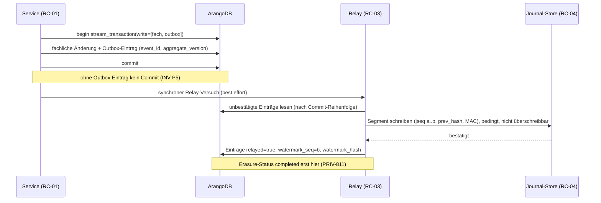
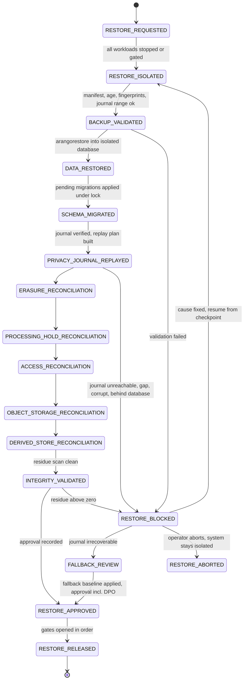

# SPEC-17 — Privacy Recovery: Journal, Restore-Lebenszyklus, Reconciliation

```
Paket: spec/privacy · Version 1.2 · 2026-11-23
Gemessen gegen: develop ce7e858d0 (Prüfung 2026-11-23, nur lesend; für Backup relevante Dateien gegenüber 007a4ea90
unverändert, Zeilenangaben des Audits 2026-11-22 gelten weiter)
Anforderungs-IDs: PRIV-800 … PRIV-899 (dieses Dokument)
Komponenten-IDs: RC-01 … RC-14 (Recovery Components)
Testfall-Vorschläge: TA-726 … TA-760 (Zuordnung in 10 durch die Hauptsession)
Hängt ab von: 01 §3.5.4, §3.5.5, §3.5.8, §3.5.9, §7, §8a · 03 §0, §2.5, §2.6, §10 · 07 §1.1 · 09 §6, §7 · 12 PRIV-E14,
PRA-0.03, PRA-0.10, PRA-1.04, PRA-1.05, PRA-1.06 · 13 (L-12, L-15, L-19, L-21) · 16 §8 · decision-log §B (LEG-11), §D
Präzisiert: PRIV-707…PRIV-714 (09 §6/§7), PRIV-E14 (12), A-JRN-1…4, A-BAK-1…5, A-AUD-3, A-HOLD-1…3 (01 §3.5),
INV-P5, INV-P6, INV-P10 (01 §8a); ersetzt R-45 (06) durch die Journal-Frist R-63 (Vorschlag)
Neue Befunde: LEG-62 … LEG-70 (Registereintrag in decision-log §D durch die Hauptsession)
Sprache: Deutsch (DEC-23); Quellcode, Identifikatoren und Ereignistypen englisch
```

---

## 0. Lesart, Evidenz und Status

### 0.1 Zweck und Abgrenzung

Dieses Dokument legt fest, wie Kamerplanter sicherstellt, dass ein Restore keine durchgesetzte
Datenschutzentscheidung rückgängig macht: Löschungen, Verarbeitungssperren, Widerrufe von Einwilligungen,
Berechtigungsentzüge und Sicherheitswiderrufe bleiben wirksam, und ein unvollständiger oder inkonsistenter Restore
gibt das System nicht frei. Es enthält die Deliverables 1–6 des Betreiberauftrags vom 2026-11-23:

| Deliverable | Abschnitt |
|---|---|
| 1 Backup-/Restore-Privacy-Architektur | §2 |
| 2 Privacy Recovery Journal | §3, §4 |
| 3 Restore-Lebenszyklus | §5 |
| 4 Lösch-Reconciliation | §6, §7 |
| 5 Backup-Retention und Crypto-Shredding | §8 |
| 6 Test- und Betriebsverfahren | §11 |
| 7 Remediation-Roadmap | nicht hier: PRA-Vorschläge in §12/§14, Pflege in [`12`](12-implementation-roadmap.md) |

Testfälle werden hier als Vorschlag (`TA-R…`) formuliert; die verbindliche TA-Nummer vergibt
[`10-testing-and-acceptance.md`](10-testing-and-acceptance.md). Rechtsfragen werden hier nur vorgeschlagen
(Q-DSB-22 ff., Q-LAW-18 ff.); das Briefing an DSB und Rechtsberatung bleibt [`16-dpo-briefing-2517.md`](16-dpo-briefing-2517.md).

### 0.2 Evidenzklassen

Es gelten die Klassen des Pakets ([`01`](01-privacy-architecture.md) §9): `VERIFIED_CODE` (am Code, Chart oder an
der Betriebsdoku des SHA belegt, mit Pfad:Zeile), `VERIFIED_SPEC`, `VERIFIED_LEGAL` (mit L-nn), `INFERRED`,
`PROPOSED`, `OPEN_DECISION`, `LEGAL_REVIEW_REQUIRED`. Zusätzlich kennzeichnet **„nicht prüfbar“** Aussagen, die nur am
laufenden System oder beim Betreiber feststellbar sind (Produktionszustand, Bucket-Konfiguration, tatsächliche
Restores); sie stützen keine MUSS-Aussage über den Ist-Stand. Backend-Pfade ohne Präfix beginnen mit
`src/backend/app/`; Pfade mit `helm/`, `docs/`, `scripts/`, `src/` sind repo-relativ.

### 0.3 Statusmodell der Maßnahmen

Jede Anforderung und Maßnahme trägt genau einen Umsetzungsstatus. Ein dokumentiertes Konzept ist **keine** technische
Compliance.

| Status | Bedeutung | Beleg, der verlangt wird |
|---|---|---|
| `spezifiziert` | in diesem Paket beschrieben, kein Code/keine Konfiguration | Abschnitt in `spec/privacy` |
| `teilweise implementiert` | Bausteine existieren (Code, Chart, Doku), die Anforderung ist aber nicht erfüllt | Pfad:Zeile des Bausteins und die Lücke |
| `implementiert und getestet` | Anforderung erfüllt, Abnahmetest grün | PR/Commit, TA-ID, Testlauf |

Stand 2026-11-23: **keine** Anforderung dieses Dokuments ist `implementiert und getestet`. Was heute existiert, sind
Bausteine (§1.5).

### 0.4 Verhältnis zu bestehenden Dokumenten

`09` §6 bleibt der Ort für den gemessenen Ist-Stand und die Restore-Szenarien S1–S10 und wird auf Ist-Stand,
Zusammenfassung und Verweis hierher gekürzt; `01` §3.5.5/§3.5.9 bleiben die Architekturentscheidung (eigene
Komponente `PrivacyJournal`, Restore-Detektor im Start, Replay im Migrationsframework). Dieses Dokument ist das einzige
Detailkonzept. Im Einzelnen:

| Bestehende ID | Wirkung dieses Dokuments |
|---|---|
| PRIV-707 (Backup nur mit Journal) | bleibt; Durchsetzung über `scripts/ci/assert_chart_contracts.sh` statt helm-unittest (PRIV-855) |
| PRIV-708 (Dump-Frist, Transparenz) | bleibt; Transparenztext ergänzt um Journal-Frist (PRIV-874) |
| PRIV-709 (Outbox im selben Schreibschritt) | **präzisiert** durch PRIV-801…PRIV-805, PRIV-811, PRIV-815; Ereignisnamen in UPPER_SNAKE_CASE (§3.3, Abbildung alt → neu) |
| PRIV-710 (Flush ins Bucket, Object Lock) | **präzisiert** durch PRIV-805…PRIV-810; die Bereinigung „Objekte gefiltert neu schreiben“ ist **ersetzt** durch Segmentablauf (PRIV-808), weil Umschreiben mit Object Lock unvereinbar ist |
| PRIV-711 (Detektor, Wartungsmodus, Replay) | **ersetzt** durch den Restore-Lebenszyklus §5 (PRIV-820…PRIV-833); Kern (Hochwassermarke, Startsperre, Replay über alle Speicher, Residue-Scan) bleibt |
| PRIV-712 (Drill S3/S5/S6/S7) | **präzisiert** durch PRIV-872 und TA-744…TA-755 (Szenarien A–H) |
| PRIV-713 (Versionierung nur mit Lifecycle) | **präzisiert** durch PRIV-850…PRIV-854 |
| PRIV-714 (Salt-Rotation) | **ergänzt** durch PRIV-813 (Identitätsprüfung des Salts) |
| PRIV-E14 (`12`) | Mechanik hier; E14 verweist auf `17` |
| A-JRN-1…4 | präzisiert: A-JRN-1 → PRIV-802; A-JRN-2 → PRIV-805/806; A-JRN-3 → PRIV-804; A-JRN-4 → PRIV-809 |
| A-BAK-1…5 | präzisiert: A-BAK-3 → PRIV-821/823; A-BAK-4 → PRIV-840; A-BAK-5 → PRIV-832 (Rückfall nur mit Freigabe) |
| A-AUD-3 | **ersetzt**: Sicherheitsereignisse gehen nicht als Kopie der Audit-Zeile, sondern als typisiertes Journal-Ereignis ins Journal (§3.3) |
| A-HOLD-1…3 | ergänzt um Journal-Ereignisse für Hold und Einschränkung (§3.3) |
| INV-P5 | präzisiert: Integrationstest je Ereignistyp **und** statischer Emittenten-Guard (PRIV-801) |
| INV-P6 | erweitert: Gate schließt auch Worker und Beat, Gründe nach §5.3 |
| INV-P10 | erweitert: Journal-Frist ≥ wirksame Backup-Lebensdauer (PRIV-808); Durchsetzung über Chart-Vertrag |
| R-45 (`06`, Journal 3 J.) | **ersetzt** durch R-63 (Restore-Fenster, §3.8); der Löschnachweis über 3 J. bleibt in `erasure_requests` (R-06) |

---

## 1. Ist-Stand (VERIFIED_CODE, sofern nicht anders markiert)

### 1.1 Was gesichert wird

| Speicher | Gesichert? | Mechanik | Frist | Beleg |
|---|---|---|---|---|
| ArangoDB (Fachdaten, Konten, Mandanten, `erasure_requests`, `security_audit_log`, `system_meta`, `schema_migrations`) | ja, Default **aus** | CronJob `arangodb-backup`: `arangodump --include-system-collections true --compress-output true` → `rclone copy` nach `s3://<bucket>/<prefix>/<UTC-Stamp>/` + `LATEST`; täglich `15 2 * * *` | `retentionDays: 30`, nur `> 0` löscht → `0`, negative und nicht-numerische Werte = unbegrenzt; neuester Dump wird nie gelöscht; `rclone purge` (auf versioniertem Bucket nur Delete-Marker) | `helm/kamerplanter/values.yaml:567–612` (Frist `:596`, SSE `:607–608`), Controller `:1324–1460` (Dump `:1366–1374`, Upload/Retention `:1406–1430`, `:1418`, `:1426`); Chart-Vertrag `scripts/ci/assert_chart_contracts.sh:177–216` |
| TimescaleDB | nein (nur Doku: Snapshot/`pg_dump`) | — | — | `values.yaml:589–592`; `docs/de/deployment/backup-restore.md:17` |
| Objektspeicher `local-fs` (PVC `backend-attachments`) | nein (nur Doku: CSI-Snapshot) | — | keine | `values.yaml:2382–2397`; `config/settings.py:1303, 1430` |
| Objektspeicher S3 | indirekt (Doku empfiehlt Versionierung) | Löschung ohne `VersionId` → Delete-Marker | keine Lifecycle-Regel dokumentiert | `data_access/storage/s3_adapter.py:164, 176`; `backup-restore.md:14, 29` |
| `vectordb` (Referenzindex mit `contributed_by`, `tenant_key`) | nein; Backup-Doku nennt ihn nicht | — | — | `domain/interfaces/reference_index_store.py:6–8, 57–69`; `backup-restore.md:11–18` |
| Valkey (Broker, Sitzungen MCP, Dedup, OAuth-State) | nein (bewusst) | — | TTL je Schlüssel | `backup-restore.md:18` |
| `kamerplanter-secrets` (`FERNET_KEY`, `ERASURE_TOMBSTONE_SALT`, `JWT_SECRET_KEY`) | nicht durch das Chart; Doku verlangt getrennte Sicherung | — | — | `backup-restore.md:16, 20–21` |
| Docker/Light | nur Doku: manueller `arangodump` als Root mit Passwort als Argument, Klartext, ohne Frist | — | keine | `docs/de/deployment/docker-dauerbetrieb.md:199–233`; `docker-compose.release.yml:252–257` |

Verschlüsselung: nur SSE `AES256`/`aws:kms`, keine client-seitige Verschlüsselung; Dump mit dem Anwendungskonto
(`values.yaml:1366–1374, 1443–1444`). Kein inkrementelles Backup, kein PITR, kein `arangobackup`. Produktionszustand
(Backup aktiv? Versionierung? Restore erfolgt?) **nicht prüfbar** → PRA-0.03.

### 1.2 Wie wiederhergestellt wird

Einziger dokumentierter Pfad: Vollrestore in einen **leeren** Namespace (`docs/de/deployment/backup-restore.md:101–160`,
EN identisch): ArgoCD anhalten → Chart frisch installieren (das Backend startet dabei einmal gegen die leere DB) →
`backend`, `celery-worker`, `celery-beat` auf 0 → `arangorestore --overwrite true` als Root → hochskalieren; „beim Start
prüft das Backend den Migrationsstand“ (`:160`). Es gibt keinen dokumentierten In-Place- oder Teil-Restore; der einzige
Teil-Restore ist der **Mandanten-Import** als neuer Mandant (`docs/de/deployment/tenant-export-import.md:3, 90`).
Validierung vor Freigabe: nur Dokumentanzahlen und Indizes (Drill `test-reports/backup-restore/2026-10-04-arangodb-restore-drill.md`).
Docker: `arangorestore --overwrite true` gegen die **laufende** Anwendung (`docker-dauerbetrieb.md:218–230`).

Startverhalten nach dem Restore: Backend-Lifespan prüft Secrets (Form/Länge), legt Collections an, migriert unter Lock,
führt Seeds und `reconcile_deployment_mode` aus (`main.py:172ff., 181–191, 196, 207–211`). Worker prüfen Salt,
Log-Salt, Fernet und (im Chart) DB-Login, **nicht** den Migrationsstand oder einen Restore-Zustand
(`tasks/__init__.py:109–225`). Beat startet mit dem vollen Plan (`tasks/__init__.py:395–615`); einen globalen
Beat-Schalter gibt es nicht, und `renderChecks.scaling` verweigert `replicas ≠ 1` (`values.yaml:291–302, 1650–1656`).
Einen Wartungsmodus gibt es nicht (`grep -ri maintenance_mode` → nur Tank-Wartung).

### 1.3 Wo Datenschutzzustände liegen und warum ein Restore sie zurücksetzt

**Alle** Datenschutzzustände liegen in **derselben** ArangoDB-Datenbank, die der Dump sichert und
`arangorestore --overwrite true` ersetzt; keiner hat eine Kopie außerhalb. Ein append-only Ereignisprotokoll und ein
Outbox-Muster gibt es nicht (`grep -ri outbox` → nur zwei Kommentare, die ein Outbox ablehnen,
`domain/services/auth_service.py:1222`, `tasks/auth_tasks.py:299`). Die Schreibpfade der Journal-Kandidaten sind
**nicht** transaktional (`privacy_service.py:983–984` zwei getrennte Schritte; `revoke_consent`, `restrict_processing`,
`revoke`, `logout_all`, `change_password`; Audit-Zeile „nach der Änderung“ `security_audit_service.py:15–17`).

| Entscheidung | Speicher | Effekt eines Restores (Dump T0, Restore T1) | Beleg |
|---|---|---|---|
| Kontolöschung beantragt | `erasure_requests`, `users.is_active=false`, `password_hash=None`, Tokens widerrufen | Antrag nach T0 fehlt → Konto aktiv mit Passwort | `domain/services/privacy_service.py:904, 982–984`; `domain/models/privacy.py:200–230` |
| Kontolöschung vollzogen | `users` gelöscht, Tombstone in `erasure_requests` | Person mit Rohschlüssel und allen Zeilen zurück; Objekte/Vektoren schon weg | `domain/engines/erasure_engine.py:853, 860–871, 1236–1248`; `data_access/arango/erasure_executor.py:185` |
| Mandantenlöschung | `tenants.status`, `tenant_erasure_records` | Mandant `active` zurück; TimescaleDB/Objekte/Vektoren weg | `domain/models/tenant.py:51–61`; `data_access/arango/tenant_erasure_executor.py:425–511` |
| Einwilligungswiderruf | `consent_records.revoked_at` (Update, kein Audit) | Widerruf verschwindet → Consent-Guard lässt zu | `privacy_service.py:1955–1977` |
| Art. 18/21 | `processing_restrictions` (nirgends gelesen) | Antrag verschwindet (heute ohne Wirkung, aber Nachweis und Fristlauf weg) | `privacy_service.py:1812ff.`; LEG-23 |
| API-Key-Widerruf | `api_keys.revoked=true` | Key wieder gültig | `data_access/arango/api_key_repository.py:70–77` |
| Sitzungen, Refresh-Token | `refresh_tokens`, `users.session_generation`, `access_token_generation` | vor T0 ausgestellte, nach T0 widerrufene Refresh-Token wieder gültig | `data_access/arango/refresh_token_repository.py:175–216`; `domain/engines/full_auth_provider.py:38` |
| Passwortwechsel/-reset | `users.password_hash` | altes Passwort gilt wieder | `auth_service.py:1273, 1453ff., 1534` |
| Mitgliedschaftsentzug, Rollenänderung, Mandantensperre | `memberships`, `tenants.status`, Audit-Zeile | Entzug und Audit-Zeile rollen gemeinsam zurück | `domain/services/security_audit_service.py:1–20`; `common/enums.py:1990–2010` |
| Anhänge | Katalog `attachments` ↔ Bytes | DB-Referenz zurück, Datei nicht (local-fs) bzw. als nicht-aktuelle Version (S3) | `s3_adapter.py:164, 176`; `data_access/arango/attachment_repository.py:278, 904, 948` |
| Freitext-Schwärzung | Fachdokument, `garden_plan_audit.snapshot` | Schwärzung nach T0 rückgängig (LEG-34) | `03` §2.5 Z. 10, 19 |
| Fristbasierte Löschung | Beats, Fristen `config/settings.py:106–124` | Zeilen zurück; nächster Beat entfernt sie erneut (einzige Selbstheilung für Fristdaten) | `tasks/retention_tasks.py:134–388` |
| Audit/Nachweis | `security_audit_log`, `ai_audit_log`, `mcp_audit_log`, `migration_reports` | Nachweise zwischen T0 und T1 verloren | `data_access/arango/collections.py:239–261` |

Zufällige Selbstheilung: `execute_scheduled_erasures` wählt `scheduled`/`partially_completed`/stale `in_progress` erneut
(`privacy_service.py:2568–2602`), `resume_tenant_erasures` setzt fällige Mandantenlöschungen fort
(`tasks/tenant_tasks.py:31–40`); Access-Token nach einer Generationserhöhung nach T0 fallen weg (Gleichheitsprüfung
`full_auth_provider.py:38`). Mehr Schutz gibt es nicht.

### 1.4 Abgeleitete Speicher

ArangoSearch-Views gibt es nicht (Suche clientseitig). Mit Personenbezug: `ai_tip_cache` (`erasure_engine.py:440`),
Glossar-Cache 7 d (`glossary_service.py:104`), Valkey-Schlüssel (MCP-Sitzung mit **rohem** `account_key` 12 h,
`mcp_server/session.py:32–34, 54`; E-Mail-Digests 24 h; Celery-Nachrichten mit `user_key`, `tasks/auth_tasks.py:202`,
`tasks/reference_contribution_tasks.py:54`; Dedup 24 h `domain/engines/notification_engine.py:35–39`), pgvector-Referenzindex,
Geräte (Service-Worker-Cache, IndexedDB-Puffer, `07` §1.1), externe Empfänger (Sentry, LLM, Pl@ntNet, Kindwise,
Web-Push, E-Mail). Thumbnails werden als WEBP-Renditions abgeleitet (`domain/engines/storage/__init__.py:8`,
`data_access/storage/local_fs_adapter.py:47`).

### 1.5 Vorhandene Bausteine (`teilweise implementiert`)

| Baustein | Nutzen für dieses Konzept | Beleg |
|---|---|---|
| Stream-Transaktion `stream_transaction(db, write=…, read=…, exclusive=…)` (ein Commit/Abort, Zeitbudget, typisierte Konflikte) | trägt den Outbox-Insert im selben Commit | `data_access/arango/transactions.py:321ff.` |
| `record_tombstone_in(txn, …)` (Löschung + Tombstone in einer Transaktion, `UPSERT`) | Vorbild für `append_privacy_event_in(txn, …)` | `data_access/arango/client_event_tombstones.py:67`; genutzt `attachment_repository.py:904, 948` |
| Emittenten-Guards „jede Mutation schreibt einen Audit-Eintrag“ | Muster für den statischen Journal-Guard | `tests/unit/guards/test_membership_mutations_write_the_security_audit.py`, `test_account_and_tenant_mutations_write_the_security_audit.py` |
| `compute_tombstone_hash`, Tombstone-Regex, Salt-Startgates | Abgleich gelöschter Konten; Ort für Salt-Fingerabdruck | `erasure_engine.py:1236`; `domain/models/privacy.py:25`; `main.py:77–110`; `tasks/__init__.py:109–180` |
| Singleton-Metadaten `system_meta` mit Start-Reconcile | Ort für Recovery-Zustand und Hochwassermarke | `data_access/arango/collections.py:166–168`; `data_access/arango/mode_switch_repository.py:139–160`; `migrations/reconcile_deployment_mode.py:1–29` |
| Migrationsframework (Lock, Barriere 600 s, Phasen, `migration_reports`) | Heimat des Restore-Controllers | `migrations/framework/runner.py:35, 125–192, 242–280`; `tracking.py:44` |
| Idempotente Löschpfade mit Wiederaufnahme | Replay ruft sie erneut auf | `privacy_service.py:2568–2602`; `tenant_service.py:270, 1549` |
| Generationen `session_generation`/`access_token_generation` | Token-Entwertung ohne JWT-Rotation | `full_auth_provider.py:38`; `domain/models/user.py:99, 106` |
| Readiness `/api/v1/health/ready`, Startup-Probe 900 s | Signal „nicht bereit“ während Reconciliation | `api/v1/health/router.py:18–45`; `values.yaml:981–1012` |
| Celery-Signale `task_prerun`, `beat_init`, `worker_process_init` | Einhängepunkte für Worker-/Beat-Gate | `tasks/__init__.py:10–15, 318, 344–345` |
| Abschalter `PWA_CACHING_ENABLED`, `mcp_server_enabled`, `REGISTRATION_MODE`, Feature-Flags externer Dienste | Isolation | `config/settings.py:259, 399, 655, 689`; `tasks/__init__.py:617–700` |
| Render-`fail`-Muster | Ort für Restore-Modus und Fristprüfung | `values.yaml:382–440` |

### 1.6 Zuordnung der Befunde zu Backup-/Restore-Prozessen

Prozesse: **B1** Backup erstellen · **B2** Backup aufbewahren/ablaufen · **B3** Backup ab- oder umschalten · **R1**
Restore vorbereiten/isolieren · **R2** Daten einspielen · **R3** Start und Freigabe · **R4** Reconciliation ·
**R5** Teil-Restore (Mandanten-Import) · **O** laufender Betrieb (Ereignis entsteht).

| Befund | Kurz | Prio | Prozess | Behoben durch (§12) |
|---|---|---|---|---|
| LEG-11 | Backup ohne Löschpropagation und Fristgrenze aktivierbar | P1 (P0 bei aktivem Backup) | B1, B2, R4 | PRIV-801…845, PRIV-855 |
| LEG-23 | Art. 18/21 ohne Wirkung | P1 | O, R4 | PRIV-801 (Ereignisse), PRA-1.06 |
| LEG-24 | Restore setzt Widerrufe und Sicherheitsänderungen zurück | P1 | O, R4 | PRIV-801, PRIV-829, §6 |
| LEG-25 | Spiegel-Zeitpunkt widersprüchlich | P1 | O | PRIV-802, PRIV-805 |
| LEG-26 | Versionierung ohne Lifecycle | P1 | B2, R4 | PRIV-850…852 |
| LEG-34 | Plan-Snapshots spielen geschwärzte Texte zurück | P2 | R4 | `REDACTION_APPLIED` (§3.3) |
| LEG-35 | kein Legal Hold | P2 | O, R4 | `LEGAL_HOLD_*` (§3.3), PRIV-843 |
| LEG-42 | keine Verschlüsselung ruhender Daten | P2 | B1 | PRIV-860 |
| LEG-43 | Docker-Backup ohne Frist/Verschlüsselung | P2 | B1, B2 | PRIV-833 |
| LEG-44 | Nebenspeicher ohne Frist | P2 | B2 | PRIV-808, R-63…R-65 |
| LEG-54 | Import übernimmt `anon_` | P3 | R5 | PRIV-844 |
| LEG-59 | Valkey ohne Authentifizierung | P3 | R1 | PRIV-825 (Flush) |
| LEG-60 | Waisenobjekte unbefristet | P3 | R4 | PRIV-853 |
| **LEG-62** (N1) | Runbook hält bei `celeryWorkers.dedicatedQueues: true` `celery-worker-default`/`-bulk` nicht an (`backup-restore.md:116–117, 156–157`; `values.yaml:160–166, 184–191`; `templates/_celery_workers.tpl:170`) | P2 | R1, R2 | PRIV-822, PRIV-824 |
| **LEG-63** (N2) | Docker-Restore gegen laufende Anwendung (`docker-dauerbetrieb.md:218–230`; `restart: unless-stopped` `docker-compose.release.yml:162, 200, 229`) | P2 | R1, R2 | PRIV-833 |
| **LEG-64** (N3) | Docker-Release ohne Anhänge-Volume, Worker mit getrenntem Dateisystem (`settings.py:1303, 1430`; `docker-compose.release.yml:145–146, 194–195, 252–257`; `Dockerfile:110–115`) — Laufzeitwirkung nicht prüfbar | P2 | B1, R4 | PRIV-833 |
| **LEG-65** (N4) | Mandanten-Import prüft nicht gegen abgeschlossene Löschungen (`domain/engines/tenant_import_engine.py:34–36`; `tenant-export-import.md:3, 22, 90`) | P2 | R5 | PRIV-844 |
| **LEG-66** (N5) | API-Key-Widerruf fail-open (`api_key_repository.py:70–77`; `auth_service.py:2404–2412`; `api/v1/auth/router.py:914–922`) | P2 | O | PRIV-812 |
| **LEG-67** (N6) | Startgate prüft Länge, nicht Identität des Tombstone-Salts (`main.py:96–98`) | P2 | R2, R3 | PRIV-813 |
| **LEG-68** (N7) | `backup.enabled: false` beendet auch die Dump-Löschung (`values.yaml:1325, 1418–1430`) | P2 | B3 | PRIV-854 |
| **LEG-69** (N8) | In-Place-Restore undokumentiert; Valkey behält den Stand nach T0 (`backup-restore.md:18, 101`; `mcp_server/session.py:32–34, 54`) | P3 | R1, R3 | PRIV-825 |
| **LEG-70** (N9) | Worker und Beat warten nicht auf den Migrationsstand (`main.py:207–211`; `tasks/__init__.py:109–225`; `backup-restore.md:155–157`) | P3 | R3 | PRIV-823, PRIV-827 |

Dazu Zitatkorrekturen (kein Befund, früher „N10“): SSE steht in `values.yaml:607–608` (nicht `:604–605`); die
LEG-24-Belege für Sitzungsende und Einwilligungswiderruf sind die Schreibpfade `refresh_token_repository.py:175–216`
und `privacy_service.py:1955–1977` (nicht `auth_service.py:891`, `consent_repository.py:220–230`); `erasure_engine.py:866`
(„retained for 1 year“) erweitert W-11. Die Hauptsession führt sie nach.

---

## 2. Backup-/Restore-Privacy-Architektur [PROPOSED]

### 2.1 Grundsatz

Ein Restore setzt die Datenbank auf T0 zurück; Datenschutzentscheidungen dürfen dabei nicht auf T0 zurückfallen. Dafür
braucht das System **ein Gedächtnis außerhalb der wiederhergestellten Daten**: das Privacy Recovery Journal. Jede
Entscheidung entsteht im selben Commit wie ein Outbox-Eintrag, ein Relay überträgt ihn in einen Journal-Store außerhalb
der Primär-DB, und nach jedem Restore spielt ein Restore-Controller alle Ereignisse seit dem Backup-Stand erneut ein,
bevor ein Nutzer oder Hintergrundprozess das System wieder benutzt. „Erneut einspielen“ heißt: die Entscheidung erneut
**anwenden** (löschen, sperren, widerrufen), nicht Daten zurückkopieren. Das Journal enthält keine Nutzdaten.

### 2.2 Verantwortlichkeiten je Betriebsmodell

| Aufgabe | BM-003 Private Self-Hosted | BM-002 Community Garden/Verein | Commercial Self-Hosted | BM-001 SaaS |
|---|---|---|---|---|
| Backup aktivieren, Frist setzen, Lifecycle am Bucket | Betreiber = Privatperson | Betreiber (Verein, Verantwortlicher) | Betreiber (Unternehmen, Verantwortlicher) | Plattformbetreiber (Auftragsverarbeiter je Mandant, LEG-01) |
| Journal-Store bereitstellen, Schlüssel verwahren | Betreiber (lokales Volume genügt) | Betreiber | Betreiber | Plattform (getrennte Rolle für Schlüssel) |
| Restore auslösen, Runbook ausführen | Betreiber | Betreiber (zwei Personen empfohlen) | Betreiber (Vier-Augen) | Plattform-SRE, Vier-Augen Pflicht |
| Freigabe im Rückfall ohne Journal | Betreiber | Betreiber + DSB des Vereins | Betreiber + DSB | Plattform + DSB; Information der betroffenen Mandanten (Verantwortliche) |
| Nachweis (Evidence-Report) | empfohlen | Pflicht | Pflicht | Pflicht, an Mandanten auf Anfrage |
| Teil-Restore eines Mandanten (Import) | — | Lead mit `management` + Plattform-Admin | wie BM-002 | Plattform-Admin auf Weisung des Mandanten |
| Produkt (Code, Chart, Doku) | Kamerplanter-Projekt liefert Mechanik, Defaults, Gates | ebenso | ebenso | ebenso |

Die Zuordnung „Mandant = Verantwortlicher, Betreiber = Auftragsverarbeiter“ ist die Paketannahme aus LEG-01
(`LEGAL_REVIEW_REQUIRED`). Die Haushaltsausnahme (Art. 2 Abs. 2 lit. c, L-12) für BM-003 ist `INFERRED`; der
Sicherheitsteil (S7, reaktivierte Zugänge) gilt unabhängig davon.

### 2.3 Komponenten

| ID | Komponente | Ort (Umsetzungsvorschlag) | Aufgabe | Status |
|---|---|---|---|---|
| RC-01 | Privacy Event Emitter + Unit of Work | Interface `domain/interfaces/privacy_unit_of_work.py`; Umsetzung `data_access/arango/privacy_unit_of_work.py`; Aufruf in `PrivacyService`, `AuthService`, API-Key-, Membership-, Tenant-, Attachment-Service | fachliche Änderung + Outbox-Eintrag in **einer** Stream-Transaktion; Services sehen nur das Interface (5-Schichten-Regel) | spezifiziert (Helper existiert, keine UoW) |
| RC-02 | Outbox `privacy_journal_outbox` | ArangoDB-Collection, plattformweit (in `TenantErasureEngine.NOT_TENANT_SCOPED` begründet, PRIV-010) | hält Ereignisse bis zur Bestätigung durch den Store | spezifiziert |
| RC-03 | Journal-Relay | Celery-Task `privacy.journal_relay` (Queue `critical`) + synchroner Versuch direkt nach dem Commit | einziger Schreiber; vergibt `jseq`, Hash-Kette, schreibt Segmente, bestätigt zurück | spezifiziert |
| RC-04 | Journal-Store | S3-Prefix/Bucket mit Object Lock **oder** lokales append-only Volume (Docker/Light); optional Replik | dauerhaft, unabhängig vom Backup, nicht löschbar durch App | spezifiziert |
| RC-05 | Journal-Reader/Verifier | Bibliothek `data_access/journal/` | liest Segmente, prüft MAC, Kette, Lücken; liefert Kopf und Bereich | spezifiziert |
| RC-06 | Recovery-State | Dokument `system_meta/privacy_recovery` | `instance_id`, `restore_epoch`, Zustand, Hochwassermarke (`watermark_seq`, `watermark_hash`), Fingerabdrücke | spezifiziert |
| RC-07 | Restore-Gate | Backend-Lifespan + Readiness + Request-Sperre; Worker `worker_process_init`/`task_prerun`; Beat `beat_init` | schließt bei jedem Zweifel (§5.3) | spezifiziert |
| RC-08 | Restore-Controller | CLI `python -m app.migrations.privacy_restore <phase>` im Migrationsframework (Lock, `migration_reports` Art `restore_replay`) | führt Phasen §5 aus, persistiert Checkpoints | spezifiziert (Framework existiert) |
| RC-09 | Reconciler je Datenbereich | `domain/services/recovery/` (Erasure, Tenant, Hold/Consent, Access, Derived) | wendet Ereignisse idempotent an, ruft bestehende Löschpfade | spezifiziert (Löschpfade existieren) |
| RC-10 | Object-Storage-Reconciler | Erweiterung `tasks/storage_tasks.py`/`domain/engines/storage/reconciliation_keys.py` | versionsvollständige Löschung, Waisen-Quarantäne | spezifiziert (Bericht-Reconcile existiert) |
| RC-11 | Backup-Manifest und -Inventar | Init-Schritt im CronJob `arangodb-backup`; Docker-Skript | schreibt `manifest.json` (Journal-Kopf vor dem Dump, Zeit, Schema, Fingerabdrücke, Prüfsumme); Ereignis `BACKUP_TAKEN`/`BACKUP_EXPIRED` | spezifiziert |
| RC-12 | Evidence-Report + Evidenzablage | Controller schreibt JSON/Markdown außerhalb der DB (Bucket-Prefix `privacy/evidence/` bzw. Volume) | Nachweis je Restore (§11.5) | spezifiziert |
| RC-13 | Isolationssteuerung | Helm-Value `privacy.restore.isolate`, Compose-Override `docker-compose.restore.yml`, Env `KP_RESTORE_MODE` | rendert Worker/Beat 0, Backend im Wartungsmodus, Abschalter an | spezifiziert |
| RC-14 | Überwachung | `observability/` Metriken, `PrometheusRule` (PRA-3.02) | Alarme §11.4 | spezifiziert |

Abbildung auf `01` §3.5: RC-01…RC-05 = Konzept „Privacy-&-Security-Journal“ (§3.5.5, `PrivacyJournal`); RC-06…RC-10,
RC-13 = „Backup-Löschpropagation“ (§3.5.9, Restore-Detektor und Replay); RC-09 (Hold/Consent) nutzt den
`ProcessingHoldGuard` aus §3.5.4; RC-12 = „Audit- und Evidenzverwaltung“ (§3.5.8, Evidenz als Betriebsartefakt außerhalb
der DB); RC-14 hängt an §3.5.11 (Alert-Regeln). Kein neuer Dienst, kein neuer Container (Entscheidung aus `01` §3.4
bleibt).

### 2.4 Datenflüsse

```mermaid
flowchart LR
    subgraph App["Anwendung (Backend, Worker)"]
        SVC["Service: Löschung, Widerruf, Sperre (RC-01)"]
        UOW["Stream-Transaktion"]
        SVC --> UOW
    end
    subgraph DB["ArangoDB (Primär-DB, wird gesichert und wiederhergestellt)"]
        DATA["Fachdaten und Zustände"]
        OUTBOX["privacy_journal_outbox (RC-02)"]
        META["system_meta/privacy_recovery (RC-06)"]
    end
    UOW -->|"ein Commit"| DATA
    UOW -->|"ein Commit"| OUTBOX
    RELAY["Journal-Relay (RC-03)"]
    OUTBOX --> RELAY
    RELAY -->|"Segment, MAC, Kette"| STORE["Journal-Store (RC-04), außerhalb der DB"]
    RELAY -->|"Ack: relayed, Hochwassermarke"| META
    BJOB["Backup-CronJob (RC-11)"]
    STORE -->|"Kopf vor dem Dump"| BJOB
    DB -->|"arangodump"| BKP["Backup-Bucket (Dumps, Manifest)"]
    BJOB --> BKP
    BKP -->|"arangorestore"| DB2["wiederhergestellte DB (Stand T0)"]
    CTRL["Restore-Controller (RC-08) und Reconciler (RC-09, RC-10)"]
    STORE -->|"Ereignisse nach T0"| CTRL
    DB2 --> CTRL
    CTRL -->|"Löschen, Sperren, Widerrufen"| DB2
    CTRL -->|"Versionen löschen, Quarantäne"| OBJ["Objektspeicher"]
    CTRL -->|"Report"| EVI["Evidenzablage (RC-12)"]
    GATE["Restore-Gate (RC-07)"]
    META --> GATE
    STORE --> GATE
```



Sequenz eines Ereignisses (Normalbetrieb):



### 2.5 Vertrauensgrenzen

| Grenze | Was sie überquert | Kontrolle (Soll) |
|---|---|---|
| Primär-DB ↔ Journal-Store | Ereignisse (Pseudonyme, Enums, Zeitstempel) | Relay mit eigenem Zugang nur `PutObject`/`GetObject`/`ListBucket` auf den Journal-Prefix, **kein** `Delete`; Object Lock; Segment verschlüsselt und MAC-gesichert mit `PRIVACY_JOURNAL_KEY` (PRIV-806, PRIV-807) |
| Primär-DB ↔ Backup-Bucket | vollständige Kopien inkl. Outbox und `system_meta` | getrennter Zugang `kamerplanter-backup-s3`; Journal-Store ist **nicht** Teil des Backups und wird nie mitwiederhergestellt (PRIV-806) |
| Betreiber ↔ Journal | Lesen nur über Controller/Verifier | kein Betreiberwerkzeug zum Löschen oder Ändern; Store-Zugriffe protokolliert (S3-Access-Log, PRIV-810) |
| Restore-Controller ↔ Anwendung | Gate-Zustand | Zustand in RC-06 **und** Abgleich gegen RC-04: eine wiederhergestellte DB kann das Gate nicht selbst „offen“ melden (§5.3) |
| Secrets ↔ Restore | Salt, Fernet, Journal-Schlüssel, JWT | Fingerabdrücke in RC-06 und im Journal-Epochenkopf; Abweichung schließt das Gate (PRIV-813) |
| Anwendung ↔ Endgeräte | gepufferte Schreibvorgänge nach T0 | Restore-Epoche im API-Header; Clients verwerfen Lesecaches, legen Puffer zur Bestätigung vor (PRIV-846) |
| Anwendung ↔ externe Empfänger | Benachrichtigungen, KI, Erkennung | während der Isolation aus; Freigabe erst nach Reconciliation (PRIV-824) |

Die Zeile „Primärspeicher ↔ Backups“ in `01` §7 wird durch die ersten beiden Zeilen präzisiert.

---

## 3. Privacy Recovery Journal [PROPOSED]

### 3.1 Ableitung der Taxonomie

Die Taxonomie folgt aus der Frage: **Welche Zustandsänderung macht ein Restore so rückgängig, dass danach eine
Verarbeitung ohne Grundlage, eine Wiederherstellung gelöschter Daten oder ein reaktivierter Zugang entsteht, und die
das System nicht aus sich heraus wiederherstellt?** Daraus drei Regeln:

1. **Journalisieren**, was einschränkt, löscht oder entzieht und nicht fristbasiert ist (VERIFY §4: Konto, Mandant,
   Einwilligung, Art. 18/21, API-Key, Sitzungen, Passwort, Mitgliedschaft, Rolle, Sperre, Anhang, Schwärzung).
2. **Gegenereignisse** journalisieren, wenn sie die Reihenfolge entscheiden (Aufhebung einer Sperre, Wiedereinsetzung
   eines Mandanten, erneute Einwilligung). Sie werden beim Replay **nicht** als Ausweitung angewendet (§3.6).
3. **Nicht journalisieren**, was das System ohnehin deterministisch wiederherstellt (fristbasierte Löschung: der
   Controller führt alle Retention-Regeln vor der Freigabe aus, PRIV-842) oder was nach einem Restore nur Funktion,
   nicht Datenschutz kostet (Rolle erhöht, Mitglied hinzugefügt, Export erzeugt). Eine Zeile je fristabgelaufenem
   Datensatz (`RETENTION_EXPIRED` je Zeile) wäre eine neue Liste personenbezogener Kennungen ohne Nutzen und entfällt.

### 3.2 Abarbeitung der Mindestprüfmenge

| Auftragsliste | Entscheidung | Begründung |
|---|---|---|
| `SUBJECT_ERASURE_REQUESTED` | aufgenommen | Antrag nach T0 setzt sonst ein aktives Konto mit Passwort zurück (VERIFY §4) |
| `SUBJECT_ERASURE_COMPLETED` | aufgenommen | S3/S4; trägt den Tombstone, damit der Nachweis (R-06) neu entsteht |
| `TENANT_ERASURE_COMPLETED` | aufgenommen, ergänzt um `TENANT_ERASURE_REQUESTED`/`_CANCELLED` | `pending_deletion` nach T0 ginge sonst verloren; Abbruch in der Gnadenfrist entscheidet die Reihenfolge |
| `PROCESSING_RESTRICTION_APPLIED`/`_RELEASED` | aufgenommen, ergänzt um `_REQUESTED`, `_REJECTED` | heute existiert nur der Antrag (LEG-23); Fristlauf Art. 12 Abs. 3 hängt am Antrag |
| `CONSENT_WITHDRAWN` | aufgenommen, ergänzt um `CONSENT_GRANTED` (nur Reihenfolge) | S6 |
| `ACCESS_REVOKED` | **aufgeteilt** in `API_KEY_REVOKED`, `SESSION_REVOKED`, `SESSIONS_REVOKED_ALL`, `PASSWORD_CHANGED`, `ACCESS_GRANT_REVOKED`, `MEMBERSHIP_REVOKED`, `MEMBERSHIP_ROLE_LOWERED`, `ACCOUNT_DISABLED` | unterschiedliche Replay-Aktionen und Speicher; ein Sammeltyp wäre nicht idempotent anwendbar |
| `DATA_ANONYMIZED` | nur als `REDACTION_APPLIED` (manuelle, nicht fristbasierte Schwärzung) | fristbasierte Anonymisierung (R-25, IP-Anonymisierung) stellt der Retention-Nachlauf wieder her |
| `RETENTION_EXPIRED` | **nicht** als Zeilenereignis; ersetzt durch Retention-Nachlauf (PRIV-842) | Datenminimierung, §3.1 Regel 3 |
| `LEGAL_HOLD_APPLIED`/`_RELEASED` | aufgenommen (wirksam mit PRA-1.06) | A-HOLD-1…3 |
| Token-Generation | kein eigenes Ereignis; Generation steht im Payload der Zugangsereignisse; nach **jedem** Restore globale Erhöhung (PRIV-829) | deckt auch Ereignisse ab, die nie journalisiert wurden |
| API-Key-Widerruf | `API_KEY_REVOKED` | S7; erst nach PRIV-812 (fail-closed) |
| Passwortwechsel | `PASSWORD_CHANGED` | S7 |
| Mitgliedschaftsentzug, Rollenänderung | `MEMBERSHIP_REVOKED`, `MEMBERSHIP_ROLE_LOWERED` (inkl. entzogener `admin_scopes`); Erhöhung nicht | §3.1 Regel 3 |
| Attachment-Löschung | `ATTACHMENT_DELETED` | Fotos sind die sensibelste Nutzdatenklasse (LEG-20/21); Katalogzeile käme zurück |
| Schwärzung | `REDACTION_APPLIED` | LEG-34 |
| Salt-Fingerabdruck | kein Ereignis, sondern Kopf jeder Journal-Epoche (`JOURNAL_EPOCH_STARTED`) und Feld in RC-06 | LEG-67 |
| zusätzlich gefunden | `ACCOUNT_EMAIL_CHANGED` (Art. 16: Mails gingen sonst an die alte, evtl. fremde Adresse), `ACCESS_GRANT_REVOKED` für HA-Entity-Grants, Auth-Provider-Verknüpfungen, Push-Abos, Kalender-Feed-Tokens, Einladungen; `TENANT_SUSPENDED`/`_REINSTATED`; `OBJECTION_RECORDED` | aus VERIFY §4/§5 und `03` §2.5 Z. 2, 4, 23 |

**Bewusst nicht journalisiert (Restrisiko, `OPEN_DECISION`):** gewöhnliche Löschungen von Fachdatensätzen durch
Nutzer (Tagebucheintrag, Notiz, Aufgabe) außerhalb der Privacy-Routen. Nach einem Restore kehren sie für höchstens die
wirksame Backup-Lebensdauer zurück (§8). Das folgt der Backup-Zyklus-Logik aus L-19 Rn. 110 und ist als Frage
Q-DSB-23 (§10) gestellt; die Alternative (Ereignis `RECORD_DELETED` je Löschung über `record_tombstone_in`) ist
technisch gleichartig und kann ohne Schemaänderung ergänzt werden (Vorschlag DEC-38).

### 3.3 Ereignistaxonomie v1

Klassen: **E** Löschung · **H** Sperre/Hold · **C** Einwilligung · **A** Zugang/Sicherheit · **D** Datenbehandlung ·
**O** Betrieb (ohne Personenbezug). Alle Ereignisse liegen in der Aufbewahrungsklasse R-63 (§3.8); Klasse O zusätzlich
im Evidence-Report (R-64).

| Ereignistyp | Kl. | Auslöser (Ist-Pfad) | Restore-Effekt ohne Journal | Replay-Aktion (idempotent) | Pflicht-Payload | alt (PRIV-709) | Status |
|---|---|---|---|---|---|---|---|
| `SUBJECT_ERASURE_REQUESTED` | E | `request_erasure` (`privacy_service.py:904, 982–984`) | Konto aktiv, Passwort gültig | Konto schließen (`is_active=false`, `password_hash=None`), Tokens widerrufen, `erasure_requests` mit Fälligkeit neu anlegen bzw. angleichen | `due_at`, `requested_via` (self/admin) | — (neu) | spezifiziert |
| `SUBJECT_ERASURE_COMPLETED` | E | Abschluss `erase_account`, `erase_account_now`, `erase_account_by_admin` (`privacy_service.py:1378, 1558`) | Person mit Rohschlüssel zurück | Kontolöschung erneut ausführen über bestehenden Plan (alle Speicher), `erasure_requests`-Nachweis mit Tombstone neu | `tombstone` (`anon_`, später `anon2_`-Liste), `erasure_key`, `plan_fingerprint`, `stores_completed[]` | `account_erased` | spezifiziert |
| `TENANT_ERASURE_REQUESTED` | E | Mandant → `pending_deletion` | Mandant `active` | Status setzen, `deletion_scheduled_at` angleichen | `scheduled_at` | — (neu) | spezifiziert |
| `TENANT_ERASURE_CANCELLED` | E | Abbruch in der Gnadenfrist | — | nur Reihenfolge: hebt ein früheres `_REQUESTED` desselben Aggregats auf | — | — | spezifiziert |
| `TENANT_ERASURE_COMPLETED` | E | `tenant_erasure_executor.py:425–511` | Mandant `active`, Nebenspeicher leer | Mandantenlöschung erneut (ArangoDB, TimescaleDB, Objekte, `vectordb`), `tenant_erasure_records` neu | `record_ref` (`ter_`-Ableitung), `stores_completed[]` | `tenant_erased` | spezifiziert |
| `PROCESSING_RESTRICTION_REQUESTED` | H | `POST /privacy/restrict` (`privacy_service.py:1810–1888`) | Antrag und Frist weg | Antrag mit ursprünglichem Datum neu anlegen | `scope` (Enum nach PRA-1.06), `requested_at` | `restriction_set` (Teil) | spezifiziert |
| `PROCESSING_RESTRICTION_APPLIED` | H | Statuswechsel `applied` (PRA-0.06/1.06) | Sperre weg | Sperre setzen | `scope` | `restriction_set` | spezifiziert (Wirkung erst mit PRA-1.06) |
| `PROCESSING_RESTRICTION_REJECTED` | H | Statuswechsel `rejected` | — | Status angleichen | `reason_code` | — | spezifiziert |
| `PROCESSING_RESTRICTION_RELEASED` | H | Aufhebung | — | nur Reihenfolge; Aufhebung erst nach Prüfung angewendet (§3.6) | `scope` | `restriction_lifted` | spezifiziert |
| `OBJECTION_RECORDED` | H | `POST /privacy/object` (`objection_pending`, `privacy_service.py:1863–1888`) | Widerspruch weg | wie `_REQUESTED` | `purpose` | `objection_recorded` | spezifiziert |
| `LEGAL_HOLD_APPLIED` / `LEGAL_HOLD_RELEASED` | H | `legal_holds` (PRA-1.06) | Hold weg → Jobs vernichten Beweismittel | Hold setzen / Reihenfolge | `hold_scope` (user/tenant/record), `expires_at`, `reason_code` | — | spezifiziert (Hold nicht gebaut) |
| `CONSENT_WITHDRAWN` | C | `revoke_consent` (`privacy_service.py:1955–1977`) | Einwilligung wieder `granted` | `revoked_at` setzen | `purpose`, `consent_version` | `consent_revoked` | spezifiziert |
| `CONSENT_GRANTED` | C | Erteilung | — | nur Reihenfolge; keine Wiedererteilung durch Replay (§3.6) | `purpose`, `consent_version` | — | spezifiziert |
| `API_KEY_REVOKED` | A | `revoke` (`api_key_repository.py:70–77`) | Key gültig | `revoked=true` | `key_ref` | `api_key_revoked` | spezifiziert (Voraussetzung PRIV-812) |
| `SESSION_REVOKED` | A | `DELETE /users/me/sessions/{key}` | Sitzung gültig | Familie widerrufen | `family_ref`, `generation_after` | `sessions_revoked` (Teil) | spezifiziert |
| `SESSIONS_REVOKED_ALL` | A | `revoke_all_for_user` (`refresh_token_repository.py:175–216`) | alle Familien gültig | alle Familien widerrufen, Generationen erhöhen | `generation_after` | `sessions_revoked` | spezifiziert |
| `PASSWORD_CHANGED` | A | Wechsel/Reset (`auth_service.py:1273, 1453ff., 1534`) | altes Passwort gilt | Passwort-Reset erzwingen (`password_hash=None`, Reset-Hinweis) | `method` (change/reset) | `password_changed` | spezifiziert |
| `ACCOUNT_EMAIL_CHANGED` | A | E-Mail-Änderung | Mails an alte Adresse | Konto auf „E-Mail neu bestätigen“, Versand an das Konto gesperrt, bis bestätigt | — (keine Adresse im Journal) | — (neu) | spezifiziert |
| `ACCOUNT_DISABLED` / `ACCOUNT_ENABLED` | A | Kontoflag-Änderung (Audit-Aktion) | Konto aktiv | deaktivieren / nur Reihenfolge | `reason_code` | — | spezifiziert |
| `ACCESS_GRANT_REVOKED` | A | HA-Entity-Grant entzogen, Auth-Provider entkoppelt, Push-Abo/Kanal entfernt, Kalender-Feed-Token widerrufen, Einladung widerrufen | Zugang/Empfänger zurück | jeweiligen Grant widerrufen | `grant_kind` (Enum), `grant_ref` | — (neu) | spezifiziert |
| `MEMBERSHIP_REVOKED` | A | `leave_tenant`, `remove_member`, `admin_remove_membership` | Mitglied zurück | Mitgliedschaft entfernen (bestehender Pfad inkl. Zuständigkeiten) | `role_before` | `membership_removed` | spezifiziert |
| `MEMBERSHIP_ROLE_LOWERED` | A | Rolle gesenkt oder `admin_scopes` entzogen | höhere Rechte zurück | Rolle/Scopes auf Payload-Wert, wenn aktueller Wert höher | `role_after`, `scopes_after[]` | `role_lowered` | spezifiziert |
| `TENANT_SUSPENDED` / `TENANT_REINSTATED` | A | Plattform-Admin | Sperre weg | sperren / nur Reihenfolge | `reason_code` | `tenant_suspended` | spezifiziert |
| `ATTACHMENT_DELETED` | D | Anhangs-/Fotolöschung (`attachment_repository.py:904, 948`) | Katalogzeile zurück, Datei fehlt oder als alte Version vorhanden | Katalogzeile löschen, alle Versionen und Renditions löschen (RC-10) | `attachment_ref`, `renditions` (Anzahl) | — (neu) | spezifiziert |
| `REDACTION_APPLIED` | D | manuelle Schwärzung (`care_event_repository.py:573–595, 1020–1084`), Plan-Snapshot-Schwärzung (PRA-2.02) | geschwärzter Text zurück | Felder erneut auf `[redacted]`, Snapshots angleichen | `record_ref`, `fields[]` (Namen, kein Inhalt), `reason_code` | — (neu) | spezifiziert |
| `JOURNAL_EPOCH_STARTED` | O | erster Relay-Lauf, jeder Restore, Schlüsselwechsel | — | Prüfung Fingerabdrücke | `instance_id`, `restore_epoch`, `salt_fp`, `journal_key_fp`, `fernet_fp`, `app_version` | — | spezifiziert |
| `BACKUP_TAKEN` / `BACKUP_EXPIRED` | O | RC-11 | — | Inventar für Fristberechnung (§3.8) | `backup_id`, `journal_seq_at_start`, `started_at`, `expires_at` | — | spezifiziert |
| `RESTORE_STARTED` / `RESTORE_RELEASED` / `RESTORE_ABORTED` | O | RC-08 | — | Nachweis, Gegenprobe gegen RC-06 | `restore_id`, `backup_id`, `replayed_range`, `fallback` (bool) | — | spezifiziert |
| `JOURNAL_GAP_ACKNOWLEDGED` | O | Freigabe im Rückfall (PRIV-832) | — | Nachweis | `gap_range`, `approved_roles[]` | — | spezifiziert |

### 3.4 Event-Schema (Version `kp.privacy-journal/v1`)

| Feld | Typ | Pflicht | Bedeutung |
|---|---|---|---|
| `schema` | string (`kp.privacy-journal/v1`) | ja | Schema-Version; Reader lehnt unbekannte Hauptversion ab (fail closed) |
| `event_id` | UUIDv7 (string) | ja | global eindeutig, im Service erzeugt; Idempotenzschlüssel für Relay und Replay |
| `event_type` | Enum §3.3 | ja | unbekannter Typ ⇒ Reader verweigert (kein stilles Überspringen) |
| `occurred_at` | RFC 3339 UTC, ms | ja | Commit-Zeit laut App; nur Information, **nicht** Ordnungskriterium |
| `aggregate.kind` | Enum (`user`, `tenant`, `membership`, `api_key`, `session_family`, `consent`, `restriction`, `legal_hold`, `attachment`, `record`, `grant`, `instance`) | ja | betroffene Einheit |
| `aggregate.ref` | Pseudonym (§3.9) | ja | Einheit ohne Rohschlüssel |
| `aggregate.version` | int, je Aggregat monoton | ja | im selben Commit am Aggregat-Dokument hochgezählt (`privacy_version`); ordnet konkurrierende Ereignisse desselben Aggregats (§4.4) |
| `subject_ref` | `jsub_…` oder null | bedingt | betroffene Person |
| `tenant_ref` | `jten_…` oder null | bedingt | betroffener Mandant |
| `actor_kind` | Enum (`self`, `tenant_lead`, `tenant_management`, `platform_admin`, `system_job`, `service_account`) | ja | keine Akteurs-ID (die steht in `security_audit_log`) |
| `payload` | Objekt, geschlossenes Schema je Typ | ja | nur Enums, Zähler, Pseudonyme, Zeitpunkte; kein Freitext |
| `cause_event_id` | UUIDv7 oder null | nein | Kausalität (z. B. `SESSIONS_REVOKED_ALL` aus `SUBJECT_ERASURE_REQUESTED`) |
| `origin` | `{instance_id, restore_epoch, app_version, schema_head}` | ja | Herkunft; erkennt Ereignisse aus einer anderen Instanz |
| `jseq` | int | im Store | vom Relay vergebene, lückenlose globale Sequenz |
| `prev_hash`, `hash` | hex SHA-256 | im Store | `hash = SHA-256(prev_hash ‖ kanonisches JSON des Eintrags ohne hash)` |

Segment (Store-Objekt): `{segment_id, first_jseq, last_jseq, prev_segment_hash, entries[], mac}` als Fernet-Token
(Schlüssel aus `PRIVACY_JOURNAL_KEY` abgeleitet), MAC = HMAC-SHA256 über Klartext mit eigenem Teilschlüssel.
Schemaänderungen: neue optionale Felder in `v1` erlaubt; Typänderung, Pflichtfeld oder Semantikwechsel ⇒ `v2`, Reader
kann beide; ein Segment trägt genau eine Version.

### 3.5 Integrität und Lückenerkennung

- **Lückenlose Sequenz:** `jseq` wird nur vom Relay vergeben (Einzelschreiber mit DB-Lock analog Migrationslock,
  `migrations/framework/tracking.py:44`, und bedingtem Schreiben des Segmentobjekts; ob der eingesetzte S3-Anbieter
  bedingte Schreibvorgänge unterstützt, ist **nicht geprüft** → TA-729 prüft es, sonst Objektname = `first_jseq` mit
  Object Lock als Überschreibschutz).
- **Kette:** `prev_hash` jedes Eintrags und `prev_segment_hash` jedes Segments; der Verifier (RC-05) prüft vom ältesten
  aufbewahrten Segment (verankert durch das zuletzt bestätigte `watermark_hash` in RC-06 und den Kopf im
  Evidence-Report) bis zum Kopf.
- **Gegenprüfung DB ↔ Store:** RC-06 hält `watermark_seq`/`watermark_hash` (zuletzt bestätigter Stand). Start und
  Restore vergleichen: Store-Kopf < DB-Marke oder `hash` an der DB-Marke ≠ Store ⇒ Journal zurückgesetzt oder
  verzweigt (Szenario G) ⇒ Gate zu.
- **Absturzfenster unterscheiden:** Einträge in (DB-Marke, Store-Kopf], deren `event_id` sämtlich unbestätigt in der
  Outbox der DB liegen, stammen aus einem Absturz zwischen Store-Bestätigung und DB-Ack → Relay vervollständigt das Ack,
  kein Restore. Fehlt auch nur eine `event_id` in der Outbox, ging der DB ein Commit verloren ⇒ Restore erkannt.
- **Korruption:** MAC- oder Kettenfehler ⇒ Gate zu, Replik prüfen (§5.5); niemals einzelne Einträge überspringen.

### 3.6 Reihenfolge und Konflikte

Replay ordnet **je Aggregat** nach `aggregate.version`, global nach `jseq`. Regel „im Zweifel einschränkend“:
Einschränkende Ereignisse (Löschung, Widerruf, Sperre, Senkung) werden angewendet; ausweitende Gegenereignisse
(`CONSENT_GRANTED`, `PROCESSING_RESTRICTION_RELEASED`, `LEGAL_HOLD_RELEASED`, `TENANT_REINSTATED`, `ACCOUNT_ENABLED`,
`TENANT_ERASURE_CANCELLED`) heben eine **frühere** Einschränkung desselben Aggregats im Replay-Plan auf, werden aber
selbst nur angewendet, wenn sie keine Verarbeitung ohne Nachweis erzeugen:
- `CONSENT_GRANTED` nach T0: der Nachweis der Erteilung (Art. 7 Abs. 1) liegt nicht im Journal ⇒ Einwilligung bleibt
  nach Replay **nicht** erteilt; die Person wird erneut gefragt (Vorschlag DEC-39, `OPEN_DECISION`, Q-DSB-25).
- `PROCESSING_RESTRICTION_RELEASED`, `LEGAL_HOLD_RELEASED`: angewendet, weil die Aufhebung eine Entscheidung des
  Verantwortlichen ist und der Grund im Vorgang dokumentiert ist; der Evidence-Report listet die Anzahl.
- `TENANT_ERASURE_CANCELLED`, `TENANT_REINSTATED`, `ACCOUNT_ENABLED`: angewendet.

### 3.7 Zugriffsschutz, Verschlüsselung, Sicherung des Journals selbst

- **Schlüssel:** neues Secret `PRIVACY_JOURNAL_KEY` (≥ 32 Byte), Teilschlüssel per HKDF für Verschlüsselung und MAC;
  Fingerabdruck `HMAC(key, "kp:journal-key-fp:v1")` in RC-06 und `JOURNAL_EPOCH_STARTED`. Verwahrung getrennt vom
  Backup-Bucket, gemeinsam mit `ERASURE_TOMBSTONE_SALT` (Restore braucht beide). Begründung für ein eigenes Secret statt
  `FERNET_KEY`: Begrenzung der Wirkung einer Kompromittierung; `FERNET_KEY` schützt OIDC-Secrets im Datenbestand.
- **Zugriff:** Relay schreibt, Controller/Verifier lesen; niemand löscht (Store-Policy ohne `DeleteObject`, Object
  Lock). Plattform-Admins haben **keinen** API-Zugang zum Journalinhalt; Betreiber sehen Zähler, Kopf, Lücken.
- **Sicherung des Journals:** Der Journal-Store ist selbst die Sicherung (append-only, WORM); er wird **nicht** mit
  dem Backup gesichert und **nie** zusammen mit der DB auf einen älteren Stand gesetzt. BM-001 und Commercial:
  Replik in zweite Zone/zweiten Anbieter (Bucket-Replikation), Abweichung Replik ↔ Primär ⇒ Alarm. BM-002/BM-003:
  Replik optional; Verlust ⇒ Rückfallpfad (§5.5).
- **Trennung von Nutzdaten:** Das Journal enthält nie Freitext, Namen, E-Mail, Rohschlüssel, Objektinhalte oder
  Speicherschlüssel; Guard: Schema-Validierung beim Relay + Regex-Scan im Test (TA-728).

### 3.8 Aufbewahrung (Vorschlag R-63; ersetzt R-45)

Ein Ereignis wird nur gebraucht, solange ein Backup existiert, das **vor** ihm entstand. Die wirksame Lebensdauer eines
Backups ist nicht `retentionDays`, sondern:

`L_eff = backup.retentionDays + noncurrentVersionDays(Backup-Bucket) + 2 d (Lifecycle-Verzug)`

**R-63 (Journal):** jedes Ereignis wird `L_eff + 14 d` aufbewahrt, höchstens **90 d**; Defaults 30 + 7 + 2 + 14 = 53 d.
Umsetzung über **Segmentablauf**: Object-Lock-`retain-until` und Lifecycle-Expiration = Segmentende + R-63; kein
Umschreiben (ersetzt das gefilterte Neuschreiben aus PRIV-710, das mit Object Lock unvereinbar ist). Render-Check:
`privacy.journal.retentionDays ≥ L_eff + 14` und `≤ 90` (PRIV-855). Der Controller verweigert ein Backup, dessen
`journal_seq_at_start` vor dem ältesten aufbewahrten Segment liegt (PRIV-826).

Begründung gegen die bisherige R-45 (3 J.): Der Löschnachweis nach Art. 5 Abs. 2 liegt dauerhaft in `erasure_requests`
(R-06, 3 J.) bzw. `tenant_erasure_records` (R-06a) in der Primär-DB. Ein Restore verliert ihn nicht, weil das Replay
von `SUBJECT_ERASURE_COMPLETED`/`TENANT_ERASURE_COMPLETED` ihn neu erzeugt. Damit gilt die geforderte Regel
„Ende = max(Backup-Lebensdauer + Marge, gesetzliche Nachweisfrist)“ **getrennt nach Speicher**: Journal = Restore-Fenster,
Primär-DB = Nachweisfrist. Drei Jahre Pseudonyme in einem WORM-Speicher wären nicht erforderlich (Art. 5 Abs. 1 lit. c,
e). Zulässigkeit und Frist sind Gegenstand von Q-DSB-15 (bestehend) und Q-DSB-22 (neu).

| Ereignisklasse | Frist | Danach |
|---|---|---|
| E, H, C, A, D | R-63 | Segment läuft ab; Nachweis liegt in R-06/R-06a, `consent_records`, `processing_restrictions`, `legal_holds`, `security_audit_log` (R-38) |
| O | R-63 im Journal; Inhalt zusätzlich im Evidence-Report | R-64: Evidence-Reports 3 J. (ohne Personenbezug, §11.5) |
| Outbox in der DB | bis Bestätigung + 7 d, dann Purge-Beat | — |

Kein Default ist unbegrenzt; ein Legal Hold verlängert **nicht** das Journal, sondern wirkt in der Primär-DB
(`legal_holds`).

### 3.9 Datenminimierung und Identifikatoren

| Kennung | Bildung | Warum diese | Warum nicht der Rohschlüssel |
|---|---|---|---|
| `jsub_` (Person) | `HMAC-SHA256(ERASURE_TOMBSTONE_SALT, "kp:journal:subject:v1:" + user_key)[:32 hex]` | domänengetrennt von `anon_`; 128 bit gegen Kollisionen; Abgleich durch Neuberechnung für jede wiederhergestellte `users`-Zeile (Prinzip DEC-26) | Rohschlüssel im externen Speicher wäre direkt identifizierend (A-JRN-3) |
| `jten_` (Mandant) | wie oben mit `"kp:journal:tenant:v1:" + tenant_key` | persönliche Mandanten sind einer Person zuordenbar | dto. |
| `jrec_` (Datensatz, API-Key, Familie, Anhang, Grant) | wie oben mit `"kp:journal:record:v1:" + collection + "/" + _key` | Abgleich gegen wiederhergestellte Zeilen | Speicherschlüssel enthalten Mandanten- und Kontopfade |
| `tombstone` (nur in `SUBJECT_ERASURE_COMPLETED`) | `compute_tombstone_hash` (`anon_`; mandantengebundene `anon2_` nach DEC-25) | nötig, um den Nachweis in `erasure_requests` (R-06) identisch neu zu erzeugen | — |

Bezug: DEC-25 (mandantengebundene Pseudonyme für **Fachzeilen**) betrifft die Verknüpfbarkeit über Mandanten-Exporte;
das Journal wird nie an Mandanten exportiert und ist instanzbezogen, deshalb genügt ein instanzweites, aber
domänengetrenntes HMAC. DEC-26 (Abgleich über Tombstones statt Rohschlüssel) wird auf alle Ereignisse übertragen.
LEG-15: auch `jsub_` ist pseudonym, nicht anonym (L-14, L-15) — mit dem Salt durch Durchrechnen des Schlüsselraums
umkehrbar; Schutz ist die Geheimhaltung des Salts (RISK-20). LEG-67: weil alle Pseudonyme am Salt hängen, prüft das Gate
seine **Identität** (PRIV-813). Nach Abschluss einer Löschung bleibt im Journal genau das Ereignis mit `jsub_`,
`tombstone`, `erasure_key`, Zeitpunkten und Speicherliste — bis R-63 abläuft.

---

## 4. Transaktionssicherheit [PROPOSED]

### 4.1 Varianten

| Kriterium | (A) Transactional Outbox in derselben Stream-Transaktion + Relay | (B) 2PC DB ↔ Journal-Store | (C) Schreiben nach Commit (eventual, ohne Outbox) | (D) CDC (WAL-Tailing) | (E) Intent-Journal vor dem Commit |
|---|---|---|---|---|---|
| Atomarität Änderung ↔ Ereignis | ja (ein Commit, `transactions.py:321ff.`) | theoretisch ja | **nein**: Absturz nach Commit verliert das Ereignis | ja, aber auf Dokumentebene | Phantom-Ereignisse möglich (Ereignis ohne Commit) |
| Verfügbarkeit bei Store-Ausfall | App läuft weiter, Outbox puffert | App blockiert | App läuft, Ereignis verloren | unabhängig | App blockiert |
| Datenminimierung | nur typisierte Ereignisse | dto. | dto. | **schlecht**: WAL enthält alle Nutzdaten | dto. |
| Umsetzbarkeit im Bestand | Helper und Muster `record_tombstone_in` vorhanden; Emittenten müssen transaktional werden | S3 kennt kein XA | trivial | python-arango ohne High-Level-API, Abbildung Dokument → Bedeutung fragil | einfach |
| Reihenfolge | `aggregate.version` + `jseq` | dto. | ungeordnet | WAL-Reihenfolge | Reihenfolge der Intents, nicht der Commits |
| Bewertung | **gewählt** | verworfen | verworfen (das ist das heutige Audit-Muster) | verworfen | nur als ergänzender synchroner Flush (siehe unten) |

**Entscheidung (Vorschlag DEC-35):** Variante A. Begründung: die einzige Variante, die „keine Änderung ohne
Ereignis“ ohne Verfügbarkeitsverlust und ohne Nutzdatenkopie garantiert; der Bestand hat Transaktions-Helper und das
fertige Muster „Löschung und Tombstone in einer Transaktion“. Ergänzend versucht der Service unmittelbar nach dem
Commit einen synchronen Relay-Lauf (Latenz Sekunden statt Minuten); Erfolg ist keine Bedingung.

Notwendige Umbauten (VERIFY §4): `request_erasure` (zwei Schreibschritte), `revoke_consent`, `restrict_processing`,
`ApiKeyRepository.revoke`, `logout_all`/`change_password`, Mitgliedschafts- und Mandantenmutationen schreiben über
RC-01. Repositories erhalten `*_in(txn, …)`-Varianten; die Transaktion bleibt in `data_access` (Schichtenregel).

### 4.2 Fehlerfälle

| Fehler | Wirkung | Behandlung |
|---|---|---|
| Absturz vor Commit | weder Änderung noch Ereignis | Aufrufer erhält Fehler; Wiederholung durch Nutzer/Job |
| Absturz zwischen Commit und Relay | Ereignis in Outbox, nicht im Store | Relay-Sweep (Beat jede Minute + nach Start); Alarm bei Alter > 15 min (Warnung) / 1 h (kritisch) |
| Absturz zwischen Store-Schreiben und DB-Ack | Ereignis im Store, Outbox unbestätigt | Start erkennt Absturzfenster (§3.5) und vervollständigt das Ack; kein Restore-Alarm |
| Duplikat (Relay schreibt erneut) | gleiches `event_id` zweimal | Relay prüft `event_id` gegen Kopfbereich; Replay ist je `event_id` idempotent |
| Konkurrierende Ereignisse desselben Aggregats | Reihenfolge unklar | ArangoDB-Schreibkonflikt serialisiert Commits am Aggregat-Dokument; `aggregate.version` ordnet |
| Verlust (Outbox-Eintrag gelöscht, Segment fehlt) | Lücke | `jseq`-Lücke bzw. Outbox-Purge nur nach Ack; Gate zu, Alarm |
| Korruption | MAC-/Kettenfehler | Gate zu, Replik, sonst Rückfall (§5.5) |
| Store dauerhaft nicht erreichbar im Betrieb | Outbox wächst | App läuft; Löschungen bleiben `completed_pending_journal`; Alarm; nach 24 h Eskalation an Betreiber |
| Rohschlüssel im Payload (Programmierfehler) | Datenleck in WORM-Speicher | Schema-Validierung im Emitter und Relay verweigert; Guard-Test |

### 4.3 Abschlussregel für Löschungen (PRIV-811)

Eine Kontolöschung, Mandantenlöschung oder Anhangslöschung gilt erst als **abgeschlossen**, wenn ihr Ereignis im
Journal-Store bestätigt ist. Der Erasure-Executor schreibt im Vollzugs-Commit den Status `completed_pending_journal`;
das Relay setzt nach Bestätigung `completed` und `journal_seq`. Nutzerbestätigung („Dein Konto ist gelöscht“),
Admin-Liste und Metriken zählen erst `completed`. Begründung: Bis zur Bestätigung existiert die Entscheidung nur in der
Datenbank, die ein Restore ersetzen würde. Restrisiko: Geht die Primär-DB innerhalb des Relay-Fensters verloren (der
typische Anlass eines Restores), ist das Ereignis verloren; Fenster = Sekunden (synchroner Versuch) bis Minuten (Sweep),
im Evidence-Report als „unbestätigtes Fenster“ ausgewiesen.

### 4.4 LEG-66 (fail-open revoke) — PRIV-812

`ApiKeyRepository.revoke` fängt jede Exception und gibt `False` zurück, `auth_service.py:2404–2412` ignoriert den
Rückgabewert, die Route meldet Erfolg (`api/v1/auth/router.py:914–922`); gleiches Muster `privacy_service.py:868`,
`tenant_service.py:3216, 3287`. Soll: Widerrufspfade werfen bei Fehlschlag, die Route antwortet 5xx, und das
Journal-Ereignis entsteht ausschließlich im Commit des Widerrufs. Damit ist „Ereignis ohne Widerruf“ ausgeschlossen.
Voraussetzung für PRA-1.04 (Vorschlag PRA-2.21).

---

## 5. Restore-Lebenszyklus [PROPOSED]

### 5.1 Zustandsmodell



Jeder Zustand steht in RC-06 (`state`, `phase`, `checkpoint`), Übergänge nur vorwärts oder nach `RESTORE_BLOCKED`.
Jede Phase ist wiederholbar: der Controller setzt am letzten Checkpoint fort; die Phasen schreiben nur über
idempotente Aktionen (§6.2). Bis `RESTORE_RELEASED` ist das Gate geschlossen. Gegenüber der Auftragsliste neu:
`SCHEMA_MIGRATED` (Replay setzt das aktuelle Schema voraus, LEG-70) und `DERIVED_STORE_RECONCILIATION` (vectordb,
TimescaleDB, Caches, Retention-Nachlauf haben eigene Speicher); `PRIVACY_JOURNAL_REPLAYED` bedeutet „Journal gelesen,
verifiziert und als Plan materialisiert“, die Anwendung erfolgt in den Reconciliation-Phasen.

### 5.2 Phasen

| Phase | Zweck | Eingaben | Schritte | Erfolg | Fehler → | Wiederholbar | Abhängig von | Verantwortung | Nachweis |
|---|---|---|---|---|---|---|---|---|---|
| RESTORE_REQUESTED | Vorgang eröffnen | Anlass, Backup-ID | `privacy_restore request --backup <id>`; `restore_id` erzeugen; Gate-Zustand außerhalb der DB setzen (Helm `privacy.restore.isolate=true` bzw. `KP_RESTORE_MODE=isolated`); ArgoCD-Sync anhalten | Vorgang angelegt, Ereignis `RESTORE_STARTED` im Journal | — | ja | — | Betreiber/SRE | Ticket, `restore_id` |
| RESTORE_ISOLATED | keine Verarbeitung während des Restores | Workload-Liste | alle `celery-worker*` per Label (LEG-62), Beat, Backend auf 0 bzw. Wartungsmodus; MCP aus; `REGISTRATION_MODE=closed`; PWA bleibt eingeschaltet (Gate antwortet 503 `restore_in_progress`, Puffer bleiben `pending`; Kill-Switch nur als Eskalation, PRIV-846); Feature-Flags externer Dienste aus; Valkey leeren oder neue Instanz (LEG-69) | kein Pod/Container konsumiert, Readiness 503, Valkey leer | bleibt | ja | — | Betreiber | Pod-Liste, `FLUSHALL`-Protokoll |
| BACKUP_VALIDATED | nur ein verwendbares Backup einspielen | Manifest, Dump | Prüfsumme; Alter ≤ `L_eff`; `journal_seq_at_start` ≥ ältestes Segment; Fingerabdrücke Salt/Fernet/Journal-Schlüssel = aktuelle Secrets; `schema_head` ≤ Code | alle Prüfungen grün | `RESTORE_BLOCKED` | ja | Journal lesbar | Controller | Prüfprotokoll |
| DATA_RESTORED | Daten einspielen | Dump | `arangorestore` in die isolierte DB; RC-06 danach **neu** schreiben: `state=restore_in_progress`, `restore_epoch+1`, `restore_id` (der Dump bringt den alten Zustand mit) | Dokumentanzahlen = Manifest | `RESTORE_BLOCKED` | ja (erneutes Einspielen) | Isolation | Controller | Zählvergleich |
| SCHEMA_MIGRATED | aktuelles Schema vor Replay und Workern | DB | `run_pending_migrations` unter Lock, ohne Seeds mit Außenwirkung | Migrationskopf = Code | `RESTORE_BLOCKED` | ja (Migrationen idempotent, NFR-016 M-3) | DATA_RESTORED | Controller | `migration_reports` |
| PRIVACY_JOURNAL_REPLAYED | Ereignisse seit Backup bestimmen | Journal, RC-06, Manifest | Verifier prüft MAC/Kette/Lücken; Startpunkt = min(DB-Marke, `journal_seq_at_start`) (§5.4); Plan = Ereignisse ab Startpunkt, je Aggregat geordnet; Dry-Run-Zählung | Plan persistiert, Kette geprüft | `RESTORE_BLOCKED` (Szenarien E, G) | ja | SCHEMA_MIGRATED | Controller | Bereich, Kopf-Hash, Zähler je Typ |
| ERASURE_RECONCILIATION | Löschungen wirksam halten | Plan (E), wiederhergestellte `users`/`tenants` | für jede `users`-Zeile `jsub_` und Tombstone berechnen, Treffer ⇒ Kontolöschung über bestehenden Plan; Anträge ⇒ Konto schließen; Mandanten ⇒ Mandantenlöschung; auch alle im Dump abgeschlossenen Löschungen gegenprüfen (S2) | kein Treffer mehr | Teilfehler ⇒ Checkpoint, Phase erneut | ja | Plan | Controller | Zähler je Aktion |
| PROCESSING_HOLD_RECONCILIATION | Sperren, Widersprüche, Holds, Einwilligungen | Plan (H, C) | anwenden nach §3.6; Holds vor allen löschenden Folgephasen | Zustand = Plan | dto. | ja | ERASURE (Hold kann Hard-Delete aufschieben) | Controller | Zähler |
| ACCESS_RECONCILIATION | keine reaktivierten Zugänge | Plan (A) | API-Keys, Familien, Passwort-Reset, E-Mail-Bestätigung, Grants, Mitgliedschaften, Rollen, Sperren; danach **global**: alle Refresh-Token widerrufen, `session_generation` und `access_token_generation` aller Konten erhöhen (PRIV-829) | kein Token aus der Zeit vor dem Restore gültig | dto. | ja | — | Controller | Zähler, Stichprobe 401 |
| OBJECT_STORAGE_RECONCILIATION | DB ↔ Objekte konsistent | Katalog, Bucket-Listing inkl. Versionen | §7: gelöschte Subjekte/Mandanten/Anhänge über alle Versionen und Renditions; Objekte ohne Katalog ⇒ Quarantäne; Katalog ohne Objekt ⇒ als fehlend markieren | Abweichungsliste leer oder quarantäniert | dto. | ja | ERASURE | Controller | Zähler, Quarantäne-Präfix |
| DERIVED_STORE_RECONCILIATION | Nebenspeicher angleichen | Plan, Speicher | `vectordb` (`delete_user_contributions`/`delete_tenant_contributions`), TimescaleDB (`delete by tenant_key`), `ai_tip_cache`/Glossar-Cache leeren; Retention-Nachlauf aller Regeln synchron mit Hold-Filter (PRIV-842) | alle Läufe `ok` | dto. | ja | HOLD (Hold-Filter) | Controller | Zähler je Regel |
| INTEGRITY_VALIDATED | Nachweis vor Freigabe | DB, Journal | Residue-Scan (kein `jsub_`/Tombstone eines gelöschten Subjekts trifft eine Zeile; kein Rohschlüssel außerhalb der Allowlist); Prüfabfragen Consent-Guard/API-Key/Login; RC-06 `watermark_seq` = Journal-Kopf; Outbox leer oder bestätigt; Evidence-Report-Entwurf | alle Kriterien §5.6 grün | `RESTORE_BLOCKED` | ja | alle Reconciliations | Controller | Report |
| RESTORE_APPROVED | menschliche Freigabe | Report | Freigabe nach Betriebsmodell (§2.2) | Freigabe gespeichert | bleibt | ja | INTEGRITY_VALIDATED | Betreiber (+ zweite Person, + DSB im Rückfall) | Freigabe im Report |
| RESTORE_RELEASED | kontrolliert öffnen | Freigabe | Reihenfolge §5.7; `state=operational`; Ereignis `RESTORE_RELEASED`; Restore-Modus zurücknehmen | Gate offen, Health grün | Rücknahme in Isolation | ja | Freigabe | Betreiber | Zeitstempel je Schritt |

### 5.3 Fail-closed-Verfahren (Restore-Gate RC-07)

Das Gate ist eine reine Funktion `evaluate_recovery_gate()` über RC-06, Journal-Kopf und Secrets; Backend, Worker und
Beat rufen sie beim Start und das Backend zusätzlich periodisch (60 s). Ergebnis `OPEN` oder `CLOSED(reason)`:

| Grund | Bedingung | Szenario |
|---|---|---|
| `RESTORE_IN_PROGRESS` | RC-06 `state ≠ operational` oder Restore-Modus gesetzt | alle |
| `WATERMARK_BEHIND_JOURNAL` | Store-Kopf > DB-Marke und nicht als Absturzfenster erklärbar (§3.5) | A–D, F |
| `JOURNAL_BEHIND_DATABASE` | Store-Kopf < DB-Marke oder Hash an der Marke abweichend | G |
| `JOURNAL_INTEGRITY` | MAC-, Ketten- oder Lückenfehler | E |
| `JOURNAL_UNREACHABLE` | Store beim Start nach Wiederholung (bis 10 min) nicht lesbar | E |
| `SECRET_MISMATCH` | Fingerabdruck Salt, Journal-Schlüssel oder Fernet ≠ RC-06 | LEG-67 |
| `SCHEMA_BEHIND` | Migrationskopf < Code (nur Worker/Beat; Backend migriert selbst) | LEG-70 |

Wirkung `CLOSED`: Backend antwortet 503 `restore_in_progress` auf allen Routen außer Health und dem Restore-Status für
Plattform-Admins; Readiness `not_ready` (kein Traffic); Worker verweigern Aufgaben (`task_prerun` ⇒ `Reject(requeue=False)`,
Valkey ist ohnehin geleert); Beat plant nichts (`beat_init` wartet); MCP 404; keine Presign-URLs. `JOURNAL_UNREACHABLE`
beim Start ist bewusst fail-closed (Vorschlag DEC-40): Ohne Journal ist nicht entscheidbar, ob die DB wiederhergestellt
wurde. Übersteuerung nur mit `privacy.recovery.acknowledgeUnverifiedStart=true` plus Evidence-Eintrag. Im **laufenden**
Betrieb schließt ein nicht erreichbarer Store das Gate nicht (Outbox puffert, §4.2).

Konkrete Hebel (VERIFY §6):

| Bereich | Hebel heute | Soll im Restore |
|---|---|---|
| Startgate | Secret-Gate `main.py:77–110, 181–191` (aus bei `DEBUG`) | Gate-Prüfung im Lifespan **vor** Seeds; auch bei `DEBUG` aktiv |
| Restore-Epoche | — | `system_meta/privacy_recovery.restore_epoch`; API-Header `X-KP-Restore-Epoch` |
| Readiness | `/api/v1/health/ready` = DB + Storage (`api/v1/health/router.py:18–45`) | + Gate-Zustand |
| Celery-Worker | Gates `tasks/__init__.py:109–225`; `task_prerun` (`:318`) | Gate + Migrationskopf; Chart rendert in Restore-Modus alle `celery-worker*` mit 0 Replikas (LEG-62) |
| Celery-Beat | kein Schalter; `renderChecks.scaling` verweigert `replicas ≠ 1` (`values.yaml:291–302`) | `beat_init`-Gate; Restore-Modus als einzige erlaubte Ausnahme von `replicas: 1` (Chart-Vertrag) (LEG-70) |
| MCP | `mcp_server_enabled=False` (`settings.py:689`) | im Restore-Modus erzwungen aus |
| Registrierung | `REGISTRATION_MODE=closed` (`settings.py:399`) | erzwungen |
| PWA | **nicht** `PWA_CACHING_ENABLED=false` | Der Kill-Switch löscht auch ungesendete Schreibpuffer (`07` §1.1, PRIV-523) und damit Eingaben der Nutzer, die nach dem Restore noch zur Bestätigung vorgelegt werden sollen (PRIV-846). Während der Isolation genügt das Gate (503 `restore_in_progress` auf allen Routen außer Health, keine Presign-URLs); nach Freigabe Epochenwechsel. Den Kill-Switch setzt der Betreiber nur als Eskalation, wenn die Epochen-Abstimmung der Geräte nicht möglich ist; der Verlust ungesendeter Einträge wird dann im Evidence-Report vermerkt. |
| Tokens | Generationen (`full_auth_provider.py:38`) | globale Erhöhung in ACCESS_RECONCILIATION |
| Externe Integrationen | Feature-Flags (`settings.py:259, 655`; `tasks/__init__.py:617–700`), Aktorik-Regelkreis | Knowledge-/Inference-Service, Wetter, Aktorik, Benachrichtigungskanäle (E-Mail, Web-Push), Kalender-Feeds aus |
| Caches/Valkey | nicht gesichert, TTL | `FLUSHALL` bzw. neue Instanz vor `DATA_RESTORED` (LEG-69) |
| Argo/Workflow | ArgoCD-Autosync (`backup-restore.md:106–107`); keine Argo-Workflows im Repo | Autosync/`selfHeal` aus, bis `RESTORE_RELEASED` |

### 5.4 Startpunkt des Replays und Konsistenz des Dumps

`arangodump` sichert Collections nacheinander; ein collectionübergreifend konsistenter Stand ist für die eingesetzte
Version **nicht belegt** (`INFERRED`, Prüfung in TA-730). Liegt `system_meta` (Hochwassermarke) im Dump „später“ als
`users`, würde ein Startpunkt allein nach der DB-Marke ein Ereignis überspringen, das `users` nicht mehr enthält.
Deshalb liest der Backup-Job **vor** dem Dump den Journal-Kopf und schreibt ihn ins Manifest
(`journal_seq_at_start`), und das Replay beginnt bei `min(DB-Marke, journal_seq_at_start)`. Zu viel Replay ist wegen
der Idempotenz unschädlich, zu wenig ist ein Verstoß.

### 5.5 Journal fehlt, beschädigt, unvollständig (Rückfall)

1. Gate bleibt zu (`RESTORE_BLOCKED`).
2. Replik prüfen (BM-001/Commercial Pflicht), Segmente aus der Replik übernehmen, Kette prüfen.
3. Ohne vollständiges Journal: `FALLBACK_REVIEW`. Pflichtmaßnahmen: globale Token-Entwertung (ohnehin, PRIV-829) und
   `JWT_SECRET_KEY` rotieren; **alle** API-Keys aus der Zeit vor dem Restore auf „Bestätigung durch Eigentümer
   erforderlich“; alle Einwilligungen mit Zweck außerhalb der Kernfunktion auf „erneut bestätigen“; alle offenen
   Mandantenlöschungen und Löschanträge aus dem Dump ausführen; Retention-Nachlauf; Liste der Lücke (Zeitraum, nicht
   Personen) im Evidence-Report.
4. Freigabe nur nach §2.2 (BM-002/Commercial: + DSB; BM-001: + DSB und Information der Mandanten); Ereignis
   `JOURNAL_GAP_ACKNOWLEDGED`. Ob die Lücke eine Verletzung nach Art. 4 Nr. 12 ist, ist Q-LAW-18.
5. Der Restore gilt im Report als „mit Lücke freigegeben“, nie als „vollständig“ (A-BAK-5).

### 5.6 Freigabekriterien (alle müssen erfüllt sein)

1. Backup-Prüfungen grün (Prüfsumme, Alter, Fingerabdrücke, Journalbereich).
2. Migrationskopf = Code.
3. Journal vom Startpunkt bis Kopf lückenlos, MAC und Kette gültig; RC-06 `watermark_seq` = Kopf.
4. Alle Plan-Aktionen `applied` oder `not_applicable` mit Grund; keine `failed`.
5. Residue-Scan 0 (kein `jsub_` oder Tombstone eines gelöschten Subjekts trifft eine Zeile; kein Rohschlüssel außerhalb
   der Allowlist; kein Katalogeintrag eines gelöschten Anhangs; keine Objektversion eines gelöschten Präfixes).
6. Stichproben: widerrufener API-Key 401; widerrufene Einwilligung ⇒ Consent-Guard 403 `ConsentRequiredError`;
   Login mit altem Passwort scheitert; vor dem Restore ausgestellter Refresh-Token 401.
7. Retention-Nachlauf aller Regeln `ok`, gehaltene Zeilen gezählt.
8. Valkey leer bzw. neu, Celery-Queues leer.
9. Evidence-Report vollständig, Freigabe nach §2.2 eingetragen.

### 5.7 Freigabereihenfolge

(1) Worker Queue `critical` (Löschungen, Relay) → Relay bestätigt `RESTORE_RELEASED` im Journal; (2) übrige Worker;
(3) Beat; (4) Backend-Readiness (Web, API); (5) externe Integrationen und Benachrichtigungen; (6) MCP; (7)
Registrierung; (8) PWA-Caching. Jeder Schritt mit Health-Prüfung; bei Fehler Rücknahme in den Restore-Modus.

### 5.8 Docker-Compose-Variante (LEG-63, LEG-64)

- Isolation: `docker compose stop frontend backend celery-worker celery-beat` (alle `restart: unless-stopped`); Valkey:
  `docker compose exec valkey valkey-cli FLUSHALL`.
- Restore: `arangorestore` gegen den gestoppten Stack (nur `arangodb` läuft), Passwort nicht als Argument (wie im
  Helm-Job).
- Reconcile: `docker compose -f docker-compose.release.yml -f docker-compose.restore.yml run --rm backend python -m
  app.migrations.privacy_restore run` (Override setzt `KP_RESTORE_MODE=isolated`, MCP aus, Registrierung zu).
- Journal-Store ohne S3: eigenes Volume `privacy_journal` (nicht `arangodb_data`), Segmente mit `fsync`, nach Abschluss
  schreibgeschützt; Kopie auf ein zweites Medium empfohlen. Ohne WORM ist die Manipulationssicherheit geringer
  (Evidenz `INFERRED`), für BM-003 vertretbar, für BM-002 mit zweitem Medium.
- Anhänge: Volume `attachments` für `backend` **und** `celery-worker` (LEG-64), sonst erreicht die Löschphase 0 die Dateien
  nicht; das Volume gehört in die Backup-Anleitung mit derselben Frist.

---

## 6. Lösch-Reconciliation [PROPOSED]

### 6.1 Behandlungsarten

**physisch löschen** (Dokument/Objekt entfernt, alle Versionen) · **logisch löschen** (Status `deleted`, unsichtbar,
später physisch; nur als Zwischenschritt) · **anonymisieren** (zeilenbezogen, ErwG 26; im Code nur R-25) ·
**pseudonymisieren** (Allowlist `anon_`/`anon2_`) · **Zurechnung entfernen** (Marker, `03` §2.5) · **sperren**
(Art. 18; Lesemodus) · **gesetzlich aufbewahren** (R-16…R-18; nur Pflichtzwecke) · **Legal Hold** (Löschung
aufgeschoben). Gesetzlich Aufzubewahrendes kehrt durch die Reconciliation nicht in Produktfunktionen zurück: es bleibt
pseudonymisiert, aus Listen, Suche, Export an Mitglieder und KI-Kontext ausgeschlossen und nur über den Pflichtzweck
erreichbar (PRIV-843).

### 6.2 Idempotenz

Schlüssel jeder Aktion: `(restore_id, event_id, action)`; der Controller speichert ihn mit Ergebnis in
`migration_reports` (Art `restore_replay`) bzw. Checkpoint-Dokument. Ein zweiter Lauf überspringt `applied`, wiederholt
`failed` und fügt keine Duplikate hinzu. Die Aktionen selbst sind zustandsprüfend („lösche, falls vorhanden“; „setze
`revoked=true`“; „Rolle senken, falls höher“). Wiederholte Restores mit neuer `restore_id` sind gleichwertig zu einem
ersten Lauf (TA-755).

### 6.3 Datenbereiche

| Datenbereich | Speicher (Beleg) | Abgleich (Erkennung) | Behandlung | Idempotenz | Fehlerbehandlung | Nachweis | Status |
|---|---|---|---|---|---|---|---|
| Benutzerkonten | `users`, Auth-Collections (`03` §2.5 Z. 1–2) | `jsub_`/Tombstone je wiederhergestellter Zeile gegen `SUBJECT_ERASURE_*` (Journal) **und** `erasure_requests completed` (Dump) | physisch löschen über bestehenden Erasure-Plan; Antrag ⇒ schließen | Erasure-Plan idempotent (`pre_arango_completed_at`, `privacy_service.py:2568–2602`) | Teilfehler ⇒ `partially_completed`, Phase erneut | Zähler, neu erzeugte `erasure_requests` | teilweise implementiert (Löschpfad), Abgleich spezifiziert |
| Mandantendaten | `tenants`, Mandanteninventar, TimescaleDB, Objekte, `vectordb` | `jten_` gegen `TENANT_ERASURE_*`; `tenant_erasure_records` | Mandantenlöschung erneut, alle Speicher | `resume_tenant_erasures` (`tasks/tenant_tasks.py:31–40`) | dto. | `tenant_erasure_records` neu | teilweise implementiert |
| Pflanzentagebücher, Pflegeprotokoll | `care_events`, Tagebuch (`03` §2.5 Z. 9–13) | über Konto-/Mandanten-Ereignis; `REDACTION_APPLIED` | Zurechnung entfernen (Marker) bzw. Mandant löschen; Schwärzung erneut | Marker/Schwärzung zustandsprüfend | dto. | Zähler | teilweise implementiert |
| Freitextfelder | Fachdokumente, `garden_plan_audit.snapshot` (LEG-34) | `REDACTION_APPLIED` (`jrec_` + Feldnamen) | `[redacted]` erneut setzen, Snapshot angleichen | dto. | dto. | Zähler | spezifiziert |
| Bilder, Anhänge, Objektversionen | `attachments` + local-fs/S3 inkl. Renditions | `ATTACHMENT_DELETED`; Konto-/Mandantenlöschung; Listing inkl. Versionen | physisch löschen über **alle** Versionen und Renditions (§7) | Löschen per `VersionId`, „falls vorhanden“ | Fehler ⇒ Objekt in Quarantäne-Liste, Gate bleibt zu | Zähler je Bucket | spezifiziert |
| Berechtigungen | `memberships`, `api_keys`, `refresh_tokens`, Grants | `MEMBERSHIP_*`, `API_KEY_REVOKED`, `SESSION*`, `ACCESS_GRANT_REVOKED`; global alle Token | entziehen / widerrufen / senken | zustandsprüfend | dto. | Zähler, Stichproben 401/403 | spezifiziert |
| Einwilligungen | `consent_records` | `CONSENT_WITHDRAWN`, `CONSENT_GRANTED` (Reihenfolge) | widerrufen; Erteilung nicht wiederhergestellt (§3.6) | `revoked_at` nur setzen, wenn null | dto. | Zähler | spezifiziert |
| Verarbeitungssperren | `processing_restrictions`, künftig `legal_holds` | `PROCESSING_RESTRICTION_*`, `OBJECTION_RECORDED`, `LEGAL_HOLD_*` | sperren / Antrag mit Datum neu / Hold setzen | Upsert je `aggregate.ref` | dto. | Zähler, Fälligkeiten | spezifiziert (Wirkung mit PRA-1.06) |
| Suchindizes | keine ArangoSearch-Views; `vectordb`-Referenzindex | Konto-/Mandantenereignisse | `delete_user_contributions`/`delete_tenant_contributions` | löschend, idempotent | dto. | Zähler | teilweise implementiert (Löschpfade) |
| Caches | `ai_tip_cache`, Glossar-Cache, Valkey | — | vollständig leeren (keine Einzelabgleiche) | Leeren ist idempotent | — | Protokoll | spezifiziert |
| Offline-Daten | Geräte (`07` §1.1) | Restore-Epoche im Header | Lesecaches verwerfen, Puffer zur Bestätigung (PRIV-846); Token-Entwertung erzwingt Neuanmeldung | Epoche monoton | — | Client-Telemetrie (Zähler) | spezifiziert |
| Audit-Daten | `security_audit_log`, `ai_audit_log`, `mcp_audit_log`, `migration_reports`, `erasure_requests` | Ereignisse nach T0 | nur zulässige Nachweise neu: `erasure_requests`/`tenant_erasure_records` (R-06/R-06a) aus E-Ereignissen; je angewendeter Zugangsentzug eine Audit-Zeile `RESTORE_REAPPLIED_<ACTION>` ohne Akteur der Ursprungshandlung; verlorene Audit-Zeilen werden **nicht** rekonstruiert (nicht im Journal) | Upsert je `event_id` | dto. | Zähler; Report nennt Audit-Lücke T0…T1 | spezifiziert |
| Exporte | `data_export_requests`, `tenant_export_requests`, Archive | Fristen R-05/R-40 | Retention-Nachlauf; Anträge ohne Archiv ⇒ `expired` | dto. | — | Zähler | teilweise implementiert (Beats) |
| Fristbasierte Daten | alle Retention-Beats | Uhrzeit | Retention-Nachlauf vor Freigabe, mit Hold-Filter | Beats idempotent | Fehler ⇒ Gate zu | Zähler je Regel | teilweise implementiert (Beats existieren) |

### 6.4 Mandanten-Import gegen abgeschlossene Löschungen (LEG-65) — PRIV-844

Der Import eines Exportarchivs ist ein Teil-Restore. Vor dem Schreiben berechnet die Import-Engine für jede
Kontokennung im Archiv (`members.jsonl`, Kontofelder der Zeilen) den Tombstone und `jsub_` und gleicht gegen
`erasure_requests` (completed) und das Journal (R-63) ab. Treffer ⇒ das Konto wird wie ein gelöschtes behandelt:
Zurechnung entfernen (Marker), Freitexte dieser Person in die Prüfwarteschlange (PRA-2.01), Fotos mit
`created_by` dieser Person nicht importieren, Zuordnung zu einem bestehenden Konto durch den Plattform-Admin für diese
Kennung gesperrt. Der Import-Bericht zählt die Treffer (ohne Kennungen). Ergänzt TA-806 und PRA-1.07.

---

## 7. Object Storage und Versionierung [PROPOSED]

### 7.1 „DB-Referenz weg ≠ Objekt weg“

Eine Objektlöschung ist erst erfolgt, wenn **alle** Bytes zu einem logischen Objekt entfernt sind: aktuelle Version,
nicht-aktuelle Versionen, Delete-Marker, Renditions (WEBP-Thumbnails), unvollständige Multipart-Uploads, Kopien in
Exportarchiven und Snapshots. Heute löscht der S3-Adapter ohne `VersionId` (`s3_adapter.py:164, 176`) und erzeugt auf
versionierten Buckets nur Delete-Marker; die Katalogzeile verschwindet, die Bytes bleiben (LEG-26).

| Objektart | Löschweg (Soll) | Wenn nicht sofort möglich | Schutz bis dahin |
|---|---|---|---|
| Original + Renditions (local-fs) | Datei und Rendition-Dateien löschen | Snapshot des Volumes | Snapshot-Frist ≤ 35 d (PRIV-713), Snapshot nie produktiv einhängen |
| Original + Renditions (S3, versioniert) | `ListObjectVersions` je Schlüssel/Präfix, `DeleteObject` mit jeder `VersionId` und jedem Delete-Marker | Object Lock auf dem Bucket | Anhangs-Bucket ohne Object Lock (PRIV-852); sonst Lifecycle-Frist |
| Multipart | `AbortIncompleteMultipartUpload` ≤ 1 d (Lifecycle) | — | Lifecycle |
| Exportarchive | R-05/R-40 inkl. Versionen | — | dto. |
| Backup-Dumps | `rclone purge` + Lifecycle `NoncurrentVersionExpiration` | Object Lock Governance auf Backup-Bucket | `retain-until ≤ retentionDays`; Verschlüsselung mit Generationsschlüssel (§8) |
| Journal-Segmente | Ablauf nach R-63 | Object Lock (gewollt) | enthält nur Pseudonyme |
| externe Kopien (Pl@ntNet, Kindwise, LLM, Sentry) | nicht rückholbar; nur künftige Sendungen verhindern | — | Isolation während Restore; Art. 19 Q-DSB-26 |

### 7.2 Lifecycle-Regeln (präzisiert PRIV-713)

Pflicht bei Versionierung (Render-Warnung nicht möglich, weil Bucket-Zustand außerhalb des Charts; best-effort
Startprüfung `GetBucketLifecycleConfiguration` mit Warnung, PRA-0.10):
- Backup-Bucket: `NoncurrentVersionExpiration` 7 d (empfohlen, höchstens 35 d), `ExpiredObjectDeleteMarker`,
  `AbortIncompleteMultipartUpload` 1 d; zusätzlich `Expiration` = `retentionDays + 1` als **vom CronJob unabhängige**
  Frist (LEG-68).
- Anhangs-Bucket: `NoncurrentVersionExpiration` ≤ 35 d, `ExpiredObjectDeleteMarker`, `AbortIncompleteMultipartUpload`
  1 d; **kein** Object Lock.
- Journal: Object Lock (Governance; Compliance nur BM-001 nach Q-LAW-19), Expiration = R-63.

### 7.3 Object Lock vs. Löschpflicht

Object Lock verhindert Löschung bis `retain-until`, auch auf Antrag. Deshalb nur dort, wo der Inhalt keine Nutzdaten
enthält (Journal) oder die Frist ohnehin die Backup-Frist ist (Backup-Bucket, Governance, `≤ retentionDays`). Für
Anhänge ist Object Lock unvereinbar mit Art. 17 und wird ausgeschlossen (PRIV-852). Ob ein WORM-Journal mit
Pseudonymen einem Löschantrag nach Art. 17 entgegengehalten werden kann (Art. 17 Abs. 3 lit. b/e oder Art. 11), ist
Q-LAW-19.

### 7.4 Verwaiste Objekte nach Restore (LEG-60)

Nach einem DB-Restore auf T0 existieren Objekte, die nach T0 hochgeladen wurden (kein Katalogeintrag). Der Reconciler
verschiebt sie in den nicht auslieferbaren Präfix `quarantine/<restore_id>/` (bzw. markiert sie), statt sie sofort zu
löschen: sie können legitime Uploads nach T0 sein, die der Restore nur im Katalog verloren hat. Frist R-65 (Vorschlag):
30 d, dann physisch löschen; Wiederherstellung in den Katalog nur durch Plattform-Admin nach Prüfung, und nie für
Objekte eines nach T0 gelöschten Subjekts (Abgleich über das Speicherpräfix gegen E-Ereignisse). Die bestehende
Voreinstellung `storage_reconcile_delete_enabled=False` (`config/settings.py:1386`) bleibt für den Normalbetrieb; im
Restore gilt die Quarantäne-Regel unabhängig davon.

### 7.5 EXIF und abgeleitete Bilder

Renditions werden aus dem gestrippten Original erzeugt; die Löschung erfasst sie über `rendition_keys`
(`local_fs_adapter.py:47`). Der EXIF-Nachstrip bei Kontolöschung (`03` §10.3, LEG-55) läuft im Replay über den
bestehenden Plan mit; ein Restore bringt Originale mit EXIF nur zurück, wenn der Strip fail-open war (LEG-57) — der
Residue-Scan prüft deshalb wiederhergestellte Bilder gelöschter Subjekte nicht auf EXIF, sondern löscht sie.

### 7.6 Ab- und Umschalten des Backups (LEG-68) — PRIV-854

Lebenszyklus aus `09` §6.1a um den Zustand **„Disabled with dumps“** ergänzt: `backup.enabled: false` rendert den
CronJob nicht, die Retention im CronJob endet; vorhandene Dumps blieben unbefristet. Soll: Ablauf primär über die
Bucket-Lifecycle-Regel (§7.2); Doku und Chart-Hinweis beim Abschalten („vorhandene Dumps laufen nur über die
Lifecycle-Regel ab; ohne Regel manuell löschen“); Evidence-Eintrag `BACKUP_EXPIRED` beim letzten Ablauf.

---

## 8. Backup-Retention und Crypto-Shredding [PROPOSED]

### 8.1 Variantenvergleich

Bewertung: ++ sehr gut · + gut · o neutral · − schwach · −− ungeeignet.

| Kriterium | (1) zeitlich begrenzte Retention | (2) Verschlüsselung mit Daten-/Tenant-Schlüsseln | (3) Crypto-Shredding je Subjekt/Mandant | (4) Löschjournal mit Replay | (5) Kombination Journal + Retention + Schlüsselvernichtung je Backup-Generation |
|---|---|---|---|---|---|
| Datenschutz (Wirksamkeit gegen Wiederkehr) | − (Wiederkehr bis Fristende bei jedem Restore) | o (schützt Vertraulichkeit, nicht gegen Restore) | + für erfasste Daten, Lücken (§8.3) | ++ (Entscheidung wird erneut angewendet) | ++ |
| Wiederherstellbarkeit (Art. 32 Abs. 1 lit. c) | ++ | + (Schlüsselverlust = Datenverlust) | − (jede Schlüsselpanne zerstört Daten) | ++ | + (Generationsschlüssel muss bis Fristende verfügbar sein) |
| Betriebskomplexität | ++ | − (Schlüsselverwaltung) | −− (KMS je Subjekt, Feldverschlüsselung im ganzen Modell) | o (Relay, Store, Controller) | − |
| Kosten | ++ | o | −− | + | o |
| Fehlerrisiko | + | o | −− | o (Programmierfehler im Emitter; durch Guards begrenzt) | o |
| Nachweisbarkeit | + (Frist belegbar) | o | o (Schlüssellöschung belegbar, Abdeckung schwer) | ++ (Report je Restore) | ++ |
| Skalierbarkeit | ++ | + | − | + | + |
| Self-Hosted-Eignung | ++ | o | −− | + (lokales Volume) | o (Schlüsselverwahrung für Laien) |
| SaaS-Eignung | − allein unzureichend | + | o (nur für Objekte je Mandant) | ++ | ++ |
| Umsetzbarkeit im Bestand | vorhanden (CronJob), Grenze fehlt (PRA-0.10) | ArangoDB Community ohne Encryption at rest; nur rclone `crypt` für Dumps | erfordert Anwendungs-Verschlüsselung aller PII-Felder; Filter/Suche brechen | Bausteine vorhanden (§1.5) | Kombination aus vorhandenen Teilen |

### 8.2 Empfehlung

Variante **5** in folgender Zusammensetzung:
1. **Journal mit Replay** (Kern, §3–§6): einzige Variante, die eine Entscheidung nach einem Restore sicher erneut anwendet.
2. **Harte Retention** `1 ≤ retentionDays ≤ 35`, Lifecycle für nicht-aktuelle Versionen, vom CronJob unabhängige
   Bucket-Expiration (PRIV-854): begrenzt das Fenster, in dem ein Backup gelöschte Daten enthält, und die Journal-Frist.
3. **Verschlüsselung je Backup-Generation** (rclone `crypt` oder `age`, Schlüssel je Monat; Schlüssel wird
   `L_eff + 7 d` nach dem letzten Dump der Generation vernichtet): garantiert, dass auch übersehene Kopien (nicht-aktuelle
   Versionen, Replikate, Offsite-Kopien) nach Fristende unlesbar sind. Empfohlen für BM-002/Commercial, Pflicht für
   BM-001.
4. **Kein** Crypto-Shredding je Subjekt im Datenbestand. Für BM-001 prüfen: Mandantenschlüssel für den Objektspeicher
   (SSE-C bzw. Envelope je Mandant), damit eine Mandantenlöschung Objekte in allen Versionen und Kopien unlesbar macht
   (Vorschlag PRA-3.11, P3).

### 8.3 Grenzen von Crypto-Shredding

- **Abdeckung:** wirkt nur für Daten, die tatsächlich mit dem vernichteten Schlüssel verschlüsselt sind. Heute ist
  nichts mit einem Subjekt- oder Mandantenschlüssel verschlüsselt; Fernet schützt nur Feld-Secrets
  (`domain/engines/encryption_engine.py:55–90`).
- **Metadaten:** Schlüsselnamen, Objektpfade, Größen, Zeitstempel, Indizes und Kontozuordnungen bleiben lesbar.
- **Replikate und Exporte:** Kopien vor der Verschlüsselung (Mandantenarchive, Art.-15-Exporte, CSV beim Empfänger)
  erreicht die Schlüsselvernichtung nicht.
- **Abgeleitete Daten:** Embeddings (`vectordb`), KI-Caches, Thumbnails, Logs, Sentry-Events sind eigene Kopien.
- **Schlüsselverwahrung:** der Schlüssel muss bis Fristende verfügbar und danach nachweislich vernichtet sein (auch in
  KMS-Backups); Schlüsselverlust vor Fristende ist Datenverlust (Art. 32 Abs. 1 lit. c).
- **Generationsschlüssel** vernichten ganze Backups, nicht einzelne Personen; sie ersetzen das Journal nicht.

### 8.4 Offene Entscheidungen

| Frage | Optionen | Empfehlung | Entscheider |
|---|---|---|---|
| Backup-Verschlüsselung Pflicht ab welchem Betriebsmodell? | nie / BM-001 / BM-001+BM-002+Commercial | BM-001 Pflicht, sonst empfohlen | Betreiber (Q-OP-16) |
| Generationsdauer der Backup-Schlüssel | Woche / Monat | Monat | Betreiber |
| Mandantenschlüssel im Objektspeicher (BM-001) | nein / ja | prüfen (PRA-3.11) | Product Owner (Q-PO-24) |
| Journal ohne S3 für BM-002 | lokales Volume / Pflicht S3 | lokales Volume + zweites Medium | Betreiber (offene Frage `01` §11) |

---

## 9. Szenarien A–H

Gemeinsame Annahmen: Backup B0 am Montag 02:15 (`journal_seq_at_start` = 1000, DB-Marke im Dump = 1000), Restore am
Mittwoch. „Ist“ = heute (VERIFIED_CODE, Runbook `backup-restore.md:101–160`); „Soll“ = dieses Dokument.

### A — Benutzerlöschung nach Backup

| Zeit | Ereignis | Komponenten | Journal | Gate |
|---|---|---|---|---|
| Mo 02:15 | B0 | RC-11 | `BACKUP_TAKEN` (1001) | offen |
| Di 10:00 | Person P beantragt Löschung | RC-01 | `SUBJECT_ERASURE_REQUESTED` (1002), `SESSIONS_REVOKED_ALL` (1003) | offen |
| Di 10:05 | Admin vollzieht sofort | RC-01, Executor | `SUBJECT_ERASURE_COMPLETED` (1004); Status `completed` nach Ack | offen |
| Mi 09:00 | Restore B0 | RC-08 | `RESTORE_STARTED` (1010) | zu (`RESTORE_IN_PROGRESS`) |
| Mi 09:20 | Replay ab 1000 | RC-05, RC-09 | — | zu |
| Mi 09:25 | `users`-Zeile von P: `jsub_` trifft 1004 ⇒ Kontolöschung erneut, `erasure_requests` mit Tombstone neu | RC-09, RC-10 | — | zu |
| Mi 09:40 | Validierung, Freigabe | RC-07, RC-12 | `RESTORE_RELEASED` (1011) | offen |

Ist heute: P mit Rohschlüssel, Passwort und allen Zeilen aktiv zurück; Digests ab 06:05 erreichen P wieder (S3/S4).
Soll-Endzustand: P existiert in keiner Collection, Objekte und Vektoren gelöscht, Nachweis in `erasure_requests`,
Login unmöglich.

### B — Mandantenlöschung, älteres Backup

Ablauf: Mandant M `pending_deletion` vor B0 (Gnadenfrist läuft) → Vollzug Di (`TENANT_ERASURE_COMPLETED`) → Restore B0.
Replay: `jten_` des wiederhergestellten M trifft das Ereignis ⇒ Mandantenlöschung über alle Speicher, TimescaleDB und
`vectordb` (dort bereits leer, idempotent), Objektpräfix inkl. Versionen, `tenant_erasure_records` neu. Variante: Antrag
nach B0 ⇒ `TENANT_ERASURE_REQUESTED` setzt `pending_deletion` mit ursprünglichem Datum. Gate bis Validierung zu.
Ist heute: M `active` zurück, Nebenspeicher leer (inkonsistent; S5); im Gnadenfall setzt `resume_tenant_erasures` fort.
Soll: M nicht aktiv, keine Zeile, kein Objekt, keine Zeitreihe.

### C — Widerrufene Einwilligung (externe KI)

Ablauf: Di 14:00 Widerruf `ai_cloud_processing` (`CONSENT_WITHDRAWN`, 1020) → Restore B0 → PROCESSING_HOLD_RECONCILIATION
setzt `revoked_at`. Während der Isolation sind Knowledge-/Inference-Service-Aufrufe ohnehin aus. Stichprobe
`ConsentRequiredError`. Hätte die Person Mittwochfrüh erneut eingewilligt (`CONSENT_GRANTED`), bleibt die Einwilligung
trotzdem widerrufen und wird erneut abgefragt (§3.6). Ist heute: Einwilligung wieder `granted`, Verarbeitung ohne
Grundlage (S6). Soll: widerrufen, kein KI-Aufruf für diesen Zweck.

### D — Verarbeitungssperre, laufender Hintergrundjob

Ablauf: Di Antrag Art. 18 `scope=all` → `PROCESSING_RESTRICTION_REQUESTED`, Di Betreiber setzt `applied`
(`PROCESSING_RESTRICTION_APPLIED`); Mi 04:55 läuft `anonymize_expired_care_events`; Mi 09:00 Restore. In
RESTORE_ISOLATED werden alle Worker gestoppt (laufender Job bricht ab; Löschjobs sind fortsetzbar), Valkey geleert (keine
Wiederaufnahme alter Nachrichten). Replay setzt die Sperre vor ERASURE- und DERIVED-Phase; der Retention-Nachlauf
filtert die gesperrte Person (`held=n`). Ist heute: Sperre fehlt und war auch vorher wirkungslos (LEG-23); Worker
`default`/`bulk` liefen bei `dedicatedQueues` während des Restores weiter (LEG-62). Soll: Sperre wirksam, kein Job
verarbeitet die Person, Bericht zählt übersprungene Zeilen. Voraussetzung: PRA-1.06.

### E — Journal nicht erreichbar oder Sequenzlücke

Ablauf: Restore B0; Verifier findet Lücke 1015–1017 oder der Store antwortet nicht. Zustand `RESTORE_BLOCKED`
(`JOURNAL_INTEGRITY` bzw. `JOURNAL_UNREACHABLE`), Gate zu, Alarm `PrivacyRecoveryBlocked`. Eskalation: (1) SRE prüft
Store-Zugang/Netz (≤ 1 h), (2) Replik (BM-001 Pflicht), (3) ohne Erfolg `FALLBACK_REVIEW` mit Pflichtmaßnahmen §5.5 und
Freigabe nach §2.2, `JOURNAL_GAP_ACKNOWLEDGED`. Ist heute: nicht anwendbar, es gibt kein Journal; das System öffnet
ohne Prüfung. Soll: keine Freigabe ohne vollständiges Journal oder dokumentierten Rückfall.

### F — Objektspeicher mit alten Versionen

Ablauf: Di Foto gelöscht (`ATTACHMENT_DELETED`, Katalogzeile weg, S3 versioniert: Delete-Marker); Restore B0 bringt die
Katalogzeile zurück; die alte Version existiert. OBJECT_STORAGE_RECONCILIATION: `jrec_` trifft die Zeile ⇒ Zeile löschen,
`ListObjectVersions` für Original und Renditions ⇒ alle Versionen und Marker löschen. Presign ist während der Isolation
nicht möglich. Ist heute: Katalogzeile zurück, Bild über die alte Version wieder abrufbar, sofern jemand die Version
wiederherstellt; ohne Lifecycle unbefristet (LEG-26, S9). Soll: weder Zeile noch Version.

### G — Journal älter als wiederhergestellte DB

Ablauf: Journal-Store wurde (Fehlbedienung) auf einen Stand mit Kopf 1005 zurückgesetzt, die wiederhergestellte DB hat
Marke 1008 (Backup nach dem Zurücksetzen). Gate: `JOURNAL_BEHIND_DATABASE` (Kopf < Marke, Hash an 1005 mag stimmen, 1006–1008
fehlen). Kein Replay, keine Freigabe; Replik/Primär vergleichen, fehlende Segmente beschaffen; sonst Rückfall wie E.
Ist heute: nicht erkennbar. Soll: erkannt, keine Freigabe bis Konsistenz nachgewiesen.

### H — Teilfehler in der Reconciliation

Ablauf: ERASURE_RECONCILIATION bricht nach 40 von 70 Aktionen ab (TimescaleDB nicht erreichbar). Zustand
`RESTORE_BLOCKED`, Checkpoint = 40 angewendete Aktionen in `migration_reports`. Nach Behebung `privacy_restore run`
⇒ Fortsetzung bei Aktion 41; die 40 werden als `applied` übersprungen; System bleibt bis INTEGRITY_VALIDATED isoliert.
Ein zweiter vollständiger Restore (neue `restore_id`) liefert dasselbe Endergebnis. Ist heute: nicht anwendbar. Soll:
idempotent fortsetzbar, keine Teilfreigabe.

---

## 10. Rechtliche Einordnung

Vorbemerkung: DSGVO-Artikel werden nur als **Bezug** genannt (L-12 `UNVERIFIED_AT_SOURCE`, V-07); die einzige
verifizierte Leitlinie zu Backups ist L-19 Rn. 110; eine deutsche Aufsichtsaussage zu Löschung in Backups wurde nicht
gefunden (L-21). L-15 (Konsultationsfassung) stützt, dass Pseudonyme personenbezogen bleiben. Nichts hier ist
abschließend.

### 10.1 Löschung nach Ort

| Ort | Was gilt (Einordnung) | Maßnahme |
|---|---|---|
| operativ (Primär-DB, Objektspeicher) | Löschung unverzüglich nach Art. 17 Abs. 1 (Bezug L-12), Fristen R-01 (Karenz) | bestehende Löschpfade, PRIV-811 |
| Backup | L-19 Rn. 110: Löschung schlägt im Backup ggf. erst mit dem nächsten Zyklus durch (Auslegung: zulässig nur bei kurzem Zyklus und Wiederanwendung nach Restore, LEG-11) | Retention ≤ 35 d, Journal + Replay |
| Replikat (Bucket-Replikation, nicht-aktuelle Versionen, Snapshots) | rechtlich wie Backup zu behandeln (`INFERRED`); Frist darf die Backup-Frist nicht übersteigen | Lifecycle, Generationsschlüssel |
| externe Dienste (Empfänger) | Art. 19 Mitteilungspflicht (Bezug); Rückholung technisch nicht möglich | Isolation; Q-DSB-26 |
| abgeleitete Bestände (Embeddings, Caches, Thumbnails, Logs) | eigene Kopien, von Art. 17 erfasst (`INFERRED`) | DERIVED-Phase, Fristen R-49 ff. |
| Nachweis (Tombstone, Journal, Report) | Art. 5 Abs. 2 (Bezug) verlangt Nachweisbarkeit; Nachweise sind selbst personenbezogen (L-15) und brauchen Frist und Grundlage | R-06, R-63, R-64; Q-DSB-15, Q-DSB-22 |

### 10.2 Je Norm

**Art. 5 (Grundsätze).** Gesichert (Bezug): Speicherbegrenzung (Abs. 1 lit. e), Integrität/Vertraulichkeit (lit. f),
Rechenschaft (Abs. 2). Technische Empfehlung: Fristobergrenzen für Dumps, Versionen, Journal (R-63); Evidence-Report.
Risikobasiert: 35 d als Obergrenze ist eine Abwägung zwischen Wiederherstellbarkeit und Begrenzung (`INFERRED`, DEC-13).
Offen: Q-DSB-22 (Journal-Frist), Q-LAW-14 (bestehend).

**Art. 17 (Löschung).** Gesichert (Bezug): Pflicht zur unverzüglichen Löschung bei Vorliegen eines Grundes; Ausnahmen
Abs. 3 lit. b (Rechtspflicht) und lit. e (Rechtsansprüche). Technische Empfehlung: Wiederanwendung nach jedem Restore,
Löschabschluss erst nach Journal-Ack (PRIV-811). Risikobasiert: verzögertes Durchschlagen in Backups bei kurzem Zyklus
(L-19 Rn. 110, Auslegung). Offen: ob gewöhnliche In-App-Löschungen unter dieselbe Backup-Regel fallen dürfen
(Q-DSB-23); ob ein WORM-Journal mit Pseudonymen einem Löschantrag entgegensteht (Q-LAW-19).

**Art. 18 (Einschränkung).** Gesichert (Bezug): eingeschränkte Daten nur speichern, Verarbeitung nur in den Ausnahmen
(Abs. 2); Unterrichtung vor Aufhebung (Abs. 3). Technische Empfehlung: Sperre überlebt Restore (Journal H), Retention-
Nachlauf mit Hold-Filter. Risikobasiert: Antragsdaten vor Wirkung (heute nur gespeichert, LEG-23) sind schon wegen der
Monatsfrist (Art. 12 Abs. 3) zu erhalten. Offen: Q-DSB-14 (bestehend, Zweckliste).

**Art. 19 (Mitteilungspflicht).** Gesichert (Bezug): Empfänger sind über Berichtigung, Löschung, Einschränkung zu
unterrichten, soweit möglich. Technische Empfehlung: während der Isolation keine Sendungen; nach Freigabe keine
Sendungen an gelöschte Subjekte. Offen: ob nach einem Restore mit Lücke (Rückfall) eine erneute Mitteilung an Empfänger
nötig ist (Q-DSB-26).

**Art. 21 (Widerspruch).** Gesichert (Bezug): nach Widerspruch keine Verarbeitung mehr, außer zwingende Gründe
(Abs. 1). Empfehlung: `OBJECTION_RECORDED` journalisieren. Offen: Q-DSB-14.

**Art. 25 (Datenschutz durch Technikgestaltung).** Gesichert (Bezug): geeignete technische Maßnahmen bereits bei der
Festlegung der Mittel. Empfehlung: Outbox im selben Commit statt nachgelagerter Synchronisation (LEG-25), Pseudonyme statt
Rohschlüssel, Fail-closed-Gate. Risikobasiert: Stand der Technik für Restore-Konsistenz ist nicht normiert (`INFERRED`).

**Art. 30 (Verarbeitungsverzeichnis).** Gesichert (Bezug): vorgesehene Löschfristen (Abs. 1 lit. f) und TOM-Beschreibung
(lit. g). Empfehlung: Zeilen für Backup (R-Backup), Journal (R-63), Evidence (R-64), Quarantäne (R-65) im Register
(`06`), generiert (PRA-1.03). Offen: keine.

**Art. 32 (Sicherheit).** Gesichert (Bezug): Integrität und Belastbarkeit (Abs. 1 lit. b), rasche Wiederherstellbarkeit
(lit. c), regelmäßige Überprüfung (lit. d). Empfehlung: Drill je Quartal mit Szenarien A–H, Restore-Gate, globale
Token-Entwertung nach jedem Restore (reaktivierte kompromittierte Zugänge, S7). Risikobasiert: Verfügbarkeitsverlust
durch fail-closed bei unerreichbarem Journal ist hinnehmbar, weil die Alternative eine unkontrollierte Freigabe ist
(`INFERRED`). Offen: Q-LAW-18 (unkontrollierter Restore als Verletzung nach Art. 4 Nr. 12, Folgen Art. 33/34).

**Art. 35 (DSFA).** Gesichert (Bezug): DSFA bei voraussichtlich hohem Risiko. Einordnung: Backup und Journal sind keine
neue Verarbeitung mit eigenem Zweck, sondern Sicherungsmaßnahme; RISK-10 (`11`) bleibt das Risiko „Restore erzeugt
gelöschte Personen neu“ und sinkt erst mit Umsetzung (Status `spezifiziert`). Offen: ob BM-001 mit aktivem Backup
die DSFA um das Restore-Szenario ergänzen muss (Teil von Q-DSB-08, bestehend).

### 10.3 Vorgeschlagene neue Fragen (Nummern ab der nächsten freien in `16`)

| ID | An | Frage | Hängt ab |
|---|---|---|---|
| Q-DSB-22 | DSB | Genügt für das Journal eine Aufbewahrung „wirksame Backup-Lebensdauer + 14 d, höchstens 90 d“ (R-63), wenn der Löschnachweis über 3 J. in `erasure_requests` (R-06) liegt, statt 3 J. im Journal (R-45)? | PRA-1.04 |
| Q-DSB-23 | DSB | Dürfen gewöhnliche Löschungen von Fachdatensätzen durch Nutzer (außerhalb der Privacy-Routen) nach einem Restore für höchstens die wirksame Backup-Lebensdauer zurückkehren, oder müssen sie wie Anhänge journalisiert werden? | DEC-38, PRA-1.04 |
| Q-DSB-24 | DSB | Ist eine Freigabe nach Restore **mit** Journal-Lücke (Rückfallbasis §5.5) vertretbar, und welche Information der Betroffenen bzw. Mandanten ist dann nötig? | PRA-1.05 |
| Q-DSB-25 | DSB | Darf eine nach T0 erteilte Einwilligung, deren Nachweis der Restore verloren hat, aus dem Journal wiederhergestellt werden, oder ist sie erneut einzuholen (Vorschlag: erneut einholen)? | DEC-39 |
| Q-DSB-26 | DSB | Müssen Empfänger (Art. 19) nach einem Restore erneut unterrichtet werden, wenn zwischen Restore und Freigabe keine Sendung stattfand, und bei Freigabe mit Lücke? | PRA-1.05 |
| Q-LAW-18 | Recht | Ist ein Restore, der gelöschte Daten wieder verfügbar macht oder widerrufene Zugänge reaktiviert (heutiger Zustand ohne Reconciliation), eine Verletzung des Schutzes nach Art. 4 Nr. 12 mit Prüfpflicht nach Art. 33/34? | PRA-3.02 |
| Q-LAW-19 | Recht | Kann einem Löschantrag hinsichtlich der Pseudonyme im WORM-Journal (Object Lock bis R-63) Art. 17 Abs. 3 lit. b/e oder Art. 11 entgegengehalten werden, und ist Compliance-Mode (nicht übersteuerbar) für BM-001 zulässig? | PRA-1.04 |

Bestehende Fragen werden präzisiert: Q-DSB-15 (Zulässigkeit des pseudonymen Journals) bezieht sich jetzt auf R-63 statt
3 J.; Q-DSB-16 (Wartungsmodus als hinreichende Maßnahme) bezieht sich auf das Gate §5.3 inkl. Worker/Beat; Q-LAW-14
unverändert.

---

## 11. Test- und Betriebsverfahren

### 11.1 Testfälle (Vorschlag; Zuordnung in `10`)

| ID | Ebene | Prüft | Messbares Akzeptanzkriterium | PRIV | Bezug bestehend |
|---|---|---|---|---|---|
| TA-726 | Unit | Event-Schema | jedes Ereignis jedes Typs validiert gegen `v1`; unbekannter Typ und unbekannte Hauptversion ⇒ Reader-Fehler | 803 | — |
| TA-727 | Unit | Pseudonyme | `jsub_`/`jten_`/`jrec_` deterministisch, domänengetrennt (≠ `anon_` für denselben Schlüssel), 32 hex | 804 | — |
| TA-728 | Unit | Minimierung | Regex-Scan über alle erzeugten Test-Ereignisse: kein Rohschlüssel, keine E-Mail, kein Freitext, kein Speicherschlüssel | 804, 807 | TA-709 |
| TA-729 | Integration (MinIO) | Relay-Einzelschreiber | zwei parallele Relays ⇒ genau eine lückenlose `jseq`-Folge; zweites Segment gleicher Startnummer wird abgewiesen | 805 | — |
| TA-730 | Integration | Dump-Konsistenz | Dump während laufender Ereignisse; Replay ab `min(Marke, journal_seq_at_start)` erfasst jedes Ereignis, das `users` nicht enthält | 814 | — |
| TA-731 | Unit | Reihenfolge | Ereignisfolge `WITHDRAWN, GRANTED` und `GRANTED, WITHDRAWN` je Aggregat ⇒ Endzustand nach §3.6 | 815 | — |
| TA-732 | Unit | Duplikate | gleiches `event_id` doppelt im Store ⇒ eine Anwendung, Zähler `duplicate=1` | 805, 841 | — |
| TA-733 | Unit | Lücke | fehlende `jseq` 1016 ⇒ Verifier `JOURNAL_INTEGRITY` | 809 | — |
| TA-734 | Unit | Korruption | verändertes Byte im Segment ⇒ MAC-Fehler; verändertes `prev_hash` ⇒ Kettenfehler | 809 | — |
| TA-721 | Integration | Outbox-Atomarität je Typ | Fehler nach fachlichem Schreiben in der Transaktion ⇒ weder Änderung noch Outbox-Eintrag; ohne Outbox kein Commit | 802 | TA-721 |
| TA-735 | Guard (statisch) | Emittenten-Vollständigkeit | jede Mutationsmethode der Ereignisliste ruft RC-01 (Muster wie `test_membership_mutations_write_the_security_audit.py`) | 801 | INV-P5 |
| TA-736 | Integration | Abschlussregel | Store nicht erreichbar ⇒ Löschung bleibt `completed_pending_journal`, UI/Admin zeigt „in Bearbeitung“; nach Ack `completed` | 811 | — |
| TA-737 | Unit | fail-closed revoke | Repository-Fehler bei `revoke` ⇒ Exception, Route 5xx, kein Outbox-Eintrag | 812 | — |
| TA-738 | Integration | Absturzfenster | Store bestätigt, DB-Ack fehlt ⇒ Start erkennt kein Restore, Ack wird nachgeholt, Gate offen | 809, 821 | — |
| TA-739 | Integration | Salt-Identität | Start mit anderem Salt gleicher Länge ⇒ Gate `SECRET_MISMATCH`, Backend 503, Worker verweigern | 813 | — |
| TA-740 | Helm (Chart-Vertrag) | Fristen | `privacy.journal.retentionDays < L_eff + 14` oder `> 90` ⇒ Render-Fehler; `backup.enabled` ohne Journal ⇒ Fehler (TA-718) | 808, 855 | TA-718, TA-720 |
| TA-741 | Helm (Chart-Vertrag) | Restore-Modus | `privacy.restore.isolate=true` rendert jedes `celery-worker*` (auch `default`, `bulk` bei `dedicatedQueues`) und Beat mit 0 Replikas, Backend mit `KP_RESTORE_MODE`, MCP aus | 822, 824 | — |
| TA-742 | Integration | Worker-/Beat-Gate | Gate zu ⇒ `task_prerun` verweigert, Beat plant 0 Aufgaben (Zähler über 2 Beat-Ticks); Migrationskopf alt ⇒ Worker `SCHEMA_BEHIND` | 823 | — |
| TA-743 | Integration | Valkey | nach RESTORE_ISOLATED `DBSIZE = 0`; keine MCP-Sitzung eines gelöschten Kontos auflösbar | 825 | — |
| TA-744 | E2E-Restore | Szenario A | Dump → Löschung (Antrag und sofortiger Vollzug) → Restore ⇒ Gate 503 → Replay ⇒ Rohschlüssel in 0 Collections, `erasure_requests` mit Tombstone vorhanden, Login 401 | 840 | TA-710, TA-723 |
| TA-745 | E2E-Restore | Szenario B | Mandant gelöscht nach Dump ⇒ nach Freigabe kein Dokument mit `tenant_key`, kein Objekt mit Präfix (inkl. Versionen), keine TimescaleDB-Zeile, keine `vectordb`-Zeile | 840 | TA-804 |
| TA-746 | E2E-Restore | Szenario C | Widerruf nach Dump ⇒ Consent-Guard 403 `ConsentRequiredError`; spätere Erteilung ⇒ weiterhin widerrufen, Re-Consent angefordert | 840 | TA-710 |
| TA-747 | E2E-Restore | Szenario D | Sperre `all` nach Dump ⇒ nach Replay 423 auf verarbeitende Routen; Retention-Nachlauf meldet `held ≥ 1`, Zeilen unverändert | 840, 842 | TA-133…136 |
| TA-748 | E2E-Restore | Szenario E | Store aus bzw. Lücke ⇒ Zustand `RESTORE_BLOCKED`, Readiness 503 nach 15 min; Freigabe ohne `JOURNAL_GAP_ACKNOWLEDGED` unmöglich | 821, 832 | TA-724 |
| TA-749 | E2E-Restore | Szenario F | Foto nach Dump gelöscht (versionierter MinIO) ⇒ nach Freigabe `list-object-versions` für Original und Renditions leer | 850 | TA-804 |
| TA-750 | E2E-Restore | Szenario G | Journal-Kopf < DB-Marke ⇒ `JOURNAL_BEHIND_DATABASE`, keine Phase nach DATA_RESTORED | 821 | — |
| TA-751 | E2E-Restore | Szenario H | Abbruch in ERASURE_RECONCILIATION ⇒ Fortsetzung wendet keine Aktion doppelt an (Zähler `applied` = Plan), System bis Freigabe 503 | 828, 841 | — |
| TA-752 | E2E-Restore | Zugänge (S7) | widerrufener API-Key 401; altes Passwort scheitert; vor Restore ausgestellter Refresh-Token 401; Rolle gesenkt bleibt gesenkt | 829 | TA-710 |
| TA-753 | Integration | Waisen | Objekt nach Dump hochgeladen ⇒ nach Restore in Quarantäne, nicht auslieferbar (404), nach R-65 gelöscht | 853 | — |
| TA-754 | Integration | Caches/abgeleitet | `ai_tip_cache` und Glossar-Cache nach Freigabe leer; `vectordb` ohne Beiträge gelöschter Subjekte | 840 | — |
| TA-755 | E2E-Restore | Wiederholter Restore | zweiter Restore desselben Backups ⇒ identischer Endzustand und Report-Zähler (außer `restore_id`) | 841 | — |
| TA-756 | Integration | Mandanten-Import | Archiv mit nach Export gelöschtem Mitglied ⇒ Marker, Fotos dieses Mitglieds nicht importiert, Zuordnung gesperrt, Bericht zählt 1 | 844 | TA-806 |
| TA-757 | Doku + Skript | Docker-Restore | Anleitung stoppt alle App-Dienste vor `arangorestore`, leert Valkey, führt Reconcile aus; Anhänge-Volume für backend und worker | 833 | TA-725 |
| TA-758 | Betrieb | Lifecycle | Backup- und Anhangs-Bucket: Lifecycle-JSON abgelegt; Drill „Objekt löschen → nach Frist + 1 d keine Version“ | 851 | TA-903 |
| TA-759 | Unit | Offline-Epoche | Header mit neuer Restore-Epoche ⇒ Client verwirft Plan-Cache und SW-API-Cache, Puffer-Einträge gehen in den Bestätigungsdialog, nicht automatisch an den Server | 846 | TA-803 |
| TA-760 | Betrieb | Evidence-Report | Report enthält alle Pflichtfelder §11.5, keine Pseudonyme/Personendaten (Regex), liegt außerhalb der DB | 870 | TA-916 |

Ein Restore gilt im Test **nur** als erfolgreich, wenn INTEGRITY_VALIDATED erreicht ist; ein grüner Dokumentzähler
(Drill 2026-10-04) genügt nicht.

### 11.2 Runbook Restore — Kubernetes

1. **Anlass dokumentieren**, `restore_id` erzeugen: `kubectl exec deploy/kamerplanter-backend -- python -m
   app.migrations.privacy_restore request --backup <UTC-Stamp>` (oder aus einem Hilfs-Pod, falls Backend nicht läuft).
2. **ArgoCD** Autosync und `selfHeal` für die Anwendung anhalten.
3. **Isolieren:** `helm upgrade … --set privacy.restore.isolate=true` (rendert alle Worker inkl. `default`/`bulk` und
   Beat mit 0 Replikas, Backend im Wartungsmodus, MCP aus, Registrierung zu, PWA-Caching aus, externe Flags aus);
   prüfen: `kubectl get pods -l app.kubernetes.io/component in (celery-worker,celery-worker-default,celery-worker-bulk,celery-beat)` → keine laufenden Pods.
   Bis RC-13 existiert: alle Deployments mit Präfix `kamerplanter-celery-` einzeln auf 0 skalieren (LEG-62).
4. **Valkey leeren:** `kubectl exec deploy/kamerplanter-valkey -- valkey-cli FLUSHALL` (oder Valkey-PVC neu).
5. **Backup validieren:** `privacy_restore validate` (Manifest, Prüfsumme, Alter, Fingerabdrücke, Journalbereich).
6. **Daten einspielen:** Dump per rclone holen, `arangorestore --create-database true --include-system-collections
   true --overwrite true` (Passwort nicht als Argument); danach `privacy_restore mark-restored` (schreibt RC-06 neu).
7. **Migrieren:** `privacy_restore migrate`.
8. **Replay und Reconciliation:** `privacy_restore run` (Phasen bis INTEGRITY_VALIDATED; bei Abbruch denselben Befehl
   erneut).
9. **Report prüfen:** `privacy_restore report` → Evidence-Report in der Evidenzablage.
10. **Freigabe:** `privacy_restore approve --role operator` (+ zweite Person/DSB nach §2.2).
11. **Freigeben:** `helm upgrade … --set privacy.restore.isolate=false`; Reihenfolge §5.7 überwacht der Controller;
    `privacy_restore release`.
12. **ArgoCD** wieder aktivieren; Alarme 24 h beobachten.

### 11.3 Runbook Restore — Docker Compose

1. `docker compose stop frontend backend celery-worker celery-beat`.
2. `docker compose exec valkey valkey-cli FLUSHALL`.
3. Journal-Volume prüfen (`privacy_journal` vorhanden, nicht Teil des Restores).
4. `docker compose run --rm -e KP_RESTORE_MODE=isolated backend python -m app.migrations.privacy_restore validate --backup ./backup-<datum>`.
5. `arangorestore` gegen den laufenden `arangodb`-Dienst (Passwort per Datei/Env, nicht als Argument).
6. `docker compose -f docker-compose.release.yml -f docker-compose.restore.yml run --rm backend python -m
   app.migrations.privacy_restore run` (inkl. Migrationen, Replay, Reconciliation, Report).
7. `… privacy_restore approve` und `… release`; danach `docker compose up -d`.
Bis PRA-1.05: Schritte 1–2 und 5 sind sofort anwendbar (PRA-0.12); statt 4 und 6 manuelle Rückfallbasis aus PRA-0.10
(Löschaufträge mit `completed_at > dump_ts` erneut, JWT-Secret rotieren, Refresh-Tokens widerrufen).

### 11.4 Monitoring und Alarme

| Metrik | Bedeutung | Alarm |
|---|---|---|
| `privacy_journal_outbox_age_seconds` (bestehender Name, `09` §6.3) | Alter des ältesten unbestätigten Eintrags | Warnung > 900 s, kritisch > 3600 s |
| `privacy_journal_outbox_pending_total` | unbestätigte Einträge | kritisch > 1000 |
| `privacy_journal_relay_failures_total` | Schreibfehler Store | Warnung bei Anstieg 5 min |
| `privacy_journal_head_seq`, `privacy_journal_watermark_lag` | Kopf, Abstand DB-Marke | kritisch Lag > 0 länger als 1 h |
| `privacy_journal_verify_failures_total` | MAC/Kette/Lücke (täglicher Verify-Beat) | kritisch bei > 0 |
| `privacy_erasures_pending_journal_total` | Löschungen ohne Ack | Warnung > 0 länger als 1 h |
| `privacy_recovery_gate_closed{reason}` | Gate zu, Grund | kritisch außerhalb eines Restores |
| `privacy_restore_phase_duration_seconds{phase}`, `privacy_restore_actions_total{area,action,result}` | Restore-Fortschritt | `result="failed"` > 0 |
| `backup_last_success_timestamp`, `backup_oldest_dump_age_days` | Backup-Gesundheit | Dump älter als `retentionDays + 2` ⇒ kritisch (Ablauf gestört, LEG-68) |
| `storage_orphan_objects_total`, `storage_quarantine_objects_total` | Waisen/Quarantäne | > 0 länger als R-65 |
| `privacy_journal_replica_divergence` | Primär ↔ Replik | kritisch bei Abweichung |

Alarme als `PrometheusRule` (gerendert mit `monitoring.enabled`, PRA-3.02); Alarm `PrivacyRecoveryBlocked` an
Betreiber mit Runbook-Link.

### 11.5 Restore-Evidence-Report (R-64)

Format: JSON (maschinenlesbar) + Markdown-Rendering; abgelegt außerhalb der DB (`privacy/evidence/<restore_id>.json`
bzw. Volume), Frist R-64 3 J., **ohne** Pseudonyme und Personendaten.

| Feld | Inhalt |
|---|---|
| `restore_id`, `instance_id`, `restore_epoch` | Vorgang |
| `reason`, `requested_at`, `requested_by_role` | Anlass (Rolle, keine Person; Personen im Ticket des Betreibers) |
| `backup` | `backup_id`, `started_at`, Prüfsumme, `journal_seq_at_start`, Alter, Fingerabdruck-Abgleich (ok/nicht ok) |
| `isolation` | Zeitpunkte, gestoppte Workloads (Anzahl je Art), Valkey geleert (ja/nein) |
| `phases[]` | je Phase Start, Ende, Ergebnis, Wiederholungen |
| `journal` | Bereich `from_seq…to_seq`, Kopf-Hash, Verify-Ergebnis, Lücken (Bereiche), Replik genutzt (ja/nein) |
| `reconciliation` | Zähler je Datenbereich × Aktion × Ergebnis (`applied`, `not_applicable`, `skipped_held`, `failed`) |
| `residue_scan` | Prüfungen und Ergebnis (jeweils 0 erwartet) |
| `probes` | Stichproben-Ergebnisse (API-Key 401, Consent 403, Login, Refresh) |
| `unconfirmed_window` | Zeitraum zwischen letztem Ack vor Datenverlust und Restore (falls bekannt) |
| `fallback` | ja/nein, Pflichtmaßnahmen erledigt, `JOURNAL_GAP_ACKNOWLEDGED` |
| `approvals[]` | Rolle, Zeitpunkt, Bezug (Ticket) |
| `released_at`, `release_steps[]` | Freigabe |
| `software` | App-Version, Schema-Kopf, Hash des Reports |

---

## 12. Anforderungen PRIV-800 ff.

Alle Anforderungen sind `PROPOSED`; Status siehe Spalte. Traceability: Finding → PRIV → RC → PRA (Vorschlag) → TA-R →
Evidence.

| ID | Anforderung | Evidenz | Status | RC | Begründung | Finding → PRA → TA-R → Evidence |
|---|---|---|---|---|---|---|
| PRIV-800 | Kein Restore darf eine durchgesetzte Datenschutzentscheidung (§3.3, Klassen E/H/C/A/D) unbemerkt rückgängig machen; bis INTEGRITY_VALIDATED bleibt das System für Nutzer und Hintergrundprozesse geschlossen. | VERIFIED_CODE (Ist §1.3) | spezifiziert | alle | Zielbild | LEG-11, LEG-24 → PRA-1.04, PRA-1.05 → TA-744…R28 → Evidence-Report |
| PRIV-801 | Die Ereignistaxonomie §3.3 ist verbindlich; jede Mutation der Liste emittiert über RC-01; ein statischer Guard erzwingt das. | VERIFIED_CODE (Guard-Muster §1.5) | spezifiziert | RC-01 | INV-P5 statisch | LEG-24 → PRA-1.04 → TA-735 → Guard grün |
| PRIV-802 | Fachliche Änderung und Outbox-Eintrag MÜSSEN in **einer** Stream-Transaktion committen (präzisiert PRIV-709/A-JRN-1). | VERIFIED_CODE (`transactions.py:321ff.`, `client_event_tombstones.py:67`) | teilweise implementiert (Helper, kein Emittent) | RC-01, RC-02 | LEG-25 | LEG-25 → PRA-1.04 → TA-721 → Testlauf |
| PRIV-803 | Ereignisse folgen Schema `kp.privacy-journal/v1` (§3.4); Reader verweigert unbekannte Typen/Hauptversionen. | — | spezifiziert | RC-05 | Fail-closed | LEG-24 → PRA-1.04 → TA-726 |
| PRIV-804 | Subjekte nur als domänengetrennte HMAC-Pseudonyme (`jsub_`, `jten_`, `jrec_`); Tombstone nur in `SUBJECT_ERASURE_COMPLETED`; kein Rohschlüssel, kein Freitext (präzisiert A-JRN-3). | VERIFIED_LEGAL L-14, L-15 | spezifiziert | RC-01 | Datenminimierung, DEC-25/26, LEG-15 | LEG-11 → PRA-1.04 → TA-727, TA-728 |
| PRIV-805 | Das Relay ist Einzelschreiber, vergibt lückenlose `jseq`, Hash-Kette, Segment-MAC, schreibt idempotent nach `event_id` und bestätigt zurück (präzisiert PRIV-710). | — | spezifiziert | RC-03 | Integrität | LEG-25 → PRA-1.04 → TA-729, TA-732 |
| PRIV-806 | Journal-Store außerhalb der Primär-DB, eigener Zugang ohne Delete, Object Lock bzw. append-only Volume; nie Teil des Backups oder Restores; BM-001/Commercial mit Replik. | — | spezifiziert | RC-04 | A-JRN-2 | LEG-11 → PRA-1.04 → TA-729, TA-750 |
| PRIV-807 | Segmente verschlüsselt und MAC-gesichert mit `PRIVACY_JOURNAL_KEY` (HKDF-Teilschlüssel); Fingerabdruck in RC-06 und Epochenkopf; Verwahrung getrennt vom Backup. | VERIFIED_CODE (Fernet im Bestand) | spezifiziert | RC-03, RC-05 | Art. 32 | LEG-11 → PRA-1.04 → TA-734 |
| PRIV-808 | Journal-Frist R-63 = `L_eff + 14 d`, ≤ 90 d, per Segmentablauf; ersetzt R-45 und das Umschreiben aus PRIV-710. | VERIFIED_LEGAL L-19 (Zyklus); INFERRED | spezifiziert | RC-04 | Art. 5 Abs. 1 lit. c/e | LEG-11, LEG-44 → PRA-1.04 → TA-740 → Lifecycle-Nachweis |
| PRIV-809 | Lücken-, Ketten- und DB↔Store-Prüfung inkl. Absturzfenster (§3.5); Fehler schließen das Gate. | — | spezifiziert | RC-05, RC-06 | Szenarien E, G | LEG-11 → PRA-1.05 → TA-733, TA-734, TA-738 |
| PRIV-810 | Zugriff: Relay schreibt, Controller liest; kein Admin-API-Zugang zum Inhalt; Store-Zugriffe protokolliert. | — | spezifiziert | RC-04 | Vertraulichkeit | LEG-11 → PRA-1.04 → TA-729 |
| PRIV-811 | Konto-, Mandanten- und Anhangslöschung gelten erst nach Journal-Ack als `completed`; vorher `completed_pending_journal`. | — | spezifiziert | RC-03 | Auftrag | LEG-11 → PRA-1.04 → TA-736 |
| PRIV-812 | Widerrufspfade sind fail-closed: Fehlschlag ⇒ Exception und 5xx; Ereignis nur im Commit des Widerrufs. | VERIFIED_CODE (`api_key_repository.py:70–77`) | spezifiziert | RC-01 | LEG-66 | LEG-66 → PRA-2.21 → TA-737 |
| PRIV-813 | Startgates prüfen die **Identität** von Tombstone-Salt, Journal-Schlüssel und Fernet über Fingerabdrücke in RC-06 (ergänzt PRIV-714). | VERIFIED_CODE (`main.py:96–98` nur Länge) | spezifiziert | RC-06, RC-07 | LEG-67 | LEG-67 → PRA-2.22 → TA-739 |
| PRIV-814 | Der Backup-Job schreibt ein Manifest mit `journal_seq_at_start` (vor dem Dump gelesen), Zeit, Schema-Kopf, Fingerabdrücken, Prüfsumme; Ereignisse `BACKUP_TAKEN`/`BACKUP_EXPIRED`. | VERIFIED_CODE (CronJob `values.yaml:1324–1460`) | spezifiziert | RC-11 | §5.4 | LEG-11 → PRA-2.22 → TA-730 |
| PRIV-815 | Je Aggregat monotone `aggregate.version` im selben Commit; Replay ordnet je Aggregat; Konfliktregel §3.6. | — | spezifiziert | RC-01, RC-09 | Reihenfolge | LEG-24 → PRA-1.04 → TA-731 |
| PRIV-820 | Restore folgt dem Zustandsmodell §5.1; Zustand und Checkpoints in RC-06/`migration_reports`; nur vorwärts oder nach `RESTORE_BLOCKED`. | VERIFIED_CODE (Framework) | spezifiziert | RC-06, RC-08 | Nachvollziehbarkeit | LEG-11 → PRA-1.05 → TA-751 |
| PRIV-821 | Restore-Gate nach §5.3; schließt bei jedem Grund; auch bei `DEBUG` (präzisiert PRIV-711, INV-P6). | VERIFIED_CODE (Lifespan, Readiness) | spezifiziert | RC-07 | A-BAK-3 | LEG-24 → PRA-1.05 → TA-748, TA-750 |
| PRIV-822 | Helm-Value `privacy.restore.isolate` bzw. `KP_RESTORE_MODE` isoliert alle Workloads (einzige Ausnahme von `renderChecks.scaling`). | VERIFIED_CODE (`values.yaml:291–302`) | spezifiziert | RC-13 | LEG-62 | LEG-62 → PRA-1.05 (+ PRA-0.12 Interim) → TA-741 |
| PRIV-823 | Worker (`worker_process_init`, `task_prerun`) und Beat (`beat_init`) prüfen Gate und Migrationskopf. | VERIFIED_CODE (Signale `tasks/__init__.py:10–15`) | spezifiziert | RC-07 | LEG-70 | LEG-70 → PRA-1.05 → TA-742 |
| PRIV-824 | Isolation umfasst MCP, Registrierung, PWA, externe Integrationen, Benachrichtigungen, Aktorik, ArgoCD-Sync. | VERIFIED_CODE (Abschalter §1.5) | teilweise implementiert (Schalter existieren einzeln) | RC-13 | Fail-closed | LEG-62 → PRA-1.05 → TA-741 |
| PRIV-825 | Valkey wird vor DATA_RESTORED geleert oder neu aufgesetzt; Celery-Queues leer vor Freigabe. | VERIFIED_CODE (`mcp_server/session.py:32–34`) | spezifiziert | RC-08 | LEG-69 | LEG-69 → PRA-0.12, PRA-1.05 → TA-743 |
| PRIV-826 | Backup-Validierung vor dem Einspielen (Prüfsumme, Alter ≤ `L_eff`, Journalbereich, Fingerabdrücke, Schema). | — | spezifiziert | RC-08 | Szenario G | LEG-11 → PRA-1.05 → TA-750 |
| PRIV-827 | Migrationen laufen vor Replay und vor Workern. | VERIFIED_CODE (`main.py:207–211`) | spezifiziert | RC-08 | LEG-70 | LEG-70 → PRA-1.05 → TA-742 |
| PRIV-828 | Replay: Startpunkt `min(DB-Marke, journal_seq_at_start)`, Dry-Run, Plan, fortsetzbar; Bericht `migration_reports` Art `restore_replay` (ersetzt PRIV-711 Schritte 1–5). | VERIFIED_CODE (Framework) | spezifiziert | RC-08 | §5.4 | LEG-11 → PRA-1.05 → TA-730, TA-751 |
| PRIV-829 | Nach **jedem** Restore: alle Refresh-Token widerrufen, Generationen aller Konten erhöhen (präzisiert PRIV-711 Schritt 6; JWT-Rotation nur im Rückfall). | VERIFIED_CODE (`full_auth_provider.py:38`) | spezifiziert | RC-09 | S7, Vorschlag DEC-37 | LEG-24 → PRA-1.05 → TA-752 |
| PRIV-830 | Freigabe nur bei allen Kriterien §5.6. | — | spezifiziert | RC-07, RC-08 | Auftrag | LEG-11 → PRA-1.05 → TA-744…R31 |
| PRIV-831 | Freigabe nach Betriebsmodell (§2.2, Vier-Augen BM-001/Commercial) und in der Reihenfolge §5.7. | — | spezifiziert | RC-08 | Kontrolle | LEG-11 → PRA-1.05, PRA-3.09 → TA-760 |
| PRIV-832 | Rückfall ohne vollständiges Journal nur über `FALLBACK_REVIEW` mit Pflichtmaßnahmen §5.5 und Freigabe inkl. DSB; Report „mit Lücke“ (präzisiert A-BAK-5). | — | spezifiziert | RC-08, RC-12 | Szenario E | LEG-11 → PRA-1.05 → TA-748 → Q-DSB-24 |
| PRIV-833 | Docker: Restore nur bei gestoppter Anwendung, Valkey geleert, Reconcile per Override; Journal-Volume getrennt; Anhänge-Volume für backend und worker. | VERIFIED_CODE (`docker-compose.release.yml:145–146, 194–195, 252–257`) | spezifiziert | RC-13 | LEG-63, LEG-64, LEG-43 | LEG-63, LEG-64 → PRA-0.12, PRA-2.23, PRA-3.07 → TA-757 |
| PRIV-840 | Reconciliation je Datenbereich nach §6.3 (präzisiert A-BAK-4). | VERIFIED_CODE (Löschpfade) | teilweise implementiert | RC-09 | Auftrag | LEG-24 → PRA-1.05 → TA-744…R23, TA-754 |
| PRIV-841 | Idempotenzschlüssel `(restore_id, event_id, action)`; Wiederholung ohne Doppelanwendung. | — | spezifiziert | RC-08, RC-09 | Szenario H | LEG-11 → PRA-1.05 → TA-751, TA-755 |
| PRIV-842 | Retention-Nachlauf aller Regeln mit Hold-Filter vor Freigabe. | VERIFIED_CODE (Beats) | teilweise implementiert | RC-09 | Selbstheilung erzwingen | LEG-23, LEG-35 → PRA-1.05, PRA-1.06 → TA-747 |
| PRIV-843 | Gesetzlich Aufzubewahrendes bleibt nach Reconciliation pseudonymisiert und aus Produktfunktionen ausgeschlossen. | VERIFIED_SPEC (`03` §2.5 Z. 20) | spezifiziert | RC-09 | Auftrag | LEG-47 → PRA-2.09 → TA-745 |
| PRIV-844 | Mandanten-Import gleicht Kontokennungen gegen abgeschlossene Löschungen ab (§6.4). | VERIFIED_CODE (`tenant_import_engine.py:34–36`) | spezifiziert | RC-09 | LEG-65 | LEG-65, LEG-54 → PRA-1.07 → TA-756 |
| PRIV-845 | Residue-Scan über alle Collections und Objektspeicher; Rest > 0 ⇒ `RESTORE_BLOCKED`. | — | spezifiziert | RC-08 | PRIV-234 | LEG-11 → PRA-1.05, PRA-1.07 → TA-744 |
| PRIV-846 | Restore-Epoche im API-Header; Clients verwerfen Lesecaches und legen Puffer zur Bestätigung vor. | VERIFIED_SPEC (`07` §1.1) | spezifiziert | RC-07 | Offline-Replays | LEG-24 → PRA-2.15 → TA-759 |
| PRIV-850 | Objektlöschung entfernt alle Versionen, Delete-Marker, Renditions; offene Multipart-Uploads werden abgebrochen. | VERIFIED_CODE (`s3_adapter.py:164, 176`) | spezifiziert | RC-10 | LEG-26 | LEG-26 → PRA-1.08 → TA-749 |
| PRIV-851 | Lifecycle-Regeln §7.2 für Backup- und Anhangs-Bucket (präzisiert PRIV-713). | — | spezifiziert | — (Betrieb) | LEG-26 | LEG-26 → PRA-0.10, PRA-0.03 → TA-758 |
| PRIV-852 | Kein Object Lock auf dem Anhangs-Bucket; Backup-Bucket nur Governance ≤ `retentionDays`. | — | spezifiziert | — (Betrieb) | Art. 17 | LEG-26 → PRA-0.10 → TA-758 |
| PRIV-853 | Waisen nach Restore in Quarantäne (nicht auslieferbar), Löschung nach R-65. | VERIFIED_CODE (`settings.py:1386`) | spezifiziert | RC-10 | LEG-60 | LEG-60 → PRA-1.08, PRA-3.06 → TA-753 |
| PRIV-854 | Dump-Ablauf unabhängig vom CronJob (Bucket-Expiration); Zustand „Disabled with dumps“ dokumentiert. | VERIFIED_CODE (`values.yaml:1325, 1418–1430`) | spezifiziert | RC-11 | LEG-68 | LEG-68 → PRA-0.10 → TA-758 |
| PRIV-855 | Chart-Vertrag (`scripts/ci/assert_chart_contracts.sh`) prüft `backup.enabled ⇒ privacy.journal.enabled`, `1 ≤ retentionDays ≤ 35`, Journal-Frist, Restore-Modus (präzisiert INV-P10; es gibt kein helm-unittest im Repo). | VERIFIED_CODE (`assert_chart_contracts.sh:177–216`) | teilweise implementiert (nur Bucket-Precheck) | RC-13 | LEG-11 | LEG-11 → PRA-0.10 → TA-740, TA-741 |
| PRIV-860 | Backups client-seitig verschlüsselt mit Schlüssel je Generation; Vernichtung nach `L_eff + 7 d`; Pflicht BM-001. | VERIFIED_CODE (nur SSE `values.yaml:1443–1444`) | spezifiziert | RC-11 | §8.2, LEG-42 | LEG-42 → PRA-3.07 → TA-915 |
| PRIV-861 | Crypto-Shredding ersetzt das Journal nicht; Abdeckungsgrenzen §8.3 sind in der Betreiberdoku genannt. | — | spezifiziert | — | Ehrlichkeit der Zusage | LEG-11 → PRA-3.11 |
| PRIV-870 | Evidence-Report §11.5 je Restore, außerhalb der DB, R-64, ohne Personendaten. | — | spezifiziert | RC-12 | Art. 5 Abs. 2 | LEG-11 → PRA-1.05, PRA-3.09 → TA-760 |
| PRIV-871 | Metriken und Alarme §11.4. | — | spezifiziert | RC-14 | Erkennung | LEG-25, LEG-68 → PRA-1.04, PRA-3.02 → TA-722 |
| PRIV-872 | Quartals-Drill mit Szenarien A–H (präzisiert PRIV-712). | VERIFIED_CODE (Drill 2026-10-04 nur Zähler) | spezifiziert | — | Art. 32 Abs. 1 lit. d | LEG-11 → PRA-3.09 → TA-916 |
| PRIV-873 | Runbooks §11.2/§11.3 in `docs/{de,en}/deployment/` (DE kanonisch), inkl. vectordb in der Backup-Tabelle. | VERIFIED_CODE (`backup-restore.md:11–18, 101–160`) | spezifiziert | — | Betrieb | LEG-62, LEG-63 → PRA-0.12 → TA-711 |
| PRIV-874 | Datenschutzinformation nennt Dump-Frist, Journal-Frist und Wiederanwendung nach Restore (ergänzt PRIV-708). | — | spezifiziert | — | Art. 13 | LEG-11 → PRA-2.18 |

---

## 13. Antworten auf die Qualitätsfragen

1. **Wie bleibt eine Löschung nach Restore wirksam?** Die Löschung erzeugt im selben Commit ein Ereignis, das das Relay
   außerhalb der DB dauerhaft ablegt; erst danach gilt sie als abgeschlossen (PRIV-802, PRIV-811). Nach dem Restore
   berechnet der Controller für jede wiederhergestellte Zeile das Pseudonym und führt die Löschung über den bestehenden
   Plan erneut aus, bevor das Gate öffnet (§5.2, §6.3).
2. **Woher weiß das System, welche Ereignisse seit dem Backup eintraten?** Aus dem Journal-Store: alle Ereignisse ab
   `min(DB-Marke, journal_seq_at_start)` (Manifest, vor dem Dump gelesen); Lücken und Rücksetzungen erkennt die
   Sequenz-, Ketten- und DB↔Store-Prüfung (§3.5, §5.4).
3. **Wie wird veralteter Consent-/Berechtigungsstatus verhindert?** Einschränkende Ereignisse (Widerruf, Entzug,
   Senkung, Sperre) werden je Aggregat in Reihenfolge erneut angewendet, ausweitende nicht als Ausweitung (§3.6); nach
   jedem Restore werden alle Token entwertet (PRIV-829).
4. **Was, wenn das Journal fehlt, beschädigt oder unvollständig ist?** Gate bleibt zu (`JOURNAL_UNREACHABLE`,
   `JOURNAL_INTEGRITY`, `JOURNAL_BEHIND_DATABASE`); Replik; sonst Rückfall mit Pflichtmaßnahmen und Freigabe inkl. DSB,
   nie „vollständig“ (§5.5, PRIV-832).
5. **Wie werden DB und Objektspeicher konsistent behandelt?** Objektlöschung über alle Versionen und Renditions anhand
   der Ereignisse und der wiederhergestellten Katalogzeilen; Objekte ohne Katalog in Quarantäne; Lifecycle begrenzt
   Restbestände (§7, PRIV-850…853).
6. **Wie werden Hintergrundjobs während eines unvollständigen Restores verhindert?** Restore-Modus rendert alle Worker
   und Beat mit 0 (inkl. dedizierter Queues), Valkey wird geleert, und Worker/Beat prüfen beim Start und je Aufgabe Gate
   und Migrationskopf (PRIV-822…825).
7. **Umgang mit Backups, die gelöschte Daten enthalten?** Sie bleiben bis zur wirksamen Lebensdauer `L_eff` (≤ 35 d +
   Versionen) bestehen, werden nur in die isolierte Umgebung eingespielt und dort vor Freigabe bereinigt; nach Fristende
   laufen sie über Bucket-Lifecycle ab und sind bei Generationsverschlüsselung unlesbar (§8, PRIV-854, PRIV-860).
8. **Wie werden Retention und Löschung der Backups selbst umgesetzt?** Chart-Grenze `1 ≤ retentionDays ≤ 35`,
   CronJob-Retention plus vom CronJob unabhängige Bucket-Expiration, `NoncurrentVersionExpiration`, Journal-Frist
   abgeleitet (PRIV-808, PRIV-851, PRIV-854, PRIV-855).
9. **Wie weist ein Betreiber einen datenschutzkonformen Restore nach?** Mit dem Evidence-Report (§11.5): Backup-Prüfung,
   Journalbereich und Verify, Zähler je Datenbereich und Aktion, Residue-Scan 0, Stichproben, Freigaben; abgelegt
   außerhalb der DB (PRIV-870), dazu Drill-Protokolle (PRIV-872).
10. **Was ist implementiert, was muss entwickelt werden?** Implementiert sind Bausteine (§1.5): Backup-CronJob,
    Transaktions-Helper, Tombstone-Muster, Löschpfade mit Wiederaufnahme, Token-Generationen, Readiness, Abschalter,
    Migrationsframework. Zu entwickeln sind alle RC-01…RC-14 und PRIV-800…874; keine Anforderung ist `implementiert und
    getestet` (§0.3, §12).

---

## 14. Management-Zusammenfassung

**Reifegrad heute: 1 von 5** (Skala: 0 nichts · 1 Backup möglich, Restore ohne Datenschutzkontrolle · 2 manuelle
Rückfallbasis dokumentiert und geübt · 3 Journal und Gate gebaut · 4 Reconciliation über alle Speicher, Drill grün ·
5 Nachweis je Restore, Replik, Vier-Augen, regelmäßig geprüft). Backups sind aktivierbar und funktionieren; ein Restore
macht heute jede Löschung, jeden Widerruf und jeden Zugangsentzug seit dem Backup rückgängig und öffnet das System ohne
Prüfung. Die einzige Selbstheilung betrifft geplante Löschungen und Fristdaten.

**Wichtigste Risiken:** (1) gelöschte Personen und Mandanten kehren zurück (Art. 17; RISK-10); (2) widerrufene
API-Keys, Sitzungen und Passwörter werden wieder gültig (Art. 32 Abs. 1 lit. b); (3) widerrufene Einwilligungen
reaktiviert (Art. 7 Abs. 3); (4) Worker laufen während des Restores weiter (LEG-62, LEG-63); (5) Objektversionen und
abgeschaltete Backups ohne Frist (LEG-26, LEG-68); (6) falscher Salt bleibt unbemerkt und macht jeden Abgleich wirkungslos
(LEG-67). Diese Risiken führt die DSFA-Vorprüfung als RISK-25 (Zugänge), RISK-26 (Einwilligungen/Sperren), RISK-27
(Verarbeitung während des Restores), RISK-28 (Kopien ohne Frist) und RISK-29 (falscher Salt) neben RISK-10
([`11`](11-dpia-pre-screening.md)).

**Zielbild:** Journal mit Outbox im selben Commit, Store außerhalb der DB, Restore-Lebenszyklus mit fail-closed-Gate,
Reconciliation über alle Speicher, Evidence-Report; Backups kurz, versionsvollständig befristet, je Generation
verschlüsselt.

**Nötige Architekturentscheidungen (Vorschläge für `decision-log` §A):** DEC-35 Outbox + Relay (Variante A);
DEC-36 Journal-Frist R-63 statt R-45; DEC-37 Token-Entwertung nach jedem Restore; DEC-38 gewöhnliche Löschungen nicht
journalisiert (außer Anhänge, Schwärzungen); DEC-39 Einwilligungs-Erteilungen nach T0 werden neu eingeholt; DEC-40
fail-closed bei unerreichbarem Journal beim Start.

**P0-/P1-Maßnahmen** (Status aller: `spezifiziert`):

| Prio | Maßnahme | Neu/erweitert | LEG |
|---|---|---|---|
| P0 | PRA-0.03 Betriebsprüfung (Backup aktiv? Versionierung? Restore erfolgt?) — erweitert um Valkey-/Worker-Isolation früherer Restores und Salt-Identität | erweitert | LEG-11, LEG-24, LEG-26, LEG-67 |
| P1 (P0 bei aktivem Backup) | **PRA-0.12** Restore-Runbook-Sofortkorrektur: alle Worker anhalten, Docker-Restore nur gestoppt, Valkey leeren, Worker erst nach Backend-Migration, Rückfallbasis, vectordb in der Backup-Tabelle | neu | LEG-62, LEG-63, LEG-69, LEG-70 |
| P1 | PRA-0.10 Interimssperre — erweitert um Bucket-Expiration unabhängig vom CronJob, Journal-Frist-Check, Chart-Vertrag statt helm-unittest | erweitert | LEG-11, LEG-26, LEG-68 |
| P1 | PRA-1.04 Journal — erweitert um UoW, Taxonomie §3.3, Schema, Pseudonyme, Abschlussregel, R-63, Segmentablauf, `PRIVACY_JOURNAL_KEY` | erweitert | LEG-11, LEG-24, LEG-25 |
| P1 | PRA-1.05 Restore — erweitert um Zustandsmodell, Gate-Gründe, Worker/Beat-Gate, Restore-Modus, Migrationen vor Replay, globale Token-Entwertung, Evidence-Report | erweitert | LEG-11, LEG-24, LEG-62, LEG-69, LEG-70 |
| P1 | PRA-1.06 Hold-Guard — erweitert um Journal-Ereignisse H und Hold-Filter im Retention-Nachlauf | erweitert | LEG-23, LEG-35 |
| P1 | **PRA-1.08** Versionsvollständige Objektlöschung und Object-Storage-Reconciler (VersionId, Renditions, Multipart, Quarantäne) | neu | LEG-26, LEG-60 |

**Offene Fragen an DSB/Recht:** Q-DSB-22…26, Q-LAW-18, Q-LAW-19 (neu, §10.3); Q-DSB-15, Q-DSB-16, Q-LAW-14 (bestehend,
präzisiert).

**Umsetzungsschritte:** (1) PRA-0.03 und PRA-0.12 sofort (Doku/Betrieb); (2) PRA-0.10 (Chart-Grenzen, Lifecycle);
(3) PRA-2.21 (fail-closed Widerruf) und PRA-2.22 (Salt-Identität, Manifest) als Voraussetzung; (4) PRA-1.04 (Journal);
(5) PRA-1.05 (Gate, Controller, Reconciler) zusammen mit PRA-1.08; (6) PRA-1.06/1.07 (Hold, Import); (7) PRA-3.09 Drill
A–H, erst danach `deployment_allowed` für Backups.

**Einsatzreife (Backup/Restore-Aspekt):**

| Betriebsmodell | heute | erreichbar nach | Bedingung |
|---|---|---|---|
| Private Self-Hosted (BM-003) | Backup nutzbar mit Restrisiko; Restore nur nach korrigiertem Runbook (Docker gestoppt, Valkey leer) und manueller Rückfallbasis | PRA-0.12 | kurze Frist (≤ 35 d), Dumps verschlüsselt empfohlen; Haushaltsausnahme `INFERRED` |
| Community Garden/Verein (BM-002) | Backup **nicht** aktivieren ohne Interimssperre und manuelles Runbook | PRA-0.10 + PRA-0.12 (Interim); voll nach PRA-1.04/1.05/1.08 | Restore mit Report; Journal auf eigenem Volume + zweites Medium |
| Commercial Self-Hosted | wie BM-002; zusätzlich insgesamt nicht freigabefähig (LEG-28/29/30, README) | PRA-1.04/1.05/1.08 + PRA-3.09 | Vier-Augen, Replik, Generationsverschlüsselung empfohlen |
| Kamerplanter SaaS (BM-001) | **nicht freigabefähig** | alle P1 + PRA-2.21/2.22 + PRA-3.09 + DSB-Antworten (Q-DSB-15/16/22/24, Q-LAW-18/19) | Vier-Augen, Replik, Generationsverschlüsselung Pflicht, Information der Mandanten bei Rückfall |
