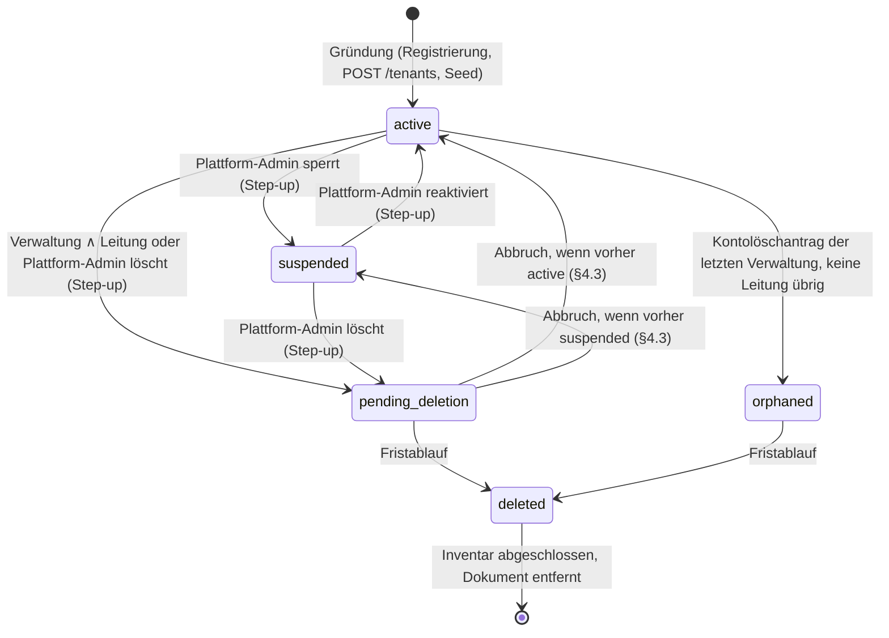

# Spezifikation: REQ-056 - Mandanten-Lebenszyklus & Kontingente

```yaml
ID: REQ-056
Titel: Mandanten-Lebenszyklus & Kontingente — Zustände, Suspendierungs-Semantik, Registrierungsmodus, Plan-Katalog mit Kontingenten, Mandanten-Export/-Import, Eigentum und Billing-Kontakt, Notfallverwaltung
Kategorie: Plattform & Betrieb
Fokus: Beides
Technologie: Python 3.14+, FastAPI, Celery, ArangoDB, TimescaleDB, Valkey, React 19, TypeScript 6, MUI 9
Status: Entwurf
Priorität: Mittel (Phase 4 des Multi-Tenant-/SaaS-Audits; Voraussetzung für Gate 3 „SaaS Ready“)
Version: 1.2 (Frontend für Plan-Katalog und Kontingente, AK-45 teilweise); 1.1 (Plan-Katalog und Kontingente umgesetzt, #2142); 1.0 (Erstfassung aus MT-050, #2143)
Datum: 2026-10-11
Tags: [tenant, lifecycle, suspension, quota, entitlements, plan, registration, export, import, key-remapping, owner, billing-contact, saas]
Abhängigkeit: REQ-023 v1.50 (Registrierungsmodus §3.2d, Step-up §3.9, Plattform-Admin §5a), REQ-024 v1.35 (Mandant, Zustände AK-52/AK-56/AK-65, Mitgliederlimit AK-64), REQ-025 v1.39 (Kontolöschung §3.1.3 Regel 2 und 4, Art.-15-Export), REQ-049 v1.14 (Rollen und Zusatzberechtigungen), REQ-031 v2.6 (KI-Tagesbudgets §3), REQ-034 v1.4 (Fotos je Pflanze), REQ-027 v1.8 (Light-Modus), NFR-011 v1.43 (R-01b, R-05, R-38, R-39, R-40), NFR-012 v1.2 (§10.3 Kontingente), NFR-013 v1.12 (Speicherkontingent §5.1, O-03)
Wird benötigt von: #2138 (Mandanten-Export/-Import, MT-042), #2142 (Plan → Entitlements, MT-049); künftig ein Billing-Modul (nicht spezifiziert)
Quelle: spec/analysis/multi-tenant-saas-readiness-audit-2026-10-04.md, Maßnahmen MT-050, MT-027, MT-007, MT-036, MT-049, MT-042, MT-038
```

### Changelog

| Version | Datum | Änderungen |
|---------|-------|-----------|
| 1.2 | 2026-10-11 | **Frontend zu §7 (§15, AK-45 teilweise):** Seite Admin › Pläne (`AdminPlansPage`, Route `admin/plans` hinter `RequirePlatformAdmin`, nur Full-Modus; DataTable mit Standard-Markierung und Anzahl Mandanten, Formular `PlanFormDialog` mit react-hook-form + Zod, `FormActions`, `UnsavedChangesGuard`; Löschen über `ConfirmDialog`, für den Default-Plan und genutzte Pläne gesperrt mit Begründung); Karte „Plan und Verbrauch“ auf der Admin-Seite eines Mandanten (`TenantPlanCard`: Planauswahl, Verbrauch je Dimension als Fortschrittsbalken, Plattform-Mandant und Mandant in `deleted` ohne Auswahl mit Begründung) und Eigentümer-Anzeige; Tab „Kontingente“ in den Garten-Einstellungen für jedes Mitglied (`TenantQuotaCard`); Fehlertexte DE/EN für `ORGANIZATION_LIMIT_REACHED`, `MEMBER_LIMIT_REACHED`, `SERVICE_ACCOUNT_LIMIT_REACHED`, `STORAGE_QUOTA_EXCEEDED`, `PHOTO_QUOTA_EXCEEDED`. Die UI hält `null` im Plan („wie Instanz-Einstellung“) und `0` („unbegrenzt“ bzw. „Budget aus“) auseinander und zeigt `0` nie als Zahl. Stand-Spalten in §2, §15, §16.7 und §20 nachgezogen. Offen in AK-45: Billing-Kontakt und Pflichtgrund beim Sperren (Backend fehlt, §5.3, §9.2). |
| 1.1 | 2026-10-11 | **#2142 (MT-049) umgesetzt:** §6.2 und §7 ohne Frontend. `Tenant.plan_key` (neue Mandanten erhalten den als Default markierten Plan), Collection `plans` mit dem fatalen Seed-Job `plans` aus `plans.yaml` (`standard`, alle Limits `null`; läuft bei jedem Start direkt nach den Migrationen), Migration `v0091` (stempelt `standard` auf jeden Mandanten ohne Plan, idempotent), `EntitlementService` (`limit`, `require`, `usage`, `ai_budget_limits`) als einzige Leserin der Settings aus §7.2 — Mitgliederlimit, Dienstkonten, Speicher, Fotos je Pflanze und `AiCallBudget` fragen nur noch ihn; `PlanService` und die Routen aus §7.6/§7.7; `TENANT_MAX_ORGANIZATIONS_PER_USER` mit `422 ORGANIZATION_LIMIT_REACHED`. Stand-Spalten in §2, §14, §16.2, §16.3, §16.6 und §20 nachgezogen. Abweichungen vom Entwurf: (1) kein eindeutiger Index auf `is_default` — „genau ein Default“ hält eine einzelne AQL-Anweisung (`make_default`), das Löschen prüft Nutzung und Default in derselben Anweisung (`delete_unused`); (2) kein Cache, der Plan wird bei jeder Prüfung frisch gelesen (§7.3 lässt beides zu); (3) zusätzlich zu `tenant_plan_changed`/`plan_changed` die Audit-Aktionen `plan_created` und `plan_deleted`; (4) `require` entscheidet die KI-Dimensionen nicht — sie bleiben Valkey-Zähler in `AiCallBudget`, das seine Grenzen über `ai_budget_limits` bezieht. Nach dem Security-Review: ein Plan-Dokument, das nicht validiert, gilt als fehlend (Log `entitlement.plan_invalid`, Rückfallkette), das Lesemodell ignoriert unbekannte Limit-Felder; Plan ändern und Plan zuordnen sind je eine AQL-Anweisung (die Zuordnung schreibt nur, solange der Plan existiert, und kollidiert mit seiner gleichzeitigen Löschung → `409`); `plan_changed` trägt für Limits alten und neuen Wert und markiert Aufhebungen (`to_unlimited`, `to_instance_setting`); jede Dimension hat eine Obergrenze; der Plattform-Mandant folgt immer den Instanzwerten und nimmt keinen Plan an (`422`). „`0` = unbegrenzt“ bei Speicher/Fotos/KI bleibt wie in §7.2 (überstimmbar), die Admin-Antwort listet solche Dimensionen in `unlimited`. Offen: Frontend (§15, AK-45). |
| 1.0 | 2026-10-11 | Erstfassung (#2143, MT-050). Bestandsaufnahme gegen `develop` @ `1fc021724` (§2): Zustände, Gnadenfrist, verwaiste Organisationen, Registrierungsmodus, Mitglieder-, Dienstkonto-, Speicher-, Foto- und KI-Limits sind umgesetzt und in REQ-023/REQ-024/REQ-025/REQ-031 spezifiziert; dieses Dokument führt sie zusammen, ohne sie zu duplizieren (§1.2). Neu spezifiziert: Hintergrundjobs eines nicht aktiven Mandanten (§5.2, fünf Beat-Aufgaben ohne Prüfung gemessen), Sperrgrund und Benachrichtigung (§5.3/§5.4), Abbruch einer Löschung stellt den Zustand **vor** der Löschung her (§4.3, gemessener Ausweg aus einer Sperre), Plan-Katalog mit Default-Plan `standard` = heutige Grenzen (§7, Betreiberentscheidung), Mandanten-Export und -Import mit Schlüssel-Neuvergabe (§8), Eigentümerwechsel und Billing-Kontakt mit Step-up (§9), Billing nur als dokumentierter Anknüpfungspunkt (§11). 45 Abnahmekriterien (§16), 10 überstimmbare Entscheidungen (§19). Folgeänderungen: REQ-023 v1.50, REQ-024 v1.35, REQ-025 v1.39, NFR-011 v1.43, NFR-012 v1.2 (§10.3 neu), NFR-013 v1.12 (O-03 beantwortet). |

---

## Inhalt

1. Zweck und Einordnung · 2. Ausgangslage (gemessen) · 3. Begriffe · 4. Lebenszyklus · 5. Suspendierungs-Semantik · 6. Registrierung und Gründung · 7. Plan-Katalog und Kontingente · 8. Mandanten-Export und -Import · 9. Eigentum und Billing-Kontakt · 10. Notfallverwaltung · 11. Billing-Anknüpfungspunkt · 12. Sicherheit und Datenschutz · 13. Datenmodell · 14. API-Übersicht · 15. Frontend · 16. Abnahmekriterien · 17. Abhängigkeiten · 18. Scope-Abgrenzung · 19. Entscheidungen und offene Punkte · 20. Umsetzungsreihenfolge

---

## 1. Zweck und Einordnung

### 1.1 Business Case

Kamerplanter wird heute als Self-Hosted-Installation für einen Haushalt, einen Gemeinschaftsgarten oder einen Verein betrieben; ein geteilter Betrieb für viele fremde Mandanten ist vorbereitet, aber nicht geregelt. Das Audit vom 2026-10-04 (REQ-09) stellt fest: Kein Requirement beschreibt, **in welchen Zuständen** ein Mandant sein kann und was jeder Zustand bewirkt, **wie viel** ein Mandant nutzen darf, **wer** für einen Mandanten gegenüber dem Betreiber steht und **wie** ein Mandant als Ganzes gesichert oder umgezogen wird. Solche Entscheidungen landeten bisher einzeln im Code.

**User Stories**

- Als **Betreiberin** einer Installation will ich einen Mandanten sperren können, der gegen die Nutzungsregeln verstößt, und mich darauf verlassen, dass ab der nächsten Anfrage niemand mehr hineinkommt und keine Aufgaben, Benachrichtigungen oder Synchronisationen mehr für ihn laufen.
- Als **Betreiber** will ich festlegen, wie viel Speicher, wie viele Mitglieder und wie viele KI-Anfragen ein Mandant hat — für alle gleich über einen Standardplan, für einzelne Mandanten abweichend über einen eigenen Plan —, ohne dafür Umgebungsvariablen zu ändern und die Installation neu zu starten.
- Als **Leitung eines Gemeinschaftsgartens mit Verwaltungsrecht** will ich den ganzen Garten exportieren, bevor wir die Installation wechseln, und ihn in der neuen Installation wieder einspielen lassen.
- Als **Gründer eines Vereinsgartens** will ich die Verantwortung für den Garten an die neue Vorsitzende übergeben, und der Betreiber soll wissen, wen er bei Fragen zum Garten anschreibt.
- Als **Mitglied** will ich erfahren, wenn mein Garten gesperrt wurde, statt ihn kommentarlos aus meiner Auswahl verschwinden zu sehen.

### 1.2 Verhältnis zu anderen Dokumenten (Vorrangregel)

Dieses Dokument ist der **eine Ort** für den Lebenszyklus eines Mandanten und für Kontingente. Teile davon sind bereits umgesetzt und in anderen Dokumenten beschrieben; dort bleiben die Detailregeln stehen, hier steht die Zusammenführung:

| Thema | Detailregel (normativ) | Hier |
|---|---|---|
| Zustände, Gnadenfrist, Abbruch | REQ-024 AK-52, AK-53, AK-65; NFR-011 R-01b | §4 (Übersicht, neue Regel §4.3) |
| Sperre durch Plattform-Admin | REQ-024 AK-48, AK-56; REQ-023 §5a.5 | §5 (Wirkung auf Hintergrundjobs, Sperrgrund, Benachrichtigung — **neu**) |
| Verwaiste Organisation | REQ-025 §3.1.3 Regel 4; REQ-024 AK-65 | §10 (Übersicht) |
| Registrierungsmodus | REQ-023 §3.2d | §6 (Übersicht, Gründungslimit — **neu**) |
| Mitgliederlimit | REQ-024 AK-64 | §7 (als Plan-Dimension) |
| Dienstkonto-Limit | REQ-023 §5b, REQ-024 v1.27 | §7 (als Plan-Dimension) |
| Speicherkontingent | NFR-013 §5.1 Schritt 3 | §7 (als Plan-Dimension); NFR-012 §10.3 |
| Fotos je Pflanze | REQ-034 §3 | §7 (als Plan-Dimension) |
| KI-Tagesbudgets | REQ-031 §3 | §7 (als Plan-Dimension) |
| Plan-Katalog, Export/Import, Eigentum, Billing-Kontakt | — | §7, §8, §9, §11 (**neu**) |

Widersprechen sich dieses Dokument und eine Detailregel, gilt bis zur Angleichung die Detailregel für das **umgesetzte** Verhalten und dieses Dokument für das **neue** Verhalten; der Widerspruch ist ein Defekt beider Dokumente.

---

## 2. Ausgangslage (gemessen an `develop` @ `1fc021724`, 2026-10-11)

Alle Pfade relativ zu `src/backend/app/`.

| Thema | Ist | Fundstelle | Stand |
|---|---|---|---|
| Zustandsmodell | `Tenant.status: TenantStatus` mit `active`, `suspended`, `pending_deletion`, `orphaned`, `deleted`; `is_active` ist daraus abgeleitet (Migration `v0085`) | `common/enums.py` (`TenantStatus`), `domain/models/tenant.py` | umgesetzt (#2123) |
| Auflösung | Nur `active` löst auf; Pfad, Header `X-Active-Tenant`, MCP und tenant-gebundener API-Schlüssel antworten wie für einen unbekannten Kurznamen | `common/auth.py`, `tests/integration/test_inactive_tenant_resolution_reach.py` | umgesetzt (#2105) |
| Gnadenfrist | `RETENTION_TENANT_ERASURE_GRACE_DAYS` (Default 90, Untergrenze 0, Obergrenze 90); Abbruch `POST /tenants/{slug}/erasure/cancel` | `config/settings.py`, `domain/services/tenant_service.py` (`cancel_tenant_erasure`) | umgesetzt (#2123) |
| Abbruch nach gesperrtem Zustand | Der Abbruch setzt **immer** `active` (`_set_tenant_status(tenant_key, TenantStatus.ACTIVE, None)`); `delete_tenant` prüft den Zustand nicht. Ein Plattform-Admin plant die Löschung eines **gesperrten** Mandanten → dessen Verwaltung bricht über die nicht am Resolver hängende Abbruch-Route ab → der Mandant ist `active` | `domain/services/tenant_service.py` (`delete_tenant`, `cancel_tenant_erasure`) | **Defekt**, §4.3 |
| Beats bei nicht aktivem Mandanten | `ActiveTenants` (`tasks/tenant_gate.py`) wird von Pflege-, Gieß-, Benachrichtigungs- (außer Digest), Frost- und drei Tank-Aufgaben gefragt. **Nicht** gefragt wird er von `check_tank_alerts`, `send_email_digests`, `ingest_ha_readings`, `fetch_weather_forecasts`, `inventree.sync_stock_levels`, `inventree.push_pending_transactions` | `tasks/*.py`, `tasks/__init__.py` (`beat_schedule`) | **Lücke**, §5.2 |
| Sperrgrund, Benachrichtigung | Kein Sperrgrund; Mitglieder erfahren von einer Sperre nichts | `api/v1/admin/platform/schemas.py` (`AdminTenantUpdate`) | fehlt, §5.3/§5.4 |
| Verwaiste Organisation | Kontolöschantrag der letzten Verwaltung: dienstälteste Leitung übernimmt, sonst `orphaned` mit Löschfrist; kein Notfall-Admin | `domain/services/tenant_service.py` (`settle_organisations_of_erased_account`) | umgesetzt (#2134, #2166) |
| Registrierungsmodus | `REGISTRATION_MODE` (`open`/`invite_only`/`closed`) und `REGISTRATION_ALLOWED_DOMAINS` | `config/settings.py`, REQ-023 §3.2d | umgesetzt (#2132) |
| Organisationen je Konto | Fest **10** im Code (`TenantEngine.can_create_organization(existing_org_count, max_orgs=10)`), gezählt über `owner_user_key`; Ablehnung als allgemeiner Validierungsfehler | `domain/engines/tenant_engine.py`, `tenant_service.py` (`create_organization`) | hartkodiert, §6.2 — seit v1.1 Setting `TENANT_MAX_ORGANIZATIONS_PER_USER` (#2142) |
| Mitgliederlimit | `min(max_members, TENANT_MAX_MEMBERS_CEILING)` (Default 50), `422 MEMBER_LIMIT_REACHED` | REQ-024 AK-64 | umgesetzt (#2133) |
| Dienstkonten je Mandant | `TENANT_MAX_SERVICE_ACCOUNTS` (Default 20), `422 SERVICE_ACCOUNT_LIMIT_REACHED` | `config/settings.py` | umgesetzt (#2137) |
| Speicher je Mandant | `STORAGE_TENANT_QUOTA_MB` (Default 2048, `0` = unbegrenzt), `409 STORAGE_QUOTA_EXCEEDED` | `domain/services/attachment_service.py` | umgesetzt |
| Fotos je Pflanze | `STORAGE_MAX_PHOTOS_PER_INSTANCE` (Default 50, `0` = unbegrenzt), `409 PHOTO_QUOTA_EXCEEDED` | `domain/services/plant_photo_service.py` | umgesetzt |
| KI-Tagesbudgets | `AI_BUDGET_USER_CALLS_PER_DAY` (50), `AI_BUDGET_TENANT_CALLS_PER_DAY` (500), `AI_BUDGET_TENANT_TOKENS_PER_DAY` (2 000 000), `429 AI_BUDGET_EXCEEDED` | `domain/services/ai_call_budget.py` | umgesetzt (#2110) |
| Plan, Entitlements | Kein `plan_key`, keine Plan-Collection, kein Entitlement-Dienst; jede Grenze liest ihr Setting selbst | — | fehlt, §7 (#2142) — seit v1.1 umgesetzt, Frontend seit v1.2: `domain/services/entitlement_service.py`, `domain/services/plan_service.py`, `migrations/versions/v0091_tenant_plan_key.py` |
| Mandanten-Export | Kein Export eines ganzen Mandanten; `AttachmentCategory.TENANT_EXPORT` ist deklariert und ungenutzt; `_key` wird je Collection von ArangoDB vergeben | `common/enums.py`, `data_access/arango/base_repository.py` | fehlt, §8 (#2138) |
| Eigentum | `owner_user_key` verleiht kein Recht (REQ-049), zählt aber für das Organisationslimit des Kontos; kein Wechsel möglich; bei Kontolöschung wird er anonymisiert | `domain/engines/erasure_engine.py`, `domain/engines/membership_engine.py` | fehlt, §9 |
| Billing-Kontakt | existiert nicht | — | fehlt, §9 |
| Kontingent-Anzeige im Admin-Panel | Die Anwenderdoku nennt „Mandanten-Kontingente und Limits einsehen“; die Admin-Seite eines Mandanten zeigt weder Plan noch Verbrauch | `src/frontend/src/pages/admin/AdminEditTenantPage.tsx` | fehlt, §15 — seit v1.2 umgesetzt: Karte „Plan und Verbrauch“ (`components/admin/TenantPlanCard.tsx`) |

---

## 3. Begriffe

| Begriff | Bedeutung |
|---|---|
| **Zustand** | Genau einer der Werte von `TenantStatus` (§4). |
| **Sperre / Suspendierung** | Zustand `suspended`, gesetzt und aufgehoben nur von einem Plattform-Admin. Umkehrbar, nichts wird gelöscht. |
| **Plan** | Benannter Satz von Kontingenten, global (nicht mandantenbezogen), vom Plattform-Admin gepflegt. Jeder Mandant verweist auf genau einen Plan (`plan_key`). |
| **Dimension** | Eine begrenzte Größe, z. B. Mitglieder oder Speicher in MB (§7.2). |
| **Instanzwert** | Der Wert, den das zugehörige Setting (Umgebungsvariable) heute liefert. Ein Plan-Eintrag `null` bedeutet „Instanzwert“. |
| **Wirksames Limit** | Das Limit, das eine Prüfung tatsächlich anwendet (§7.3). |
| **Eigentümer** | `owner_user_key`: das Konto, das gegenüber dem Betreiber für eine Organisation steht. Verleiht **kein** Recht im Mandanten (REQ-049 §2). |
| **Billing-Kontakt** | `billing_contact_user_key`: das Konto, das der Betreiber zu Kontingent- und künftigen Abrechnungsfragen anschreibt. Default = Eigentümer. Verleiht kein Recht. |
| **Mandanten-Export** | Ein Archiv aller Daten eines Mandanten (§8), zu unterscheiden vom persönlichen Art.-15-Export eines Kontos (REQ-025). |

---

## 4. Lebenszyklus

### 4.1 Zustände

| Zustand | Bedeutung | Löst auf | Beats für den Mandanten | Daten |
|---|---|---|---|---|
| `active` | in Nutzung | ja | laufen | unverändert |
| `suspended` | vom Plattform-Admin gesperrt | nein (wie unbekannter Kurzname) | laufen **nicht** (§5.2) | unverändert |
| `pending_deletion` | Löschung geplant, Gnadenfrist läuft | nein | laufen nicht | unverändert, Mitgliedschaften aktiv gespeichert |
| `orphaned` | Organisation ohne Verwaltung nach Kontolöschantrag, Gnadenfrist läuft | nein | laufen nicht | unverändert |
| `deleted` | Frist abgelaufen, Löschinventar läuft | nein | laufen nicht | wird gelöscht bzw. pseudonymisiert (REQ-024 AK-16) |

### 4.2 Übergänge



| Übergang | Wer | Route | Step-up | Audit (`security_audit_log`) | Stand |
|---|---|---|---|---|---|
| `active` ↔ `suspended` | Plattform-Admin | `PATCH /admin/platform/tenants/{key}` (`is_active`) | ja (`admin_tenant_update`) | `tenant_suspended` / `tenant_reactivated` | umgesetzt |
| `active` → `pending_deletion` | Verwaltung ∧ Leitung | `DELETE /tenants/{slug}` | ja (`tenant_deletion`) | `tenant_deletion_requested` | umgesetzt |
| `active`/`suspended` → `pending_deletion` | Plattform-Admin | `DELETE /admin/platform/tenants/{key}` | ja (`tenant_deletion`) | `tenant_deletion_requested` | umgesetzt |
| `active` → `orphaned` | System (Kontolöschantrag) | `POST /privacy/erasure`, `DELETE /users/me` | (der des Antrags) | `membership_*` mit `via=account_erasure` | umgesetzt |
| `pending_deletion` → vorheriger Zustand | Verwaltung ∧ Leitung oder Plattform-Admin | `POST /tenants/{slug}/erasure/cancel` | ja (`tenant_erasure_cancel`) | `tenant_deletion_cancelled` | umgesetzt nur nach `active`; §4.3 |
| `pending_deletion`/`orphaned` → `deleted` | Beat `resume_tenant_erasures` | — | — | — | umgesetzt |

Der Plattform-Mandant (`platform`) und der einzige Mandant einer Light-Installation werden weder gesperrt noch gelöscht (umgesetzt, `403`).

### 4.3 Abbruch stellt den Zustand vor der Löschung her (neu)

Gemessen (§2): Der Abbruch einer geplanten Löschung setzt den Mandanten immer auf `active`. Plant ein Plattform-Admin die Löschung eines gesperrten Mandanten, kann dessen Verwaltung die Löschung abbrechen — die Abbruch-Route hängt absichtlich nicht am Slug-Resolver, und die Berechtigung wird aus der gespeicherten Mitgliedschaft bewiesen — und hat danach einen **entsperrten** Mandanten. Die Sperre ist damit umgehbar.

**Regel.** Beim Planen einer Löschung wird der bisherige Zustand in `status_before_deletion` festgehalten (`active` oder `suspended`). Der Abbruch stellt **diesen** Zustand her. Ein Abbruch, der einen gesperrten Mandanten zurückgibt, ist für die Verwaltung des Mandanten erlaubt (sie verhindert damit den Datenverlust), ändert an der Sperre aber nichts; nur ein Plattform-Admin hebt sie auf. Für bestehende Datensätze ohne `status_before_deletion` gilt `active` (das Verhalten vor dieser Regel).

---

## 5. Suspendierungs-Semantik

### 5.1 Zugriffe (umgesetzt)

Ein Mandant in einem anderen Zustand als `active` ist für jedes Mitglied, jeden API-Schlüssel und jeden MCP-Client gesperrt: Pfad `/api/v1/t/{slug}/…`, Header `X-Active-Tenant`, MCP-Mandantenliste und ein auf den Mandanten gescopter API-Schlüssel antworten wie für einen unbekannten Kurznamen (`403` mit derselben Meldung, kein Existenz-Orakel, REQ-024 AK-48). Sitzungen der Mitglieder bleiben bestehen und wirken in ihren anderen Mandanten weiter. Einladungen in einen nicht aktiven Mandanten lassen sich nicht annehmen (`422`, REQ-024 AK-07). Der Plattform-Admin sieht und verwaltet den Mandanten weiter im Admin-Bereich.

Für den Weg über einen tenant-gebundenen API-Schlüssel fehlt ein eigener Negativtest (REQ-024 AK-56); er ist hier als AK-04 gefordert.

### 5.2 Hintergrundjobs (neu)

**Regel.** Eine periodische Aufgabe, die **in** einen Mandanten schreibt (Aufgaben, Messwerte, Wetterdaten, Bestände) oder **über** einen Mandanten benachrichtigt, lässt jeden nicht aktiven Mandanten aus. Sie fragt dafür den gespeicherten Mandanten (`ActiveTenants`, `tasks/tenant_gate.py`), nicht die Mitgliedschaft — die bleibt in `suspended` und `pending_deletion` absichtlich aktiv.

**Weiter laufen** für einen nicht aktiven Mandanten: Aufbewahrung und Löschung (`retention.*`, `tenant_tasks.resume_tenant_erasures`, `security_audit.purge_expired`), Speicher-Rekonziliation (`storage_tasks.*`), Ablauf von Einladungen und Exporten sowie globale Katalogaufgaben ohne Mandantenbezug (Anreicherung, Wissensbasis, OIDC-Discovery). Diese Aufgaben dürfen einen gesperrten Mandanten nicht auslassen: Fristen nach NFR-011 laufen auch in einer Sperre ab.

**Klassifikation (Pflicht).** Jeder Eintrag im `beat_schedule` (`tasks/__init__.py`) ist in genau einer deklarierten Liste geführt: `TENANT_WRITING_BEATS` (muss `ActiveTenants` fragen) oder `TENANT_AGNOSTIC_BEATS` (läuft unabhängig vom Zustand, mit Begründung). Ein Guard-Test schlägt fehl, wenn ein Beat in keiner Liste steht, und — für jede Aufgabe aus `TENANT_WRITING_BEATS` — wenn ein nicht aktiver Mandant in ihrem Lauf etwas erhält.

Gemessener Rückstand (§2), der mit dieser Regel geschlossen wird:

| Beat | Wirkung heute bei gesperrtem Mandanten |
|---|---|
| `tank_maintenance_tasks.check_tank_alerts` | Tank-Warnungen an Mitglieder |
| `notifications.send_email_digests` | stellt Benachrichtigungen der letzten 24 Stunden zu, auch solche über den Mandanten, die vor der Sperre entstanden sind (filtert weder Mandant noch Zustand) |
| `sensor_ingestion_tasks.ingest_ha_readings` | Home-Assistant-Messwerte werden weiter geschrieben |
| `weather_tasks.fetch_weather_forecasts` | Wetterdaten werden weiter geholt und geschrieben (Kontingent externer Anbieter) |
| `inventree.sync_stock_levels`, `inventree.push_pending_transactions` | Synchronisation mit InvenTree läuft weiter |

Eine bereits eingereihte, nicht periodische Aufgabe (z. B. eine Bildanalyse), die nach der Sperre startet, prüft den Zustand ebenfalls, bevor sie in den Mandanten schreibt; eine laufende wird nicht abgebrochen.

### 5.3 Sperrgrund (neu)

Beim Sperren gibt der Plattform-Admin einen **Grund** an: `suspension_reason: Literal['abuse', 'legal', 'non_payment', 'operator_request', 'other']` (Pflicht beim Sperren, `422` ohne) und optional eine Notiz `suspension_note` (höchstens 500 Zeichen). Beides steht am Mandanten-Dokument, ist nur im Admin-Bereich sichtbar und wird beim Reaktivieren geleert. Der Audit-Eintrag `tenant_suspended` trägt den Code, nie die Notiz (die Notiz kann personenbezogene Angaben enthalten und lebt deshalb nur so lange wie der Mandant, nicht 730 Tage im Audit, NFR-011 R-38). `non_payment` setzt kein Billing voraus; der Betreiber vermerkt damit einen außerhalb von Kamerplanter festgestellten Grund.

### 5.4 Benachrichtigung (neu)

Beim Sperren und beim Reaktivieren erhält jedes aktive menschliche Mitglied eine E-Mail: „Dein Garten ‚{Name}‘ wurde vom Betreiber vorübergehend gesperrt“ bzw. „… ist wieder verfügbar“, mit dem Hinweis, dass die Daten erhalten bleiben und der persönliche Datenexport weiter möglich ist. Weder Code noch Notiz werden genannt. Ein persönlicher Mandant wird nicht mit Namen genannt (sein Name ist der Anzeigename des Eigentümers; dieselbe Regel wie bei der Benachrichtigung über eine geplante Mandantenlöschung, #1824). Die Mail ist kein Existenz-Orakel: Sie geht nur an Mitglieder, die den Mandanten kennen. Zustellung *best effort* — ein Mailfehler macht die Sperre nicht rückgängig.

### 5.5 Was eine Sperre nicht berührt

- **Betroffenenrechte** der Mitglieder (REQ-025): Auskunft, persönlicher Export, Berichtigung und Kontolöschung laufen über das Konto (`/api/v1/privacy/…`) und bleiben in einer Sperre möglich. Der persönliche Export enthält nur, was REQ-025 §3.1.2 ihm zuordnet.
- **Kontingente**: Ein gesperrter Mandant zählt weiter für das Organisationslimit seines Eigentümers (§6.2) und belegt seinen Speicher.
- **Löschung**: Nur ein Plattform-Admin kann die Löschung eines gesperrten Mandanten planen (die Route der Verwaltung hängt am Resolver); §4.3 gilt für den Abbruch.

---

## 6. Registrierung und Gründung

### 6.1 Registrierungsmodus (umgesetzt, REQ-023 §3.2d)

`REGISTRATION_MODE` (`open` · `invite_only` · `closed`, Default `open`) und `REGISTRATION_ALLOWED_DOMAINS` entscheiden, wer ein Konto anlegen darf — lokal und bei der ersten OIDC-Anmeldung. Eine passende E-Mail-Einladung ist die Ausnahme von `invite_only` und der Domain-Liste, nicht von `closed`. Jede Ablehnung ist `403 REGISTRATION_NOT_ALLOWED` mit einer Meldung. Bestehende Konten melden sich in jedem Modus an. Light-Modus: `closed`. Dieses Dokument ändert daran nichts.

Jede neue Registrierung erzeugt den persönlichen Mandanten des Kontos; er erhält den Default-Plan (§7.1).

### 6.2 Organisationen je Konto (neu)

Das hartkodierte Limit von zehn Organisationen je Eigentümer wird ein Setting: `TENANT_MAX_ORGANIZATIONS_PER_USER` (Default `10`, `ge=0`). `0` bedeutet: Kein Konto gründet selbst Organisationen über `POST /tenants`; Organisationen entstehen dann nur durch den Plattform-Admin (geschlossener Betrieb, ergänzt `REGISTRATION_MODE=closed`). Gezählt werden Organisationen mit `owner_user_key` des Kontos in jedem Zustand außer `deleted`. Ablehnung: `422 ORGANIZATION_LIMIT_REACHED` (bisher ein allgemeiner Validierungsfehler; der Code ändert sich, der Status nicht). Ein Plattform-Admin, der eine Organisation anlegt, ist an das Limit nicht gebunden.

Das Limit hängt am **Konto**, nicht an einem Mandanten; es ist deshalb keine Plan-Dimension (§19, E-04). Der Eigentümerwechsel (§9.1) prüft es für das empfangende Konto.

---

## 7. Plan-Katalog und Kontingente

### 7.1 Plan

Ein **Plan** ist ein globales Dokument (Collection `plans`, nicht mandantenbezogen) mit einem Schlüssel, einem Namen und einem Satz von Kontingenten (§7.2). Jeder Mandant verweist mit `plan_key` auf genau einen Plan.

- **Default-Plan `standard`** (Betreiberentscheidung, #2143): wird geseedet, ist der Default jedes neuen Mandanten, kann umbenannt, aber nicht gelöscht werden. Alle seine Kontingente stehen auf `null` = Instanzwert. Er verhält sich damit **genau wie heute**, einschließlich jeder Grenze, die ein Betreiber per Umgebungsvariable gesetzt hat.
- Die Migration setzt `plan_key = "standard"` auf jedem bestehenden Mandanten, auch dem Plattform-Mandanten.
- Weitere Pläne legt **nur der Plattform-Admin** an (§7.6). Es gibt keine Preise, keine Laufzeiten, keine Testphasen (§11, §18).
- Ein Plan kennt in dieser Fassung **nur Kontingente**, keine Feature-Freischaltungen. Welche Module ein Mandant sieht, regelt weiter REQ-042 (§19, E-05).

### 7.2 Dimensionen

| Dimension (`limits.<name>`) | Bedeutung | Instanzwert (Setting, Default) | Wertebereich im Plan | Durchgesetzt in | Ablehnung (unverändert) |
|---|---|---|---|---|---|
| `members` | aktive Mitgliedschaften eines Mandanten (inkl. Dienstkonten) | `TENANT_MAX_MEMBERS_CEILING` (50) | `null` oder 1 … Obergrenze | Einladungsannahme, Admin-Hinzufügen, Dienstkonto anlegen; der OIDC-Auto-Join überspringt einen vollen Mandanten still (REQ-024 AK-09) | `422 MEMBER_LIMIT_REACHED` |
| `service_accounts` | aktive Dienstkonten eines Mandanten | `TENANT_MAX_SERVICE_ACCOUNTS` (20) | `null` oder ≥ 1 | Dienstkonto anlegen | `422 SERVICE_ACCOUNT_LIMIT_REACHED` |
| `storage_mb` | Summe der Anhang-Bytes eines Mandanten | `STORAGE_TENANT_QUOTA_MB` (2048) | `null` oder ≥ 0 (`0` = unbegrenzt) | Upload-Pipeline Schritt 3 (NFR-013 §5.1) | `409 STORAGE_QUOTA_EXCEEDED` |
| `photos_per_instance` | Galeriefotos je Pflanze | `STORAGE_MAX_PHOTOS_PER_INSTANCE` (50) | `null` oder ≥ 0 (`0` = unbegrenzt) | Foto-Upload (REQ-034) | `409 PHOTO_QUOTA_EXCEEDED` |
| `ai_calls_per_user_day` | KI-Aufrufe eines Kontos im Mandanten je UTC-Tag | `AI_BUDGET_USER_CALLS_PER_DAY` (50) | `null` oder ≥ 0 (`0` = aus) | `AiCallBudget` (REQ-031 §3) | `429 AI_BUDGET_EXCEEDED` |
| `ai_calls_per_tenant_day` | KI-Aufrufe aller Mitglieder je UTC-Tag | `AI_BUDGET_TENANT_CALLS_PER_DAY` (500) | `null` oder ≥ 0 (`0` = aus) | `AiCallBudget` | `429 AI_BUDGET_EXCEEDED` |
| `ai_tokens_per_tenant_day` | LLM-Tokens des Mandanten je UTC-Tag | `AI_BUDGET_TENANT_TOKENS_PER_DAY` (2 000 000) | `null` oder ≥ 0 (`0` = aus) | `AiCallBudget` | `429 AI_BUDGET_EXCEEDED` |

„`0` = aus“ bei den KI-Budgets heißt wie heute: Das Budget ist abgeschaltet (keine Begrenzung durch dieses Budget). Ein Plan, der KI für einen Mandanten sperren soll, ist damit nicht ausdrückbar; KI-Sichtbarkeit regeln REQ-031/REQ-042.

Die Ablehnungscodes und HTTP-Status bleiben je Dimension, wie sie heute sind (kein `402`, kein neuer Sammelcode) — Clients, Doku und Tests hängen an ihnen (§19, E-06).

**Nicht** Plan-Dimension in dieser Fassung (Audit MT-049 nannte sie): `organizations_per_user` (Konto-Limit, §6.2), `sensors` und `api_keys` (heute ohne jede Grenze; eine neue Grenze ist eine eigene Entscheidung mit eigener Messung).

### 7.3 Wirksames Limit

```text
wirksam(mandant, d) = plan(mandant).limits[d]  falls nicht null
                      instanzwert(d)           sonst
wirksam(mandant, members) = min(mandant.max_members, plan.limits.members ?? CEILING, CEILING)
```

- `TENANT_MAX_MEMBERS_CEILING` bleibt die harte Obergrenze für Mitglieder; ein Plan mit `members` über der Obergrenze wird beim Speichern abgelehnt (`422`). `max_members` am Mandanten bleibt die mandanteneigene, niedrigere Grenze (REQ-024 AK-64).
- Für alle anderen Dimensionen darf ein Plan über dem Instanzwert liegen: Der Instanzwert ist der Default, keine Obergrenze.
- Die Prüfung liest den Plan bei jeder Entscheidung frisch (oder aus einem Cache mit höchstens 60 s Lebensdauer, der beim Plan-Wechsel und beim Ändern des Plans invalidiert wird).
- Fehlt der referenzierte Plan (Datenfehler), gilt der Default-Plan und ein Log-Ereignis `entitlement.plan_missing` wird geschrieben; die Prüfung öffnet nie auf „unbegrenzt“.

### 7.4 `EntitlementService` (eine Quelle)

Alle Prüfungen der Dimensionen aus §7.2 laufen über **einen** Dienst in der Business-Schicht:

```python
class EntitlementService:
    def limit(self, tenant_key: str, dimension: EntitlementDimension) -> int | None:
        """Wirksames Limit (§7.3); ``None`` = unbegrenzt."""

    def require(self, tenant_key: str, dimension: EntitlementDimension, *, projected: int) -> None:
        """Wirft die dimensionsspezifische Ablehnung aus §7.2, wenn ``projected`` das Limit überschreitet."""

    def usage(self, tenant_key: str, *, user_key: str | None = None) -> list[EntitlementUsage]:
        """Limit und Verbrauch je Dimension für die Anzeige (§7.7)."""
```

- Die heutigen Prüfstellen (Mitgliederlimit in `TenantService`, Dienstkonten, `AttachmentService`, `PlantPhotoService`, `AiCallBudget`) lesen ihr Limit nur noch über `EntitlementService.limit`/`require`; ihre Zählweise (vor und nach dem Einfügen, Valkey-Zähler je UTC-Tag) bleibt unverändert.
- **Guard:** Kein Modul unter `app/` außer `EntitlementService` und `config/settings.py` liest die Settings aus §7.2 (`tenant_max_members_ceiling`, `tenant_max_service_accounts`, `storage_tenant_quota_mb`, `storage_max_photos_per_instance`, `ai_budget_*`). Ein AST-Guard-Test hält das fest (AK-19).
- `EntitlementService` liegt in `domain/services/`, kennt das Plan-Repository über ein Interface (NFR-001) und ist im Light-Modus derselbe Dienst.

### 7.5 Senken eines Limits und Planwechsel

Ein niedrigeres Limit — durch Planwechsel oder Ändern eines Plans — **entfernt nichts**: Ein Mandant über seinem neuen Limit behält Mitglieder, Dienstkonten, Dateien und Fotos; abgelehnt wird erst die nächste Anlage (Regel aus REQ-024 AK-64 und `TENANT_MAX_SERVICE_ACCOUNTS`, auf alle Dimensionen ausgedehnt). Ein Planwechsel wirkt ab der nächsten Prüfung; der KI-Zähler des laufenden UTC-Tages wird nicht zurückgesetzt.

### 7.6 Pflege durch den Plattform-Admin

| Aktion | Route | Regeln |
|---|---|---|
| Pläne listen | `GET /admin/platform/plans` | mit Anzahl zugeordneter Mandanten |
| Plan anlegen | `POST /admin/platform/plans` | `key` `^[a-z][a-z0-9_-]{1,39}$`, eindeutig (`409`); `name` 1–100 Zeichen; Limits nach §7.2 (`422` außerhalb) |
| Plan ändern | `PATCH /admin/platform/plans/{plan_key}` | `key` unveränderlich; wirkt für alle zugeordneten Mandanten (§7.5) |
| Plan löschen | `DELETE /admin/platform/plans/{plan_key}` | `409`, solange ein Mandant ihn nutzt oder er der Default ist |
| Default festlegen | `PATCH /admin/platform/plans/{plan_key}` mit `is_default: true` | genau ein Default; der bisherige verliert die Markierung in derselben Transaktion |
| Plan zuordnen | `PATCH /admin/platform/tenants/{key}` mit `plan_key` | unbekannter Plan `422`; auch für gesperrte Mandanten; nicht in `deleted` |

Kein Step-up für diese Aktionen (sie sperren niemanden aus und löschen nichts, §7.5; §19, E-07). Jede Zuordnung und jede Änderung eines Plans schreibt einen Audit-Eintrag (`tenant_plan_changed` mit `from_plan`/`to_plan`; `plan_changed` mit den geänderten Dimensionen, ohne Werte anderer Felder). Mandanten-Verwaltungen können ihren Plan **nicht** selbst wählen.

### 7.7 Anzeige von Plan und Verbrauch

`GET /tenants/{slug}/entitlements` (jedes Mitglied; Lesen ist für jedes Mitglied offen, REQ-024 §1a) liefert:

```json
{
  "plan": {"key": "standard", "name": "Standard"},
  "limits": [
    {"dimension": "members", "limit": 50, "used": 12},
    {"dimension": "storage_mb", "limit": 2048, "used": 731},
    {"dimension": "photos_per_instance", "limit": 50, "used": null},
    {"dimension": "ai_calls_per_user_day", "limit": 50, "used": 3},
    {"dimension": "ai_calls_per_tenant_day", "limit": 500, "used": 41}
  ]
}
```

`limit: null` = unbegrenzt; `used: null` = je Pflanze, nicht je Mandant gezählt. `ai_calls_per_user_day.used` ist der Verbrauch des **anfragenden** Kontos, nie der eines anderen Mitglieds. `service_accounts` und `ai_tokens_per_tenant_day` sieht nur, wer Leitung ist (Dienstkonten verwalten Leitung ∧ Technik, REQ-049 v1.12; Token-Zahlen sind eine Betriebsgröße). Der Plattform-Admin erhält dieselbe Struktur für jeden Mandanten über `GET /admin/platform/tenants/{key}` (Feld `entitlements`).

### 7.8 Light-Modus

Im Light-Modus gibt es keine Admin-Routen; der einzige Mandant hat den Plan `standard`, und alle Grenzen sind die Instanzwerte — wie heute.

---

## 8. Mandanten-Export und -Import

### 8.1 Zweck

1. **Sicherung und Umzug** eines Mandanten durch seine Verwaltung (Installation wechseln, Shared → Dedicated).
2. **Einzel-Wiederherstellung** eines Mandanten durch den Plattform-Admin, ohne die gemeinsame Datenbank zurückzuspielen (das Chart-Backup sichert nur die ganze Datenbank, NFR-002 §8.0).
3. **Exportfenster in der Gnadenfrist**: Die Verwaltung kann den Mandanten während `pending_deletion` noch exportieren.

Der Mandanten-Export ersetzt **nicht** den persönlichen Art.-15/Art.-20-Export eines Kontos (REQ-025); er ist eine Funktion der Mandantenverwaltung.

### 8.2 Wer, wann

| Aktion | Wer | Zustände | Route | Step-up |
|---|---|---|---|---|
| Export anfordern | Verwaltung ∧ Leitung, menschliches Konto, kein API-Schlüssel | `active`, `pending_deletion` | `POST /tenants/{slug}/exports` (nicht am Slug-Resolver, Berechtigung aus der gespeicherten Mitgliedschaft wie beim Löschabbruch) | ja (`tenant_export`, an den Mandantenschlüssel gebunden) |
| Export anfordern | Plattform-Admin | alle außer `deleted` | `POST /admin/platform/tenants/{key}/exports` | ja (`tenant_export`) |
| Exporte listen / herunterladen | wer ihn angefordert hat | solange nicht abgelaufen | `GET /tenants/{slug}/exports`, `GET /tenants/{slug}/exports/{export_key}/download` bzw. die Admin-Entsprechungen | nein |
| Import | nur Plattform-Admin | erzeugt immer einen **neuen** Mandanten | `POST /admin/platform/tenant-imports` | ja (`tenant_import`) |

Export und Import gibt es nicht als MCP-Werkzeug und nicht für Dienstkonten. Ein Mandant hat höchstens **einen** laufenden Export (`409 EXPORT_ALREADY_RUNNING`) und höchstens drei angeforderte Exporte je 24 Stunden (`429`). Ein Export ist eine teure Operation; er läuft als Celery-Aufgabe (`202 Accepted` mit `export_key`), in Stapeln mit Lebenszeichen wie das Löschinventar.

### 8.3 Inhalt des Archivs

Grundlage ist das **Mandanten-Löschinventar** (`TenantErasureEngine`, REQ-024 AK-16): Was die Löschung eines Mandanten erfasst, erfasst auch der Export — abzüglich der unten ausdrücklich ausgeschlossenen Collections; ein Guard hält beide Listen deckungsgleich (AK-29). Damit fehlt nichts, was dem Mandanten gehört, und nichts kommt hinzu, was ihm nicht gehört.

| Teil | Inhalt |
|---|---|
| `manifest.json` | Formatversion (`kamerplanter-tenant-export/1`), Migrationsstand der Quelle, Erstellzeit (UTC), Quell-Instanz-ID (zufällig, keine URL), Anzahl und SHA-256 je Datei |
| `collections/<name>.jsonl` | jedes Dokument jeder Inventar-Collection mit `tenant_key` des Mandanten, wie gespeichert (inkl. pseudonymisierter aufbewahrungspflichtiger Zeilen, R-16…R-18) |
| `edges/<name>.jsonl` | jede Kante, deren beide Enden im Export liegen oder deren eines Ende ein **globaler** Katalogeintrag ist (Art, Sorte, Familie, Schädling …) |
| `members.jsonl` | je Mitgliedschaft: `user_key`, Anzeigename, Rolle, Zusatzberechtigungen, `joined_at` — **keine** E-Mail-Adresse, kein Konto-Dokument |
| `objects/` | jedes Speicherobjekt unter `t/{tenant_key}/` samt Renditionen |
| `timeseries/readings.csv` | Sensor-Messwerte des Mandanten aus TimescaleDB (Rohdaten und Aggregate, soweit nach NFR-011 noch vorhanden) |

**Ausgeschlossen**, auch wenn sie mandantenbezogen sind: Konten und Anmeldedaten, Sitzungen, API-Schlüssel und deren Hashes, Einladungstoken, Step-up-Daten, verschlüsselte Integrationsgeheimnisse (Home-Assistant-Token, InvenTree-Zugang, Anbieter-Schlüssel), das Sicherheits-Audit, Benachrichtigungs-Zustellprotokolle, Export-Anträge und Übergabe-Angebote, Erkennungsvektoren in pgvector (werden beim Import aus den Fotos neu berechnet oder fehlen). Ausgeschlossenes steht mit Begründung im Manifest (`excluded[]`).

Das Archiv ist **ein** ZIP, wird über die Speicherpipeline des Art.-15-Exports unter der Kategorie `tenant_export` abgelegt, ist nur für die anfordernde Person über die Download-Route erreichbar (kurzlebiger, an Person und Export gebundener Link wie beim persönlichen Export) und läuft nach 72 Stunden ab (NFR-011 R-05, gleiche Frist und gleicher Beat `retention.expire_data_exports`). Größer als `wirksam(storage_mb)` plus 10 % darf es nicht werden; sonst bricht der Export mit Status `failed` und Grund `too_large` ab.

### 8.4 Import mit Schlüssel-Neuvergabe

`_key` wird je Collection von ArangoDB vergeben und ist über alle Mandanten hinweg eindeutig. Ein Archiv kann deshalb nicht in eine lebende, geteilte Datenbank zurückgespielt werden, ohne fremde Dokumente zu überschreiben. Der Import vergibt **jeden** Schlüssel neu:

1. **Prüfen**: Formatversion bekannt, Prüfsummen stimmen, Migrationsstand der Quelle ≤ Zielstand (ältere Archive werden durch die Migrationen gehoben, die sich auf Archive anwenden lassen; sonst `422 IMPORT_FORMAT_UNSUPPORTED`). Jede Referenz auf einen globalen Katalogeintrag muss im Ziel existieren; fehlende werden gesammelt gemeldet (`422 IMPORT_MISSING_CATALOG_ENTRIES`, Liste im Body), nichts wird geschrieben.
2. **Neuer Mandant**: Der Import legt immer einen neuen Mandanten an (neuer Schlüssel, Kurzname aus dem Archiv oder mit Suffix, wenn vergeben), Zustand `active`, Plan = Default-Plan oder der im Antrag genannte. Er führt nie in einen bestehenden Mandanten zusammen.
3. **Schlüssel-Tabelle**: Jedes Dokument erhält einen neuen `_key`; eine Abbildungstabelle `alt → neu` je Collection entsteht im Speicher des Laufs. Jedes Referenzfeld (`*_key`, `_from`, `_to`, Listen davon, Speicher-Schlüssel `t/{tenant}/…`) wird über die Tabelle umgeschrieben. Welche Felder Referenzen sind, ist je Collection **deklariert** (Erweiterung der Inventar-Deklaration um `references`); ein Guard schlägt fehl, wenn eine Inventar-Collection ein Feld auf `_key` endend führt, das weder als mandanteninterne Referenz, als globale Referenz noch als Kontoreferenz deklariert ist (AK-31).
4. **Konten**: Mitgliedschaften werden nur für Konten angelegt, die der Admin im Antrag ausdrücklich abbildet (`member_mapping: {alter user_key: Ziel-E-Mail}`, die Zieladresse muss ein bestehendes Konto sein). Nicht abgebildete Mitglieder entfallen; ihre Kontoreferenzen in Fachdaten (`created_by` u. ä.) werden auf das Pseudonym `_anonymized` gesetzt. Eigentümer und Billing-Kontakt des neuen Mandanten ist ein abgebildetes Konto mit Verwaltung, sonst der importierende Admin bis zur Übergabe (§9).
5. **Transaktion und Abbruch**: Dokumente werden in Stapeln geschrieben; scheitert der Import, löscht er den angelegten Mandanten über das Löschinventar (ohne Gnadenfrist) und meldet `failed`. Ein halber Mandant bleibt nicht stehen.
6. **Kontingente**: Der Import prüft die Kontingente des Zielplans (Mitglieder, Speicher, Fotos je Pflanze) **vor** dem Schreiben und lehnt mit dem Code der Dimension ab.

**Roundtrip-Eigenschaft:** Export → Import in eine leere Datenbank → erneuter Export ergibt bis auf Schlüssel, Zeitstempel des Imports und Instanz-ID dieselben Daten (AK-32). Ein Import ändert keinen anderen Mandanten (AK-33).

---

## 9. Eigentum und Billing-Kontakt

### 9.1 Eigentümerwechsel (neu)

`owner_user_key` verleiht kein Recht im Mandanten (REQ-049) — Verwalten, Einladen, Löschen hängen an Rolle und Zusatzberechtigung. Er ist aber das Konto, das gegenüber dem Betreiber steht, zählt für dessen Organisationslimit (§6.2) und ist Default des Billing-Kontakts. Er lässt sich bisher nicht ändern.

- **Nur Organisationen.** Ein persönlicher Mandant gehört zu seinem Konto und wird nicht übertragen (`422 OWNERSHIP_TRANSFER_NOT_ALLOWED`); ebenso der Plattform-Mandant.
- **Anbieten**: `POST /tenants/{slug}/ownership-transfer` mit `to_user_key`. Wer: Verwaltung ∧ Leitung (nicht zwingend der bisherige Eigentümer — der kann ausgetreten sein). Step-up `tenant_ownership_change`, an den Mandantenschlüssel gebunden. Ziel: aktives **menschliches** Mitglied mit Leitung **und** Verwaltung (sonst `422`), nicht der bisherige Eigentümer. Höchstens ein offenes Angebot je Mandant (ein neues ersetzt das alte). Gültig 7 Tage. Das Ziel erhält eine E-Mail und einen Hinweis in den Garten-Einstellungen.
- **Annehmen**: `POST /tenants/{slug}/ownership-transfer/accept` durch das Zielkonto (angemeldete Sitzung, kein API-Schlüssel). Geprüft werden erneut Mitgliedschaft, Rolle und Verwaltung sowie das Organisationslimit des Ziels (`422 ORGANIZATION_LIMIT_REACHED`). Dann wird `owner_user_key` gesetzt; war der Billing-Kontakt der bisherige Eigentümer, wechselt er mit.
- **Zurückziehen / Ablehnen**: `DELETE /tenants/{slug}/ownership-transfer` durch die Anbietenden, jede Person mit Verwaltung ∧ Leitung oder das Ziel.
- Nur in `active`; ein offenes Angebot verfällt, wenn der Mandant einen anderen Zustand erreicht oder das Ziel die Mitgliedschaft, die Leitung oder die Verwaltung verliert.
- Audit: `tenant_ownership_offered`, `tenant_ownership_transferred`, `tenant_ownership_offer_withdrawn`.

**Kontolöschung des Eigentümers** (Ergänzung zu REQ-025 §3.1.3 Regel 4, nicht umgesetzt): Übernimmt nach Regel 4 (a) die dienstälteste Leitung die Verwaltung einer Organisation, deren Eigentümer die gelöschte Person war, wird sie auch Eigentümerin (und Billing-Kontakt, falls er beim Eigentümer lag); bleibt die Verwaltung bei einem anderen Mitglied, wird die dienstälteste Person mit Leitung ∧ Verwaltung Eigentümerin. Erst wenn niemand bleibt, gilt die heutige Anonymisierung (der Mandant ist dann `orphaned`). Eine Migration ersetzt bei bestehenden Organisationen einen anonymisierten Eigentümer (`_anonymized`) nach derselben Regel; ohne passendes Mitglied bleibt er.

### 9.2 Billing-Kontakt (neu)

- Feld `billing_contact_user_key: str | None` am Mandanten; `None` heißt „wie Eigentümer“.
- **Setzen**: `PUT /tenants/{slug}/billing-contact` mit `user_key` (oder `null`). Wer: Verwaltung ∧ Leitung, Step-up `tenant_ownership_change`. Ziel: aktives menschliches Mitglied in **beliebiger** Rolle (z. B. die Kassenwartin eines Vereins ohne Verwaltung). Persönlicher Mandant: `422` (dort ist es immer der Eigentümer).
- Das Ziel erhält eine E-Mail, dass es als Kontakt hinterlegt wurde und was das bedeutet (der Betreiber kann es zu Kontingent- und Abrechnungsfragen anschreiben; keine Rechte im Garten).
- **Ende der Mitgliedschaft** des Kontakts (Austritt, Entfernen, Kontolöschung): Das Feld wird in derselben Operation auf `None` gesetzt (fällt auf den Eigentümer zurück).
- Gespeichert wird **nur** der Kontoschlüssel — keine Rechnungsadresse, keine Zahlungsdaten, keine Steuernummer. Die E-Mail-Adresse liest der Plattform-Admin aus dem Konto (`GET /admin/platform/tenants/{key}` zeigt Eigentümer und Billing-Kontakt mit Anzeigename und E-Mail).
- Audit: `tenant_billing_contact_changed`.

---

## 10. Notfallverwaltung

Entschieden und umgesetzt (REQ-023 v1.43 §5a.5, REQ-025 §3.1.3 Regel 4, #2134, #2166):

- Freiwillig verliert eine Organisation ihre letzte Verwaltung nie: Entfernen, Austritt und Entzug der Zusatzberechtigung scheitern an INV-1 (REQ-024).
- Beim **Kontolöschantrag** der letzten Verwaltung übernimmt die dienstälteste verbleibende Leitung die Verwaltung; bleibt keine Leitung oder gar kein Mitglied, wird die Organisation `orphaned` und läuft in die Gnadenfrist der Mandantenlöschung. Mitglieder und Plattform-Admins werden benachrichtigt; das Admin-Panel zeigt den Zustand.
- Eine verwaiste Organisation wird **nicht** wiederbelebt: kein Notfall-Admin, kein Abbruch der Löschung (`422`). Ihre Mitglieder sichern ihre persönlichen Daten über den persönlichen Export.

Ergänzt durch dieses Dokument: Der Plattform-Admin kann eine verwaiste Organisation während der Frist exportieren (§8.2), damit ein Betreiber auf Anfrage der Mitglieder einen Import in eine neue Organisation mit neuer Verwaltung anstoßen kann (§8.4) — ohne die gestrichene Notfall-Ernennung wieder einzuführen.

Offen bleibt der Fall eines **gesperrten Kontos** als letzter Verwaltung (Plattform-Admin sperrt das Konto, nicht den Mandanten): §19, O-01.

---

## 11. Billing-Anknüpfungspunkt (dokumentiert, nicht implementiert)

Kamerplanter rechnet nicht ab. Dieses Dokument legt nur fest, woran ein späteres Billing-Modul anknüpft, damit es nichts im Kern umbauen muss:

| Anknüpfung | Quelle heute / nach diesem Dokument |
|---|---|
| Wer zahlt / wird angeschrieben | `billing_contact_user_key`, sonst `owner_user_key` (§9) |
| Was ist gebucht | `plan_key` (§7) |
| Was wird genutzt | `EntitlementService.usage` (§7.4) |
| Was hat sich wann geändert | Audit-Einträge `tenant_plan_changed`, `plan_changed`, `tenant_suspended`/`tenant_reactivated`, `tenant_deletion_requested`/`tenant_deletion_cancelled`, `tenant_ownership_transferred`, `tenant_billing_contact_changed` (`security_audit_log`, 730 Tage, NFR-011 R-38) |
| Zahlungsverzug | manuelle Sperre mit `suspension_reason: non_payment` (§5.3) |

**Nicht** Teil dieses Dokuments und nicht im Code anzulegen: Preise, Währungen, Rechnungen, Steuern, Zahlungsanbieter, Webhooks an Dritte, Testphasen, automatische Sperre bei Zahlungsverzug, Selbstbedienung beim Planwechsel. Ein Billing-Modul ist ein eigenes Requirement; es liest die obigen Quellen und schreibt höchstens `plan_key` und die Sperre über die bestehenden Admin-Routen.

---

## 12. Sicherheit und Datenschutz

### 12.1 Neue Step-up-Aktionen (Ergänzung zu REQ-023 §3.9)

| Aktion | Route(n) | Ziel (`target`) | Wer |
|---|---|---|---|
| `tenant_export` | `POST /tenants/{slug}/exports`, `POST /admin/platform/tenants/{key}/exports` | Mandantenschlüssel | handelndes Konto |
| `tenant_import` | `POST /admin/platform/tenant-imports` | `new:<slug>` | Plattform-Admin |
| `tenant_ownership_change` | `POST /tenants/{slug}/ownership-transfer`, `PUT /tenants/{slug}/billing-contact` | Mandantenschlüssel | handelndes Konto |

Alle drei laufen durch den `StepUpVerifier` (Passwort, frische OIDC-Anmeldung oder Code), nie mit API-Schlüssel oder Dienstkonto (`403`), mit Sperre nach Fehlversuchen (`429 STEP_UP_LOCKED`). Begründung: Export und Import bewegen die Daten aller Mitglieder einschließlich Standortkoordinaten aus der bzw. in die Installation; der Eigentümerwechsel ändert, wer gegenüber dem Betreiber steht.

### 12.2 Orakelfreiheit

- Routen unter `/tenants/{slug}/…`, die nicht am Resolver hängen (Export, Löschabbruch), antworten auf einen unbekannten Kurznamen und auf fehlende Berechtigung mit derselben `403`-Meldung.
- `GET /tenants/{slug}/entitlements` hängt am Resolver: Ein nicht aktiver Mandant antwortet wie ein unbekannter.
- Die Sperr-Mail (§5.4) geht nur an Mitglieder.

### 12.3 Aufbewahrung (NFR-011)

| Daten | Regel |
|---|---|
| Mandanten-Export-Archiv | NFR-011 R-05 (72 Stunden, `retention.expire_data_exports`) |
| Antragsdatensätze der Exporte und Importe (inkl. Importbericht) | NFR-011 R-40: 30 Tage nach Abschluss bzw. Ablauf; mit dem Mandanten über das Inventar |
| `suspension_reason`, `suspension_note` | am Mandanten, beim Reaktivieren geleert, mit dem Mandanten gelöscht |
| Eigentümerwechsel-Angebote | NFR-011 R-39: 7 Tage, sofort bei Annahme, Rückzug oder Zustandswechsel |
| Neue Audit-Aktionen (§7.6, §8, §9) | NFR-011 R-38 (730 Tage), ohne Freitext |
| Neue Kontoreferenzen bei Kontolöschung | `billing_contact_user_key` → `None` (bzw. Übergabe nach §9.1), `ownership_transfer_offers` des Kontos (als Anbietende oder Ziel) → löschen, `requested_by_user_key` in Export-/Import-Anträgen → `_anonymized`. Alle vier Felder gehören in das Löschinventar der Kontolöschung (Guard R6, `scripts/check_privacy_inventory.py`) |

### 12.4 Missbrauch

| Fall | Gegenmaßnahme |
|---|---|
| Gekaperte Sitzung einer Verwaltung zieht den ganzen Garten ab | Step-up `tenant_export`, Ratenlimit (§8.2), Audit `tenant_export_requested`, Mail an alle Verwaltungen des Mandanten bei jedem Export |
| Präpariertes Archiv beim Import | nur Plattform-Admin, Prüfsummen, Schema-Validierung jedes Dokuments gegen das Domänenmodell (`422`), Speicherobjekte durch dieselbe Upload-Pipeline (MIME, Magic Bytes, Pixelgrenze, Virenscan, NFR-013 §5.1), keine Schlüssel aus dem Archiv übernommen (§8.4) |
| Sperre umgehen | §4.3; Beats §5.2 |
| Eigentum aufdrängen | Annahme durch das Ziel (§9.1) |
| Kontingent durch parallele Anfragen überschreiten | Zählung vor und nach dem Einfügen wie heute (REQ-024 AK-64); Valkey-Zähler für KI |

---

## 13. Datenmodell

### 13.1 `Tenant` (Ergänzung)

```python
class Tenant(BaseModel):
    # bestehend (REQ-024 §2): name, slug, tenant_type, owner_user_key, max_members,
    # status: TenantStatus, deletion_scheduled_at, ...
    plan_key: str = "standard"                            # §7.1, Migration setzt "standard"
    billing_contact_user_key: str | None = None           # §9.2, None = Eigentümer
    status_before_deletion: TenantStatus | None = None    # §4.3, gesetzt beim Planen der Löschung
    suspension_reason: Literal['abuse', 'legal', 'non_payment', 'operator_request', 'other'] | None = None  # §5.3
    suspension_note: str | None = Field(default=None, max_length=500)                                     # §5.3
```

`plan_key` steht bewusst **nicht** in `Tenant.settings` (schemalos, Audit MT-056).

### 13.2 `Plan` (Collection `plans`, global)

```python
class PlanLimits(BaseModel):
    members: int | None = Field(default=None, ge=1)
    service_accounts: int | None = Field(default=None, ge=1)
    storage_mb: int | None = Field(default=None, ge=0)
    photos_per_instance: int | None = Field(default=None, ge=0)
    ai_calls_per_user_day: int | None = Field(default=None, ge=0)
    ai_calls_per_tenant_day: int | None = Field(default=None, ge=0)
    ai_tokens_per_tenant_day: int | None = Field(default=None, ge=0)

class Plan(BaseModel):
    key: str = Field(pattern=r"^[a-z][a-z0-9_-]{1,39}$")   # _key
    name: str = Field(min_length=1, max_length=100)
    description: str | None = Field(default=None, max_length=500)
    limits: PlanLimits
    is_default: bool = False
    created_at: datetime
    updated_at: datetime
```

Seed (`migrations/seed_data/plans.yaml`): `standard`, Name „Standard“, alle Limits `null`, `is_default: true`. Index: eindeutig auf `is_default` für `true` (sparse/persistent mit Prüfung im Service). Persistenter Index `tenants.plan_key` (Zählung zugeordneter Mandanten).

### 13.3 `TenantExportRequest` (Collection `tenant_export_requests`, mandantenbezogen)

```python
class TenantExportRequest(BaseModel):
    tenant_key: str
    requested_by_user_key: str
    origin: Literal['tenant_management', 'platform_admin']
    status: Literal['pending', 'running', 'completed', 'failed', 'expired']
    failure_reason: str | None = None        # z. B. "too_large", kein Stacktrace
    attachment_key: str | None = None        # Archiv, Kategorie tenant_export
    size_bytes: int | None = None
    requested_at: datetime
    completed_at: datetime | None = None
    expires_at: datetime | None = None       # completed_at + R-05
```

### 13.4 `OwnershipTransferOffer` (Collection `ownership_transfer_offers`, mandantenbezogen)

```python
class OwnershipTransferOffer(BaseModel):
    tenant_key: str
    offered_by_user_key: str
    to_user_key: str
    created_at: datetime
    expires_at: datetime                     # created_at + 7 Tage
```

Höchstens ein Dokument je Mandant (eindeutiger Index auf `tenant_key`).

### 13.5 `TenantImportRequest` (Collection `tenant_import_requests`, global — der Zielmandant entsteht erst)

```python
class TenantImportRequest(BaseModel):
    requested_by_user_key: str               # Plattform-Admin
    status: Literal['pending', 'validating', 'running', 'completed', 'failed']
    source_format: str                       # z. B. "kamerplanter-tenant-export/1"
    target_tenant_key: str | None = None     # gesetzt, sobald der neue Mandant angelegt ist
    report: dict[str, int] = {}              # Anzahl je Collection; keine Inhalte
    failure_reason: str | None = None        # Code, kein Stacktrace
    missing_catalog_entries: list[str] = []  # §8.4 Schritt 1
    requested_at: datetime
    completed_at: datetime | None = None
```

`tenant_export_requests` und `ownership_transfer_offers` gehören in das Mandanten-Löschinventar; `tenant_import_requests` laufen nach NFR-011 R-40 ab. Das hochgeladene Archiv eines Imports wird nach Abschluss oder Fehlschlag sofort gelöscht.

### 13.6 Settings (neu)

| Setting | Default | Bedeutung |
|---|---|---|
| `TENANT_MAX_ORGANIZATIONS_PER_USER` | `10` | §6.2; `0` = keine Selbstgründung |
| `TENANT_EXPORTS_PER_DAY` | `3` | §8.2 (Exporte je Mandant und 24 Stunden) |

---

## 14. API-Übersicht

| Methode | Pfad | Zweck | Berechtigung | Stand |
|---|---|---|---|---|
| PATCH | `/admin/platform/tenants/{key}` | `is_active` (mit `suspension_reason`, `suspension_note`), `plan_key` | Plattform-Admin; Step-up bei `is_active` | `is_active`, `plan_key` umgesetzt (#2142); Sperrgrund neu |
| GET | `/admin/platform/tenants/{key}` | + `plan_key`, `entitlements`, Eigentümer, Billing-Kontakt, Sperrgrund | Plattform-Admin | `plan_key`, `entitlements` umgesetzt (#2142); Rest neu |
| GET/POST | `/admin/platform/plans` | Pläne listen/anlegen | Plattform-Admin | umgesetzt (#2142) |
| PATCH/DELETE | `/admin/platform/plans/{plan_key}` | Plan ändern/löschen | Plattform-Admin | umgesetzt (#2142) |
| GET | `/tenants/{slug}/entitlements` | Plan, Limits, Verbrauch | jedes Mitglied (Teile nur Leitung, §7.7) | umgesetzt (#2142) |
| POST | `/tenants/{slug}/exports` | Export anfordern (`202`) | Verwaltung ∧ Leitung + Step-up | neu |
| GET | `/tenants/{slug}/exports` | eigene Exporte listen | Anfordernde | neu |
| GET | `/tenants/{slug}/exports/{export_key}/download` | Archiv laden | Anfordernde | neu |
| POST | `/admin/platform/tenants/{key}/exports` | Export durch Admin | Plattform-Admin + Step-up | neu |
| POST | `/admin/platform/tenant-imports` | Archiv importieren (`202`) | Plattform-Admin + Step-up | neu |
| GET | `/admin/platform/tenant-imports/{import_key}` | Importbericht | Plattform-Admin | neu |
| POST | `/tenants/{slug}/ownership-transfer` | Eigentum anbieten | Verwaltung ∧ Leitung + Step-up | neu |
| POST | `/tenants/{slug}/ownership-transfer/accept` | annehmen | Zielkonto | neu |
| DELETE | `/tenants/{slug}/ownership-transfer` | zurückziehen/ablehnen | Anbietende, Verwaltung ∧ Leitung, Ziel | neu |
| PUT | `/tenants/{slug}/billing-contact` | Billing-Kontakt setzen | Verwaltung ∧ Leitung + Step-up | neu |
| POST | `/tenants/{slug}/erasure/cancel` | Löschabbruch, stellt vorherigen Zustand her | Verwaltung ∧ Leitung oder Plattform-Admin + Step-up | umgesetzt; §4.3 neu |

Fehler folgen NFR-006 (`ErrorResponse`, keine internen Details). Alle neuen Routen sind im Full-Modus registriert und im Light-Modus nicht eingebunden (außer `GET /tenants/{slug}/entitlements`, falls der Light-Modus die Mandanten-Routen einbindet).

---

## 15. Frontend

| Ort | Inhalt | Stand |
|---|---|---|
| Admin › Mandanten › Mandant | Zustand, Löschdatum (umgesetzt); **neu:** Plan (Auswahl), Verbrauch je Dimension als Fortschrittsbalken, Eigentümer, Billing-Kontakt, beim Sperren Pflichtauswahl Grund + optionale Notiz, Schaltfläche „Garten exportieren“ | teilweise — Plan, Verbrauch und Eigentümer umgesetzt (v1.2, `TenantPlanCard`); Billing-Kontakt, Sperrgrund und Export fehlen (Backend fehlt) |
| Admin › Pläne | Liste (DataTable) mit Anzahl Mandanten, Formular anlegen/ändern (react-hook-form + Zod, `FormActions`, `UnsavedChangesGuard`), Löschen mit `ConfirmDialog`; leeres Feld = „wie Instanz-Einstellung“ | umgesetzt (v1.2, `pages/admin/AdminPlansPage.tsx`, `components/admin/PlanFormDialog.tsx`) |
| Admin › Importe | Archiv hochladen, Mitglieder-Zuordnung, Fortschritt, Bericht | neu |
| Garten-Einstellungen | Karte „Kontingente“ (für alle Mitglieder; §7.7), Abschnitt „Garten exportieren“ (Verwaltung ∧ Leitung), „Verantwortung übergeben“ und „Ansprechperson für den Betreiber“ (Verwaltung ∧ Leitung), Hinweis auf ein offenes Übergabeangebot (Ziel) | teilweise — Kontingente als eigener Tab umgesetzt (v1.2, `components/tenants/TenantQuotaCard.tsx`); Export, Übergabe und Ansprechperson fehlen |
| Fehlermeldungen | `ORGANIZATION_LIMIT_REACHED`, `EXPORT_ALREADY_RUNNING`, `OWNERSHIP_TRANSFER_NOT_ALLOWED`, Import-Codes mit verständlichem Text (i18n DE/EN) | teilweise — `ORGANIZATION_LIMIT_REACHED` und die Kontingent-Codes aus §7.2 umgesetzt (v1.2, `utils/entitlements.ts`, `useApiError`); Export-, Übergabe- und Import-Codes fehlen mit ihren Routen |

Alle Texte über i18n; Kontingentkarte auf dem Smartphone als Liste.

---

## 16. Abnahmekriterien

Status: **umgesetzt** (mit Testbeleg) oder **nicht implementiert**. Testart: U = Unit, I = Integration (ArangoDB), A = API, G = Guard, F = Frontend (vitest).

### 16.1 Lebenszyklus und Sperre

| AK | Kriterium | Test | Stand |
|---|---|---|---|
| AK-01 | Ein Mandant hat genau einen Zustand aus `TenantStatus`; nur `active` löst auf (REQ-024 AK-65). | I `test_inactive_tenant_resolution_reach.py` | umgesetzt |
| AK-02 | Pfad, `X-Active-Tenant` und MCP antworten für einen nicht aktiven Mandanten wie für einen unbekannten Kurznamen (gleiche Meldung). | U `test_path_tenant_oracle.py`, `test_active_tenant_header.py` | umgesetzt |
| AK-03 | Reaktivieren stellt den Zugriff jedes Mitglieds mit unveränderter Rolle wieder her. | I `test_inactive_tenant_resolution_reach.py` | umgesetzt |
| AK-04 | GIVEN ein API-Schlüssel mit `tenant_scope` auf Mandant M, WHEN M gesperrt ist, THEN antwortet jede tenant-gebundene Route mit demselben Status und derselben Meldung wie für einen unbekannten Mandanten; nach Reaktivieren wieder `200`. | A | nicht implementiert (Test fehlt) |
| AK-05 | GIVEN ein gesperrter Mandant, WHEN ein Plattform-Admin die Löschung plant und die Verwaltung sie abbricht, THEN ist der Mandant `suspended`, nicht `active`; `status_before_deletion` wird geleert. | U + I | nicht implementiert (Defekt §4.3) |
| AK-06 | GIVEN ein aktiver Mandant mit geplanter Löschung, WHEN abgebrochen wird, THEN ist er `active` (unverändert zu heute); ein Datensatz ohne `status_before_deletion` ergibt `active`. | U | teilweise (ohne Feld umgesetzt) |
| AK-07 | Jeder Eintrag im `beat_schedule` steht in genau einer der Listen `TENANT_WRITING_BEATS` / `TENANT_AGNOSTIC_BEATS`; ein neuer Beat ohne Einordnung lässt den Guard fehlschlagen. | G | nicht implementiert |
| AK-08 | Für jede Aufgabe aus `TENANT_WRITING_BEATS`: GIVEN je ein aktiver und ein gesperrter Mandant mit fälligen Daten, WHEN die Aufgabe läuft, THEN schreibt bzw. benachrichtigt sie nur für den aktiven (umfasst die sechs Beats aus §5.2). | U je Beat | teilweise (Pflege, Gießen, Benachrichtigung, Frost, drei Tank-Aufgaben umgesetzt: `test_care_beats_skip_closed_tenants.py` u. a.) |
| AK-09 | Aufbewahrungs- und Lösch-Beats verarbeiten Daten eines gesperrten Mandanten weiter (Frist läuft ab). | U | nicht implementiert (Test) |
| AK-10 | Sperren ohne `suspension_reason` → `422`, nichts geschrieben; mit Grund → Grund und Notiz am Mandanten, Audit `tenant_suspended` trägt den Code und nicht die Notiz; Reaktivieren leert beides. | U + A | nicht implementiert |
| AK-11 | Beim Sperren und Reaktivieren erhält jedes aktive menschliche Mitglied eine Mail ohne Grund und Notiz; ein Mailfehler lässt die Sperre bestehen. | U | nicht implementiert |
| AK-12 | Plattform-Mandant und Light-Mandant lassen sich weder sperren noch löschen (`403`). | U | umgesetzt |

### 16.2 Registrierung und Gründung

| AK | Kriterium | Test | Stand |
|---|---|---|---|
| AK-13 | `REGISTRATION_MODE` und `REGISTRATION_ALLOWED_DOMAINS` wirken nach REQ-023 §3.2d. | U `test_registration_mode.py`, I `test_registration_mode_reach.py`, A `test_registration_mode_api.py` | umgesetzt |
| AK-14 | GIVEN `TENANT_MAX_ORGANIZATIONS_PER_USER=2` und ein Konto mit zwei Organisationen (eine davon gesperrt), WHEN es eine dritte gründet, THEN `422 ORGANIZATION_LIMIT_REACHED`, nichts angelegt. | U `test_tenant_quotas_follow_the_plan.py`, A `test_plan_and_entitlement_routes.py`, I `test_v0091_tenant_plan_key.py` (Zählung ohne `deleted`) | umgesetzt (#2142) |
| AK-15 | GIVEN `TENANT_MAX_ORGANIZATIONS_PER_USER=0`, WHEN ein Konto `POST /tenants` aufruft, THEN `422 ORGANIZATION_LIMIT_REACHED`; ein Plattform-Admin legt weiterhin Organisationen an. | U `test_tenant_quotas_follow_the_plan.py` | umgesetzt (#2142; die Grenze sitzt nur in `TenantService.create_organization`, das allein `POST /tenants` ruft — eine Admin-Route zum Anlegen einer Organisation gibt es nicht, der Plattform-Admin ist also an nichts gebunden) |

### 16.3 Plan und Kontingente

| AK | Kriterium | Test | Stand |
|---|---|---|---|
| AK-16 | Nach der Migration trägt jeder Mandant `plan_key = "standard"`; der Plan `standard` existiert mit allen Limits `null` und `is_default: true`; die Migration ist idempotent. | I `test_v0091_tenant_plan_key.py` | umgesetzt (#2142) |
| AK-17 | Mit Plan `standard` und unveränderten Settings ist jede Ablehnung (Code, Status, Schwelle) dieselbe wie vor der Umstellung — die bestehenden Tests der sechs Prüfstellen bleiben unverändert grün. | U `test_entitlement_service.py` + bestehende Suiten | umgesetzt (#2142; drei KI-API-Suiten ersetzen zusätzlich die beiden Repository-Blätter des Dienstes, ihre Assertions sind unverändert) |
| AK-18 | Je Dimension aus §7.2: GIVEN ein Plan mit Limit n, WHEN die (n+1)-te Anlage versucht wird, THEN Ablehnung mit dem Code der Dimension; `null` übernimmt den Instanzwert; `0` bei Speicher/Fotos = unbegrenzt, bei KI = Budget aus. | U `test_entitlement_service.py`, `test_tenant_quotas_follow_the_plan.py` | umgesetzt (#2142) |
| AK-19 | Kein Modul unter `app/` außer `EntitlementService` und `config/settings.py` liest die Settings aus §7.2 (AST-Guard). Der Guard schlägt bei einem eingeschleusten direkten Lesezugriff fehl (Selbsttest). | G `test_quota_settings_are_read_by_the_entitlement_service.py`, `test_quota_checks_reach_the_entitlement_service.py` | umgesetzt (#2142) |
| AK-20 | Ein Plan mit `members` über `TENANT_MAX_MEMBERS_CEILING` → `422` beim Anlegen und Ändern; wirksam ist `min(max_members, plan.members ?? Obergrenze, Obergrenze)`. | U `test_entitlement_service.py`, `test_plan_service.py` | umgesetzt (#2142) |
| AK-21 | Senken eines Limits (Planwechsel oder Plan ändern) entfernt nichts; die nächste Anlage wird abgelehnt. | U `test_tenant_quotas_follow_the_plan.py`, `test_entitlement_service.py` | umgesetzt (#2142) |
| AK-22 | Plan löschen, der genutzt wird oder Default ist → `409`; Default wechseln setzt genau einen Default (Transaktion). | U `test_plan_service.py`, I `test_v0091_tenant_plan_key.py` | umgesetzt (#2142; eine AQL-Anweisung statt Transaktion) |
| AK-23 | Plan zuordnen und Plan ändern schreiben `tenant_plan_changed` bzw. `plan_changed`; ein Nicht-Admin erhält `403`; die Verwaltung eines Mandanten kann `plan_key` über keine Route setzen. | A `test_plan_and_entitlement_routes.py`, U `test_tenant_quotas_follow_the_plan.py` | umgesetzt (#2142) |
| AK-24 | `GET /tenants/{slug}/entitlements` liefert Plan, Limits und Verbrauch; `ai_calls_per_user_day.used` ist der eigene Verbrauch; `service_accounts` und `ai_tokens_per_tenant_day` fehlen für Nicht-Leitung; ein gesperrter Mandant antwortet wie ein unbekannter. | A `test_plan_and_entitlement_routes.py` | umgesetzt (#2142; der gesperrte Mandant über den Resolver `get_current_tenant`, AK-02) |
| AK-25 | Fehlt der referenzierte Plan, gelten die Limits des Default-Plans und `entitlement.plan_missing` wird geloggt; es wird nie unbegrenzt. | U `test_entitlement_service.py` | umgesetzt (#2142) |

### 16.4 Export und Import

| AK | Kriterium | Test | Stand |
|---|---|---|---|
| AK-26 | `POST /tenants/{slug}/exports` durch Verwaltung ∧ Leitung mit Step-up → `202`; ohne Step-up `401`; mit API-Schlüssel oder als Dienstkonto `403`; Gärtner/Beobachter und unbekannter Kurzname dieselbe `403`. | A | nicht implementiert |
| AK-27 | Export ist in `active` und `pending_deletion` möglich, für die Verwaltung nicht in `suspended`/`orphaned`; der Plattform-Admin exportiert in jedem Zustand außer `deleted`. | U | nicht implementiert |
| AK-28 | Zweiter Export während eines laufenden → `409 EXPORT_ALREADY_RUNNING`; vierter innerhalb 24 h → `429`. | U | nicht implementiert |
| AK-29 | Die Collections des Exports sind genau die des Mandanten-Löschinventars abzüglich der deklarierten Ausschlüsse (`excluded[]`, jeder mit Begründung); eine neue Inventar-Collection ohne Einordnung lässt den Guard fehlschlagen (Guard in beide Richtungen). | G | nicht implementiert |
| AK-30 | Das Archiv enthält keine E-Mail-Adresse, keinen Passwort-Hash, keinen API-Schlüssel-Hash, kein Einladungstoken, kein Integrationsgeheimnis und keine Zeile eines anderen Mandanten (Test mit zwei Mandanten und präparierten Geheimnissen). | I | nicht implementiert |
| AK-31 | Jedes Feld einer Inventar-Collection, das auf `_key` endet (oder `_from`/`_to` ist), ist als mandanteninterne, globale oder Kontoreferenz deklariert (Guard). | G | nicht implementiert |
| AK-32 | Roundtrip: Export → Import in eine leere Datenbank → Export ergibt bis auf Schlüssel, Importzeitpunkt und Instanz-ID dieselben Daten. | I | nicht implementiert |
| AK-33 | Import von Mandant A in eine Datenbank mit Mandant B ändert kein Dokument von B und überschreibt keinen Schlüssel. | I | nicht implementiert |
| AK-34 | Fehlende globale Katalogeinträge → `422 IMPORT_MISSING_CATALOG_ENTRIES` mit Liste, nichts geschrieben; ein Fehler mitten im Import hinterlässt keinen Mandanten. | I | nicht implementiert |
| AK-35 | Das Archiv läuft nach 72 Stunden ab (R-05) und ist danach nicht mehr ladbar (`410` oder `404`). | U | nicht implementiert |
| AK-36 | Jeder Export schreibt `tenant_export_requested` und mailt alle Verwaltungen des Mandanten. | U | nicht implementiert |

### 16.5 Eigentum und Billing-Kontakt

| AK | Kriterium | Test | Stand |
|---|---|---|---|
| AK-37 | Angebot an ein Mitglied ohne Leitung ∧ Verwaltung, an ein Dienstkonto oder für einen persönlichen Mandanten → `422`; ohne Step-up `401`. | U + A | nicht implementiert |
| AK-38 | Annahme durch das Ziel setzt `owner_user_key`; lag der Billing-Kontakt beim bisherigen Eigentümer, wechselt er mit; ein Ziel am Organisationslimit → `422 ORGANIZATION_LIMIT_REACHED`, nichts geändert. | U | nicht implementiert |
| AK-39 | Ein Angebot verfällt nach 7 Tagen, bei Zustandswechsel des Mandanten und wenn das Ziel Mitgliedschaft, Leitung oder Verwaltung verliert; eine Annahme danach → `422`. | U | nicht implementiert |
| AK-40 | Billing-Kontakt setzen (Verwaltung ∧ Leitung + Step-up) auf ein beliebiges aktives menschliches Mitglied; das Ziel erhält eine Mail; Ende seiner Mitgliedschaft setzt das Feld in derselben Operation auf `None`. | U + I | nicht implementiert |
| AK-41 | Kontolöschantrag des Eigentümers einer Organisation, die nach REQ-025 Regel 4 weiterbesteht: Eigentum geht an die neue bzw. dienstälteste Verwaltung mit Leitung über; nur ohne solche Person bleibt die Anonymisierung. | U + I | nicht implementiert |

### 16.6 Notfallverwaltung und Light-Modus

| AK | Kriterium | Test | Stand |
|---|---|---|---|
| AK-42 | Kontolöschantrag der letzten Verwaltung: dienstälteste Leitung übernimmt, sonst `orphaned` mit Löschfrist; eine verwaiste Organisation ist nicht abbrechbar (`422`). | U `test_erasure_settles_organisations_at_request.py`, I `test_erasure_orphaned_organisations.py` | umgesetzt |
| AK-43 | Im Light-Modus sind Plan- und Import-Routen nicht eingebunden; die Grenzen entsprechen den Instanzwerten. | A `test_plan_routes_follow_the_mode.py` | umgesetzt für die Plan-Routen (#2142; Import-Routen gibt es noch nicht, #2138) |

### 16.7 Ergänzungen zu Export und Frontend

| AK | Kriterium | Test | Stand |
|---|---|---|---|
| AK-44 | Überschreitet das Archiv `wirksam(storage_mb)` plus 10 %, endet der Export mit `failed`/`too_large`, ohne ein Teilarchiv zum Download anzubieten; der Antrag zählt für das Tageslimit. | U | nicht implementiert |
| AK-45 | Die Garten-Einstellungen zeigen jedem Mitglied die Kontingentkarte mit Plan und Verbrauch (§7.7, ohne Dienstkonten und Tokens für Nicht-Leitung); die Admin-Seite eines Mandanten zeigt Plan, Verbrauch, Eigentümer und Billing-Kontakt; das Sperren verlangt einen Grund; die Plan-Pflege nutzt DataTable, Formular mit `FormActions`/`UnsavedChangesGuard` und `ConfirmDialog`. Alle Texte DE/EN. | F `AdminPlansPage.test.tsx`, `TenantPlanCard.test.tsx`, `TenantQuotaCard.test.tsx`, `usePlanCatalogue.test.tsx`, `useTenantEntitlements.test.tsx`, `entitlements.test.ts`, `TenantCreateOrganizationLimit.test.tsx`, a11y `adminPlans.a11y.test.tsx` | teilweise (v1.2: Kontingentkarte, Plan, Verbrauch, Eigentümer und Plan-Pflege umgesetzt; Billing-Kontakt und Pflichtgrund beim Sperren fehlen, weil das Backend sie noch nicht hat — §5.3, §9.2) |

---

## 17. Abhängigkeiten

### Abhängig von

| REQ/NFR | Bezug |
|---|---|
| REQ-023 v1.50 | Registrierungsmodus §3.2d, Step-up §3.9 (drei neue Aktionen, §12.1), Plattform-Admin §5a |
| REQ-024 v1.35 | Mandant, Zustände (AK-48, AK-52, AK-56, AK-65), Mitgliederlimit (AK-64), Löschinventar (AK-16), INV-1 |
| REQ-025 v1.39 | Kontolöschung §3.1.3 Regel 2/4 (Ergänzung Eigentum §9.1, dort vermerkt), persönlicher Export |
| REQ-049 v1.14 | Leitung, Verwaltung, Technik; `owner_user_key` ohne Recht |
| REQ-031 v2.6 | KI-Tagesbudgets §3 |
| REQ-034 v1.4 | Fotos je Pflanze |
| REQ-027 v1.8 | Light-Modus |
| NFR-001 | `EntitlementService` in der Business-Schicht, Plan-Repository hinter Interface |
| NFR-006 | Fehlerformat |
| NFR-011 v1.43 | R-01b (Gnadenfrist), R-05 (Export-Archive), R-38 (Audit), R-39 (Übergabe-Angebote), R-40 (Export-/Import-Anträge) |
| NFR-012 v1.2 | §10.3 Kontingent-Tabelle (aus diesem Dokument abgeleitet) |
| NFR-013 v1.12 | §5.1 Upload-Pipeline (Speicherkontingent, Import-Objekte) |

### Wird benötigt von

| Vorhaben | Bezug |
|---|---|
| #2142 (MT-049) | §7, §13.1/§13.2, AK-16 … AK-25 |
| #2138 (MT-042) | §8, §13.3, §13.5, AK-26 … AK-36, AK-44 |
| künftiges Billing-Requirement | §11 |
| NFR-013 O-03 | beantwortet durch §7 und NFR-012 §10.3 |

---

## 18. Scope-Abgrenzung

**In Scope:** Zustände und Übergänge (Zusammenführung), Suspendierungs-Semantik inkl. Hintergrundjobs, Sperrgrund und Benachrichtigung, Organisationslimit als Setting, Plan-Katalog mit Kontingenten, `EntitlementService`, Kontingent-Anzeige, Mandanten-Export und -Import mit Schlüssel-Neuvergabe, Eigentümerwechsel, Billing-Kontakt, dokumentierter Billing-Anknüpfungspunkt.

**Nicht in Scope:**

- Preise, Rechnungen, Zahlungsanbieter, Steuern, Testphasen, Selbstbedienung beim Planwechsel, automatische Sperre bei Zahlungsverzug (§11)
- Feature-Freischaltungen je Plan (§7.1; Module regelt REQ-042)
- Neue Grenzen für Sensoren und API-Schlüssel (§7.2)
- Zusammenführen eines Imports in einen bestehenden Mandanten
- Import durch die Mandanten-Verwaltung selbst
- Wiedereinführung eines Notfall-Admins (REQ-023 §5a.5 gestrichen)
- Hierarchische Mandanten, Untergruppen (REQ-024 §8)

---

## 19. Entscheidungen und offene Punkte

### 19.1 Getroffene Entscheidungen dieses Entwurfs (überstimmbar)

| Nr. | Entscheidung | Begründung | Alternative |
|---|---|---|---|
| E-01 | Default-Plan heißt `standard` (nicht `free` wie in Issue und Audit) und hat alle Limits `null` = Instanzwert | Betreiberentscheidung; „free“ suggeriert ein Preismodell, das es nicht gibt; `null` hält jede Umgebungsvariablen-Anpassung eines Betreibers wirksam | `standard` mit festen Zahlen (verliert Betreiber-Overrides) |
| E-02 | Abbruch einer Löschung stellt den Zustand **vor** der Löschung her (§4.3) | schließt den gemessenen Ausweg aus einer Sperre | Abbruch für die Verwaltung verbieten, wenn ein Admin gelöscht hat |
| E-03 | Mitglieder werden bei Sperre und Reaktivierung per Mail informiert, ohne Grund | „Garten kommentarlos weg“ ist für Mitglieder nicht verständlich; Mail an Mitglieder ist kein Orakel | keine Mail (heutiger Stand, REQ-023 §5a.5 „erscheint nicht“) |
| E-04 | `organizations_per_user` ist ein Instanz-Setting, keine Plan-Dimension; `0` = keine Selbstgründung | das Limit hängt am Konto, Pläne hängen am Mandanten | Plan des persönlichen Mandanten bestimmt das Limit |
| E-05 | Pläne enthalten in v1.0 nur Kontingente, keine `features` | ein Feature-Feld ohne Leser wäre inert | `features: set[str]` mit FeatureGuard (MT-049) |
| E-06 | Ablehnungscodes und Status bleiben je Dimension (409/422/429), kein `402` und kein Sammelcode | kein Billing; Clients und Tests hängen an den Codes | `402 ENTITLEMENT_EXCEEDED` |
| E-07 | Plan zuordnen und ändern ohne Step-up, mit Audit | sperrt niemanden aus, löscht nichts (§7.5) | Step-up wie `admin_tenant_update` |
| E-08 | Export durch Verwaltung ∧ Leitung mit Step-up; Import nur durch den Plattform-Admin, immer als neuer Mandant | Import schreibt beliebige Dokumente; Zusammenführen ist nicht beherrschbar | Self-Service-Import in einen leeren eigenen Mandanten |
| E-09 | Export-Archiv ohne E-Mail-Adressen und Geheimnisse; Mitglieder nur mit Schlüssel, Anzeigename, Rolle | Datenminimierung; Konten gehören nicht dem Mandanten | E-Mail-Adressen für die Zuordnung beim Import mitnehmen |
| E-10 | Eigentum nur an Leitung ∧ Verwaltung, mit Annahme durch das Ziel; Billing-Kontakt an jedes menschliche Mitglied ohne Annahme, mit Mail | Eigentum ist Verantwortung und braucht Zustimmung; der Kontakt ist nur eine Adresse | Billing-Kontakt ebenfalls mit Annahme |

### 19.2 Offene Punkte

| Nr. | Frage | Empfehlung | Entscheider |
|---|---|---|---|
| O-01 | Ist das **Konto** der letzten Verwaltung einer Organisation gesperrt (nicht gelöscht), verwaltet niemand die Organisation. INV-1 zählt nur lebende Konten. Soll der Plattform-Admin dann einer bestehenden Leitung die Verwaltung geben dürfen (eng begrenzt: nur ohne aktive Verwaltung, Step-up, Audit, Mail an Mitglieder)? | ja, als eng begrenzte Ausnahme — oder bewusst „Konto reaktivieren“ als einziger Weg | Betreiber |
| O-02 | Soll ein Export während `pending_deletion` auch für Gärtner/Beobachter möglich sein (Art.-20-Fenster für gemeinsame Daten)? | nein; der persönliche Export deckt ihre eigenen Daten | Betreiber + Datenschutz |
| O-03 | Gilt für Archive, die eine Verwaltung herunterlädt, eine eigene DSFA-Notiz (Standortkoordinaten aller Mitglieder verlassen die Installation)? | ja, Ergänzung im DSFA-Abschnitt von REQ-025 bei Umsetzung | Datenschutz |

---

## 20. Umsetzungsreihenfolge

| Schritt | Inhalt | AK | Issue |
|---|---|---|---|
| 1 | Abbruch stellt vorherigen Zustand her (§4.3) — Sicherheitsdefekt, unabhängig vom Rest | AK-05, AK-06 | neues Issue |
| 2 | Beat-Klassifikation und Lückenschluss (§5.2), API-Key-Negativtest | AK-04, AK-07 … AK-09 | neues Issue |
| 3 | Sperrgrund und Mitglieder-Mail | AK-10, AK-11 | neues Issue |
| 4 | Plan-Collection, Migration, `EntitlementService`, Organisationslimit-Setting | AK-14 … AK-25 | #2142 (umgesetzt, v1.1; Frontend v1.2) |
| 5 | Eigentümerwechsel, Billing-Kontakt, Eigentum bei Kontolöschung | AK-37 … AK-41 | neues Issue |
| 6 | Export (Inventar-Deckung, Archiv, Ablauf) | AK-26 … AK-30, AK-35, AK-36, AK-44 | #2138 |
| 7 | Import mit Schlüssel-Neuvergabe | AK-31 … AK-34 | #2138 |
| 8 | Frontend (§15) | AK-45 | mit den Schritten — Plan-Teil umgesetzt (v1.2) |
